# 嵌入式开发 0 基础入门教程

> **目标读者**：完全零基础，不需要硬件背景，不需要 C 语言基础
> **硬件平台**：STM32F103C8T6 (Blue Pill 开发板，约 15 元人民币)
> **开发环境**：STM32CubeIDE（免费）

---

## 目录

1. [什么是嵌入式开发](#1-什么是嵌入式开发)
2. [硬件基础](#2-硬件基础)
3. [开发环境搭建](#3-开发环境搭建)
4. [C 语言嵌入式基础](#4-c-语言嵌入式基础)
5. [GPIO 输入输出](#5-gpio-输入输出)
6. [中断系统](#6-中断系统)
7. [定时器](#7-定时器)
8. [串口通信 UART](#8-串口通信-uart)
9. [I2C 与 SPI 通信](#9-i2c-与-spi-通信)
10. [ADC 模数转换](#10-adc-模数转换)
11. [综合项目：温湿度监测系统](#11-综合项目温湿度监测系统)

---

## 1. 什么是嵌入式开发

### 1.1 用一句话理解

**嵌入式开发 = 给"不是电脑"的设备写程序。**

你手机里的 App 是软件，你电脑上的浏览器是软件——这些跑在"通用计算机"上。
嵌入式开发写的程序，跑在微波炉、洗衣机、汽车刹车系统、智能手表、无人机飞控里。

### 1.2 嵌入式 vs 纯软件的区别

```
┌─────────────────────────────────────────────────────────────────┐
│                      纯软件开发                                   │
│                                                                  │
│   写代码 ───────► 编译 ───────► 在操作系统上运行                    │
│   (Python/Java)            (Windows/Linux/macOS 帮你管一切)       │
└─────────────────────────────────────────────────────────────────┘

┌─────────────────────────────────────────────────────────────────┐
│                      嵌入式开发                                   │
│                                                                  │
│   写代码 ───────► 交叉编译 ───────► 烧录进芯片 ───────► 裸机运行   │
│   (C/汇编)       (在你的电脑上      (用下载器       (没有操作系统   │
│                  编译出芯片能      写入芯片)       帮你管内存和资源) │
│                  执行的机器码)                                    │
└─────────────────────────────────────────────────────────────────┘
```

核心区别表：

| 维度 | 纯软件开发 | 嵌入式开发 |
|------|-----------|-----------|
| 运行环境 | 操作系统之上 | 裸机或 RTOS |
| 内存 | GB 级别，几乎无限 | KB 级别，精打细算 |
| 调试方式 | printf / IDE 断点 | 还需要逻辑分析仪、示波器 |
| 出 Bug 的后果 | 闪退、报错 | 机器不动、电机烧毁 |
| 典型语言 | Python, Java, JS | C, C++, 汇编 |

### 1.3 嵌入式系统的架构

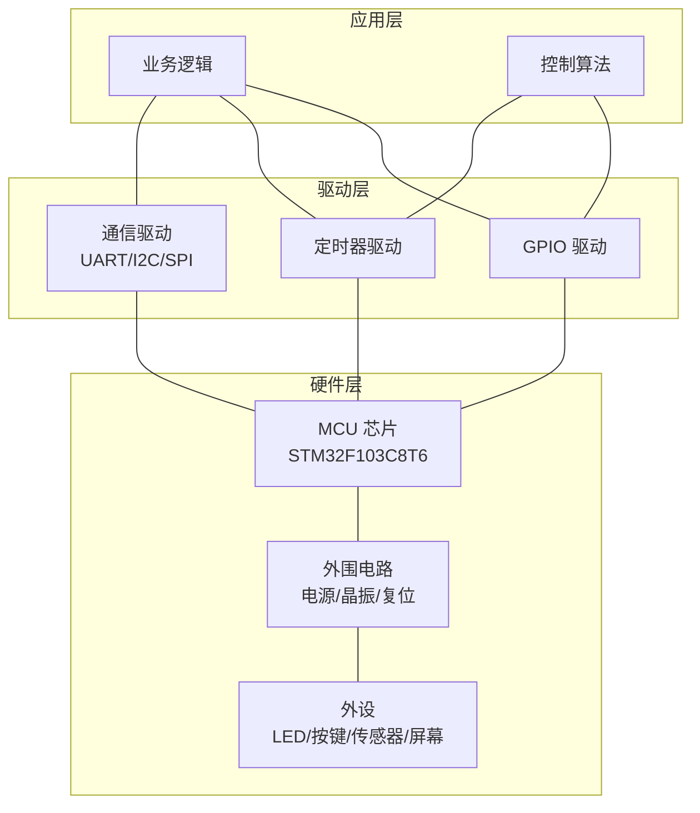

### 1.4 你会写出什么？

学习完本教程后，你将能写出这样的程序：

> "按下按键 → LED 呼吸灯亮起 → 温度传感器采集数据 → 通过串口发送到电脑上显示"

---

## 2. 硬件基础

### 2.1 核心概念：MCU、MPU、SoC

这三个词你一定会遇到，先分清楚：

```
MCU (Microcontroller Unit) 微控制器
    │
    ├── CPU    (计算核心)
    ├── RAM    (运行内存，KB 级别)
    ├── Flash  (程序存储，KB~MB 级别)
    └── 外设   (GPIO、定时器、串口等，全部内置在一个芯片里)
    │
    特点：一片芯片 = 一台微型计算机
    例：STM32F103C8T6、Arduino 上的 ATmega328P


MPU (Microprocessor Unit) 微处理器
    │
    ├── CPU    (计算核心，性能强)
    └── 没了！RAM、Flash、外设全部需要外部芯片配合
    │
    特点：只负责计算，其他都靠外接
    例：树莓派的 CPU 核心


SoC (System on Chip) 片上系统
    │
    ├── CPU + GPU + NPU
    ├── RAM + 存储控制器
    └── 各种外设 + 通信模块（WiFi/蓝牙）
    │
    特点：MCU 的终极升级版
    例：手机里的骁龙、A 系列芯片
```

**本教程用的是 MCU——STM32F103C8T6**，它内部包含：

```
┌──────────────────────────────────────────────┐
│           STM32F103C8T6 芯片内部              │
│                                              │
│  ┌──────────────┐  ┌────────────────────┐    │
│  │  ARM Cortex-M3│  │  Flash: 64KB      │    │
│  │  72MHz 主频   │  │  (存你的程序)       │    │
│  └──────────────┘  └────────────────────┘    │
│                                              │
│  ┌──────────────┐  ┌────────────────────┐    │
│  │  SRAM: 20KB  │  │  外设总线 APB1/APB2│    │
│  │  (存运行变量)  │  │  (连接所有外设)     │    │
│  └──────────────┘  └────────────────────┘    │
│                                              │
│  外设清单：                                   │
│  ├── GPIO × 37 个 (控制引脚输入输出)           │
│  ├── USART × 3 个 (串口通信)                  │
│  ├── I2C × 2 个                              │
│  ├── SPI × 2 个                              │
│  ├── ADC × 2 个 (10通道，12位精度)             │
│  ├── 定时器 × 4 个                            │
│  └── USB 2.0 × 1 个                          │
└──────────────────────────────────────────────┘
```

### 2.2 引脚与 GPIO

芯片周围那些金属"脚"，就是**引脚 (Pin)** 。每个引脚有以下属性：

```
         STM32F103C8T6 (LQFP48 封装)
         ┌───────────────────────────────────┐
         │  ●  ●  ●  ●  ...  ●  ●  ●  ●   │
    PB10─┤48                              37├─PB11
         │                                   │
     PB2─┤                                   ├─PA8
         │                                   │
     ...─┤          STM32F103C8T6           ├─...
         │                                   │
     PA0─┤                                   ├─PA12
         │                                   │
     PA1─┤ 1                             24├─PA11
         └───────────────────────────────────┘
                 48 个引脚，其中 37 个可配置为 GPIO

每个引脚可配置为：
┌──────────────────────────────────────────┐
│ 模式          │ 能做什么                   │
├──────────────────────────────────────────┤
│ 推挽输出       │ 输出高低电平，点亮 LED      │
│ 开漏输出       │ 需要外部上拉电阻            │
│ 浮空输入       │ 读取引脚状态（不接电阻）     │
│ 上拉输入       │ 默认高电平，接地变低         │
│ 下拉输入       │ 默认低电平，接高变高         │
│ 模拟输入       │ 读取连续变化的电压（ADC用）  │
│ 复用推挽输出   │ 给串口/I2C/SPI 用          │
└──────────────────────────────────────────┘
```

### 2.3 寄存器——控制硬件的开关

**寄存器 = 芯片内部的一个"开关面板"。**

每个寄存器是一个 32 位（或 16 位、8 位）的存储单元，芯片把它映射到一个地址上。你往这个地址写数据，芯片的硬件行为就改变了。

```
以 GPIOA 的"输出数据寄存器"为例：

寄存器名: GPIOA_ODR  (Output Data Register)
地址: 0x4001080C
位宽: 32 位，低 16 位有效

  ┌──────────────────────────────────────────────────────────────┐
  │ 位31 .................... 位16 │ 位15 ........... 位0 │
  │       (保留不用)              │  每个位对应一个引脚     │
  │                               │  1 = 输出高电平         │
  │                               │  0 = 输出低电平         │
  └──────────────────────────────────────────────────────────────┘

比如你想让 PA0 输出高电平：
  GPIOA->ODR |= (1 << 0);   // 将第 0 位置 1

想让 PA5 输出低电平：
  GPIOA->ODR &= ~(1 << 5);  // 将第 5 位清 0
```

**为什么不直接用数字 0、1 而要搞位操作？**
因为一个寄存器管 16 个引脚，你改动一个引脚的时候不能影响其他 15 个！

### 2.4 开发板实物连接概念

```
┌─────────────────────────────────────────────────────────┐
│              STM32F103C8T6 Blue Pill 开发板              │
│                                                         │
│   USB 口 ──► 供电 + 烧录（需要 USB-TTL 模块或 ST-Link）  │
│                                                         │
│   ┌─────────────────────────────────────┐               │
│   │  PC13 ──●── 板载 LED (低电平点亮)     │               │
│   │                                     │               │
│   │  PA0  ── 可接外部 LED               │               │
│   │  PA1  ── 可接按键                   │               │
│   │  PA9  ── USART1 TX (串口发送)       │               │
│   │  PA10 ── USART1 RX (串口接收)       │               │
│   │  PB6  ── I2C1 SCL (时钟线)          │               │
│   │  PB7  ── I2C1 SDA (数据线)          │               │
│   └─────────────────────────────────────┘               │
│                                                         │
│   引脚排针：两侧各一排，可以插面包板                          │
│   工作电压：3.3V（千万别接 5V 到 IO 口！）                  │
└─────────────────────────────────────────────────────────┘
```

---

## 3. 开发环境搭建

### 3.1 工具链全景图

写嵌入式程序需要的工具链：

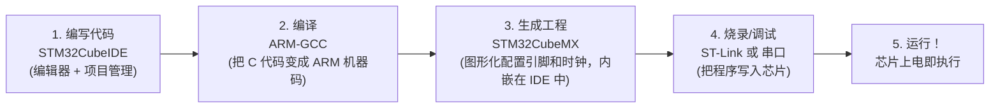

### 3.2 认识 STM32CubeIDE

```
┌──────────────────────────────────────────────────────────────┐
│  STM32CubeIDE 界面布局（第一次打开时）                         │
│                                                              │
│  ┌────────────────────┐  ┌───────────────────────────────┐   │
│  │   项目浏览器        │  │                               │   │
│  │   (Project Explorer)│  │     代码编辑区                 │   │
│  │                    │  │     (Editor)                  │   │
│  │  ├── Core/         │  │                              │   │
│  │  │   ├── Src/      │  │  int main(void) {            │   │
│  │  │   │   └─main.c  │  │      while (1) {             │   │
│  │  │   └── Inc/      │  │          // 你的代码在这里    │   │
│  │  ├── Drivers/      │  │      }                       │   │
│  │  └── Debug/        │  │  }                           │   │
│  └────────────────────┘  └───────────────────────────────┘   │
│                                                              │
│  ┌──────────────────────────────────────────────────────┐    │
│  │   控制台输出 (Console)                                 │    │
│  │   编译信息、烧录进度、调试输出都在这里                    │    │
│  └──────────────────────────────────────────────────────┘    │
└──────────────────────────────────────────────────────────────┘
```

### 3.3 安装步骤

**步骤 1：下载 STM32CubeIDE**

去 ST 官网下载对应你操作系统的版本（支持 Windows/macOS/Linux）。

**步骤 2：安装**

一路 Next，安装路径不要有中文和空格。

**步骤 3：安装 ST-Link 驱动（Windows 需要）**

如果你用的是 ST-Link 下载器，Windows 需要装驱动。macOS/Linux 免驱。

**步骤 4：创建第一个工程**

```
1. 打开 STM32CubeIDE
2. File → New → STM32 Project
3. 在芯片选择界面搜索 "STM32F103C8"
4. 选中 STM32F103C8Tx，点 Next
5. 输入工程名（比如 "01_hello_led"），点 Finish
6. 会弹出 "初始化所有外设为默认模式？" 的弹窗 → 点 Yes
7. 这时会打开 .ioc 文件（STM32CubeMX 配置界面）
```

### 3.4 理解 .ioc 文件和 HAL 库

**.ioc 文件**是一个图形化配置文件。你在里面用鼠标点一点配置引脚，它自动生成初始化代码。

**HAL 库 (Hardware Abstraction Layer 硬件抽象层)**：
ST 官方提供的驱动库，把操作寄存器的细节封装成函数，让你用 `HAL_GPIO_WritePin()` 而不是直接操作寄存器。

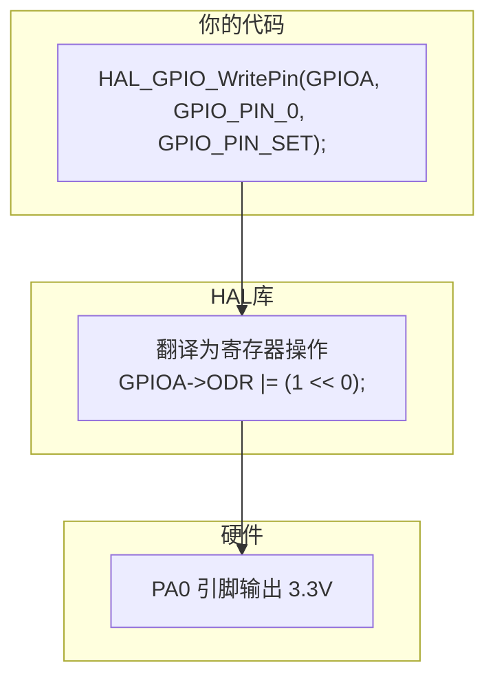

### 3.5 第一个程序：让板载 LED 闪烁

不写一行代码的步骤：

```
在 .ioc 文件中：
1. 找到 PC13 引脚，点击它
2. 在弹出的菜单中选择 "GPIO_Output"
3. 保存 .ioc 文件（会自动生成初始化代码）
4. 打开 Core/Src/main.c
5. 在 while(1) 循环中添加代码
```

```c
/* main.c - 第一个嵌入式程序：LED 闪烁 */

/* 包含 HAL 库头文件 */
#include "main.h"

int main(void)
{
    /* HAL 库初始化：配置系统时钟、Flash 等 */
    HAL_Init();

    /* 配置系统时钟为 72MHz */
    SystemClock_Config();

    /* 初始化 GPIO（这部分由 CubeMX 自动生成） */
    MX_GPIO_Init();

    /* ★ 主循环——嵌入式程序永远不退出 ★ */
    while (1)
    {
        /* 点亮 LED（PC13 低电平点亮！注意这个反直觉的设计） */
        HAL_GPIO_WritePin(GPIOC, GPIO_PIN_13, GPIO_PIN_RESET);

        /* 延时 500 毫秒 */
        HAL_Delay(500);

        /* 熄灭 LED */
        HAL_GPIO_WritePin(GPIOC, GPIO_PIN_13, GPIO_PIN_SET);

        /* 延时 500 毫秒 */
        HAL_Delay(500);
    }
}
```

**关键理解点：**

```
★ 为什么嵌入式程序是死循环？

   PC 程序:                    嵌入式程序:
  ┌──────────┐                ┌──────────┐
  │ 启动     │                │ 启动     │
  │ 初始化   │                │ 初始化   │
  │ 执行任务 │                │ ┌──────┐ │
  │ 结束 ✓  │                │ │while │ │
  └──────────┘                │ │ (1)  │ │
                              │ │ {    │ │
   退出后操作系统回收资源       │ │ 干活 │ │
                              │ │}     │ │
                              │ └──────┘ │
                              └──────────┘

   嵌入式程序退出 = 芯片跑飞 = 不知道执行到哪去了
   所以必须死循环，永远在干活（或等待）
```

### 3.6 烧录与运行

```
┌─────────────────────────────────────────────┐
│            烧录方式对比                       │
├──────────────┬──────────────┬───────────────┤
│   方式        │  需要什么     │  能调试吗？    │
├──────────────┼──────────────┼───────────────┤
│ ST-Link      │ ST-Link 下载器│  ✅ 能断点调试 │
│ 串口 ISP     │ USB-TTL 模块 │  ❌ 只能烧录   │
│ J-Link      │ J-Link 下载器 │  ✅ 专业调试   │
│ DAP-Link    │ DAP-Link     │  ✅ 开源方案    │
└──────────────┴──────────────┴───────────────┘

推荐：买个 ST-Link V2（约 10 元），能烧录能调试。
```

### 3.7 常见坑点

| 坑 | 现象 | 原因 | 解决 |
|----|------|------|------|
| **烧录失败 "No ST-Link detected"** | IDE 找不到下载器 | 驱动没装或连接线松了 | 检查设备管理器 / 重新插拔 |
| **程序烧进去了但不运行** | LED 不亮 | 烧录后没复位芯片 | 按一下开发板上的 Reset 键 |
| **main.c 里写代码被覆盖** | 自己写的代码不见了 | 在 `/* USER CODE BEGIN */` 外面写了代码 | 代码必须写在 `USER CODE` 注释块之间 |
| **中文路径报错** | 编译不通过 | CubeIDE 不支持中文路径 | 工程路径全英文 |

---

## 4. C 语言嵌入式基础

### 4.1 为什么用 C 语言？

```
Python:          print("hello")  ──解释器──► 操作系统 ──► CPU
                 太远了，太慢了，太大了（解释器本身几十 MB）

C 语言:          GPIOA->ODR = 1; ──编译──► 一条 ARM 汇编 ──► CPU
                 直接操作硬件，效率极致
```

### 4.2 嵌入式中最重要的数据类型

标准 C 的 `int` 在不同平台可能占 2 字节或 4 字节——嵌入式中你**必须**精确知道每个变量占多少位。所以用 `<stdint.h>` 中的固定宽度类型：

```c
#include <stdint.h>

/* ============================================================
   嵌入式开发中的标准数据类型（必须记住！）
   ============================================================ */

int8_t   a = -128;       // 有符号 8 位， 范围 -128 ~ 127
uint8_t  b = 255;        // 无符号 8 位， 范围 0 ~ 255
int16_t  c = -32768;     // 有符号 16 位，范围 -32768 ~ 32767
uint16_t d = 65535;      // 无符号 16 位，范围 0 ~ 65535
int32_t  e = -2147483648;// 有符号 32 位
uint32_t f = 4294967295; // 无符号 32 位

/* 在 STM32 HAL 库中看到这样的变量名不要惊讶 */
GPIO_PinState pin_state;  // 其实本质是 uint8_t 的枚举
```

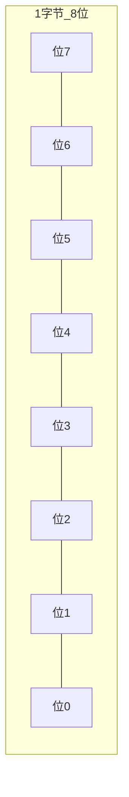

### 4.3 位操作——嵌入式核心技能

**思考题**：怎么只改变一个寄存器的第 3 位，而不影响其他位？

```c
/* ============================================================
   位操作武器库（嵌入式程序员每天用的操作）
   ============================================================ */

uint8_t reg = 0b10100000;   // 初始值

/* 1. 将某一位置 1（用 OR + 左移） */
reg |= (1 << 3);
//   10100000
// OR 00001000  (1 << 3)
// ──────────
//   10101000   ← 第 3 位变成了 1，其他位不变

/* 2. 将某一位清 0（用 AND + 取反 + 左移） */
reg &= ~(1 << 5);
//   10100000
// AND 11011111  ~(1 << 5)
// ──────────
//   10000000   ← 第 5 位变成了 0，其他位不变

/* 3. 翻转某一位（用 XOR + 左移） */
reg ^= (1 << 7);
//   10000000
// XOR 10000000  (1 << 7)
// ──────────
//   00000000   ← 第 7 位翻转

/* 4. 判断某一位是否为 1 */
if (reg & (1 << 3)) {
    // 第 3 位是 1
} else {
    // 第 3 位是 0
}

/* 5. 提取连续多位 */
uint8_t high_4bit = (reg >> 4) & 0x0F;  // 取高 4 位
//   10000000 >> 4 = 00001000
//   00001000 & 00001111 = 00001000 = 8
```

**位操作速查表：**

| 操作 | 写法 | 效果 |
|------|------|------|
| 将第 N 位置 1 | `reg \|= (1 << N)` | 不管原来是 0 是 1，都变 1 |
| 将第 N 位清 0 | `reg &= ~(1 << N)` | 不管原来是 0 是 1，都变 0 |
| 翻转第 N 位 | `reg ^= (1 << N)` | 0 变 1，1 变 0 |
| 读第 N 位 | `(reg >> N) & 1` | 返回 0 或 1 |
| 赋值连续多位 | `reg = (reg & ~MASK) \| VALUE` | 先清再写 |

### 4.4 volatile——告诉编译器"别自作聪明"

```c
/* ============================================================
   不用 volatile 会发生什么？
   ============================================================ */

/* 错误写法：编译器会"优化"掉你的等待 */
uint32_t flag = 0;  // 这个 flag 会被中断处理函数修改

// 中断服务函数（在别的地方执行）
void EXTI0_IRQHandler(void)
{
    flag = 1;  // 按键按下后把 flag 设为 1
}

// 主循环
while (flag == 0)
{
    // 编译器看到 flag 从来没在这段代码里改过，
    // 可能会优化成：把 flag 的值加载到寄存器一次，
    // 然后永远读寄存器，不再从内存读！
    // 结果：即使中断改了 flag，主循环也看不到！
}

/* 正确写法：volatile 告诉编译器"每次都要从内存读" */
volatile uint32_t flag = 0;  // 加 volatile！

// 这次编译器不敢优化了，每次循环都从内存重新读 flag 的值
while (flag == 0)
{
    // 中断改了 flag → 下次循环就读到新值 → 退出循环 ✓
}
```

**volatile 三原则：**
1. **中断中修改的全局变量**——必须加 volatile
2. **硬件寄存器映射的变量**——必须加 volatile
3. **多线程共享的变量**——必须加 volatile

### 4.5 结构体操作寄存器——HAL 库的核心技巧

```c
/* ============================================================
   为什么要用结构体映射寄存器？
   ============================================================ */

/* 芯片内部：一组相关寄存器地址是连续的 */
/*
   GPIOA 的寄存器布局：
   0x40010800: CRL   (配置寄存器 低)
   0x40010804: CRH   (配置寄存器 高)
   0x40010808: IDR   (输入数据寄存器)
   0x4001080C: ODR   (输出数据寄存器)
   0x40010810: BSRR  (位设置/清除寄存器)
*/

/* 用结构体映射这组寄存器 */
typedef struct
{
    volatile uint32_t CRL;    /* 偏移 0x00 */
    volatile uint32_t CRH;    /* 偏移 0x04 */
    volatile uint32_t IDR;    /* 偏移 0x08 */
    volatile uint32_t ODR;    /* 偏移 0x0C */
    volatile uint32_t BSRR;   /* 偏移 0x10 */
    volatile uint32_t BRR;    /* 偏移 0x14 */
    volatile uint32_t LCKR;   /* 偏移 0x18 */
} GPIO_TypeDef;

/* 把 GPIOA 的基地址强制转换为结构体指针 */
#define GPIOA  ((GPIO_TypeDef *)0x40010800)

/* 现在可以用优雅的方式操作寄存器了！ */
GPIOA->ODR |= (1 << 0);   // PA0 输出高电平
GPIOA->BSRR = (1 << 16);  // PA0 输出低电平（BSRR 的高 16 位用于清 0）

/* 如果用裸地址的方式 */
*(volatile uint32_t *)0x4001080C |= (1 << 0);  // 太丑了！
```

### 4.6 宏定义技巧

```c
/* 嵌入式中常用的宏定义 */

/* 设置/清除位的宏 */
#define SET_BIT(reg, bit)    ((reg) |= (1 << (bit)))
#define CLEAR_BIT(reg, bit)  ((reg) &= ~(1 << (bit)))
#define READ_BIT(reg, bit)   (((reg) >> (bit)) & 1)
#define TOGGLE_BIT(reg, bit) ((reg) ^= (1 << (bit)))

/* 获取数组长度（编译时确定） */
#define ARRAY_SIZE(arr)  (sizeof(arr) / sizeof((arr)[0]))

/* 取两个数中较小的 */
#define MIN(a, b)  ((a) < (b) ? (a) : (b))

/* 使用示例 */
uint32_t gpio_val = 0;
SET_BIT(gpio_val, 3);    // gpio_val = 0b00001000
CLEAR_BIT(gpio_val, 3);  // gpio_val = 0b00000000
```

### 4.7 常见坑点

| 坑 | 现象 | 原因 | 解决 |
|----|------|------|------|
| **忘记 volatile** | 中断修改的变量在主循环看不到 | 编译器优化 | 全局共享变量加 volatile |
| **位操作忘了括号** | `reg & 1 << 3` 不等于 `reg & (1 << 3)` | 运算符优先级 | 多加括号，别省 |
| **用 int 存寄存器值** | 溢出或符号扩展 | 寄存器是 unsigned 的 | 用 uint32_t |
| **结构体里有 padding** | 偏移对不上寄存器地址 | 编译器可能插入填充字节 | ST 已经处理好了，别慌 |

---

## 5. GPIO 输入输出

### 5.1 GPIO 是什么

**GPIO = General Purpose Input / Output（通用输入输出）**

最直白的理解：**芯片的引脚，你可以用程序控制它是输出 3.3V 还是 0V（输出模式），也可以读它当前是 3.3V 还是 0V（输入模式）。**

### 5.2 推挽输出——点亮 LED

```
推挽输出的"推挽"是什么意思？

    VDD (3.3V)
       │
    ┌──┴──┐
    │ PMOS│  "挽"——拉高：PMOS 导通，电流从 VDD 流向引脚
    ├─────┤
    │ 引脚 ├────► 输出 3.3V
    ├─────┤
    │ NMOS│  "推"——拉低：NMOS 导通，电流从引脚流向 GND
    └──┬──┘
       │
       GND (0V)

   可以主动输出高电平和低电平，驱动能力较强
```

**代码：点亮外部 LED（PA0）**

```c
/* ============================================================
   驱动 PA0 引脚上的外部 LED
   电路连接：PA0 → 220Ω 电阻 → LED → GND
   高电平点亮
   ============================================================ */

#include "main.h"

/* 初始化（CubeMX 自动生成，这里展示其本质） */
static void LED_Init(void)
{
    GPIO_InitTypeDef GPIO_InitStruct = {0};

    /* 使能 GPIOA 的时钟——芯片为了省电，默认关闭所有外设时钟 */
    __HAL_RCC_GPIOA_CLK_ENABLE();

    /* 配置 PA0 为推挽输出 */
    GPIO_InitStruct.Pin = GPIO_PIN_0;       /* 选择引脚 PA0 */
    GPIO_InitStruct.Mode = GPIO_MODE_OUTPUT_PP; /* 推挽输出模式 */
    GPIO_InitStruct.Pull = GPIO_NOPULL;     /* 不上拉也不下拉 */
    GPIO_InitStruct.Speed = GPIO_SPEED_FREQ_LOW; /* 低速即可 */
    HAL_GPIO_Init(GPIOA, &GPIO_InitStruct);
}

int main(void)
{
    HAL_Init();
    SystemClock_Config();
    MX_GPIO_Init();  /* CubeMX 生成的初始化，内部调用了类似上面的代码 */

    while (1)
    {
        /* 点亮 LED */
        HAL_GPIO_WritePin(GPIOA, GPIO_PIN_0, GPIO_PIN_SET);
        HAL_Delay(500);

        /* 熄灭 LED */
        HAL_GPIO_WritePin(GPIOA, GPIO_PIN_0, GPIO_PIN_RESET);
        HAL_Delay(500);
    }
}
```

```
LED 电路连接图（ASCII）：

     PA0 ──────[220Ω]──────►├─── GND
                              LED

    220Ω 电阻的作用：限流。LED 正向压降约 2V，没有电阻的话：
    I = (3.3V - 2V) / 0Ω = 无穷大 → LED 烧毁
    I = (3.3V - 2V) / 220Ω ≈ 6mA → LED 正常发光
```

### 5.3 上拉/下拉输入——检测按键

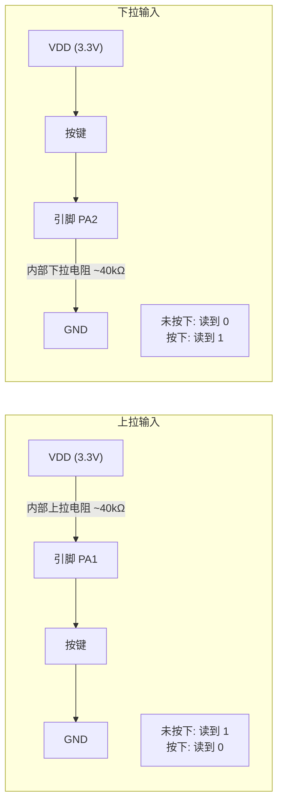

```c
/* ============================================================
   按键检测（上拉输入模式）
   电路连接：PA1 → 按键 → GND
   内部上拉：不按 = 高电平，按下 = 低电平
   ============================================================ */

/* 按键初始化（CubeMX 自动生成，本质如下） */
static void Key_Init(void)
{
    GPIO_InitTypeDef GPIO_InitStruct = {0};

    __HAL_RCC_GPIOA_CLK_ENABLE();

    GPIO_InitStruct.Pin = GPIO_PIN_1;
    GPIO_InitStruct.Mode = GPIO_MODE_INPUT;      /* 输入模式 */
    GPIO_InitStruct.Pull = GPIO_PULLUP;          /* 上拉！不按时默认高电平 */
    HAL_GPIO_Init(GPIOA, &GPIO_InitStruct);
}

/* 读取按键状态 */
uint8_t Key_Read(void)
{
    /* 返回 0 = 按下，1 = 未按下（上拉输入，按下接地，读回 0） */
    return (uint8_t)HAL_GPIO_ReadPin(GPIOA, GPIO_PIN_1);
}

int main(void)
{
    HAL_Init();
    SystemClock_Config();
    MX_GPIO_Init();

    while (1)
    {
        if (Key_Read() == 0)  /* 按键按下（读到低电平） */
        {
            HAL_GPIO_WritePin(GPIOA, GPIO_PIN_0, GPIO_PIN_SET); /* 点亮 LED */
        }
        else
        {
            HAL_GPIO_WritePin(GPIOA, GPIO_PIN_0, GPIO_PIN_RESET); /* 熄灭 LED */
        }
    }
}
```

### 5.4 按键去抖动——重要！

机械按键按下时不是理想的一次接通，而是：

```
理想情况：  ────────┐         ┌──────────
                    └─────────┘

实际情况：  ────────┐┌┐┌┐┌┐┌──┐──────────
                    └┘└┘└┘└┘  └─  ← 抖动！持续约 5~20ms

如果不加去抖动，一次按键会被识别成几十次！
```

```c
/* ============================================================
   软件去抖动方案
   ============================================================ */

uint8_t Key_Scan(void)
{
    /* 1. 检测到按键按下（低电平） */
    if (HAL_GPIO_ReadPin(GPIOA, GPIO_PIN_1) == GPIO_PIN_RESET)
    {
        /* 2. 延时 20ms，跳过抖动期 */
        HAL_Delay(20);

        /* 3. 再次确认按键仍然按下（是真的按下，不是抖动） */
        if (HAL_GPIO_ReadPin(GPIOA, GPIO_PIN_1) == GPIO_PIN_RESET)
        {
            /* 4. 等待按键松开，避免按住时重复触发 */
            while (HAL_GPIO_ReadPin(GPIOA, GPIO_PIN_1) == GPIO_PIN_RESET)
            {
                /* 等待释放 */
            }
            return 1;  /* 确认一次有效按键 */
        }
    }
    return 0;  /* 没有按键 */
}

int main(void)
{
    uint8_t led_state = 0;

    while (1)
    {
        if (Key_Scan())
        {
            led_state = !led_state;  /* 翻转 LED 状态 */
            HAL_GPIO_WritePin(GPIOA, GPIO_PIN_0,
                led_state ? GPIO_PIN_SET : GPIO_PIN_RESET);
        }
    }
}
```

**HAL_Delay 去抖的缺点**：延时期间 CPU 什么也不能干（阻塞）。进阶做法是用定时器，后面会讲。

### 5.5 常见坑点

| 坑 | 现象 | 原因 | 解决 |
|----|------|------|------|
| **忘记使能时钟** | GPIO 操作无效 | STM32 各外设时钟默认关闭 | 调用 `__HAL_RCC_GPIOx_CLK_ENABLE()` |
| **上拉/下拉配反** | 按键逻辑颠倒 | 输入模式的上下拉配置错误 | 检查电路：按键接地用上拉，按键接 VCC 用下拉 |
| **LED 没串电阻** | LED 烧毁或不亮 | 无电流限制 | 务必串联 220Ω~1kΩ 电阻 |
| **抖动没处理** | 按一次触发多次 | 机械触点抖动 | 软件延时去抖或硬件 RC 滤波 |

---

## 6. 中断系统

### 6.1 中断是什么——用生活类比

```
你在家看书（CPU 在执行主程序）

    "叮咚——" 门铃响了（外部事件）

你放下书，记下页码（保存现场）
    ↓
你去开门，处理快递（执行中断服务程序）
    ↓
处理完，回来继续从刚才的页码看书（恢复现场）

这就是中断！
```

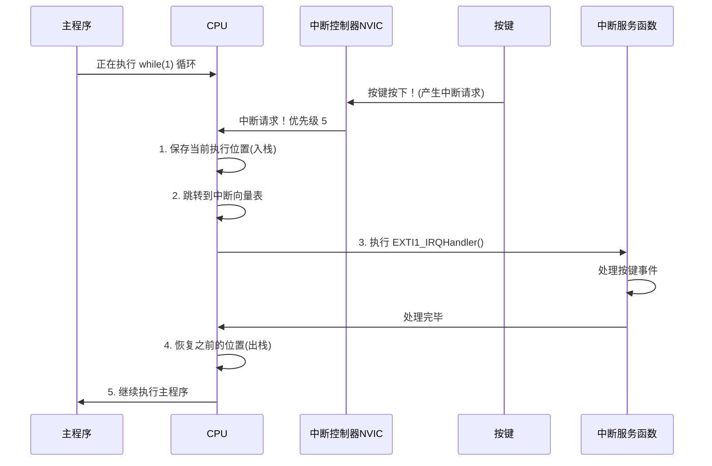

### 6.2 中断的核心概念

```
中断优先级：多个中断同时到达时，谁先处理？

   higher priority      lower priority
   ─────────────►       ─────────────►
   ┌──────────┐         ┌──────────┐
   │ 紧急刹车  │  >      │ 车窗升降  │
   │ 中断     │         │ 中断     │
   └──────────┘         └──────────┘

STM32 的中断优先级：
  - 抢占优先级：高优先级的可以打断低优先级的
  - 响应优先级：同抢占优先级时，响应优先级高的先执行
  - 数值越小 → 优先级越高！

中断向量表：一张"电话本"，告诉 CPU 每个中断对应的处理函数在哪
┌──────────────────────┬──────────────────────┐
│ 中断号               │ 处理函数               │
├──────────────────────┼──────────────────────┤
│ EXTI0 (PA0 中断)     │ EXTI0_IRQHandler     │
│ EXTI1 (PA1 中断)     │ EXTI1_IRQHandler     │
│ TIM2 (定时器2中断)    │ TIM2_IRQHandler      │
│ USART1 (串口1中断)    │ USART1_IRQHandler    │
│ ...                  │ ...                  │
└──────────────────────┴──────────────────────┘
```

### 6.3 外部中断 EXTI——按键中断实战

用中断方式检测按键，再也不需要轮询！

```c
/* ============================================================
   外部中断 EXTI 实战
   按键 PA1 → 外部中断线 EXTI1 → 中断服务函数
   按下按键 → 触发中断 → 翻转 LED
   ============================================================ */

/* 全局标志位——必须加 volatile！ */
volatile uint8_t key_pressed = 0;

/**
 * @brief 外部中断服务函数——由硬件自动调用，名字必须和启动文件一致
 *        当 PA1 引脚检测到下降沿（按键按下，高→低）时触发
 */
void EXTI1_IRQHandler(void)
{
    /* 1. 判断是否真的是 EXTI1 线路的中断（因为多条线路可能共享一个中断函数） */
    if (__HAL_GPIO_EXTI_GET_IT(GPIO_PIN_1) != RESET)
    {
        /* 2. 清除中断标志位——必须做！否则会反复进入中断 */
        __HAL_GPIO_EXTI_CLEAR_IT(GPIO_PIN_1);

        /* 3. 设置标志位，让主循环去处理（中断里不要做耗时操作！） */
        key_pressed = 1;
    }
}

/**
 * @brief EXTI 初始化（CubeMX 自动生成的本质）
 *        在 .ioc 文件里配置 PA1 为 "GPIO_EXTI1"，触发方式选下降沿
 */
static void EXTI_Init(void)
{
    GPIO_InitTypeDef GPIO_InitStruct = {0};

    __HAL_RCC_GPIOA_CLK_ENABLE();

    GPIO_InitStruct.Pin = GPIO_PIN_1;
    GPIO_InitStruct.Mode = GPIO_MODE_IT_FALLING; /* 下降沿触发中断 */
    GPIO_InitStruct.Pull = GPIO_PULLUP;          /* 上拉，默认高，按下变低 */
    HAL_GPIO_Init(GPIOA, &GPIO_InitStruct);

    /* 设置中断优先级 */
    HAL_NVIC_SetPriority(EXTI1_IRQn, 2, 0);  /* 抢占优先级2，响应优先级0 */
    HAL_NVIC_EnableIRQ(EXTI1_IRQn);          /* 使能中断 */
}

int main(void)
{
    HAL_Init();
    SystemClock_Config();
    MX_GPIO_Init();

    /* 初始化外部中断（如果你用 CubeMX 配置了，会放在 MX_GPIO_Init 里） */
    /* EXTI_Init(); */

    while (1)
    {
        /* 检查中断设置的中断标志 */
        if (key_pressed)
        {
            key_pressed = 0;  /* 清除标志 */

            /* 翻转 LED */
            HAL_GPIO_TogglePin(GPIOA, GPIO_PIN_0);

            /* 简单的去抖：延时后再清除可能残留的中断标志 */
            HAL_Delay(20);
            __HAL_GPIO_EXTI_CLEAR_IT(GPIO_PIN_1);
        }
    }
}
```

### 6.4 中断 vs 轮询

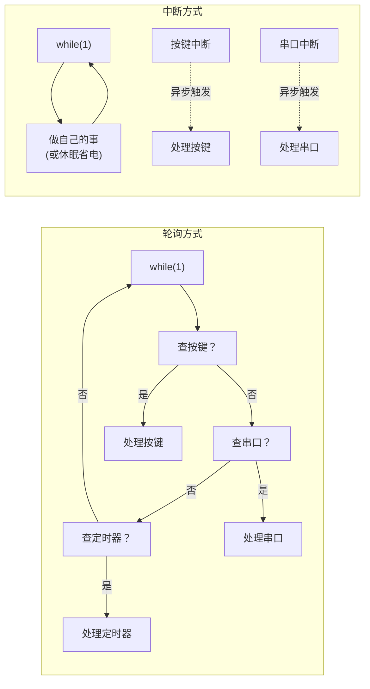

| 对比维度 | 轮询 | 中断 |
|----------|------|------|
| CPU 占用 | 一直查询，即使没事也占着 CPU | 有事才处理，没事休眠 |
| 响应速度 | 取决于循环一次的时间 | 微秒级，硬件直接响应 |
| 复杂度 | 简单 | 要注意优先级、标志位、临界区 |
| 适用场景 | 简单应用，事件发生频繁 | 偶尔发生的事件，低功耗 |

### 6.5 中断处理的金科玉律

```c
/* ============================================================
   中断服务函数——该做什么，不该做什么
   ============================================================ */

void EXTI0_IRQHandler(void)
{
    /* ✅ 可以做：清除标志位 */
    __HAL_GPIO_EXTI_CLEAR_IT(GPIO_PIN_0);

    /* ✅ 可以做：设置标志位（volatile 变量） */
    flag = 1;

    /* ✅ 可以做：简单的数据读取 */
    uint8_t data = read_sensor_register();

    /* ✅ 可以做：往缓冲区存数据 */
    rx_buffer[rx_index++] = UART1->DR;

    /* ❌ 不要做：长时间的延时 */
    // HAL_Delay(1000);  // NO! 中断里延时是嵌入式新手第一罪

    /* ❌ 不要做：printf 打印 */
    // printf("interrupt!\r\n");  // NO! 太慢了

    /* ❌ 不要做：复杂计算 */
    // complex_fft_calculation();  // NO! 应该放主循环
}

/* 黄金法则：
   中断服务函数 = 收快递
   主循环 = 拆快递

   中断里只负责"收"（标志位、存缓冲区）
   主循环里再"拆"（处理数据、更新显示）
*/
```

### 6.6 常见坑点

| 坑 | 现象 | 原因 | 解决 |
|----|------|------|------|
| **忘了清中断标志** | 反复进入中断，程序卡死 | 硬件标志位没清除 | 中断函数里第一件事就清标志 |
| **中断里调用 HAL_Delay** | 程序卡死 | HAL_Delay 依赖 SysTick 中断，优先级可能不够 | 中断里不要延时，用标志位 |
| **中断名写错** | 编译器不报错但不进入中断 | 函数名必须和启动文件中的向量表一致 | 从启动文件中复制准确函数名 |
| **中断变量没加 volatile** | 主循环看不到变量变化 | 编译器优化 | 中断和主循环共享的变量加 volatile |

---

## 7. 定时器

### 7.1 定时器家族

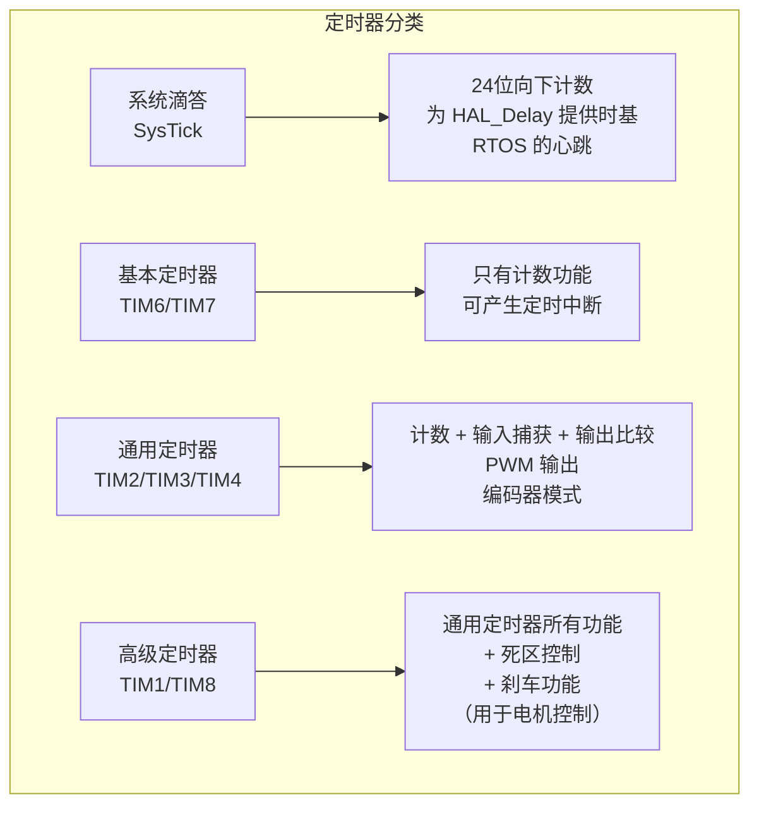

### 7.2 定时器的工作原理

```
定时器的本质 = 计数器 + 比较器

时钟源 (72MHz)
    │
    ▼
┌──────────┐
│ 预分频器  │  先降频：72MHz / 7200 = 10kHz
│ PSC = 7199│  (0.1ms 计一次)
└────┬─────┘
     │
     ▼
┌──────────┐
│ 计数器    │  CNT 从 0 数到 ARR
│ CNT: 0→  │  每次加 1 用 0.1ms
└────┬─────┘
     │
     ▼
┌──────────┐
│ 自动重装载│  ARR = 9999
│ ARR=9999 │  从 0 数到 9999 = 10000 次
└────┬─────┘  10000 × 0.1ms = 1000ms = 1秒
     │
     ▼
  ╔══════════╗
  ║ 溢出中断！║  每 1 秒触发一次
  ╚══════════╝

公式：定时时间 = (PSC + 1) × (ARR + 1) / 时钟频率
                7200    ×  10000     / 72,000,000 = 1 秒
```

```c
/* ============================================================
   通用定时器 TIM2 实现 1 秒定时中断
   替代 HAL_Delay 的阻塞式延时！
   ============================================================ */

volatile uint32_t timer2_tick = 0;  /* 秒计数器 */

/**
 * @brief 定时器初始化：72MHz / 7200 / 10000 = 每秒中断一次
 */
static void TIM2_Init(void)
{
    TIM_ClockConfigTypeDef sClockSourceConfig = {0};
    TIM_MasterConfigTypeDef sMasterConfig = {0};

    /* 1. 使能 TIM2 时钟 */
    __HAL_RCC_TIM2_CLK_ENABLE();

    /* 2. 配置定时器基本参数 */
    TIM_HandleTypeDef htim2 = {0};
    htim2.Instance = TIM2;
    htim2.Init.Prescaler = 7200 - 1;     /* 预分频：72MHz/7200 = 10kHz */
    htim2.Init.CounterMode = TIM_COUNTERMODE_UP;  /* 向上计数 */
    htim2.Init.Period = 10000 - 1;       /* 计数 10000 次 = 1 秒 */
    htim2.Init.ClockDivision = TIM_CLOCKDIVISION_DIV1;
    htim2.Init.AutoReloadPreload = TIM_AUTORELOAD_PRELOAD_ENABLE;
    HAL_TIM_Base_Init(&htim2);

    /* 3. 配置时钟源为内部时钟 */
    sClockSourceConfig.ClockSource = TIM_CLOCKSOURCE_INTERNAL;
    HAL_TIM_ConfigClockSource(&htim2, &sClockSourceConfig);

    /* 4. 使能定时器中断 */
    HAL_NVIC_SetPriority(TIM2_IRQn, 0, 0);  /* 最高优先级 */
    HAL_NVIC_EnableIRQ(TIM2_IRQn);

    /* 5. 启动定时器（中断模式） */
    HAL_TIM_Base_Start_IT(&htim2);
}

/**
 * @brief TIM2 中断服务函数
 */
void TIM2_IRQHandler(void)
{
    if (__HAL_TIM_GET_FLAG(&htim2, TIM_FLAG_UPDATE) != RESET)
    {
        __HAL_TIM_CLEAR_FLAG(&htim2, TIM_FLAG_UPDATE);  /* 清标志 */
        timer2_tick++;  /* 秒计数器 +1 */
    }
}

int main(void)
{
    HAL_Init();
    SystemClock_Config();
    MX_GPIO_Init();

    TIM2_Init();

    while (1)
    {
        /* 每过 5 秒翻转一次 LED，完全不阻塞！ */
        if (timer2_tick >= 5)
        {
            timer2_tick = 0;  /* 重置计数 */
            HAL_GPIO_TogglePin(GPIOA, GPIO_PIN_0);
        }
    }
}
```

### 7.3 PWM——呼吸灯

```
PWM (Pulse Width Modulation) 脉冲宽度调制

  周期 (Period) = 1 / 频率
  ┌─────────┐
  │         │
  │  高电平  │  占空比 = 高电平时间 / 周期 × 100%
  │         │
──┘  低电平  └──

  20% 占空比: ┌──┐┌────────────────────────┐┌──
             │  ││                        ││
            ─┘  └──────────────────────────┘

  50% 占空比: ┌─────┐┌───────────────┐┌─────
             │     ││               ││
            ─┘     └─────────────────┘

  80% 占空比: ┌──────────┐┌──────┐┌──────────
             │          ││      ││
            ─┘          └────────┘

  LED 效果：
  占空比 0%   → 完全不亮
  占空比 50%  → 半亮
  占空比 100% → 最亮

  平滑改变占空比 → 呼吸灯效果！
```

```c
/* ============================================================
   TIM3 通道1 (PA6) 输出 PWM —— 呼吸灯
   ============================================================ */

TIM_HandleTypeDef htim3;

/**
 * @brief 初始化 TIM3 的 PWM 输出
 *        PA6 → TIM3_CH1 → PWM 输出
 */
static void PWM_Init(void)
{
    TIM_OC_InitTypeDef sConfigOC = {0};

    __HAL_RCC_TIM3_CLK_ENABLE();

    htim3.Instance = TIM3;
    htim3.Init.Prescaler = 72 - 1;        /* 72MHz / 72 = 1MHz */
    htim3.Init.CounterMode = TIM_COUNTERMODE_UP;
    htim3.Init.Period = 1000 - 1;         /* 1MHz / 1000 = 1kHz PWM 频率 */
    htim3.Init.ClockDivision = TIM_CLOCKDIVISION_DIV1;
    htim3.Init.AutoReloadPreload = TIM_AUTORELOAD_PRELOAD_ENABLE;
    HAL_TIM_PWM_Init(&htim3);

    /* PWM 通道配置 */
    sConfigOC.OCMode = TIM_OCMODE_PWM1;          /* PWM 模式 1 */
    sConfigOC.Pulse = 0;                          /* 初始占空比 0% */
    sConfigOC.OCPolarity = TIM_OCPOLARITY_HIGH;   /* 高电平有效 */
    sConfigOC.OCFastMode = TIM_OCFAST_DISABLE;
    HAL_TIM_PWM_ConfigChannel(&htim3, &sConfigOC, TIM_CHANNEL_1);

    /* 启动 PWM 输出 */
    HAL_TIM_PWM_Start(&htim3, TIM_CHANNEL_1);
}

/**
 * @brief 设置 PWM 占空比
 * @param duty 占空比 0~999（对应 0%~100%）
 */
void PWM_SetDuty(uint16_t duty)
{
    if (duty > 999) duty = 999;
    __HAL_TIM_SET_COMPARE(&htim3, TIM_CHANNEL_1, duty);
}

int main(void)
{
    HAL_Init();
    SystemClock_Config();
    MX_GPIO_Init();

    PWM_Init();

    uint16_t duty = 0;    /* 当前占空比 */
    int8_t direction = 1; /* 1=变亮, -1=变暗 */

    while (1)
    {
        PWM_SetDuty(duty);

        duty += direction;

        /* 到达最亮或最暗时反向 */
        if (duty >= 999) direction = -1;
        if (duty == 0)   direction = 1;

        HAL_Delay(2);  /* 2ms 一步，呼吸周期约 4 秒 */
    }
}
```

### 7.4 常见坑点

| 坑 | 现象 | 原因 | 解决 |
|----|------|------|------|
| **PSC/ARR 算错** | 定时时间不对 | 实际分频是 PSC+1，实际计数是 ARR+1 | 公式：T = (PSC+1)×(ARR+1)/Fclk |
| **PWM 引脚没配置复用** | PWM 不输出 | GPIO 需要设为复用推挽输出 | CubeMX 选 PWM 输出会自动配 |
| **忘记启动定时器** | 不进中断 | HAL_TIM_Base_Start_IT 没调 | 初始化后必须调用 _Start_IT |
| **PWM 频率太高** | LED 不呼吸，一直亮 | 人眼分辨不出 >50Hz 的闪烁 | PWM 频率设 1kHz 即可 |

---

## 8. 串口通信 UART

### 8.1 什么是串口通信

**UART = Universal Asynchronous Receiver/Transmitter（通用异步收发器）**

用最少的线（2根）在两个设备之间传数据：

```
┌──────────┐     TX ──────────► RX     ┌──────────┐
│  STM32   │                          │   电脑    │
│          │     RX ◄────────── TX     │  (串口助手)│
└──────────┘                          └──────────┘
              GND ────────────────── GND

最少只需要 3 根线：TX(发送), RX(接收), GND(共地)
```

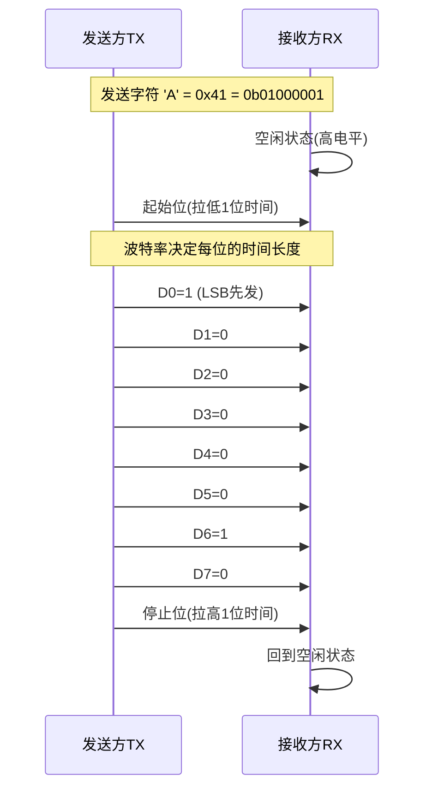

**关键参数：**

| 参数 | 含义 | 常见取值 |
|------|------|----------|
| 波特率 (Baud Rate) | 每秒传输的位数 | 9600, 115200 |
| 数据位 | 每个字节的位数 | 8（最常用） |
| 停止位 | 结束标志的长度 | 1 |
| 校验位 | 简单的错误检测 | None（最常用） |
| 流控 | 硬件流量控制 | None（最常用） |

### 8.2 printf 重定向——像写 PC 程序一样打印

```c
/* ============================================================
   重定向 printf 到串口——最实用的调试工具！
   ============================================================ */

#include <stdio.h>  /* 需要这个头文件 */

/* UART 句柄（CubeMX 生成的全局变量） */
extern UART_HandleTypeDef huart1;

/**
 * @brief 重定向 fputc，让 printf 输出到串口 1
 *        这个函数名是固定的，由 printf 内部调用
 */
int fputc(int ch, FILE *f)
{
    /* 发送一个字符 */
    HAL_UART_Transmit(&huart1, (uint8_t *)&ch, 1, HAL_MAX_DELAY);
    return ch;
}

/* 如果用的是支持 MicroLib 的工程，还需要重定向 fgetc */
int fgetc(FILE *f)
{
    uint8_t ch;
    /* 接收一个字符（阻塞等待） */
    HAL_UART_Receive(&huart1, &ch, 1, HAL_MAX_DELAY);
    return ch;
}

int main(void)
{
    HAL_Init();
    SystemClock_Config();
    MX_GPIO_Init();
    MX_USART1_UART_Init();  /* CubeMX 生成的串口初始化 */

    uint32_t count = 0;

    /* 现在可以像写 PC 程序一样用 printf！ */
    printf("嵌入式系统启动成功！\r\n");
    printf("系统时钟: %d MHz\r\n", HAL_RCC_GetSysClockFreq() / 1000000);

    while (1)
    {
        count++;
        printf("运行计数: %lu\r\n", count);

        /* 读取 ADC 值并打印 */
        uint16_t adc_val = 2048;  /* 示例值 */
        float voltage = adc_val * 3.3f / 4096.0f;
        printf("ADC: %d, 电压: %.3fV\r\n", adc_val, voltage);

        HAL_Delay(1000);
    }
}
```

### 8.3 中断接收——不阻塞的串口接收

```c
/* ============================================================
   串口中断接收——收到数据自动处理，不阻塞主循环
   ============================================================ */

#define RX_BUF_SIZE 64

uint8_t rx_buffer[RX_BUF_SIZE];    /* 接收环形缓冲区 */
volatile uint8_t rx_index = 0;     /* 当前写入位置 */
volatile uint8_t rx_complete = 0;  /* 收到完整一帧的标志 */

/**
 * @brief 启动一次中断接收（只收 1 个字节）
 */
void UART_StartRxIT(void)
{
    HAL_UART_Receive_IT(&huart1, &rx_buffer[rx_index], 1);
}

/**
 * @brief 串口接收完成回调（HAL 库在中断里自动调用）
 *        收到一个字节后会进这里
 */
void HAL_UART_RxCpltCallback(UART_HandleTypeDef *huart)
{
    if (huart->Instance == USART1)
    {
        /* 检查是否收到换行符（以 \n 为一帧结束标志） */
        if (rx_buffer[rx_index] == '\n')
        {
            rx_buffer[rx_index] = '\0';  /* 替换为字符串结束符 */
            rx_complete = 1;              /* 通知主循环处理 */
            rx_index = 0;                 /* 重置缓冲区 */
        }
        else
        {
            rx_index++;
            if (rx_index >= RX_BUF_SIZE)
            {
                rx_index = 0;  /* 防止溢出 */
            }
        }

        /* ★ 关键：再次启动中断接收，等待下一个字节 ★ */
        HAL_UART_Receive_IT(&huart1, &rx_buffer[rx_index], 1);
    }
}

/* 串口错误回调 */
void HAL_UART_ErrorCallback(UART_HandleTypeDef *huart)
{
    if (huart->Instance == USART1)
    {
        /* 发生错误时重新启动接收 */
        HAL_UART_Receive_IT(&huart1, &rx_buffer[rx_index], 1);
    }
}

int main(void)
{
    HAL_Init();
    SystemClock_Config();
    MX_GPIO_Init();
    MX_USART1_UART_Init();

    /* 启动首次中断接收 */
    UART_StartRxIT();

    printf("串口中断接收模式已启动\r\n");
    printf("发送任意文本以换行结束\r\n");

    while (1)
    {
        if (rx_complete)
        {
            rx_complete = 0;

            /* 处理收到的数据 */
            printf("收到: %s\r\n", rx_buffer);

            /* 示例：收到 "LEDON" 开灯，"LEDOFF" 关灯 */
            if (strcmp((char *)rx_buffer, "LEDON") == 0)
            {
                HAL_GPIO_WritePin(GPIOA, GPIO_PIN_0, GPIO_PIN_SET);
                printf("LED 已打开\r\n");
            }
            else if (strcmp((char *)rx_buffer, "LEDOFF") == 0)
            {
                HAL_GPIO_WritePin(GPIOA, GPIO_PIN_0, GPIO_PIN_RESET);
                printf("LED 已关闭\r\n");
            }
        }
    }
}
```

### 8.4 硬件连接

```
┌────────────────────────────────────────────────┐
│  STM32 Blue Pill  ↔  USB-TTL 模块 ↔ 电脑 USB   │
│                                                │
│  PA9  (TX) ─────────────► RX  (USB-TTL)        │
│  PA10 (RX) ◄───────────── TX  (USB-TTL)        │
│  GND ──────────────────── GND (USB-TTL)         │
│                                                │
│  注意：TX 接 RX，RX 接 TX（交叉连接！）          │
│  注意：必须共地！                                │
└────────────────────────────────────────────────┘
```

### 8.5 常见坑点

| 坑 | 现象 | 原因 | 解决 |
|----|------|------|------|
| **TX/RX 接反** | 串口助手收不到数据 | TX 和 RX 没交叉 | TX→RX, RX→TX |
| **没共地** | 乱码或收不到 | 两设备电平没有共同参考 | 连上 GND 线 |
| **波特率不对** | 收到一堆乱码 | 发送端和接收端波特率不一致 | 两边设置相同波特率（如 115200） |
| **忘记重定向** | printf 编译报错 | 嵌入式 printf 需要自己实现底层 | 重写 fputc |
| **中断不继续启动** | 收到一个字节后就没反应了 | 中断接收一次就结束了 | 在回调里重新调用 Receive_IT |

---

## 9. I2C 与 SPI 通信

### 9.1 两种总线对比

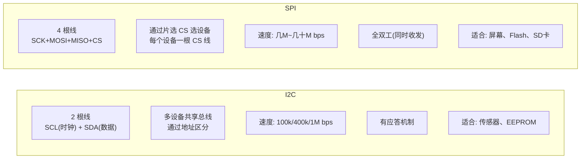

```
I2C 总线拓扑：

    Master (STM32)          Slave1 (传感器)     Slave2 (EEPROM)
        │                       │                   │
    SCL ├───────────────────────┼───────────────────┤
    SDA ├───────────────────────┼───────────────────┤
        │                       │                   │
        │              地址: 0x40              地址: 0x50
        │
    SCL/SDA 各接一个 4.7kΩ 上拉电阻到 VDD


SPI 总线拓扑：

    Master (STM32)
    ┌─────────┐
    │ SCK ├────────────┬────────────── 时钟
    │ MOSI├────────────┼────────────── 主机输出→从机输入
    │ MISO├────────────┼────────────── 从机输出→主机输入
    │ CS0 ├────── Slave0             片选0
    │ CS1 ├────── Slave1             片选1
    └─────────┘
```

### 9.2 I2C 实战——读写 EEPROM (AT24C02)

```c
/* ============================================================
   I2C 驱动 AT24C02 EEPROM（256 字节存储芯片）
   电路：PB6=SCL, PB7=SDA，各接 4.7kΩ 上拉到 3.3V
   ============================================================ */

#define EEPROM_ADDR  0xA0   /* AT24C02 的 7 位地址 0x50 << 1 */
#define EEPROM_I2C   &hi2c1

/**
 * @brief 向 EEPROM 写入一个字节
 * @param addr EEPROM 内部地址 (0~255)
 * @param data 要写入的数据
 * @return HAL_OK / HAL_ERROR
 */
HAL_StatusTypeDef EEPROM_WriteByte(uint8_t addr, uint8_t data)
{
    uint8_t buf[2];
    buf[0] = addr;   /* 先发地址 */
    buf[1] = data;   /* 再发数据 */

    return HAL_I2C_Master_Transmit(
        EEPROM_I2C,           /* I2C 句柄 */
        EEPROM_ADDR,          /* 设备地址 */
        buf,                  /* 发送缓冲区 */
        2,                    /* 发送 2 字节 */
        100                   /* 超时 100ms */
    );
}

/**
 * @brief 从 EEPROM 读取一个字节
 * @param addr EEPROM 内部地址 (0~255)
 * @param data 读取到的数据存放位置
 */
HAL_StatusTypeDef EEPROM_ReadByte(uint8_t addr, uint8_t *data)
{
    /* 先发送要读的地址（写操作），再接收数据（读操作） */
    return HAL_I2C_Mem_Read(
        EEPROM_I2C,
        EEPROM_ADDR,
        addr,                 /* 内存地址 */
        I2C_MEMADD_SIZE_8BIT, /* 地址是 8 位的 */
        data,
        1,                    /* 读 1 字节 */
        100
    );
}

int main(void)
{
    uint8_t write_data = 0xAB;
    uint8_t read_data = 0;

    HAL_Init();
    SystemClock_Config();
    MX_GPIO_Init();
    MX_I2C1_Init();  /* CubeMX 生成的 I2C 初始化 */

    /* 写入 */
    if (EEPROM_WriteByte(0x00, write_data) == HAL_OK)
    {
        printf("写入成功: 地址 0x00 = 0x%02X\r\n", write_data);
    }

    HAL_Delay(10);  /* EEPROM 写操作需要时间完成 */

    /* 读回验证 */
    if (EEPROM_ReadByte(0x00, &read_data) == HAL_OK)
    {
        printf("读取成功: 地址 0x00 = 0x%02X\r\n", read_data);
        printf("%s\r\n", (read_data == write_data) ? "验证通过!" : "验证失败!");
    }

    while (1) {}
}
```

### 9.3 SPI 实战——驱动 OLED 屏幕 (SSD1306)

```c
/* ============================================================
   SPI 驱动 0.96 寸 OLED (SSD1306)
   电路：PB12=CS, PB13=SCK, PB15=MOSI, PB14=DC, PA4=RST
   ============================================================ */

#define OLED_CS_L()   HAL_GPIO_WritePin(GPIOB, GPIO_PIN_12, GPIO_PIN_RESET)
#define OLED_CS_H()   HAL_GPIO_WritePin(GPIOB, GPIO_PIN_12, GPIO_PIN_SET)
#define OLED_DC_L()   HAL_GPIO_WritePin(GPIOB, GPIO_PIN_14, GPIO_PIN_RESET)
#define OLED_DC_H()   HAL_GPIO_WritePin(GPIOB, GPIO_PIN_14, GPIO_PIN_SET)
#define OLED_RST_L()  HAL_GPIO_WritePin(GPIOA, GPIO_PIN_4, GPIO_PIN_RESET)
#define OLED_RST_H()  HAL_GPIO_WritePin(GPIOA, GPIO_PIN_4, GPIO_PIN_SET)

extern SPI_HandleTypeDef hspi2;  /* SPI2 */

/**
 * @brief 向 OLED 发送一个命令字节
 */
void OLED_WriteCmd(uint8_t cmd)
{
    OLED_DC_L();   /* DC 低 = 命令模式 */
    OLED_CS_L();   /* 选中设备 */
    HAL_SPI_Transmit(&hspi2, &cmd, 1, 100);
    OLED_CS_H();   /* 释放 */
}

/**
 * @brief 向 OLED 发送一个数据字节
 */
void OLED_WriteData(uint8_t data)
{
    OLED_DC_H();   /* DC 高 = 数据模式 */
    OLED_CS_L();
    HAL_SPI_Transmit(&hspi2, &data, 1, 100);
    OLED_CS_H();
}

/**
 * @brief OLED 初始化（SSD1306 驱动芯片的初始化序列）
 */
void OLED_Init(void)
{
    /* 硬件复位 */
    OLED_RST_L();
    HAL_Delay(10);
    OLED_RST_H();
    HAL_Delay(10);

    /* SSD1306 初始化命令序列 */
    OLED_WriteCmd(0xAE);  /* 关闭显示 */
    OLED_WriteCmd(0x20);  /* 设置内存地址模式 */
    OLED_WriteCmd(0x00);  /* 水平寻址模式 */
    OLED_WriteCmd(0xB0);  /* 设置页起始地址 */
    OLED_WriteCmd(0xC8);  /* COM 扫描方向 */
    OLED_WriteCmd(0x00);  /* 低列起始地址 */
    OLED_WriteCmd(0x10);  /* 高列起始地址 */
    OLED_WriteCmd(0x40);  /* 起始行 */
    OLED_WriteCmd(0x81);  /* 对比度 */
    OLED_WriteCmd(0xFF);  /* 最大对比度 */
    OLED_WriteCmd(0xA1);  /* 段重映射 */
    OLED_WriteCmd(0xA6);  /* 正常显示（非反色） */
    OLED_WriteCmd(0xA8);  /* 多路复用比 */
    OLED_WriteCmd(0x3F);  /* 1/64 占空比 */
    OLED_WriteCmd(0xA4);  /* 全屏显示关闭 */
    OLED_WriteCmd(0xD3);  /* 显示偏移 */
    OLED_WriteCmd(0x00);  /* 无偏移 */
    OLED_WriteCmd(0xD5);  /* 时钟分频 */
    OLED_WriteCmd(0xF0);
    OLED_WriteCmd(0xD9);  /* 预充电周期 */
    OLED_WriteCmd(0x22);
    OLED_WriteCmd(0xDA);  /* COM 引脚配置 */
    OLED_WriteCmd(0x12);
    OLED_WriteCmd(0xDB);  /* VCOMH 电压 */
    OLED_WriteCmd(0x20);
    OLED_WriteCmd(0x8D);  /* 电荷泵 */
    OLED_WriteCmd(0x14);  /* 使能电荷泵 */
    OLED_WriteCmd(0xAF);  /* 打开显示 */
}

/**
 * @brief 填充整个屏幕
 * @param color 0x00=全黑, 0xFF=全白
 */
void OLED_Fill(uint8_t color)
{
    uint8_t page, col;

    for (page = 0; page < 8; page++)
    {
        OLED_WriteCmd(0xB0 + page);  /* 设置页 */
        OLED_WriteCmd(0x00);          /* 低列 */
        OLED_WriteCmd(0x10);          /* 高列 */

        for (col = 0; col < 128; col++)
        {
            OLED_WriteData(color);
        }
    }
}

int main(void)
{
    HAL_Init();
    SystemClock_Config();
    MX_GPIO_Init();
    MX_SPI2_Init();

    OLED_Init();
    OLED_Fill(0x00);  /* 清屏 */

    while (1)
    {
        OLED_Fill(0xFF);  /* 全白 */
        HAL_Delay(1000);
        OLED_Fill(0x00);  /* 全黑 */
        HAL_Delay(1000);
    }
}
```

### 9.4 I2C vs SPI 选型指南

| 场景 | 用什么 | 原因 |
|------|--------|------|
| 引脚少、设备多 | I2C | 2 根线可以挂 100+ 个设备 |
| 需要高速传输 | SPI | 几十 MHz，I2C 最高才几 MHz |
| 简单传感器 | I2C | 接线简单，库丰富 |
| 屏幕显示 | SPI | 速度快，刷新不卡 |
| 距离远（>1米） | 都不好用 | 考虑 RS485 或 CAN 总线 |

### 9.5 常见坑点

| 坑 | 现象 | 原因 | 解决 |
|----|------|------|------|
| **I2C 忘了上拉电阻** | 通信失败或数据错误 | I2C 总线需要外部上拉 | SCL/SDA 各接 4.7kΩ 到 VDD |
| **I2C 地址弄错** | HAL_I2C_xxx 返回 HAL_ERROR | 7 位地址左移问题 | 地址 = 7位地址 << 1（如 0x50 → 0xA0） |
| **SPI 模式不对** | 读到全 0 或全 1 | CPOL/CPHA 配置与设备不匹配 | 查看设备数据手册的 SPI 模式要求 |
| **CS 没拉高** | 多个 SPI 设备互相干扰 | 片选信号没正确释放 | 操作完一个设备必须拉高 CS |
| **EEPROM 写完立即读** | 读回旧数据 | EEPROM 写完需要内部编程时间 | 写完等 5~10ms 再读 |

---

## 10. ADC 模数转换

### 10.1 模拟世界 vs 数字世界

```
现实世界是连续的（模拟），芯片世界是离散的（数字）

模拟量：
    电压 ▲
    3.3V │        ╱╲
         │       ╱  ╲    ╱╲
         │      ╱    ╲  ╱  ╲
    0V   │─────╱      ╲╱    ╲────► 时间
         └────────────────────────
    可以是 0~3.3V 之间的任意值！


数字量（12位 ADC，4096 级台阶）：
    3.3V ───► 4095
    2.5V ───► ?
    1.65V ──► 2048
    0.5V ───► ?
    0V   ───► 0

    转换公式：数字值 = (模拟电压 / 参考电压) × (2^分辨率 - 1)
             数字值 = (V_in / 3.3V) × 4095
```


### 10.2 ADC 关键参数

| 参数 | STM32F103 规格 | 含义 |
|------|---------------|------|
| 分辨率 | 12 位 | 输出范围 0~4095 (2^12-1) |
| 参考电压 | 3.3V (Vref+) | 最大可测电压 |
| 通道数 | 最多 10 路 | 可以接 10 个模拟传感器 |
| 采样时间 | 可配 1.5~239.5 周期 | 采样越久越准 |
| 转换模式 | 单次/连续/扫描 | 测一次还是连续测 |

### 10.3 读取电位器电压

```c
/* ============================================================
   ADC1 通道0 (PA0) 读取电位器电压
   电路：电位器中间脚 → PA0，两端分别接 3.3V 和 GND
   ============================================================ */

ADC_HandleTypeDef hadc1;
uint16_t adc_value = 0;  /* ADC 转换结果 */

/**
 * @brief ADC1 初始化：单通道，连续转换
 */
static void ADC1_Init(void)
{
    ADC_ChannelConfTypeDef sConfig = {0};

    __HAL_RCC_ADC1_CLK_ENABLE();

    hadc1.Instance = ADC1;
    hadc1.Init.ScanConvMode = ADC_SCAN_DISABLE;        /* 不扫描，只用1通道 */
    hadc1.Init.ContinuousConvMode = ENABLE;            /* 连续转换模式 */
    hadc1.Init.DiscontinuousConvMode = DISABLE;
    hadc1.Init.ExternalTrigConv = ADC_SOFTWARE_START;  /* 软件触发 */
    hadc1.Init.DataAlign = ADC_DATAALIGN_RIGHT;        /* 数据右对齐 */
    hadc1.Init.NbrOfConversion = 1;                    /* 转换1个通道 */
    HAL_ADC_Init(&hadc1);

    /* 配置通道 0 */
    sConfig.Channel = ADC_CHANNEL_0;
    sConfig.Rank = ADC_REGULAR_RANK_1;                 /* 第1个转换 */
    sConfig.SamplingTime = ADC_SAMPLETIME_239CYCLES_5; /* 最长采样时间，最稳定 */
    HAL_ADC_ConfigChannel(&hadc1, &sConfig);
}

/**
 * @brief 读取 ADC 值（阻塞模式）
 */
uint16_t ADC_Read(void)
{
    HAL_ADC_Start(&hadc1);                        /* 启动 ADC */
    HAL_ADC_PollForConversion(&hadc1, 100);       /* 等待转换完成，超时100ms */
    return (uint16_t)HAL_ADC_GetValue(&hadc1);    /* 读取结果 */
}

int main(void)
{
    HAL_Init();
    SystemClock_Config();
    MX_GPIO_Init();
    ADC1_Init();

    printf("ADC 读取程序启动\r\n");

    while (1)
    {
        adc_value = ADC_Read();

        /* 转换为电压 */
        float voltage = adc_value * 3.3f / 4096.0f;

        printf("ADC: %4d, 电压: %.2fV\r\n", adc_value, voltage);

        /* 用作 LED 呼吸（替代定时器 PWM 的简化版） */
        if (voltage > 2.0f)
        {
            HAL_GPIO_WritePin(GPIOA, GPIO_PIN_0, GPIO_PIN_SET);
        }
        else
        {
            HAL_GPIO_WritePin(GPIOA, GPIO_PIN_0, GPIO_PIN_RESET);
        }

        HAL_Delay(200);
    }
}
```

### 10.4 多通道 ADC + DMA（进阶）

如果一个一个读多个通道太慢了，用 DMA（直接存储器访问）让硬件自动搬运数据：

```c
/* ============================================================
   ADC1 双通道 + DMA：PA0(通道0) + PA1(通道1)
   DMA 自动循环把转换结果存到数组里，CPU 零干预！
   ============================================================ */

#define ADC_CH_NUM  2  /* 2 个通道 */

ADC_HandleTypeDef hadc1;
DMA_HandleTypeDef hdma_adc1;
uint16_t adc_dma_buf[ADC_CH_NUM];  /* DMA 自动填充这个数组 */

static void ADC_DMA_Init(void)
{
    ADC_ChannelConfTypeDef sConfig = {0};

    __HAL_RCC_ADC1_CLK_ENABLE();
    __HAL_RCC_DMA1_CLK_ENABLE();

    /* ===== DMA 配置 ===== */
    hdma_adc1.Instance = DMA1_Channel1;  /* ADC1 使用 DMA1 通道1 */
    hdma_adc1.Init.Direction = DMA_PERIPH_TO_MEMORY;   /* 外设→内存 */
    hdma_adc1.Init.PeriphInc = DMA_PINC_DISABLE;       /* 外设地址固定 */
    hdma_adc1.Init.MemInc = DMA_MINC_ENABLE;           /* 内存地址递增 */
    hdma_adc1.Init.PeriphDataAlignment = DMA_PDATAALIGN_HALFWORD;  /* 16位 */
    hdma_adc1.Init.MemDataAlignment = DMA_MDATAALIGN_HALFWORD;
    hdma_adc1.Init.Mode = DMA_CIRCULAR;                /* 循环模式！自动重来 */
    hdma_adc1.Init.Priority = DMA_PRIORITY_HIGH;
    HAL_DMA_Init(&hdma_adc1);

    __HAL_LINKDMA(&hadc1, DMA_Handle, hdma_adc1);  /* 关联 DMA 和 ADC */

    /* ===== ADC 配置 ===== */
    hadc1.Instance = ADC1;
    hadc1.Init.ScanConvMode = ADC_SCAN_ENABLE;     /* 扫描模式（多通道） */
    hadc1.Init.ContinuousConvMode = ENABLE;
    hadc1.Init.DiscontinuousConvMode = DISABLE;
    hadc1.Init.ExternalTrigConv = ADC_SOFTWARE_START;
    hadc1.Init.DataAlign = ADC_DATAALIGN_RIGHT;
    hadc1.Init.NbrOfConversion = ADC_CH_NUM;       /* 2 个通道 */
    HAL_ADC_Init(&hadc1);

    /* ===== 通道 0 (PA0) ===== */
    sConfig.Channel = ADC_CHANNEL_0;
    sConfig.Rank = ADC_REGULAR_RANK_1;
    sConfig.SamplingTime = ADC_SAMPLETIME_239CYCLES_5;
    HAL_ADC_ConfigChannel(&hadc1, &sConfig);

    /* ===== 通道 1 (PA1) ===== */
    sConfig.Channel = ADC_CHANNEL_1;
    sConfig.Rank = ADC_REGULAR_RANK_2;
    HAL_ADC_ConfigChannel(&hadc1, &sConfig);
}

int main(void)
{
    HAL_Init();
    SystemClock_Config();
    MX_GPIO_Init();
    ADC_DMA_Init();

    /* 启动 ADC DMA 模式，只需调用一次 */
    HAL_ADC_Start_DMA(&hadc1, (uint32_t *)adc_dma_buf, ADC_CH_NUM);

    printf("双通道 ADC + DMA 模式启动\r\n");

    while (1)
    {
        /* DMA 在后台自动更新 adc_dma_buf，CPU 完全不用管！
           直接读数组就行 */
        float voltage_ch0 = adc_dma_buf[0] * 3.3f / 4096.0f;
        float voltage_ch1 = adc_dma_buf[1] * 3.3f / 4096.0f;

        printf("CH0: %.2fV, CH1: %.2fV\r\n", voltage_ch0, voltage_ch1);

        HAL_Delay(500);
    }
}
```

### 10.5 ADC 滤波——平均值滤波

```c
/**
 * @brief 多次采样取平均值——最简单的软件滤波
 * @param times 采样次数（建议 8~32 次）
 */
uint16_t ADC_ReadFiltered(uint8_t times)
{
    uint32_t sum = 0;

    for (uint8_t i = 0; i < times; i++)
    {
        sum += ADC_Read();
        HAL_Delay(1);  /* 两次采样之间隔 1ms */
    }

    return (uint16_t)(sum / times);
}
```

### 10.6 常见坑点

| 坑 | 现象 | 原因 | 解决 |
|----|------|------|------|
| **ADC 值抖动大** | 读数跳变剧烈 | 电源噪声、采样时间太短 | 延长采样时间 + 软件滤波 |
| **参考电压不稳** | 读数漂移 | Vref 受电源波动影响 | 用外部基准电压源或内部校准 |
| **输入阻抗太高** | 读数偏低不准 | ADC 内部的采样电容充不满 | 加一级运放跟随器 |
| **忘记转换公式** | 电压算错 | 用了 4096 而不是 4095 | 12 位 ADC 最大值是 4095 (2^12 - 1) |

---

## 11. 综合项目：温湿度监测系统

### 11.1 项目功能

```
┌──────────────────────────────────────────────────┐
│              温湿度监测系统                        │
│                                                  │
│   ┌──────────────┐   ┌──────────────┐            │
│   │  DHT11 传感器 │   │ 0.96寸 OLED  │            │
│   │ (单总线协议)   │   │ (SPI 接口)   │            │
│   └──────┬───────┘   └──────┬───────┘            │
│          │                  │                    │
│   ┌──────┴──────────────────┴───────┐            │
│   │         STM32F103C8T6           │            │
│   │                                 │            │
│   │  读取温湿度 → OLED 显示数值      │            │
│   │  串口上报 → 电脑显示            │            │
│   │  按键切换显示模式               │            │
│   │  LED 报警（温度>30°C时闪烁）    │            │
│   └────────────────────────────────┘            │
│                                                  │
│   涉及知识点：                                     │
│   GPIO / 中断 / 定时器 / 串口 / SPI / I2C         │
└──────────────────────────────────────────────────┘
```

### 11.2 系统架构

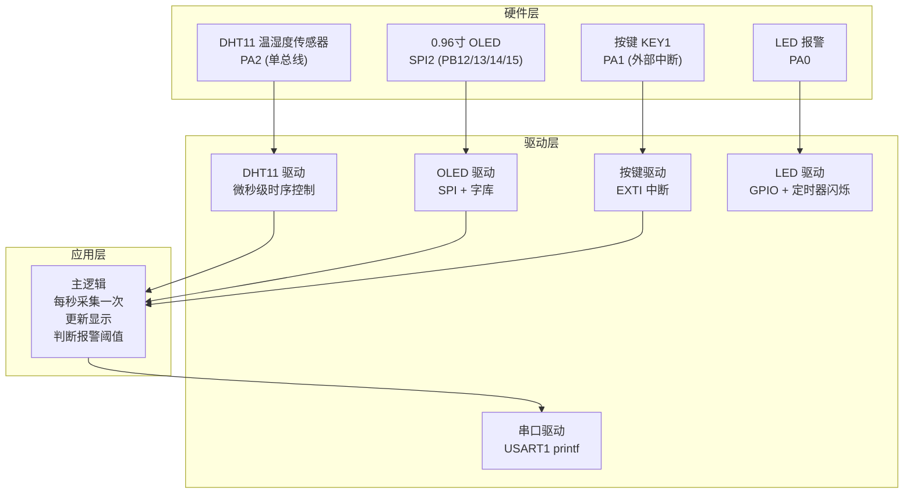

### 11.3 DHT11 驱动实现

DHT11 使用"单总线"协议，一根线完成双向通信，时序要求极严（微秒级）：

```c
/* ============================================================
   DHT11 温湿度传感器驱动
   单总线协议：一根线(DATA)双向通信
   连接：PA2 + 4.7kΩ上拉到3.3V
   ============================================================ */

#define DHT11_PORT      GPIOA
#define DHT11_PIN       GPIO_PIN_2

/* 宏：切换引脚为输出模式并输出高/低 */
#define DHT11_OUT_H()   do { \
    DHT11_PORT->BSRR = DHT11_PIN; \
} while(0)

#define DHT11_OUT_L()   do { \
    DHT11_PORT->BRR = DHT11_PIN; \
} while(0)

/* 宏：读引脚 */
#define DHT11_READ()    ((DHT11_PORT->IDR & DHT11_PIN) ? 1 : 0)

/* 引脚方向切换 */
static void DHT11_SetOutput(void)
{
    GPIO_InitTypeDef GPIO_InitStruct = {0};
    GPIO_InitStruct.Pin = DHT11_PIN;
    GPIO_InitStruct.Mode = GPIO_MODE_OUTPUT_OD;   /* 开漏输出 */
    GPIO_InitStruct.Pull = GPIO_NOPULL;
    GPIO_InitStruct.Speed = GPIO_SPEED_FREQ_HIGH;
    HAL_GPIO_Init(DHT11_PORT, &GPIO_InitStruct);
}

static void DHT11_SetInput(void)
{
    GPIO_InitTypeDef GPIO_InitStruct = {0};
    GPIO_InitStruct.Pin = DHT11_PIN;
    GPIO_InitStruct.Mode = GPIO_MODE_INPUT;        /* 浮空输入 */
    GPIO_InitStruct.Pull = GPIO_NOPULL;
    HAL_GPIO_Init(DHT11_PORT, &GPIO_InitStruct);
}

/**
 * @brief 微秒级延时（用指令循环实现，72MHz 下每个 nop 约 14ns）
 */
static void DHT11_DelayUs(uint32_t us)
{
    uint32_t count = us * 5;  /* 校准过的经验值 */
    while (count--)
    {
        __NOP();
    }
}

/**
 * @brief 读取 DHT11 数据
 * @param temp  输出：温度值（℃）
 * @param humi  输出：湿度值（%RH）
 * @return 0=成功, 1=失败
 *
 * 协议时序：
 *   主机发开始信号（拉低 18ms → 拉高 20-40us）
 *   DHT11 响应（拉低 80us → 拉高 80us）
 *   然后连续 40 位数据（湿度8 + 湿度小数8 + 温度8 + 温度小数8 + 校验8）
 */
uint8_t DHT11_Read(uint8_t *temp, uint8_t *humi)
{
    uint8_t data[5] = {0};  /* 5 字节原始数据 */
    uint8_t i, j;

    /* 步骤1：主机发开始信号 */
    DHT11_SetOutput();
    DHT11_OUT_L();           /* 拉低 */
    DHT11_DelayUs(18000);    /* 持续 18ms */
    DHT11_OUT_H();           /* 拉高 */
    DHT11_DelayUs(30);       /* 持续 30us */

    /* 步骤2：切换到输入模式，等待 DHT11 响应 */
    DHT11_SetInput();

    /* 等待 DHT11 拉低（响应信号），超时 100us */
    uint32_t timeout = 100;
    while (DHT11_READ() && --timeout) { /* 等低电平 */ }
    if (timeout == 0) return 1;  /* 超时失败 */

    /* 等待 DHT11 拉高 */
    timeout = 100;
    while (!DHT11_READ() && --timeout) { /* 等高电平 */ }
    if (timeout == 0) return 1;

    /* 等待 DHT11 再次拉低（准备发数据） */
    timeout = 100;
    while (DHT11_READ() && --timeout) { /* 等低电平 */ }
    if (timeout == 0) return 1;

    /* 步骤3：读取 40 位数据 */
    for (i = 0; i < 5; i++)
    {
        for (j = 0; j < 8; j++)
        {
            /* 等待 DHT11 拉高 */
            timeout = 50;
            while (!DHT11_READ() && --timeout) {}
            if (timeout == 0) return 1;

            /* 延时 40us 后判断电平，高=1，低=0 */
            DHT11_DelayUs(35);

            data[i] <<= 1;  /* 左移一位 */
            if (DHT11_READ())
            {
                data[i] |= 0x01;  /* 高电平 → 该位为 1 */
            }

            /* 等待 DHT11 拉低准备下一位 */
            timeout = 50;
            while (DHT11_READ() && --timeout) {}
            if (timeout == 0) return 1;
        }
    }

    /* 步骤4：校验 */
    if ((data[0] + data[1] + data[2] + data[3]) != data[4])
    {
        return 1;  /* 校验失败 */
    }

    /* DHT11 的小数部分始终为 0，所以直接用整数部分 */
    *humi = data[0];  /* 湿度整数部分 */
    *temp = data[2];  /* 温度整数部分 */

    return 0;  /* 成功 */
}
```

### 11.4 主程序——把所有模块串起来

```c
/* ============================================================
   综合项目主程序
   每 2 秒采集一次温湿度，显示在 OLED 上并通过串口上报
   ============================================================ */

#include "main.h"
#include "dht11.h"
#include "oled.h"
#include <stdio.h>
#include <string.h>

/* 全局变量 */
volatile uint8_t display_mode = 0;  /* 0=主界面, 1=详情 */
volatile uint8_t alarm_active = 0;  /* 报警标志 */
uint8_t temperature = 0;
uint8_t humidity = 0;

/* OLED 显示缓冲区 */
char oled_line1[22] = {0};
char oled_line2[22] = {0};
char oled_line3[22] = {0};

/**
 * @brief 按键中断回调（PA1 外部中断）
 */
void EXTI1_IRQHandler(void)
{
    if (__HAL_GPIO_EXTI_GET_IT(GPIO_PIN_1) != RESET)
    {
        __HAL_GPIO_EXTI_CLEAR_IT(GPIO_PIN_1);
        display_mode = !display_mode;  /* 切换显示模式 */
    }
}

/**
 * @brief 定时器中断：用于 LED 报警闪烁
 */
void TIM2_IRQHandler(void)
{
    if (__HAL_TIM_GET_FLAG(&htim2, TIM_FLAG_UPDATE) != RESET)
    {
        __HAL_TIM_CLEAR_FLAG(&htim2, TIM_FLAG_UPDATE);

        if (alarm_active)
        {
            HAL_GPIO_TogglePin(GPIOA, GPIO_PIN_0);  /* 闪烁 LED */
        }
        else
        {
            HAL_GPIO_WritePin(GPIOA, GPIO_PIN_0, GPIO_PIN_RESET);
        }
    }
}

int main(void)
{
    /* 初始化所有外设 */
    HAL_Init();
    SystemClock_Config();

    MX_GPIO_Init();         /* 初始化 GPIO */
    MX_DMA_Init();
    MX_SPI2_Init();         /* 初始化 SPI（OLED） */
    MX_USART1_UART_Init();  /* 初始化串口 */
    MX_TIM2_Init();         /* 初始化定时器（报警闪烁） */

    /* 使能外部中断（按键） */
    HAL_NVIC_SetPriority(EXTI1_IRQn, 2, 0);
    HAL_NVIC_EnableIRQ(EXTI1_IRQn);

    /* 启动定时器 */
    HAL_TIM_Base_Start_IT(&htim2);

    /* 初始化外设 */
    OLED_Init();
    OLED_Fill(0x00);  /* 清屏 */

    printf("========================================\r\n");
    printf("  温湿度监测系统 v1.0\r\n");
    printf("  MCU: STM32F103C8T6 @ 72MHz\r\n");
    printf("========================================\r\n\r\n");

    /* 主界面显示 */
    OLED_ShowString(0, 0, "Temp & Humi Monitor", 12);
    OLED_ShowString(0, 2, "Press KEY to switch", 12);
    OLED_ShowString(0, 4, "Initializing...", 12);

    HAL_Delay(2000);

    while (1)
    {
        /* 读取 DHT11 */
        if (DHT11_Read(&temperature, &humidity) == 0)
        {
            /* 成功读取——更新显示 */
            printf("[OK] 温度: %d°C  湿度: %d%%\r\n", temperature, humidity);

            /* 报警判断 */
            if (temperature > 30)
            {
                alarm_active = 1;
                printf("[ALARM] 温度过高！%d°C\r\n", temperature);
            }
            else
            {
                alarm_active = 0;
            }

            /* OLED 显示处理 */
            OLED_Fill(0x00);

            if (display_mode == 0)
            {
                /* 主界面 */
                OLED_ShowString(0, 0, "-- 温湿度监控 --", 14);

                sprintf(oled_line1, "温度: %d C", temperature);
                OLED_ShowString(0, 2, oled_line1, 16);

                sprintf(oled_line2, "湿度: %d %%", humidity);
                OLED_ShowString(0, 4, oled_line2, 16);

                if (alarm_active)
                {
                    OLED_ShowString(0, 6, "!! 高温报警 !!", 14);
                }
                else
                {
                    OLED_ShowString(0, 6, "状态: 正常", 14);
                }
            }
            else
            {
                /* 详情界面 */
                OLED_ShowString(0, 0, "-- 系统详情 --", 14);

                sprintf(oled_line1, "T:%dC H:%d%%", temperature, humidity);
                OLED_ShowString(0, 2, oled_line1, 16);

                sprintf(oled_line2, "Alarm: %s", alarm_active ? "ON" : "OFF");
                OLED_ShowString(0, 4, oled_line2, 16);

                sprintf(oled_line3, "Mode: %d", display_mode);
                OLED_ShowString(0, 6, oled_line3, 16);
            }
        }
        else
        {
            printf("[ERR] DHT11 读取失败\r\n");
            OLED_ShowString(0, 6, "Sensor Error!", 14);
        }

        HAL_Delay(2000);  /* 2 秒采集一次 */
    }
}
```

### 11.5 完整物料清单

| 物料 | 型号/规格 | 数量 | 参考价 |
|------|-----------|------|--------|
| 开发板 | STM32F103C8T6 Blue Pill | 1 | ¥15 |
| 下载器 | ST-Link V2 | 1 | ¥10 |
| 温湿度传感器 | DHT11 | 1 | ¥5 |
| OLED 屏幕 | 0.96寸 SSD1306 SPI | 1 | ¥10 |
| USB-TTL 模块 | CH340G | 1 | ¥5 |
| 按键 | 6×6mm 轻触开关 | 1 | ¥0.5 |
| LED | 5mm 红色 | 1 | ¥0.2 |
| 电阻 | 220Ω, 4.7kΩ | 各 2 | ¥0.5 |
| 面包板 + 杜邦线 | - | 1 套 | ¥10 |
| **合计** | | | **约 ¥56** |

### 11.6 调试技巧

```c
/* ============================================================
   嵌入式开发调试技巧汇总
   ============================================================ */

/* 1. LED 调试法——最简单但最有效 */
#define DEBUG_LED_ON()   HAL_GPIO_WritePin(GPIOA, GPIO_PIN_0, GPIO_PIN_SET)
#define DEBUG_LED_OFF()  HAL_GPIO_WritePin(GPIOA, GPIO_PIN_0, GPIO_PIN_RESET)
// 在关键位置放 LED 的亮灭，用眼睛判断程序走到了哪里

/* 2. 串口打印法——printf 大法好 */
#define DEBUG_PRINT(fmt, ...)  printf("[%s:%d] " fmt, __func__, __LINE__, ##__VA_ARGS__)
// 调用示例：DEBUG_PRINT("温度 = %d\r\n", temp);

/* 3. 断言——提前暴露 Bug */
#define ASSERT(expr)  do { \
    if (!(expr)) { \
        printf("ASSERT FAIL: %s, line %d\r\n", #expr, __LINE__); \
        while(1) { HAL_GPIO_TogglePin(GPIOA, GPIO_PIN_0); HAL_Delay(100); } \
    } \
} while(0)

/* 4. 看门狗——程序卡死自动复位 */
// IWDG_Init();  // 开启独立看门狗
// IWDG_Refresh();  // 在主循环中定期喂狗
```

### 11.7 常见坑点

| 坑 | 现象 | 原因 | 解决 |
|----|------|------|------|
| **DHT11 时序不准** | 读到的全是 0 或全是 1 | 微秒级延时在 72MHz 下需要校准 | 用示波器或逻辑分析仪校准延时 |
| **OLED 不亮** | 初始化没反应 | SPI 配置或接线有误 | 逐根线检查 SCK/MOSI/CS/DC/RST |
| **模块太多引脚冲突** | 某些功能不工作 | 两个模块复用了同一个引脚 | 用 CubeMX 的引脚冲突检查功能 |

---

## 附录 A：嵌入式开发学习路线图

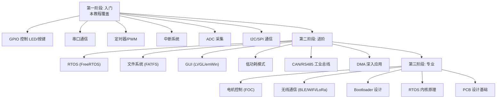

## 附录 B：寄存器操作速查表

| 操作 | HAL 库写法 | 裸寄存器写法 |
|------|-----------|-------------|
| 引脚输出高 | `HAL_GPIO_WritePin(GPIOA, PIN_0, SET)` | `GPIOA->BSRR = GPIO_PIN_0` |
| 引脚输出低 | `HAL_GPIO_WritePin(GPIOA, PIN_0, RESET)` | `GPIOA->BRR = GPIO_PIN_0` |
| 读引脚状态 | `HAL_GPIO_ReadPin(GPIOA, PIN_0)` | `(GPIOA->IDR & GPIO_PIN_0) ? 1 : 0` |
| 翻转引脚 | `HAL_GPIO_TogglePin(GPIOA, PIN_0)` | `GPIOA->ODR ^= GPIO_PIN_0` |
| 延时 ms | `HAL_Delay(100)` | 用 SysTick 自己实现 |
| 开启中断 | `HAL_NVIC_EnableIRQ(EXTI0_IRQn)` | `NVIC->ISER[0] = 1 << 6` |

## 附录 C：CubeMX 配置要点总结

| 功能 | CubeMX 配置步骤 |
|------|----------------|
| GPIO 输出 | 点引脚 → GPIO_Output → 设置初始电平 |
| GPIO 输入 | 点引脚 → GPIO_Input → 设置上拉/下拉 |
| 外部中断 | 点引脚 → GPIO_EXTIx → 设置触发边沿 → NVIC 标签页勾选使能 |
| 串口 USART | Connectivity → USART1 → Mode=Asynchronous → 波特率设 115200 |
| 定时器 | Timers → TIMx → Clock Source=Internal → 设 PSC 和 ARR → NVIC 使能 |
| PWM | Timers → TIMx → Channelx=PWM Generation → 设 PSC/ARR/Pulse |
| I2C | Connectivity → I2Cx → Mode=I2C → 默认参数即可 |
| SPI | Connectivity → SPIx → Mode=Full-Duplex Master → 注意 CPOL/CPHA |
| ADC | Analog → ADCx → 勾选通道 → 设采样时间 |
| DMA | DMA 标签页 → 添加 DMA 请求 → Mode=Circular |

---

> **写在最后**
>
> 嵌入式开发入门最难的不是写代码，而是**理解软件如何与硬件交互**。
> 当你第一次看到自己写的程序让一个真实的 LED 亮起来的时候，那种感觉是写 Web 应用永远体会不到的。
>
> 保持好奇心，多动手，别怕烧芯片（反正便宜）。
