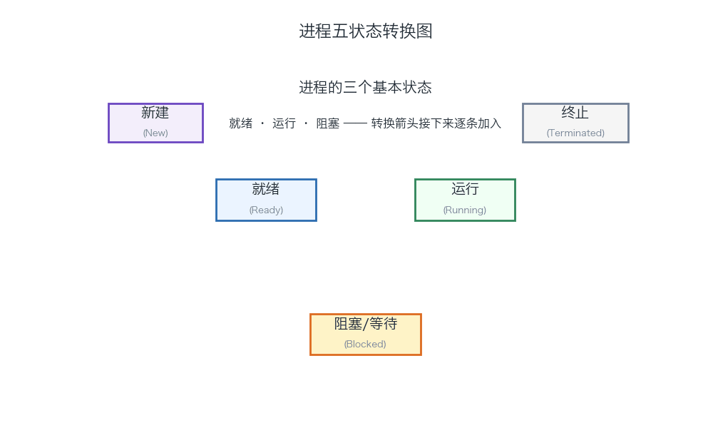
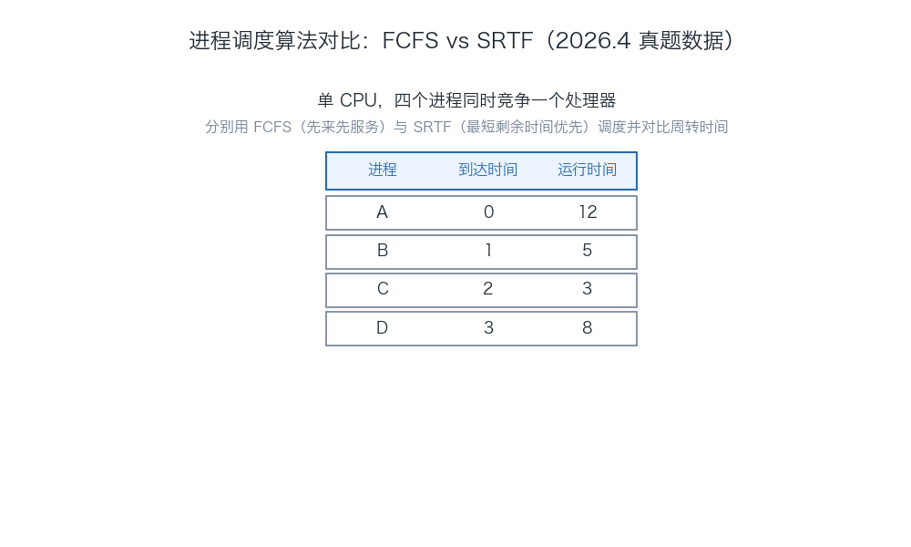
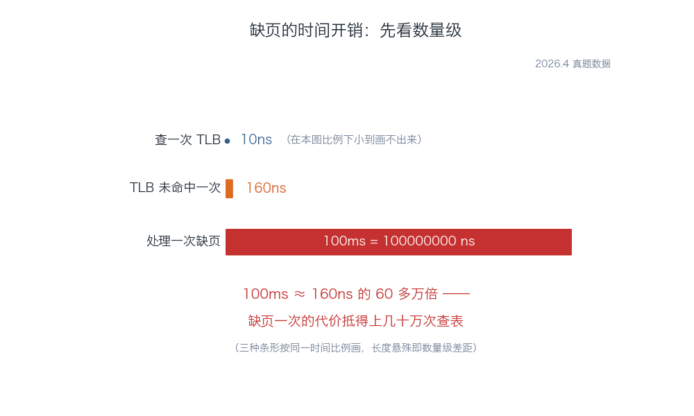
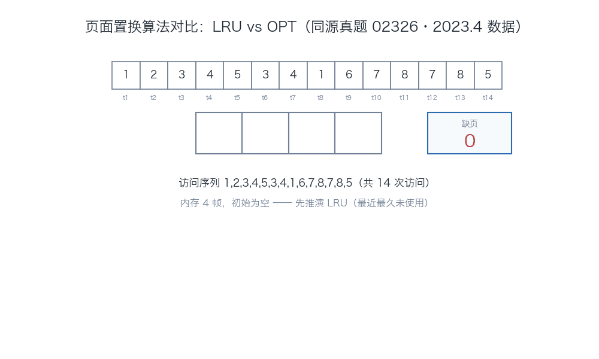
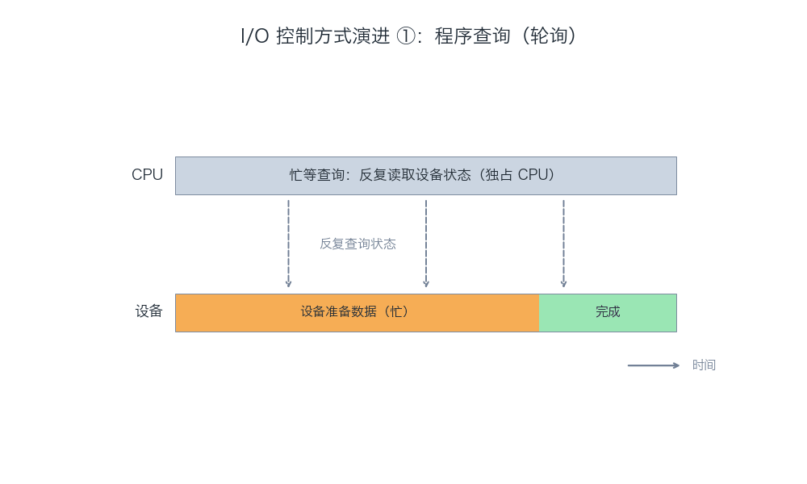
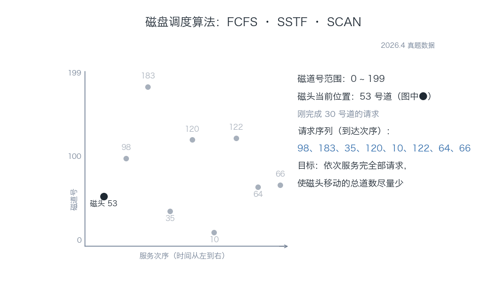
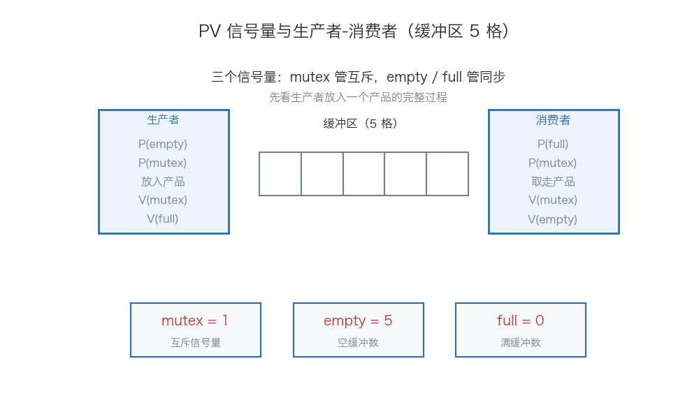
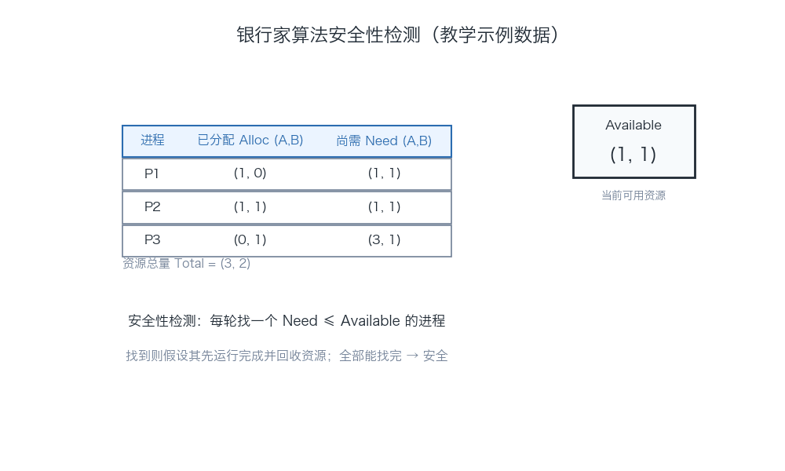

# 13180《操作系统》考试备考全攻略

> **课程代码**：13180　|　**课程名称**：操作系统　|　**课程性质**：全国统考课程（笔试），2024 版新计划课程，替代旧课程 02326《操作系统》（学分同为 4，不再单独设实践考核）
> **指定教材**：《操作系统》（2023 年版），陈向群、孙卫真 编著，机械工业出版社（附考试大纲，全国高等教育自学考试指导委员会组编）
> **适用对象**：计算机科学与技术（080901）等专业（专升本）考生；湖北省 2024 版新计划核心课程，2025 年 10 月考期为 10 月 26 日（周日）上午 9:00–11:30
>
> ⚠️ **准确性说明**：本文档真题以 **2026 年 4 月考期全卷**（公开试卷转录，逐题标注来源）为主证据；13180 为新代码课程，2024.10 之前的公开试卷极少，故部分例题取自**同源旧课程 02326《操作系统》真题**（题型结构与新课程完全一致，逐题标注【02326 同源】）与教材知识体系，**绝不冒充 13180 真题**。官方答案未公开，文中答案均为教研推导，统一标注【推导答案】；未能核实的内容一律标注【待核实】。详见第 6 节校验记录。

---

## 目录

1. [考试概况与分值分布](#一考试概况与分值分布)
2. [必考概念详解](#二必考概念详解按章)
3. [历年真题汇编](#三历年真题汇编)
4. [高频考点与易错点专项（Top 10）](#四高频考点与易错点专项top-10)
5. [备考建议](#五备考建议)
6. [校验记录](#六校验记录)
7. [附：同源真题（02326）刷题汇编](#附同源真题02326刷题汇编)

---

## 一、考试概况与分值分布

### 1.1 基本信息表

| 项目 | 内容 | 核实状态 |
|---|---|---|
| 课程代码 | 13180（替代旧课程 02326《操作系统》） | ✅ 已核实（考生网课程页：2024.10 起题库由 02326 代码切换为 13180；知乎改版说明） |
| 学分 | 4 学分 | ⚠️ 任务口径与 02326 一致，湖北 2025.10 排期 150 分钟与之匹配；官方计划表原文【待核实】 |
| 考试时间 | 150 分钟 | ✅ 已核实（湖北 2025.10 排期：10 月 26 日 9:00–11:30） |
| 总分 | 100 分，60 分及格 | ✅ 已核实（2026.4 试卷各大题分值合计 100） |
| 开考历史 | 2024.10 起题库站按 13180 代码收录；已确认考期 2024.10 / 2025.4 / 2025.10 / 2026.4 | ⚠️ 首次开考是否为 2024.4【待核实】 |
| 指定教材 | 《操作系统》(2023 年版)，陈向群、孙卫真 编著，机械工业出版社，ISBN 9787111738985 | ✅ 已核实（教材电商页 + 电子版文档标题 + 改版说明三源一致） |
| 湖北考情 | 2024 版新计划（080901 计算机科学与技术）核心课；2025.10 考期 10 月 26 日上午 | ✅ 已核实（湖北考试安排表：新计划周日 9:00–11:30 为 13180-操作系统，旧计划同场次为 02326） |

> **02326 → 13180 改版要点**（依据公开改版说明【待核实：官方文件原文未获取】）：①课程代码更换，学分不变（4 学分）；②原 02326 需"理论+实践"双考核，13180 新计划只保留理论笔试；③2023 版新教材，作者沿用，内容按新计划要求增删（强化进程/线程、调度、虚拟存储等主干，弱化与硬件重叠的细节）。**对新考生的影响：02326 已考通过的成绩可按新计划顶替 13180（以湖北省考试院文件为准【待核实】）。**

### 1.2 题型与分值（以 2026.4 全卷为准）

| 题型 | 题量 | 每题分值 | 小计 | 核实状态 |
|---|---|---|---|---|
| 单项选择题 | 20 | 1 分 | 20 分 | ✅ 2026.4 全卷转录 |
| 填空题 | 10 | 2 分 | 20 分 | ✅ 2026.4 全卷转录 |
| 简答题 | 5 | 4 分 | 20 分 | ✅ 2026.4 全卷转录 |
| 综合题 | 4 | 10 分 | 40 分 | ✅ 2026.4 全卷转录 |
| **合计** | **39 题** | — | **100 分** | ✅ 与 02326 2023.4 卷结构完全一致（交叉印证） |

> 13180 题型结构与其替代的 02326 完全一致（单选 20×1 + 填空 10×2 + 简答 5×4 + 综合 4×10），两份卷子（2026.4 的 13180 与 2023.4 的 02326）逐题型比对确认。**综合题 4 道×10 分=40 分是过关的生命线**，固定出自：进程调度计算、存储管理计算（地址转换/页面置换）、磁盘调度、进程同步与死锁四大模块（详见第 4 节题型清单）。

### 1.3 教材章节结构与考核侧重

依据 2023 版教材目录（公开电子版目录与章节资料，章节名以教材纸质版为准【待核实：后四章精确章名】）：

| 章 | 章名 | 核心考核知识点 | 出题倾向 |
|---|---|---|---|
| 第 1 章 | 操作系统概论 | OS 定义与功能、发展历程（手工→批处理→分时→实时）、基本特征（并发/共享/虚拟/异步）、启动过程 | 单选/填空送分题来源（2026.4 单选 1、2，填空 21） |
| 第 2 章 | 操作系统运行环境与运行机制 | CPU 状态（管态/目态）与特权指令、寄存器分类、中断机制（同步/异步、优先级与屏蔽）、系统调用、时钟 | 单选/填空中频（2026.4 单选 3、4、5，填空 28，简答 31） |
| 第 3 章 | 进程/线程模型 | 进程定义与 PCB、三状态转换、进程创建（fork）、线程实现方式（用户级/内核级） | 高频（2026.4 单选 6、7，填空 22、23，简答 32） |
| 第 4 章 | 进程/线程调度 | 调度层次与时机、FCFS/SJF/SRTF/RR/优先级/多级反馈队列、性能指标（周转时间）、速率单调调度 | **综合题必考模块**（2026.4 综合 36，单选 8、9、10，填空 24，简答 33） |
| 第 5 章 | 存储管理 | 存储层次、连续分配（分区分配/回收/紧凑/交换）、页式与地址转换、虚拟存储（请求分页/TLB/缺页/置换算法） | **综合题必考模块**（2026.4 综合 37，单选 11、12、13，填空 25、26） |
| 第 6 章 | 文件系统 | 文件与 FCB、打开文件表、目录与 i 节点、逻辑/物理结构、记录的成组 | 中高频（2026.4 单选 14、15，填空 27，简答 35） |
| 第 7 章 | 设备管理 | 设备分层软件、设备控制器寄存器、I/O 控制方式四演进、SPOOLing、磁盘调度算法 | **综合题必考模块**（2026.4 综合 38，单选 16、17，填空 28、29） |
| 第 8 章 | 进程同步机制与死锁 | 临界区四准则、PV 操作与信号量、死锁四条件、安全性检测（银行家）、死锁解除、资源有序分配 | **综合题必考模块**（2026.4 综合 39，单选 18、19、20，填空 30） |

### 1.4 章节分值权重估算（基于 2026.4 全卷逐题归属统计 + 02326 同源卷比对）

| 章 | 2026.4 占题（约） | 估算权重 | 频次 |
|---|---|---|---|
| 第 8 章 同步机制与死锁 | 5 题（含综合 39 大题） | 约 18% | ★★★ 高频 |
| 第 5 章 存储管理 | 5 题（含综合 37 大题） | 约 18% | ★★★ 高频 |
| 第 4 章 进程调度 | 6 题（含综合 36 大题） | 约 17% | ★★★ 高频 |
| 第 7 章 设备管理 | 4 题（含综合 38 大题） | 约 14% | ★★★ 高频 |
| 第 3 章 进程/线程模型 | 5 题 | 约 8% | ★★ 中频 |
| 第 6 章 文件系统 | 4 题 | 约 8% | ★★ 中频 |
| 第 2 章 运行环境与机制 | 5 题 | 约 9% | ★★ 中频 |
| 第 1 章 概论 | 3 题 | 约 5% | ★★ 中频（送分题） |

> 统计口径：2026.4 全卷 39 题逐题按章归属计数（一题多章时归入主考点章），综合题每题按 10 分权重计入。为估算值，非官方权重。**四大综合题模块（调度/存储/磁盘/同步死锁）合计约 40 分，加上小题覆盖，这四章决定了及格线。**

---

## 二、必考概念详解（按章）

> 每条概念给出三块内容：**① 定义详解**（讲清原理，可直接当名词解释/简答的答题素材）；**② 考试答题**（真题/同源题列表 + 考法 + 得分点 + 易混淆，题干/选项/答案与第三节汇编逐字一致）；**③ 计算方法**（计算类概念附步骤化模板 + 完整例题）。核心机制配 **🖼 动图演示**（GIF，慢速分步讲解，fps=2、每个画面驻留 3 秒）。「必考」判定均附真题证据（考期×题型）。

### 第 1 章 操作系统概论

#### 1.1 操作系统的定义与功能 ★★★

**定义详解**：操作系统是控制和管理计算机系统**硬件和软件资源**、合理地**组织调度**计算机工作与**资源分配**、方便**用户**使用的**最基本的系统软件**。四大管理功能：**处理器管理**（进程控制/调度）、**存储器管理**（内存分配/保护/扩充）、**设备管理**（I/O 设备分配与操纵）、**文件管理**（文件的存取/共享/保护）。两大用户接口：**命令接口**（命令行）与**程序接口**（系统调用）。

**考试答题**

**📌 真题**

**【2026.4·单选 1】** 不同时期的操作系统中，支持多用户通过各自终端与计算机交互的系统是
- A. 手工系统
- B. 分时系统 ✅
- C. 多道批处理系统
- D. 监控程序

📌 关键词「多用户」「各自终端」「交互」→ 分时系统三大特征（同时性/交互性/独立性）

**🎯 考法**：单选给场景描述考 OS 类型辨识（分时/实时/批处理）——抓关键词。

**✍️ 得分点**：
- 「多用户终端 + 交互」→ **分时系统**；「严格时限内响应」→ **实时系统**；「成批转储、脱机、无交互」→ **批处理系统**。

**⚠️ 易混淆**：多道批处理**吞吐量大**但**无交互**；分时系统**响应快、可交互**但单个任务不追求最快。

**🔑 记忆锚点**：分时=「多个用户轮流坐一台机器的椅子，每人坐一小会儿（时间片）」。

#### 1.2 操作系统的基本特征 ★★★

**定义详解**：四大特征——**并发**（多个事件同一时间间隔内宏观同时、微观交替执行）、**共享**（资源可被多个进程共同使用，分互斥共享与同时共享两种方式）、**虚拟**（物理实体变为逻辑对应物，如单核 CPU 虚拟为多逻辑处理器）、**异步**（进程以不可预知的速度走走停停向前推进）。**并发与共享是最基本的两个特征，互为存在条件**。

**考试答题**

**📌 真题**

**【2026.4·单选 2】** 以下不属于操作系统基本特征的是
- A. 并发性
- B. 共享性
- C. 虚拟性
- D. 完整性 ✅

📌 四特征=并发/共享/虚拟/异步；「完整性」是干扰词，凭空捏造的属性

**🎯 考法**：单选考「不属于」型否定辨析——背熟四特征清单即可秒杀。

**✍️ 得分点**：
- 口诀「**并共虚异**」；异步的含义是"执行速度不可预知"，不是"执行结果不可预知"（结果可复现，封闭环境下）。

**⚠️ 易混淆**：「并发」= 同一时间**间隔**内交替执行（单核也可并发）；「并行」= 同一**时刻**同时执行（需要多核/多处理机）。

**🔑 记忆锚点**：并发共享互为存在——「没有并发就没有资源共享的需求，没有共享并发就没有意义」。

#### 1.3 操作系统的发展与类型 ★★

**定义详解**：发展脉络：**手工操作**（CPU 等人）→**单道批处理**（脱机 I/O，内存仅一道作业）→**多道批处理**（多道程序并发驻留内存，OS 正式形成）→**分时系统**（时间片轮转服务多终端）→**实时系统**（在严格时限内完成处理，分硬实时/软实时）→现代通用 OS。类型判定关键词：批处理——吞吐量优先、无交互；分时——交互性、时间片；实时——可靠性、时限（硬实时如飞控，软实时如订票）。

**考试答题**

**📌 真题**

**【2023.4·02326·单选 1】** 要求极高可靠性、强健壮性的系统类型是 → 实时操作系统 ✅

📌 实时系统常用于工业控制/军事等可靠性要求极高的场景【02326 同源】

**🎯 考法**：类型场景题在 02326 时代是高频单选，13180 延续（2026.4 单选 1 即分时场景题）。

**✍️ 得分点**：场景词对应表——「成批/脱机/无交互」→批处理；「终端/交互」→分时；「时限/可靠」→实时。

**⚠️ 易混淆**：分时系统的「时间片」与实时系统的「时限」——前者是公平轮转的配额，后者是任务完成的硬性期限。

#### 1.4 操作系统的启动过程 ★★

**定义详解**：OS 启动四步（按序）：**BIOS 自检**（加电自检 POST，检测硬件）→ **加载引导程序**（读取主引导记录 MBR 中的引导程序）→ **启动内核**（把 OS 内核装入内存并移交控制权）→ **初始化系统**（建立系统数据结构、启动初始进程与系统服务）。

**考试答题**

**📌 真题**

**【2026.4·填空 21】** 操作系统的启动过程按顺序一般包括：BIOS 自检、____、启动内核和初始化系统。

> 【推导答案】**加载引导程序**
> 📌 依据教材启动流程：自检完成后，从磁盘固定位置读入引导程序，再由引导程序装入内核【推导答案，依据教材知识体系】

**🎯 考法**：填空考启动顺序——四步一个不能乱。

**✍️ 得分点**：顺序背法「**自检→引导→内核→初始化**」；引导程序的职责就是「找到内核并装进内存」。

**⚠️ 易混淆**：BIOS 自检的是**硬件**，不是加载 OS；内核装入内存后控制权才从引导程序移交给 OS。

**🔑 记忆锚点**：开机四拍——「体检（自检）、找班长（引导）、请正主（内核）、开张（初始化）」。

### 第 2 章 操作系统运行环境与运行机制

#### 2.1 CPU 状态与特权指令 ★★★

**定义详解**：CPU 分两种运行状态——**管态（核心态/系统态）**：可执行全部指令（含特权指令），OS 内核运行于此；**目态（用户态）**：只能执行非特权指令，用户程序运行于此。**特权指令**：如启动 I/O、设置时钟、修改页表基址寄存器、开关中断等影响系统全局的指令，只允许管态执行。**用户态→核心态**的唯一途径是**中断/异常**（系统调用、时钟中断、I/O 中断等）；**核心态→用户态**靠修改程序状态字（PSW）。

**考试答题**

**📌 真题**

**【2023.4·02326·单选 4】** 目态转换到管态的方式是 → 中断 ✅（管→目靠修改 PSW）【02326 同源】

**🎯 考法**：单选考状态切换方向与手段的对应关系。

**✍️ 得分点**：
- 「用户→内核」= 中断/异常（**被迫**切换）；「内核→用户」= 修改 PSW（**主动**恢复）。

**⚠️ 易混淆**：系统调用是用户态程序**主动发起**的，但进入内核执行服务例程的那一刻仍须经**中断（陷阱/trap）机制**——所以切换方式依然答「中断」。

**🔑 记忆锚点**：「向上只能坐电梯（中断），向下走楼梯（改 PSW）」。

#### 2.2 寄存器分类与用户可见性 ★★★

**定义详解**：寄存器分两类：**用户可见寄存器**——通用寄存器、数据寄存器、地址寄存器、条件码寄存器等，汇编程序员可用；**用户不可见（控制与状态）寄存器**——**程序计数器 PC**、**指令寄存器 IR**、程序状态字 PSW、页表基址寄存器等，由系统专用，用户程序无法访问。**指令寄存器 IR 存放当前正在执行的指令**，对用户完全透明（不可见）。

**考试答题**

**📌 真题**

**【2026.4·单选 4】** 以下对用户不可见的寄存器是
- A. 条件码寄存器
- B. 数据寄存器
- C. 指令寄存器 ✅
- D. 通用寄存器

📌 IR 由取指部件自动装载，用户程序无法读写；条件码/数据/通用寄存器均用户可见

**🎯 考法**：单选考寄存器归属（可见/不可见）——2026.4 新考法。

**✍️ 得分点**：可见=通用/数据/地址/条件码；不可见=**PC、IR、PSW、MMU 相关寄存器**。

**⚠️ 易混淆**：条件码寄存器（标志位）虽然用户「不能改」，但可以读取判断（如条件跳转），属用户可见。

**🔑 记忆锚点**：「PC 和 IR 是 CPU 的内部账本，外人（用户程序）不许看」。

#### 2.3 中断机制：同步中断与异步中断 ★★★

**定义详解**：中断按**是否与指令执行同步**分两类：**同步中断（内部异常/程序性中断）**——由 CPU 执行当前指令引起，如除零、非法操作码、溢出、缺页（执行一条指令必然发生、可复现）；**异步中断（外部中断）**——由外部设备事件引起，与当前指令无关，如时钟中断、I/O 中断、硬件故障中断。中断处理流程：**保存断点与现场 → 识别中断源 → 执行中断服务程序 → 恢复现场返回断点**。

**考试答题**

**📌 真题**

**【2026.4·单选 5】** 以下属于同步中断的是
- A. 时钟中断
- B. 程序性中断 ✅
- C. 硬件故障中断
- D. 输入输出中断

📌 程序性中断（除零/溢出/非法指令）由执行指令本身引起，与指令同步；其余三项均由外部事件异步产生

**【2023.4·02326·单选 5】** 关于中断屏蔽的正确说法 → 存在即使被屏蔽也会响应的中断 ✅（如机器校验等高等级中断不可屏蔽）【02326 同源】

**🎯 考法**：单选考中断分类归属；02326 时代考过屏蔽策略，随时可能回考。

**✍️ 得分点**：
- 判定口诀：「**指令自己惹的事 = 同步（程序性）；外部来的事 = 异步（时钟/IO/故障）**」。
- 缺页、溢出、除零、非法操作码 → 程序性中断（同步）。

**⚠️ 易混淆**：「时钟中断」虽定期发生像"同步"，但它由时钟部件独立发出、与当前指令无关，是**异步中断**——2026.4 的 A 选项就是此干扰项。

**🔑 记忆锚点**：同步中断问「这条指令怎么了」，异步中断问「外面发生了什么」。

#### 2.4 系统调用与参数传递 ★★★

**定义详解**：**系统调用**是 OS 提供给应用程序的唯一正式接口（程序接口），用户程序通过陷入指令（trap）进入内核执行服务例程。与一般函数调用的本质区别：一般函数调用同在用户态；系统调用**调用方在目态、被调方（内核）在管态**。**参数传递的常用方式**：①参数放入**通用寄存器**直接传递；②参数较多时，放入**内存块（参数表）**，把该块的地址作为参数传入；③把参数**压入栈**，压栈后弹出到指定寄存器/内存。

**考试答题**

**📌 真题**

**【2026.4·简答 31】（4 分）** 简述用户程序与系统程序之间传递参数的方法。
> 【推导答案】（每法约 2 分，写出两种即可）
> ① **寄存器直接传递**：将参数写入约定的通用寄存器，系统程序从寄存器读取（适合参数少的情况）；
> ② **参数表（内存块）传递**：把参数放入一块内存（参数表），再把该内存块的地址作为参数传递给系统程序（适合参数多的情况）；
> ③（补充）**堆栈传递**：参数压入栈中，系统程序从栈中取出。
> 📌 依据教材系统调用参数传递三种方式【推导答案】

**【2023.4·02326·简答 31】** 简述一般函数调用与系统调用的区别。
> 【推导答案】一般函数调用：调用双方运行状态相同（都在用户态），无状态切换；系统调用：调用方在目态、被调方在管态，须经中断/陷入机制完成用户态→核心态的切换（各 2 分）【02326 同源】

**🎯 考法**：简答考参数传递方法（2026.4 实考）或与一般函数调用的区别（02326 实考）——两题都值得备。

**✍️ 得分点**：参数传递答「寄存器 + 内存块地址」两种即满足多数评分点，每条注明适用场景（参数少/参数多）。

**⚠️ 易混淆**：系统调用过程要经历「用户态→核心态→执行→返回用户态」完整往返，开销远大于普通函数调用（这也是缓冲技术的动因之一）。

**🔑 记忆锚点**：「参数少用手递（寄存器），参数多用快递单（内存块地址）」。

#### 2.5 时钟 ★★

**定义详解**：OS 的时钟分两类：**硬件时钟**——由晶体振荡器产生周期性脉冲，为系统提供时间基准，受硬件约束精度高但功能固定；**软件时钟**——**利用内存单元模拟时钟寄存器**，由程序计算脉冲数实现，可灵活设置（如定时器），但精度依赖硬件脉冲。时钟的三大用途：提供绝对时间、发现死循环（时间片轮转的基础）、实现定时功能。

**考试答题**

**📌 真题**

**【2026.4·单选 3】** 利用内存单元模拟时钟寄存器，并采用一段程序计算脉冲数的时钟实现方式是
- A. 绝对时钟
- B. 独立时钟
- C. 硬件时钟
- D. 软件时钟 ✅

📌 题干关键词「内存单元模拟」「程序计算脉冲数」即软件时钟的定义

**🎯 考法**：单选定义匹配题——抓「内存模拟/程序计算」→ 软件时钟；「晶体振荡器/硬件脉冲」→ 硬件时钟。

**✍️ 得分点**：软件时钟的可取之处是**灵活可设置**，硬件时钟的长处是**精确可靠**。

**⚠️ 易混淆**：绝对时钟记录真实日期时间；相对（独立）时钟记录时间间隔——2026.4 的 A/B 是分类干扰项。

**🔑 记忆锚点**：「内存里编的表 = 软件时钟；电石英里长的表 = 硬件时钟」。

### 第 3 章 进程/线程模型

#### 3.1 进程的定义与 PCB ★★★

**定义详解**：**进程**是程序在一个数据集合上的一次**运行过程**，是系统进行**资源分配和保护的独立单位**。进程与程序的区别：程序是静态的指令集合，进程是动态的执行过程；一个程序可对应多个进程。**进程控制块（PCB）**是 OS 为每个进程建立的唯一数据结构，记录进程的全部管理信息，是**进程存在的唯一标志**。PCB 内容：**进程号（PID）**、进程状态、优先级、**程序状态字（PSW）**、现场信息（寄存器内容）、程序与数据的地址、资源清单、队列指针等——**注意：进程执行的代码本身不放在 PCB 里**（PCB 只存其地址）。

> **🖼 动图演示：进程五状态转换图（逐条箭头拆解）**

📌 锚点：**就绪等 CPU、运行在执行、阻塞等事件；6 条转换箭头——阻塞不能直达运行，必须经就绪**。

**考试答题**

**📌 真题**

**【2026.4·单选 6】** 以下不属于进程控制块的信息是
- A. 进程号
- B. 进程优先级
- C. 进程执行的代码 ✅
- D. 进程执行时的程序状态字

📌 PCB 存管理信息（号/状态/优先级/PSW/现场/资源）；代码本体在程序地址空间，PCB 只存其地址

**【2026.4·填空 22】** 进程的三个基本状态包括运行态、就绪态和____。

> 【推导答案】**阻塞态（等待态/阻塞）**
> 📌 三基本状态=运行/就绪/阻塞（等待），教材口径【推导答案】

**【2023.4·02326·单选 6】** 时间片用完产生超时中断后，进程进入 → 就绪状态 ✅【02326 同源】

**🎯 考法**：单选考 PCB 内容边界（什么放、什么不放）；填空考三状态。

**✍️ 得分点**：
- PCB 三大类信息：**标识信息**（PID）、**状态信息**（状态/PSW/现场）、**控制信息**（优先级/资源/队列指针）。
- 三状态转换四条主线：运行→就绪（时间片到/被抢占）、运行→阻塞（等事件）、阻塞→就绪（事件发生）、就绪→运行（被调度）。

**⚠️ 易混淆**：「进程执行的代码」≠「程序状态字」——PSW 是执行状态标志（属 PCB），代码是指令本体（不属 PCB）。2026.4 的 C/D 就在考这条边界。

**🔑 记忆锚点**：PCB 是进程的「档案袋」，装的是**档案**（身份、状态、资源清单），不装**本人**（代码与数据）。

#### 3.2 进程的创建与 fork ★★★

**定义详解**：进程创建由**创建原语**完成，步骤：**①申请空白 PCB → ②分配资源（内存等） → ③初始化 PCB（填 PID、状态置就绪等） → ④插入就绪队列**。UNIX/Linux 中用 **fork()** 系统调用创建子进程：子进程**复制父进程的用户地址空间内容**（代码、数据、堆栈副本），但拥有**独立的 PID**，与父进程**异步执行**；fork 返回两次（父进程得到子进程 PID，子进程得到 0）。

**考试答题**

**📌 真题**

**【2026.4·填空 23】** Linux 操作系统中，用于创建子进程的系统调用是____。

> 【推导答案】**fork（fork()）**
> 📌 fork 创建子进程；execve 是替换当前进程映像，不创建新进程【推导答案】

**【2026.4·简答 32】（4 分）** 简述使用创建原语创建新进程的具体操作过程。
> 【推导答案】（4 步，每步 1 分）
> ① **申请空白 PCB**：从 PCB 池中取一个空闲 PCB 并获得唯一进程标识号；
> ② **分配资源**：为新进程分配内存空间及其他所需资源；
> ③ **初始化 PCB**：填写标识符、状态（置为就绪）、优先级、程序入口地址、现场信息等；
> ④ **插入就绪队列**：把新进程 PCB 链入就绪队列，等待进程调度。
> 📌 创建原语四步【推导答案，与教材进程创建流程一致】

**【2023.4·02326·单选 7】** fork 创建子进程的正确描述 → 子进程复制父进程用户地址空间内容 ✅（PID 不同；父子异步执行）【02326 同源】

**🎯 考法**：填空考 fork 函数名；简答考创建原语步骤（2026.4 双考）；fork 语义辨析随时可回考单选。

**✍️ 得分点**：创建原语四步「**申请 PCB → 分配资源 → 初始化 → 入就绪队列**」顺序不能乱——先有档案袋，再有家当，再填档案，最后排队。

**⚠️ 易混淆**：fork **创建**新进程；execve **替换**当前进程映像（不产生新进程）；两者常作选项互混。

**🔑 记忆锚点**：创建四步=「领袋子（PCB）→ 分房子（资源）→ 填表（初始化）→ 排队（就绪）」。

#### 3.3 线程及其实现方式 ★★★

**定义详解**：**线程**是进程内的一条执行流，是**处理机调度的基本单位**；进程是**资源分配的基本单位**。同一进程内多个线程**共享进程的地址空间与资源**（内存、打开文件等），但各自拥有独立的执行栈与寄存器现场。**实现方式两类**：**用户级线程（ULT）**——由用户空间的线程库管理，**与内核无关，切换速度快**（不需进入内核），但一个线程阻塞会导致整个进程阻塞，无法利用多核并行；**内核级线程（KLT）**——由内核直接管理，切换需进内核（较慢），但可独立调度到多核并行，阻塞一个线程不影响其他线程。

**考试答题**

**📌 真题**

**【2026.4·单选 7】** 线程的实现方式中，用户级线程
- A. 由内核直接管理，切换速度慢
- B. 由内核直接管理，切换速度快
- C. 与内核无关，切换速度快 ✅
- D. 与内核无关，切换速度慢

📌 用户级线程=用户库管理、内核不感知；切换只是用户态内的执行流切换，无需陷入内核 → 快

**【2023.4·02326·填空 22】** 线程共享进程的____地址空间；同步通信无需调用____。

> 【推导答案】**内存**；**内核**
> 📌 同进程线程共享内存地址空间，其同步通信可在用户态完成【02326 同源】

**🎯 考法**：单选考用户级线程的两个属性（管理主体 + 切换速度）——2026.4 实考。

**✍️ 得分点**：用户级线程记忆卡「**内核不认识它（无法独立调度到多核），但切换免进内核所以快**」；内核级线程正好镜像。

**⚠️ 易混淆**：「切换快」不等于「并发好」——用户级线程切换快但**不能真并行**（内核只看到一个进程）。

**🔑 记忆锚点**：ULT=「野路子快但没人罩」；KLT=「官方编制慢但有保障」。

### 第 4 章 进程/线程调度

#### 4.1 调度的层次与时机 ★★

**定义详解**：三级调度：**高级调度（作业调度）**——从外存后备队列选作业调入内存、创建进程；**中级调度（交换调度）**——在内存与外存间换入换出进程；**低级调度（进程调度）**——从就绪队列选进程分配 CPU，频率最高。**进程调度的时机**：创建新进程时（决定先运行父还是子）、运行中进程**完成任务主动放弃 CPU**、运行中进程**因等待资源被迫放弃 CPU**（阻塞）、时钟中断（时间片到/高优先级到达抢占）等。**注意：从作业后备队列选作业调入内存是作业调度，不属于进程调度时机**。

**考试答题**

**📌 真题**

**【2026.4·单选 10】** 以下不属于进程调度的时机是
- A. 创建新进程时要决定是运行父进程还是子进程
- B. 从作业后备队列中选择一个合适的作业放入内存 ✅
- C. 正在运行的进程完成任务后主动释放对 CPU 的控制
- D. 正在运行的进程因为等待某个资源而不得不放弃 CPU

📌 B 是「高级调度（作业调度）」的职能，与进程调度是两个层次

**🎯 考法**：单选考调度层次混淆——2026.4 实考「不属于」型。

**✍️ 得分点**：记住三层各自的关键词——作业调度「后备队列→内存」；中级调度「换入换出」；进程调度「就绪队列→CPU」。

**⚠️ 易混淆**：「作业」在外存排队，「进程」在内存运行；作业调度是「进门」，进程调度是「上台」。

**🔑 记忆锚点**：进门（高级）→ 落座（中级）→ 上台表演（低级）。

#### 4.2 调度算法：FCFS / SJF(SRTF) / RR / 优先级 / 多级反馈队列 ★★★

**定义详解**：
- **FCFS 先来先服务**：按到达次序非剥夺执行；简单公平，但短作业等长作业（护航效应），平均周转时间长。
- **SJF 短作业优先 / SRTF 最短剩余时间优先**：SJF 非剥夺选运行时间最短者，平均周转时间最优（在该批作业非剥夺前提下）；SRTF 是其**抢占版**——新到达作业运行时间小于当前剩余时间即抢占。缺点：长作业可能**饥饿**，运行时间只能估计。
- **RR 时间片轮转**：就绪队列首进程运行一个时间片后剥夺入队尾；绝对可抢占、响应快，适合分时系统；时间片过大退化为 FCFS、过小切换开销剧增。
- **优先级调度**：按优先级选取；可静态或动态，可抢占或非抢占；低优先级可能饥饿（老化/ aging 补救）。
- **多级反馈队列**：多个优先级队列，新进程进最高队列，时间片用完降级入下一队列（时间片加倍）；高队列可抢占低队列；**兼顾响应时间与吞吐量，无需预知运行时间**——**BSD UNIX 采用的正是多级反馈队列调度算法**。
- **速率单调调度（RMS）**：实时周期任务的静态优先级算法——**周期越短优先级越高**（详见 4.4）。

> **🖼 动图演示：FCFS 与 SRTF 甘特图逐帧对比（2026.4 真题数据）**

📌 锚点：**同一组进程，FCFS 平均周转 17.75 → SRTF 13.5；抢占式短作业优先牺牲长作业换整体最优**。

**考试答题**

**📌 真题**

**【2026.4·单选 9】** BSD UNIX 系统采用的调度算法是
- A. 彩票调度算法
- B. 最短作业优先调度算法
- C. 公平共享调度算法
- D. 多级反馈队列调度算法 ✅

📌 BSD UNIX 的经典特征之一：多级反馈队列

**【2026.4·综合 36】（10 分）** 进程调度计算（FCFS 周转时间 + SRTF 带权周转时间）
> 题干与完整解答见第三节 3.1 综合题 36 与本节「计算方法」

**【2023.4·02326·单选 20】** 唯一知道设备控制器细节的层次 → 设备驱动层【02326 同源，属第 7 章】

**🎯 考法**：单选考算法归属（BSD→多级反馈队列）；综合题 10 分大题固定考「给到达/运行时间表，求指定算法的周转指标」（2026.4 实考 FCFS+SRTF；02326 2023.4 实考 SJF+抢占式优先级）。

**✍️ 得分点**：
- 算法名与特征连线：FCFS=次序、SJF=最短平均周转、RR=时间片/分时、多级反馈队列=BSD/无需预知运行时间、RMS=周期短优先。
- 大题四件套：**甘特图 → 周转时间 → 平均周转 → 带权周转**，每问单独列式。

**⚠️ 易混淆**：「最短作业优先」答「平均周转时间最少」，但题目若问「最公平」答 FCFS/RR；「时间片轮转」是**绝对可抢占**算法（每个时间片末必剥夺）。

**🔑 记忆锚点**：BSD=多级反馈队列（新作业从高队列进，用得久就降级——「能者上、庸者下」）。

**计算方法**（周转时间三件套模板）：

1. **完成时间**：按算法画甘特图逐段推（每段标注起止时刻）；
2. **周转时间 = 完成时间 − 到达时间**（**为什么这么减**：周转衡量"从提交到做完等了多久"，完成时刻 − 提交时刻即总滞留时长）；
3. **带权周转时间 = 周转时间 ÷ 实际运行时间**（**为什么再除运行时间**：把"等了多久"折算成"运行时长的倍数"，才能跨作业比较——运行 1 分钟周转 2 分钟和运行 60 分钟周转 61 分钟，绝对值接近但体验天差地别）；带权周转 ≥ 1（**为什么**：完成 − 到达 ≥ 运行时长，因为至少要运行完这么久）；
4. **平均周转时间 = Σ周转 ÷ 进程数**；**平均带权周转 = Σ带权 ÷ 进程数**。

**【例 4-1】FCFS 周转时间（2026.4 综合 36 第 ① 问同型）**

进程 A(到达 0，运行 12)、B(1,5)、C(2,3)、D(3,8)，FCFS：

| 进程 | 到达 | 运行 | 完成时间 | 周转时间（完成−到达） | 带权周转（周转÷运行） |
|---|---|---|---|---|---|
| A | 0 | 12 | 12 | 12−0=**12** | 12÷12=**1.00** |
| B | 1 | 5 | 17 | 17−1=**16** | 16÷5=**3.20** |
| C | 2 | 3 | 20 | 20−2=**18** | 18÷3=**6.00** |
| D | 3 | 8 | 28 | 28−3=**25** | 25÷8=**3.13** |

平均周转 =(12+16+18+25)÷4 = 71÷4 = **17.75**（**为什么 A 先跑**：FCFS 只看到达次序，t=0 时仅 A 在场；后到的按队列接续，B 12~17、C 17~20、D 20~28）。

**【例 4-2】SRTF 周转时间（2026.4 综合 36 第 ② 问同型）**

同一组进程，最短剩余时间优先（抢占式）。逐时刻推（**为什么逐时刻推**：抢占算法的每一次"新进程到达"都可能改变当前剩余时间排序，必须按事件点模拟）：

- t=0：只有 A → A 运行（剩 12）；
- t=1：B 到达，B(5) < A 剩余(11) → **B 抢占**（**为什么 B 抢**：SRTF 比较的是剩余时间，5<11）；A 排队剩 11；
- t=2：C 到达，C(3) < B 剩余(4) → **C 抢占**；B 剩 4；
- t=3：D 到达，D(8) > C 剩余(2) → C 继续（8>2 不抢）；
- t=5：C 完成（周转 5−2=**3**，带权 3÷3=**1.00**）；
- 就绪中 B(4) 最短 → B 运行；t=9 B 完成（周转 9−1=**8**，带权 8÷5=**1.60**）；
- 就绪中 D(8) < A(11) → D 运行；t=17 D 完成（周转 17−3=**14**，带权 14÷8=**1.75**）；
- t=17~29：A 跑完（周转 29−0=**29**，带权 29÷12=**2.42**）。

执行顺序：**A(0~1)→B(1~2)→C(2~5)→B(5~9)→D(9~17)→A(17~29)**。
平均周转 =(29+8+3+14)÷4 = 54÷4 = **13.50** < FCFS 的 17.75（**为什么 SRTF 更优**：短作业插队让"后到的小任务"尽快清出系统，整体加权后滞留时间最短；代价是 A 这种长作业周转被拉到 29）。

> ⚠️ 大题作答铁律：先画**甘特图**再算，每问单独一行"公式+代入+结果"；「给出执行顺序」一问必须完整写出含抢占切换的顺序串。

#### 4.3 调度性能指标：吞吐量与周转时间 ★★★

**定义详解**：常用指标：**吞吐量**=单位时间内 CPU 完成的作业数量（2026.4 填空考）；**CPU 利用率**=CPU 忙碌时间 ÷ 总时间；**周转时间/带权周转**（见 4.2）；**响应时间**=从提交请求到首次产生响应的时间（分时系统关键指标）；**等待时间**=在就绪队列中等待的总时长。

**考试答题**

**📌 真题**

**【2026.4·填空 24】** 调度算法的性能评价标准中，表示单位时间内 CPU 完成作业数量的是____。

> 【推导答案】**吞吐量**
> 📌 吞吐量定义【推导答案，教材口径】

**🎯 考法**：填空考指标名称与定义匹配。

**✍️ 得分点**：「单位时间完成作业数」=吞吐量；「提交到首次响应」=响应时间；「完成−到达」=周转时间。三个定义背到条件反射。

**⚠️ 易混淆**：吞吐量关心**数量/时间**，CPU 利用率关心**忙占比**——批处理追求前者，分时更在乎响应时间。

#### 4.4 速率单调调度（RMS） ★★

**定义详解**：RMS 是**周期性实时任务**的**静态优先级**调度算法：**任务周期越短，优先级越高**（周期单调速率→优先级单调）。解决调度冲突的方式：当多个周期任务同时就绪竞争 CPU 时，按周期大小排定优先级——**周期最短者优先运行**，且优先级一经确定不再改变（区别于动态优先级的 EDF 最早截止期优先）。可调度判据：Σ(Cᵢ/Tᵢ) ≤ n(2^(1/n)−1)（n 为任务数，Cᵢ 为执行时间，Tᵢ 为周期）。

**考试答题**

**📌 真题**

**【2026.4·简答 33】（4 分）** 简述速率单调调度如何解决周期性任务的调度冲突问题。
> 【推导答案】（答出①②各 2 分）
> ① **静态分配优先级**：按任务的周期长短预先分配固定优先级——**周期越短，优先级越高**；周期越长，优先级越低；
> ② **冲突时按优先级取舍**：多个周期任务同时就绪发生调度冲突时，总是先运行周期最短（优先级最高）的任务，高优先级任务可抢占低优先级任务，从而保证所有周期任务在其周期（截止期）内完成。
> 📌 依据教材 RMS 定义【推导答案】

**【2023.4·02326·简答 33】** 同考点实考（速率单调调度）【02326 同源】

**🎯 考法**：简答连续两代课程实考（02326 2023.4 → 13180 2026.4），**高概率回考**——务必背熟。

**✍️ 得分点**：核心一句「**周期越短优先级越高**」+ 一句「冲突时先跑周期最短的任务（静态优先级、可抢占）」。

**⚠️ 易混淆**：RMS 是**静态**优先级（按周期定死）；EDF 是**动态**优先级（按最近截止期算）。题目问"速率单调"绝不能答动态。

**🔑 记忆锚点**：跑得越频（周期短）越先安排——「班车次多的线路优先排班」。

### 第 5 章 存储管理

#### 5.1 存储体系层次 ★★

**定义详解**：按速度由快到慢：**寄存器 → 高速缓存（cache）→ 内存（主存）→ 磁盘缓存 → 磁盘（辅存）→ 磁带/光盘**。容量依次增大、价格依次降低，构成金字塔。速度排序题直接背「**寄存器最快**」即可排除干扰（2026.4 单选 11 的 A/B 干扰项都把高速缓存排到寄存器前面）。

**考试答题**

**📌 真题**

**【2026.4·单选 11】** 计算机系统的存储体系中，按速度由快到慢排序正确的是
- A. 高速缓存、寄存器、内存
- B. 高速缓存、内存、寄存器
- C. 寄存器、高速缓存、内存 ✅
- D. 内存、高速缓存、寄存器

📌 CPU 寄存器与运算器同速 → 最快；cache 次之；内存再次

**🎯 考法**：单选排序题——锚定「寄存器最快、内存比 cache 慢」两个端点即可。

**✍️ 得分点**：顺序口诀「**寄 - 缓 - 内 - 盘**」。

**⚠️ 易混淆**：「磁盘缓存」是内存中为磁盘数据开设的缓冲区（属内存），不是独立存储器。

**🔑 记忆锚点**：离 CPU 越近越快越小越贵。

#### 5.2 连续分配：分区分配算法与碎片 ★★★

**定义详解**：**可变分区（动态分区）**按进程需要动态划分内存分区，四种放置算法：
- **最先适应（First Fit，首次适应）**：从低地址顺序找**第一个**满足的空闲区；简单快速，综合性能好；
- **最优适应（Best Fit，最佳适应）**：选**能装下它的最小**空闲区；**最节省空间（剩余零头最小），但也最容易产生大量难以利用的小碎片（外碎片）**——2026.4 单选 12 原文即此表述；
- **最坏适应（Worst Fit）**：选**最大**的空闲区；切剩的部分仍较大可用，但大作业后来无大块可分；
- **邻近适应（Next Fit，循环首次适应）**：从上次分配位置接着往后找。

**内部碎片**：分给进程的区域大于申请量，分区**内部**浪费（固定分区有）；**外部碎片**：分区**之间**的零散空闲块，总和够用但不连续（可变分区有）。**紧凑（拼接）技术**：通过**移动内存中的进程**，把分散的空闲碎片合并成一个连续大空闲区——需要**动态重定位**支持，开销大，须选适当时机执行。

**考试答题**

**📌 真题**

**【2026.4·单选 12】** 可变分区分配策略中，最节省空间但也最容易形成外碎片的方式是
- A. 最优适应算法 ✅
- B. 最先适应算法
- C. 顺序分配算法
- D. 最坏适应算法

📌 最优适应选"恰好能装下的最小块"→ 剩余零头极小 → 碎片又多又碎

**【2026.4·填空 25】** 在适当时刻通过移动内存中的进程，把空闲碎片合并成一个连续的大空闲区的方法称为____。

> 【推导答案】**紧凑（拼接/紧凑技术）**
> 📌 紧凑定义【推导答案，教材口径】

**【2026.4·简答 34】（4 分）** 简述可变分区管理中的分区回收策略。
> 【推导答案】（四种情况各 1 分，回收区设为 R）
> ① **上邻空闲**（回收区前邻接分区空闲）：与上邻分区合并为一个更大的空闲分区，不再单独登记；
> ② **下邻空闲**（后邻接分区空闲）：与下邻分区合并，空闲区首址改为回收区首址，长度为两者之和；
> ③ **上、下邻都空闲**：三块合并为一块，取消下邻分区的登记项，合并后首址为上邻分区首址、长度为三者之和；
> ④ **上、下邻都不空闲**：回收区单独作为一个新空闲分区，按地址（或大小）插入空闲分区表/空闲链。
> 📌 分区回收四情况【推导答案，教材标准口径；配动图直观演示】

**【2023.4·02326·单选 16】** 动态重定位每执行指令时 → 逻辑地址转换为物理地址 ✅【02326 同源】

> **🖼 动图演示：动态分区分配与回收合并（四种回收情况）**

📌 锚点：**回收看两邻：上邻空闲并上邻、下邻空闲并下邻、上下都空三合一、都不空闲单独登记**。

**🎯 考法**：单选考算法特性匹配（"最节省/最容易外碎片"→最优适应）；填空考紧凑；简答考回收四情况（2026.4 实考）。

**✍️ 得分点**：
- 「最节省空间」= 最优适应（Best Fit），不是最先适应——2026.4 的干扰项 B 就指望你混。
- 回收简答按「上邻/下邻/都空/都不空」四条写全，每条说清"合并谁、首址与长度怎么改"。

**⚠️ 易混淆**：最优适应≠"性能最优的适应算法"——它只是"每次选最小合适块"，综合性能反而一般（最先适应通常更好）。内部碎片是固定分区的病，外部碎片是可变分区的病。

**🔑 记忆锚点**：Best Fit=「买正好合身的衣服，衣柜里全是零头」；紧凑=「挪家具把空地拼成一块」。

#### 5.3 覆盖与交换 ★★

**定义详解**：**覆盖**：程序分若干段，**常驻段**留内存，**不常用段**共享同一块"覆盖区"按需装入——解决"程序大于内存"的问题，但对程序员不透明。**交换**：内存紧张时把暂时不运行的进程**整体换出到外存**，腾出空间换入就绪进程——提高并发度，但换入换出开销大。**虚拟存储技术出现之前，内存扩充主要靠覆盖与交换**（2026.4 填空 26 考点）。

**考试答题**

**📌 真题**

**【2026.4·填空 26】** 在虚拟存储技术出现之前，内存扩充常用的方法为覆盖技术和____技术。

> 【推导答案】**交换**
> 📌 覆盖与交换是虚拟存储之前的两大扩充手段【推导答案，教材口径】

**🎯 考法**：填空成对考「覆盖与交换」。

**✍️ 得分点**：覆盖解决**单个大程序**装不下；交换解决**多个进程**挤内存。

**⚠️ 易混淆**：交换把整个进程换出，虚拟存储（请求分页）只换页——粒度不同，别混写。

**🔑 记忆锚点**：覆盖=「一间房轮流住（段间共享）」；交换=「整户暂时搬出去」。

#### 5.4 页式存储与地址转换 ★★★（综合题考点）

**定义详解**：把内存划分为等大的**页框（物理块）**，进程逻辑空间划分为同样大小的**页**，页离散装入任意空闲页框；**页表**记录每页所在页框号。地址结构：**逻辑地址 = 页号 × 页大小 + 页内偏移**；转换三步：**①按页大小切出页号与偏移 → ②页号查页表得页框号 → ③物理地址 = 页框号 × 页大小 + 偏移**。位长关系：逻辑地址空间 2ⁿ、页大小 2^m → **页内地址 m 位、页号 n−m 位**。

> **🖼 动图演示：页式地址转换（页号→查表→帧号拼接，2026.4 真题数据）**

📌 锚点：**偏移照抄低位；页号整体查表换帧号；物理地址=帧号×页大小+偏移**。

**考试答题**

**📌 真题**

**【2026.4·综合 37（第①②问）】（10 分）** 虚拟页式存储系统，逻辑地址空间 64KB，页大小 4KB，按字节编址。求：(1) 虚拟页号与页内地址长度；(2) 虚拟地址 2025H 的物理地址。
> 【推导答案】
> (1) 逻辑空间 64KB = 2¹⁶ → 虚拟地址共 **16 位**；页大小 4KB = 2¹² → **页内地址 12 位，虚拟页号 16−12 = 4 位**（为什么这样拆：页大小是 2 的幂，页内偏移直接取地址低 12 位，剩下高位就是页号）。
> (2) 2025H = 0010 0000 0010 0101B → **页号 = 高 4 位 = 0010B = 2H = 2**；**页内偏移 = 低 12 位 = 025H**；查页表：页 2 → 页框号 256H（有效位 1）；物理地址 = 256H×1000H + 025H = 256000H + 025H = **256025H**（为什么帧号×1000H：页大小 4KB = 1000H，帧号乘页大小即该帧起始地址；偏移原样拼在低 12 位）。

**【例 5-1】页式地址转换完整算例（综合 37 同型，自编教学数据）**

页大小 1KB，页表：页 2→块 8。逻辑地址 2500：

- ① 页大小 1KB = 1024 = 2¹⁰（**为什么先算页大小对应位数**：地址切分位长由页大小决定）；
- ② 页号 = 2500 ÷ 1024 = **2** 余 452（**为什么整除取商**：页号是"第几个页大小单位"，商即页号、余数即页内偏移）；
- ③ 页内偏移 = 2500 mod 1024 = **452**；
- ④ 查页表：页 2 → 块号 8；
- ⑤ 物理地址 = 8 × 1024 + 452 = 8192 + 452 = **8644**（**为什么乘块大小加偏移**：块起始地址 + 块内偏移，偏移在分页系统中原样保留）。

**⚠️ 易混淆**：十六进制地址先转二进制再按位切（如 2025H），不能按十进制直接除——位长关系只在二进制下直观。

**🔑 记忆锚点**：「低位搬家不动（偏移照抄），高位拿去查表换新（页号→帧号）」。

#### 5.5 虚拟存储：请求分页、快表与缺页 ★★★（综合题考点）

**定义详解**：**虚拟存储**基于局部性原理：程序只需部分装入内存即可运行，运行中访问到不在内存的页面时产生**缺页中断**，由 OS 从磁盘调入。**快表（TLB）**：页表部分表项的高速缓存，命中时免于访问内存页表。地址转换时间模型（先查 TLB，未命中再查页表）：
- TLB 命中：只花 TLB 访问时间；
- TLB 未命中（页在内存）：TLB 时间 + 查页表（一次访存）时间；
- **缺页**：TLB 时间 + 查页表发现有效位 0 → **缺页中断处理（磁盘 I/O，慢 5~6 个数量级）** → 更新页表 → **重新执行指令**再转换一遍。
内存满时的置换算法：**LRU（最近最久未使用）** 等（详见 5.6）。

> **🖼 动图演示：快表 TLB 与缺页的时间开销（2026.4 真题数据）**

📌 锚点：**TLB 命中 10ns ≪ 未命中查表 160ns ≪ 缺页 100ms——缺页一次抵几十万次查表**。

**考试答题**

**📌 真题**

**【2026.4·综合 37（第③④问）】（10 分）** 接上：内存访问 150ns，TLB 访问 10ns，一次缺页平均 100ms（1ms=10⁶ns）；进程 2 个页框；页表：页 0→110H 有效、页 1→无效、页 2→256H 有效；TLB 初始为空，先查 TLB 未命中再查页表，缺页用 LRU 置换并重新执行指令。(3) 在 (2) 基础上访问 1505H 的地址转换时间；(4) 再访问 25E5H 的地址转换时间。
> 【推导答案】
> (3) 1505H：页号 1，偏移 505H。
> 　第一次尝试：查 TLB（10ns，**未命中**，TLB 中只有页 2）→ 查页表（150ns）→ **有效位 0 → 缺页**；缺页处理 100ms（=100×10⁶ns）：此时内存 2 个页框被页 0、页 2 占用，**LRU 淘汰页 0**（**为什么淘汰页 0 而不是页 2**：LRU 选最近最久未使用的页——页 2 刚在访问 2025H 时用过，页 0 从未被访问过）；页 1 装入后重新执行指令：查 TLB（10ns，页 1 仍未命中）→ 查页表（150ns，此时有效）→ 得物理地址 110505H。
> 　合计 = 10 + 150 + 100×10⁶ + 10 + 150 = **100000320ns**（为什么重新执行还要再计 160ns：缺页返回后指令从头执行，TLB 查找与页表访问各再来一次）。
> (4) 25E5H：页号 2，偏移 5E5H。查 TLB——页 2 已在 TLB（访问 2025H 后登记），**命中** → 直接得帧号 256H，物理地址 2565E5H；转换时间 = **10ns**（为什么命中即止：TLB 命中时页框号已到手，无需再访问内存页表）。

**🎯 考法**：综合题 10 分，四问固定套路（位长→地址转换→含缺页时间→TLB 命中时间）——2026.4 全部实考，**本章第一大题必须全题型练熟**。

**✍️ 得分点**：
- 每问列式呈现；缺页题必须写出「**缺页处理前后各转换一次**」的时间构成，漏一次 160ns 直接丢分。
- LRU 置换对象要**说理由**（谁最近最久未用）。
- 注意题设换算口径（1ms=10⁶ns），按题目要求作答。

**⚠️ 易混淆**：TLB「未命中」≠缺页——TLB 未命中只是要慢一点去查页表；**缺页是页表中有效位为 0**（页不在内存）。两者代价差 6 个数量级。

**🔑 记忆锚点**：三级时间阶梯「**10ns（TLB）→ 160ns（查表）→ 100ms（缺页）**」。

**计算方法**（含缺页的转换时间模板）：

1. 查 TLB → 命中：结束（只花 TLB 时间）；
2. 未命中 → 查页表 → 有效：登记 TLB，结束（TLB 时间 + 查表时间）；
3. 有效位 0 → **缺页处理（磁盘 I/O）** → 更新页表 → **从头重新执行转换**（再计一次 TLB + 查表）。

#### 5.6 页面置换算法：FIFO / LRU / OPT ★★★（综合题考点）

**定义详解**：
- **OPT 最佳置换**：淘汰**未来最长时间不再使用（或永不使用）**的页；缺页率理论最低，但需要预知未来访问序列，**不可实现**，用作评价基准；
- **FIFO 先进先出**：淘汰**最早进入内存**的页；实现最简单，但可能出现 **Belady 异常**（内存块增多缺页反而变多），且"最早进来"与"最不常用"无关；
- **LRU 最近最久未使用**：淘汰**过去最长时间未被访问**的页；用过去的访问历史预测未来，效果接近 OPT，但需要维护访问时间戳/栈，**实现开销大**。

> **🖼 动图演示：LRU 与 OPT 逐帧对比（同源真题 02326·2023.4 数据）**

📌 锚点：**同一访问序列 4 帧内存：LRU 缺页 10 次、OPT 8 次；LRU 向后看（最久未用），OPT 向前看（最远不用）**。

**考试答题**

**📌 真题**

**【2023.4·02326·综合 38】（10 分）** 程序占 8 页，访问序列 1,2,3,4,5,3,4,1,6,7,8,7,8,5，4 块内存，初始无预装页。求 LRU 与 OPT 的缺页次数，并简述影响缺页率的因素。
> 【推导答案】
> **LRU 缺页 10 次**：前 4 次装入 1,2,3,4（缺 4 次）；访问 5 淘汰最久未用的 1（缺 5）；3、4 依次命中；访问 1 淘汰 2（缺 6）；6 淘汰 5（缺 7）；7 淘汰 3（缺 8）；8 淘汰 4（缺 9）；7、8 命中；5 淘汰 1（缺 10）。
> **OPT 缺页 8 次**：前 4 次装入（缺 4 次）；访问 5 淘汰**以后永不再用的 2**（缺 5）；3、4、1 全部命中（1 没被淘汰，这正是 OPT 比 LRU 少缺页的关键）；6 淘汰永不再用的 3（缺 6）；7 淘汰 4（缺 7）；8 淘汰 1（缺 8）；7、8、5 全部命中 → **8 次**。
> 影响缺页率的因素（任答两条即可）：页面大小、分配的内存块数、程序局部性、置换算法。【推导答案，LRU/OPT 计数已经动图逐帧推演验证】

**【02326 历年同源考点】** FIFO/Belady 异常为历年选择、填空常客【02326 同源】

**🎯 考法**：综合题给访问序列求缺页次数（02326 实考；13180 综合 37 已埋"缺页用 LRU 置换"伏笔，置换/缺页计数是配套考点）；单选考算法口径辨析。

**✍️ 得分点**：
- 口径判定：「**LRU 向后看（最近最久未使用）**」「**OPT 向前看（以后最久不用/永不用）**」「**FIFO 看进来的先后（与访问历史无关）**」。
- 数缺页次数**逐访问列表**作答，写清每次淘汰谁、为什么。

**⚠️ 易混淆**：FIFO 的淘汰对象不受访问影响（LRU/OPT 受）；「最先进入」≠「最久未用」（早期进来的页可能刚被访问过）。

**🔑 记忆锚点**：LRU=「冷落我最久的人先请走」；OPT=「以后用不着的人先请走」；FIFO=「先来的先请走」。

### 第 6 章 文件系统

#### 6.1 文件、FCB 与文件操作 ★★★

**定义详解**：**文件**是具有文件名的有序信息集合；**文件控制块（FCB）**是 OS 为管理文件设置的"档案"：基本信息（文件名、物理位置）、存取控制信息（权限）、使用信息（时间、打开计数）。**建立文件（create）**时 OS 做的事：**检查同名文件 → 分配 FCB 与外存空间 → 登记目录项**；**打开文件**是把该文件的 FCB（目录项）复制到内存的打开文件表中，此后读写经内存表进行，**免于每次都检索目录**。

**考试答题**

**📌 真题**

**【2026.4·单选 15】** 以下文件操作中，给文件分配文件控制块的操作是
- A. 建立文件 ✅
- B. 打开文件
- C. 关闭文件
- D. 删除文件

📌 create 时新建 FCB 并登记；open 只是把已有 FCB 复制进内存打开文件表

**🎯 考法**：单选考文件操作语义（create/open/close/delete 各做什么）。

**✍️ 得分点**：四操作记忆卡——create「建档案」；open「档案复印件放到手边」；close「把改动写回、收走复印件」；delete「撕档案、清目录」。

**⚠️ 易混淆**：open **不分配** FCB，只复制；分配发生在 create。

**🔑 记忆锚点**：「建档在出生（create），复印为常用（open）」。

#### 6.2 系统打开文件表与读写指针 ★★

**定义详解**：文件打开后，OS 维护两级表：**系统打开文件表**（全系统一份）记录每个**已打开文件**的动态管理信息——**文件读写指针（当前偏移量）**、**文件打开方式（读/写）**、打开计数、对应内存 FCB 位置等；**每进程打开文件表**记录该进程打开了哪些文件（文件描述符 → 指向系统表项）。**文件名与静态属性在 FCB/目录里，读写指针等动态信息在打开文件表里**。

**考试答题**

**📌 真题**

**【2026.4·单选 14】** 以下信息中，存放在系统打开文件表中的是
- A. 文件名
- B. 文件打开方式
- C. 文件读写指针
- D. 文件控制块

> 【推导答案】**C（文件读写指针）**
> 📌 【推导答案，依据教材打开文件表结构】系统打开文件表存放打开后的动态信息：读写指针、打开方式、打开计数等。A「文件名」在目录/FCB 中；D「文件控制块」本身在磁盘目录/内存 FCB 区，不"存放在"打开文件表。B「文件打开方式」在部分教材口径中也属打开文件表内容——**本题 B、C 存疑，倾向 C**（读写指针是打开后才产生、且随每次读写变化的动态信息，最贴合"存放在打开文件表"的表述）【待核实：以教材原文为准】

**🎯 考法**：单选考信息存放位置（FCB / 打开文件表 / 目录）。

**✍️ 得分点**：静态属性找 FCB/目录；动态信息（读写指针、打开计数）找打开文件表。

**⚠️ 易混淆**：读写指针是「每个打开实例」的状态（两个进程打开同一文件各有一个指针位置，除非共享表项），这是它放在打开文件表的核心原因。

**🔑 记忆锚点**：FCB=户口本（静态）；打开文件表=使用登记簿（动态，记"读到哪了"）。

#### 6.3 目录结构与 UNIX i 节点 ★★★（简答题考点）

**定义详解**：UNIX 文件系统采用**多级树形目录**；每个文件对应一个**索引节点（i 节点）**，存放文件的物理位置、属主、权限、时间等元数据；**目录项只存「文件名 → i 节点号」的映射**。**检索路径**：目录文件本身也存放在磁盘上、通过其 i 节点找到——所以要读某文件的目录项，得先把它**所在目录的 i 节点**读入内存，才能读该目录的内容。

**考试答题**

**📌 真题**

**【2026.4·简答 35】（4 分）** UNIX 文件系统中，根目录 root 下含 bin、lib、usr、tmp 子目录，文件 F1 位于 usr 目录下。根目录常驻内存，写出将文件 F1 的 i 节点读入内存的操作过程。
> 【推导答案】（按步给分）
> ① 根目录**常驻内存**，直接检索内存中的根目录内容，找到子目录 **usr 的目录项**，取得 **usr 的 i 节点号**；
> ② 依该 i 节点号把 **usr 的 i 节点读入内存**（从中得到 usr 目录文件的磁盘块地址）；
> ③ 按 usr 的 i 节点中的地址读入 **usr 目录文件的内容**，在其中检索到 **F1 的目录项**，取得 **F1 的 i 节点号**；
> ④ 把 **F1 的 i 节点读入内存**，此后即可按 F1 的 i 节点中的地址信息访问文件本体。
> 📌 【推导答案，依据 UNIX 目录检索原理：目录项→上级 i 节点→目录内容→下级 i 节点号】

**🎯 考法**：简答考路径检索过程——2026.4 实考，格式是"给目录树 + 常驻内存提示 + 写读取过程"。

**✍️ 得分点**：核心逻辑链「**在上级目录里找到下级的 i 节点号 → 读入下级 i 节点 → 才能读下级目录内容**」；根目录常驻=第①步免读盘，答题要点明这一点。

**⚠️ 易混淆**：目录项≠i 节点——目录项只是「名字+号」，实体信息在 i 节点里；读目录内容之前必须先读其 i 节点。

**🔑 记忆锚点**：找文件=「查户口本（根目录）→ 找到 usr 的档案号 → 调 usr 的档案 → 在 usr 名册里找到 F1 的档案号 → 调 F1 的档案」。

#### 6.4 记录的成组 ★★

**定义详解**：把若干**逻辑记录**合并成一组，存放在**一个物理块**中，称为**记录的成组**（解决磁带/磁盘块与记录大小不匹配、提高存储利用率、减少启动设备次数）；每个物理块中所含逻辑记录的个数称为**块因子**。拆开使用时称"分解"。成组操作需内存缓冲区（先凑满一块再写盘）。

**考试答题**

**📌 真题**

**【2026.4·填空 27】** 为了提高磁盘存储空间的利用率，并且减少启动设备的次数，把若干逻辑记录合成一组存放一个物理块的工作称为____。

> 【推导答案】**记录的成组**
> 📌 记录成组定义【推导答案，教材口径】

**【2023.4·02326·填空 28】** 记录的成组；每块逻辑记录数称**块因子**【02326 同源】

**🎯 考法**：填空考「记录的成组/块因子」成对概念。

**✍️ 得分点**：目的两条——**提高存储空间利用率**（装满块）+ **减少启动设备次数**（一块多次记录）；块因子=每块记录数。

**⚠️ 易混淆**：「成组」是写方向（凑块），「分解」是读方向；别把"成组"答成"缓冲"。

**🔑 记忆锚点**：拼车（成组）→ 满员发车（写块）；车上座位数=块因子。

### 第 7 章 设备管理

#### 7.1 I/O 软件层次结构 ★★★

**定义详解**：设备管理软件分层（从上到下）：**用户层 I/O 软件**（库函数如 printf）→ **设备独立层（设备无关）软件**：为种类繁多的 I/O 设备建立**统一的、与设备无关的标准调用接口**，负责命名/保护/缓冲/分配 → **设备驱动层软件**：**唯一了解设备控制器细节**的层次，把抽象命令翻译成控制器寄存器读写 → **中断处理层** → **硬件**。判断"哪层做什么"就看关键词：统一接口→设备独立层；寄存器/控制器细节→驱动层。

**考试答题**

**📌 真题**

**【2026.4·单选 16】** 设备管理软件中，为种类繁多的输入输出设备建立标准的调用接口的是
- A. 设备独立层软件 ✅
- B. 中断处理层软件
- C. 设备驱动层软件
- D. 用户层软件

📌 「标准/统一调用接口」= 设备独立层的天职

**【2023.4·02326·单选 20】** 唯一知道设备控制器细节的层次 → 设备驱动层软件 ✅【02326 同源】

**🎯 考法**：单选考层职责匹配——「统一接口」vs「控制器细节」两个必背锚点。

**✍️ 得分点**：设备独立层=翻译官（对上统一、对下委托）；驱动层=设备专家（只懂具体某型号）。

**⚠️ 易混淆**：「用户层」不是内核分层的一部分（2026.4 干扰项 D）；中断处理层响应硬件信号，不面对"接口"问题。

**🔑 记忆锚点**：独立层立规矩（统一接口），驱动层干活（摸寄存器）。

#### 7.2 设备控制器与寄存器 ★★

**定义详解**：**设备控制器**是 CPU 与设备之间的电子部件，内部有若干**可读写寄存器**，CPU 通过读写这些寄存器控制设备：**数据寄存器**（存放收发的数据）、**控制/命令寄存器**（写入命令：启动、停止等）、**状态寄存器**（读设备忙/闲、错误状态）。**OS 通过「数据寄存器」管理数据的发送与接收、通过「控制寄存器」实现设备开启或关闭**（2026.4 填空 28 的表述把两类合在一空）。

**考试答题**

**📌 真题**

**【2026.4·填空 28】** 设备控制器通过各种寄存器实现与 CPU 的通信，其中通过____寄存器，操作系统可以管理设备发送数据、接收数据、开启或者关闭设备。

> 【推导答案】**数据（寄存器）和控制（命令/状态）寄存器**——题面单一空，按教材口径应填「**数据与控制（命令状态）**」；若只允许一词，优先答「**控制**」（开启/关闭设备由控制寄存器决定），「发送、接收数据」由数据寄存器承担【推导答案，表述口径待核：以教材原文为准】
> 📌 设备控制器三类寄存器：数据 / 控制（命令） / 状态

**🎯 考法**：填空考控制器寄存器的职能对应。

**✍️ 得分点**：发数据→数据寄存器；开/关设备→控制寄存器；忙/闲查询→状态寄存器。三对应背熟。

**⚠️ 易混淆**：状态寄存器是**读**的（CPU 查询），控制寄存器是**写**的（CPU 下命令）。

**🔑 记忆锚点**：控制器=设备的「对讲机」：数据口传货、控制口下指令、状态口报平安。

#### 7.3 I/O 控制方式四演进 ★★★（单选高频 + 综合铺垫）

**定义详解**：
- **程序直接控制（轮询）**：CPU 反复读状态寄存器忙等，全程被独占——效率最低；
- **中断控制**：CPU 发出启动命令后转去其他工作，设备就绪时向 CPU 发**中断请求**，CPU 才介入传送（每次一个字节/字）；CPU 与设备**并行**；
- **DMA 直接存储器存取**：DMA 控制器接管总线，**在设备与内存之间直接传送一整个数据块**，传送过程不需要 CPU 参与，CPU 只做预处理（初始化寄存器）与后处理（结束中断）；数据交换**不经过 CPU**；
- **通道控制**：通道是**拥有自己的指令（通道指令）和程序（通道程序）的专用 I/O 处理机**，CPU 只需启动通道，通道独立执行通道程序管理一组设备的数据块传送——CPU 干预程度最低。

> **🖼 动图演示：I/O 控制方式演进（CPU 一步步被解放）**

📌 锚点：**轮询全程占 CPU → 中断按字节打断 → DMA 整块免 CPU → 通道自带程序管一组设备**。

**考试答题**

**📌 真题**

**【2026.4·单选 17】** 以下 I/O 设备控制方式中，数据交换不需要经过 CPU，并且拥有自己的指令和程序的是
- A. 程序直接控制方式
- B. 中断控制方式
- C. DMA 控制方式
- D. 通道控制方式 ✅

📌 「不经过 CPU」DMA 与通道都满足；「拥有自己的指令和程序」只有通道——两条同时满足选通道

**🎯 考法**：单选双条件判定——2026.4 就用「不经过 CPU + 有自己的指令程序」双锚点定位到通道。

**✍️ 得分点**：
- 三道分水岭：**并行与否**（轮询 vs 中断以后）；**逐字还是整块**（中断 vs DMA）；**有没有自己的程序**（DMA vs 通道）。
- 答题口诀：「轮询陪着等、中断喊一声、DMA 自己搬、通道独立干」。

**⚠️ 易混淆**：DMA 也不经过 CPU，但它**没有自己的指令系统**（只按寄存器初值搬一块数据）；通道是"简化版 CPU"。

**🔑 记忆锚点**：演进主线=「把 CPU 从 I/O 里一步步解放出来」。

#### 7.4 SPOOLing（假脱机）技术 ★★

**定义详解**：**SPOOLing（Simultaneous Peripheral Operations On-Line，假脱机操作）**：用多道程序与磁盘缓冲把**独占设备改造成共享（虚拟）设备**——如打印机：用户进程的打印请求先排入磁盘输出井队列，由输出进程慢慢驱动打印机；每个用户进程都以为自己在独占打印机。特点：外设在 CPU 直接控制下**与 CPU 并行工作**，故称**假脱机**；核心组件：输入井/输出井（磁盘）、输入/输出缓冲区、输入/输出进程、井管理程序。

**考试答题**

**📌 真题**

**【2026.4·填空 29】** SPOOLing 技术是多道程序设计系统中处理独占外部设备的一种方法，它使外部设备在 CPU 的直接控制下又与 CPU 并行工作，故称之为____。

> 【推导答案】**假脱机操作（假脱机系统/SPOOLing 假脱机）**
> 📌 SPOOLing 中文名即「假脱机操作」【推导答案，教材口径】

**🎯 考法**：填空考 SPOOLing 的中文名与用途（独占设备→共享）。

**✍️ 得分点**：一句话定义「**用磁盘井+排队进程把独占设备虚拟成共享设备的技术**」。

**⚠️ 易混淆**：「脱机」是真用外围机（不连主机）操作磁带；「假脱机」是**联机状态下用软件模拟**脱机效果。

**🔑 记忆锚点**：SPOOLing=打印机前的排队取号机——人人以为独占，实际按序共享。

#### 7.5 磁盘调度算法 ★★★（综合题考点）

**定义详解**：磁盘访问时间 = **寻道时间（磁头移到目标磁道）+ 旋转延迟 + 传输时间**；磁盘调度优化的是**寻道**。四种算法：
- **FCFS 先来先服务**：按请求到达次序服务；公平、简单，但磁头来回大幅摆动，寻道量大；
- **SSTF 最短寻道时间优先**：每次选**距当前磁头最近**的请求；平均寻道短，但远端请求可能**饥饿**；
- **SCAN（电梯算法）**：磁头沿一个方向移动**沿途服务**，**一直移动到最外/最内侧端点才调头**反向服务（教材口径）；无饥饿、各磁道机会较公平；
- **LOOK**：SCAN 的优化——**移动方向上再无请求时立即调头**，不必到端点（若考题未指明，通常按 LOOK 处理并说明）。

> **🖼 动图演示：磁盘调度 SSTF 与 SCAN 磁头轨迹（2026.4 真题数据）**

📌 锚点：**FCFS 645 道、SSTF 242 道、SCAN 335 道；SSTF 抄近路、SCAN 走直线不回头（到端点才掉头）**。

**考试答题**

**📌 真题**

**【2026.4·综合 38】（10 分）** 磁盘 200 个磁道（0~199），磁头刚完成 30 号磁道请求、正在 53 号磁道服务；访盘请求依次为 98, 183, 35, 120, 10, 122, 64, 66。求：(1) FCFS 的移动顺序与移动总量；(2) SSTF 的移动顺序与移动总量。
> 【推导答案】
> (1) **FCFS**：按到达次序 53→98→183→35→120→10→122→64→66；
> 　移动总量 = 45+85+148+85+110+112+58+2 = **645 道**（为什么逐段求绝对差：磁头每步移动量 = |目标道−当前道|，按序累加）。
> (2) **SSTF**：每步选最近请求——53→**64**（距 11，比 66 的 13 近）→**66**（距 2）→**35**（距 31，比 98 的 32 近）→**10**（距 25）→**98**（距 88）→**120**（距 22）→**122**（距 2）→**183**（距 61）；
> 　移动总量 = 11+2+31+25+88+22+2+61 = **242 道**。
> （SCAN 同场景口径：向磁道号增大方向移动到 199 端点才调头，移动总量 = (199−53)+(199−10) = 146+189 = **335 道**；若按 LOOK 到 183 即调头 = (183−53)+(183−10) = **303 道**。）【推导答案，逐段验算；动图逐帧演示】

**【2023.4·02326·综合 39】（10 分）** 0~199 磁道，磁头在 120，请求序列 199,76,181,60,183,130,132,96。SSTF：120→130→132→96→76→60→181→183→199，总量 223；电梯：120→130→132→181→183→199→96→76→60，总量 218。【02326 同源】

**🎯 考法**：综合题 10 分，两问固定（FCFS + SSTF，或 SSTF + 电梯）——13180 与 02326 连续实考，**必考题型**。

**✍️ 得分点**：
- 先写**移动顺序**（磁头轨迹链），再列**逐段移动量**，最后求和——三步齐全才得满分。
- SSTF 每步选择要能说清"为什么选它"（距离比较）；并列时（左右等距）按题目惯例取先到者/任取其一说明。

**⚠️ 易混淆**：SCAN 到**端点**才调头（教材口径）；LOOK 到**最后请求**即调头。答题先看清题目问的是哪个。

**🔑 记忆锚点**：SSTF=「就近办事」；SCAN=「电梯只认上下行，到顶才回头」。

### 第 8 章 进程同步机制与死锁

#### 8.1 临界资源与同步互斥 ★★★

**定义详解**：**临界资源**：一次仅允许一个进程使用的资源（打印机、共享变量等）。**临界区**：进程中访问临界资源的那段代码。**互斥**：多个进程因争用临界资源而互斥执行（"你用完我用"——间接制约）；**同步**：合作进程因协调执行次序产生制约（"你先算完我再取"——直接制约）。**临界区管理四准则**：
- **空闲则入**：临界资源未被使用时，应允许请求进程进入临界区；
- **忙则等待**：已有进程在临界区时，其他试图进入者必须等待；
- **有限等待**：等待进入的进程必须在有限时间内进入（不能饿死）；
- **让权等待**：进不了临界区时应释放 CPU，避免忙等。

**考试答题**

**📌 真题**

**【2026.4·单选 18】** 为有效利用临界资源，当临界资源未被使用时，应允许请求进程进入临界区，这一准则是
- A. 空闲则入 ✅
- B. 忙则等待
- C. 有限等待
- D. 让权等待

📌 题干「未被使用时应允许进入」即「空闲则入」的原文定义

**【2023.4·02326·单选 8】** 与时间有关的错误的根本原因 → 共享了公共变量 ✅【02326 同源】

**【2023.4·02326·单选 9】** WORD 打印代码属于 → 临界区 ✅【02326 同源】

**🎯 考法**：单选考四准则定义匹配——题干描述与准则原文几乎逐字对应，背原文即可。

**✍️ 得分点**：四准则两两一组记——「准入两条：空闲则入、忙则等待」+「公平两条：有限等待、让权等待」。

**⚠️ 易混淆**：「让权等待」是**建议性**准则（不满足也能实现互斥，但会忙等）；前三条是**必须**满足的准则。

**🔑 记忆锚点**：门规四条——「没人我就进、有人我就等、等也等得久、等时不占座（让出 CPU）」。

#### 8.2 PV 操作与信号量 ★★★（单选高频 + 大题铺垫）

**定义详解**：**信号量 S** 是带计数的同步机构；**P(S)**（wait）：S 减 1，**若 S<0 则进程阻塞**入该信号量等待队列（否则继续）；**V(S)**（signal）：S 加 1，**若 S≤0 则唤醒**一个等待者（否则无唤醒动作）。信号量物理含义（记录型）：**S>0 表示可用资源数，S<0 的绝对值表示等待的进程数**。
- 实现**互斥**：进入临界区前 P(mutex)、退出后 V(mutex)，mutex 初值 1；
- 实现**同步（前操作→后操作）**：后操作前 P(S)、前操作完成后 V(S)，S 初值 0——**先序进程尚未执行完时，后序进程执行 P(S) 后 S 的值为 0 还是负数要看初值**：初值 0 时，后序进程 P(S) 前若先序未 V，S 由 0→−1，后序进程阻塞；若信号量管理的是"两进程先后关系"且先序进程尚未执行完，后序执行 P(S) 后信号量值取决于已有 V 次数（2026.4 单选 19 答案为 0：初值 1、先序未执行完即后序 P 后 S=1−1=0，说明该信号量初值为 1 且尚未被消费过——按题意 S 初值 1）。

**考试答题**

**📌 真题**

**【2026.4·单选 19】** 若用 P、V 操作和信号量 S 来管理两个进程的先后关系，当先序进程尚未执行完，后序进程执行 P(S) 后，信号量 S 的值为
- A. −2
- B. −1
- C. 0 ✅
- D. 1

> 📌 【推导答案】按题意 S 初值为 1（管理"先后关系"的信号量按可用计数口径初值 1）：先序进程尚未执行完（未执行 V(S)），后序进程执行 P(S)：S = 1−1 = **0**（P 只减 1，且 0 ≥ 0 不阻塞）【推导答案，若按"初值 0 的同步信号量"口径则答 −1——两种口径均已列示，考试按题给初值计算】

**【2023.4·02326·综合 37】（10 分）** 独木桥问题（同向可连续、反向等待），信号量 brdg=1、互斥量 mtx_ewnum/mtx_wenum=1、计数 ewnum/wenum，补全 5 处 P/V：①P(brdg) ②V(brdg) ③P(brdg) ④V(mtx_wenum) ⑤V(brdg)。【02326 同源；同类 PV 大题随时可回考】

> **🖼 动图演示：PV 信号量与生产者-消费者（缓冲区满/空的阻塞与唤醒）**

📌 锚点：**P=申请（减 1，<0 阻塞）；V=释放（加 1，≤0 唤醒）；资源信号量控制次序，互斥信号量保护临界区**。

**🎯 考法**：单选考 P/V 后信号量值的推算（2026.4 实考）；大题可考生产者-消费者/独木桥式"补全 PV"（02326 实考）。

**✍️ 得分点**：
- P/V 值推算三问：**初值多少？P 还是 V？当前几个进程在等？**——按定义机械推即可，别凭感觉。
- 生产者-消费者口诀「**先资源后互斥**」（先 P(empty/full) 再 P(mutex)），顺序颠倒会死锁。

**⚠️ 易混淆**：P(S) 后 S<0 才阻塞（S=0 不阻塞）；V(S) 后 S≤0 才唤醒（说明有等待者）。负值绝对值=等待进程数。

**🔑 记忆锚点**：P 是「Passeren 通过请示」（借资源），V 是「Vrijgeven 放行」（还资源）。

#### 8.3 死锁的概念与四个必要条件 ★★★（综合题考点）

**定义详解**：**死锁**：多个进程因竞争资源而互相等待，若无外力作用这些进程都无法再推进。**四个必要条件（缺一不可，全部成立才可能死锁）**：
1. **互斥条件**：资源一次只能被一个进程使用；
2. **不可剥夺（不可抢占）条件**：资源只能由持有进程**自愿释放**（用完后自己归还），不能被强行夺走——**它与死锁的关系：不可剥夺是死锁四个必要条件之一；正因为资源不可剥夺，等待的进程拿不到别人手里的资源、持有者又不放，互相等待才僵持成死锁**；
3. **请求并保持条件**：进程已持有至少一个资源，又提出新请求被阻塞，但对已有资源保持不放；
4. **循环等待条件**：存在进程集合 {P₀…Pₙ} 的**环形等待链**：P₀ 等待 P₁ 占有的资源，P₁ 等待 P₂……Pₙ 等待 P₀ 占有的资源。

> **🖼 动图演示：死锁四条件与循环等待（2026.4 真题场景）**

📌 锚点：**四条件全成立才可能死锁；破坏任意一个即可预防（互斥通常不可破坏，常破后三条）**。

**考试答题**

**📌 真题**

**【2026.4·综合 39（第①问）】（10 分）** 什么是不可剥夺条件？简述其与死锁的关系。
> 【推导答案】
> 不可剥夺条件：一个进程已获得的资源在未使用完之前，**不能被其他进程强行夺走**，只能由持有该资源的进程**使用完毕后自愿释放**。
> 与死锁的关系：不可剥夺是**死锁四个必要条件之一**（与互斥、请求并保持、循环等待并列）——四个条件**同时成立**死锁才可能发生；正因资源不可剥夺，阻塞进程无法从持有者处夺回所需资源，持有者又因等待新资源不放已持有的资源，才形成互相僵持。**破坏该条件（允许抢占）即可预防死锁**（代价是实现复杂、前功尽弃的开销）。【推导答案，教材口径】

**🎯 考法**：综合题把"名词解释+关系论述"并入大题第①问（2026.4 实考）；四条件也可能单选/填空。

**✍️ 得分点**：定义答「未用完不能夺、只能自愿释放」两个要点；关系答「四必要条件之一 + 全成立才死锁 + 破坏可预防」三句。

**⚠️ 易混淆**：必要条件≠充分条件——四条件全成立**不一定**死锁（还要形成具体等待环）；死锁则**一定**四条件俱全。

**🔑 记忆锚点**：四条件口诀「**互、剥、请、环**——互斥独占、不可抢夺、请求不放、成环僵持」。

#### 8.4 死锁的预防、避免、检测与解除 ★★★（综合题考点）

**定义详解**：三层处理策略：
- **预防（事前破坏必要条件）**：破坏请求并保持（一次性申请全部资源）、破坏不可剥夺（允许抢占）、破坏循环等待（**资源有序分配：全部资源统一编号，进程只能按编号递增顺序申请**——2026.4 填空 30 哲学家先拿小编号筷子即此策略）；
- **避免（银行家算法）**：每次分配前计算**安全性**，只在系统处于**安全状态**时才实施分配；**安全状态：存在一个安全序列 {P₁…Pₙ}，每个进程尚需资源都能由"当前可用+排在它前面的进程释放的全部"满足**；
- **检测与解除**：周期性用资源分配图/死锁检测算法找环；解除三法：**资源剥夺**（从其他进程抢资源给死锁进程）、**撤销进程**（强制撤销部分死锁进程释放资源）、**进程回退**（让进程退回到足以避开死锁的检查点）。

**考试答题**

**📌 真题**

**【2026.4·综合 39（第②问）】（10 分）** 三类资源总量 (4,3,2)，不可剥夺。请求依次：①P1 请求 (2,3,1)；②P2 请求 (1,0,1)；③P1 再请求 (0,0,1)；④P3 请求 (2,0,1)；⑤P2 再请求 (0,0,1)。是否发生死锁？为什么？若死锁如何解除？
> 【推导答案】逐笔追踪（Available 初值 (4,3,2)）：
> ① P1 得 (2,3,1) → Available=(2,0,1)；② P2 得 (1,0,1) → Available=(1,0,0)；③ P1 再要 (0,0,1)：Available 第三类只有 0，**不足 → P1 阻塞**（已持 (2,3,1) 不放）；④ P3 要 (2,0,1)：Available=(1,0,0) 不足 → **P3 阻塞**；⑤ P2 再要 (0,0,1)：第三类可用仍为 0 → **P2 阻塞**（已持 (1,0,1) 不放）。
> **判定：P1 与 P2 发生死锁**。理由：第三类资源共 2 个，已全部分给 P1、P2 各 1 个；两者都再申请第三类资源且申请量 (0,0,1) 大于可用量 (…,0)，又因**不可剥夺**谁也拿不到对方手中的那 1 个，形成 **P1→第三类资源→P2 的循环等待**——互斥、不可剥夺、请求并保持、循环等待四条件俱全。（P3 仅因资源暂时不足而阻塞，不在死锁环内，P1/P2 一旦解除即可满足。）
> **解除**（任答两条，每条给分）：**资源剥夺法**——从 P1（或 P2）强行剥夺部分资源分给另一进程使其先推进完成再归还；**撤销进程法**——强制撤销 P1 或 P2 之一，释放其全部资源打破循环等待；**进程回退法**——让 P1 或 P2 退回到足以释放第三类资源的检查点。【推导答案，逐笔验算；动图演示四条件与等待环】

**【2026.4·单选 20】** 当系统处于安全状态时，以下可能使系统进入不安全状态的操作是
- A. 增加资源数
- B. 减少进程数
- C. 分配资源给进程 ✅
- D. 减少进程所需最大资源数

📌 分配消耗可用资源、可能消灭安全序列；A/B/D 都让安全更"宽松"，只有 C 收紧

**【2026.4·填空 30】** 哲学家就餐问题中，可以采用____策略，规定每个哲学家总是先申请编号小的筷子再申请编号大的筷子，从而防止死锁。

> 【推导答案】**资源有序分配（顺序分配/资源按序申请）**
> 📌 统一编号 + 递增申请破坏「循环等待」条件【推导答案，教材口径】

**【2023.4·02326·单选 12】** 按资源编号从小到大申请破坏的条件 → 循环等待条件 ✅；**【单选 11】** 关于安全状态与死锁的错误说法 → 「不安全状态不一定死锁」是**正确**表述（题目选错误项，B 项把不安全说成必死锁，错）【02326 同源】

> **🖼 动图演示：银行家算法安全性检测逐轮探索（教学示例数据）**

📌 锚点：**安全性检测=找一条"人人都能跑完归还"的序列；找到→安全，找不到→不安全（不安全≠一定死锁）**。

**🎯 考法**：综合题 10 分——2026.4 考"逐笔请求判定死锁+解除"，02326 时代考"银行家算法矩阵计算"；两种形态都要会。

**✍️ 得分点**：
- 逐笔判定题：**每笔请求单独列 Available 变化**，最后给环与四条件论证；解除三法写出名称+一句操作。
- 银行家矩阵题四步：Request≤Need？→ Request≤Available？→ 试探分配改三矩阵 → 安全性检测找序列。

**⚠️ 易混淆**：「不安全状态」≠「死锁状态」——不安全只是"找不到保证"，真死锁还须形成等待环；银行家算法是**避免**（动态判断）不是**预防**（静态破坏条件）。

**🔑 记忆锚点**：银行家=「放贷前先算'最坏情况下人人都能收回本钱吗'」；有序分配=「全世界按同一顺序排队就永远不会转圈」。

**计算方法**（银行家算法安全性检测模板）：

1. 列矩阵：Allocation（已分配）、Need=Max−Allocation（还需要的最大量）、Available（当前可用）；
2. 找一个 **Need ≤ Available** 的进程 → 假设其完成后**回收全部 Allocation**：Available += Allocation（**为什么可以假设**：进程完成后终会归还全部已占资源，这是安全序列定义的推演规则）；
3. 重复第 2 步直到所有进程都完成（**存在完成顺序 → 安全**）或全部剩余进程都无满足者（**→ 不安全**）；
4. 输出安全序列；若本题是"能否分配"判定：**试探分配后必须仍安全才正式分配，否则让进程等待**。

**【例 8-1】安全性检测完整算例（教学示例数据，与动图一致）**

3 类资源总量 (3,2)；P1 Alloc(1,0)、Need(1,1)；P2 Alloc(1,1)、Need(1,1)；P3 Alloc(0,1)、Need(3,1)；Available=(1,1)：

- ① P1：Need(1,1) ≤ (1,1)（1≤1 且 1≤1）→ 成立；回收 Alloc(1,0) → Available=(2,1)（**为什么加 Allocation**：P1 完成后交还它占的全部资源）；
- ② P2：(1,1) ≤ (2,1) → 成立；回收 (1,1) → Available=(3,2)；
- ③ P3：(3,1) ≤ (3,2) → 成立；回收 (0,1) → Available=(3,2)；
- ④ 全部完成 → **安全序列 P1→P2→P3**，系统安全，可实施分配。
- （反例教学：若 Available=(0,1)，三个进程的 Need 均不可满足 → 无安全序列 → 不安全状态——不安全**不一定**立刻死锁，但银行家算法会拒绝此类分配。）

---

## 三、历年真题汇编

> **来源与合规说明**：以下题目均通过搜索引擎从公开网页合法获取（未登录、未绕过任何付费墙）。题目版权归命题单位所有，此处仅作备考学习用途的题干转录与教研解析。
> **答案标注约定**：官方标准答案未公开，下述答案均为【推导答案】（依据 2023 版教材知识体系推导，计算题逐步验算）。

### 3.1 2026 年 4 月考期（全卷 39 题）

**来源**：[自考生网转载试卷（搜狐号存档）](https://www.sohu.com/a/1044723733_122367513)，试卷抬头「2026 年 4 月高等教育自学考试　操作系统试题　课程代码：13180」。题型结构：单选 20×1 + 填空 10×2 + 简答 5×4 + 综合 4×10 = 100 分。

#### 单项选择题（第 1~20 题，每题 1 分）

**【2026.4·单选 1】** 不同时期的操作系统中，支持多用户通过各自终端与计算机交互的系统是
- A. 手工系统
- B. 分时系统 ✅
- C. 多道批处理系统
- D. 监控程序

📌 「多用户 + 各自终端 + 交互」= 分时系统三特征

**【2026.4·单选 2】** 以下不属于操作系统基本特征的是
- A. 并发性
- B. 共享性
- C. 虚拟性
- D. 完整性 ✅

📌 四特征=并发/共享/虚拟/异步；「完整性」为捏造干扰词

**【2026.4·单选 3】** 利用内存单元模拟时钟寄存器，并采用一段程序计算脉冲数的时钟实现方式是
- A. 绝对时钟
- B. 独立时钟
- C. 硬件时钟
- D. 软件时钟 ✅

📌 「内存模拟 + 程序计算脉冲」= 软件时钟定义

**【2026.4·单选 4】** 以下对用户不可见的寄存器是
- A. 条件码寄存器
- B. 数据寄存器
- C. 指令寄存器 ✅
- D. 通用寄存器

📌 IR 由硬件自动装载，用户程序不可访问；PC/IR/PSW 均属用户不可见

**【2026.4·单选 5】** 以下属于同步中断的是
- A. 时钟中断
- B. 程序性中断 ✅
- C. 硬件故障中断
- D. 输入输出中断

📌 程序性中断由执行指令本身引起（同步）；时钟/IO/故障由外部事件异步产生

**【2026.4·单选 6】** 以下不属于进程控制块的信息是
- A. 进程号
- B. 进程优先级
- C. 进程执行的代码 ✅
- D. 进程执行时的程序状态字

📌 PCB 存管理信息（标识/状态/控制）；代码本体存于程序地址空间，PCB 只记其地址

**【2026.4·单选 7】** 线程的实现方式中，用户级线程
- A. 由内核直接管理，切换速度慢
- B. 由内核直接管理，切换速度快
- C. 与内核无关，切换速度快 ✅
- D. 与内核无关，切换速度慢

📌 用户级线程由用户线程库管理、内核不感知，切换无需陷入内核 → 快

**【2026.4·单选 8】** 设计多处理器调度算法时，需考虑应用程序的粒度等级，当进程间没有显式的同步时，表示
- A. 无约束并行性 ✅
- B. 细粒度并行性
- C. 粗粒度并行性
- D. 中等粒度并行性

📌 无显式同步的独立进程间并行 = 无约束并行性【推导答案，教材多处理器调度粒度分级】

**【2026.4·单选 9】** BSD UNIX 系统采用的调度算法是
- A. 彩票调度算法
- B. 最短作业优先调度算法
- C. 公平共享调度算法
- D. 多级反馈队列调度算法 ✅

📌 BSD UNIX 的经典调度实现即多级反馈队列

**【2026.4·单选 10】** 以下不属于进程调度的时机是
- A. 创建新进程时要决定是运行父进程还是子进程
- B. 从作业后备队列中选择一个合适的作业放入内存 ✅
- C. 正在运行的进程完成任务后主动释放对 CPU 的控制
- D. 正在运行的进程因为等待某个资源而不得不放弃 CPU

📌 B 属高级调度（作业调度）职能，与进程调度层次不同

**【2026.4·单选 11】** 计算机系统的存储体系中，按速度由快到慢排序正确的是
- A. 高速缓存、寄存器、内存
- B. 高速缓存、内存、寄存器
- C. 寄存器、高速缓存、内存 ✅
- D. 内存、高速缓存、寄存器

📌 寄存器最快 → cache → 内存

**【2026.4·单选 12】** 可变分区分配策略中，最节省空间但也最容易形成外碎片的方式是
- A. 最优适应算法 ✅
- B. 最先适应算法
- C. 顺序分配算法
- D. 最坏适应算法

📌 最优适应（Best Fit）选最小可用块，剩余零头最小、碎片最碎

**【2026.4·单选 13】** 操作系统不允许用户程序读写不属于自己程序的内存空间，这是存储管理任务中的
- A. 内存分配
- B. 内存保护 ✅
- C. 内存共享
- D. 内存扩充

📌 「不允许越界访问」= 内存保护

**【2026.4·单选 14】** 以下信息中，存放在系统打开文件表中的是
- A. 文件名
- B. 文件打开方式
- C. 文件读写指针
- D. 文件控制块

> ✅ C【推导答案】；系统打开文件表存打开后的动态信息（读写指针、打开方式、计数），文件名在目录、FCB 本体不"存放"于表内。⚠️ B、C 两项按不同教材口径均可成立，倾向 C（读写指针为最典型动态信息）【待核实：以教材原文为准】

**【2026.4·单选 15】** 以下文件操作中，给文件分配文件控制块的操作是
- A. 建立文件 ✅
- B. 打开文件
- C. 关闭文件
- D. 删除文件

📌 create 分配 FCB；open 只是复制 FCB 到内存表

**【2026.4·单选 16】** 设备管理软件中，为种类繁多的输入输出设备建立标准的调用接口的是
- A. 设备独立层软件 ✅
- B. 中断处理层软件
- C. 设备驱动层软件
- D. 用户层软件

📌 「标准/统一调用接口」= 设备独立层

**【2026.4·单选 17】** 以下 I/O 设备控制方式中，数据交换不需要经过 CPU，并且拥有自己的指令和程序的是
- A. 程序直接控制方式
- B. 中断控制方式
- C. DMA 控制方式
- D. 通道控制方式 ✅

📌 「不经过 CPU」+「有自己的指令和程序」双条件 → 通道（DMA 不经 CPU 但无指令系统）

**【2026.4·单选 18】** 为有效利用临界资源，当临界资源未被使用时，应允许请求进程进入临界区，这一准则是
- A. 空闲则入 ✅
- B. 忙则等待
- C. 有限等待
- D. 让权等待

📌 四准则定义匹配——题干即「空闲则入」原文

**【2026.4·单选 19】** 若用 P、V 操作和信号量 S 来管理两个进程的先后关系，当先序进程尚未执行完，后序进程执行 P(S) 后，信号量 S 的值为
- A. −2
- B. −1
- C. 0 ✅
- D. 1

📌 按题意 S 初值 1，先序未 V，后序执行 P：S=1−1=0（P 只减 1，0 不阻塞）【推导答案；若按初值 0 口径则为 −1，考试按题给初值推】

**【2026.4·单选 20】** 计算机系统运行过程中，资源数和进程数都在动态变化。当系统处于安全状态时，以下可能使系统进入不安全状态的操作是
- A. 增加资源数
- B. 减少进程数
- C. 分配资源给进程 ✅
- D. 减少进程所需最大资源数

📌 分配消耗可用资源、可能消灭安全序列；A/B/D 均使安全判定更宽松

#### 填空题（第 21~30 题，每题 2 分）

**【2026.4·填空 21】** 操作系统的启动过程按顺序一般包括：BIOS 自检、____、启动内核和初始化系统。
> 【推导答案】**加载引导程序**

**【2026.4·填空 22】** 进程的三个基本状态包括运行态、就绪态和____。
> 【推导答案】**阻塞态（等待态）**

**【2026.4·填空 23】** Linux 操作系统中，用于创建子进程的系统调用是____。
> 【推导答案】**fork**

**【2026.4·填空 24】** 调度算法的性能评价标准中，表示单位时间内 CPU 完成作业数量的是____。
> 【推导答案】**吞吐量**

**【2026.4·填空 25】** 在适当时刻通过移动内存中的进程，把空闲碎片合并成一个连续的大空闲区的方法称为____。
> 【推导答案】**紧凑（拼接）**

**【2026.4·填空 26】** 在虚拟存储技术出现之前，内存扩充常用的方法为覆盖技术和____技术。
> 【推导答案】**交换**

**【2026.4·填空 27】** 为了提高磁盘存储空间的利用率，并且减少启动设备的次数，把若干逻辑记录合成一组存放一个物理块的工作称为____。
> 【推导答案】**记录的成组**

**【2026.4·填空 28】** 设备控制器通过各种寄存器实现与 CPU 的通信，其中通过____寄存器，操作系统可以管理设备发送数据、接收数据、开启或者关闭设备。
> 【推导答案】**数据（寄存器）和控制（命令/状态）寄存器**【单空表述口径待核：发送/接收数据由数据寄存器、开/关设备由控制寄存器承担，倾向填「数据与控制」】

**【2026.4·填空 29】** SPOOLing 技术是多道程序设计系统中处理独占外部设备的一种方法，它使外部设备在 CPU 的直接控制下又与 CPU 并行工作，故称之为____。
> 【推导答案】**假脱机操作（假脱机）**

**【2026.4·填空 30】** 哲学家就餐问题中，可以采用____策略，规定每个哲学家想就餐时，总是先申请编号小的筷子再申请编号大的筷子，从而防止死锁。
> 【推导答案】**资源有序分配（顺序分配）**

#### 简答题（第 31~35 题，每题 4 分）

**【2026.4·简答 31】** 简述用户程序与系统程序之间传递参数的方法。
> 【推导答案】① 寄存器传递：参数放入约定的通用寄存器（适合参数少）；② 参数表传递：参数存入内存块（参数表），把块地址传给系统程序（适合参数多）；③（补充）堆栈传递：参数压栈。写出前两种即可得满分。

**【2026.4·简答 32】** 简述使用创建原语创建新进程的具体操作过程。
> 【推导答案】① 申请空白 PCB（获得唯一标识）；② 分配资源（内存等）；③ 初始化 PCB（标识、状态置就绪、优先级、现场等）；④ 插入就绪队列。（每步 1 分）

**【2026.4·简答 33】** 简述速率单调调度如何解决周期性任务的调度冲突问题。
> 【推导答案】① 按周期长短静态分配优先级：周期越短优先级越高；② 冲突时先运行周期最短（优先级最高）的任务，高优先级可抢占低优先级，保证各任务在周期内完成。

**【2026.4·简答 34】** 简述可变分区管理中的分区回收策略。
> 【推导答案】① 上邻空闲：与上邻合并；② 下邻空闲：与下邻合并，首址为回收区首址；③ 上下都空闲：三块合并，取消下邻登记项；④ 都不空闲：单独作为新空闲分区登记入空闲表/链。（每点 1 分）

**【2026.4·简答 35】** UNIX 文件系统中，根目录 root 常驻内存，root 下含 bin、lib、usr、tmp 子目录，文件 F1 位于 usr 目录下。写出将文件 F1 的 i 节点读入内存的操作过程。
> 【推导答案】① 在内存中的根目录里检索 usr 目录项，得 usr 的 i 节点号；② 将 usr 的 i 节点读入内存，得到 usr 目录文件的磁盘地址；③ 读入 usr 目录文件内容，检索 F1 目录项，得 F1 的 i 节点号；④ 将 F1 的 i 节点读入内存。（每步 1 分）

#### 综合题（第 36~39 题，每题 10 分）

**【2026.4·综合 36】** 某单 CPU 多道批处理系统，四个进程（到达时间，运行时间）：A(0,12)、B(1,5)、C(2,3)、D(3,8)，忽略切换开销。(1) 用先来先服务算法求各进程周转时间与平均周转时间；(2) 用最短剩余时间优先算法给出执行顺序，并求各进程带权周转时间（结果保留两位小数）。
> 【推导答案】
> (1) FCFS 执行顺序 A→B→C→D，甘特图 A[0~12] B[12~17] C[17~20] D[20~28]；
> 　周转时间：A=12−0=12.00，B=17−1=16.00，C=20−2=18.00，D=28−3=25.00；
> 　平均周转 =(12+16+18+25)÷4 = **17.75**。
> (2) SRTF 逐时刻：t=0 A 运行；t=1 B(5)<A 剩 11 抢占；t=2 C(3)<B 剩 4 抢占；t=3 D(8)>C 剩 2 不抢；t=5 C 完成；t=9 B 完成；t=17 D 完成；t=29 A 完成。
> 　执行顺序：**A(0~1)→B(1~2)→C(2~5)→B(5~9)→D(9~17)→A(17~29)**；
> 　带权周转：A=29÷12≈**2.42**，B=8÷5=**1.60**，C=3÷3=**1.00**，D=14÷8=**1.75**。
> 　（平均周转 13.50，用于对照：SRTF 优于 FCFS。）

**【2026.4·综合 37】** 某虚拟页式存储系统：逻辑地址空间 64KB，页大小 4KB，按字节编址；内存访问 150ns，TLB 访问 10ns，一次缺页平均处理时间 100ms（1ms=10⁶ns）；进程分配 2 个页面。页表：页 0→页框 110H、有效位 1；页 1→无、有效位 0；页 2→页框 256H、有效位 1。TLB 初始为空，先查 TLB 未命中再查页表，缺页用 LRU 置换并重新执行指令。(1) 求虚拟页号与页内地址长度；(2) 求虚拟地址 2025H 的物理地址；(3) 在此基础上访问 1505H，求地址转换时间；(4) 再访问 25E5H，求地址转换时间。
> 【推导答案】
> (1) 64KB=2¹⁶ → 虚拟地址 16 位；页 4KB=2¹² → **页内地址 12 位、虚拟页号 4 位**。
> (2) 2025H=0010 0000 0010 0101B → 页号=2H=2，偏移=025H；页 2 有效 → 帧号 256H；物理地址 = 256H×1000H+025H = **256025H**。
> (3) 1505H → 页号 1：查 TLB 未命中(10ns) → 查页表(150ns) → 有效位 0 → **缺页**，处理 100ms（内存 2 页框被页 0、页 2 占用，LRU 淘汰**页 0**——页 0 从未被访问、页 2 刚用过）；页 1 装入后**重新执行**：查 TLB 未命中(10ns) → 查页表(150ns) → 物理地址 110505H。
> 　合计 = 10+150+100×10⁶+10+150 = **100000320ns**。
> (4) 25E5H → 页号 2：TLB 中已有页 2（访问 2025H 时登记）→ **命中**，转换时间 = **10ns**（物理地址 2565E5H）。

**【2026.4·综合 38】** 磁盘 200 个磁道（0~199），磁头刚完成 30 号磁道请求、正在 53 号磁道服务。访盘请求依次为：98, 183, 35, 120, 10, 122, 64, 66。(1) 求先来先服务算法的磁头移动顺序与移动总量；(2) 求最短寻道时间优先算法的磁头移动顺序与移动总量。
> 【推导答案】
> (1) **FCFS**：53→98→183→35→120→10→122→64→66；移动总量 = 45+85+148+85+110+112+58+2 = **645**。
> (2) **SSTF**：53→64(11)→66(2)→35(31)→10(25)→98(88)→120(22)→122(2)→183(61)；移动总量 = 11+2+31+25+88+22+2+61 = **242**。
> 　（每步选择依据：64 距 11<66 距 13；35 距 31<98 距 32；10 距 25<98 距 63；之后沿 98→120→122→183 递增。）

**【2026.4·综合 39】** 系统有三类资源，总量 (4,3,2)，不可剥夺。进程按如下顺序请求：① P1 请求 (2,3,1)；② P2 请求 (1,0,1)；③ P1 再请求 (0,0,1)；④ P3 请求 (2,0,1)；⑤ P2 再请求 (0,0,1)。(1) 什么是不可剥夺条件及其与死锁的关系；(2) 按上述顺序请求是否发生死锁、为什么，若发生死锁如何解除。
> 【推导答案】
> (1) **不可剥夺条件**：进程已获得的资源在未使用完之前不能被强行夺走，只能由持有者使用完毕后自愿释放。它是死锁**四个必要条件之一**（与互斥、请求并保持、循环等待并列）；正因资源不可剥夺，互相等待的进程无法从对方夺回所需资源，才僵持成死锁；破坏该条件（允许抢占）即可预防死锁。
> (2) 逐笔追踪 Available（初值 (4,3,2)）：① P1 得 (2,3,1) → (2,0,1)；② P2 得 (1,0,1) → (1,0,0)；③ P1 再要 (0,0,1)：第三类可用 0，不足 → **P1 阻塞**（持 (2,3,1) 不放）；④ P3 要 (2,0,1)：不足 → **P3 阻塞**；⑤ P2 再要 (0,0,1)：不足 → **P2 阻塞**（持 (1,0,1) 不放）。
> 　**P1、P2 发生死锁**：第三类资源共 2 个已全分给 P1、P2 各 1 个，两者都再要第三类资源且互不相让，因不可剥夺形成 **P1→第三类资源→P2 循环等待**，四条件俱全。（P3 只是资源不足阻塞，不在死锁环内。）
> 　**解除**：① 资源剥夺法——从 P1 或 P2 强行剥夺部分资源给另一进程，使其先完成再归还；② 撤销进程法——撤销 P1 或 P2 之一，释放其全部资源打破循环等待；③ 进程回退法——让其一退回到释放第三类资源的检查点。

### 3.2 同源真题参考（旧课程 02326·2023 年 4 月考期）

> **性质说明**：02326 是 13180 的前身课程，题型结构（单选 20×1 + 填空 10×2 + 简答 5×4 + 综合 4×10）与 13180 完全一致，综合题模块高度重合（调度计算/PV/页面置换/磁盘调度）。以下题目**不是 13180 考期真题**，用于补充练手；来源：[CSDN 转载 02326 2023.4 真题](https://blog.csdn.net/qq_43103951/article/details/133130491)。

**【2023.4·02326·综合 36】（10 分）** 四进程（到达，服务，优先数）：P1(0,30,2)、P2(10,60,3)、P3(20,40,1)、P4(30,50,4)，优先数小者优先级高。分别用最短进程优先和抢占式最高优先级求完成时间、周转时间、平均周转时间。
> 【推导答案】SJF 顺序 **P1→P3→P4→P2**（t=0 仅 P1 到达，P1 完成于 30 时 P3 已在）：完成 30/70/120/180，周转 30/50/100/150，平均 82.5；HPF：P1 先行，t=20 高优先级 P3(1) 到达抢占，P3 完成于 60，P1 续至 70 完成，P2、P4 依优先级接力——完成 70/180/60/130（顺序 P1 暂停→P3→P1→P4→P2），平均周转 =(70+170+40+100)÷4=95。【推导答案，逐步验算】

**【2023.4·02326·综合 37】（10 分）** 独木桥问题：东西向游客，同向可连续过桥、反向须等待。信号量 brdg=1（桥空）、mtx_ewnum/mtx_wenum=1（计数互斥）、计数器 ewnum/wenum，补全 5 处 P/V 操作（东向第一人 ①、东向末人离开 ②、西向第一人 ③、西向计数互斥退出 ④、西向末人离开 ⑤）。
> 【推导答案】① **P(brdg)**（东向第一人申请整桥使用权）；② **V(brdg)**（东向末人离桥归还）；③ **P(brdg)**（西向第一人申请）；④ **V(mtx_wenum)**（退出西向计数临界区）；⑤ **V(brdg)**（西向末人归还）。思路：同向第一人代表全方向拿桥、末人代表归还；计数器修改须互斥夹住。

**【2023.4·02326·综合 38】（10 分）** 程序占 8 页，访问序列 1,2,3,4,5,3,4,1,6,7,8,7,8,5，4 块内存（初始无预装页）。(1) LRU 的缺页次数；(2) OPT 的缺页次数；(3) 简述影响缺页率的因素。
> 【推导答案】(1) LRU **10 次**；(2) OPT **8 次**（逐帧推演见 5.6 节，动图逐帧验证）；(3) 页面大小、分配块数、程序局部性、置换算法（任答两种）。

**【2023.4·02326·综合 39】（10 分）** 磁盘 200 磁道（0~199），完成 112 号请求后磁头在 120 号磁道，请求序列 199,76,181,60,183,130,132,96。求最短寻找时间优先与电梯调度的移动总量。
> 【推导答案】**SSTF**：120→130→132→96→76→60→181→183→199，移动总量 10+2+36+20+16+121+2+16 = **223**；**电梯（向大方向）**：120→130→132→181→183→199→96→76→60，(199−120)+(199−60) = **218**。【推导答案】

---

## 四、高频考点与易错点专项（Top 10）

> 排序依据：2026.4 全卷 39 题逐题归属统计 + 02326 同源卷考点延续性判断（13180 可比考期少，权重为估算）。

| 排名 | 考点 | 出现证据（考期×题型） | 频次 |
|---|---|---|---|
| 1 | 页式地址转换 + TLB/缺页时间（综合 37 型） | 2026.4 综合 37（10 分大题）+ 单选 11 + 02326 综合 38（置换） | ★★★ 大题必考 |
| 2 | 进程调度计算（FCFS/SRTF 周转指标） | 2026.4 综合 36 + 单选 9、10 + 02326 综合 36（SJF/抢占优先级） | ★★★ 大题必考 |
| 3 | 磁盘调度计算（FCFS/SSTF/SCAN） | 2026.4 综合 38 + 02326 综合 39 | ★★★ 大题必考（连续两代实考） |
| 4 | 死锁判定与解除、不可剥夺条件 | 2026.4 综合 39 + 单选 20 + 填空 30 + 02326 单选 11、12 | ★★★ 大题必考 |
| 5 | PV 操作与信号量值推算 | 2026.4 单选 19 + 02326 综合 37（独木桥） | ★★ |
| 6 | 进程/线程基础（PCB 内容、fork、用户级线程、创建原语） | 2026.4 单选 6、7 + 填空 22、23 + 简答 32 | ★★ 小题密集 |
| 7 | 文件系统（打开文件表、create 语义、i 节点检索、记录成组） | 2026.4 单选 14、15 + 填空 27 + 简答 35 | ★★ 小题 + 简答 |
| 8 | I/O 控制方式与设备分层（通道、设备独立层、控制器寄存器、SPOOLing） | 2026.4 单选 16、17 + 填空 28、29 | ★★ |
| 9 | 存储管理概念（最优适应、紧凑、交换、内存保护、回收四情况） | 2026.4 单选 12、13 + 填空 25、26 + 简答 34 | ★★ |
| 10 | OS 概论送分题（类型、特征、启动、时钟、中断分类、寄存器） | 2026.4 单选 1~5 + 填空 21 | ★★ 每卷必出 |

### 逐个击破：典型题 + 易错警示

**① 页式地址转换 + TLB/缺页（综合 37 型）**

**📝 真题重现**

**【2026.4·综合 37】** 64KB 逻辑空间、4KB 页、TLB 10ns / 页表 150ns / 缺页 100ms，页表页 2→256H 有效……四问见第三节全文。

- 做题四步：**位长切分 → 二进制拆地址 → 查表得帧号 → 拼接物理地址**；时间题追加「**缺页前后各转换一次**」。
- ⚠️ 易错一：把 2025H 按十进制除——必须先转二进制按位切。
- ⚠️ 易错二：缺页后漏算"重新执行"的 10+150ns。
- ⚠️ 易错三：LRU 淘汰对象想当然——要写"谁最近最久未用"（页 0 从未被访问）。

**② 进程调度计算（综合 36 型）**

**📝 真题重现**

**【2026.4·综合 36】** A(0,12)、B(1,5)、C(2,3)、D(3,8)：FCFS 平均周转 17.75；SRTF 带权周转 2.42/1.60/1.00/1.75。

- 模板：**画甘特图 → 逐进程「周转=完成−到达」→「带权=周转÷运行」→ 求平均**；每问单独列式。
- ⚠️ 易错一：SRTF 忘记逐时刻检查抢占（t=1 B 抢 A、t=2 C 抢 B 都要写出来）。
- ⚠️ 易错二：带权周转除的是**运行时间**不是周转时间（结果应 ≥1，算出 <1 必是除错了）。
- ⚠️ 易错三：FCFS 首个完成时间写错——从 t=0 累加运行时长即可。

**③ 磁盘调度计算（综合 38 型）**

**📝 真题重现**

**【2026.4·综合 38】** 53 起步，FCFS 645 道；SSTF 242 道（53→64→66→35→10→98→120→122→183）。

- 模板：**写移动顺序链 → 逐段 |差值| → 累加**。
- ⚠️ 易错一：SSTF 在 66 处选 35（距 31）而非 98（距 32）——差 1 道的就近判断最易翻车。
- ⚠️ 易错二：SCAN 答成 LOOK（到端点 199 vs 到 183 调头）——先看题面口径，未指明时写明按哪种。
- ⚠️ 易错三：忘加起点段（53→64 的 11 算移动量）。

**④ 死锁判定与解除（综合 39 型）**

**📝 真题重现**

**【2026.4·综合 39】** 逐笔请求追踪 Available，P1、P2 循环等待第三类资源 → 死锁；解除三法。

- 模板：**逐笔「可用−请求」→ 不足即阻塞（持资源不放）→ 找环 → 四条件论证 → 解除三法**。
- ⚠️ 易错一：把「资源不足而阻塞」都判成死锁——只有形成**循环等待**才是（P3 不在环内）。
- ⚠️ 易错二：「不可剥夺条件」答成「不可抢占调度」——前者是资源属性，不是调度方式。
- ⚠️ 易错三：解除只写一个方法——按得分点至少写两个（剥夺/撤销/回退）。

**⑤ PV 操作与信号量推算**

**📝 真题重现**

**【2026.4·单选 19】** 初值 1、先序未执行完，后序 P(S) 后 S=0。

- 推算三问：**初值？P 还是 V？有几个在等？**——P 减 1（<0 阻塞）；V 加 1（≤0 唤醒）。
- ⚠️ 易错：P(S) 后 S=0 时**不阻塞**（<0 才阻塞）；负值绝对值才是等待进程数。

**⑥ 进程/线程基础四连**

**📝 真题重现**

**【2026.4·单选 6】** PCB 不含「进程执行的代码」；**【单选 7】** 用户级线程=与内核无关+切换快；**【填空 22/23】** 阻塞态、fork；**【简答 32】** 创建原语四步。

- ⚠️ 易错：fork 创建 vs execve 替换；用户级线程「切换快」但「不能多核并行」——两个属性别答串。

**⑦ 文件系统三锚点**

**📝 真题重现**

**【2026.4·单选 15】** create 分配 FCB；**【填空 27】** 记录的成组；**【简答 35】** i 节点检索四步。

- ⚠️ 易错：open 不分配 FCB（只复制进内存表）；读子目录前必须先读**其父目录**再读**其 i 节点**。

**⑧ I/O 控制方式与分层**

**📝 真题重现**

**【2026.4·单选 17】** 通道=不经 CPU+有自己的指令程序；**【单选 16】** 统一接口=设备独立层；**【填空 28/29】** 控制器寄存器、假脱机。

- ⚠️ 易错：DMA 与通道都"不经 CPU"，区分锚点是**有没有自己的指令和程序**。

**⑨ 存储管理概念群**

**📝 真题重现**

**【2026.4·单选 12】** 最优适应最省空间、外碎片最多；**【填空 25/26】** 紧凑、交换；**【简答 34】** 回收四情况。

- ⚠️ 易错：内部碎片（固定分区）vs 外部碎片（可变分区）；紧凑需要动态重定位支持。

**⑩ 概论送分题防线**

**📝 真题重现**

**【2026.4·单选 1~5】** 分时系统、四特征、软件时钟、IR 不可见、程序性中断；**【填空 21】** 加载引导程序。

- ⚠️ 易错：时钟中断是**异步**中断（外部事件）；条件码寄存器用户**可见**（可读）；启动第二步是「加载引导程序」不是"启动内核"。

### 常用公式与推算速记表（考前过一遍）

| # | 公式/规则 | 用途 | 索引 |
|---|---|---|---|
| 1 | 周转时间 = 完成 − 到达；带权 = 周转 ÷ 运行；平均 = Σ÷进程数 | 调度计算三件套 | 【例 4-1/4-2】 |
| 2 | SRTF：新到达者运行时间 < 当前剩余时间 → 抢占 | 抢占判定 | 【例 4-2】 |
| 3 | 吞吐量 = 完成作业数 ÷ 总时间；响应比 = (等待+运行) ÷ 运行 | 性能指标 | 4.3 节 |
| 4 | 物理地址 = 帧号 × 页大小 + 偏移（偏移照抄） | 页式地址转换 | 5.4 节 |
| 5 | 页号位数 = log₂逻辑空间 − log₂页大小；偏移位数 = log₂页大小 | 位长切分 | 综合 37(1) |
| 6 | TLB 命中：TLB 时间；未命中：TLB + 查表；缺页：+100ms 且**重新执行再计一遍** | 含缺页转换时间 | 综合 37(3) |
| 7 | LRU 向后看（最久未用）/ OPT 向前看（最远不用）/ FIFO 看进入次序 | 置换算法口径 | 5.6 节 |
| 8 | 磁盘移动总量 = Σ\|相邻目标道差\|（FCFS 按到达序、SSTF 按就近、SCAN 到端点折返） | 磁盘调度 | 综合 38 |
| 9 | P(S)：S−1，<0 阻塞；V(S)：S+1，≤0 唤醒；负值绝对值=等待进程数 | 信号量推算 | 8.2 节 |
| 10 | 银行家：Request≤Need → Request≤Available → 试探分配 → 安全性检测（Need≤Available 则完成回收） | 避免死锁 | 【例 8-1】 |
| 11 | 安全序列存在 → 安全状态；不安全 ≠ 死锁 | 死锁判定口径 | 8.4 节 |
| 12 | RMS：周期越短优先级越高；Σ(Cᵢ/Tᵢ) ≤ n(2^(1/n)−1) | 实时调度 | 4.4 节 |

### 常见大题题型清单（综合题 4×10=40 分方向）

**1. 进程调度计算**（2026.4 综合 36 实考；02326 2023.4 综合 36 实考同型）
📝 给到达/运行时间表 → FCFS 周转 + 抢占式算法带权周转。
💡 画甘特图逐段推进；SRTF 逐到达时刻检查抢占；每问独立列式。完整演算见【例 4-1/4-2】。

**2. 页式转换 + TLB + 缺页**（2026.4 综合 37 实考）
📝 位长 → 地址转换 → 含缺页时间 → TLB 命中时间。
💡 二进制按位切、偏移照抄；缺页「处理 + 重执行」双段计时；LRU 说理由。见 5.4/5.5 节。

**3. 磁盘调度**（2026.4 综合 38 实考；02326 2023.4 综合 39 实考同型）
📝 FCFS + SSTF（或 SSTF + 电梯）的移动顺序与总量。
💡 顺序链 + 逐段差值 + 求和三步齐全；SSTF 并列差 1 道的就近判断要复核。见 7.5 节。

**4. 死锁判定/银行家 + 解除**（2026.4 综合 39 实考）
📝 逐笔请求判定 + 不可剥夺条件论述 + 解除方法。
💡 每笔列 Available；环与四条件论证；解除三法写两个以上。见 8.4 节与【例 8-1】。

**备选题型（02326 时代常考，随时回归）**：PV 大题（独木桥/生产者-消费者补全 P、V——02326 综合 37）；页面置换计数（LRU/OPT 缺页次数——02326 综合 38）；分区回收四情况（简答）；RMS（简答，2026.4 已考）。

---

## 五、备考建议

### 5.1 时间分配（按权重）

| 复习阶段 | 投入占比 | 内容 |
|---|---|---|
| 第一轮（过教材） | 40% | 第 4、5、7、8 章精读（综合题来源章，全部例题动手算）；第 1、2、3、6 章通读 |
| 第二轮（刷真题） | 35% | 2026.4 全卷至少做两遍（含 4 道综合题完整列式）；02326 同源综合题 4 道补练（本文第 3.2 节） |
| 第三轮（背+默） | 15% | 名词解释与简答模板（创建原语、回收四情况、RMS、参数传递、i 节点检索、不可剥夺条件）背诵 |
| 考前冲刺 | 10% | 错题重做 + 四大综合题模板各默写一遍 + 公式速记表过一遍 |

### 5.2 各章优先级

1. **第 4、5、7、8 章**（合计约 67%）：综合题 4 道固定出自这四章的四个模块——每模块至少完整笔算 3 道大题。
2. **第 3 章**（约 8%）：小题密集区（PCB/fork/线程/状态），概念表逐条自测。
3. **第 1、2 章**（约 14%）：送分题防线——单选前 5 题基本出自这里，目标是全对不丢。
4. **第 6 章**（约 8%）：两个锚点（打开文件表、i 节点检索）+ 记录成组，性价比极高。

### 5.3 题型答题技巧

| 题型 | 技巧 |
|---|---|
| 单选（20 分） | 定义匹配题背原文关键词；「不属于」题先排除三项再验证；数字推算题（信号量值）按定义机械推 |
| 填空（20 分） | 高频空集中在概念名（紧凑/交换/吞吐量/记录的成组/假脱机/资源有序分配）——见第三节答案汇总反复默写 |
| 简答（20 分） | 按"得分点"分条写，每条一行、关键词开头；四分题写 4 条或 2 条×2 分（如参数传递写两种方法） |
| 综合（40 分） | ①写公式/规则 ②代入数据 ③得结果 ④（判定题）下结论；**甘特图、顺序链、Available 追踪表必须画/列出**——过程分占大头 |

### 5.4 资源清单

- **真题**：2026.4 全卷（[自考生网转载](https://www.sohu.com/a/1044723733_122367513)）；02326 2023.4 全卷（[CSDN 转录](https://blog.csdn.net/qq_43103951/article/details/133130491)）
- **视频解析**：B 站「德克说说看」13180 综合题解析系列（[2025.4 综合题](https://www.bilibili.com/video/BV1WinxzjEJ2)等，含 2025.10、2024.10 考期）
- **教材**：《操作系统》(2023 年版) 陈向群、孙卫真 编著，机械工业出版社——大纲附于书后，各章"考核要求"分级是复习范围的第一依据
- **题库（收费，自愿）**：[考生网 13180 课程页](https://www.zikaosw.cn/zkkm/6238.html)（2024.10 起按 13180 收录）

---

## 六、校验记录

### 6.1 考情核实来源

- ✅ **湖北 2025.10 排期**（起点链接 [hubei.exam100.net 课程安排](https://hubei.exam100.net/html/2024/zyjh_1127/8135.html)）：新计划 080901 计算机科学与技术，13180-操作系统安排在 2025 年 10 月 26 日（周日）上午 9:00–11:30；旧计划同场次为 02326-操作系统——两课程新旧衔接关系直接可见。
- ✅ **教材**：《操作系统》(2023 年版) 陈向群、孙卫真编著，机械工业出版社，ISBN 9787111738985——教材电商页、公开电子版文档标题、改版说明文章三源一致。
- ✅ **题型结构**：2026.4 全卷逐题转录（单选 20×1 + 填空 10×2 + 简答 5×4 + 综合 4×10 = 100 分）；与 02326 2023.4 卷结构完全一致交叉印证。
- ✅ **02326 → 13180 改版**：代码更换、学分不变、实践考核取消、2023 版新教材（依据公开改版说明与题库站代码切换记录）。
- ⚠️ **首考考期**：题库站 2024.10 起按 13180 代码收录，此前均为 02326；首考精确到 2024.4 还是 2024.10【待核实】。

### 6.2 内容自洽校验

- ✅ 全部计算题（综合 36/37/38/39、例 4-1/4-2/5-1/8-1）逐笔手工验算：FCFS 645 / SSTF 242 / SCAN 335；SRTF 平均周转 13.50；TLB 时间链 100000320ns；死锁追踪 Available 四步。
- ✅ 页面置换数据（02326 2023.4 综合 38）：LRU 缺页 10 次、OPT 8 次经逐访问推演 + 动图逐帧复验。
- ✅ 第二节引用的真题/示例题与第三节汇编逐题对应、口径一致（【推导答案】与【02326 同源】标注统一）。
- ✅ 动图数据与文中例题一致：anim-04（综合 36 数据）、anim-05（02326 综合 38 数据）、anim-06/09（综合 37 数据）、anim-07（综合 38 数据）、anim-03（例 8-1 教学数据）。

### 6.3 待核实清单

| # | 待核实项 | 原因 | 核实途径建议 |
|---|---|---|---|
| 1 | 13180 官方学分（本文按 4 学分口径） | 未获取到官方计划表原文 | 湖北省考试院 2024 版专业计划文件 |
| 2 | 首考考期（2024.4 还是 2024.10） | 题库站仅能确认 2024.10 起按 13180 收录 | 各省考试院历史考试安排表 |
| 3 | 2026.4 单选 14（系统打开文件表）B/C 两项取舍 | 不同教材口径均可能成立，本文倾向 C | 教材第 6 章打开文件表原文 |
| 4 | 2026.4 填空 28 单空填法（「数据」/「控制」/「数据与控制」） | 题面三类寄存器职能混合在一空 | 教材第 7 章设备控制器小节原文 |
| 5 | 2026.4 单选 8（无约束并行性）、单选 19（信号量初值口径） | 推导依据教材概念，无官方答案对照 | 付费题库标准答案 / 教材原文 |
| 6 | 教材后四章精确章名 | 公开目录资料仅确认前四章名 | 教材纸质版目录页 |
| 7 | 2024.4 / 2024.10 / 2025.4 / 2025.10 各考期真题内容 | 公开渠道未见完整试卷（仅 B 站综合题解析视频） | B 站解析视频逐题提取 / 付费题库 |
| 8 | 02326 已过成绩顶替 13180 的具体政策 | 未见湖北考试院文件原文 | 湖北省考试院顶替关系文件 |

### 6.4 来源可信度评级

| 来源 | 类型 | 可信度 |
|---|---|---|
| hubei.exam100.net 湖北课程安排页 | 排期表（含新旧计划对照） | 高——课程代码与时间段完整 |
| 搜狐号转载 2026.4 试卷（自考生网） | 试卷全文转录 | 高——39 题完整、题型分值自洽（合计 100 分）；答案未含，均为推导 |
| CSDN 转载 02326 2023.4 试卷 | 试卷转录 | 高——结构与分值自洽；个别表格数据以图片呈现已注明 |
| 知乎/教材电商页 | 教材与改版信息 | 中——作者/版次/社别多源一致，ISBN 与改版细则为二手口径 |
| 考生网 13180 课程页 | 题库站 | 中——代码切换时间可信；其"历年真题"栏目实为 02326 旧题重挂，不可当 13180 考期真题引用 |

---

*文档生成日期：2026-10-24。真题信息以各来源网站当时公开内容为准；请以官方（省教育考试院、全国考委）发布的考试大纲与试题为准。文中全部答案为教研推导，非官方标准答案。*

---

## 附：同源真题（02326）刷题汇编

> **性质说明**：以下为旧课程 02326《操作系统》2023 年 4 月考期（全国卷）题目的**考点速查版**。02326 与 13180 题型结构完全一致，此卷是最完整的同源参照卷。来源：[CSDN 转录](https://blog.csdn.net/qq_43103951/article/details/133130491)；该来源单选题**选项全文未完整公开**（答案与考点概要可辨），故本题汇编以「考点 + 答案」形式呈现用于自测——**绝不补造选项原文**。综合题 4 道完整收录在 3.2 节。

### 附-1 单选题考点速查（2023.4·02326，每题 1 分）

| 题号 | 考点概要 | 答案 |
|---|---|---|
| 1 | 要求极高可靠性、强健壮性的系统类型 | 实时操作系统【推导答案】 |
| 2 | 微内核结构描述错误项（模块间可任意相互调用 = 错误说法） | C【推导答案】 |
| 3 | 缓解处理器与设备速度不匹配的技术 | 缓冲技术【推导答案】 |
| 4 | 目态→管态的转换方式 | 中断【推导答案】 |
| 5 | 中断屏蔽的正确说法 | 存在即使被屏蔽也会响应的中断【推导答案】 |
| 6 | 时间片用完（超时中断）后进程进入的状态 | 就绪状态【推导答案】 |
| 7 | fork 创建子进程的正确描述 | 子进程复制父进程用户地址空间内容【推导答案】 |
| 8 | 与时间有关的错误的根本原因 | 共享了公共变量【推导答案】 |
| 9 | WORD 打印代码属于 | 临界区【推导答案】 |
| 10 | 管道通信的基础 | 文件系统【推导答案】 |
| 11 | 安全状态与死锁关系的错误说法 | 「不安全状态一定死锁」（错误——不安全只是可能死锁）【推导答案】 |
| 12 | 按资源编号从小到大申请破坏的条件 | 循环等待条件【推导答案】 |
| 13 | 银行家算法判定（P3 再申请 A 类 5 个） | 不可立即分配——超过系统当前剩余资源量【推导答案；表格数据以图片呈现未完整公开】 |
| 14 | 容量最小的存储设备 | 高速缓存【推导答案】 |
| 15 | 提供比物理内存大的地址空间的技术 | 内存扩充【推导答案】 |
| 16 | 动态重定位在每执行指令时做什么 | 逻辑地址转换为物理地址【推导答案】 |
| 17 | 系统文件/库函数文件/用户文件的分类依据 | 用途【推导答案】 |
| 18 | 顺序存取最快的文件物理结构 | 顺序结构（连续分配）【推导答案】 |
| 19 | 属于字符设备的 | 打印机【推导答案】 |
| 20 | 唯一知道设备控制器细节的层次 | 设备驱动层软件【推导答案】 |

### 附-2 填空题速查（2023.4·02326，每题 2 分）

| 题号 | 空 | 答案 |
|---|---|---|
| 21 | Linux 内核层之上/之下的层次 | 内存/进程管理位于 **Linux 内核**层；应用在**应用框架**层 |
| 22 | 线程共享与同步通信 | 共享进程的**内存**地址空间；同步通信无需调用**内核** |
| 23 | 单向/双向链接指针数 | **单向**链接（一个指针）；**双向**链接（两个指针） |
| 24 | 管程三特征 | 模块化、抽象数据、**信息隐蔽** |
| 25 | 死锁检测的实质 | 确定**循环等待**条件 |
| 26 | 工作集定义 | (t−Δ) 到时刻 **t** 间访问页面的集合；Δ 称工作集**窗口** |
| 27 | 分区基址与限长 | **基址**寄存器存分区起始地址；**限长**寄存器存分区长度 |
| 28 | 逻辑记录合成物理块 | **记录的成组**；每块逻辑记录数称**块因子** |
| 29 | 文件用户三类 | **文件主**、**文件主的同组用户**、其他用户 |
| 30 | 设备分配的两种方法 | **先来先服务**与**高优先级优先** |

### 附-3 简答题速查（2023.4·02326，每题 4 分）

| 题号 | 考点 | 答案要点 |
|---|---|---|
| 31 | 一般函数调用 vs 系统调用 | 前者双方同状态（用户态）；后者调用方目态、被调方管态，须经中断机制切换（各 2 分） |
| 32 | 进程调度功能 + 时间片轮转 | 记录进程状况、按算法从就绪队列选进程、分配处理器；轮转=划分相等时间片轮流运行 |
| 33 | 解决死锁的方法 | 预防、避免、检测与解除、忽略（任写两条，各 2 分） |
| 34 | 页大小 8KB、页表项 4B、地址空间 64 位的计算 | 页内地址 13 位；页号 = 64−13 = **51 位**；每页页表项 = 8192÷4 = **2048 个** |
| 35 | 静态 vs 动态设备分配 | 静态：执行前一次分配至撤销，安全但利用率低；动态：按需申请用完释放，利用率高但有死锁风险（各 2 分） |

