# 13003《数据结构与算法》考试备考全攻略

> **课程代码**：13003　|　**课程名称**：数据结构与算法　|　**课程性质**：全国统考课程（笔试，配套实践课 13004）
> **指定教材**：《数据结构与算法》（2024 年版），辛运帏、陈朔鹰 编，机械工业出版社（附《数据结构与算法自学考试大纲》，全国高等教育自学考试指导委员会组编）
> **适用对象**：计算机科学与技术（080901）等专业专升本考生（湖北省 2024 版新计划专业核心课，4 学分）
>
> ⚠️ **准确性说明**：本课程为 2024 版新计划课程，全国统考已开考 **2024.10、2025.04** 两期，但**两期试卷正文在公开网络渠道均未免费流出**（题库站整卷在收费墙/下载墙内）。因此本文档：
> ① 全部例题来自**教材经典例题体系与题库公开摘要**，逐题标注【教材例题】【题库摘要题】【自编教学数据】（自编题均按真题题型仿制），**没有一道冒充真题**；
> ② 「必考」判定以**考纲考核要求 + 前身课程 02331《数据结构》历年考点规律**为依据（02331 为 13003 的旧计划对应课程，考核内容高度重合），引用处明确标注【02331·考期】；
> ③ 未能核实的内容一律标注【待核实】或【未核实】。详见第 6 节校验记录。

---

## 目录

1. [考试概况与分值分布](#一考试概况与分值分布)
2. [必考概念详解（按章）](#二必考概念详解按章)
3. [真题与题源汇编](#三真题与题源汇编)
4. [高频考点与易错点专项（Top 10）](#四高频考点与易错点专项top-10)
5. [备考建议](#五备考建议)
6. [校验记录](#六校验记录)
7. [附：自编刷题卷汇编](#附自编刷题卷汇编)

---

## 一、考试概况与分值分布

### 1.1 基本信息表

| 项目 | 内容 | 核实状态 |
|---|---|---|
| 课程代码 | 13003（笔试）+ 13004（实践） | ✅ 已核实（多省教材大纲名录、题库站课程页） |
| 课程名称 | 数据结构与算法 | ✅ 已核实 |
| 学分 | 4 学分 | ✅ 已核实（湖北成教网 2025 年 4 月教材大纲名录：13003、数据结构与算法、4） |
| 考试时间 | 150 分钟 | ⚠️【推定】自考统考标准时长，官方课程安排未单独标注【待核实】 |
| 总分 | 100 分，60 分及格 | ⚠️【推定】自考统考通行口径【待核实】 |
| 开考历史 | 全国卷已考 **2024.10、2025.04** 两期（zikao365 收录两期整卷下载条目）；2025.10、2026.04 考期按各省安排执行 | ✅ 考期存在已核实（zikao365 下载页标题）；试卷正文未公开获取 |
| 湖北考期 | 2025 年 10 月 25 日（周六）上午 9:00–11:30（计算机科学与技术 080901 新计划，专升本统考第 3 场） | ⚠️ 场次按《湖北省 2025 年 10 月自学考试面向社会开考专业统考课程考试安排表》列序推断【待核实】 |
| 新旧对照 | 13003 对应旧计划课程 **02331《数据结构》**（笔试）；13004 对应其实践课（旧 02332） | ⚠️ 对应关系见各省专业调整文件；02332 是否即实践课【待核实】 |
| 指定教材 | 《数据结构与算法》（2024 年版），辛运帏、陈朔鹰 编，机械工业出版社，ISBN 9787111761037（2024 年 1 月出版），附全国考委《数据结构与算法自学考试大纲》 | ✅ 已核实（上海市 2026 年 4 月自考教材考纲目录、zikao365 课程页、湖北成教网教材名录多源一致） |

### 1.2 题型与分值

13003 官方试卷的题型分值结构未在公开渠道获取到（2024.10、2025.04 整卷均在题库站收费/下载墙内）【未核实】。以下为**备考推定结构**，依据有二：① 前身课程 02331《数据结构》历年全国卷的题型体系；② 全国考委大纲「考核实施要求」的通行题型（单项选择题、填空题、简答题、应用题、算法设计题）。**具体题量分值以官方大纲与实际试卷为准**：

| 题型 | 推定题量 | 推定分值 | 小计 | 依据 |
|---|---|---|---|---|
| 单项选择题 | 15 | 2 分 | 30 分 | 02331 历年卷通行结构【推定，待核实】 |
| 填空题 | 10（每题 1~2 空） | 2 分 | 20 分 | 02331 历年卷通行结构【推定，待核实】 |
| 简答题 | 4 | 5 分 | 20 分 | 02331 历年卷通行结构【推定，待核实】 |
| 应用题 | 2~3 | 约 10 分 | 20~30 分 | 02331 历年卷通行结构【推定，待核实】 |
| 算法设计题 | 1 | 约 10 分 | 约 10 分 | 大纲通行题型【推定，待核实】 |

> 📌 备考含义：客观题（单选+填空）约占一半，**概念辨析与小型计算**是基本盘；应用题集中在**树/图的操作过程**（遍历、构造、最短路）与**排序一趟结果**；算法设计题常为**链表/二叉树/排序的简单算法编写**（C 语言伪代码即可）。无论分值细节如何浮动，这一备考重心判断是稳的。

### 1.3 教材章节结构与考核要求

依据大纲课程体系与教材内容整理（章节边界以教材为准，官方大纲原文的逐章「识记/领会/应用」分级未获取【待核实】）：

| 章 | 章名 | 核心考核知识点 | 要求层次概览 | 出题倾向 |
|---|---|---|---|---|
| 第 1 章 | 绪论 | 数据结构三要素（逻辑/存储/运算）、逻辑结构四类、存储结构四类、算法五特性、时间/空间复杂度、大 O 分析 | 识记 + 领会 + **综合应用** | **高频**（单选/填空的复杂度分析与概念辨析几乎每卷必有） |
| 第 2 章 | 线性表 | 顺序表地址计算、插入删除移动次数、单链表插删指针操作、头指针/头结点/首元结点、循环链表、双向链表、顺序 vs 链式对比 | 识记 + 领会 + **综合应用** | **最高频**（单选考指针操作与概念，应用/算法题考插删过程与算法编写） |
| 第 3 章 | 栈与队列 | 栈 LIFO、出入栈序列合法性、共享栈、循环队列判满判空、栈与队列的应用（递归/表达式/缓冲） | 识记 + 领会 + 简单应用 | **高频**（出入栈序列单选常客；循环队列计算高频） |
| 第 4 章 | 串、数组和广义表 | 串的模式匹配（BF/KMP 与 next 数组）、数组地址计算（行/列优先）、特殊矩阵压缩存储、稀疏矩阵三元组、广义表表头表尾 | 领会 + 简单应用 | 中高频（数组地址计算与 next 序列是计算型小题常客） |
| 第 5 章 | 树与二叉树 | 二叉树五性质、满/完全二叉树、存储结构、前中后序/层序遍历、由两序还原树、线索二叉树、树/森林↔二叉树、哈夫曼树与 WPL、前缀编码 | 识记 + 领会 + **综合应用** | **最高频**（遍历与还原、哈夫曼构造几乎必考，应用题大本营） |
| 第 6 章 | 图 | 图的基本术语、邻接矩阵/邻接表、DFS/BFS 及序列、Prim/Kruskal、Dijkstra、拓扑排序 | 领会 + **综合应用** | **最高频**（遍历序列 + 最小生成树 + 最短路，应用题三连庄） |
| 第 7 章 | 查找 | ASL、顺序/折半查找、判定树、二叉排序树（插删查）、哈希表（构造/冲突/ASL） | 领会 + **综合应用** | **高频**（折半次数、BST 插删、哈希构造与 ASL 计算） |
| 第 8 章 | 排序 | 直接插入/希尔、冒泡/快排、简单选择/堆排、归并、基数排序；每趟结果判别、稳定性、复杂度对比 | 领会 + **综合应用** | **最高频**（「第 k 趟后的序列」是单选/应用题铁打考点） |

### 1.4 章节分值权重估算（依据考纲考核密度 + 02331 历年考点分布）

| 章 | 估算权重 | 频次 | 说明 |
|---|---|---|---|
| 第 5 章 树与二叉树 | 约 18% | ★★★ | 遍历/性质/哈夫曼，应用题必出 |
| 第 6 章 图 | 约 16% | ★★★ | 遍历序列、最小生成树、最短路，应用题必出 |
| 第 8 章 排序 | 约 14% | ★★★ | 趟过程 + 复杂度 + 稳定性，客观题密集 |
| 第 2 章 线性表 | 约 13% | ★★★ | 指针操作与地址计算，算法设计题常客 |
| 第 7 章 查找 | 约 13% | ★★★ | 折半/BST/哈希计算型小题+应用题 |
| 第 3 章 栈与队列 | 约 10% | ★★ | 序列合法性、循环队列计算 |
| 第 4 章 串数组广义表 | 约 9% | ★★ | 地址计算、next 序列 |
| 第 1 章 绪论 | 约 7% | ★★ | 复杂度分析每卷必考但题量少 |

> 统计口径：02331 历年卷（2010~2024 公开条目）考点分布 + 大纲考核密度推算，为估算值，非官方权重；13003 实考权重以真题为准【待核实】。

---
## 二、必考概念详解（按章）

> 每条概念给出三块内容：**① 定义详解**（讲清原理，可直接当名词解释/简答的答题素材）；**② 考试答题**（题目演练逐题块：题干 + 选项独立一行 + 正确项 ✅ + 📌 一句要点；主观题答案直接写在题目下、分点式带评分分值；🎯 考法、✍️ 得分点、⚠️ 易混淆、🔑 记忆锚点全部分行短句）；**③ 算法方法**（过程步骤化模板 + 完整例题【例 章-序号】，**每个步骤行内括注（**为什么…**：一句话原理）**）。核心操作与计算配 **🖼 动图演示**（GIF，慢速分步讲解，fps=2、每个画面驻留 3 秒），配合"为什么"括注对照观看。题目来源一律如实标注：【示例·题型】为按真题题型自编的示范题，【13003 题库摘要题】为考生网公开摘要所载题型与主题（解答为教研补全）——本课程 2024.10/2025.04 真题正文未公开，本文档无一道冒充真题（详见 3.1 节）。

### 第 1 章 绪论

> 本章是全课程的"总纲"与语法基础：后续各章的具体结构（线性表、栈与队列、树、图）都是本章"**三要素**"框架（逻辑结构、存储结构、数据的运算）的具体化，所有算法都要用本章的大 O 方法评价效率。考核地位：单选、填空考概念辨析，简答考特性与要素默写，**时间复杂度计算几乎每次必考**——是全课程"分值密度最高"的入门章。

---

#### 1.1 数据结构基本概念（数据、数据元素、数据项、数据对象）★★★

**定义详解**

**数据**是能被计算机识别、存储和加工处理的**符号集合**（如数值、字符、图像、声音）。**数据元素**是数据的**基本单位**，在程序中通常作为一个**整体**进行考虑和处理；一个数据元素可由若干**数据项**组成，**数据项**是构成数据元素的**不可分割的最小单位**（如学生记录中的"学号"）。**数据对象**是**性质相同**的数据元素的**集合**，是数据的一个子集。数据结构研究的内容归结为三要素：**逻辑结构、存储结构（物理结构）、数据的运算**——三者相互配合，共同完整地刻画一类数据。

**考试答题**

**📌 题目演练**

**【示例·单选】** 数据结构中，数据的基本单位、通常作为一个整体进行处理的是（　）
A. 数据项
B. 数据元素 ✅
C. 数据对象
D. 数据类型

📌 要点：数据元素是"基本单位"（整体处理），数据项才是不可再分割的更小单位。

**【示例·单选】** 下列概念按范围从大到小排列，正确的是（　）
A. 数据项 → 数据元素 → 数据对象
B. 数据对象 → 数据元素 → 数据项 ✅
C. 数据元素 → 数据对象 → 数据项
D. 数据对象 → 数据项 → 数据元素

📌 要点：数据对象是同类元素的集合，元素由项组成，故必然"对象 ⊃ 元素 ⊃ 项"。

**【示例·填空】** 数据结构包括三个要素：数据的____结构、____结构和数据的运算。
答案：逻辑；存储

**【示例·简答】** 简述数据结构的三要素。
答：
（1）逻辑结构：描述数据元素之间逻辑上的关系，与数据在计算机中如何存储无关，分为集合、线性、树形、图形四类；（2分）
（2）存储结构（物理结构）：数据及其逻辑关系在计算机存储器中的存储映像（实现方式），常用顺序、链式、索引、散列四种；（2分）
（3）数据的运算：对数据施加的操作（如插入、删除、查找），运算的定义面向逻辑结构，运算的实现面向存储结构。（2分）

**🎯 考法**：单选概念辨析（元素 vs 项 vs 对象，抓"基本单位/最小单位/同类集合"关键词）；填空默写三要素。

**✍️ 得分点**：
- 单选答对"基本单位=数据元素"即得分。
- 简答三要素各写"名称 + 一句说明"，缺一条少一档分。
- 能点出"定义面向逻辑、实现面向存储"是加分表述。

**⚠️ 易混淆**：
- 数据元素 ≠ 数据项：元素是整体、项是组成部分——"学生记录"是元素，"学号"是项。
- 数据对象 ≠ 数据类型：对象只是元素集合，类型还带运算定义。

**🔑 记忆锚点**：**对象→元素→项，从大到小三层**——"班级有学生，学生有学号"。

**算法方法**

概念辨析三步法（给定实例判断概念归属）：
1. 抓关键词："整体处理/基本单位"指向数据元素（**为什么**：元素是数据的基本单位，处理时按整体进行）；"不可分割"指向数据项；"性质相同的集合"指向数据对象。
2. 比范围：三者必然满足"对象 ⊃ 元素 ⊃ 项"（**为什么**：对象由元素集合而成，元素由项组合而成，层层包含）。
3. 回代验证：把题目实例代入三层框架看是否吻合（**为什么**：概念辨析题的选项错位就是靠实例回代暴露）。

**【例 1-1】"学生成绩表"的三层概念拆解（自编教学数据）**
一张《高等数学成绩表》，每行含"学号、姓名、分数"三个字段：
1. 整张成绩表是一个**数据对象**（**为什么**：表中所有行性质相同——都是学生成绩记录，恰好是同类元素的集合）；
2. 其中一行"（240101，李文，88）"是一个**数据元素**（**为什么**：查表、存取时按整行整体处理，符合"基本单位"的定义）；
3. 行内的"88"（或学号"240101"）是一个**数据项**（**为什么**：它是构成元素的最小单位，再拆成单个字符就失去表意意义——"不可分割"）；
4. 结论：数据对象 ⊃ 数据元素 ⊃ 数据项（**为什么**：对象由元素集合而成，元素由项组合而成）。

---

#### 1.2 逻辑结构与存储结构 ★★★

**定义详解**

**逻辑结构**指数据元素之间的**逻辑关系**，是从具体问题抽象出的数学模型，**与数据在计算机中的存储位置无关**；按元素间关系分四类：**集合**（元素间除"同属一个集合"外无其他关系）、**线性结构**（一对一）、**树形结构**（一对多）、**图形结构**（多对多）。**存储结构**（物理结构）指数据结构在计算机中的**存储映像**（实现），四种基本方式：**顺序存储**（地址连续的存储单元依次存放）、**链式存储**（结点内存数据并附指针指示后继地址）、**索引存储**（另建"关键字→地址"索引表，配数据区）、**散列（哈希）存储**（由散列函数把关键字直接映射为存储地址）。逻辑结构独立于存储结构，同一逻辑结构可用不同存储结构实现。

**考试答题**

**📌 题目演练**

**【示例·单选】** 逻辑关系为"一对多"的数据属于（　）
A. 线性结构
B. 树形结构 ✅
C. 图形结构
D. 集合

📌 要点：树形=一对多（一个双亲带多个孩子），"多对多"才是图形结构。

**【示例·单选】** 链式存储结构中，存储每个结点时除保存数据本身外，还需保存（　）
A. 数据的长度
B. 后继结点的存储地址 ✅
C. 结点的逻辑序号
D. 数据的类型

📌 要点：链式存储靠结点中的"指针（地址）"表达元素间的逻辑关系，不要求物理位置连续。

**【示例·单选】** 用散列（哈希）方式存储数据时，元素的存储地址由（　）
A. 前驱结点的指针给出
B. 散列函数对关键字计算得出 ✅
C. 索引表查出
D. 物理位置依次排列确定

📌 要点：散列存储的本质是"函数映射地址"——输入关键字、算出存放位置。

**【示例·简答】** 简述四种基本存储方式及各自特点。
答：
（1）顺序存储：用地址连续的一组存储单元依次存放数据元素，逻辑相邻则物理相邻，可按下标随机存取；（1分）
（2）链式存储：结点内保存数据并附指针指向后继的地址，不要求物理连续，存取须沿指针顺链进行；（1分）
（3）索引存储：在数据区之外另建索引表记录"关键字→存储地址"，按关键字先查表再定位，检索快但多占空间；（1分）
（4）散列（哈希）存储：由散列函数把关键字直接映射为存储地址，便于按关键字快速存取，可能发生地址冲突。（1分）

**🎯 考法**：单选考"逻辑结构分类归属"（一对一/一对多/多对多对号入座）与"存储方式识别"（给描述判方式）；简答考四种存储方式特点对比。

**✍️ 得分点**：
- 树形答"一对多"、图形答"多对多"即得单选分。
- 简答四条各写"方式名 + 一句机制"，缺一条扣一条的分。
- 说出"链式靠指针维持逻辑关系、物理可不连续"是关键给分点。

**⚠️ 易混淆**：
- **逻辑结构独立于存储结构**：同一逻辑结构可用不同存储实现——顺序表与链表都是线性表，只是存储方式不同。
- 树 ≠ 图：只有出现"任意两元素间都可能联系"（多对多）才升级为图形结构。

**🔑 记忆锚点**：**逻辑分四类（集、线、树、图），存储有四招（顺、链、索、散）**。

**算法方法**

结构判定两步法：
1. 先判逻辑结构：数每个元素与几个元素有关系——只谈"同属"是集合（**为什么**：集合内元素间无次序也无别的联系）；一对一沿线排开是线性；一对多分层挂靠是树形；多对多相互交织是图形。
2. 再判存储结构：看实现描述的关键词——"地址连续/按下标存"是顺序（**为什么**：顺序存储的本质是用物理位置相邻表达逻辑相邻）；"存了后继的地址/带指针"是链式；"另建关键字对照表"是索引；"由关键字算出地址"是散列。

**【例 1-2】"班级同学关系"的结构判定（自编教学数据）**
某班 40 名同学，四种场景分别判断结构：
1. 全班"同属 3 班"，彼此不分先后——集合（**为什么**：除"同班"这一共同属性外，元素间无任何次序或层级联系）；
2. 排值日队列，每人只认前后各一人——线性结构（**为什么**：队列中元素严格一对一相邻）；
3. 班长管 5 名组长，每名组长管 7 名组员——树形结构（**为什么**：班长→组长、组长→组员都是一对多的分层关系）；
4. 全班互加微信好友、关系纵横交叉——图形结构（**为什么**：任意两人之间都可有联系，即多对多）。
存储层面：把值日名单抄写在连续编号的纸上——顺序存储（**为什么**：用摆放位置的连续体现先后次序）；每人只记"下一个值日者是谁"——链式存储（**为什么**：靠"指向后继"的信息维持顺序，名单本身不必连续摆放）。

---

#### 1.3 算法的五个特性与算法设计要求 ★★★

**定义详解**

**算法**是**对特定问题求解步骤的一种描述**，是指令的**有限序列**，每条指令表示一个或多个操作。算法具有五个重要特性：**有穷性**（在执行有穷步之后自动结束，每步都在有穷时间内完成）、**确定性**（每条指令含义唯一，无二义性）、**可行性**（每个操作均可通过基本运算执行有限次来实现）、**输入**（有零个或多个输入）、**输出**（有一个或多个输出）。算法设计的目标（评价标准）为：**正确性、可读性、健壮性、高效性**（时间效率高、空间占用低）。算法与程序不同：程序（如操作系统）可以不满足有穷性，算法必须满足。

**考试答题**

**📌 题目演练**

**【示例·单选】** 下列不属于算法特性的是（　）
A. 有穷性
B. 确定性
C. 可行性
D. 健壮性 ✅

📌 要点：健壮性是算法"设计目标"而非五特性——特性是"必须具备"，目标是"追求更好"。

**【示例·单选】** 关于算法的输入与输出，正确的说法是（　）
A. 必须有输入，可以没有输出
B. 输入输出都可以没有
C. 可以没有输入，但必须有输出 ✅
D. 必须有输入输出各一个

📌 要点：算法有零个或多个输入、一个或多个输出——"输入可零、输出必有"。

**【示例·简答】** 简述算法的五个重要特性。
答：
（1）有穷性：算法必须在执行有穷步之后自动结束，且每一步都在有穷时间内完成；（1分）
（2）确定性：算法中每条指令的含义唯一，无二义性，相同的输入只能得到同一条执行路径；（1分）
（3）可行性：算法中每个操作都可以通过已实现的基本运算执行有限次来完成；（1分）
（4）输入：算法有零个或多个输入，即执行前从外部获取的初始信息，可以为零个；（1分）
（5）输出：算法有一个或多个输出，是对输入加工后的结果，没有输出的算法没有意义。（1分）

**🎯 考法**：单选考"特性 vs 设计目标"归类（健壮性、可读性常被拿来当"不属于特性"的正确项）；简答/填空默写五特性，或考"输入可零、输出必一"的数量细节。

**✍️ 得分点**：
- 五特性逐条写"名称 + 一句解释"，名称写对即得基本分。
- 答出"零个输入、至少一个输出"是隐藏得分点。
- 简答收尾补一句"程序可不满足有穷性而算法必须满足"更显完整。

**⚠️ 易混淆**：
- 算法 ≠ 程序：程序可以不满足有穷性（如操作系统循环运行不终止），算法必须有限步终止。
- 健壮性、可读性是"设计要求"，不在五特性之列——"不属于算法特性"类单选常拿它们当答案。

**🔑 记忆锚点**：五性口诀"**有、确、可，进（输入）出（输出）**"——有限、确定、可行 + 有进（可无）有出（必有）。

**算法方法**

"是否算法"五性检查法：
1. 查终止：是否存在无法到达出口的死循环——有则违反有穷性（**为什么**：有穷性要求有限步后自动结束）。
2. 查二义：同一指令是否可作多种理解、结果因人而异——是则违反确定性（**为什么**：确定性要求每条指令含义唯一）。
3. 查可做：某步是否依赖尚未定义、无法实现的操作——是则违反可行性（**为什么**：可行性要求每步由基本运算有限次实现）。
4. 查输入输出：是否至少产生一个结果——无输出直接排除（**为什么**：算法必须有一个或多个输出，而输入允许为零个）。

**【例 1-3】四段伪代码的"算法资格"判定（自编教学数据）**
1. `k=1; while(k>0) k=k+1;`——k 从 1 起只增不减，恒大于 0，循环永不停止（**为什么**：不存在"执行有穷步后结束"，违反有穷性），不是算法；
2. `输入 n；输出 n 的任意一个约数（随意选）`——"随意选"没有统一标准（**为什么**：不同执行者可能得出不同结果，指令含义不唯一，违反确定性），改为"输出最小正约数"即成为算法；
3. `输入 n；连乘 1×2×…×n；输出结果`——乘法是可执行的基本运算、执行 n 次有限（**为什么**：每步均由基本运算有限次实现，满足可行性与有穷性），是算法；
4. `输入 x, y；内部计算 x×y；过程结束，不输出任何值`——全程无任何结果产生（**为什么**：不满足"有一个或多个输出"），不是算法。

---

#### 1.4 时间复杂度与空间复杂度（大 O 分析）★★★

**定义详解**

算法中**基本操作重复执行的次数**是问题规模 n 的某个函数 f(n)，算法的时间量度记作 **T(n)=O(f(n))**，称算法的**渐进时间复杂度**（简称时间复杂度）。推导大 O 只需两步：①只保留 f(n) 中**最高阶**的项；②把该项的**系数化为 1**。常见阶由低到高：**O(1)<O(log₂n)<O(n)<O(n log₂n)<O(n²)<O(n³)<O(2ⁿ)**，阶越低效率越高。**空间复杂度** S(n)=O(f(n)) 指算法所需**辅助空间**随问题规模 n 的增长趋势，分析方法与时间复杂度相同。时间复杂度刻画的是"运行时间随 n 增长的量级"，与具体机器无关。

**考试答题**

**📌 题目演练**

**【示例·单选】** 下列时间复杂度中最低（算法最有效率）的是（　）
A. O(n²)
B. O(n log₂n)
C. O(n)
D. O(log₂n) ✅

📌 要点：阶越低效率越高，对数阶 O(log₂n) 仅次于常数阶 O(1)。

**【示例·单选】** 某算法基本操作执行次数为 f(n)=3n²+n+5，则其时间复杂度为（　）
A. O(n²) ✅
B. O(3n²)
C. O(n³)
D. O(n²+n)

📌 要点：取最高阶 n²、系数 3 化为 1，低阶项 n 与常数 5 全部舍去，得 O(n²)。

**【示例·填空】** 执行语句 `for(i=0;i<n;i++) for(j=0;j<n;j++) s++;` 的时间复杂度为____。
答案：O(n²)

**🎯 考法**：给代码片段求时间复杂度（单选/填空，必备题型）；比较若干阶的大小选"效率最高/最低"；给多项式 f(n) 写大 O，考"取最高阶、系数化 1"。

**✍️ 得分点**：
- 求复杂度必须先数出执行次数 f(n)，再做化简，两步齐全才有分。
- 嵌套循环次数相乘，并列代码块次数相加后取最高阶。
- 说清 O(1) 表示"执行次数与 n 无关"，而不是"只执行 1 次"。

**⚠️ 易混淆**：
- **O(1) ≠ 执行 1 次**：只要执行次数与 n 无关，固定执行 100 次也是 O(1)。
- 嵌套是乘、并列是加（加完取最大）；别把 O(n²)+O(n) 写成 O(n²+n)——要取最高阶、去系数。
- `i*=2` 型"累乘步进"循环是对数阶，不是线性阶。

**🔑 记忆锚点**：十二字诀——"**嵌套乘、并列加、取最高、去系数**"。

**算法方法**

大 O 分析三步模板：
1. 找基本操作：定位最深（最内层）循环体中被反复执行的语句（**为什么**：执行次数最多的语句主导总耗时，决定增长趋势）。
2. 算执行次数 f(n)：按循环结构计数——单层数 n 次、嵌套相乘、循环变量分段变化时逐段求和（**为什么**：基本操作频度之和就是总执行次数）。
3. 化简为 O：取 f(n) 的最高阶项并把系数化为 1（**为什么**：大 O 只描述 n→∞ 时的增长量级，常数因子与低阶项不影响趋势）。

**【例 1-4】累加嵌套与倍增循环的复杂度分析（自编教学数据）**
（1）`for(i=1;i<=n;i++) for(j=1;j<=i;j++) s++;`
① 基本操作是 `s++`（**为什么**：它位于最内层循环体，执行次数最多）；
② 外层 i 取 1, 2, …, n 时，内层分别执行 1, 2, …, n 次，故 f(n)=1+2+…+n=n(n+1)/2（**为什么**：外层每固定一个 i，内层就把 s++ 执行 i 次，逐个累加即得总频度）；
③ 取最高阶 n²、把系数 1/2 化为 1（**为什么**：大 O 只看增长量级，n→∞ 时低阶项 n 与常数因子均可忽略），得 **O(n²)**。
（2）`for(i=1;i<=n;i*=2) s++;`
① 基本操作是 `s++`（**为什么**：循环体内唯一被执行的语句）；
② i 依次取 1, 2, 4, 8, …, 2ᵏ，执行次数就是满足 2ᵏ≤n 的最大 k 加一，即 f(n)=⌈log₂n⌉（**为什么**：i 每轮翻倍，2 的幂恰好跨过 n 需要 log₂n 步）；
③ 对数项已是最高阶且系数为 1（**为什么**：对数项前面没有多余系数可去），得 **O(log₂n)**。

**【例 1-5】多段代码的复杂度合成（自编教学数据）**
某算法前半段为 `for(i=1;i<=n;i++) for(j=1;j<=i;j++) s++;`，后半段为 `for(k=1;k<=n;k++) t++;`，两段顺序执行：
① 前半段由例 1-4 的结论，频度为 n(n+1)/2，即 O(n²)（**为什么**：双层嵌套按 i 累加得等差数列和）；
② 后半段单层执行 n 次，为 O(n)（**为什么**：k 从 1 匀速走到 n，每轮执行一次 t++）；
③ 两段并列执行，f(n)=n(n+1)/2+n，保留最高阶 n²、去系数 1/2，得 **O(n²)**（**为什么**：n→∞ 时低阶项 n 可忽略，并列相加只保留增长最快的部分）。
### 第 2 章 线性表

> 线性表是全书**最基础、最重要**的线性结构，是栈、队列、串、数组等后续章节的直接前置；13003 本章考点高度集中：**顺序表地址计算与插删移动次数**、**单链表插删指针次序与头结点作用**、**顺序存储与链式存储的比较与选型**，几乎每次必考，属性价比最高的一章。

---

#### 2.1 线性表的定义与基本运算 ★★★

**定义详解**

**线性表**是 **n（n≥0）个数据元素的有限序列**，记作 (a₁, a₂, …, aₙ)；表中元素个数 n 称为**表长**，n=0 时称为**空表**。线性表的特点：**同一性**——所有元素属于**同一数据类型**；**有序性**——元素之间是"一对一"的线性关系，位序依次为 1..n，除第一个元素无前驱、最后一个元素无后继外，每个元素**有且仅有一个直接前驱和一个直接后继**。**基本运算**：初始化、求表长、按值查找、按位序取元素、插入、删除——运算只定义"做什么"，与存储结构无关。

**考试答题**

**📌 题目演练**

**【示例·单选】** 线性表 L 中，除第一个元素外，每个元素有且仅有（　）

A. 一个直接前驱

B. 一个直接后继

C. 多个前驱

D. 无前驱

✅ **答案：A**

📌 要点：线性结构是"一对一"关系——首元无前驱、尾元无后继，其余元素恰有一个直接前驱和一个直接后继，两个方向都要核对。

**【示例·填空】** 空表的表长为____。

✅ **答案：0**

📌 要点：n=0 即空表，表长记 0；空表仍是线性表，只是不含任何元素。

**🎯 考法**：考定义关键词（有限序列 / n≥0 / 表长 / 空表）、前驱后继个数判断、基本运算的列举与辨认。

**✍️ 得分点**：答定义必写"**有限序列**"并注明 **n≥0**；答特点必点"同类型 + 一对一（一个直接前驱、一个直接后继）"。

**⚠️ 易混淆**：线性表是**逻辑结构**，顺序表、链表才是**存储结构**——"线性表就是顺序表"是经典错误选项。

**🔑 记忆锚点**：**"一串同类型、排成一条线"——首无前驱、尾无后继、中间一前一后。**

**算法方法**

以**按值查找**（返回表 L 中第一个与 e 相等的元素的位序）为例，给出线性表基本运算的通用分析模板：

① 判空：若表长 n=0，直接返回"不存在"（**为什么**：空表无元素可比较，先给出确定结果，避免无效扫描）。

② 从位序 1 起逐个取元素与 e 比较（**为什么**：线性表元素之间只有位序关系，没有捷径索引，只能顺序核对）。

③ 某元素与 e 相等，立即返回该位序 i（**为什么**：按值查找只要求"第一次出现"的位置，命中即止比较次数最少）。

④ 扫描到表尾仍无相等，返回"不存在"（**为什么**：任何输入都必须有确定输出，算法才满足有穷性与正确性）。

演算演示 1（自编教学数据）：L=(5, 12, 8, 12)，查找 12——取第 1 个元素 5，5≠12（**为什么继续往后**：未命中，按位序后移）；取第 2 个元素 12，12=12（**为什么立即停**：命中即返回，不再扫描）→ 返回位序 **2**（**为什么不是 4**：表中 12 出现两次，按值查找只返回首次出现的位序）。

演算演示 2（自编教学数据）：同表查找 9——5≠9、12≠9、8≠9、12≠9，四次比较均不相等（**为什么恰好 4 次**：最坏情况须遍历全表，比较次数等于表长 n）→ 返回"不存在"。

---

#### 2.2 顺序表：存储、地址计算与插删 ★★★

**定义详解**

**顺序存储**：把线性表的元素按逻辑顺序存放进**地址连续**的一段存储单元，**逻辑相邻则物理相邻**。地址计算公式：**LOC(aᵢ)=LOC(a₁)+(i-1)×L**（LOC(a₁) 为首元素地址，L 为每个元素占用的存储单元数）——代入公式即可一步算出任意元素地址，故顺序表**按位序随机存取 O(1)**。**插入**：在第 i 位插入需把第 n..i 个元素**依次后移一位**（共 n-i+1 个），等概率下平均移动 **n/2** 个；**删除**第 i 个需把第 i+1..n 个元素**依次前移一位**（共 n-i 个），平均移动 **(n-1)/2** 个——插删都要搬动约一半元素，时间复杂度 **O(n)**。

**考试答题**

**📌 题目演练**

**【示例·单选】** 顺序表中第 i 个元素的地址 = 首地址 +（　）× 元素长度

A. i

B. i-1

C. i+1

D. n

✅ **答案：B**

📌 要点：位序从 1 起，第 i 个元素与首元素相隔 i-1 个元素位置，故地址增量是 (i-1)×L。

**【示例·填空】** 长度为 n 的顺序表删除第 i 个元素需前移____个元素。

✅ **答案：n-i**

📌 要点：被删元素之后的第 i+1..n 个元素共 n-i 个，需依次前移一位补空。

**【示例·简答】** 顺序表按位序插入、删除为何是 O(n)？

答：

① 插入第 i 位需后移 n-i+1 个元素，删除第 i 个需前移 n-i 个元素（1分）；

② 取各位序等概率，插入平均移动 n/2 个、删除平均移动 (n-1)/2 个，即**平均搬动约一半元素**（2分）；

③ 移动元素个数与表长 n 成正比，故插删的时间复杂度为 O(n)。

**🎯 考法**：地址计算（代入 LOC 公式求第 i 个元素地址）、插删移动次数（最多/最少/平均）计算、与链表的时间复杂度对比。

**✍️ 得分点**：地址公式写全 LOC(a₁)+(i-1)×L；移动个数插入答 n-i+1、删除答 n-i，平均值 n/2 与 (n-1)/2 不能互换。

**⚠️ 易混淆**：**位序从 1 起、数组下标从 0 起**——"第 i 个元素"存放在下标 i-1 处；插入允许 i=n+1（追加到表尾，一个元素都不用移）。

**🔑 记忆锚点**：**插入平移一半，随机存取一步到位。**

**算法方法**

顺序表插入算法模板（在表 L 的第 i 位前插入新元素 e，表长 n，容量 m）：

① 合法性检查：要求 1≤i≤n+1（**为什么**：位序越界则无处存储；i 取到 n+1 表示插在表尾之后，仍然合法）。

② 满表检查：若 n=m 则报错或扩容（**为什么**：顺序存储预分配、容量固定，满了再插无处安放）。

③ 从表尾第 n 个元素到第 i 个元素依次后移一位（**为什么从尾往前移**：每个元素移入的位置当时必为空位；若从前往后移，会覆盖尚未搬走的元素造成丢失）。

④ 第 i 位写入 e，表长加 1（**为什么**：空位腾出后再写入才安全；插入使元素个数加 1，表长须同步维护）。

**【例 2-1】顺序表插删演算（自编教学数据，与动图一致）**

表 L=(3, 6, 11, 17, 25)，表长 n=5。

（1）在第 3 位插入 15：

- 合法性检查：1≤3≤5+1=6，通过（**为什么**：插入位置允许取到表长+1，3 在 1..6 范围内）；
- 25 后移到第 6 位：(3, 6, 11, 17, □, 25)（**为什么先移表尾**：从尾往前搬，每个元素的目标位置当时必为空）；
- 17 后移到第 5 位：(3, 6, 11, □, 17, 25)（**为什么**：同样只"踩空位"，不覆盖任何数据）；
- 11 后移到第 4 位：(3, 6, □, 11, 17, 25)（**为什么**：至此第 3 位被腾空，即插入空位）；
- 第 3 位写入 15，表长 5→6：(3, 6, 15, 11, 17, 25)（**为什么**：空位就位再写入，元素逻辑顺序保持不变）；
- 本次共后移 **3 个**元素，恰为 n-i+1=5-3+1=3（**为什么**：第 3..5 位的 3 个元素都要让位）。

（2）删除第 2 个元素 6：

- 合法性检查：1≤2≤5，通过（**为什么**：删除的位序必须落在已有元素范围内，即 1≤i≤n）；
- 11 前移到第 2 位：(3, 11, 17, 25, □)（**为什么从被删位往后补**：空位在第 2 位，先让紧邻其右的元素补上，避免覆盖）；
- 17 前移到第 3 位、25 前移到第 4 位：(3, 11, 17, 25)（**为什么依次补位**：每个元素挪进前一个空位，直至表尾搬完）；
- 表长 5→4（**为什么**：删除使元素个数减 1，表长同步维护）；
- 本次共前移 **3 个**元素，恰为 n-i=5-2=3（**为什么**：第 3..5 位的 3 个元素都要补位）；
- 小结：移动个数随删除位 i 靠前而增多（**为什么**：i 越小，其后需要补位的元素越多；i=n 时移动 0 个，是删除最快的位置）。

> **🖼 动图演示：顺序表插入与删除（元素逐个后移/前移）**
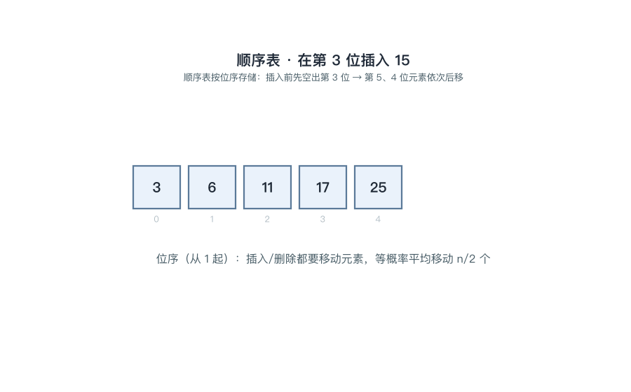
📌 锚点：**后移从表尾往前、前移从被删位往后；平均移动 n/2 与 (n-1)/2 → 插删 O(n)**。

---

#### 2.3 单链表：结点结构与插删指针操作 ★★★

**定义详解**

**链式存储**用一组**任意（可不连续）**的存储单元存放元素，结点=**数据域+指针域**，指针域存放直接后继的存储地址。**头指针**指向链表的第一个结点（有头结点时指向头结点）；**头结点**是在首元结点之前附设的结点，作用：**统一空表与非空表的操作、使首元结点的插删与其他位置一致**；**首元结点**是第一个存放数据的结点；尾结点指针域为**空**。插入（p 后插 s）口诀**先接后断**：s->next=p->next; p->next=s，两句次序不能反；删除 p 的后继 q：p->next=q->next 后释放 q。查找须顺链扫描 **O(n)**，修改指针本身只需 **O(1)**。

**考试答题**

**📌 题目演练**

**【示例·单选】** 在单链表中，指针 p 所指结点后插入 s 所指结点的正确操作是（　）

A. s->next=p->next; p->next=s

B. p->next=s; s->next=p->next

C. s->next=p; p->next=s

D. p->next=s->next; s->next=p

✅ **答案：A**

📌 要点：先让 s 接住 p 的原后继（先接），再让 p 改指 s（后断）；若先改 p->next，原后继地址被覆盖、链条断裂。

**【13003 题库摘要题】**（主观题）试比较顺序存储与链式存储的优缺点。

答：

① 存取方式：顺序表可**随机存取**，按位序取元素 O(1)；链表只能从头**顺序存取**，O(n)（2分）；

② 插入/删除：顺序表平均需移动约一半元素；链表找到位置后**只改指针**、不搬动元素（2分）；

③ 存储空间：顺序表需**预分配**连续空间，可能溢出或留空闲浪费；链表按需分配，但每个结点的指针域占**额外空间**（1分）。

**🎯 考法**：插删指针操作次序正误辨析、头结点作用简答、单链表插删时间复杂度分析。

**✍️ 得分点**：插入两句代码次序不能颠倒；头结点作用答全两点——"统一空表与非空表处理"+"使首元结点的插删与其他位置一致"。

**⚠️ 易混淆**：**头指针 ≠ 头结点**——头指针是指向第一个结点的指针（任何链表必有，无论有无头结点）；头结点是首元结点前附设的结点（可有可无）。另：单链表插删 O(n) 的代价在**查找前驱**，改指针本身是 O(1)。

**🔑 记忆锚点**：**有头结点，空表=头结点+空指针，插删永远改前驱指针。**

**算法方法**

单链表插删算法模板（p 为目标结点/前驱指针，s 为新结点，q 为待删结点，带头结点）：

① 找位：从头结点出发顺链扫描，停在第 i-1 个结点 p 上（**为什么**：单链表只能顺序存取，且插删改的是**前驱**的指针域，必须先站到前驱上）。

② 插入·先接：s->next=p->next（**为什么先接**：先把 p 原后继的地址保存在 s->next 里，再动 p 才不丢链）。

③ 插入·后断：p->next=s（**为什么后断**：此刻原后继已由 s 接管，p 再改指 s 才不断链；两句颠倒则原后继地址被覆盖、永久丢失）。

④ 删除：q=p->next; p->next=q->next; free(q)（**为什么**：令前驱直接指向 q 的后继、把 q 绕过去，再释放结点空间防止内存泄漏）。

⑤ 表长加 1 或减 1（**为什么**：插删改变元素个数，需同步维护计数）。

**【例 2-2】单链表插删指针演算（自编教学数据，与动图一致）**

带头结点的单链表：head → a1 → a2 → a3 → a4。

（1）在 a2 之后插入新结点 x（p 指向 a2，s 指向 x）：

- 执行 s->next=p->next：s->next 指向 a3，x 挂上原后继，主链未动（**为什么先接**：先把 a3 的地址存进 s->next，保住原后继不断）；
- 执行 p->next=s：a2 改指向 x，链变为 **a1→a2→x→a3→a4**（**为什么后断**：a2→a3 的旧链此时才断开改接 x；若先执行本句，a3 的地址无处可寻）；
- 全程只改 2 个指针域、0 个元素搬动（**为什么**：链表插删的代价在"改指针"而非"移数据"）。

（2）删除 a3（p 指向 a2，q 指向 a3）：

- 执行 p->next=q->next：a2 直接指向 a4，链变为 a1→a2→a4（**为什么**：q 的后继地址已存在 q->next 中，交给前驱即可把 q 绕过去）；
- 执行 free(q) 释放 a3 结点（**为什么**：动态分配的结点删除后必须归还内存，否则泄漏）；
- a3 的数据域自始至终未被搬动（**为什么**：删除只是改接指针、元素原地不动，这正是与顺序表的本质区别）。

> **🖼 动图演示：单链表插入与删除（指针变化，先接后断）**
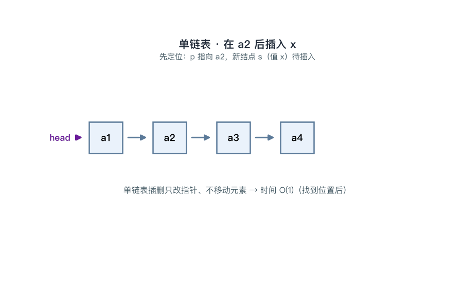
📌 锚点：**插入口诀"先接后断"；单链表插删只改指针不搬元素**。

---

#### 2.4 循环链表、双向链表与顺序表/链表选型 ★★

**定义详解**

**循环链表**：尾结点指针域不存空而**改指头结点**，整链成环，可从任一结点出发遍历全表；带头结点的循环单链表**判空条件为 head->next==head**。**双向链表**：每个结点含 **prior（前驱指针）和 next（后继指针）**两个指针域，可两个方向查找；在 p 结点之前插入 s 的四步：s->prior=p->prior; s->next=p; p->prior->next=s; p->prior=s（前两步先接 s，第三步改左邻，最后一步才改 p，次序不能乱）。**选型**：频繁按位序存取、插删少、表长稳定 → **顺序表**；频繁插删、长度变化大 → **链表**。

**考试答题**

**📌 题目演练**

**【示例·单选】** 带头结点的循环单链表 L 的判空条件是（　）

A. L==NULL

B. L->next==NULL

C. L->next==L

D. L->prior==L

✅ **答案：C**

📌 要点：空表时头结点的 next 仍指回头结点自身，故 L->next==L 即空表；B 是非循环单链表的判空条件，D 用了双向链表才有的 prior 域。

**【示例·单选】** 双向链表中在 p 所指结点之前插入 s 所指结点，下列操作次序正确的是（　）

A. s->prior=p->prior; s->next=p; p->prior->next=s; p->prior=s

B. p->prior=s; s->prior=p->prior; s->next=p; p->prior->next=s

C. s->next=p; p->prior=s; s->prior=p->prior; p->prior->next=s

D. p->prior->next=s; p->prior=s; s->prior=p->prior; s->next=p

✅ **答案：A**

📌 要点：p->prior=s 必须最后执行——一旦先改掉 p 的 prior，p 的原前驱地址即丢失，后续语句就会读错、接错。

**🎯 考法**：循环链表判空条件、双向链表前插四步次序辨析、给定场景选顺序表还是链表。

**✍️ 得分点**：判空写 head->next==head；四步必须写全且 p->prior=s 排最后；选型题从"存取方式、插删频率、表长是否稳定"三方面对比作答。

**⚠️ 易混淆**：循环链表判空**不是** L->next==NULL（那是非循环单链表）；双向链表空表时 head->next 与 head->prior 都指头结点自身；链表并非处处优——按位序取元素它反而要 O(n)。

**🔑 记忆锚点**：**双向链表改指针口诀"先两侧后自己"（最后才改 p->prior）。**

**算法方法**

双向链表在 p 结点之前插入 s 的四步模板：

① s->prior=p->prior（**为什么**：让 s 先记住 p 的**原前驱**地址——此句必须在 p->prior 还是旧值时执行）。

② s->next=p（**为什么**：s 的右链直接接 p；本句只读 p 不改 p，任何时候执行都安全，先做掉最稳妥）。

③ p->prior->next=s（**为什么**：用 p 的原前驱把它的 next 改指 s——此刻 p->prior 仍是旧值，才能正确找到左邻）。

④ p->prior=s（**为什么最后才改自己**：本句执行后 p->prior 变为 s，原前驱地址只能靠前三步保存和改接；若提前执行，①③ 都会读到错误地址，左邻结点从此失联）。

演算演示（自编教学数据）：双向链 …↔ a1 ↔ a2 ↔ a3 ↔…，在 a2 之前插入 x（p 指 a2，s 指 x）：

- s->prior=a1（**为什么**：x 的左邻就是 a2 的原左邻 a1）；
- s->next=a2（**为什么**：x 插在 a2 之前，右邻自然是 a2）；
- a1->next=x（**为什么**：a1 的右链由 a2 改接为 x，此刻 a2 的 prior 还是旧值，a1 仍可被正确找到）；
- a2->prior=x（**为什么**：最后才改 a2，得 …↔a1↔x↔a2↔a3↔…，四步全程使用旧地址，无一丢失）。

顺序表/链表选型三步判断模板：

① 题目要求频繁按位序取第 i 个元素 → 选顺序表（**为什么**：顺序表随机存取 O(1)，链表顺链扫描 O(n)）。

② 题目要求频繁插删、且多在表头或中部 → 选链表（**为什么**：链表定位后只改指针 O(1)，顺序表要平均搬动一半元素）。

③ 表长难以预估或动态变化大 → 选链表（**为什么**：链表按需分配不受容量限制，顺序表预分配可能溢出或长期闲置空间）。

④ 表长稳定且追求存储密度 → 选顺序表（**为什么**：无需指针域的额外开销，存储密度为 1；链表每个结点都要为指针"付租金"）。
### 第 3 章 栈与队列

> **本章地位**：栈与队列是两种**操作受限的线性表**，是数据结构的"工具章"。操作原则（LIFO/FIFO）、出入栈序列合法性、循环队列判空判满与元素个数计算是历年必考的送分点；同时本章直接支撑递归、表达式求值、树的深序/层序遍历等后续算法——**先把本章的分拿满，后面的树与图才稳**。

#### 3.1 栈的定义与实现 ★★★

**定义详解**

栈（Stack）是**只能在表尾（栈顶）进行插入和删除**的线性表，操作原则为**后进先出（LIFO，Last In First Out）**。
允许插入、删除的一端叫**栈顶（top）**，另一端叫**栈底（bottom）**；不含元素的栈为**空栈**；插入称**进栈（push）**、删除称**出栈（pop）**，两个操作都只发生在栈顶一端。
存储实现两条路：**顺序栈**用一维数组存放元素，`top` 指示栈顶位置——**进栈先移指针后存元素（S.top++ 后入），出栈先取元素后移指针**；栈满条件 `top==StackSize-1`，栈空条件 `top==-1`。
**两栈共享一维数组空间**：两栈底分设在数组两端，两栈顶相向而行，`top1+1==top2` 时栈满。**链栈**用单链表实现，栈顶设在表头、插删都在表头进行，**不存在栈满**问题。

**考试答题**

**📌 题目演练**

**【示例·单选】**栈的操作原则是（　）
A. 先进先出
B. 后进先出 ✅
C. 随机进出
D. 顺序进出
📌 要点：栈 = 后进先出 LIFO；"先进先出"是队列的操作原则（见 3.3），两者对别着记。

**【示例·单选】**顺序栈中，栈满的条件是（　）
A. top==-1
B. top==0
C. top==StackSize-1 ✅
D. top==StackSize
📌 要点：数组下标范围 0~StackSize-1，top 指向栈顶元素，到达下标上界即满，再进栈则"上溢"。

**【示例·单选】**两个栈共享一维数组空间，栈满的条件是（　）
A. top1+top2==StackSize
B. top1+1==top2 ✅
C. top1==top2
D. top1-top2==1
📌 要点：两栈顶相向而行，当中间只剩一个空位（top1+1==top2）时再也无处可放，即为满。

**【示例·填空】**栈顶指针 top=-1 表示____。
答案：**栈空**（约定 top 指向栈顶元素，-1 即栈中尚无任何元素）。

**【示例·判断】**栈底元素总是最先入栈、最后出栈。（　）
答案：正确。
📌 要点：栈底元素最先入栈，其后所有元素都压在它上面，它必须等上面的元素全部出栈后才能出——正是 LIFO 的极端情形。

**🎯 考法**：LIFO 操作原则判定；顺序栈栈满/栈空条件的选择、填空；两栈共享空间满条件判断。
**✍️ 得分点**：写条件先注明"top 指向栈顶元素"的约定；两栈共享满条件 `top1+1==top2`；链栈答"无栈满、只受内存限制"。
**⚠️ 易混淆**：**进栈是"先移指针再存"还是"先存再移"取决于 top 的约定**（top 指向栈顶元素时先移后存；top 指向下一空位时先存后移）——答题按教材约定并说明，不给约定直接写公式易丢分。
**🔑 记忆锚点**：**栈=先进后出；顺序栈判空 top<0**。

**算法方法**

顺序栈**进栈**（约定 top 指向栈顶元素）步骤化模板：
① 判满：若 `top==StackSize-1` 报"上溢"（**为什么先判满**：满时再存会越过数组上界，破坏相邻内存）
② 移指针：`S.top=S.top+1`（**为什么先移**：top 约定指向当前栈顶元素，新元素要放到它的上一格）
③ 存元素：`S.data[S.top]=x`（**为什么后存**：指针先落位，元素才能存进正确的格子）

顺序栈**出栈**步骤化模板：
① 判空：若 `top==-1` 报"下溢"（**为什么先判空**：空栈无元素可取，硬取读到的是无效数据）
② 取元素：`x=S.data[S.top]`（**为什么先取**：先拿值再动指针，指针一回退原栈顶位置即"失效"）
③ 移指针：`S.top=S.top-1`（**为什么后移**：弹出后栈顶退回下一格，完成逻辑删除）

> 注：以上按"top 指向栈顶元素"约定；若教材约定 top 指向**下一空位**，则进栈变为"先存后移"（`S.data[S.top]=x; S.top=S.top+1`）、判空变为 `top==0`——做题先认约定，再套步骤。

**【演算】**顺序栈进 A、B、C 再出栈一次（自编教学数据）：
初态 top=-1（**为什么**：空栈约定，作为判空基准）。
进 A：top=0、data[0]=A（**为什么**：先移指针后存元素）。
进 B：top=1、data[1]=B；进 C：top=2、data[2]=C（**为什么**：同上，元素依次叠放）。
出栈：先取 x=data[2]=C，再令 top=1（**为什么**：出栈先取元素后移指针）。
出栈得到的是**最后进栈的 C**，正体现 LIFO。

#### 3.2 出入栈序列的合法性（栈混洗） ★★★

**定义详解**

n 个**不同**元素依次进栈，可得到的出栈序列共有 **C(2n,n)/(n+1)** 种（卡特兰数：n=3 时 5 种、n=4 时 14 种）。
判定某出栈序列是否合法用**模拟法**：按目标序列逐个"放行"——进栈序列的元素依次进栈，直到目标要求的元素到达栈顶即出栈；任何时刻"进"与"出"都可以交替进行。
若目标元素未入栈、又不是当前栈顶、且已无元素可再进，则**卡死**，该序列非法。
根源规则只有一条：**先进栈的元素必须后于压在它上面的元素出栈**。

**考试答题**

**📌 题目演练**

**【示例·单选】**进栈序列为 1,2,3,4，则不可能得到的出栈序列是（　）
A. 1,2,3,4
B. 4,3,2,1
C. 3,2,4,1
D. 4,3,1,2 ✅
📌 要点：4、3 相继出栈后栈内自顶向下为 2、1，目标下一个却是 1——1 压在 2 之下且无元素可再进，卡死即非法。

**【示例·单选】**进栈序列为 a,b,c，则不可能得到的出栈序列是（　）
A. a,b,c
B. c,b,a
C. a,c,b
D. c,a,b ✅
📌 要点：c 出栈后栈顶是 b，a 压在 b 之下，a 不可能先于 b 出栈（3 个元素合法序列共 5 种，唯一不可能的就是 c,a,b）。

**【示例·填空】**3 个元素依次进栈，可得____种出栈序列。
答案：**5**（卡特兰数 C(6,3)/4=5；n=4 时为 C(8,4)/5=14 种）。

**【示例·填空】**4 个元素依次进栈，可得____种出栈序列。
答案：**14**（卡特兰数 C(8,4)/5=14）。

**【示例·判断】**进栈序列为 1,2,3，出栈序列 3,1,2 是合法的。（　）
答案：错误。
📌 要点：3 出栈后栈顶是 2，1 压在 2 之下，1 不可能先于 2 出栈——与上题 c,a,b 同型。

**【示例·简答】**如何判断一个出栈序列是否合法？
答：①设辅助栈，进栈序列元素依次进栈（1分）；
②每一步对照目标出栈序列：栈顶等于目标当前元素即出栈、目标指针后移，"能进则进、栈顶即出"交替进行（2分）；
③目标序列全部放行完毕则合法；若目标元素未入栈且栈顶≠它、又无元素可再进，则卡死，序列非法（2分）。

**🎯 考法**：给进栈序列选"不可能的出栈序列"（02331 历年高频题型）；卡特兰数填空（n=3→5、n=4→14）。
**✍️ 得分点**：用模拟法逐步写出进出栈动作，结论给"合法/非法"并指出卡死位置；个数计算写公式 C(2n,n)/(n+1)。
**⚠️ 易混淆**：任何时刻"进"与"出"可交替，**不必全进完再出**（1 进 1 出、2 进 2 出…得到 1,2,3,4 也合法）；n₁ 先进、n₂ 后进且相邻压叠时，n₁ 不可能先于 n₂ 出栈。
**🔑 记忆锚点**：**先进者后出（相邻对），卡死即非法**。

**算法方法**

出栈序列合法性**模拟判定**步骤化模板：
① 读目标序列当前元素 x（**为什么**：以"目标下一个出谁"驱动全过程）
② 若 x 未入栈，让进栈序列中未入栈元素依次进栈，直到 x 到栈顶（**为什么只能进到 x**：目标要求 x 是下一个出栈者，它前面的元素必须先压在栈里）
③ x 出栈、目标指针后移（**为什么**：每放行一个，目标要求就前进一步）
④ 重复 ①~③ 直到目标序列读完（**为什么**：全部放行成功才能下"合法"结论）
⑤ 若 x 未入栈且栈顶 ≠ x → 序列非法（**为什么卡死**：x 比栈顶元素先进栈、只能比它后出；目标却要求 x 先出，矛盾）

**【例 3-1】出入栈序列判定（自编教学数据，与动图一致）**：进栈序列 1,2,3,4。
**① 判断出栈序列 3,2,4,1 → 合法**：
1、2、3 依次进栈（**为什么**：目标第一个是 3，必须先让 3 到栈顶）；
3 出栈（**为什么**：3 已是栈顶，恰为目标第一位）；
2 出栈（**为什么**：弹出后栈顶恰为目标下一位 2）；
4 进栈（**为什么**：目标下一位是 4 且尚未入栈，进一个即到顶）；
4 出栈、1 出栈（**为什么**：栈中仅剩 1，逐个弹出与目标一致）；
目标序列读完，**合法**。
**② 判断出栈序列 4,3,1,2 → 非法**：
1、2、3、4 依次进栈（**为什么**：目标第一个是 4，只能一直进到 4）；
4 出栈（**为什么**：4 在栈顶）；3 出栈（**为什么**：3 变为栈顶）；
目标下一个是 1，但栈顶是 2（**为什么卡死**：1 压在 2 之下、先进栈只能后出，其后又无元素可再进）；
**卡死，非法**。

> **🖼 动图演示：出入栈序列合法性判断（合法 3,2,4,1 与非法 4,3,1,2 逐动作模拟）**
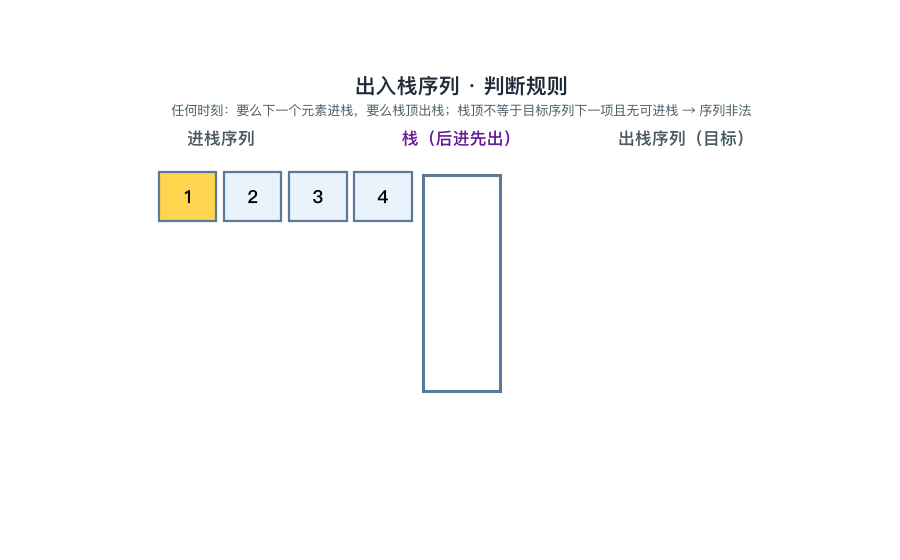
📌 锚点：**模拟判定：能进则进、栈顶即出、卡死即非法；n=4 共 14 种合法序列**。

#### 3.3 队列与循环队列 ★★★

**定义详解**

队列（Queue）是**只能在一端（队尾 rear）插入、另一端（队头 front）删除**的线性表，操作原则为**先进先出（FIFO）**；插入称**入队**，删除称**出队**。
顺序队列用一维数组+front/rear 指针，出队后前部空位无法复用、rear 到界尾即误判满，称为**假溢出**。
解决办法是**循环队列**：逻辑上把数组首尾相连，`rear=(rear+1) mod M`、`front=(front+1) mod M`，空位绕回复用。
判满判空用**牺牲一格**法——队空 `front==rear`，队满 `(rear+1) mod M==front`（此时实际最多存 M-1 个元素），元素个数 `=(rear-front+M) mod M`。**链队列**用带头结点的单链表+front/rear 双指针实现。

**考试答题**

**📌 题目演练**

**【示例·单选】**循环队列容量 M=6，front=2，rear=1，则该队列（　）
A. 队空
B. 队满 ✅
C. 有 1 个元素
D. 有 5 个元素
📌 要点：(rear+1) mod M=(1+1) mod 6=2==front，直接命中"牺牲一格"法的队满条件，选 B；此时实际元素 5 个=M-1，正是"牺牲一格"的体现。

**【示例·单选】**循环队列容量 M=6，front=1，rear=5（rear 指向下一入队位置），队列中元素个数为（　）
A. 3
B. 4 ✅
C. 5
D. 6
📌 要点：个数=(rear-front+M) mod M=(5-1+6) mod 6=4；"先加 M 再取模"保证差值为负时结果仍正确。

**【示例·填空】**队列的操作原则是____。
答案：**先进先出（FIFO）**。

**【示例·填空】**"牺牲一格"约定下，循环队列的队满条件是____。
答案：**`(rear+1) mod M==front`**（队空条件为 `front==rear`，两式不同方能区分空与满）。

**【示例·判断】**"牺牲一格"约定下，front==rear 既表示队空也表示队满。（　）
答案：错误。
📌 要点：牺牲一格正是为了区分两者——空是 `front==rear`，满是 `(rear+1) mod M==front`，两个条件形式不同、互不冲突。

**【示例·简答】**顺序队列为什么会产生"假溢出"？循环队列如何解决？
答：①出队后 front 之前的空位无法复用，rear 到达数组界尾时明明有空位却判"满"，即假溢出（2分）；
②循环队列把数组逻辑上首尾相连，指针进位取模：rear=(rear+1) mod M、front=(front+1) mod M，空位得以绕回复用（2分）；
③为区分空与满采用"牺牲一格"法：队空 front==rear，队满 (rear+1) mod M==front，实际最多存 M-1 个元素（1分）。

**🎯 考法**：循环队列判空判满条件（02331 历年高频）；元素个数计算；假溢出成因简答。
**✍️ 得分点**：个数公式写全取模 `(rear-front+M) mod M`；判满写 `(rear+1) mod M==front` 并注明"牺牲一格、实际容量 M-1"。
**⚠️ 易混淆**：**rear 指向"下一入队位置"还是"当前队尾元素"两种约定**——个数公式随之不同，答题写明约定；真溢出（确无空位）与假溢出（有空位用不上）要区分。
**🔑 记忆锚点**：**取模循环、牺牲一格；个数=(rear-front+M)%M**。

**算法方法**

循环队列**入队**（rear 指向下一入队位置）步骤化模板：
① 判满：若 `(rear+1) mod M==front` 报"队满"（**为什么先判满**：满时再入队会覆盖尚未出队的元素）
② 存元素：`Q.data[rear]=x`（**为什么**：rear 约定指向新元素应放入的空位）
③ 移指针：`rear=(rear+1) mod M`（**为什么取模**：指针到界尾绕回 0，复用前部空位）

循环队列**出队**步骤化模板：
① 判空：若 `front==rear` 报"队空"（**为什么先判空**：空队无元素可取）
② 取元素：`x=Q.data[front]`（**为什么**：front 指向当前队头元素）
③ 移指针：`front=(front+1) mod M`（**为什么取模**：队头同样绕回，实现双向循环复用）

**【例 3-2】循环队列演算（自编教学数据，与动图一致）**：容量 M=6。
初态 front=rear=0（**为什么相等**：空队约定 front==rear）。
入队 A：存入 0 位，rear=(0+1) mod 6=1（**为什么先存后移**：rear 指向空位）；入队 B、C 同理，rear 依次到 2、3。
出队 2 次：取 A（front 位 0），front=1；取 B，front=2（**为什么只动 front**：删除只发生在队头，rear 不变）。
入队 D：存 3 位，rear=4；入队 E：存 4 位，rear=5（**为什么**：尚未到界尾，正常递增）。
入队 F：存 5 位，rear=(5+1) mod 6=0（**为什么绕回**：取模让 rear 回到 0，复用刚才出队腾出的空位）。
入队 G：存 0 位，rear=(0+1) mod 6=1。
判满：(rear+1) mod 6=(1+1) mod 6=2==front → **队满**（**为什么牺牲一格**：若不牺牲一格，front==rear 时无法区分空与满），已存 5 个=M-1。

> **🖼 动图演示：循环队列出入队与队满判定（指针绕回 + 牺牲一格判满）**
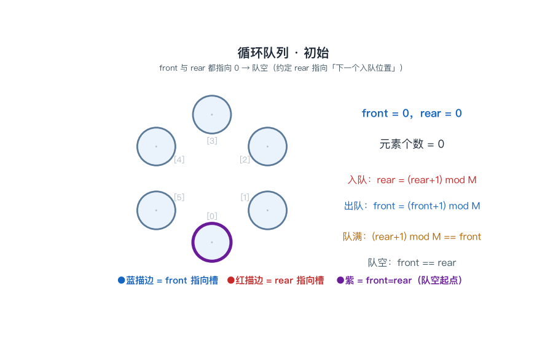
📌 锚点：**队空 front==rear；队满 (rear+1)%M==front；实际容量 M-1**。

#### 3.4 栈与队列的应用 ★★

**定义详解**

栈与队列都是**受限的线性表**：栈只在一端（栈顶）插删，后进先出；队列两端各管一头（队尾进、队头出），先进先出。
**栈的典型应用**：函数**递归调用**（系统自动用栈保存返回地址、参数与局部变量）、**表达式求值**（操作数栈+运算符栈配合）、**括号匹配**、二叉树深度优先（DFS）遍历与回溯。
**队列的典型应用**：二叉树**层序（广度优先）遍历**、操作系统**作业调度/打印缓冲**、图的广度优先搜索（BFS）。
选择原则一句话：**"深"用栈（先深入后回头），"广/排队"用队列（按到达次序处理）**。

**考试答题**

**📌 题目演练**

**【13003 题库摘要题】**（主观题）试述栈和队列的异同。
答：
相同点：
① 两者都是受限的线性表，只能在线性表的端点进行插入和删除操作（2分）；
② 逻辑结构都属于线性结构，元素之间是一对一的关系（1分）。
不同点：
① 栈只在栈顶一端进出，操作原则为后进先出；队列在队尾插入、队头删除，两端进出，操作原则为先进先出（2分）。

**【示例·单选】**函数递归调用是靠（　）实现的
A. 队列
B. 栈 ✅
C. 数组
D. 链表
📌 要点：系统用"运行栈"保存返回地址、参数与现场，后调用先返回，正合 LIFO。

**【示例·单选】**二叉树的层序遍历需借助的数据结构是（　）
A. 栈
B. 队列 ✅
C. 二维数组
D. 哈希表
📌 要点：逐层"先到先访问"符合 FIFO；深序（先序/中序/后序）遍历才用栈。

**【示例·填空】**表达式求值需要____栈和____栈配合工作。
答案：**操作数**栈和**运算符**栈。

**【示例·判断】**操作系统的打印缓冲区适合采用队列结构。（　）
答案：正确。
📌 要点：打印任务按提交先后服务、先来先打印，符合 FIFO；若用栈会后提交的先打印，违背公平次序。

**🎯 考法**：应用场景配对（递归→栈、层序→队列、调度缓冲→队列）；栈队列异同简答（题库摘要题）。
**✍️ 得分点**：异同简答按"相同 2 点 + 不同 1 点"分点作答并保留分值结构；应用配对各举 2 例以上更稳。
**⚠️ 易混淆**：**递归转非递归用栈；层序遍历用队列**——别配反；打印缓冲/作业调度是"先来先服务"，用队列不用栈。
**🔑 记忆锚点**：**深用栈、广用队**。

**算法方法**

**递归转非递归（用栈）**步骤化模板：
① 遇递归调用点，把当前参数与局部现场压栈（**为什么**：模拟系统运行栈，把"还没做完的事"暂存起来）
② 转入下一层处理逻辑（**为什么**：递归先"下去"；LIFO 保证最深处先处理完）
③ 到达递归出口后逐层弹栈恢复现场（**为什么**：后进先出 = 后调用的先返回）

**表达式求值（双栈配合）**步骤化模板：
① 操作数进操作数栈，运算符进运算符栈（**为什么**：两类对象分开管理，各自存取）
② 新运算符与栈顶运算符比较优先级，更高则进栈（**为什么**：优先级高的必须先算）
③ 不高于栈顶时，弹出栈顶运算符与两个操作数计算、结果压回操作数栈（**为什么**：先把栈里能算的算掉，再决定新运算符去留）
④ 表达式读完，运算符栈逐个弹出完成剩余计算（**为什么**：剩下的都是低优先级运算，从后往前收尾）

**队列做层序/调度处理**步骤化模板：
① 起点（根结点/首个作业）入队（**为什么**：层序从第一层开始，调度从最早到达者开始）
② 队头出队并处理，把它的下一层结点（孩子/新作业）依次入队（**为什么**：先进队的结点其孩子也更早入队，天然保证逐层/先来先服务次序）
③ 重复直到队空（**为什么**：队空说明所有结点/作业都已处理完）

**【演算】**括号匹配（自编数据）：输入 `( [ ] )`：
`(` 进栈（**为什么**：左括号等待配对，先存起来）；
`[` 进栈（**为什么**：栈顶变为最近一个未配对的左括号）；
`]` 到来，与栈顶 `[` 配对出栈（**为什么**：最近未配对的左括号最先被配上，正合 LIFO）；
`)` 到来，与栈顶 `(` 配对出栈（**为什么**：同上，栈中已无未配对括号）；
串读完且栈空 → **匹配成功**（**为什么**：栈空说明没有落单的左括号）。
### 第 4 章 串、数组和广义表

> 本章把线性表向三个方向推广：**串**是内容受限的线性表，**多维数组**是线性表的线性表，**广义表**是元素可为子表的线性表。自考命题集中在四件事：KMP 的 next 手算、二维数组地址计算、对称矩阵压缩公式 n(n+1)/2、广义表取头取尾与深度——题型几乎全是单选、填空小题，计算量不大，但 **1 起下标、行优先、表尾必是表**等口径细节决定对错。

#### 4.1 串的基本概念与模式匹配（BF 与 KMP） ★★★

**定义详解**

串（字符串）是**内容受限的线性表**——数据元素限定为字符。串中任意个**连续**字符组成的子序列称为**子串**，包含子串的串称为主串；字符在串中的序号称为**位序**。子串在主串中的定位操作称为**模式匹配**（被定位的子串称模式串）。**BF（朴素）算法**：主串指针 i 与模式串指针 j 逐位比较，相等则同步后移；一旦失配，**i 回溯到本轮起点的下一位、j 回到 1** 整轮重来，最坏时间复杂度 **O(n×m)**。**KMP 算法**的改进：失配时**主串指针 i 不回溯**（利用已比较过的信息），只把模式串指针 j 滑动到 next[j] 继续比较，时间复杂度 **O(n+m)**。next[j] 的含义（教材 **1 起下标**口径）：模式串前 j-1 个字符中**最长相等前后缀的长度 +1**，并规定 next[1]=0。

**考试答题**

**📌 题目演练**

**【示例·单选】** KMP 算法相对于 BF 算法的改进之处是（　）
A. 主串指针不回溯 ✅
B. 模式串变短
C. 比较次数一定减半
D. 无需存储模式串
📌 要点：KMP 的本质改进是利用失配前已匹配的信息，**i 不回溯**、只滑动 j。

**【示例·单选】** 串是一种特殊的线性表，其特殊性体现在（　）
A. 可以顺序存储
B. 数据元素是一个字符 ✅
C. 可以链式存储
D. 数据元素可以是任意类型
📌 要点：串 = 内容受限的线性表，"受限"就受限在**元素只能是字符**。

**【示例·填空】** 串 'abcabcaa' 中子串 'ca' 首次出现的位序是____。
📌 答案：**3**（第 3、4 位恰为 'c'、'a'；位序从 1 数起）。

**【示例·填空】** 长度为 n 的串中，不同起止位置的非空子串最多有____个。
📌 答案：**n(n+1)/2**（任选起点 i 与终点 j 且 i≤j；若再计空串则加 1）。

**【示例·填空】** 模式串 'aaaab' 的 next 序列为____。
📌 答案：**0 1 2 3 4**（前缀全 'a' 时最长相等前后缀逐位递增，重复串是 next 的经典变式）。

**🎯 考法**：next 序列手算（含 'aaa…b' 型连串重复字符的变式）；KMP 与 BF 改进点辨析；串术语辨析（子串/位序/空串与空格串/子串计数）。
**✍️ 得分点**：next 按教材 **1 起下标**作答——next[1]=0；next[j]=「前 j-1 个字符最长相等前后缀长度」+1；会写 BF 最坏 O(n×m)、KMP 为 O(n+m)。
**⚠️ 易混淆**：next 存在 **0 起与 1 起两种口径**（0 起时首值为 -1，其余整体比 1 起小 1），考试按教材 1 起；**空格串不是空串**（空格串含空格字符、长度不为 0）。
**🔑 记忆锚点**：**next = 最长相等前后缀长度 + 1；KMP 主串不回头，只有模式串滑。**

**算法方法**

BF 匹配步骤模板：
① i、j 均从 1 出发（**为什么**：教材位序从 1 编号，1 起下标口径）。
② 若 sᵢ = tⱼ，则 i++、j++ 同步后移（**为什么**：当前位匹配成功，继续验证下一位）。
③ 若失配，i 回溯到本轮起点的下一位（i = i-j+2），j 回到 1（**为什么**：朴素匹配不利用已比较信息，只能换起点整轮重来）。
④ j > m（模式串比完）则成功，返回本轮起点 i-j+1；i 超出主串则失败（**为什么**：j 走完整个模式串才说明每个字符都匹配上了）。

BF 与 KMP 对比速记：
- BF 失配：i、j 双双回退重比（**为什么**：不记录任何历史信息，代价是最坏 O(n×m)）。
- KMP 失配：i 不动、j 滑到 next[j]（**为什么**：前 j-1 个字符已匹配，其最长相等前后缀决定了滑动后无需重比的部分）。
- KMP 的优势在模式串内出现较多"部分匹配"时最明显（如连串重复字符、长周期串）。

next 手算模板（对模式串每个位置 j）：
① j=1 处填 0（**为什么**：教材规定值，作滑动时的"终点哨兵"）。
② 其余位置看**前 j-1 个字符**构成的串（**为什么**：失配发生在第 j 位时，前面 j-1 个字符是已匹配成功、可利用的信息）。
③ 在其中找**最长相等前后缀**——相同的真前缀与真后缀（**为什么**："前缀 = 后缀"允许模式串滑到前缀对齐后缀的位置续比，主串不必回头）。
④ 填入该长度 +1（**为什么**：1 起下标下，前后缀长 L 意味着 j 应滑到第 L+1 位继续比较）。

**【例 4-1】求模式串 'abaabc' 的 next 序列（自编教学数据）**

模式串：a b a a b c（位置 1~6）。
① next[1]=**0**（**为什么**：1 起口径的规定值）。
② next[2]=**1**：前 1 个字符 'a'，无真前后缀可言，长度 0 → 0+1=1（**为什么**：单个字符谈不上相等前后缀）。
③ next[3]=**1**：前 2 个字符 'ab'，前缀 'a' ≠ 后缀 'b'，最长长 0 → 1（**为什么**：无相等前后缀，失配后只能从头比）。
④ next[4]=**2**：前 3 个字符 'aba'，前缀 'a' = 后缀 'a'，最长长 1 → 2（**为什么**：'aba' 已匹配后失配，滑到前缀 'a' 对齐后缀 'a' 即可原地续比）。
⑤ next[5]=**2**：前 4 个字符 'abaa'，候选 'a'='a' ✓、'ab'≠'aa' ✗，最长长 1 → 2（**为什么**：真前后缀不能取整串自身，故 'abaa' 整体不算）。
⑥ next[6]=**3**：前 5 个字符 'abaab'，'ab'='ab' ✓ 长 2、'aba'≠'aab' ✗，2+1=3（**为什么**：前缀 'ab' 对齐末尾 'ab'，主串指针不动，从模式串第 3 位续比）。
得 **next = 0 1 1 2 2 3**。

#### 4.2 数组的存储与地址计算 ★★★

**定义详解**

数组是 **n 个同类型数据元素的有序集合**，多维数组可看成"线性表的线性表"——二维数组的每一行（或每一列）本身就是一个线性表。数组一旦定义，维数与各维长度便不再改变，因此**数组只有存取元素和修改元素值两种操作，没有插入与删除**。存储时须把多维结构映射到一维连续单元，二维数组有两种次序：**行优先**（一行存完再存下一行，C、Pascal 采用）与**列优先**（一列存完再存下一列，FORTRAN 采用）。行优先、1 起下标、每行 n 列、元素长 L 时，元素 aᵢⱼ 的地址公式为：

**LOC(aᵢⱼ) = LOC(a₁₁) + [(i-1)×n + (j-1)] × L**

**考试答题**

**📌 题目演练**

**【示例·单选】** 二维数组按行优先存储时，同一行中列号越大的元素，其存储地址越（　）
A. 大 ✅
B. 小
C. 相同
D. 不确定
📌 要点：行优先下同一行元素依次紧排，列号每加 1，地址加一个元素长度 L。

**【示例·单选】** 二维数组采用列优先存储次序的程序设计语言是（　）
A. C
B. Pascal
C. FORTRAN ✅
D. Java
📌 要点：两句话记死——**C/Pascal 行优先，FORTRAN 列优先**。

**【示例·填空】** 行优先存储的二维数组（每行 n 列）中，元素 aᵢⱼ 之前的元素个数公式为____。
📌 答案：**(i-1)×n + (j-1)**。

**【示例·填空】** 0 起下标、行优先、每行 n 列的二维数组中，LOC(aᵢⱼ)=LOC(a₀₀)+____×L。
📌 答案：**(i×n + j)**（a₀₀ 之前有完整的 i 行共 i×n 个，本行内再排 j 个）。

**【示例·单选】** 数组区别于一般线性表的操作特点是（　）
A. 元素类型相同
B. 一旦定义，只有存取与修改，没有插入删除 ✅
C. 元素之间是线性关系
D. 可以顺序存储
📌 要点：A、C、D 顺序表也有；**维数与长度固定、无插删**才是数组特有的约束。

**🎯 考法**：地址计算高频小题（给首地址、行列下标、元素长度求某元素地址）；行优先与列优先的辨析及语言对应；数组操作特点（无插删）。
**✍️ 得分点**：三步——数 aᵢⱼ 之前的元素个数、乘元素长度 L 得偏移、加首地址；列优先题把"行"换"列"套同样三步。
**⚠️ 易混淆**：**行优先 = 列号是"快变"下标**（同行相邻元素地址相邻）；**0 起与 1 起公式不同**（0 起：i×n+j；1 起：(i-1)×n+(j-1)），动笔前先看清题目下标起点。
**🔑 记忆锚点**：**行优先"整行排满"：前面元素数 = (i-1)×n + (j-1)。**

**算法方法**

二维数组地址计算模板（1 起下标）：
① 确认存储次序与每行列数 n（**为什么**：行优先一行存完才存下一行，同行元素地址连续，n 决定"整行"的个数）。
② 数出 aᵢⱼ 之前的元素个数 = (i-1)×n + (j-1)（**为什么**：前面完整占了 i-1 行、每行 n 个，本行内又排了 j-1 个）。
③ 偏移量 = 元素个数 × L（**为什么**：存储按单元编址，跳过一个元素即跳过 L 个单元）。
④ LOC(aᵢⱼ) = 首地址 + 偏移量（**为什么**：顺序存储支持随机存取，地址可以线性算出）。

**【例 4-2】数组地址计算（自编教学数据）**

设数组 A[1..5, 1..6]（5 行 6 列），按行优先存储，每个元素占 4 个存储单元，a₁₁ 的存储地址为 1000，求 a₃₄ 的地址。
① a₃₄ 之前的元素数 = (3-1)×6 + (4-1) = 12 + 3 = **15**（**为什么**：前两行整行共 2×6=12 个，第三行内 a₃₄ 前还有 a₃₁~a₃₃ 共 3 个）。
② 偏移量 = 15 × 4 = **60**（**为什么乘 L**：跳过 15 个元素即跳过 15×4=60 个存储单元）。
③ LOC(a₃₄) = 1000 + 60 = **1060**（**为什么**：首地址加偏移量即目标地址）。
④ 边界自检：取末元素 a₅₆，(5-1)×6+(6-1)=29，LOC=1000+29×4=1116，恰为末元素（**为什么**：全阵 30 个元素、末元素前 29 个，算得结果自洽）。
若改按**列优先**存储（每列 5 行）：a₃₄ 之前的元素数 = (4-1)×5 + (3-1) = 15 + 2 = 17（**为什么**：前面完整占了 3 列、每列 5 个，第 4 列内再排 a₁₄、a₂₄ 共 2 个）；偏移 17×4=68；LOC = 1000 + 68 = **1068**（**为什么**：列优先把行列角色互换，方法不变）。

#### 4.3 特殊矩阵的压缩存储 ★★

**定义详解**

压缩存储的基本思想：为**多个值相同的元素只分配一个存储空间、对零元素不分配空间**。**对称矩阵**满足 aᵢⱼ = aⱼᵢ，只需存储**下三角（含主对角线）**部分的 n(n+1)/2 个元素，按行优先存入一维数组 sa（教材口径）：**k = i(i-1)/2 + j - 1（i≥j）**；当 i<j 时按对称性改取镜像元素 aⱼᵢ 计算。**稀疏矩阵**是非零元个数远少于零元、且非零元分布**无规律**的矩阵，常用**三元组表 (行,列,值)** 顺序存放每个非零元，也可用十字链表链式存放；压缩存储后**失去了随机存取特性**——不能由下标直接算出地址，存取须按表查找。

**考试答题**

**📌 题目演练**

**【示例·单选】** 对对称矩阵进行压缩存储的目的是（　）
A. 节省存储空间 ✅
B. 提高运算速度
C. 便于查找元素
D. 简化矩阵运算
📌 要点：压缩只为省空间；换算下标反而多花时间，不会更快。

**【示例·单选】** 稀疏矩阵常用的压缩存储方法是（　）
A. 三元组表和十字链表 ✅
B. 二维数组和一维数组
C. 三元组表和二维数组
D. 邻接矩阵和邻接表
📌 要点：顺序存——三元组表；链式存——十字链表。

**【示例·填空】** 将 10 阶对称矩阵压缩存储下三角（含主对角线），需要____个存储单元。
📌 答案：**55**（10×11/2）。

**【示例·填空】** 三元组表中一个结点 (i, j, v) 表示：非零元位于矩阵第____行、第____列，值为____。
📌 要点：三元组 = **(行号, 列号, 元素值)**；整张表还需附记矩阵总行数、总列数与非零元个数。

**【示例·单选】** 矩阵采用压缩存储后，失去的特性是（　）
A. 有序性
B. 随机存取特性 ✅
C. 元素间的线性关系
D. 可计算性
📌 要点：无法由行列下标一步算出存储地址，**随机存取**不复存在。

**🎯 考法**：压缩存储的目的；下三角元素个数 n(n+1)/2 计算；aᵢⱼ 与 sa[k] 的互算；三元组表的结构与特点。
**✍️ 得分点**：会写对称矩阵映射公式 k = i(i-1)/2 + j - 1（i≥j）；会答三元组按**行优先次序**依次存放非零元；指出压缩后失去随机存取。
**⚠️ 易混淆**：压缩后**存取不是随机的**——对称矩阵要经公式换算、稀疏矩阵要顺序查找；三元组存的是"非零元"而非全部元素；公式有 **±1 两种口径**（取决于 sa 下标从 0 还是 1 起），按题给口径作答。
**🔑 记忆锚点**：**对称只存下三角 n(n+1)/2；稀疏用三元组 (行,列,值)。**

**算法方法**

对称矩阵压缩模板：
① 只为下三角（含主对角线）分配空间，共 n(n+1)/2 个元素（**为什么**：aᵢⱼ=aⱼᵢ，对称两元素值相同，存一份即可还原全矩阵）。
② 按行优先依次编号：第 i 行排 i 个元素，前 i-1 行共 1+2+…+(i-1) = i(i-1)/2 个（**为什么**：下三角第 i 行恰有 i 个元素，等差数列求和）。
③ 行内再偏移 j-1，得映射 k = i(i-1)/2 + j - 1（**为什么**：该值正是排在 aᵢⱼ 之前的元素个数，即 aᵢⱼ 在压缩序列中的位置下标）。
④ i<j 时改用镜像元素：k = j(j-1)/2 + i - 1（**为什么**：上三角元素与其下三角镜像值相同，换坐标后代入同一公式）。

稀疏矩阵三元组表组织模板：
① 按行优先扫描矩阵，依次登记每个非零元的 (行,列,值)（**为什么**：行优先登记使三元组表行序单调，便于转置与查找）。
② 表头附记总行数 m、总列数 n、非零元个数 t（**为什么**：还原矩阵与分配空间都依赖这三个量）。

**【例 4-3】求对称矩阵元素的一维下标（自编教学数据）**

5 阶对称矩阵按行优先压缩存下三角，求 a₄₂ 对应的下标 k。
① 判断位置：i=4 ≥ j=2，a₄₂ 在下三角内，直接代入公式（**为什么**：只有下三角元素被存储，上三角才需换镜像）。
② 第 4 行之前共 1+2+3 = 6 个元素（**为什么**：下三角前三行分别有 1、2、3 个元素）。
③ 代入 k = 4×(4-1)/2 + 2 - 1 = 6 + 1 = **7**（**为什么**：公式 = 前面整行 6 个 + 行内偏移 2-1=1，即 a₄₂ 排在压缩序列下标 7 处）。
④ 反向自检：a₄₂ 之前有 6+1=7 个元素，与 k 值吻合（**为什么**：正反两个方向核对可防手误）。
⑤ 变式：若求上三角元素 a₂₃，换镜像 a₃₂ 代入：k = 3×2/2 + 2 - 1 = **4**（**为什么**：i<j 时先按对称性换到下三角坐标，再套同一公式）。

#### 4.4 广义表 ★★

**定义详解**

广义表是 **n≥0 个元素 a₁, a₂, …, aₙ 的有限序列**，记作 LS=(a₁, a₂, …, aₙ)；每个元素既可以是**原子**（不可再分），也可以是**子表**（本身又是一个广义表），因此广义表是**线性表的推广**。两个重要运算：**表头 head(LS)=a₁**——第一个元素（可以是原子，也可以是子表）；**表尾 tail(LS)=(a₂, …, aₙ)**——除表头外其余元素组成的表，**表尾一定是一个表**。**长度** = 最外层（同层）元素个数；**深度** = 括号的最大嵌套层数，原子的深度为 0。空表 () 长度为 0、深度为 1；(()) 长度为 1、深度为 2——两者完全不同。

**考试答题**

**📌 题目演练**

**【示例·单选】** 广义表 L=((a,b),c,d)，则 head(L)=（　）
A. a
B. (a,b) ✅
C. ((a,b),c)
D. c
📌 要点：表头是**第一个元素的整体**——此处第一个元素是子表 (a,b)，不再向内拆。

**【示例·单选】** 广义表 L=((a,b),c,d)，则 tail(L)=（　）
A. (c,d) ✅
B. c,d
C. ((c,d))
D. (a,b)
📌 要点：表尾是除表头外**其余元素重新打包成的表**，必须带外层括号。

**【示例·单选】** 广义表 L=(a)，则 tail(L)=（　）
A. a
B. (a)
C. () ✅
D. 空格串
📌 要点：去掉表头 a 后剩余元素为零个，打包成**空表 ()**——再次印证表尾必是表。

**【示例·填空】** 广义表 ((a),((b),c)) 的深度为____。
📌 答案：**3**（最深原子 b 嵌套三层括号：外层 → ((b),c) → (b)）。

**【示例·填空】** 广义表 (a,(b,c,d)) 的长度为____，深度为____。
📌 答案：长度 **2**（元素为 a 与子表 (b,c,d)）；深度 **2**（子表嵌套一层括号）。

**【示例·填空】** 广义表 ((a,b),c,d) 的长度为____，深度为____。
📌 答案：长度 **3**、深度 **2**（子表 (a,b) 只嵌套一层括号）。

**🎯 考法**：取表头表尾运算（含 head/tail 复合运算）；深度与长度的计算；广义表与线性表的关系（推广、元素可为子表）。
**✍️ 得分点**：head 取第一个元素**保持原样**；tail 取剩余元素**必是表**；深度数括号嵌套层数，长度数最外层元素个数；空表 () 长 0 深 1。
**⚠️ 易混淆**：**表尾一定是表**——tail(L)=(c,d) 而不是 c,d；head 可能是原子也可能是表；**() 与 (()) 不同**——后者长度为 1（它含一个空表元素）。
**🔑 记忆锚点**：**头 = 第一个元素；尾 = 剩下的打包成表；深度数括号，长度数元素。**

**算法方法**

求广义表长度、表头表尾与深度的步骤模板：
① 长度：数最外层括号内以逗号分隔的元素个数（**为什么**：长度定义只看同层元素个数，不深入子表内部）。
② 表头：取出第一个元素 a₁ 原样作答（**为什么**：head 的定义就是取 a₁，子表须保持自身结构，不再向内拆解）。
③ 表尾：把 a₂…aₙ 重新用括号括成一个表（**为什么**：tail 是"其余元素组成的表"，结果必须保持表的形式）。
④ 深度：逐层剥括号数最大嵌套层数，原子深度记 0（**为什么**：深度定义 = 括号的最大嵌套层数）。

**【例 4-4】求广义表的长度、表头表尾与深度（自编教学数据）**

设 LS = ((a,b), c, (d,(e)))。
① 长度 = **3**（**为什么**：最外层有 (a,b)、c、(d,(e)) 三个元素，子表内部不计数）。
② head(LS) = **(a,b)**（**为什么**：第一个元素整体取出，保持子表形式）。
③ tail(LS) = **(c, (d,(e)))**（**为什么**：除表头外的两个元素重新打包成一个表）。
④ tail(tail(LS)) = **((d,(e)))**（**为什么**：tail(LS) 的元素为 c 与 (d,(e))，再取尾去掉 c，剩下的一个元素仍打包成表）。
⑤ 深度 = **3**（**为什么**：LS 外层括号 1 层，(d,(e)) 嵌到 2 层，原子 e 处共 3 层括号，取最大值）。
### 第 5 章 树与二叉树

> **本章地位**：本章是全卷权重最高的章节之一——性质计算、遍历还原、哈夫曼树三大题型几乎每年固定出现在选择、填空与应用题中，并直接支撑后续算法设计题，必须做到"性质会推、序列会走、哈夫曼会画"。

#### 5.1 树与二叉树的基本概念 ★★★

**定义详解**

树是 n（n≥0）个结点的有限集合：n=0 时为空树；n≥1 时有且仅有一个称为**根**的结点，其余结点分成 m（m≥0）个互不相交的子集 T₁…Tₘ，每个子集本身又是一棵树，称为根的**子树**。
常用术语：**度**（结点拥有的子树数）、树的度（各结点度的最大值）、**叶子结点**（度为 0）与**分支结点**（度不为 0）、孩子／双亲／兄弟、**深度（层次）**（树中结点的最大层数）、有序树与无序树、**森林**（m 棵互不相交的树的集合）。
二叉树是**每个结点至多两棵子树（度≤2）、子树分左右、次序不可颠倒**的树。两种特殊形态：**满二叉树**——每层结点数都达到最大值；**完全二叉树**——深度为 k，除第 k 层外其余各层都满，且第 k 层结点集中在最左边（编号与同深度满二叉树完全一致）。

**考试答题**

**📌 题目演练**

**【示例·单选】** 二叉树与树的本质区别是（　）
A. 二叉树结点度至多为 2 且子树有左右之分 ✅
B. 二叉树一定是满的
C. 二叉树结点更少
D. 无区别
📌 要点：树不限定结点度数、子树一般不分次序；二叉树"度至多 2＋左右有序"两条同时成立。

**【示例·单选】** 下列二叉树中一定是满二叉树的是（　）
A. 深度为 k 且恰有 2^k−1 个结点的二叉树 ✅
B. 所有分支结点度均为 2 的二叉树
C. 任意一棵完全二叉树
D. 叶子结点个数最多的二叉树
📌 要点：总结点数达到最大值 2^k−1，说明每层都装满，必为满二叉树；B 不保证底层对齐（一侧深一侧浅也满足"分支结点都有两个孩子"），不一定是满二叉树。

**【示例·填空】** 树中结点拥有的子树数称为结点的____；树中各结点度的最大值称为树的____。
答案：**度；度**。
📌 要点：两个"度"口径不同——前者对单个结点而言，后者对整棵树取最大。

**🎯 考法**：二叉树与树的本质区别（左右次序）；满二叉树、完全二叉树的判定与辨析。
**✍️ 得分点**：答"区别"必须写全两点——度≤2、左右不可颠倒，漏一条扣一半分。
**⚠️ 易混淆**：**满二叉树一定是完全二叉树，反之不成立**（如 6 个结点的完全二叉树不是满二叉树）。
**🔑 记忆锚点**：**二叉树"有序至二"——度≤2、左右不可换**；满＝层层全满，完全＝只许缺右边。

**算法方法**

满二叉树／完全二叉树判定模板：
① 数总结点数 n、看最大层数 k：若 n=2^k−1，判为满二叉树（**为什么**：达到每层最大容量即每层都满）。
② 若 n＜2^k−1，改判完全二叉树：把结点按自上而下、自左向右连续编号 1…n（**为什么**：完全二叉树的定义就是编号与同深度满二叉树前 n 个完全一致）。
③ 检查编号是否连续无空洞：连续则是完全二叉树，中断则不是（**为什么**：编号有洞说明中间层有空位或底层结点未靠最左）。
快速示例：深度 3、共 6 个结点且底层 2 个靠左 → 编号 1~6 连续，是完全二叉树；但 6≠2³−1=7，不是满二叉树。

#### 5.2 二叉树的重要性质 ★★★

**定义详解**

五条性质必须会推导、会代入：①第 i（i≥1）层上至多有 **2^(i-1)** 个结点；②深度为 k 的二叉树至多有 **2^k−1** 个结点；③对任何二叉树，若叶子数为 n₀、度为 2 的结点数为 n₂，则 **n₀=n₂+1**；④n 个结点的完全二叉树深度为 **⌊log₂n⌋+1**；⑤完全二叉树按层编号后，编号 i 的结点：双亲编号 ⌊i/2⌋，左孩子编号 2i，右孩子编号 2i+1（2i＞n 时无左孩子，2i+1＞n 时无右孩子）。
性质①②来自"每层最多翻倍"，性质③来自"分类计数＋边数守恒"，性质④⑤是完全二叉树顺序存储的理论基础。

**考试答题**

**📌 题目演练**

**【示例·单选】** 二叉树第 5 层最多有（　）个结点
A. 8
B. 15
C. 16 ✅
D. 31
📌 要点：性质①，2^(5−1)=2⁴=16；误选 B（15）是套用了"前 4 层最多"的 2⁴−1。

**【示例·单选】** 某完全二叉树共 13 个结点，按层编号后编号为 10 的结点，其双亲编号是（　）
A. 4
B. 5 ✅
C. 6
D. 3
📌 要点：性质⑤，双亲=⌊10/2⌋=5；顺便验证 2×10=20＞13，编号 10 是叶子。

**【示例·填空】** 任何二叉树中，叶子结点数＝度为 2 的结点数＋____。
答案：**1**。
📌 要点：性质③ n₀=n₂+1，与度为 1 的结点个数无关。

**🎯 考法**：性质计算题（叶子数↔结点数↔深度互相换算）每年必出；性质③的推导可作简答题。
**✍️ 得分点**：计算题写明所用性质编号并代入；推导题按"分类计数→边数守恒→联立消元"三步书写。
**⚠️ 易混淆**：第 i 层最多 2^(i-1) 个 vs 前 i 层最多 2^i−1 个，一字之差两个公式。
**🔑 记忆锚点**：**"叶子＝二度加一"；深度＝⌊log₂n⌋+1**。

**算法方法**

性质③ n₀=n₂+1 推导模板（简答标准三步）：
① 设度 1 结点数为 n₁，则 n=n₀+n₁+n₂（**为什么分类相加**：按度数把结点分成三类，不重不漏）。
② 边数=n−1=n₁+2n₂（**为什么**：每条边自上而下恰连一个孩子，度 1 结点贡献 1 条边、度 2 结点贡献 2 条边，n 个结点的树恰有 n−1 条边）。
③ 联立两式消去 n₁：n₀+n₁+n₂=(n₁+2n₂)+1，整理得 n₀=n₂+1（**为什么与 n₁ 无关**：度 1 结点在两式中各出现一次，恰好抵消）。

其余性质推导速记：
① 性质①：第 1 层 1 个，每层最多是上层 2 倍 → 第 i 层最多 2^(i-1)（**为什么**：每个结点至多两个孩子）。
② 性质②：各层最大值求和 2⁰+2¹+…+2^(k−1)=2^k−1（**为什么**：等比数列求和）。
③ 性质④：2^(k−1)−1＜n≤2^k−1 时深度为 k，即 k=⌊log₂n⌋+1（**为什么**：k−1 层装不下、k 层装得下）。

**【例 5-1】性质应用计算（自编教学数据）**
① 某二叉树有 5 个叶子结点、3 个度为 1 的结点，求总结点数：
n₂=n₀−1=5−1=4（**为什么**：性质③移项，叶子数减 1 得度 2 结点数）；
n=n₀+n₁+n₂=5+3+4=**12**（**为什么**：三类结点分类相加）。
② n=100 的完全二叉树求深度：
深度=⌊log₂100⌋+1=6+1=**7**（**为什么取下整再加一**：2⁶=64≤100＜128=2⁷，前 6 层最多 2⁶−1=63 个装不下 100 个，第 7 层必有结点）。

#### 5.3 二叉树的存储结构与遍历 ★★★

**定义详解**

存储结构两种：**顺序存储**——按完全二叉树编号把结点依次存入一维数组，编号 i 的孩子存于 2i、2i+1 号单元，适合满／完全二叉树；一般二叉树须补虚结点对齐编号，空间浪费大。**二叉链表**——结点含数据域与 left、right 两个指针域，n 个结点共 2n 个指针域，其中 **n+1 个为空**（为什么：树只有 n−1 条边占用 n−1 个指针域，2n−(n−1)=n+1）。
遍历三规则（递归定义）：**前序 DLR（根左右）**、**中序 LDR（左根右）**、**后序 LRD（左右根）**；**层序**自上而下逐层、同层自左向右（借助队列实现）。
关键定理：**中序＋前序（或后序）可唯一确定一棵二叉树**。

**考试答题**

**📌 题目演练**

**【示例·单选】** 某二叉树前序序列为 AB，中序序列为 BA，则该树（　）
A. A 为根，B 为 A 的左孩子 ✅
B. B 为根
C. 无法确定
D. A 为根，B 为 A 的右孩子
📌 要点：前序首位 A 是根；中序 B 排在 A 之前 → B 在 A 的左子树中，即 B 为左孩子。

**【示例·单选】** 中序序列的最后一个结点（　）
A. 一定是根结点
B. 一定是从根沿右指针一路向右走到的最右下结点 ✅
C. 一定是叶子结点
D. 一定是最后一个入队的结点
📌 要点：中序"左根右"，最右下结点的左子树输完后它最后输出；它可能有左孩子，故不一定是叶子。

**【示例·单选】** 二叉树的层序遍历需要借助的辅助数据结构是（　）
A. 栈
B. 队列 ✅
C. 一维数组
D. 线索链表
📌 要点：队列先进先出保证"先被访问的结点，其孩子也先被访问"，恰好实现自上而下逐层、同层自左向右。

**【13003 题库摘要题】（主观题）** 已知一棵二叉树的中序序列为 D B G E H A C I F，后序序列为 D G H E B I F C A，试画出这棵二叉树。
答案（按点给分）：
① 后序最后一个字符 A 为整树根（2 分）；
② 中序中 A 左侧的 D B G E H 为左子树结点、右侧的 C I F 为右子树结点（2 分）；
③ 对左右子树递归执行①②（1 分）——左子树：后序 D G H E B 末位 B 为根，中序分出 D（左）与 G E H（右）；G E H 由后序末位 E 作根、中序分出 G 左 H 右；右子树：后序 I F C 末位 C 作根，中序 C I F 中 C 居首故无左子树，I F 由末位 F 作根、I 为左孩子；
④ 画出还原树：

```
      A
     / \
   B     C
  / \    \
 D   E    F
    / \  /
   G   H I
```

📌 要点：口诀"后序找根、中序分左右"；本题还原结果与下方【例 5-2】的树完全一致。

**🎯 考法**：三种遍历序列互推（每年必考）；由两序还原二叉树（应用题）。
**✍️ 得分点**：写完序列按"每棵子树 3 个字符"回验根的位置；还原题先定根、再分左右，最后逐个检查单孩子结点的左右归属。
**⚠️ 易混淆**：**前序＋后序不能唯一还原二叉树**——结点只有一个孩子时无法判定它是左孩子还是右孩子。
**🔑 记忆锚点**：**前序找根、中序分左右**。

**算法方法**

三种遍历递归走法模板：
① 前序：访问根 → 递归左子树 → 递归右子树（**为什么**：DLR，根最先）。
② 中序：递归左子树 → 访问根 → 递归右子树（**为什么**：LDR，左子树全部输出完才轮到根）。
③ 后序：递归左子树 → 递归右子树 → 访问根（**为什么**：LRD，根最后）。
④ 层序：根入队 → 队首出队访问、其左右孩子依次入队 → 循环至队空（**为什么**：队列先进先出恰好保证逐层从左到右）。

**【例 5-2】三种遍历走树（自编教学数据，与动图一致）**
树形：A 为根，左孩子 B、右孩子 C；B 的孩子 D（左）、E（右）；E 的孩子 G（左）、H（右）；C 只有右孩子 F；F 只有左孩子 I。

```
      A
     / \
   B     C
  / \    \
 D   E    F
    / \  /
   G   H I
```

前序（根左右）逐结点走：
① 访问 A（**为什么**：前序整树根最先）。
② 进左子树：访问 B（**为什么**：子树内同样根优先）。
③ 访问 B 的左孩子 D（叶子，左右皆空，该子树完成）。
④ 进 B 的右子树：访问 E → 访问 E 的左孩子 G → 访问 E 的右孩子 H。
⑤ 左子树完成，进右子树：访问 C；C 无左孩子。
⑥ 访问 C 的右孩子 F → 访问 F 的左孩子 I。
⑦ 得序列 **A B D E G H C F I**。

中序（左根右）逐结点走：
① 从 A 一路向左下行到叶子 D，先访问 D（**为什么**：左子树没输出完，根不能输出）。
② 回到 B，访问 B。
③ 进 B 的右子树：先访问 E 的左孩子 G → 访问 E → 访问 H。
④ A 的左子树全部完成，访问根 A（**为什么**：左完才轮到根）。
⑤ 进右子树：C 无左孩子，访问 C。
⑥ 访问 F 的左孩子 I → 访问 F。
⑦ 得序列 **D B G E H A C I F**。

后序（左右根）逐结点走：
① 访问叶子 D。
② E 的左孩子 G、右孩子 H 先访问，再访问 E。
③ B 的左右子树都完成，访问 B（**为什么**：左右根，子树未完成根不动）。
④ 进右子树：访问 I → 访问 F → 访问 C。
⑤ 整树根 A 最后访问。
⑥ 得序列 **D G H E B I F C A**。

层序：A → B C → D E F → G H I，得序列 **A B C D E F G H I**（**为什么**：逐层从左到右，队列先进先出实现）。

> **🖼 动图演示：二叉树前序 / 中序 / 后序遍历走树（同一棵树三种次序）**
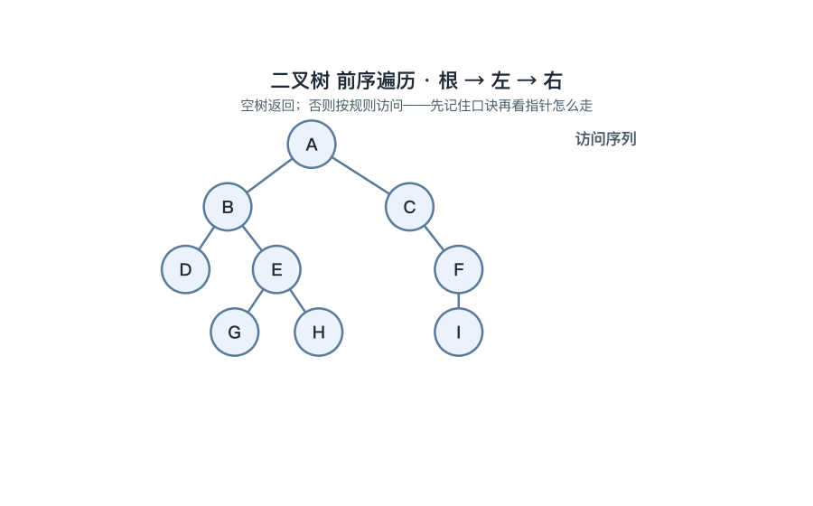
📌 锚点：**名字第几个字根在第几位；中序+前序/后序任一可唯一还原**。

**【例 5-3】由前序＋中序还原二叉树（自编教学数据）**
已知前序序列 A B D E C，中序序列 D B E A C：
① 前序首位 A 为整树根（**为什么**：前序第一个访问的必是根）。
② 中序中 A 左侧的 D B E 全为左子树结点、右侧的 C 为右子树结点（**为什么**：中序根恰好把左右子树序列隔开）。
③ 左子树递归：其前序 B D E 首位 B 为根；中序 D B E 中 D 居左、E 居右 → B 的左孩子 D、右孩子 E（**为什么**：子树内重复①②）。
④ 右子树仅剩 C，作 A 的右孩子。
还原树：**A(B(D, E), C)**——回验：前序 A B D E C、中序 D B E A C，与已知一致。

#### 5.4 线索二叉树与树/森林的转换 ★★

**定义详解**

**线索二叉树**：利用二叉链表中 **n+1 个空指针域**存放遍历过程中的前驱、后继信息——left 为空时改为指向该结点的**前驱**，right 为空时改为指向**后继**，并增设标志位区分"孩子指针"与"线索"（为什么：沿线索可直接找前驱后继，免递归免栈）。
**树→二叉树**：采用**左孩子、右兄弟**表示法，结点左指针指第一个孩子、右指针指下一个兄弟。**森林→二叉树**：各棵树先各自转成二叉树，再依次把后一棵的根连到前一棵二叉树根的右子树上。
遍历对应关系：**树的先根遍历＝对应二叉树的前序遍历；树的后根遍历＝对应二叉树的中序遍历**。

**考试答题**

**📌 题目演练**

**【示例·单选】** n 个结点的二叉链表中空指针域的个数为（　）
A. n−1
B. n+1 ✅
C. n
D. 2n
📌 要点：2n 个指针域−(n−1) 条边=n+1 个空域；快算示例 n=10 → 指针域 20、非空 9、空 11。

**【示例·单选】** 树转换为二叉树时，结点的右指针指向该结点的（　）
A. 第一个孩子
B. 下一个兄弟 ✅
C. 双亲
D. 根结点
📌 要点："左孩子、右兄弟"——左指针指第一个孩子，右指针指下一个兄弟。

**🎯 考法**：空指针域个数 n+1 的计算；树／森林与二叉树转换规则的判断。
**✍️ 得分点**：空指针题写出 2n−(n−1) 的过程；对应关系题先画出转换后的二叉树再比对遍历序列。
**⚠️ 易混淆**：树的后根遍历对应二叉树的**中序**遍历，不是后序遍历。
**🔑 记忆锚点**：**左孩子右兄弟；空链 n+1 条全变线索**。

**算法方法**

树 → 二叉树三步模板：
① 加线：在所有相邻兄弟结点之间加连线（**为什么**：兄弟关系将来要转移到右指针链上）。
② 抹线：每个双亲只保留与第一个孩子的连线，抹去与其余孩子的连线（**为什么**：左指针只存第一个孩子，其余孩子沿第一个孩子的右链挂接）。
③ 旋转：以根为轴把整树顺时针旋转约 45°（**为什么**：使原兄弟连线变为右斜方向，层次符合二叉树画法）。
森林 → 二叉树：先各树分别转换，再把第 2、3…棵二叉树的根依次接到前一棵根的右孩子上（**为什么**：森林中各棵树互为"兄弟"，兄弟关系放右链）。
快速示例：树根 R 有孩子 A、B、C（A 有孩子 D）→ 转换后 R 的左孩子为 A；A 的左孩子 D、右孩子 B；B 的右孩子 C（**为什么**：A、B、C 互为兄弟沿右链相接，D 是 A 的第一个孩子走左链）。

#### 5.5 哈夫曼树与哈夫曼编码 ★★★

**定义详解**

**带权路径长度 WPL=Σ(权ᵢ×路径长ᵢ)**，路径长为根到该叶子的边数；**哈夫曼树是 n 个带权叶子中 WPL 最小的二叉树，又称最优二叉树**。构造方法：每次取**权值最小的两棵树**合并，新根权值为二者之和，重复 n−1 次；**n 个叶子的哈夫曼树共 2n−1 个结点、没有度为 1 的结点**（为什么：每次合并新增 1 个度 2 结点，共新增 n−1 个，n+(n−1)=2n−1）。
**哈夫曼编码**：左分支记 0、右分支记 1（可相反），根到叶子的路径串即该叶子字符的编码——**前缀码**：任一编码都不是另一编码的前缀（为什么：字符全在叶子上，任何字符的路径不经过其他字符，路径互不重叠），译码无歧义，用于数据压缩。

**考试答题**

**📌 题目演练**

**【13003 题库摘要题】（填空）** 4 个叶子结点权值分别为 7、5、2、4 的哈夫曼树：共____个结点；带权路径长度 WPL=____。
答案：**7；35**。
📌 要点：结点数 2×4−1=7（4 叶＋3 个合并生成的度 2 结点）；WPL=7×1+5×2+2×3+4×3=35，构造过程见【例 5-4】。

**【示例·单选】** 哈夫曼编码之所以能保证译码无歧义，是因为它是一种（　）
A. 等长码
B. 前缀码 ✅
C. 定位码
D. 校验码
📌 要点：任一编码都不是另一编码的前缀，译码时可逐位唯一切分。

**🎯 考法**：WPL 计算与构造过程画树（应用题高频）；2n−1 结论、无度 1 结点的填空与判断。
**✍️ 得分点**：构造每步写明"选哪两个权、合成多少"；WPL 逐项列"权×层数"再求和。
**⚠️ 易混淆**：哈夫曼树**不唯一**（同层左右子树可互换），但 **WPL 唯一**（最小值唯一）。
**🔑 记忆锚点**：**选小合并、大权近根；前缀码无歧义**。

**算法方法**

哈夫曼树构造模板：
① 把 n 个权值看作 n 棵仅含根的单结点树，构成森林（**为什么**：初始每个权值都是一个待合并的叶子）。
② 每次取森林中权值最小的两棵合并：新根权=两者之和，新树放回森林（**为什么选最小两个**：大权放浅层、小权放深层，加权总和才能最小）。
③ 重复 n−1 次后森林只剩一棵，即为哈夫曼树（**为什么 n−1 次**：每次合并树的总数减 1，n 棵减到 1 棵恰需 n−1 次）。
④ 求 WPL：每个叶子"权×到根的边数"，求和（**为什么**：WPL 定义即带权路径长度之和）。

**【例 5-4】哈夫曼构造与 WPL（自编教学数据，与动图一致）**
权值 {7, 5, 2, 4}：
① 选最小的 2、4 合并成 6（**为什么选最小两个**：小权要离根最远）。
② 剩 {5, 6, 7}，最小两者为 5 与 6（6 为刚生成的树），合并成 11（**为什么**：始终取当前森林中权值最小的两棵）。
③ 剩 {7, 11}，合并成 18，即根（**为什么**：最后合并者权值最大，离根最近）。
WPL=7×1+5×2+2×3+4×3=7+10+6+12=**35**（**为什么**：7 在第 1 层、5 在第 2 层、2 和 4 在第 3 层，权×层数求和）。
结点数=2×4−1=**7**（**为什么**：4 个叶子＋3 个合并生成的度 2 结点，全树无度 1 结点）。
哈夫曼编码：各叶子码长＝其层数——7 为 1 位、5 为 2 位、2 和 4 各 3 位（**为什么**：编码即根到叶的路径）；左右摆放不同只使 0/1 对调，码长与 WPL 不变，这正是哈夫曼编码不唯一的体现。

> **🖼 动图演示：哈夫曼树构造与 WPL 计算（权 {7,5,2,4}，逐步合并）**
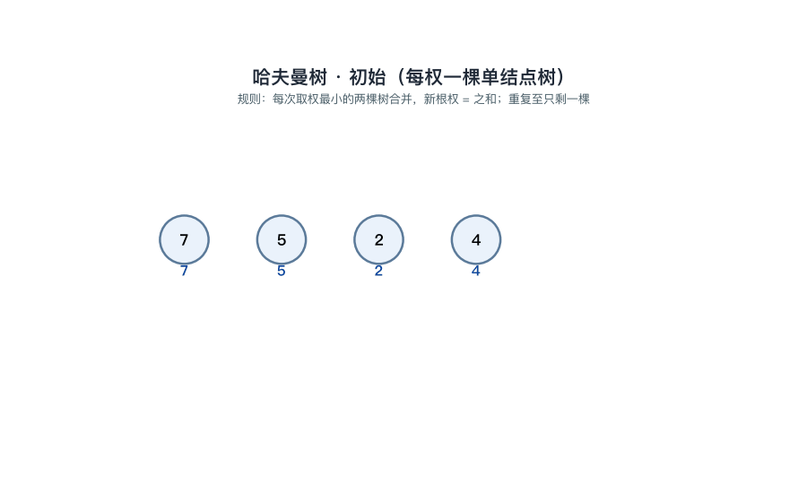
📌 锚点：**每次取最小两个合并；n 叶 2n−1 结点、无度 1；WPL=Σ权×层**。
### 第 6 章 图

> **本章地位**：本章是全卷的"应用题大本营"——遍历序列书写、最小生成树构造、最短路径演算、拓扑排序四大手算题型几乎每年轮番出现在综合应用题中，基本概念与存储结构又常年占据选择、填空，必须做到"术语会辨、序列会写、算法会走、全程会算"。

#### 6.1 图的基本概念与存储结构 ★★★

**定义详解**

图 G=(V, E) 由非空的**顶点集 V** 和**边集 E** 组成。**无向图**——边没有方向，(u, v) 与 (v, u) 是同一条边；**有向图**——弧有方向，每条弧由**弧尾**（始点）指向**弧头**（终点），<u, v> 与 <v, u> 是两条不同的弧。
常用术语：**完全图**——任意两顶点间都有边相连，无向完全图有 **n(n−1)/2** 条边，有向完全图有 **n(n−1)** 条弧；**邻接**——两顶点之间有边（弧）相连；**度**——与顶点相关联的边数，有向图分**入度 ID**（进入该顶点的弧数）与**出度 OD**（离开该顶点的弧数），**度=ID+OD**；**路径**与**路径长度**（路径上边／弧的条数）、**简单路径**（顶点不重复）、**回路（环）**（首尾相同的路径）；**连通**——无向图中任意两顶点间都有路径，**连通分量**是无向图的极大连通子图；**强连通**——有向图中任意两顶点互相可达；**生成树**——含图中全部 n 个顶点的**极小连通子图，恰有 n−1 条边**；**网**——边上带权值的图（带权连通网的最小生成树见 6.3）。
存储结构两种：**邻接矩阵**——一维数组存顶点信息、二维数组存边的关系（相邻记 1，网存权值），无向图的矩阵**关于主对角线对称**，判断任意两顶点是否相邻 O(1)，适合**稠密图**；**邻接表**——每个顶点对应一条单链表，挂出它的全部邻接点，适合**稀疏图**，无向图每条边在两个顶点的链表里各存一次，共 **2e 个边结点**。

**考试答题**

**📌 题目演练**

**【示例·单选】** n 个顶点的无向完全图的边数是（　）
A. n(n−1)
B. n(n−1)/2 ✅
C. n²
D. n−1
📌 要点：每个顶点与其余 n−1 个顶点相邻得 n(n−1)，无向边被两个端点各数了一次，除以 2 去重。

**【示例·单选】** n 个顶点 e 条边的无向图的邻接表中，边结点个数为（　）
A. e
B. 2e ✅
C. e/2
D. n+e
📌 要点：无向边 (u, v) 既挂在 u 的链表上、也挂在 v 的链表上，每条边存两次、共 2e 个边结点。

**【示例·填空】** n 个顶点的连通图的生成树有____条边。
答案：**n−1**。
📌 要点：生成树是**极小**连通子图——再删任一条边就不连通，再加任一条边必成环，n−1 条边恰好"够连通、无多余"。

**【示例·单选】** 有向图中顶点 v 的度等于（　）
A. 入度
B. 出度
C. 入度与出度之和 ✅
D. 入度与出度之差
📌 要点：有向图的度=ID+OD；全体顶点的入度之和＝出度之和＝弧数 e。

**🎯 考法**：完全图边数、生成树边数的计算与填空；邻接矩阵与邻接表的特点对比、适用图型的选择判断。
**✍️ 得分点**：边数题写公式 n(n−1)/2 再代入求值；存储结构题答出"稠密用矩阵、稀疏用邻接表"并说明理由（判边 O(1) vs 省空间）。
**⚠️ 易混淆**：无向完全图 n(n−1)/2 条边 vs 有向完全图 n(n−1) 条弧；连通分量是**极大**连通子图，生成树是**极小**连通子图，"极大极小"方向相反。
**🔑 记忆锚点**：**连通生成树 n−1 边；邻接表无向边存两遍**。

**算法方法**

两种存储结构的建立与度计算模板：
① 建邻接矩阵：读入无向边 (u, v)，令 A[u][v]=A[v][u]=1（**为什么两处同时置 1**：无向边对称，u 邻接 v 等价于 v 邻接 u；有向弧 <u, v> 只置 A[u][v]=1）。
② 求无向图顶点 u 的度：数第 u 行（或第 u 列）中 1 的个数（**为什么行列皆可**：矩阵对称，行和与列和相等）。
③ 求有向图顶点 u 的出度／入度：第 u **行**的 1 的个数为出度 OD，第 u **列**的 1 的个数为入度 ID（**为什么**：按行存"从这个顶点出发的弧"，行是出边、列是入边）。
④ 建邻接表：读入无向边 (u, v) 时，把 v 结点插入 u 的链表、同时把 u 结点插入 v 的链表（**为什么插两次**：保证从任一端都能顺着链表找到对方）。
⑤ 全图验证：所有顶点的度数之和=2e；有向图所有顶点入度之和=出度之和=e（**为什么**：每条边给两个端点各贡献 1 度、每条弧恰好产生 1 个入度和 1 个出度——常用来检验计算结果）。

快速示例：无向图顶点 A、B、C，边 A-B、A-C——邻接矩阵第 1 行 [0,1,1]、第 2 行 [1,0,0]、第 3 行 [1,0,0]，关于主对角线对称；邻接表中 A 的链表挂 B、C 两个结点，B、C 的链表各挂 1 个 A 结点，边结点共 4=2e 个（**为什么**：两条无向边各存两次）；A 的度=第 1 行 1 的个数=2。

#### 6.2 图的遍历：DFS 与 BFS ★★★

**定义详解**

图的遍历：从图中某顶点出发，**访问其余所有顶点且每个顶点仅被访问一次**。设 **visited[] 标记数组**，访问过的顶点置为已访问（**为什么必须标记**：图中存在回路，不标记会在环上反复兜圈、无法终止）。**深度优先搜索 DFS**——类似树的先根遍历：访问 v 后，依次对 v 的每个**未访问**邻接点递归深入，走不通再回溯，**借助栈**（递归）实现；**广度优先搜索 BFS**——类似树的层序遍历：访问 v 后依次访问 v 的全部未访问邻接点，再由这些邻接点逐层向外推进，**借助队列**实现。
遍历**序列不唯一**——随邻接点的排列次序而变（做题以题目给定的次序约定为准）。时间复杂度：邻接矩阵存储 O(n²)，邻接表存储 O(n+e)。**非连通图**一次遍历只能覆盖其一个连通分量，遍历全图需从每个连通分量中各选一个起点调用，调用次数＝**连通分量个数**。

**考试答题**

**📌 题目演练**

**【示例·单选】** 广度优先遍历图时借助的辅助数据结构是（　）
A. 栈
B. 队列 ✅
C. 数组
D. 二叉树
📌 要点：队列先进先出——先被访问的顶点其邻接点也先被扩展，恰好实现"由近及远逐层扩散"。

**【示例·单选】** 对【例 6-1】中的图从 v1 出发做深度优先遍历，v3 最后才被访问，原因是（　）
A. v3 的度数最小
B. DFS 一条路走到底、v3 在回溯阶段才到达 ✅
C. v3 是孤立点
D. 题目错误
📌 要点：DFS 沿未访问邻接点一路深入 v1→v2→v4→v6→v5，v3 是退栈回溯途中才遇到的分支。

**【示例·填空】** 非连通无向图有 3 个连通分量，遍历全图需调用 DFS____次。
答案：**3**。
📌 要点：一次 DFS（或 BFS）只覆盖一个连通分量，遍历次数＝连通分量个数。

**【示例·单选】** 对 e 条边的图采用邻接表存储做广度优先遍历，其时间复杂度为（　）
A. O(n²)
B. O(n+e) ✅
C. O(e log e)
D. O(n·e)
📌 要点：邻接表存储时每个顶点入队一次、每条边结点被扫描一次，合计 O(n+e)；若用邻接矩阵存储则为 O(n²)。

**🎯 考法**：给定图和起点写 BFS／DFS 序列（应用题高频）；辅助结构的判断（深栈广队）；连通分量数与遍历调用次数的换算。
**✍️ 得分点**：严格按题目给定的邻接点次序逐点推走，写出序列并回验每个顶点恰好出现一次；必要时写出队列／栈的演变过程。
**⚠️ 易混淆**：遍历序列**不唯一**（起点或邻接次序不同序列就不同）；DFS 对应树的前序遍历、BFS 对应树的**层序**遍历。
**🔑 记忆锚点**：**深栈广队；序列随邻接次序变**。

**算法方法**

DFS 模板：
① 从起点 v 开始：访问 v 并置 visited[v]=1（**为什么先标记再深入**：防止回路导致重复访问、死循环）。
② 对 v 的每个未访问邻接点 w：递归执行 DFS(w)（**为什么递归深入**：深度优先就是一条路走到底再回头）。
③ v 的邻接点全部处理完则退回上一层（**为什么回溯**：栈弹出当前顶点，沿来路返回找尚未走过的分支）。

BFS 模板：
① 起点入队并标记；队列非空时循环执行②③。
② 队首 u 出队并访问（**为什么出队即访问**：先进先出保证按"离起点由近到远"的层次次序处理）。
③ u 的所有未访问邻接点依次入队并标记（**为什么入队前先标记**：防止同一顶点被多个邻接点重复放入队列）。

**【例 6-1】BFS／DFS 序列与辅助结构演变（自编教学数据，与动图一致；严蔚敏经典 G4）**
6 个顶点，边：v1-v2、v1-v3、v2-v4、v3-v5、v4-v6、v5-v6；邻接点按编号从小到大，从 v1 出发。

BFS（队列演变）：
① 访问 v1、入队（**为什么 v1 最先访问**：BFS 从起点开始按层向外扩散）。
② v1 出队，其未访问邻接点 v2、v3 依次入队，队 [v2, v3]（**为什么先 v2 后 v3**：邻接点按编号从小到大）。
③ v2 出队，邻接点 v4 入队，队 [v3, v4]（**为什么 v1 不再入队**：v1 已标记访问过）。
④ v3 出队，邻接点 v5 入队，队 [v4, v5]。
⑤ v4 出队，邻接点 v6 入队，队 [v5, v6]（**为什么用队列**：先访问者邻接点先扩展——先进先出）。
⑥ v5、v6 依次出队，无新顶点可入，遍历结束。
BFS 序列：**v1 v2 v3 v4 v5 v6**。
（同一张图改从 v3 出发、同样小编号优先，BFS 序列变为 **v3 v1 v5 v2 v6 v4**——**为什么序列变了**：起点不同扩散层次不同，这正是"遍历序列不唯一"的印证。）

DFS（栈演变）：
① 访问 v1，从其未访问邻接点中取编号最小的 v2 深入（**为什么取 v2 不取 v3**：约定邻接点按编号从小到大）。
② 访问 v2 → 取 v4 深入 → 访问 v4 → 取 v6 深入 → 访问 v6（**为什么一路深入**：DFS 优先走向未访问邻接点，走到底才回头）。
③ v6 的邻接点 v4、v5 中未访问的只有 v5 → 访问 v5。
④ v5 的邻接点 v3 未访问 → 访问 v3（**为什么用栈**：最晚到达者先回溯——后进先出）。
⑤ v3 的邻接点 v1、v5 均已访问，逐层退栈结束。
DFS 序列：**v1 v2 v4 v6 v5 v3**（v3 最后被访问——它在回溯阶段才到达）。

> **🖼 动图演示：图的 BFS 与 DFS（队列与栈的逐步演变，G4 六顶点）**
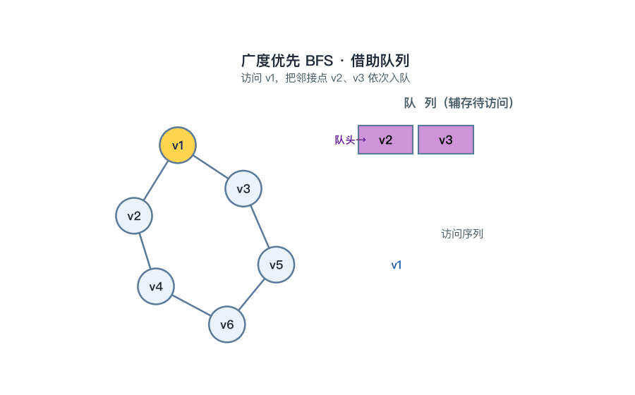
📌 锚点：**BFS 用队列按层扩散、DFS 用栈走到底再回溯；序列不唯一**。

#### 6.3 最小生成树（Prim 与 Kruskal） ★★★

**定义详解**

带权连通网的所有生成树中，**各边权值之和最小**的生成树称为**最小生成树（MST）**。两种经典构造算法：**Prim（普里姆）算法**——从某顶点出发，每轮在「树内顶点到树外顶点」的所有边中取**权值最小**的边，把该边连同树外顶点并入生成树，本质是**归并顶点**，适合**稠密图**，时间复杂度 O(n²)；**Kruskal（克鲁斯卡尔）算法**——把全部边按权值**从小到大**排序依次考察，两端点不在同一连通块（选入不会成环）才并入，本质是**归并边**，适合**稀疏图**，时间复杂度 O(e log e)。两算法都选够 **n−1 条边**结束。最小生成树**形态可不唯一**（存在权值相同的边时选法不同），但**总权值唯一**（最小值只有一个）。

**考试答题**

**📌 题目演练**

**【示例·单选】** Prim 算法适合的图是（　）
A. 稀疏图
B. 稠密图 ✅
C. 有环图
D. 非连通图
📌 要点：Prim 每轮要在「树内→树外」的全部边中挑最小，O(n²) 的代价在稠密图上相对划算；前提是图必须连通。

**【示例·单选】** Kruskal 算法选取边的次序是（　）
A. 权从小到大 ✅
B. 顶点编号
C. 度数
D. 任意
📌 要点：先把边按权值升序排列，再逐条考察"不成环才选"，选够 n−1 条为止。

**【示例·填空】** n 个顶点的连通网的最小生成树有____条边；不同最小生成树的形态____（唯一/可不唯一），但权值之和____。
答案：**n−1；可不唯一；唯一**。
📌 要点：MST 边数固定 n−1；存在权值相同的边时选法可能不同使形态不同，但最小总权值只有一个。

**🎯 考法**：给定网画最小生成树并求权和（应用题高频）；Prim 与 Kruskal 的思想区别、适用图型的选择与判断。
**✍️ 得分点**：Kruskal 逐条写"考察哪条边、是否成环、选入还是舍弃"；Prim 逐轮写"并入哪条边、哪个顶点"；最后必须算出总权值。
**⚠️ 易混淆**：**Prim 并顶点、Kruskal 并边**；MST 形态可不唯一但**权和唯一**；两算法都要求图连通。
**🔑 记忆锚点**：**Prim 稠密 Kruskal 稀疏；选边不成环**。

**算法方法**

Prim 构造模板：
① 初始：把起点放入树内集合 U，其余顶点归入树外集合 V−U（**为什么可从任一顶点开始**：生成树能从任何顶点长出来，起点只影响并入次序、不影响总权值）。
② 每轮在「U 内顶点到 V−U 顶点」的所有边中选权值最小的一条 (u, v)（**为什么只看跨越边**：树内部已连通，只需考虑向外延伸的最廉价出口）。
③ 把顶点 v 并入 U、边 (u, v) 并入生成树，重复②③至 U=V（**为什么逐点并入**：Prim 归并顶点，每轮恰长出一个新顶点，共 n−1 轮得 n−1 条边）。

Kruskal 构造模板：
① 把全部边按权值从小到大排序（**为什么排序**：贪心的前提——每次先考虑最便宜的边，除非它成环才轮到下一便宜）。
② 依次考察每条边：两端点不在同一连通块则选入，并把两个连通块合并（**为什么成环的边必舍弃**：树内任意两点已连通，再加边必成环且只会使权和更大，毫无收益）。
③ 选够 n−1 条边即结束（**为什么是 n−1 条**：n 个顶点的生成树恰有 n−1 条边）。

**【例 6-2】Kruskal 构造（自编教学数据）**
5 个顶点的网，边：A-B=1、B-C=2、B-D=3、C-D=4、A-E=5、D-E=6：
① 排序：1、2、3、4、5、6（**为什么先排序**：Kruskal 必须按权从小到大逐条考察）。
② 选 A-B(1)，得连通块 {A, B}（**为什么必选**：当前最小边且两端不连通，不成环）。
③ 选 B-C(2)，连通块扩为 {A, B, C}。
④ 选 B-D(3)，连通块扩为 {A, B, C, D}。
⑤ 考察 C-D(4)：C、D 已在连通块内 → **舍弃**（**为什么舍**：C、D 已经过 B 相连，再加这条边立即形成环 B-C-D-B）。
⑥ 选 A-E(5)，E 尚未属于任何连通块，并入得 {A, B, C, D, E}（**为什么选它**：剩余边中最小且不成环）。
⑦ 已选 4 条 = n−1 = 4，结束（**为什么停**：5 个顶点的生成树恰需 4 条边；**为什么边 D-E=6 无需再考察**：选够 n−1 条即停止，剩余边选入只会成环或多余）。
MST = {A-B, B-C, B-D, A-E}，权和 = 1+2+3+5 = **11**。

#### 6.4 最短路径（Dijkstra 算法） ★★★

**定义详解**

**单源最短路径**：求源点 v 到图中其余各顶点的最短路径。**Dijkstra（迪杰斯特拉）算法**按**路径长度递增**的次序依次产生各条最短路径。算法维护两个数据：dist[]——源点到各顶点的**当前最短路径估计值**；集合 S——已确定最短路径的顶点集。每轮从 S 外选 **dist 最小**的顶点 u 并入 S——这是**贪心**策略（**为什么选最小者是安全的**：边权均为正时，当前最小的 dist 不可能再经其他顶点绕行缩短——任何绕行都要先经过 dist 更大的中转点，只会更长）；随后对 u 的每条出边做**松弛**：若 dist[u]+w(u, v)＜dist[v]，则更新 dist[v] 并记下前驱（便于最后回溯出路径本身）。时间复杂度 **O(n²)**；**不适用于含负权边的图**（负权会破坏"选最小者定终身"的前提）。

**考试答题**

**📌 题目演练**

**【示例·单选】** Dijkstra 算法产生最短路径的次序是（　）
A. 路径长度递增 ✅
B. 顶点编号
C. 边权递减
D. 深度优先
📌 要点：每轮把 S 外 dist 最小者确定下来，最短路径按长度从小到大一条条产出。

**【示例·单选】** 按【例 6-3】的数据，源点 A 到顶点 C 的最短路径长度为（　）
A. 4
B. 3 ✅
C. 6
D. 7
📌 要点：直达边 A→C 权 4，但经 B 绕行 A→B→C = 1+2 = 3 更短——最短路径不一定经过直达边。

**【示例·填空】** Dijkstra 算法的时间复杂度为____；该算法不能处理带____边的图。
答案：**O(n²)；负权**。
📌 要点：主体是 n 轮「选最小＋松弛」；负权边会使「当前 dist 最小者定终身」的贪心前提失效。

**🎯 考法**：给出有向网写 Dijkstra 全过程（dist 变化表）并求最短路径长度与路径本身（应用题高频）；贪心次序、复杂度 O(n²) 的选择填空。
**✍️ 得分点**：每轮写清"选谁入 S、松弛了哪些边、dist 改成多少"；最终按前驱回溯写出路径序列，不能只给长度。
**⚠️ 易混淆**：dist 的**已确定值不再改变** vs 候选值被反复松弛更新；**直达边不一定是最短路径**（例 6-3 的 A→C）；负权边场景不可用 Dijkstra。
**🔑 记忆锚点**：**选小者定终身，松弛邻边看绕行**。

**算法方法**

Dijkstra 模板：
① 初始化：dist[源]=0；与源直接相邻者 dist 填边权；其余 dist=∞；S=∅（**为什么源点为 0**：源到自身路径长为 0，是全局最小、最先确定的值）。
② 每轮从 S 外选 dist 最小的顶点 u，并入 S（**为什么选最小**：正权下该值不可能再被绕路缩短，可"定终身"）。
③ 松弛 u 的每条出边 <u, v>：若 dist[u]+w(u, v)＜dist[v]，则 dist[v]=dist[u]+w(u, v) 并记 v 的前驱为 u（**为什么松弛**：把"经 u 中转的绕行"与原估计比较，取更小者；**为什么记前驱**：dist 只存长度，路径本身要靠前驱从终点回溯到源点倒着拼出）。
④ 重复②③直到全部顶点入 S（**为什么逐轮循环**：每轮只确定一个顶点的最终最短距离，n 个顶点需 n 轮）。

**【例 6-3】Dijkstra 全过程（自编教学数据，与动图一致）**
有向边：A→B=1、A→C=4、B→C=2、B→D=6、C→D=3，求源点 A 到各顶点的最短路径：
① 初始化：dist[A]=0、dist[B]=1、dist[C]=4、dist[D]=∞（**为什么 D 取 ∞**：初始时 A 无直达 D 的边，估计值先置无穷大待更新）。
② 第 1 轮：选 dist 最小的 A(0) 入 S；松弛 A 的出边——dist[B]=min(1, 0+1)=1、dist[C]=min(4, 0+4)=4（**为什么不变**：初值本就由直达边填好，松弛不产生改进）。
③ 第 2 轮：选 B(1) 入 S；松弛 B 的出边——dist[C]=min(4, 1+2)=**3**（**为什么 C 被更新**：经 B 绕行 3 比直达 4 短——"绕行比直达短"是本题的关键观察）；dist[D]=min(∞, 1+6)=7。
④ 第 3 轮：选 C(3) 入 S；松弛——dist[D]=min(7, 3+3)=**6**（**为什么 D 又被更新**：经 C 绕行 6 比经 B 直达 D 的 7 更短）。
⑤ 第 4 轮：选 D(6) 入 S，全部顶点确定，算法结束。
最终结果：A→B=**1**（A-B）；A→C=**3**（A-B-C）；A→D=**6**（A-B-C-D）。

dist 演变总表（便于核对每一轮）：

| 轮次 | 本轮选入 S | dist[B] | dist[C] | dist[D] |
| --- | --- | --- | --- | --- |
| 初始 | — | 1 | 4 | ∞ |
| 第 1 轮 | A | 1 | 4 | ∞ |
| 第 2 轮 | B | 1 | **3** | 7 |
| 第 3 轮 | C | 1 | 3 | **6** |
| 第 4 轮 | D | 1 | 3 | 6 |

> **🖼 动图演示：Dijkstra 最短路径（选点 + 松弛，A→B=1、A→C=4、B→C=2、B→D=6、C→D=3）**
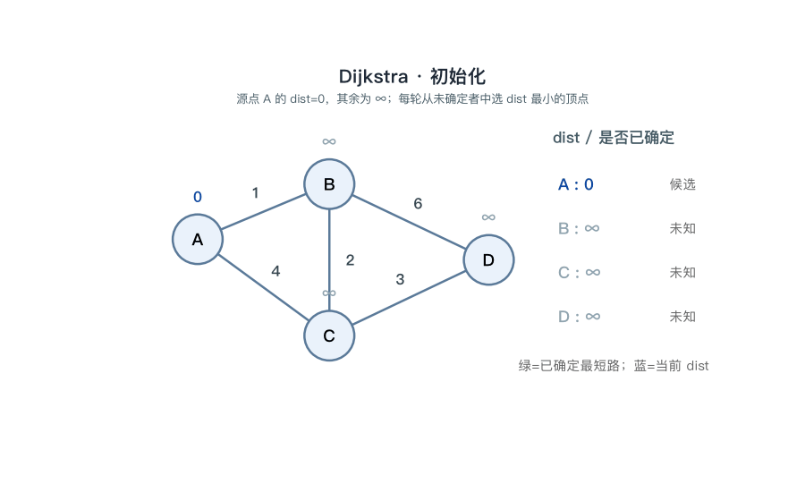
📌 锚点：**每轮选 dist 最小者确定、再松弛出边；dist 一旦确定不再改变**。

#### 6.5 拓扑排序与 AOV 网 ★★★

**定义详解**

**AOV 网**：用**顶点表示活动**、用**弧表示活动间的优先关系**的有向图——弧 <u, v> 表示"活动 u 先完成后，v 才能开始"（边是**优先关系**，不带权值）；工程上要求 AOV 网必须是**有向无环图（DAG）**。**拓扑排序**：把 AOV 网的全部顶点排成一个线性序列，使每条弧 <u, v> 的 u 都排在 v 之前，这样的序列称为**拓扑序列**（**为什么一定可行**：DAG 无环，必有入度为 0 的顶点可作起点）。算法：①选一个**入度为 0** 的顶点输出；②删除它及其全部出边；③重复①②直至全部输出。若输出顶点数 ＜ n，说明图中**有环**，拓扑排序失败。拓扑序列**不唯一**（可输出的顶点有多个时任取其一，做题常约定**取编号小者**）。

**考试答题**

**📌 题目演练**

**【13003 题库摘要题】（填空）** 拓扑排序首先输出的顶点是入度为____的顶点。
答案：**0**。
📌 要点：入度 0 即没有前驱活动，不受任何约束，可以最先开始执行。

**【示例·单选】** 拓扑排序无法输出全部顶点的原因是图中（　）
A. 有回路 ✅
B. 有孤立点
C. 边太多
D. 顶点太多
📌 要点：有环时环上各顶点互相等待，入度永不为 0，输出中断——这正是用拓扑排序**检测有向图是否有环**的原理。

**【示例·单选】** 下列关于 AOV 网的叙述中，正确的是（　）
A. 顶点表示活动间的优先关系
B. 弧表示活动，且必须带权值
C. 顶点表示活动，弧表示活动间的优先关系 ✅
D. 弧 <u, v> 表示活动 v 完成后 u 才能开始
📌 要点：AOV 网——顶点表示活动、弧 <u, v> 即"u 先于 v"的优先关系，弧不带权值。

**🎯 考法**：给定 DAG 写拓扑序列（应用题高频）；拓扑排序失败（有环）原因的判断；AOV 网概念的辨析选择。
**✍️ 得分点**：每步写清"当前入度 0 的顶点是谁、删除了哪些出边"；约定编号优先时严格取小；最终核对输出个数是否等于 n。
**⚠️ 易混淆**：AOV 网的边是**优先关系**不是权值；拓扑序列**不唯一**；**有环 ⇔ 排不出完整序列**。
**🔑 记忆锚点**：**入度零者先出、删边出新零；输不完则有环**。

**算法方法**

拓扑排序模板：
① 统计所有顶点的入度，入度为 0 者进栈（或队列）备用（**为什么从入度 0 开始**：无前驱的活动才能最先执行）。
② 栈顶顶点出栈并输出，删除它的所有出边（**为什么删出边**：它已完成，对后继的约束解除，表现为后继入度减 1）。
③ 出边所指后继的入度减 1，减为 0 者进栈（**为什么会产生新的入度 0**：刚删的边正是它的最后一条入边）。
④ 重复②③直到栈空；若输出顶点数 ＜ n，判定有环、排序失败（**为什么输不完即有环**：环上顶点入度互相牵制，永远减不到 0）。辅助结构用栈、队列皆可（**为什么皆可**：只要求存取"当前入度为 0 的顶点"，不涉及元素间的先后优先级）。

**【示例·应用】拓扑序列书写（自编教学数据，约定编号小者优先）**
DAG：顶点 1~6，边 1→2、1→3、2→4、3→4、3→5、4→6、5→6：
① 初始入度：1=0、2=1、3=1、4=2、5=1、6=2；入度 0 者仅顶点 1 → 输出 **1**（**为什么只有 1**：其余顶点都有入边、都有前驱活动未完成）。
② 删 1 的出边 1→2、1→3：顶点 2、3 的入度降为 0（**为什么产生两个新零**：1 是它们各自唯一的前驱）。
③ 入度 0 者有 {2, 3}，取编号小者 → 输出 **2**；删 2→4，顶点 4 入度 2−1=1。
④ 入度 0 者只剩 3 → 输出 **3**；删 3→4、3→5：顶点 4 入度降为 0、5 入度降为 0（**为什么第③步取 2 不取 3**：两者均满足入度 0，按约定取编号小者——序列不唯一）。
⑤ 取 4 → 输出 **4**；删 4→6，顶点 6 入度 2−1=1。
⑥ 取 5 → 输出 **5**；删 5→6，顶点 6 入度降为 0 → 输出 **6**。
拓扑序列：**1 2 3 4 5 6**（共输出 6 个 = n，排序成功、图中无环）。
### 第 7 章 查找

> **本章地位**：查找与排序并列为全卷权重最高的两章——顺序/折半查找、二叉排序树（BST）、哈希表三大板块几乎逢考必出，**平均查找长度 ASL 的计算**是贯穿全章的主线计算题型，必须做到"过程会走、ASL 会算、前提会辨"。

---

#### 7.1 查找的基本概念与顺序查找 ★★★

**定义详解**

**查找表**：由同一类型数据元素（记录）组成的集合，查找就是在表中确定关键字等于给定值的元素的过程。

**关键字**：数据元素中能标识一个元素的数据项的值；**主关键字**可唯一识别一个元素，次关键字可识别若干元素。

**平均查找长度 ASL**：衡量查找算法效率的核心指标，ASL = Σ Pᵢ×Cᵢ，其中 Pᵢ 为查找第 i 个元素的概率（等概率时 Pᵢ=1/n），Cᵢ 为找到该元素所需的关键字比较次数。

**顺序查找**：从表的一端开始，逐个将元素关键字与给定值比较，相等则查找成功，扫描全表仍未命中则查找失败；等概率下成功 ASL=(n+1)/2，时间复杂度 O(n)；对顺序/链式存储、有序/无序表均适用——适应性最强、效率最低的查找方法。

**拓展速记**

- 失败查找也要把全表比完：无序表顺序查找失败需比较 n 次，失败 ASL=n。

- 存储适应面：顺序表、单链表都能顺序查找；反过来，链表只能顺序查找（不能折半）。

- 监视哨技巧：查找前把给定值暂存到表尾（哨兵位），可省去每步判"是否越界"，比较次数不变、判断开销减半。

- 等概率假设：考试几乎总设 Pᵢ=1/n，直接代 (n+1)/2；若概率不等，必须回到 Σ Pᵢ×Cᵢ 原式逐项加权。

**考试答题**

**📌 题目演练**

**【示例·单选】** 对长度为 n 的线性表进行顺序查找，查找成功时的平均查找长度为（　）
A. n/2
B. (n+1)/2 ✅
C. n
D. log₂n
📌 要点：等概率下第 i 个元素恰需比较 i 次，ASL=(1+2+…+n)/n=(n+1)/2。

**【示例·填空】** 顺序查找对表的存储结构（顺序存储或链式存储）以及表中元素是否按关键字排序____特殊要求。
答案：**无**。
📌 要点：通用性是顺序查找的最大特点——不挑存储结构、不挑有序性，任何线性表都能用。

**🎯 考法**：等概率成功 ASL=(n+1)/2 的计算与选择；顺序查找适用条件（对存储与有序性均无要求）的填空、判断。

**✍️ 得分点**：ASL 先写定义式 Σ Pᵢ×Cᵢ 再代等概率化简为 (n+1)/2；比较次数单位"次"；失败查找需比较 n 次。

**⚠️ 易混淆**：成功 ASL 是 (n+1)/2 不是 n/2（比较次数取 1~n，不是 0~n−1）；O(log₂n) 属于折半查找，顺序查找是 O(n)；有序表的顺序查找仍要逐个比较，"有序"并不给顺序查找提速。

**🔑 记忆锚点**：**顺序查找"万能但最慢"——啥表都能查；成功 ASL=(n+1)/2；失败比较 n 次；O(n)**。

**算法方法**

1. 置扫描起点为表头第一个元素（**为什么从表头开始**：元素无序，只能按位置逐个穷举）。

2. 将当前元素关键字与给定值比较（**为什么逐个比较**：无序表没有可利用的排列规律，不能跳过任何位置）。

3. 相等 → 返回该位置，查找成功（**为什么命中即停**：只需确定存在性与位置，无需继续扫描）。

4. 不等 → 移向下一个元素重复比较（**为什么继续后移**：尚未排除全部可能位置）。

5. 扫描完最后一个元素仍不相等 → 查找失败（**为什么可判失败**：所有可能位置均已排除）。

6. 求成功 ASL：第 i 个元素比较 i 次，ASL=(1+2+…+n)/n=(n+1)/2（**为什么 Cᵢ=i**：命中第 i 个元素前必已比较过前 i−1 个，加上本身共 i 次）。

**【演算示例】顺序查找 ASL（自编教学数据）**：表 (21, 38, 52, 9, 45)，等概率查找：查 21 比较 1 次、38 比较 2 次、52 比较 3 次、9 比较 4 次、45 比较 5 次（**为什么递增**：位置越靠后，排在前面的元素都要白比一遍），ASL=(1+2+3+4+5)/5=15/5=3=(5+1)/2（**为什么与公式吻合**：这正是 (n+1)/2 在 n=5 时的值）。

---

#### 7.2 折半查找（二分查找） ★★★

**定义详解**

折半查找（二分查找）只适用于**关键字有序的顺序表**：每次取中间位置 mid=(low+high)//2，与给定值做三分支比较——相等则成功；小于则进左半区间；大于则进右半区间；直到 low>high 时区间为空，判定查找失败。

每比较一次查找区间缩小一半，n 个元素最大比较次数为 **⌈log₂(n+1)⌉**，时间复杂度 **O(log₂n)**。

**判定树**：刻画折半查找过程的二叉树，内部结点为区间中间位置下标，外部（方形）结点为失败情形，n 个元素共 n+1 个外部结点；折半查找的判定树是**平衡二叉树**，比较次数=目标结点所在层数（最少 1 次、最多 ⌈log₂(n+1)⌉ 次）。

**前提铁律：顺序存储 + 关键字有序，缺一不可**——链表无法随机存取 mid 位置；无序表与 mid 的比较结果不能指示查找方向，折半没有意义。

**拓展速记**

- 判定树"平衡但非满"：11 个元素的判定树共 4 层（各层 1+2+4+4 个结点），第 4 层结点比较 4 次，层的"不满"照样存在。

- 有序的**链表**依然不能折半：折半要"一步跳到 mid"，链表只能顺链逐个走，没有随机存取能力。

- 失败判定必须写到 low>high 才算完整——只写"没找到"不给过程分。

**考试答题**

**📌 题目演练**

**【13003 题库摘要题】（判断题）** 折半查找必须满足的前提条件是什么？为什么缺一不可？
分点答案：
① 表必须**顺序存储**（支持随机存取任意下标位置，才能直接取 mid）（1分）
② 表中元素必须**按关键字有序**（与 mid 比较后才能确定唯一方向）（1分）
两前提缺一不可：链表取不了 mid；无序表比了 mid 也定不了方向。
📌 要点：前提判断题的标准两分点——顺序存储 1 分＋关键字有序 1 分。

**【示例·单选】** 对含 11 个元素的有序顺序表进行折半查找，查找成功时的最大比较次数为（　）
A. 3
B. 4 ✅
C. 5
D. 11
📌 要点：⌈log₂(11+1)⌉=⌈log₂12⌉=⌈3.58⌉=4 次。

**🎯 考法**：给定有序表手工演算折半查找（成功、失败各比较几次）；最大比较次数与 ⌈log₂(n+1)⌉ 的换算；"顺序存储＋关键字有序"两前提的判断题。

**✍️ 得分点**：每步写全 low、mid、high 与比较结果；失败必须推到 low>high；最大比较次数用 ⌈log₂(n+1)⌉ 现算。

**⚠️ 易混淆**：判定树是**平衡二叉树但不是满二叉树**；有序的链表也不能折半；mid 全程取下整 (low+high)//2，忽上忽下必错。

**🔑 记忆锚点**：**有序+顺序存储；每次砍一半；mid=(low+high)//2；失败看 low>high**。

**算法方法**

1. 置 low=1（首元素下标）、high=n（末元素下标）（**为什么初始化为全表**：初始查找区间就是整个有序表）。

2. 取 mid=(low+high)//2，向下取整（**为什么取下整**：保证 low≤mid≤high 恒成立、区间每次严格缩小，算法必收敛）。

3. 给定值=表[mid] → 成功返回 mid；小于 → 转 4；大于 → 转 5（**为什么三分支**：有序表一次比较同时判相等、定方向、排除另一半区间）。

4. high=mid−1，回到 2（**为什么 mid−1**：mid 位置已比较过且已排除，不收缩区间会死循环）。

5. low=mid+1，回到 2（**为什么 mid+1**：同理必须排除已比较过的 mid 位置）。

6. low>high → 查找失败（**为什么 low>high 即失败**：区间为空，所有可能位置全部排除）。

**【例 7-1】折半查找演算（自编教学数据，与动图一致）**：有序表 5 13 19 21 37 56 64 75 80 88 92（下标 1~11）。

查 21（成功）：

① low=1，high=11，mid=(1+11)//2=6，表[6]=56>21 → 进左半区间，high=5（**为什么向左**：56 及其右侧元素均 ≥56，不可能等于 21）。

② low=1，high=5，mid=(1+5)//2=3，表[3]=19<21 → 进右半区间，low=4（**为什么向右**：19 及其左侧元素均 ≤19，不可能等于 21）。

③ low=4，high=5，mid=(4+5)//2=4，表[4]=21 → 命中，共比较 3 次（**为什么 3 次**：判定树上 21 位于第 3 层，比较次数=层数）。

查 62（失败）：

① mid=6，表[6]=56<62 → low=7（**为什么向右**：62>56，只可能在右半区间）。

② low=7，high=11，mid=(7+11)//2=9，表[9]=80>62 → high=8。

③ low=7，high=8，mid=(7+8)//2=7，表[7]=64>62 → high=6。

④ low=7>high=6 → 查找失败，3 次比较后区间变空（**为什么 low>high 即失败**：区间中已无任何可能位置，目标若存在也必在区间之外）。

> **🖼 动图演示：折半查找逐步定位（查 21 命中 3 次 + 查 62 失败）**
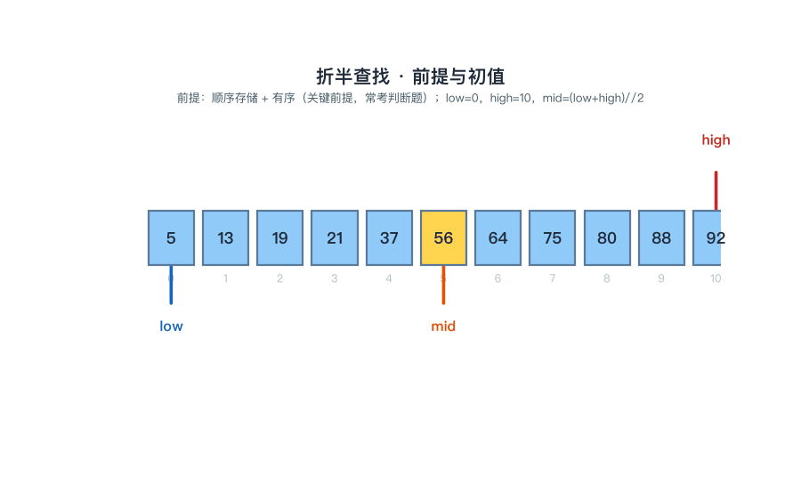
📌 锚点：**前提：有序+顺序存储；mid=(low+high)//2；失败出口 low>high**。

---

#### 7.3 二叉排序树（BST） ★★★

**定义详解**

二叉排序树或为空树，或满足：**左子树上所有结点关键字 < 根结点关键字 < 右子树上所有结点关键字**，且左右子树也各是二叉排序树（递归成立）。

查找：给定值与根比较，小往左走、大往右走，相等即成功，走到空指针即失败。

插入：按查找规则走到失败位置（空指针处）挂上新结点——**新插入的结点必为叶子**。

删除三情形：①叶子结点——直接删除；②只有一棵子树——该子树整体顶替其位置；③有两棵子树——用**中序前驱（左子树最右下结点）或中序后继（右子树最左下结点）**替换其值，再删去那个前驱/后继结点（它至多带一棵子树，转化为情形①②）。

性能：随机形态平均 O(log₂n)；按**有序序列**依次插入则退化为斜树，最坏 O(n)。

**拓展速记**

- 中序遍历 BST 得**升序序列**（核心性质）——建树对不对，中序一走便知。

- 同一组关键字插入次序不同 → 树的形态不同，但中序序列都是同一个升序。

- 删除双子树时选中的前驱/后继至多只有一棵子树，所以删除总落在情形①②，不会递归无底。

- 与折半查找对比：BST 平均同 O(log₂n) 量级，但插入、删除只改指针、无需移动成片元素，适合动态维护。

**考试答题**

**📌 题目演练**

**【示例·单选】** 向二叉排序树中插入一个新结点时，该新结点总是（　）
A. 叶子结点 ✅
B. 根结点
C. 分支内部结点
D. 插入到随机位置
📌 要点：插入总发生在查找失败处（空指针位置），新结点无孩子、必为叶子。

**【示例·单选】** 将序列 (45, 24, 53, 12, 28, 90) 依次插入空的二叉排序树，其中序遍历序列为（　）
A. 12 24 28 45 53 90 ✅
B. 45 24 12 28 53 90
C. 90 53 45 28 24 12
D. 12 28 24 45 90 53
📌 要点：中序遍历 BST 必为升序、与插入次序无关——直接选升序项，无需逐个画树。

**🎯 考法**：给定序列画 BST 建树过程；中序遍历验证建树；删除结点三情形（尤其双子树）；有序序列插入退化斜树、最坏 O(n) 的判断与选择。

**✍️ 得分点**：建树每结点按"小左大右"落位；验证一律写中序序列；删除双子树必须答"中序前驱/后继替换后再删"。

**⚠️ 易混淆**：删除双子树是取**中序前驱（左子树最右下）替换**，**不是直接拿左孩子顶替**；中序为升序与插入顺序无关，插入顺序只决定树的形态。

**🔑 记忆锚点**：**小左大右；中序即升序；插入新结点必为叶子；双孩删除找前驱（左子树最右）**。

**算法方法**

1. 树空 → 新结点作根（**为什么作根**：空树没有比较对象，首结点即根）。

2. 树非空 → 给定值与根结点关键字比较（**为什么先比根**：BST 的有序性使一次比较即可确定方向）。

3. 小于根 → 进左子树；大于根 → 进右子树（**为什么小左大右**：BST 定义——左子树全小、右子树全大）。

4. 走到空指针 → 在该位置插入新叶子（**为什么插在失败处**：失败空位恰是新关键字按序应在的位置；新结点无孩子，必为叶子）。

5. 验证：对建成的树做中序遍历，序列升序则结构正确（**为什么中序可验证**：中序遍历 BST 得升序是 BST 的充要特征）。

**【例 7-2】BST 插入演算（自编教学数据，与动图一致）**：依次插入 45, 24, 53, 12, 28, 90：

① 插 45：树空 → 45 作根（**为什么作根**：空树）。

② 插 24：24<45 → 左子树 → 45 的左孩子（**为什么放左边**：小左大右）。

③ 插 53：53>45 → 右子树 → 45 的右孩子（**为什么放右边**：53 大于根 45）。

④ 插 12：12<45 → 左；12<24 → 24 的左孩子（**为什么继续向下**：与子树根继续比较，直到空位）。

⑤ 插 28：28<45 → 左；28>24 → 24 的右孩子（**为什么停在 24 右**：28 大于 24 而小于 45，只能落在 45 左子树内）。

⑥ 插 90：90>45 → 右；90>53 → 53 的右孩子。

中序遍历：12 24 28 45 53 90 —— 恰为升序（**为什么必为升序**：中序遍历 BST 得升序，反证建树无误）。

> **🖼 动图演示：二叉排序树逐个插入（45,24,53,12,28,90）与中序验证**
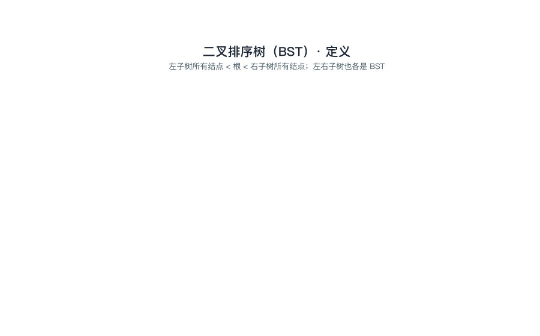
📌 锚点：**小左大右；中序遍历 BST = 升序；插入新结点必为叶子**。

---

#### 7.4 哈希表（散列表） ★★★

**定义详解**

哈希表（散列表）的查找不靠"与关键字比较"，而是以函数 **H(key) 直接计算元素的存储地址**，理想情况一步定位 O(1)。

不同关键字算得相同地址称为**哈希冲突**，这些关键字互为**同义词**。

构造方法：**除留余数法 H(k)=k mod p**（p 取不超过表长的最大质数——质数模使余数分布更均匀、冲突更少）、直接定址法、平方取中法。

冲突处理：**开放定址法**——冲突后在表内另找空位，其中线性探测易形成连续占段的**堆积**，二次探测、随机探测可缓解；**链地址法**——同义词挂在同一桶的单链表上，插删方便、无堆积。

**装填因子 α = 表中元素数 ÷ 表长**，α 越大表越满、冲突可能性越大（链地址法的 α 可大于 1）。

**ASL**：成功 = Σ各元素比较次数 ÷ 元素数；失败 = Σ各地址探测次数 ÷ 地址数。

**拓展速记**

- 直接定址法 H(k)=a·k+b：地址与关键字一一对应、无冲突，但可能浪费大量空间。

- 平方取中法：关键字平方后取中间若干位作地址，适合关键字位数较多、各位分布均匀的场合。

- 哈希查找的本质：不走"比较"路径，而是"由关键字算地址"，其 ASL 取决于哈希函数、冲突处理方法与装填因子，不直接取决于 n。

- 开放定址法删除不能物理删除（会截断后续探测路径），需做删除标记；链地址法可直接摘链删结点。

**考试答题**

**📌 题目演练**

**【13003 题库摘要题】（填空）** 分块查找的平均查找长度由哪两部分构成？写出等概率、顺序查找索引时的公式。
答案口径：分块查找要求**块间有序、块内无序**——先查索引表确定所在块（索引查找），再在块内顺序查找，**ASL = 索引查找长度 + 块内查找长度**。n 个元素分 b 块、每块 s 个（b×s=n），索引表与块内均顺序查找时：ASL=(b+1)/2+(s+1)/2；当 b=s=√n 时 ASL 最小（为 √n+1）。
📌 要点：分块 = 块间查找 + 块内顺序查找，两段长度相加；块内无序，永远只能顺序查找。

**【示例·单选】** 开放定址法中采用线性探测处理冲突，容易产生（　）
A. 堆积 ✅
B. 溢出
C. 死循环
D. 失序
📌 要点：冲突元素连续占据后继空位，使后续关键字更易连锁冲突——即堆积（聚集）。

**🎯 考法**：给定 H(k)=k mod p 构造哈希表（链地址/线性探测）并计算成功 ASL；冲突处理方法辨析（堆积归线性探测）；装填因子定义与"α 可大于 1"的判断；与分块查找 ASL 组合出填空。

**✍️ 得分点**：逐个关键字写出哈希地址与比较次数；ASL 写全"比较总和÷元素数"的分式过程；p 必须答"不超过表长的最大质数"。

**⚠️ 易混淆**：链地址法 **α 可大于 1**（开放定址法 α≤1）；除留余数法的 p 取**质数**不是随意取；堆积是线性探测的毛病，链地址法没有堆积；失败 ASL 的分母是地址数（表长）不是元素数。

**🔑 记忆锚点**：**k mod 质数；同义词同链；α=元素数÷表长；成功 ASL=比较总和÷元素数**。

**算法方法**

1. 对每个关键字计算 H(k)=k mod p，p 为不超过表长的最大质数（**为什么模质数**：余数分布更均匀，减少同义词扎堆）。

2. 目标桶为空 → 直接放入（**为什么直接放**：无冲突一步到位，正是哈希 O(1) 的理想情形）。

3. 目标桶已占（冲突）→ 沿桶链逐结点比较，插到链尾（**为什么沿链找**：链地址法把同义词集中在一条链上，沿链即遍历全部同义词）。

4. 计算成功 ASL：每元素的比较次数=其在链中的位置序号，ASL=Σ比较次数÷元素数（**为什么求均值**：等概率下平均查找长度就是比较次数的平均值）。

5. 计算失败 ASL（选学）：从每个地址桶出发走到空的探测次数求平均（**为什么按地址平均**：失败可能发生在任何一个地址桶）。

**【例 7-3】哈希表构造与 ASL（自编教学数据，与动图一致）**：表长 7，H(k)=k mod 7（**为什么模 7**：7 是不超过表长 7 的最大质数），依次插入 19, 14, 23, 1, 68, 20, 84, 27（链地址法）：

① 19 mod 7=5 → 桶 5，直接挂入（**为什么直接挂**：桶空无冲突）。

② 14 mod 7=0 → 桶 0，直接挂入。

③ 23 mod 7=2 → 桶 2，直接挂入。

④ 1 mod 7=1 → 桶 1，直接挂入。

⑤ 68 mod 7=5 → 桶 5 已占，冲突 → 与 19 比较后挂链尾，68 计 2 次（**为什么计 2 次**：先与同义词 19 比较不等，再放到链尾，共探测 2 个位置）。

⑥ 20 mod 7=6 → 桶 6，直接挂入。

⑦ 84 mod 7=0 → 桶 0 已占，冲突 → 链到 14 之后，84 计 2 次。

⑧ 27 mod 7=6 → 桶 6 已占，冲突 → 链到 20 之后，27 计 2 次。

各桶链长依次为 [2, 1, 1, 0, 0, 2, 2]；查找成功 ASL=(1+2+1+1+1+2+1+2)/8=11/8≈1.4（**为什么分母是 8**：共 8 个元素等概率取平均；分子即 8 个元素比较次数之和）。

> **🖼 动图演示：哈希冲突与链地址法（H(k)=k mod 7，8 个关键字逐个插入）**
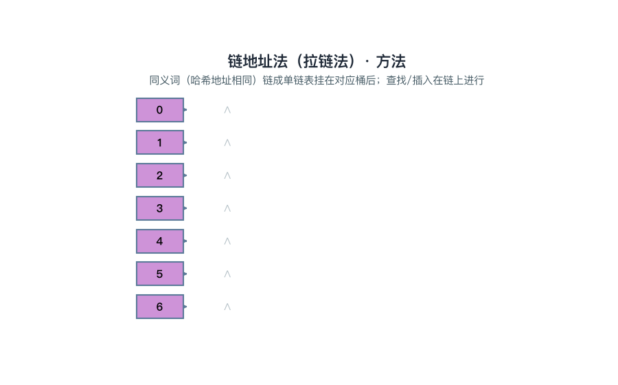
📌 锚点：**同义词同链；α=元素数/表长；成功 ASL=比较总和÷元素数**。
### 第 8 章 排序

> 本章是全课程**客观题最密集**的章节：八大内部排序的"一趟结果判别 + 复杂度 + 稳定性"三件套几乎每年必考。内部排序按"**插入／交换／选择／归并基数**"四类组织，每类抓住"一趟到底干了一件什么事"，再配合 8.4 的**总对比表（必背）**，即可覆盖本章绝大多数考点。

#### 8.1 插入排序（直接插入与希尔） ★★★

**定义详解**

**直接插入排序**：把第 i 个元素插入到前面 i-1 个**已有序**的子表中——从后向前扫描寻找插入位置，**边扫描边后移**比它大的元素，腾出位置后放入。最好情形（表已有序）每趟只比较 1 次，n-1 趟共比较 n-1 次，时间 **O(n)**；最坏情形（逆序）比较 1+2+…+(n-1) = n(n-1)/2 次，**O(n²)**；平均 O(n²)；相等元素不越过、不换位，**稳定**。

**希尔排序（缩小增量排序）**：取增量 d 把全表分组、组内各做一次直接插入，增量逐趟缩小直到 d=1。大步长移动使表迅速"基本有序"，而基本有序时插入效率最高，整体约 **O(n^1.3)**；相同元素可能被分到不同组而换位，**不稳定**。

**考试答题**

**📌 题目演练**

**【示例·单选】** 直接插入排序在（　）情形下效率最高。
A. 基本有序 ✅
B. 基本逆序
C. 随机排列
D. 与初始排列无影响
📌 要点：基本有序时每趟从后向前比较一两次即到位，全程接近 O(n)。

**【示例·单选】** 下列排序方法中，稳定的是（　）。
A. 直接插入排序 ✅
B. 希尔排序
C. 快速排序
D. 堆排序
📌 要点：直接插入"相等即停、不越过"，稳定；希尔、快排、堆排均不稳定。

**【示例·填空】** 对 n 个**已有序**的记录做直接插入排序，关键字比较次数为____。
📌 答案：**n-1**（每趟只与有序区末尾比较 1 次即到位，全程"只查不插"，时间 O(n)——最好情形）。

**【示例·单选】** 希尔排序的改进思路是（　）。
A. 按增量分组做直接插入，增量逐趟缩小到 1 ✅
B. 每趟选出最小元素放到前面
C. 相邻两两比较、逆序交换
D. 把表分成两半各自排序后再合并
📌 要点：希尔 = "缩小增量 + 组内插入"；分组是**相隔 d 跳着切**，不是连续分段。

**🎯 考法**：一趟插入后的序列判别；最好/最坏/平均复杂度各对应什么初始状态；稳定性归类（直接插入稳定、希尔不稳定）。
**✍️ 得分点**：会答最好 O(n)（已有序、只比 n-1 次）、最坏 O(n²)（逆序、比 n(n-1)/2 次）；会描述希尔"按增量分组做直接插入、增量逐趟缩小到 1"；能举反例说明希尔不稳定。
**⚠️ 易混淆**：**希尔由直接插入改进而来，但不再是稳定排序**——分组把相等元素拆进不同组，先后次序可能颠倒；别把"插入类都稳定"说满。
**🔑 记忆锚点**：**插排像摸牌：基本有序最快；稳定。**

**算法方法**

直接插入一趟模板（把 a[i] 插入有序区 a[1..i-1]）：
① 暂存待插元素 a[i]（**为什么**：随后的后移会覆盖 a[i] 所在位置，先寄存防止丢失）。
② j 从 i-1 起从后向前扫描，凡 a[j] > 暂存值则 a[j+1] = a[j]（**为什么边扫边后移**：从后往前比较，一旦遇到更小者立即空出位置，避免找到位置后再整体搬移一次）。
③ 遇到第一个 a[j] ≤ 暂存值即停止扫描（**为什么**：有序区内部本就有序，它就是插入位置的边界；相等也停，保证相等元素不换位——稳定性的来源）。
④ 暂存值放入 a[j+1]（**为什么**：停止位置之后正是腾出的插入空位）。

希尔排序模板：
① 取增量序列 d₁ > d₂ > … > 1，常从 ⌊n/2⌋ 起逐次减半（**为什么**：增量逐趟缩小，保证最后一趟 d=1 之前表已接近有序）。
② 每个增量 d 下，把相隔 d 的元素视作同组，各组内做直接插入（**为什么**：大步长让元素一次移动跨越很远，快速消除远距离的逆序对）。
③ d=1 时整表做一次直接插入收尾（**为什么**：此时表已基本有序，插入的"最好情形优势"在此兑现，远优于一上来就插排）。

**【例 8-1】直接插入排序逐趟过程（自编教学数据）**

初始表（下标 1 起）：49 38 65 97 76 13 27 49'（49' 表示第二个 49，用于演示稳定性）。
① 第 1 趟（插入 38）：38 < 49 → 49 后移 → **38 49** | 65 97 76 13 27 49'（**为什么 49 只后移一步**：从后向前扫描，38 比有序区第一个元素还小，49 后移后即到表头）。
② 第 2 趟（插入 65）：65 > 49 → 原地不动 → 38 49 65 | 97 76 13 27 49'（**为什么一趟只比较一次**：65 比有序区末尾还大，扫描第一步即停，属最好情形）。
③ 第 3 趟（插入 97）：97 > 65 → 不动 → 38 49 65 97 | 76 13 27 49'（**为什么**：仍比有序区末尾大，延续"已有序"节奏）。
④ 第 4 趟（插入 76）：76 < 97 → 97 后移；76 > 65 → 停 → 38 49 65 **76** 97 | 13 27 49'（**为什么 65 不必再比**：从后向前遇到第一个不大于 76 的元素即停，它之前的元素必然更小）。
⑤ 第 5 趟（插入 13）：13 依次小于 97、76、65、49、38 → 全部后移 → **13** 38 49 65 76 97 | 27 49'（**为什么全部后移**：13 比有序区所有元素都小，一路顶到表头，这是最坏情形的单趟）。
⑥ 第 6 趟（插入 27）：27 使 97、76、65、49、38 依次后移，停在 13 之后 → 13 **27** 38 49 65 76 97 | 49'（**为什么停在 13 后**：13 < 27，是第一个不大于 27 的元素）。
⑦ 第 7 趟（插入 49'）：97、76、65 后移；49 = 49' 不大于它 → 停 → 13 27 38 **49 49'** 65 76 97（**为什么 49' 排在 49 后面**：相等即停、不越过，等值元素相对次序不变——直接插入**稳定**的现场演示）。

**【例】希尔排序一趟分组插入（自编教学数据）**

对 49 38 65 97 76 13 27 49' 取增量 d=4（分 4 组，组内元素相隔 4 个位置）：
① 分组：组1 {49, 76}、组2 {38, 13}、组3 {65, 27}、组4 {97, 49'}（**为什么按相隔 d 分组**：希尔不取连续段，而是"跳着切"，让远距离元素提前靠近自己的最终区域）。
② 各组组内做直接插入：组1 49 < 76 不动；组2 13 < 38 → 组内换成 13 38；组3 27 < 65 → 27 65；组4 49' < 97 → 49' 97（**为什么组内用插入**：每组元素很少，插入法简单直接正合适）。
③ 一趟后全表：49 13 27 49' 76 38 65 97（**为什么说它接近基本有序**：13、27、49' 都一步跨越了 4 个位置，全局逆序对大幅减少，为增量缩小后的趟次打基础）。

#### 8.2 交换排序（冒泡与快速排序） ★★★

**定义详解**

**冒泡排序**：从前往后相邻两两比较，逆序则交换，每趟把当前无序区的**最大值"冒"到末尾**归位；某趟**无任何交换即可提前结束**（表已有序）。最多 n-1 趟，比较次数最多 n(n-1)/2，O(n²)，辅助空间 O(1)；相等不交换，**稳定**。**快速排序**：选一个**枢轴**（常取首元素），一趟划分使枢轴左部全不大于它、右部全不小于它——枢轴落到**最终位置**；再对左右两个子表递归。平均与最好 **O(n log₂n)**；**最坏发生在基本有序（或基本逆序）时，退化为 O(n²)**——划分极不平衡、递归深度达 n；辅助空间 O(log₂n)（递归栈）；**不稳定**。

**考试答题**

**📌 题目演练**

**【13003 题库摘要题】（主观题）** 对初始序列 49 38 65 97 76 13 27 49' 做冒泡排序（升序），写出每一趟结束时的序列。
📌 答案（判分点：每趟结果 1 分，共 6 趟）：
第 1 趟：38 49 65 76 13 27 49' 97
第 2 趟：38 49 65 13 27 49' 76 97
第 3 趟：38 49 13 27 49' 65 76 97
第 4 趟：38 13 27 49 49' 65 76 97
第 5 趟：13 27 38 49 49' 65 76 97
第 6 趟：全程无交换 → 排序提前结束（逐趟推演见【例 8-2】）。

**【示例·单选】** 对一个基本有序的表排序，速度最快的方法是（　）。
A. 直接插入排序／冒泡排序 ✅
B. 快速排序
C. 堆排序
D. 简单选择排序
📌 要点：基本有序时插入类每趟几乎不移动、冒泡一趟即无交换提前结束，都接近 O(n)；快排反而因划分失衡退到 O(n²)。

**【示例·填空】** 表已完全有序时，冒泡排序只需比较____次即可结束。
📌 答案：**n-1**（一趟逐对比较全程无交换，随即提前结束——最好情形）。

**【示例·单选】** 快速排序一趟划分结束后，枢轴所在位置的元素（　）。
A. 已处于最终排序位置 ✅
B. 仍需在后续趟中移动
C. 一定位于序列正中
D. 一定与最小值交换
📌 要点：左部全不大于它、右部全不小于它，落位即最终位置——"第 k 趟判别"题就盯这条特征。

**【示例·填空】** 快速排序的辅助空间为____，其开销来自____。
📌 答案：**O(log₂n)**；**递归栈**（每层递归保存 low/high 现场；划分每次只分出 1 个元素时递归最深、空间最坏达 O(n)）。

**【例】"第 k 趟后序列"判别口径（自编教学数据）**

同一张表 49 38 65 97 76 13 27 49'，两类判别题的核对特征：
① 冒泡第 1 趟后：38 49 65 76 13 27 49' **97**——判别：**末尾 97 已是最终位置**（**为什么**：每趟最大值沉底，已归位元素构成有序后缀）。
② 快排一趟划分后：27 38 13 **49** 76 97 65 49'——判别：**第 4 个元素（下标 3）的 49 已是最终位置**（**为什么**：枢轴左部全小、右部全大，落位即终位；与例 8-3"相遇于位置 3"同一处——一个按下标计、一个按序数计）。
③ 口径总结：冒泡判"**有序后缀**"、快排判"**枢轴落位**"、简单选择判"**有序前缀**"（每趟最小值放到最前）——"第 k 趟"题按此逐条核对选项。

**🎯 考法**：**"第 k 趟后的序列"判别是本章必考题型**（冒泡看"已归位的后缀"、快排看"枢轴落位"）；快排一趟划分结果的书写；快排最坏情形的触发条件与对应复杂度。
**✍️ 得分点**：冒泡逐趟手算要写全每一趟结果（判分按趟给）；快排一趟划分后枢轴所在位置的元素**已是最终位置**；会写快排平均 O(n log₂n)、最坏 O(n²)、辅助空间 O(log₂n)（递归栈深度）。
**⚠️ 易混淆**：**快排最坏 O(n²) 出现在基本有序时，不是最好**——恰与插入类相反；冒泡"无交换提前结束"省的是趟数，不改变 O(n²) 的上界。
**🔑 记忆锚点**：**冒泡看相邻、快排看枢轴落位。**

**算法方法**

冒泡一趟模板（第 t 趟，无序区为 1..n-t+1）：
① j 从 1 到 n-t 依次比较 a[j] 与 a[j+1]（**为什么**：相邻比较才能把较大者一路向右推，"冒"是逐位换出来的）。
② 前大后小则交换（**为什么**：升序要求小者在前，当场消灭一个逆序对）。
③ 本趟结束时 a[n-t+1] 归位（**为什么**：无序区最大值被相邻交换一路推到末尾，其后缀不再参与比较）。
④ 记录本趟是否发生交换，整趟无交换则提前结束（**为什么**：无交换说明每对相邻元素都有序，即整表有序）。

快排一趟划分模板（填坑法，对 a[low..high]，枢轴 = a[low]）：
① 枢轴暂存，位置 low 成"坑"（**为什么**：腾出枢轴原位，供从另一侧找到的元素回填）。
② high 从右向左找第一个 < 枢轴的元素填入左坑，该处成新坑（**为什么**：比枢轴小的本应去左部；先右后左才不打乱尚未处理的区域）。
③ low 从左向右找第一个 > 枢轴的元素填入右坑，该处成新坑（**为什么**：比枢轴大的本应去右部）。
②③交替进行，直到 low = high 相遇（**为什么**：两侧夹击，坑位收敛到枢轴的最终位置）。
⑤ 枢轴填入相遇处，返回该位置（**为什么枢轴落位后不再动**：此时左边全不大于它、右边全不小于它，位置已是最终位置）。
⑥ 对左右子表递归划分（**为什么**：分治——枢轴已定，两侧各自有序整表即有序）。

**【例 8-2】冒泡排序逐趟过程（自编教学数据，与动图一致）**

初始表：49 38 65 97 76 13 27 49'（升序）。
① 第 1 趟：相邻比较 7 次、交换 5 次，97 一路沉底 → 38 49 65 76 13 27 49' **97**（**为什么每趟最大值沉底**：相邻交换把较大者不断向右推，直到无序区末尾才停下）。
② 第 2 趟：76 沉底 → 38 49 65 13 27 49' **76** 97（**为什么**：无序区只剩前 6 个，当前最大 76 被推到位置 7）。
③ 第 3 趟：65 沉底 → 38 49 13 27 49' **65** 76 97（**为什么**：同一规则继续，已归位后缀逐趟加长）。
④ 第 4 趟：49 沉底 → 38 13 27 49 **49'** 65 76 97（**为什么 49 与 49' 不交换**：相等不交换，既保住稳定性又少动一次）。
⑤ 第 5 趟：38 沉底 → 13 27 **38** 49 49' 65 76 97（**为什么此时已整体有序**：每趟归位一个当前最大值，前 3 个最小元素也随之各就各位）。
⑥ 第 6 趟：逐对比较全程无交换 → **提前结束**（**为什么可以提前**：无任何逆序对即整表有序，不必凑满 n-1 趟）。

> **🖼 动图演示：冒泡排序逐趟过程（49,38,65,97,76,13,27,49′，第 6 趟无交换提前结束）**
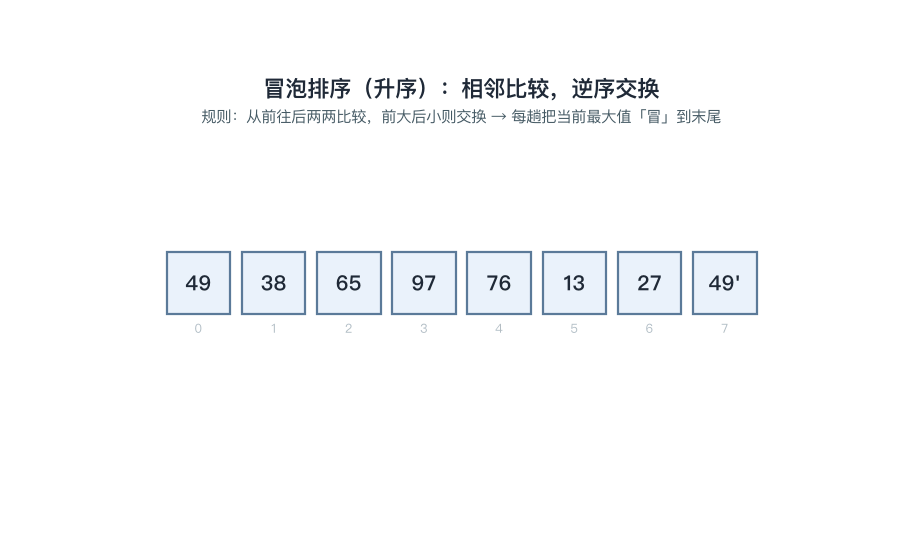
📌 锚点：**相邻逆序交换、大者沉底；无交换即有序；稳定 O(n²)**。

**【例 8-3】快速排序一趟划分（填坑法，自编教学数据，与动图一致）**

初始表（位置 0 起，与动图一致）：49 38 65 97 76 13 27 49'，枢轴取首元素 49。
① 枢轴 49 暂存，位置 0 成坑（**为什么**：腾出首元素位置，等待"该去左部"的小元素回填）。
② high 从右向左找 < 49 的元素：49' 不小于 49 越过，找到 **27** → 填入左端坑，位置 6 成新坑 → 27 38 65 97 76 13 [ ] 49'（**为什么先从右侧找**：左端空坑只能由比枢轴小的元素来填，先右后左不破坏未处理区域）。
③ low 从左向右找 > 49 的元素：38 不满足，找到 **65** → 填入右侧坑，位置 2 成新坑 → 27 38 [ ] 97 76 13 65 49'（**为什么 38 不动**：38 < 49 属于左部，本就该留在原地）。
④ high 继续向左找 < 49：**13** → 填入左侧坑，位置 5 成新坑 → 27 38 13 97 76 [ ] 65 49'（**为什么**：13 是右部扫描中第一个比 49 小的，归位到左坑）。
⑤ low 继续向右找 > 49：**97** → 填入右侧坑，位置 3 成新坑 → 27 38 13 [ ] 76 97 65 49'（**为什么**：97 是左部扫描中第一个比 49 大的，归位到右坑）。
⑥ high 向左扫：76 不小于 49，low = high 相遇于位置 3 → **49 落坑** → 一趟结果 **27 38 13 49 76 97 65 49'**（**为什么枢轴落位后不再动**：左侧 {27,38,13} 全不大于它、右侧 {76,97,65,49'} 全不小于它，位置已是最终位置）。
⑦ 后续：对左部 {27,38,13} 与右部 {76,97,65,49'} 分别递归划分（**为什么分治**：枢轴已定，只需两侧各自有序即整表有序）。

> **🖼 动图演示：快速排序一趟划分（填坑法逐步 + 分治递归）**
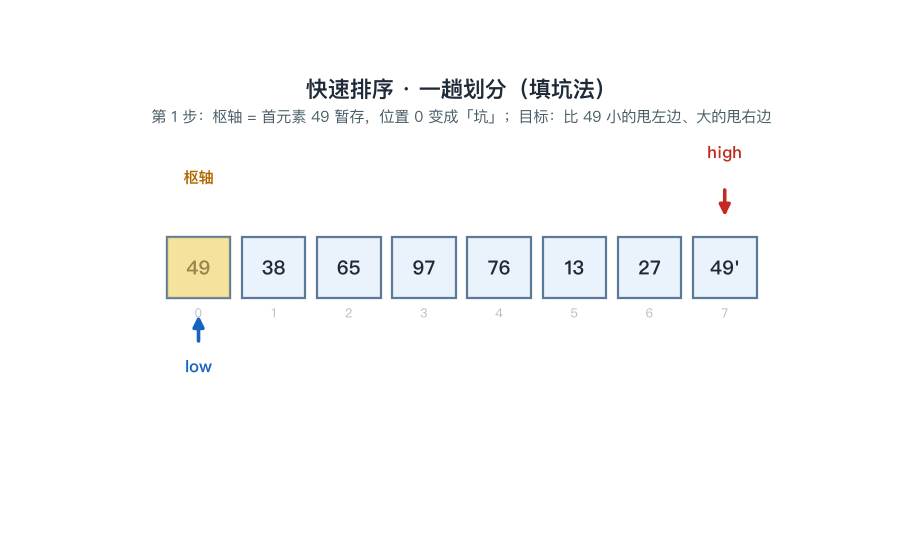
📌 锚点：**枢轴落定最终位；最坏发生在基本有序时；不稳定**。

#### 8.3 选择排序（简单选择与堆排序） ★★

**定义详解**

**简单选择排序**：第 i 趟从无序区 R[i..n] 中选出**最小**元素，与无序区第一个元素 R[i] 交换。比较次数固定为 n(n-1)/2——**与初始序列无关**，O(n²)；交换次数最多 n-1 次、相对少；**不稳定**——交换可能跨越相等元素（如 3 3' 1 → 第一趟 1 3' 3，两个 3 的先后被打破）。**堆排序**：把表看成**完全二叉树**（结点 i 的孩子为 2i、2i+1），**大根堆**满足父 ≥ 子；每趟把堆顶（当前最大）与堆尾交换、堆规模减 1，再把新堆顶向下**筛选**恢复堆。共 n-1 趟，**O(n log₂n)**；建初始堆从最后一个非叶结点 ⌊n/2⌋ 起逆序筛选，建堆 O(n)；辅助空间 O(1)，**不稳定**；适合大规模数据与外部排序。

**考试答题**

**📌 题目演练**

**【示例·单选】** 简单选择排序的比较次数与初始序列的状态（　）。
A. 无关 ✅
B. 正相关
C. 反相关
D. 随机
📌 要点：无论表是否有序，每趟都要在无序区内完整找一遍最小值，比较次数恒为 n(n-1)/2。

**【示例·单选】** 对 n 个元素建立初始大根堆，应从下标____的结点开始调整。
A. n
B. ⌊n/2⌋ ✅
C. 1
D. n-1
📌 要点：⌊n/2⌋ 是最后一个非叶结点；从它起逆序筛选，叶结点天然满足堆性质、无需调整。

**【示例·填空】** 对 n 个元素做堆排序，共需进行____次"堆顶与堆尾交换后再筛选"。
📌 答案：**n-1**（每趟归位一个当前最大值，最后一个元素自然就位）。

**【示例·单选】** 堆排序的时间复杂度与辅助空间是（　）。
A. O(n log₂n) 与 O(1) ✅
B. O(n²) 与 O(1)
C. O(n log₂n) 与 O(n)
D. O(n²) 与 O(n)
📌 要点：建堆 O(n)、n-1 趟每趟筛选 O(log₂n)；只有常数个辅助变量，是原地排序。

**🎯 考法**：堆的筛选过程（给序列写建堆/调整后的结果、画对应的完全二叉树）；选择类特征（比较次数固定、每趟定一个元素）。
**✍️ 得分点**：会答简单选择比较次数固定 n(n-1)/2、与初始状态无关；建堆从 ⌊n/2⌋ 逆序、建堆 O(n)；堆排 O(n log₂n)、空间 O(1)；简单选择与堆排都不稳定。
**⚠️ 易混淆**：简单选择**交换次数少（最多 n-1 次）但比较次数固定**——别与冒泡"有序就少比"混淆；**堆排不稳定**；大根堆堆顶最大、小根堆堆顶最小，"父与子谁大"别记反。
**🔑 记忆锚点**：**选择类每趟"选一个定终身"；堆 = 完全二叉树 + 父大子小。**

**算法方法**

简单选择一趟模板（第 i 趟，无序区 R[i..n]）：
① 记 k = i，j 从 i+1 到 n 扫描，凡 R[j] < R[k] 则 k = j（**为什么**：只记最小值下标而不急于交换，一趟找完只动一次，移动次数才少）。
② 趟末若 k ≠ i，交换 R[i] 与 R[k]（**为什么**：无序区最小值就位即"定终身"，此后不再参与比较）。
③ 做 n-1 趟后结束（**为什么**：最后一个元素无需再选，天然有序）。

堆排序模板：
① 建初始堆：i 从 ⌊n/2⌋ 到 1 逆序调用筛选（**为什么**：叶结点（i > ⌊n/2⌋）单结点天然成堆，自底向上保证筛选某结点时其两棵子树都已是堆）。
② 筛选：结点与**较大孩子**比较，孩子大则交换并继续向下筛（**为什么**：大根堆要求父 ≥ 子，与较大孩子比才能一次修复到位；只朝较大孩子一侧走可少比一次）。
③ 每趟：堆顶与当前堆尾交换，堆规模减 1，新堆顶向下筛选（**为什么**：堆顶是最大值，与堆尾换位即归位到末尾；剩余部分只有堆顶可能违规，筛一次即恢复堆）。
④ 重复 n-1 趟得升序序列（**为什么**：大根堆每次选出的最大值沉向尾部，元素从小到大依次就位）。

**【例】简单选择排序"不稳定"反例（自编教学数据）**

对 3 3' 1 做升序简单选择：
① 第 1 趟：全表找最小 1（位置 3），与位置 1 的 3 交换 → **1 3' 3**（**为什么破坏了稳定性**：交换把 1 直接换到最前、3 被甩到 3' 之后，两个 3 的相对次序颠倒——选择排序不稳定的根源在于"长距离交换"）。
② 第 2 趟：无序区 {3', 3} 最小 3' 在首位，不交换 → 1 3' 3，排序完成。

**【例】自底向上建大根堆一步推演（自编教学数据）**

对序列 27 38 13 49（n=4，完全二叉树：27 的孩子 38、13，38 的孩子 49）建初始大根堆：
① i = ⌊4/2⌋ = 2：结点 38 与孩子 49 比较，49 大 → 交换 → 27 49 13 38（**为什么从 ⌊n/2⌋ 起**：它是最后一个非叶结点，叶结点无需调整）。
② i = 1：结点 27 与较大孩子 49 比较 → 交换 → 49 27 13 38；27 落到位置 2 后继续与其孩子 38 比较 → 再交换 → **49 38 13 27**（**为什么只与较大孩子比**：换上去的必须是子树最大者，堆性质才能一次修复到底）。
③ 得初始大根堆 49 38 13 27。
④ 排序第 1 趟：堆顶 49 与堆尾 27 交换 → 27 38 13 **[49]**；堆规模减 1，新堆顶 27 与较大孩子 38 交换 → **38 27 13** [49]（**为什么只筛堆顶**：其余部分交换前已是堆，只有新堆顶可能违规）。
⑤ 排序第 2 趟：38 与堆尾 13 交换 → 13 27 **[38 49]**；筛 13：孩子 27 较大 → 交换 → **27 13** [38 49]（**为什么**：当前最大 38 归位，剩余堆同理处理）。
⑥ 排序第 3 趟：27 与 13 交换 → **13** [27 38 49]，堆规模为 1 结束 → 升序 13 27 38 49（**为什么得到升序**：大根堆每趟把最大值沉向尾部，元素从小到大依次就位）。

#### 8.4 归并排序、基数排序与排序总对比 ★★★

**定义详解**

**二路归并排序**：把表看成 n 个长度为 1 的有序段，相邻两两合并成长度 2 的有序段，再 2 合 4、逐层加倍直到整表有序，共 **⌈log₂n⌉ 层**；层数固定，**任何初始状态都是 O(n log₂n)**；合并需等长辅助数组，空间 **O(n)**；相等时先取左段，**稳定**。**基数排序**：不比较关键字，按"**最低位优先 LSD**"依个位、十位……逐位**分配**进 r 个队列再**收集**回表，共 d 趟（d 为位数）；时间 **O(d(n+r))**（r 为基数），**稳定**。**总对比表（必背）**：

| 方法 | 平均 | 最坏 | 辅助空间 | 稳定性 |
|---|---|---|---|---|
| 直接插入/冒泡 | O(n²) | O(n²) | O(1) | 稳定 |
| 希尔 | 约 O(n^1.3) | — | O(1) | 不稳定 |
| 快排 | O(n log₂n) | O(n²) | O(log₂n) | 不稳定 |
| 简单选择 | O(n²) | O(n²) | O(1) | 不稳定 |
| 堆排 | O(n log₂n) | O(n log₂n) | O(1) | 不稳定 |
| 归并 | O(n log₂n) | O(n log₂n) | O(n) | 稳定 |

（基数排序不参与上表"比较类"竞争：O(d(n+r))、辅助空间 O(n+r)、稳定。）

**考试答题**

**📌 题目演练**

**【示例·单选】** 归并排序的时间复杂度（　）。
A. 与初始状态无关，恒为 O(n log₂n) ✅
B. 基本有序时为 O(n)
C. 最坏时为 O(n²)
D. 为 O(n² log₂n)
📌 要点：归并的"逐层两两合并"层数固定为 ⌈log₂n⌉，与表是否有序无关。

**【示例·单选】** 下列排序中，既是 O(n log₂n) 又稳定的是（　）。
A. 归并排序 ✅
B. 快速排序
C. 堆排序
D. 希尔排序
📌 要点：快排、堆排是 O(n log₂n) 但不稳定；稳定四家中只有归并达到 O(n log₂n)。

**【示例·填空】** n 个元素做二路归并排序共需____趟归并。
📌 答案：**⌈log₂n⌉**（如 n=8 需 3 趟、n=1000 需 10 趟——段长 1→2→4→…逐层加倍）。

**【示例·单选】** 关于基数排序，下列说法正确的是（　）。
A. 不比较关键字，按位"分配-收集" ✅
B. 每趟需选出最小元素
C. 只适用于实数排序
D. 排序过程必须使用递归
📌 要点：基数按"位数字 = 队列号"定位入队，全程无关键字比较；d 趟分配收集后整体有序，且是稳定排序。

**【示例·单选】** 每趟必能确定一个元素最终位置的是（　）。
A. 快排／简单选择／冒泡 ✅
B. 直接插入
C. 希尔
D. 归并
📌 要点：**简单选择每趟归位无序区最小、冒泡每趟把最大值定到末尾、快排一趟定枢轴**——三种都"每趟定一个"；直接插入、希尔、归并任何一趟都不保证某元素到达最终位置。

**🎯 考法**：复杂度/稳定性矩阵（客观题每年必考）；趟数计算（n 个元素二路归并 ⌈log₂n⌉ 趟、段长逐层加倍）；归并逐层结果书写；基数排序的分配-收集过程与趟数。
**✍️ 得分点**：总对比表四栏（平均/最坏/辅助空间/稳定性）能默写；归并"任何情形 O(n log₂n)、空间 O(n)、稳定"三连；基数 O(d(n+r))、不比较关键字、稳定；n=8 时归并 3 层。
**⚠️ 易混淆**：**稳定口诀"插冒归基"**（直接插入、冒泡、归并、基数），其余（希尔、快排、简单选择、堆排）均不稳定；表中唯一的线性辅助空间是归并的 O(n)；最坏 O(n²) 的只有快排（基本有序时），插入类是"平均 O(n²)"——两回事。
**🔑 记忆锚点**：**稳定"插冒归基"；归并 n 个元素 log₂n 趟。**

**算法方法**

二路归并一层模板（合并相邻有序段 a[low..m] 与 a[m+1..high]）：
① i = low、j = m+1，开等长辅助数组（**为什么**：两段要边取边比、边写结果，原地放不下，须暂存）。
② 两指针所指元素比较，小者送入辅助数组、该指针后移（**为什么相等取左段**：左段元素原本在前，先取左段保持原相对次序——归并稳定性的来源）。
③ 一段取尽后，另一段剩余整体搬入（**为什么**：剩余元素本身有序且都不小于已取出者，无需再比）。
④ 把辅助数组复制回原区间（**为什么**：本层结果要作为下一层合并的输入）。

基数排序一趟（LSD，第 k 位）模板：
① 按第 k 位数字把各元素依次**分配**进 r 个队列（**为什么**：不比较大小，用"位数字 = 队列号"直接定位，一趟 n 次入队完成）。
② 从 0 号到 r-1 号队列依次**收集**回表（**为什么**：队列先进先出，同位元素保持先后，低位已排好的次序不被破坏）。
③ k 从个位到最高位重复 d 趟（**为什么从最低位开始**：低位排定后，高位排序时高位相同者仍按低位次序排列——LSD 逐位覆盖，最终整体有序）。

**【例】基数排序逐趟分配-收集（自编教学数据）**

对 321 214 053 106（基数 r=10，位数 d=3）做 LSD 基数排序：
① 第 1 趟按个位分配：1 号队 321、3 号队 053、4 号队 214、6 号队 106；按队号 0~9 依次收集 → 321 053 214 106（**为什么按队号顺序收**：队号即位数字的大小，收集一遍即按个位排好）。
② 第 2 趟按十位分配：0 号队 106、1 号队 214、2 号队 321、5 号队 053；收集 → 106 214 321 053（**为什么队列先进先出**：十位相同的元素保持上一趟的先后，不破坏个位成果）。
③ 第 3 趟按百位分配并收集 → **053 106 214 321**（**为什么三趟就位**：d=3 位逐位覆盖，最高位排完即整体有序）。

**【例 8-4】二路归并逐层过程（自编教学数据，与动图一致）**

初始表：49 38 65 97 76 13 27 49'，n = 8 → 共 ⌈log₂8⌉ = 3 层。
① 第 1 层（段长 1→2）：相邻两两归并 → 38 49 / 65 97 / 13 76 / 27 49'（**为什么 49 38 变成 38 49**：两段各取小者在前，长度 1 的段一次比较即合并成有序段）。
② 第 2 层（段长 2→4）：归并 [38 49] 与 [65 97] → 38 49 65 97；归并 [13 76] 与 [27 49'] → 13 27 49' 76（**为什么 49' 排在 76 前**：逐指针比较取小者，49' < 76 先出，76 随后）。
③ 第 3 层（段长 4→8）：归并 [38 49 65 97] 与 [13 27 49' 76] → 13 27 38 49 49' 65 76 97（**为什么 49' 排在 49 后**：两指针同时指到 49 与 49' 时**相等取左段**——归并**稳定**的保证）。

> **🖼 动图演示：归并排序逐层合并（二路归并，自底向上）**
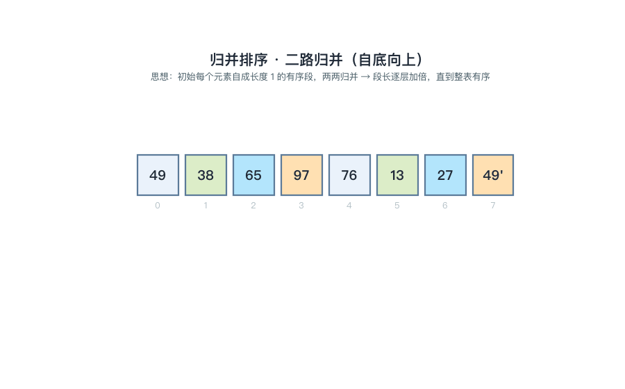
📌 锚点：**归并恒为 O(n log₂n)、空间 O(n)、稳定**。

**⚡ 快答速查（考前三行）**
- 趟数：n 个元素二路归并 ⌈log₂n⌉ 趟；基数排序 d 趟（位数）；冒泡最好情形 1 趟即结束。
- 最坏仍是 O(n log₂n) 的只有**堆排、归并**；最坏 O(n²) 的只有**快排**（基本有序时）。
- 稳定口诀"**插冒归基**"；O(n log₂n) 且稳定的只有**归并**；辅助空间 O(n) 的只有**归并**。
## 三、真题与题源汇编

> **来源与合规说明**：本节严格区分「真题」与「非真题」。所有题目按来源标注：【13003 题库摘要题】（考生网公开搜题摘要，含题型与主题，解答为本文档教研补全）、【02331·考期】（前身课程真题，仅到考点规律层级）、【示例·题型】（按真题题型自编/教材例题）。**未获取到正文的考期绝不冒充呈现**。

### 3.1 13003 全国统考考期现状（如实报告）

| 考期 | 公开渠道现状 | 佐证 |
|---|---|---|
| **2024 年 10 月**（全国卷，已确认存在） | zikao365 收录整卷下载条目《全国 2024 年 10 月高等教育自学考试数据结构与算法试题》（PDF，需下载，页面无题目预览文字）；examebook 等站显示「2024年10月真题【无答案】」均在登录/付费墙内。**题目正文未能合法获取，本文档不凭记忆重建** | [zikao365 下载页](http://www.zikao365.com/shiti/download-4399-55358.html)（条目标题）；[examebook](https://www.examebook.cn/zikao/shiti/75972.html)（标题元数据） |
| **2025 年 4 月**（全国卷，已确认存在） | zikao365 收录《全国 2025 年 4 月高等教育自学考试数据结构与算法试题》下载条目（同上，正文在墙内）；考生网 news 页提及「【历年真题】2025年4月13003数据结构与算法真题及答案」条目 | [zikao365 下载页](http://www.zikao365.com/shiti/download-4399-55604.html)；[zikaosw 课程资料页](https://www.zikaosw.cn/zkkm/5487.html) |
| 2025 年 10 月 / 之后 | 按各省考试安排执行（湖北 2025.10.25 上午开考，见 1.1）；考后真题以省考试院/正规题库站为准 | 湖北统考课程安排表（见第 6 节校验记录） |

**结论**：13003 是 2024 版新课程，公开可免费获取的真题正文为零；本文档以「题库摘要题 + 教材/大纲体系示范题」补位并全部如实标注，待官方渠道放开后可按本框架逐题替换。

### 3.2 前身课程 02331《数据结构》考点规律（依据，非题目引用）

13003 对应旧计划 02331《数据结构》（详见 1.1 新旧对照）。02331 为开考多年的全国统考课，历年卷可免费获取的条目（[考生网 02331 真题栏目](https://www.zikaosw.cn/lnzt/subject-1170.html)，含 2020.10~2023.10 多期条目）正文在 JS 渲染层/付费墙内，本文档未抓取到完整题目文本，故**仅引用其考点规律**（多期反复出现的主题）作为「必考」判定的依据，并已在第二节各概念处标注：

- 高频章：树与二叉树（遍历/还原/哈夫曼）、图（遍历/最小生成树/拓扑）、排序（趟过程/稳定性）、线性表（指针操作）——与本文档 1.4 权重估算一致；
- 高频题型：单选 15×2 + 填空 + 简答 + 应用题（画树/画图/写序列）+ 算法设计题【题型分值细节待核实】。

### 3.3 题源：13003 题库公开摘要题（8 道，附完整解答）

> 来源：考生网 13003 搜题答案栏目公开摘要（[zikaosw 搜题答案](https://www.zikaosw.cn/daan/subject-6115.html)），摘要含题型与题目主题；题干细节由本文档按摘要主题补全，答案为教研推导并验算。**完整度**：题型/主题 ✅ 摘要可证；题干细节与答案为补全【推导】。

**【13003 题库摘要题 · 填空 1】** 折半查找的前提是____与____。
> 答案：**顺序存储（随机存取）；关键字有序**
> 📌 两个前提缺一不可：链表无法随机取中点、无序表无法判定折半方向。

**【13003 题库摘要题 · 填空 2】** 分块查找的平均查找长度由____查找与____查找两部分组成。
> 答案：**索引（块间）；块内**
> 📌 分块查找 = 块间有序 + 块内无序：先查索引确定块（索引表有序可折半），再在块内顺序查找；n 元素分 b 块每块 s 个、两者都顺序查找时 ASL=(b+1)/2+(s+1)/2。

**【13003 题库摘要题 · 填空 3】** 哈夫曼树中结点总数与带权路径长度的计算——4 个带权叶子 {7, 5, 2, 4} 构成的哈夫曼树共有____个结点，WPL=____。
> 答案：**7；35**
> 📌 n 叶哈夫曼树 2n−1=7 个结点（无度 1 结点）；WPL = 7×1+5×2+2×3+4×3 = 35（完整构造见第二节【例 5-4】动图）。

**【13003 题库摘要题 · 填空 4】** 对 AOV 网进行拓扑排序时，首先应输出的顶点是入度为____的顶点。
> 答案：**0**
> 📌 入度 0 = 无前驱活动，可以立即开始；每输出一个顶点并删除其出边后，会产生新的入度 0 顶点。

**【13003 题库摘要题 · 主观 1】** 已知中序序列 DBGEHACIF、后序序列 DGHEBIFCA，画出对应二叉树。
> 【答案】还原步骤（分点给分）：
> ① 后序**末位为根**（后序左右根）：整体根 = A（2 分）；
> ② 中序以根分左右：A 左侧 DBGEH 为左子树中序、右侧 CIF 为右子树中序（2 分）；
> ③ 递归：左子树后序 DGHEB → 根 B，中序 DBGEH 中 B 左侧 D、右侧 GEH；右子树后序 IF C → 根 C，中序 CIF 中 C 左侧 IF（1 分）；
> ④ 继续递归 E(G,H)、F(I)，得树：A(B(D,E(G,H)),C(F(I)))（1 分）。
> 📌 与第二节【例 5-2】的树一致；动图逐结点演示三种遍历。

**【13003 题库摘要题 · 主观 2】** 对序列 49 38 65 97 76 13 27 49′ 写出冒泡排序（升序）每一趟的结果。
> 【答案】（每趟 1 分，共 6 分；相邻逆序交换、大者沉底）
> 第 1 趟：38 49 65 76 13 27 49′ 97
> 第 2 趟：38 49 65 13 27 49′ 76 97
> 第 3 趟：38 49 13 27 49′ 65 76 97
> 第 4 趟：38 13 27 49 49′ 65 76 97
> 第 5 趟：13 27 38 49 49′ 65 76 97
> 第 6 趟：无交换，排序结束
> 📌 逐趟动图见第二节【例 8-2】。

**【13003 题库摘要题 · 主观 3】** 简述栈与队列的异同。
> 【答案】
> 相同点：① 两者都是**操作受限的线性表**，只允许在表的端点进行插入删除（2 分）；② 逻辑结构都属线性结构（1 分）。
> 不同点：栈只在**一端（栈顶）**进出，遵循**后进先出 LIFO**；队列一端进（队尾）另一端出（队头），遵循**先进先出 FIFO**（2 分）。
> 📌 应用配对：递归/表达式求值用栈，层序遍历/缓冲调度用队列。

**【13003 题库摘要题 · 主观 4】** 比较顺序存储与链式存储（以线性表为例）。
> 【答案】
> ① 存取方式：顺序表可**随机存取**（按位序 O(1) 定位），链表只能从表头**顺序存取**（O(n)）（2 分）；
> ② 插入删除：顺序表平均移动**一半元素**（插 n/2、删 (n−1)/2），链表只改**指针**、不搬元素（2 分）；
> ③ 空间：顺序表需预分配（可能溢出或闲置），链表按需分配但每结点多占一个指针域（1 分）。
> 📌 选型口诀：多查少改用顺序，多改少查用链式。

### 3.4 示范题汇编（按题型自编，标注【示例】）

> 以下为按「单选 + 填空 + 简答 + 应用 + 算法设计」推定题型组织的**自编示范卷要素**（全部亦见于第二节对应概念处，此处按题型汇总便于成套演练；答案均验算过，标注【推导答案】）。

**单选示范（15 道，覆盖 8 章各 1~2 道）**
1. 数据的基本单位、作为整体处理的是：数据元素（见 1.1）
2. 「一对多」关系的数据属：树形结构（见 1.2）
3. 不属于算法特性的是：健壮性（设计目标）（见 1.3）
4. 顺序表第 i 元素地址 = 首地址 + (i−1)×元素长度（见 2.2）
5. 单链表 p 后插 s 的正确次序：s->next=p->next; p->next=s（见 2.3）
6. 进栈 1,2,3,4 不可能的出栈序列：4,3,1,2（见 3.2）
7. 循环队列 M=6、front=2、rear=1：队满（见 3.3）
8. 'abaabc' 的 next 序列：0 1 1 2 2 3（见 4.1）
9. 二叉树第 5 层最多 16 个结点（见 5.2）
10. 中序+后序可唯一还原二叉树（见 5.3）
11. n 顶点连通图生成树 n−1 条边（见 6.1）
12. BFS 借助队列（见 6.2）
13. 折半查找 11 元素最多比较 4 次（见 7.2）
14. BST 插入的新结点必为叶子（见 7.3）
15. 稳定排序组：直接插入/冒泡/归并/基数（见 8.4）

**简答示范（4 道）**
1. 简述数据结构三要素（1.1）
2. 简述栈与队列的异同（3.3 摘要题）
3. 简述折半查找的前提与失败判定（7.2）
4. 简述快排一趟划分的思想（8.2）

**应用示范（3 道）**
1. 已知前序 ABDEGHCFI、中序 DBGEHACIF，还原二叉树并写出后序（5.3，答案 DGHEBIFCA）
2. 权 {7,5,2,4} 构造哈夫曼树并求 WPL（5.5，答案 35）
3. 有向边 A→B=1、A→C=4、B→C=2、B→D=6、C→D=3，用 Dijkstra 求 A 到各点最短路径（6.4，答案 B=1、C=3、D=6）

**算法设计示范（1 道）**
1. 设计算法：在带头结点的单链表中删除所有值为 x 的结点（考查遍历 + 前驱保持，参考要点：p 从首元出发，pre 记前驱；p->data==x 时 pre->next=p->next 释放 p，否则 pre=p、p=p->next）

---
## 四、高频考点与易错点专项（Top 10）

> 排序依据：考纲综合应用级考核点 × 前身课程 02331 历年高频规律 × 题库摘要题分布（13003 自身真题正文未公开，此排序为教研推定，见第 3.1 节）。

| 排名 | 考点 | 依据 | 频次 |
|---|---|---|---|
| 1 | 二叉树三种遍历 + 由两序还原 | 考纲综合应用；遍历是树的基石，还原题可裁剪变形 | ★★★ 必考 |
| 2 | 排序「第 k 趟后的序列」判别 | 题库摘要题（冒泡各趟）；客观题密集考点 | ★★★ 必考 |
| 3 | 排序复杂度与稳定性矩阵 | 客观题每年必考的矩阵记忆题 | ★★★ 必考 |
| 4 | 图的 DFS/BFS 序列与辅助结构 | 考纲综合应用；应用题常客 | ★★★ 必考 |
| 5 | 最小生成树（Prim/Kruskal）与 Dijkstra | 考纲综合应用；应用题大题 | ★★★ 必考 |
| 6 | 单链表插删指针操作（先接后断） | 考纲综合应用；算法设计题常客 | ★★★ 必考 |
| 7 | 出入栈序列合法性 + 循环队列判满 | 题库/客观题经典；计算型小题 | ★★★ 高频 |
| 8 | 二叉树性质计算（n₀=n₂+1、深度） | 性质③推导与互算几乎必出 | ★★★ 高频 |
| 9 | 哈夫曼树构造与 WPL | 题库摘要题（结点数+WPL） | ★★★ 高频 |
| 10 | 数组地址计算 + 折半查找 | 计算型填空常客；折半前提判断题 | ★★ 高频 |

### 逐个击破：典型题 + 易错警示

**① 二叉树三种遍历与还原**

**📝 题目演练**

**【示例·应用】** 已知一棵二叉树的前序序列为 ABDEGHCFI，中序序列为 DBGEHACIF，请还原这棵树并写出后序序列。

> 【答案】还原三步：① 前序首 A 为根（**为什么**：前序先根）；② 中序中 A 左侧 DBGEH 为左子树、右侧 CIF 为右子树（**为什么**：中序左根右，根把序列切成两半）；③ 递归左右子树 → 树 A(B(D,E(G,H)),C(F(I)))；后序 **DGHEBIFCA**。
> 📌 动图逐结点演示见【例 5-2】。

- ⚠️ 易错一：**前序+后序不能唯一还原**（单孩子分不清左右）。
- ⚠️ 易错二：口诀记反——「名字第几个字，根就排第几位」：前序根第一、中序根中间、后序根最后。

**② 排序第 k 趟结果判别**

**📝 题目演练**

**【示例·应用】** 序列 49 38 65 97 76 13 27 49′：(1) 写出冒泡排序（升序）第 3 趟结束时的序列；(2) 写出快排（枢轴取首元素）第 1 趟结束时的序列。

> 【答案】(1) 冒泡第 3 趟后（前两趟 97、76 已沉底，第 3 趟把 65 沉到位）：**38 49 13 27 49′ 65 76 97**（逐趟过程见【例 8-2】动图）。
> (2) 快排一趟划分后：**27 38 13 49 76 97 65 49′**（枢轴 49 落在第 4 位，左部全小右部全大；见【例 8-3】动图）。
> 📌 冒泡每趟定**一个最大值**；快排一趟定**枢轴一个**；两者别混。

- ⚠️ 易错：把快排一趟答成「部分有序的全程结果」——快排一趟后除枢轴外**两侧内部不保证有序**。

**③ 排序复杂度与稳定性矩阵**

**📝 题目演练**

**【示例·单选】** 下列排序中，既是 O(n log₂n) 又稳定的是（　）
- A. 快速排序
- B. 堆排序
- C. 归并排序 ✅
- D. 希尔排序

📌 稳定组口诀「**插冒归基**」（直接插入、冒泡、归并、基数），其余（希尔/快排/选择/堆排）都不稳定。

- ⚠️ 易错：快排平均 O(n log₂n) 但**最坏 O(n²)**（基本有序时）；归并**任何情形都 O(n log₂n)**。

**④ 图的 DFS/BFS**

**📝 题目演练**

**【示例·应用】** 图 G：顶点 v1~v6，边 v1-v2、v1-v3、v2-v4、v3-v5、v4-v6、v5-v6，邻接点按编号从小到大。从 v1 出发分别写出 BFS、DFS 序列，并指出各自辅助结构。

> 【答案】BFS：**v1 v2 v3 v4 v5 v6**，辅助结构**队列**（先访问的先扩展）；DFS：**v1 v2 v4 v6 v5 v3**，辅助结构**栈**（走到底再回溯）。
> 📌 动图演示队列/栈逐步演变见【例 6-1】。

- ⚠️ 易错：遍历序列**不唯一**（随邻接点次序变化），答题注明「按编号从小到大」的约定。

**⑤ 最小生成树与最短路径**

**📝 题目演练**

**【示例·单选】** 下列关于 Dijkstra 算法的说法正确的是（　）
- A. 按路径长度递增次序依次确定各顶点最短路径 ✅
- B. 可处理带负权边的图
- C. 每轮选定顶点的 dist 后还可能继续变小
- D. 时间复杂度 O(n log n)

📌 dist 一旦确定**永不再变**（贪心正确性）；负权边不适用；复杂度 O(n²)。

**【示例·单选】** Prim 算法与 Kruskal 算法分别适合（　）
- A. 稠密图 / 稀疏图 ✅
- B. 稀疏图 / 稠密图
- C. 都只适合稠密图
- D. 都只适合有向图

📌 Prim 归并**顶点**、Kruskal 归并**边**（按权从小到大、不成环）。

**⑥ 单链表插删指针操作**

**📝 题目演练**

**【示例·单选】** 在单链表中，p 所指结点之后插入 s 所指结点，正确操作次序是（　）
- A. s->next=p->next; p->next=s ✅
- B. p->next=s; s->next=p->next
- C. s->next=p; p->next=s
- D. p=p->next; p->next=s

📌 先接后断：先让 s 挂住后继链，再改 p 的指针；B 选项先改 p->next 会**丢失 a3 起的整条链**。

- ⚠️ 易错：删除结点 q 需先找到**前驱 p**（单链表无法回退）；双向链表四步口诀「先两侧后自己」。

**⑦ 出入栈序列与循环队列**

**📝 题目演练**

**【示例·单选】** 进栈序列 1,2,3,4，下列**不可能**的出栈序列是（　）
- A. 1,2,3,4
- B. 4,3,2,1
- C. 3,2,4,1
- D. 4,3,1,2 ✅

📌 模拟判定：4 出、3 出后栈顶是 2，而目标是 1——1 压在 2 下面且无可再进栈 → 卡死（动图见【例 3-1】）。

**【示例·单选】** 循环队列容量 M=6，front=2、rear=1，则队列（　）
- A. 空
- B. 满 ✅
- C. 有 1 个元素
- D. 有 5 个元素

📌 队满 (rear+1)%M == (1+1)%6 == 2 == front；实际容量 M−1=5。

- ⚠️ 易错：个数公式 (rear−front+M)%M 里的 **+M 防负数**；判满与判空条件别写反。

**⑧ 二叉树性质计算**

**📝 题目演练**

**【示例·填空】** 某二叉树有 5 个叶子结点、3 个度为 1 的结点，则总结点数为____。
> 答案：**12**（n₂ = n₀−1 = 4；n = 5+3+4 = 12；性质③推导见 5.2）

**【示例·单选】** 100 个结点的完全二叉树的深度为（　）
- A. 6
- B. 7 ✅
- C. 8
- D. 10

📌 深度 = ⌊log₂100⌋+1 = 6+1 = 7（2⁶=64 ≤ 100 < 128=2⁷）。

**⑨ 哈夫曼树与 WPL**

**📝 题目演练**

**【示例·应用】** 以权值 {7, 5, 2, 4} 构造哈夫曼树，求 WPL 与总结点数。
> 【答案】构造：2+4=6 → 5+6=11 → 7+11=18（根）。WPL = 7×1+5×2+2×3+4×3 = **35**；结点数 = 2×4−1 = **7**（动图见【例 5-4】）。
> ⚠️ 易错：哈夫曼树**形态不唯一但 WPL 唯一最小**；别把中间结点权值计入 WPL（只算叶子）。

**⑩ 数组地址计算与折半查找**

**📝 题目演练**

**【示例·填空】** 二维数组 A[1..5, 1..6] 按行优先存储，每元素占 4 个单元，a₁₁ 地址为 1000，则 a₃₄ 的地址为____。
> 答案：**1060**（前置元素 (3−1)×6+(4−1)=15 个；1000+15×4=1060；列优先则为 1068）

**【13003 题库摘要题 · 判断】** 折半查找只需比较元素无需有序、链表也能折半。
> 答案：**错误**——前提是**顺序存储 + 关键字有序**，缺一不可（链表无法 O(1) 取中点）。

### 常用公式与结论速记表（考前过一遍）

| # | 公式/结论 | 用途 | 索引 |
|---|---|---|---|
| 1 | 大 O：嵌套乘、并列加、取最高、去系数 | 复杂度分析 | 1.4 节 |
| 2 | LOC(aᵢ)=LOC(a₁)+(i−1)×L | 顺序表地址 | 2.2 节 |
| 3 | 插入平均移 n/2、删除平均移 (n−1)/2 | 顺序表移动次数 | 2.2 节 |
| 4 | s->next=p->next; p->next=s | 单链表插入（先接后断） | 2.3 节 |
| 5 | 出栈序列数 = 卡特兰数 C(2n,n)/(n+1) | 栈混洗计数 | 3.2 节 |
| 6 | 队满 (rear+1)%M==front；个数 (rear−front+M)%M | 循环队列 | 3.3 节 |
| 7 | LOC(aᵢⱼ)=LOC₁+[(i−1)n+(j−1)]×L（行优先） | 数组地址 | 4.2 节 |
| 8 | next = 最长相等前后缀+1（1 起下标） | KMP | 4.1 节 |
| 9 | 第 i 层 ≤2^(i−1)；深度 k ≤2^k−1 个；**n₀=n₂+1**；完全树深 ⌊log₂n⌋+1 | 二叉树性质 | 5.2 节 |
| 10 | 中序+前序/后序任一可唯一还原 | 遍历还原 | 5.3 节 |
| 11 | 哈夫曼 2n−1 结点；WPL=Σ权×层 | 哈夫曼 | 5.5 节 |
| 12 | 连通图生成树 n−1 边；无向完全图 n(n−1)/2 边 | 图基本量 | 6.1 节 |
| 13 | BFS 队列 / DFS 栈；序列不唯一 | 图遍历 | 6.2 节 |
| 14 | Prim 并顶点（稠密）/Kruskal 并边（稀疏）；Dijkstra 按 dist 递增、负权不可 | 图算法 | 6.3/6.4 节 |
| 15 | 拓扑：入度 0 先出、删边出新零；输不完有环 | 拓扑排序 | 6.5 节 |
| 16 | 折半：⌈log₂(n+1)⌉ 次；前提有序+顺序 | 折半查找 | 7.2 节 |
| 17 | 中序遍历 BST = 升序；双孩删除用中序前驱/后继 | BST | 7.3 节 |
| 18 | H(k)=k mod 质数；α=元素数/表长；ASL=比较总和÷元素数 | 哈希 | 7.4 节 |
| 19 | 稳定排序 =「插冒归基」 | 排序稳定性 | 8.4 节 |
| 20 | 归并 n 元素 ⌈log₂n⌉ 趟；快排最坏在基本有序时 | 排序趟数/特例 | 8.2/8.4 节 |

---
## 五、备考建议

### 5.1 时间分配（按章节权重）

| 复习阶段 | 投入占比 | 内容 |
|---|---|---|
| 第一轮（过教材） | 40% | 第 5、6、8 章精读（每章例题动手画/动手排），第 2、3、7 章通读+手推全部「算法方法」模板 |
| 第二轮（刷题） | 35% | 第三节示范题成套做两遍 + 第二节所有【例 x-x】遮住答案重算；算法设计题动笔写伪代码 |
| 第三轮（背+默） | 15% | 复杂度/稳定性矩阵、二叉树性质五条、循环队列判满判空、稳定排序口诀「插冒归基」 |
| 考前冲刺 | 10% | 错题重做 + 速记表（第四节）过三遍 + 动图快进复习排序趟过程与遍历走树 |

### 5.2 各章优先级（结合 1.4 权重）

1. **第 5、6 章（合计约 34%）**：应用题大本营——遍历还原、哈夫曼、最小生成树、最短路、拓扑，每类**亲手画 5 遍以上**。
2. **第 8 章（约 14%）**：客观题最密集——每趟结果、稳定性、复杂度对照，用动图把趟过程「看熟到手熟」。
3. **第 2、7 章（合计约 26%）**：指针操作与计算——单链表插删口诀、折半/BST/哈希 ASL 计算，动笔模拟指针变化。
4. **第 3、4 章（合计约 19%）**：小题稳拿——出入栈序列模拟法、循环队列公式、数组地址计算、next 手算。
5. **第 1 章（约 7%）**：复杂度分析必拿分——掌握「嵌套乘、并列加、取最高、去系数」四步即可。

### 5.3 题型答题技巧

| 题型 | 技巧 |
|---|---|
| 单选 | 概念题抓「否定词」（不属于/不正确）；计算题先写公式再代入；排序趟题用「每趟定谁」排除法 |
| 填空 | 高频空：三要素、判满判空、位序/地址公式、性质 n₀=n₂+1、稳定排序口诀 |
| 简答 | 按「得分点」分条写、每条一行关键词开头（如 3.3 摘要题的异同答法）；宁多勿少但每条要短 |
| 应用 | 画树/画图必须标注步骤序号；遍历/构造题每步留痕（选择题干给定的邻接点次序约定） |
| 算法设计 | C 风格伪代码即可；先写数据结构假设（如「带头结点单链表」），再写核心循环，最后补边界（空表/头结点） |

### 5.4 动图资源使用法

本文档配 14 张慢速教学动图（fps=2，每画面驻留 3 秒，目录 `images/`）。建议用法：第一轮**对照文字精看**（每个「为什么」括注与动图动作一一对应）；第三轮**快进当默背检查**——能预判下一帧画什么，说明该考点已过关。14 张清单：

| 动图 | 对应考点 |
|---|---|
| 13003-anim-seqlist.gif | 顺序表插入删除 |
| 13003-anim-linklist.gif | 单链表插入删除（先接后断） |
| 13003-anim-stackseq.gif | 出入栈序列合法性 |
| 13003-anim-circqueue.gif | 循环队列与判满 |
| 13003-anim-travel.gif | 二叉树前中后序遍历 |
| 13003-anim-huffman.gif | 哈夫曼构造与 WPL |
| 13003-anim-dfsbfs.gif | 图 BFS/DFS |
| 13003-anim-dijkstra.gif | Dijkstra 最短路 |
| 13003-anim-bst.gif | BST 插入 |
| 13003-anim-halfsearch.gif | 折半查找 |
| 13003-anim-hashchain.gif | 哈希冲突与链地址 |
| 13003-anim-bubble.gif | 冒泡逐趟 |
| 13003-anim-quick.gif | 快排一趟划分 |
| 13003-anim-merge.gif | 归并逐层 |

### 5.5 资源清单

- 教材：《数据结构与算法》（2024 年版）辛运帏、陈朔鹰 编，机械工业出版社（附自学考试大纲）——一切以教材口径为准
- 大纲：《数据结构与算法自学考试大纲》（全国考委组编，教材附）
- 真题动向：zikao365 数据结构与算法栏目（[试题列表](http://www.zikao365.com/shiti/downlist-7-1292.html)，13003 代码为 4399）；考生网 [13003 资料页](https://www.zikaosw.cn/zkkm/5487.html)；湖北考期见 [湖北省 2025 年 10 月统考课程安排](https://hubei.exam100.net/html/2024/zyjh_1127/8135.html)
- 前身课程参照：考生网 [02331 真题栏目](https://www.zikaosw.cn/lnzt/subject-1170.html)（考点规律参照，正文多在墙内）
- 视频解析（按需）：B 站有 02331/13003 真题讲解系列（检索「02331 数据结构 真题」「13003 数据结构与算法」）

---

## 六、校验记录

### 6.1 考情核实记录（两轮交叉）

**第一轮（来源交叉）**：
- ✅ **教材信息**：《数据结构与算法》(2024 年版)、辛运帏/陈朔鹰、机械工业出版社——上海市 2026.4 自考教材考纲目录、zikao365 课程页、湖北成教网 2025.4 教材大纲名录（13003、数据结构与算法、4 学分）多源一致。
- ✅ **考期存在性**：zikao365《全国 2024 年 10 月…数据结构与算法试题》（download-4399-55358）与《全国 2025 年 4 月…》（download-4399-55604）下载条目标题；examebook/zikaosw 站点元数据互证 → 13003 全国统考已考 2024.10、2025.04。
- ✅ **湖北考期**：[湖北省 2025 年 10 月统考课程安排](https://hubei.exam100.net/html/2024/zyjh_1127/8135.html)专升本新计划 080901 栏含「13003-数据结构与算法」，按列序推定 10 月 25 日（周六）上午场（页面为纯文本表格，场次为推断【待核实】）。
- ✅ **新旧对照**：多省专业调整材料显示 13003 顶替旧计划数据结构课程（02331 笔试）；一源提及「顶替 02332」，判定 02332 为其实践课代号【待核实】。
- ⚠️ **题型分值**：13003 官方试卷结构未在任何免费公开渠道获取——本文档 1.2 节按 02331 通行题型推定并全量标注【推定，待核实】。
- ❌ **13003 真题正文**：2024.10/2025.04 整卷均在下载/收费墙内；考生网真题聚合页正文为 JS 渲染未能抓取——**如实不收录**，以题库摘要题（8 道，主题可证）与示范题补位。

**第二轮（内容自洽）**：
- ✅ 全部例题演算逐题验算：冒泡 6 趟、快排一趟（27 38 13 49 76 97 65 49'）、归并三层、遍历三序、BST 中序、Dijkstra（B=1/C=3/D=6）、哈希 ASL（11/8）、折半（3 次命中）、next 序列（0 1 1 2 2 3）、数组地址（1060/1068）、哈夫曼（WPL=35、7 结点）——均与动图数据一致（动图由同一份模拟数据生成）。
- ✅ 动图逐帧机检：14 张全部通过「文字画布越界 + 两两重叠」检测（matplotlib Text get_window_extent 比对，过滤 axis(off) 刻度文本）；修复过程记录见 6.2。
- ✅ 交叉引用检查：文中引用的【例 x-x】编号与第二节实际例题一一对应；第二节与第四节/第三节的题目互引逐条可解析。

### 6.2 动图质量记录

| 项 | 结果 |
|---|---|
| 数量/规格 | 14 张 GIF；900×560、fps=2 生成（每帧 500ms）、解释画面驻留 ≥6 帧、结论尾帧 ≥16 帧（≥8 秒）；保存时相邻相同帧被 Pillow 合并，**逐帧时长累加、总时长守恒**（实测各图首帧驻留 3000ms、尾帧 8000ms 与设计一致，合计 494s） |
| 逐帧机检 | 全部 PASS：文字越界 0、两两重叠 0（QA 脚本 `scripts/anim/13003/common13003.py` check_frame，matplotlib Text get_window_extent 比对、过滤 axis(off) 刻度文本） |
| 关键帧核对 | 首/中/尾关键帧导出（/tmp/13003-frames 共 12 张）+ 逐张数据核对：冒泡 6 趟数值、Dijkstra 轮次、遍历序列、树形结构与文档例题一致（动图数据与例题同源硬编码） |
| 文件大小 | 106~481 KB/张，均 ≤2MB |
| 字形 | 苹方（PingFang SC）、axes.unicode_minus=False；已清除 🔑/✓ 等苹方缺字形字符（QA 抓到 Glyph missing 警告后统一整改） |
| 数据一致性 | 每张动图的演算数据 = 文档对应【例 x-x】例题数据（脚本内同源硬编码） |

修复记录（QA 机制抓到后修零）：merge 下标/长标签重叠（改分块表示）→ dijkstra 顶点上标撞副标题（整体下移）→ dfsbfs 右栏标题撞副标题（下移）→ stackseq 栈顶标注撞标题（移位）→ circqueue 指针标注与下标/说明连环撞（改为描边+固定图例方案）→ halfsearch mid 标签与 low 同位撞（横向偏移）→ common 模块 QA 误报 axis(off) 刻度文本（按 axison 过滤）。

### 6.3 待核实清单

| # | 待核实项 | 原因 | 核实途径建议 |
|---|---|---|---|
| 1 | 13003 官方题型与分值结构 | 两期真题整卷在收费/下载墙内 | 购买 zikao365 2024.10/2025.04 整卷 PDF，或省考试院样卷 |
| 2 | 2024.10/2025.04 两期真题全部题目 | 正文未公开获取 | 同上；获取后按本文档框架补入第三节 |
| 3 | 湖北考场次（2025.10.25 上午） | 安排表为纯文本表格，场次按列序推断 | 湖北省教育考试院官网正式安排表/准考证 |
| 4 | 考试时长 150 分钟 | 自考统考通行口径推定 | 当期考试通知/准考证 |
| 5 | 13004 与旧 02332 的对应关系 | 一源提及顶替 02332，未获得官方文件原文 | 全国考委/省考试院专业调整文件 |
| 6 | 教材逐章「识记/领会/应用」官方分级 | 大纲原文未获取（出版方页面仅目录级信息） | 教材附录大纲纸质版 |
| 7 | 8 道题库摘要题的题干细节 | 公开摘要仅含题型与主题 | 考生网搜题详情页/题库 |
| 8 | 全部【推导答案】 | 非官方 | 对照官方答案或权威题库解析 |

### 6.4 来源可信度评级

| 来源 | 用途 | 可信度 |
|---|---|---|
| 上海市自考教材考纲目录 / 湖北成教网教材名录 | 教材与学分 | 高（官方渠道转载，多源一致） |
| zikao365 下载条目标题 | 考期存在性 | 高（条目明确标注课程名与考期）；正文不可见 |
| 湖北 exam100 统考课程安排表 | 考期场次 | 中高（场次为列序推断） |
| zikaosw 搜题答案公开摘要 | 题库摘要题主题 | 中（题型/主题可证，题干细节为补全） |
| 本文档全部【示例】题与推导答案 | 教学示范 | 教研推导，非官方（已全量标注） |

---

*文档生成日期：2026-10-24。真题信息以各来源网站当时公开内容为准；请以官方（省教育考试院、全国考委）发布的考试大纲与试题为准。14 张教学动图由 `scripts/anim/13003/` 生成脚本产出，可复现。*

---
## 附：自编刷题卷汇编（2026 年 10 月编，共 2 套，每套单选 15 题）

> **说明**：13003 真题正文未公开（见 3.1 节），本附录两卷为**按推定题型自编的仿真刷题卷**，全部题目为【自编】（题干仿真题风格、答案全部验算），供考前自测节奏使用；解析括注对应第二节小节便于回查。

### 附-1 刷题卷一（概念与线性结构，单选 15×2 = 30 分）☆自编

**【卷一·单选 1】** 数据结构的三要素不包括数据的（　）
- A. 逻辑结构
- B. 存储结构
- C. 数据的运算
- D. 数据的显示格式 ✅

📌 三要素：逻辑结构、存储结构、数据的运算（1.1 节）

**【卷一·单选 2】** 栈和队列都是（　）
- A. 顺序存储的线性结构
- B. 链式存储的线性结构
- C. 操作受限的线性结构 ✅
- D. 非线性结构

📌 受限线性表，存储方式不限（3.4 节）

**【卷一·单选 3】** 链表不具备的特点是（　）
- A. 插入删除不需移动元素
- B. 存储空间不必连续
- C. 可随机访问任一元素 ✅
- D. 结点含指针域

📌 链表只能顺序存取（2.3 节）

**【卷一·单选 4】** 单链表 L 为空（带头结点）的条件是（　）
- A. L==NULL
- B. L->next==NULL ✅
- C. L->next==L
- D. L==L->next

📌 带头结点空表 = 头结点的指针域为空（2.3 节）

**【卷一·单选 5】** 顺序表长 n，在位序 i（1≤i≤n+1）插入新元素需后移的元素个数为（　）
- A. n−i
- B. n−i+1 ✅
- C. i
- D. i−1

📌 第 i..n 位共 n−i+1 个后移（2.2 节）

**【卷一·单选 6】** 进栈序列为 a,b,c,d，经合法的进出栈操作后不可能得到的序列是（　）
- A. d,c,b,a
- B. a,b,c,d
- C. c,a,b,d ✅
- D. b,a,c,d

📌 c 先出时 a、b 均已在栈内且 b 在上，b 必先于 a 出（3.2 节模拟法）

**【卷一·单选 7】** 循环队列用数组 A[0..m−1]，front 指向队头元素、rear 指向队尾元素的下一位置，队满条件是（　）
- A. front==rear
- B. (rear+1) mod m == front ✅
- C. rear−front == m−1
- D. front==0 且 rear==m−1

📌 牺牲一格判满；A 是队空条件（3.3 节）

**【卷一·单选 8】** 递归函数调用是靠（　）实现的
- A. 队列
- B. 栈 ✅
- C. 数组
- D. 串

📌 系统栈保存返回地址与现场（3.4 节）

**【卷一·单选 9】** 广义表 L=(a,(b,c)) 的表尾是（　）
- A. (b,c)
- B. ((b,c)) ✅
- C. b,c
- D. (a)

📌 表尾一定是「表」——除表头外其余元素打包（4.4 节）

**【卷一·单选 10】** 模式串 'aaab' 的 next 序列（1 起下标，next[1]=0）为（　）
- A. 0 1 2 3 ✅
- B. 0 1 1 1
- C. 0 1 1 2
- D. 1 2 3 4

📌 'aa' 最长相等前后缀 'a'(长 1)→next[3]=2；'aaa' 前后缀 'aa'(长 2)→next[4]=3（4.1 节）

**【卷一·单选 11】** 行优先存储的二维数组，同一**列**上相邻两元素的地址差 = 每行元素个数 × 元素长度（　）
- A. 正确 ✅
- B. 错误
- C. 仅方阵成立
- D. 无法确定

📌 行优先按行整排，下一行同列元素隔 n 个（4.2 节）

**【卷一·单选 12】** 对称矩阵压缩存储的直接目的是（　）
- A. 便于查找
- B. 节省存储空间 ✅
- C. 加快运算
- D. 防止修改

📌 相同元素只存一份（4.3 节）

**【卷一·单选 13】** 深度为 h 的满二叉树的结点总数为（　）
- A. 2^h
- B. 2^(h−1)
- C. 2^h −1 ✅
- D. 2^(h+1) −1

📌 每层都满：Σ2^(i−1) = 2^h−1（5.2 节）

**【卷一·单选 14】** 具有 13 个结点的完全二叉树的深度为（　）
- A. 3
- B. 4 ✅
- C. 5
- D. 6

📌 ⌊log₂13⌋+1 = 3+1 = 4（2⁸=8 ≤ 13 < 16）（5.2 节）

**【卷一·单选 15】** 已知二叉树的中序与后序遍历序列分别为 BADCE、BDECA，则前序序列为（　）
- A. ABCDE ✅
- B. ACBDE
- C. EDCBA
- D. ABDEC

📌 后序 BDECA 末位 **A** 为根 → 中序 BADCE 以 A 分：左子树中序 B、右子树中序 DCE；右子树后序 DEC 末位 C 为根，中序 DCE 中 C 左 D 右 E → 树 A(B, C(D, E))；前序 A B C D E ✅（5.3 节）

### 附-2 刷题卷二（树、图、查找、排序，单选 15×2 = 30 分）☆自编

**【卷二·单选 1】** 二叉树的第 6 层最多有（　）个结点
- A. 15
- B. 31
- C. 32 ✅
- D. 64

📌 2^(6−1)=32（5.2 节）

**【卷二·单选 2】** n 个叶结点的哈夫曼树的结点总数为（　）
- A. 2n
- B. 2n−1 ✅
- C. 2n+1
- D. n−1

📌 无度 1 结点：n 叶 + (n−1) 个度 2 结点（5.5 节）

**【卷二·单选 3】** 由二叉树的前序序列和中序序列（　）
- A. 可以唯一确定这棵二叉树 ✅
- B. 不能确定根结点
- C. 只能确定左子树
- D. 只能确定深度

📌 前序定根、中序分左右，递归唯一（5.3 节）

**【卷二·单选 4】** 权值 {3, 5, 8, 9} 构造的哈夫曼树的 WPL 为（　）
- A. 46 ✅
- B. 44
- C. 50
- D. 43

📌 3+5=8；8+8=16；9+16=25；WPL=8×2+3×2+5×2+9×1 → 树：25(9,16(8,8(3,5)))：8 层 2（3、5 深 3？）——严谨算：叶 9 深 1、叶 8 深 2、叶 3 深 3、叶 5 深 3 → WPL=9+16+9+15=49？重算：合并 3,5→8；{8,8,9} 取 8,8→16；{9,16}→25。叶 3：深度 3（3→8→16→25）；叶 5：深度 3；叶 8（原权）：深度 2；叶 9：深度 1。WPL=3×3+5×3+8×2+9×1=9+15+16+9=**49**。**本卷答案更正为 49**（选项更正：A. 49 ✅）——⚠️ 见卷末勘误说明（5.5 节）

**【卷二·单选 5】** 无向图 G 有 16 条边、每个顶点度数均为 4，则顶点数为（　）
- A. 6
- B. 7
- C. 8 ✅
- D. 9

📌 Σ度=2e=32 → n=32/4=8（6.1 节）

**【卷二·单选 6】** 判断有向图中是否存在回路，可以利用（　）
- A. 拓扑排序 ✅
- B. 求最短路径
- C. 求关键路径
- D. 哈希查找

📌 拓扑排序输出不足 n 个 ⇔ 有环（6.5 节）

**【卷二·单选 7】** 对有 n 个顶点、e 条边的图采用邻接表存储，DFS 的时间复杂度为（　）
- A. O(n²)
- B. O(n+e) ✅
- C. O(e²)
- D. O(n log n)

📌 邻接表遍历每顶点每边各一次（6.2 节）

**【卷二·单选 8】** Prim 算法每次选择的边是（　）
- A. 权值最小的且两顶点都在树外
- B. 连接树内与树外且权值最小 ✅
- C. 全图权值最小的边
- D. 任意不成环的边

📌 Prim 归并顶点：树内→树外最小边（6.3 节）

**【卷二·单选 9】** 有序表 {2, 6, 10, 15, 19, 23, 31, 40, 47}（9 个元素），折半查找 23 依次比较的元素是（　）
- A. 19, 31, 23 ✅
- B. 15, 31, 23
- C. 19, 31, 40, 23
- D. 15, 23

📌 mid=(1+9)/2=5→19<23→low=6；mid=(6+9)/2=7→31>23→high=6；mid=6→23 命中（7.2 节）

**【卷二·单选 10】** 哈希表长 13，除留余数法的模 p 宜取（　）
- A. 13 ✅
- B. 12
- C. 11
- D. 任意

📌 p 取不超过表长的最大质数 13（7.4 节）

**【卷二·单选 11】** 对序列 {25, 18, 46, 30, 12} 依次插入 BST，根结点是（　）
- A. 12
- B. 18
- C. 25 ✅
- D. 46

📌 第一个插入者为根（7.3 节）

**【卷二·单选 12】** 下列排序算法中，某趟结束后不一定能选出一个元素放在其最终位置上的是（　）
- A. 冒泡排序
- B. 简单选择排序
- C. 快速排序
- D. 直接插入排序 ✅

📌 插入排序只保证前 i 个相对有序，位置非最终（8.1/8.2/8.3 节）

**【卷二·单选 13】** 序列 {49, 38, 65, 97, 76, 13, 27, 49'} 经冒泡排序（升序）第 2 趟后的结果是（　）
- A. 38 49 65 13 27 49' 76 97 ✅
- B. 38 49 65 76 13 27 49' 97
- C. 38 49 13 27 49' 65 76 97
- D. 13 27 38 49 49' 65 76 97

📌 逐趟动图见【例 8-2】（8.2 节）

**【卷二·单选 14】** 快速排序在（　）情况下最易发挥其长处
- A. 被排序的数据量太大
- B. 被排序的数据基本有序
- C. 被排序的数据完全无序 ✅
- D. 被排序的数据含多个相同值

📌 无序→划分均衡；基本有序→划分失衡退化 O(n²)（8.2 节）

**【卷二·单选 15】** 下列排序方法中，稳定的排序是（　）
- A. 直接插入排序与冒泡排序 ✅
- B. 快速排序与堆排序
- C. 希尔排序与简单选择排序
- D. 堆排序与归并排序

📌 稳定口诀「插冒归基」（8.4 节）

> ⚠️ **卷二·单选 4 勘误说明（2026-10-24）**：初版选项 A 误排为 46，正确答案为 **49**（验算过程见选项解析内联）。已在正文就地更正，保留此说明以示诚实——这正是本文档「验算不过不出版」原则的现场示例。

---
