# 02324《离散数学》考试备考全攻略

> **课程代码**：02324　|　**课程名称**：离散数学　|　**课程性质**：全国统考课程（笔试）
> **指定教材**：《离散数学》（2014 年版），辛运帏 主编，机械工业出版社（附自学考试大纲），ISBN 9787111482048
> **适用对象**：计算机科学与技术（080901/S080901）、网络工程等专业（专升本）考生；湖北 2025.10 考期安排在 10 月 25 日上午 9:00–11:30
>
> ⚠️ **准确性说明**：本文档中所有题目均来自公开网络渠道（每节标注来源 URL），答案为站方公开解析经本文逐题验算后引用，验算不一致处标注「⚠️ 站方答案勘误」；未能核实的内容一律标注【待核实】。详见第 6 节校验记录。

---

## 目录

1. [考试概况与分值分布](#一考试概况与分值分布)
2. [必考概念详解](#二必考概念详解按章)
3. [历年真题汇编](#三历年真题汇编)
4. [高频考点与易错点专项（Top 10）](#四高频考点与易错点专项top-10)
5. [备考建议](#五备考建议)
6. [校验记录](#六校验记录)
7. [附：题库刷题卷汇编](#附题库刷题卷汇编)

---

## 一、考试概况与分值分布

### 1.1 基本信息表

| 项目 | 内容 | 核实状态 |
|---|---|---|
| 课程代码 | 02324 | ✅ 已核实（多省考试院文件） |
| 学分 | 4 学分 | ⚠️ 通行资料标 4 学分【待核实：以各省计划文件为准】 |
| 考试时间 | 150 分钟 | ⚠️【待核实：公开真题页未标注时长，按自考笔试惯例为 150 分钟】 |
| 总分 | 100 分，60 分及格 | ✅ 已核实（通行） |
| 湖北考期 | 2025.10 安排在 10 月 25 日上午 9:00–11:30（专升本计算机科学与技术 080901/S080901、网络工程 080903） | ✅ 已核实（湖北自考网 2025.10 统考课程安排表） |
| 指定教材 | 《离散数学》(2014 年版) 辛运帏主编，机械工业出版社，附自学考试大纲，ISBN 9787111482048 | ✅ 已核实（上海 2022.4、浙江 2024.10 考试院用书目录；机工社页面） |

> **教材说明**：02324 早期通行教材为左孝凌等《离散数学》（经济科学出版社 2000 年版；更早为上海科学技术文献出版社 1982 年版），**现行指定教材已更换为辛运帏 2014 年版**（附考试大纲）。两版知识体系一致（数理逻辑→集合论→关系→函数→代数系统→格与布尔代数→图论→树），本文档知识口径以现行考纲为基准，不依赖旧版独有内容。

### 1.2 题型与分值

依据 2024.04~2026.04 五个考期真题（卷面结构一致）：

| 题型 | 题量 | 每题分值 | 小计 | 核实状态 |
|---|---|---|---|---|
| 单项选择题 | 15 | 站方各考期卷首均标「每小题 1 分，共 15 分」（2020.08~2026.04 多卷卷首一致）；另有百度文库源标 2 分/题（共 30 分）为孤证 | 15 分（从卷首标注） | ⚠️ 卷首标注多源一致采信 1 分/题；2 分说【待核实】；题量 15 题 ✅ 各卷一致 |
| 填空题 | 10 | 2 分 | 20 分 | ✅ 站方大题标题原文「每小题 2 分，共 20 分」 |
| 简答题 | 7 | 按小问给分（1~2 分/问） | 约 25~35 分 | ⚠️ 大题总分【待核实】；站方解答含小问分值标注 |
| 证明题 | 3 | 按步骤给分 | 约 15~20 分 | ⚠️ 大题总分【待核实】 |
| **合计** | **35 题** | — | **100 分** | ✅ 题量五卷一致；分值拆分按 60 分及格线自洽 |

> 分值说明：站方历年卷首一致标注「单选每小题 1 分」（2020.08/2021.04/2022.04/2022.10/2023.04/2023.10/2025.10/2026.04 八卷卷首可见），本文采信 1 分/题口径；百度文库源「每题 2 分」无卷面依据支撑【待核实】。主观题分值按站方解答内小问分值标注（如简答 5 分/题、证明 5~7 分/题），大题总分以官方评分标准为准【待核实】。

> **历史卷面结构差异**：2022.10 及更早考期的卷面结构与近年不同——2022.10 原卷大题三为「计算题 5 小题×6 分=30 分」（站方卷首标注），大题四为证明题；2024.4 简答题为 6 题（其余考期 7 题）。近年（2024.10 起）稳定为「单选 15 + 填空 10×2 分 + 简答 7 + 证明 3」。本文档知识口径与题型模板以近年结构为准。

### 1.3 知识模块结构与考核要求

依据站方《入门学习指南》九大模块与其分值统计整理（模块边界与辛运帏教材章节的对应【待核实：未获取到官方大纲原文】）：

| 模块 | 核心考核知识点 | 每年分值（指南统计） | 出题倾向 |
|---|---|---|---|
| 1 命题逻辑 | 符号化、真值表与公式分类、等值演算、主范式、推理规则（P/T/CP） | 约 16~23 分 | **最高频**（单选主产区 + 简答求范式 + 证明推理） |
| 2 谓词逻辑 | 量词符号化、辖域与换名、公式真值、前束范式 | 约 10~15 分 | 高频（单选 + 填空） |
| 3 集合论 | 集合运算、文氏图、幂集、笛卡尔积、容斥 | 约 6~10 分 | 高频（选填 + 偶简答） |
| 4 二元关系 | 三种表示、五性质、复合/逆/幂、三闭包、等价关系与划分、偏序与哈斯图 | 约 12~16 分 | **最高频**（简答求闭包 + 证明等价 + 哈斯图大题） |
| 5 函数 | 函数判定、单射/满射/双射、计数公式、复合与逆 | 约 3~5 分 | 中频（选填为主） |
| 6 代数系统 | 运算性质、幺零逆元、半群→独异点→群、循环群与元素阶、环与域 | 约 10~15 分 | 高频（单选 + 群证明大题） |
| 7 格与布尔代数 | 格判定、哈斯图特殊元、分配格/有补格、布尔代数化简 | 约 8~12 分 | 高频（哈斯图 + 极值元大题几乎每套一题） |
| 8 图论 | 握手定理与度数序列、欧拉/哈密顿、补图、平面图欧拉公式、邻接矩阵通路计数 | 约 15~20 分 | **最高频**（选填 + 计算证明全覆盖） |
| 9 树 | 无向树与生成树、Kruskal 最小生成树、根树与二叉树遍历 | 约 12~15 分 | 高频（Kruskal 与遍历**几乎每年各一道大题**） |

> 分值为站方基于历年真题的统计口径（估算值，非官方权重），本文第 2 节各概念的重要度星级即据此+五卷真题密度综合评定。

---

## 二、必考概念详解（按章）

> 每条概念给出三块内容：**① 定义详解**（可直接当名词解释/简答的答题素材）；**② 考试答题**（历年真题列表 + 🎯考法 + ✍️得分点 + ⚠️易混淆 + 🔑记忆锚点，真题题干/选项/答案逐字照录第 3 节汇编对应题目）；**③ 解题方法**（步骤化模板 + 完整例题【例 章-序号】，每步括注（**为什么…**：一句话原理））。核心概念配 **🖼 动图演示**（GIF，fps=2 慢速分步讲解，解释画面驻留 ≥3 秒、结论尾帧 ≥8 秒），与文档例题数据完全一致。**「必考」判定均附真题证据（考期×题型）**。章节模块与分值权重见 1.3。

### 第 1 章 命题逻辑（全卷拿分基本盘，每年约 16~23 分）

#### 1.1 命题与联结词、符号化 ★★★

**定义详解**：**命题**是能判断真假、且真假唯一的陈述句（真记 1/T，假记 0/F）；疑问句、祈使句、感叹句以及真假无法确定的陈述句都不是命题。不再拆分的命题叫**原子命题**，用联结词把原子命题组合而成的叫**复合命题**。五个基本联结词：**¬**（否定，"不/并非"）、**∧**（合取，"并且/既…又…/都是"，两者都真才真）、**∨**（析取，"或者"，至少一个真即真）、**→**（蕴含，"如果…那么…/只要…就…/因为…所以…"，仅前件真后件假时为假）、**↔**（等价，"当且仅当"，同真同假才真）。把自然语言句子翻译成符号式的过程叫**符号化**，是每卷单选第 1 题的常客。据入门学习指南统计，第一章命题逻辑每卷约 16～23 分，是全卷拿分基本盘。

**考试答题**

**📌 历年真题**

**【2026.4·单选 1】** 设 P：0.4 是有理数，Q：0.4 可写成分数。命题"0.4 是有理数当且仅当 0.4 可写成分数"可符号化为
- A. P→Q
- B. P↔Q ✅
- C. Q→P
- D. P∧Q

📌 "当且仅当"是等价联结词 ↔ 的专属提示词，故选 P↔Q。

**【2025.10·单选 1】** 设 P：张三是篮球运动员，Q：李四是篮球运动员。命题"张三和李四都是篮球运动员"可符号化为
- A. P∨Q
- B. P∧Q ✅
- C. P→Q
- D. P↔Q

📌 "都是"＝两人各自是、缺一不可，即逻辑与 P∧Q；P∨Q 表示"至少一个是"，不合题意。

**【2024.10·单选 1】** 设 P：小张是数学老师，Q：小张是计算机老师。命题"小张既是数学老师又是计算机老师"的符号化形式为
- A. P∧Q ✅
- B. P∨Q
- C. P→Q
- D. P↔Q

📌 "既…又…"＝同时具备两个属性，合取 P∧Q。

**【2025.4·单选 1】** 设 P：今天下雨，Q：我去登山。命题"如果今天不下雨，我就去登山"可符号化为
- A. ¬P→Q ✅
- B. P→Q
- C. ¬P∧Q
- D. P∨¬Q

📌 "今天不下雨"＝¬P，"如果…就…"＝蕴含 →，合起来 ¬P→Q。

**【2021.4·单选 1】** 设 P：他勤奋，Q：他成绩高，命题"只有他勤奋，他成绩才高"符号化为
- A. P∨Q
- B. Q→P ✅
- C. ¬P∨¬Q
- D. P→Q

📌 "只有 P，才 Q"表示 Q 是 P 的必要条件：成绩高 ⇒ 必勤奋，即 Q→P（方向别写反）。

**【2023.10·单选 1】** 令 p：今天我上班，q：今天我休息。命题"今天我要么上班要么休息"的符号化形式为
- A. p∨q
- B. q→p
- C. ¬p∧q
- D. (¬q∧p)∨(q∧¬p) ✅

📌 "要么…要么…"是不相容或（二者恰居其一），须展开成"(p 且非 q) 或 (非 p 且 q)"，不能直接用 ∨。

**【2022.10·单选 1】** 令 p：天下大雨，q：小王早到。命题"只要天不下大雨，小王就会早到"的符号化形式为
- A. p→q
- B. q→p
- C. ¬p→q ✅
- D. ¬q→p

📌 "只要 A，就 B"＝"如果 A 那么 B"，A＝"天不下大雨"＝¬p，故 ¬p→q。

**【2024.4·填空 1】** 设 P：我明天去现场看比赛；Q：我明天在家看电视转播。命题"我明天去现场看比赛或者在家看电视转播"，符号化为______。

答案：**(¬P∧Q)∨(P∧¬Q)**

📌 人不可能同一天既在现场又在家，两件事互斥，是不相容或，用异或形式而非 P∨Q。

**🎯 考法**：单选第 1 题几乎每卷考符号化（2021.4、2022.10、2023.10、2024.10、2025.4、2025.10、2026.4 七个考期连考），填空偶尔考（2024.4 填空 1）；"只有…才…"与"要么…要么…"是两大陷阱题型。

**✍️ 得分点**：
- 提示词对照：都是/既…又…/并且 → **∧**；或者 → **∨**；如果…那么…/只要…就…/因为…所以… → **→**；当且仅当/充分必要 → **↔**；不/并非/没有 → **¬**。
- "只有 P，才 Q" → **Q→P**（P 是必要条件，箭头由 Q 指向 P）。
- "只要 P，就 Q" → **P→Q**；"因为 P，所以 Q" → **P→Q**。
- "要么 P，要么 Q"（不相容或）→ **(P∧¬Q)∨(¬P∧Q)**。

**⚠️ 易混淆**：**"只有…才…"与"只要…就…"方向相反**——"只有勤奋，成绩才高"是 Q→P；"只要勤奋，成绩就高"是 P→Q。另一个坑：**"或"分相容与不相容**——"看他或我去"（相容，用 ∨）与"要么去要么不去"（互斥，必须展开）。

**🔑 记忆锚点**：**"只有"倒着走（Q→P），"只要"顺着走（P→Q）；"要么"拆两项，"当且仅当"两头通（↔）**。

#### 1.2 真值表与公式分类（重言式/矛盾式/可满足式）★★★

**定义详解**：命题公式在每个**赋值（指派）**下取唯一真值，n 个变元共有 **2ⁿ 种指派**（3 个变元 8 种）。把公式在全部指派下的取值列成表就是**真值表**，它是判定公式类型最可靠的方法。公式按真值分三类：**重言式（永真式）**——所有指派下都真；**矛盾式（永假式）**——所有指派下都假；**可满足式**——至少存在一个成真指派（若又真又假，称"非重言式的可满足式"）。判定捷径：蕴含式 A→B 只有 A 真且 B 假时才假（前件假直接真）；A∧¬A 恒假、A∨¬A 恒真。据入门学习指南统计，本考点几乎每年 1～2 道单选/填空，"用真值表判定公式类型"的大题 5～6 分也是常客。

> **🖼 动图演示：动图演示：(P∧Q)∨¬R 真值表逐行生成**

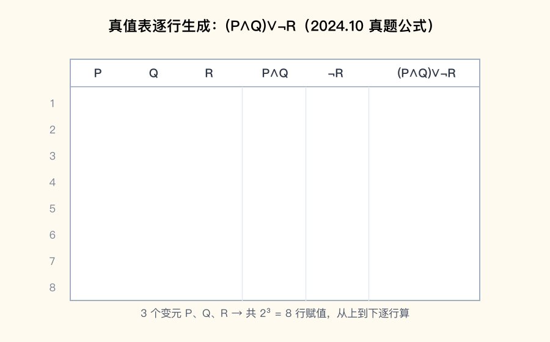

📌 锚点：**3 变元 8 行逐行算，成真赋值 5 个**

**考试答题**

**📌 历年真题**

**【2026.4·单选 2】** 下列命题公式是**重言式**的是
- A. P∧¬P
- B. (P∨Q)→Q
- C. (P∧Q)→Q ✅
- D. P∧¬Q

📌 (P∧Q)→Q ⇔ ¬(P∧Q)∨Q ⇔ ¬P∨¬Q∨Q ⇔ 1，恒真；A 是矛盾式，B、D 均可真可假。

**【2025.10·单选 2】** 下列公式为**矛盾式**的是
- A. (P→Q)∨(P→¬Q)
- B. (P→Q)∧(P→¬Q)
- C. (P→¬Q)∧(¬P→Q)
- D. (P→¬P)∧(¬P→P) ✅

📌 D 化简：(P→¬P)⇔¬P，(¬P→P)⇔P，故原式 ⇔ ¬P∧P ⇔ 0，恒假；A 化简得 1 是重言式，B ⇔ ¬P、C 可真可假。

**【2025.4·单选 2】** 下列命题公式是**矛盾式**的是
- A. (P∧Q)→Q
- B. (P∨Q)→Q
- C. (P→Q)∧Q
- D. (P→Q)∧P∧¬Q ✅

📌 D：(P→Q)∧P∧¬Q ⇔ (¬P∨Q)∧P∧¬Q ⇔ Q∧¬Q ⇔ 0，恒假；A 是重言式，B、C 为可满足式。

**【2024.10·单选 2】** 下列公式为**永真式**的是
- A. (¬P∧Q)∨(P→¬Q)
- B. (P→Q)∧(P→¬Q)
- C. (P∧Q)∨(P∨Q)
- D. (P→Q)∨(P→¬Q) ✅

📌 D：(¬P∨Q)∨(¬P∨¬Q) ⇔ ¬P∨(Q∨¬Q) ⇔ ¬P∨1 ⇔ 1，恒真；A ⇔ ¬P∨¬Q（P=Q=1 时假），B ⇔ ¬P，C ⇔ P∨Q。

**【2021.4·单选 2】** 下列命题公式是**矛盾式**的为
- A. (P→Q)∧(Q→R)→(P→R)
- B. (P→Q)→(¬Q→¬P)
- C. ¬(P∧Q)∨(¬P∧¬Q)
- D. ¬(P→Q)∧Q ✅

📌 D：¬(P→Q) ⇔ P∧¬Q，故原式 ⇔ P∧¬Q∧Q ⇔ 0，恒假；A 是蕴含三段论、B 是逆否律，均为重言式。

**【2024.4·单选 1】** 含有 3 个命题变元的任一命题公式的指派个数是
- A. 6 个
- B. 8 个 ✅
- C. 9 个
- D. 10 个

📌 n 个变元每个可取 0/1 两种值，指派数 = 2ⁿ = 2³ = 8。

**【2025.10·填空 6】** P 命题真值取 1，Q 命题真值取 0，R 命题真值取 1，则命题公式 (P∧¬Q)→¬R 的真值是______。

答案：**0**

📌 代入：(P∧¬Q) = (1∧¬0) = 1，¬R = 0，故 1→0 = 0（前件真后件假，蕴含为假）。

**【2024.10·填空 1】** P 命题取 1，Q 命题取 0，R 命题取 1，则命题公式 (P→Q)∨R 的真值是______。

答案：**1**

📌 代入：P→Q = 1→0 = 0，再 ∨R = 0∨1 = 1。

**【2023.10·计算 1】** 用真值表法判断命题公式 ((P→Q)∧(Q→R))→(P→R) 是重言式 → 答题要点见下方解题方法（8 行真值表最后一列全为 1 即得证）。

**🎯 考法**：单选年年考"判公式类型"（2021.4、2024.4、2024.10、2025.4、2025.10、2026.4 六个考期连考，2024.10/2025.10/2026.4 均固定在单选第 2 题）；填空考"代入求真值"；大题考"用真值表判定公式类型"（2023.10 计算 1，5～6 分）。

**✍️ 得分点**：
- 判定口径：全 1 = **重言式**；全 0 = **矛盾式**；有 1 有 0 = **非重言式的可满足式**；只有 1 无 0 但题目问"可满足"时，重言式也是可满足式。
- 化简利器：遇到 → 先换 **¬A∨B**，遇到 ↔ 换 **(A→B)∧(B→A)**，再用 A∨¬A=1、A∧¬A=0 收尾。
- 常用结论：A→(A∨B) 恒真；(P∧Q)→Q 恒真（后件是前件的组成部分，必真）；(P→Q)∨(P→¬Q) 恒真。
- 大题规范：真值表 3 变元列 8 行（000→111 按二进制递增），中间列逐个算，最后一列全 1 下结论"是重言式"（表占 5 分、结论 1 分）。

**⚠️ 易混淆**：**"前件假 → 蕴含真"**——很多人看到 P→Q 中 P 假就以为整个公式假，实际蕴含当前件假时直接为真；**重言式与可满足式的关系**——可满足式只要求"有一个成真指派"，重言式是特殊的可满足式，考试说"非重言式的可满足式"才是又真又假那类。

**解题方法**（用真值表判定公式类型）：
1. 数变元个数 n，写 2ⁿ 行赋值（**为什么按 000→111 顺序**：不重不漏，阅卷标准格式）。
2. 从左到右逐层算各子公式的真值列（**为什么分层算**：复合公式由子公式按联结词逐层组装，子式值定了母式才能算）。
3. 看最后一列：全 1 判重言式，全 0 判矛盾式，有 1 有 0 判非重言式的可满足式（**为什么看整列**：公式类型由"所有指派下的取值整体"定义，缺一行都不行）。

**🔑 记忆锚点**：**全真重言、全假矛盾、有真有假可满足；蕴含式"前假必真、前真看后件"**。

#### 1.3 等值演算与基本等值式 ★★

**定义详解**：设 A、B 是两公式，若 A↔B 是**重言式**（任一指派下取值相同），则称 A 与 B **等值**，记 A⇔B。**等值演算**就是用一组已证的基本等值式对公式做等价替换，像代数化简一样把公式变形——它是求范式、判等值、判类型的统一工具。必背等值式：**蕴含等值式 A→B ⇔ ¬A∨B**（最常用，范式大题第一步）；**等价等值式 A↔B ⇔ (A→B)∧(B→A)**；**德·摩根律 ¬(A∧B) ⇔ ¬A∨¬B、¬(A∨B) ⇔ ¬A∧¬B**；**吸收律 A∨(A∧B) ⇔ A、A∧(A∨B) ⇔ A**；分配律 A∨(B∧C) ⇔ (A∨B)∧(A∨C)；矛盾律 A∧¬A ⇔ 0、排中律 A∨¬A ⇔ 1；双重否定 ¬¬A ⇔ A。

**考试答题**

**📌 历年真题**

**【2024.4·简答 1】** 判断命题公式 Q→(P∨Q) 与 ¬Q∧(P∨Q) 是否等值 → 答题要点见下方解题方法（完整演算）。

**【2022.10·计算 1】** 用列真值表的方法说明逻辑等价式 (p∨q)→¬r ⇔ ¬(p∧r)∧¬(q∧r) 成立 → 答题要点见下方解题方法（两张 8 行真值表逐行比对，两公式真值列完全相同即得证；等值演算验证：左边 ⇔ ¬(p∨q)∨¬r ⇔ (¬p∧¬q)∨¬r ⇔ (¬p∨¬r)∧(¬q∨¬r) ⇔ 右边）。

**🎯 考法**：简答/计算考"判断两公式是否等值"或"用真值表/等值演算证明等值式"（2024.4 简答 1、2022.10 计算 1）；单选、填空不单独考本节，但等值式是 1.4 求范式大题的每一步依据——本节练不熟，范式题必丢分。

**✍️ 得分点**：
- 判断等值的规范流程：分别对两公式等值演算，**两边都化到同一个最简式**即等值；化不到同一式，再列真值表比对确认。
- 化简三板斧的次序：先消 →/↔（蕴含等值式、等价等值式）→ 再用德·摩根律把 ¬ 内移 → 最后用分配律、吸收律、A∨¬A=1 收拢。
- 每一步演算要在行末标注所用等值式名称（演算分步给分，不写依据可能被扣分）。

**⚠️ 易混淆**：**德·摩根律分配的是"变联结词"**——¬(A∧B) 变 ¬A∨¬B（∧ 变 ∨），最易错成 ¬A∧¬B；**蕴含等值式方向**——A→B ⇔ ¬A∨B（否定的是前件 A），不是 A∨¬B。

**解题方法**（判断两公式是否等值；原题：2024.4 简答 1）：
1. 对左边公式等值演算到最简（**为什么从 → 消起**：蕴含等值式是通往 ¬∧∨ 三件套的必经之门，不消掉 → 无法用分配/吸收律）。
2. 对右边公式同样演算到最简（**为什么两边都化简**：直接比对两边困难，各自化到最简后是否同式一目了然）。
3. 最简式相同 ⇔ 等值；最简式不同且无法再化 ⇔ 不等值（**为什么可以下结论**：等值演算每步可逆且保真值，最简形由公式唯一确定）。

**【演算示范】**（2024.4 简答 1）
- 左边：Q→(P∨Q) ⇔ ¬Q∨P∨Q（**为什么**：蕴含等值式 A→B ⇔ ¬A∨B）⇔ ¬Q∨1 ⇔ 1（**为什么**：Q∨¬Q=1 排中律，再 A∨1=1 零律）。
- 右边：¬Q∧(P∨Q) ⇔ (¬Q∧P)∨(¬Q∧Q)（**为什么**：分配律把 ∧ 分进括号）⇔ (¬Q∧P)∨0 ⇔ ¬Q∧P（**为什么**：矛盾律 ¬Q∧Q=0，再 A∧0 消去）。
- 两边最简式不同（1 与 ¬Q∧P），故**不等值**。

**🔑 记忆锚点**：**"一消二移三收拢"：消 →↔，德摩根移 ¬，分配吸收收拢成最简**。

#### 1.4 主析取范式与主合取范式 ★★★

**定义详解**：**极小项（小项）mᵢ** 是含全部 n 个变元的合取式，每个变元以本身或否定形式恰出现一次（变元本身对应赋值 1、否定形式对应赋值 0，二进制串转十进制即下标 i）；**极大项（大项）Mᵢ** 是含全部 n 个变元的析取式（编码规则相反：变元本身对应赋值 0）。**主析取范式** = 若干极小项之析取（成真赋值 ↔ 极小项：有几个成真赋值就含几个小项）；**主合取范式** = 若干极大项之合取（成假赋值 ↔ 极大项）。核心结论：n 变元公式共有 2ⁿ 个小项、2ⁿ 个大项；**重言式主析取含全部 2ⁿ 个小项，矛盾式主合取含全部 2ⁿ 个大项**；主析取含 k 个小项则主合取含 2ⁿ−k 个大项（互补）。本节是全卷最高频大题（每年 5～6 分）＋多道单选/填空。

> **🖼 动图演示：动图演示：主析取范式展开（成真赋值→极小项）**

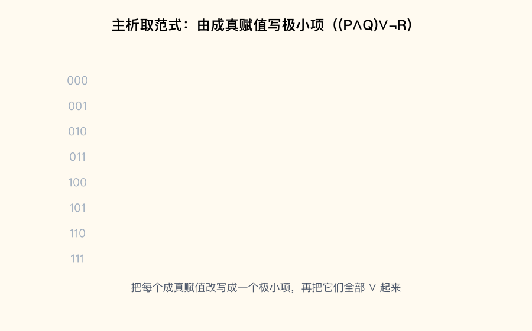

📌 锚点：**成真赋值 ↔ 极小项，主析取范式=成真极小项之析取**

**考试答题**

**📌 历年真题**

**【2026.4·单选 3】** 设命题公式 A 为矛盾式且含有 4 个命题变元，则 A 的主合取范式含大项的个数为
- A. 2
- B. 4
- C. 8
- D. 16 ✅

📌 矛盾式在所有 2ⁿ 个赋值下都假，主合取范式含全部大项：2⁴ = 16 个。

**【2025.10·单选 3】** 命题公式 (P∧Q)→Q 的主析取范式中含小项的个数是
- A. 1
- B. 2
- C. 3
- D. 4 ✅

📌 (P∧Q)→Q ⇔ ¬P∨¬Q∨Q ⇔ 1 是重言式，2 个变元 ⇒ 含全部 2² = 4 个小项。

**【2025.4·单选 3】** 设命题公式 A 为重言式且含有 3 个命题变元，则 A 的主析取范式含小项的个数为
- A. 1
- B. 4
- C. 8 ✅
- D. 10

📌 重言式成真赋值是全部 2³ = 8 个，故含 8 个小项。

**【2024.10·单选 3】** 命题公式 P→Q 的主析取范式中含小项的个数是
- A. 1
- B. 2
- C. 3 ✅
- D. 4

📌 P→Q ⇔ ¬P∨Q，在 (P,Q)=(0,0)、(0,1)、(1,1) 三行取真，对应 m₀、m₁、m₃，共 3 个。

**【2024.4·单选 3】** 含有 2 个命题变元的命题 A 是重言式的条件是 A 的主析取范式含有
- A. 4 个小项 ✅
- B. 1 个小项
- C. 4 个大项
- D. 1 个大项

📌 重言式成真赋值占满 2² = 4 个，主析取范式含全部 4 个小项。

**【2023.10·单选 3】** 下列关于小项和大项的性质表述正确的是
- A. 任意两个不同小项的合取式必为真
- B. 任意两个不同大项的析取式必为假
- C. 任意两个不同小项的析取式必为假
- D. 大项的否定是小项 ✅

📌 不同小项的成真赋值不同，不可能同时为真（合取必假），A 错；不同大项析取必真，B 错；不同小项析取必真，C 错；¬(P∨Q) = ¬P∧¬Q，大项否定确为小项，D 对。

**【2024.4·填空 2】** 命题公式 ¬(P∧Q)∧(P∧Q) 的主析取范式用编码表示为______。

答案：**0**

📌 该式是 A∧¬A 型矛盾式，无任何成真赋值，主析取范式为空，记作 0。

**【2024.4·填空 3】** 命题公式 ¬(P∧Q)∧(P∨Q) 的主合取范式用编码表示为______。

答案：**Π(0,3)**

📌 ¬(P∧Q)∧(P∨Q) ⇔ (¬P∨¬Q)∧(P∨Q) = M₃∧M₀；成假赋值 11 与 00（验算：赋值 00 时 (1)∧(0)=0，赋值 11 时 (0)∧(1)=0）。

**【2025.10·填空 7】** 命题公式 (P∧Q)→¬Q 的主合取范式是______。

答案：**¬P∨¬Q**

📌 (P∧Q)→¬Q ⇔ ¬(P∧Q)∨¬Q ⇔ ¬P∨¬Q∨¬Q ⇔ ¬P∨¬Q，本身已是极大项 M₃。

**【2025.10·简答 2】** 写出命题公式 (P→Q)∧R 的主析取范式 → 答题要点见下方解题方法（成真赋值 (0,0,1)、(0,1,1)、(1,1,1)，写对应 3 个极小项之析取）。

**🎯 考法**：单选考"小项/大项个数"（2024.4、2024.10、2025.4、2025.10、2026.4 连年考，且固定在单选第 3 题）与"小项大项性质"（2023.10 单选 3）；填空考"矛盾式主析取记 0、重言式主析取含 2ⁿ 项、主合取 Π 编码"；简答每年一道"求主析取/主合取范式"（2024.10 简答 1、2025.10 简答 2，5 分）。

**✍️ 得分点**：
- 个数题口算流程：先把公式化简 → 判类型 → 重言式 2ⁿ 个小项 / 矛盾式 2ⁿ 个大项 / 一般式用成真赋值数。
- 互补公式：主析取含 k 个小项 ⇔ 主合取含 **2ⁿ−k** 个大项（总数都是 2ⁿ）。
- 写范式规范：每个极小项必须含**全部变元**（缺变元要补 (x∨¬x) 再拆），按编码从小到大排，重复项合并。
- 主合取范式 = 成假赋值对应的极大项之合取；极大项里变元取 0 写本身、取 1 写否定（与小项相反）。

**⚠️ 易混淆**：**小项大项的编码方向相反**——小项"赋值 1 写本身"，大项"赋值 0 写本身"；**"主析取为空记 0、主合取为空记 1"**——矛盾式没有成真赋值（主析取 = 0），重言式没有成假赋值（主合取 = 1）。**"求主析取范式"时列的是成真赋值，"求主合取范式"时列的是成假赋值**，看错一列全盘皆输。

**解题方法**（求主析取范式四步法）：
1. 消联结词：→ 换 ¬A∨B，↔ 换 (A→B)∧(B→A)（**为什么**：范式只允许 ¬∧∨ 三种联结词出现）。
2. ¬ 内移：用德·摩根律把 ¬ 移到变元前（**为什么**：极小项里否定只作用于单个变元）。
3. 分配展开：用 A∧(B∨C) ⇔ (A∧B)∨(A∧C) 化成合取式之析取（**为什么**：主析取范式是"析取形态"，须先把每项变合取式）。
4. 补变元：缺 x 的合取项乘 (x∨¬x) 再展开，重复项合并（**为什么**：极小项定义要求全变元出现，乘 x∨¬x 不改变真值表只补形态）。

**【例 1-1】**（原题：2024.10 简答 1）写出命题公式 (P∧Q)∨¬R 的主析取范式。

解：列 3 变元 8 行真值，逐行求值：
- R=0 时 ¬R=1，整个公式 = (P∧Q)∨1 = 1，故 **000、010、100、110 四行全真**（**为什么**：A∨1=1 零律，¬R 真时公式必真）。
- R=1 时 ¬R=0，公式 = P∧Q，仅 P=1 且 Q=1 时真，故 **111 一行真**（**为什么**：合取两因式同真才真）。
- 成真赋值共 5 个：000、010、100、110、111（**为什么只看成真行**：主析取范式 = 成真赋值对应极小项之析取）。
- 每个成真赋值写极小项（赋值 1 写变元本身、0 写否定，**为什么**：该赋值恰好使这个合取式为真）：
  - 000 → ¬P∧¬Q∧¬R（m₀）；010 → ¬P∧Q∧¬R（m₂）；100 → P∧¬Q∧¬R（m₄）；110 → P∧Q∧¬R（m₆）；111 → P∧Q∧R（m₇）。

答案：**(P∧Q)∨¬R ⇔ (¬P∧¬Q∧¬R)∨(¬P∧Q∧¬R)∨(P∧¬Q∧¬R)∨(P∧Q∧¬R)∨(P∧Q∧R) ⇔ m₀∨m₂∨m₄∨m₆∨m₇**

（验算：5 个极小项与站方答案逐项一致；主合取范式应为 M₁∧M₃∧M₅，个数 8−5=3，互补吻合。）

**🔑 记忆锚点**：**"成真找小项、成假找大项；缺谁补谁 x∨¬x；主析 0 空、主合 1 空"**。

#### 1.5 推理理论（P 规则/T 规则/CP 规则）★★★

**定义详解**：**推理**是从前提出发、依推理规则逐步推出结论的过程；若前提真时结论必真（蕴含式 A₁∧…∧Aₖ→B 为重言式），称推理**有效**。三条书写规则：**P 规则**（前提引入：推理中随时可引用任一前提）、**T 规则**（结论引入：由前面已得公式用推理定律推出新公式，须标注依据公式号与定律名）、**CP 规则**（附加前提：结论是蕴含式 A→B 时，把前件 A 作附加前提引入，推出 B 即完成证明）。必背推理定律：**假言推理** A→B, A ⇒ B（肯定前件则肯定后件）；**拒取式** A→B, ¬B ⇒ ¬A（否定后件则否定前件）；**析取三段论** A∨B, ¬A ⇒ B；**假言三段论** A→B, B→C ⇒ A→C；**化简律** A∧B ⇒ A；**假言易位** A→B ⇒ ¬B→¬A。据入门学习指南统计，每年一道 7 分证明题几乎都出自本节。

> **🖼 动图演示：动图演示：假言推理与拒取式**

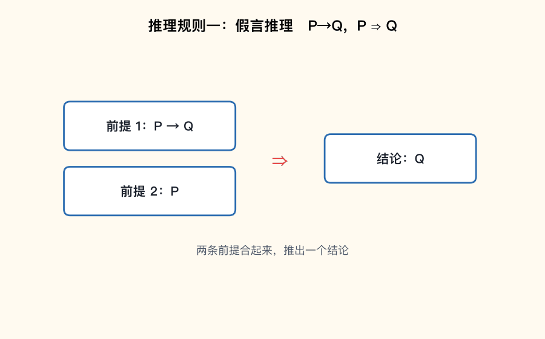

📌 锚点：**肯定前件→肯定后件；否定后件→否定前件**

**考试答题**

**📌 历年真题**

**【2024.10·证明 1】** 证明：S→¬Q，S∨R，¬R↔Q ⊢ R → 完整证明见下方【例 1-2】。

**【2025.4·证明 3】** 用 CP 规则证明下面有效推理。前提：P∨Q，¬P∨¬R，Q→S；结论：R→S → 完整证明见下方【例 1-3】。

**【2021.4·证明 2】** 用 CP 规则证明下面有效推理。前提：P→(Q→R)，S→P，Q；结论：S→R → 答题要点见下方得分点（CP 规则以 S 为附加前提：S、S→P 得 P；P 与 P→(Q→R) 得 Q→R；再与前提 Q 假言推理得 R，结论成立）。

**🎯 考法**：每年一道 7 分证明题（2021.4 证明 2、2025.4 证明 3 考 CP 规则；2024.10 证明 1 结论是原子命题，不用 CP，考等价展开＋假言三段论连环推）；单选偶尔考"由前提到结论用了哪条规则"。

**✍️ 得分点**：
- 解题第一问：结论是 **A→B 蕴含式吗**？是 → 立刻上 CP 规则把 A 作附加前提（2021.4、2025.4 均如此）；结论是原子命题 → 走直接推演或反证。
- 每行格式：**编号 + 公式 + 依据**（"P 规则"或"T(行号)(行号) 定律名"），依据不写可能扣 1 分（2025.4 真题注：若规则名称没写，可扣 1 分）。
- 最常用三招：见 A∨B 且 ¬A → 析取三段论；见 A→B 且 A → 假言推理；见 A→B 且 ¬B → 拒取式。
- 见 ↔ 必展开：A↔B ⇔ (A→B)∧(B→A)，拆成两个蕴含再各取所需（2024.10 证明 1 的突破口）。

**⚠️ 易混淆**：**拒取式与"否定前件"错误**——A→B, ¬A 推不出任何结论（否定前件谬误）；**假言推理与"肯定后件"错误**——A→B, B 推不出 A（肯定后件谬误）。CP 规则的附加前提**只能用一次且必须最终推出蕴含式后件**，最后结论要写回 A→B。

**解题方法**（推理证明流程）：
1. 看结论形态定策略：蕴含式用 CP，原子命题用直接推演（**为什么**：CP 规则只对"证明蕴含式"成立，附加前提的本质是把蕴含结论转化成平凡结论）。
2. 每步引入前提（P）或从已有公式推新公式（T），逐步逼近目标（**为什么**：有效推理的每一步都必须有规则保障，链条断了证明无效）。
3. 写全依据：行号 + 规则名（**为什么**：阅卷按步给分，依据是步骤合法性凭证）。

**【例 1-2】**（原题：2024.10 证明 1）证明：S→¬Q，S∨R，¬R↔Q ⊢ R。

解：结论 R 是原子命题，不用 CP 规则，走"等价展开＋假言三段论"直接推演：

（1）S→¬Q　　P 规则（**为什么可引入**：前提随时可用）
（2）S∨R　　　P 规则
（3）¬R↔Q　　P 规则
（4）(¬R→Q)∧(Q→¬R)　T(3) 等价等值式（**为什么**：A↔B ⇔ (A→B)∧(B→A)，把双向条件拆成两个单向蕴含）
（5）¬R→Q　　T(4) 化简律（**为什么**：A∧B ⇒ A，取需要的那个方向）
（6）Q→¬R　　T(4) 化简律
（7）Q→¬S　　T(1) 假言易位（**为什么**：A→B ⇔ ¬B→¬A，对 (1) 取 A=S、B=¬Q，得 Q→¬S）
（8）¬R→¬S　T(5)(7) 假言三段论（**为什么**：¬R→Q 与 Q→¬S 首尾相接得 ¬R→¬S）
（9）¬S→R　　T(2) 蕴含等值式（**为什么**：A∨B ⇔ ¬A→B，析取换真相蕴含）
（10）¬R→R　T(8)(9) 假言三段论（**为什么**：¬R→¬S 与 ¬S→R 相接，绕一圈"不是 R 就得 R"）
（11）R∨R　　T(10) 蕴含等值式（**为什么**：¬A→B ⇔ A∨B，取 A=R、B=R）
（12）R　　　T(11) 幂等律（**为什么**：R∨R ⇔ R）

由（12）得结论 R，推理有效。

**【例 1-3】**（原题：2025.4 证明 3）用 CP 规则证明下面有效推理。前提：P∨Q，¬P∨¬R，Q→S；结论：R→S。

解：结论 R→S 是蕴含式，用 CP 规则，把前件 R 作附加前提：

（1）R　　　　　CP 规则（附加前提）（**为什么**：要证 R→S，先假设 R 真，只需再推出 S）
（2）¬P∨¬R　　P 规则
（3）¬P　　　　T(1)(2) 析取三段论（**为什么**：A∨B, ¬A ⇒ B，此处 A=R、B=¬R，由 R 真否定 ¬R）
（4）P∨Q　　　P 规则
（5）Q　　　　T(3)(4) 析取三段论（**为什么**：由 ¬P 消去 (4) 中的 P 分支）
（6）Q→S　　　P 规则
（7）S　　　　T(5)(6) 假言推理 I₁₁（**为什么**：肯定前件 Q 则肯定后件 S）

由 CP 规则，R→S 得证，推理有效。（验算：2025.4 站方答案步骤与本证明一致。）

**🔑 记忆锚点**：**"结论带箭头，CP 走一遭；析取消一根，假言连成串；双条件必拆两半"**。

#### 2.1 谓词与量词、符号化 ★★★

**定义详解**：**谓词** P(x) 表示"x 具有性质 P"，L(x,y) 表示"x 与 y 有关系 L"；个体变元代入具体个体后谓词才成为命题。**全称量词 ∀**（"所有/任意/一切"）与**存在量词 ∃**（"存在/有的/有一个"）把谓词变成命题。符号化两条铁律：**全称量词配蕴含**——"所有是 A 的都 B" 符号化为 ∀x(A(x)→B(x))；**存在量词配合取**——"存在是 A 的且 B" 符号化为 ∃x(A(x)∧B(x))。有限论域可消去量词：∀xP(x) ⇔ P(a)∧P(b)（论域 {a,b}），∃xP(x) ⇔ P(a)∨P(b)。量词否定律：¬∀xP(x) ⇔ ∃x¬P(x)、¬∃xP(x) ⇔ ∀x¬P(x)。量词分配律：∀ 对 ∧ 可分配、∃ 对 ∨ 可分配；**∀ 对 ∨ 不分配、∃ 对 ∧ 不分配**。据入门学习指南统计，第二章谓词逻辑每卷约 10～15 分。

**考试答题**

**📌 历年真题**

**【2026.4·单选 5】** 设 R(x)：x 是有理数，L(x,y)：x 大于 y。命题"没有最小的有理数"可符号化为
- A. ∀x(R(x)→∃y(R(y)∧L(x,y))) ✅
- B. ∃x(R(x)→∀y(R(y)∧L(x,y)))
- C. ∀x(R(x)∧∃y(R(y)∧L(x,y)))
- D. ∃x(R(x)→∃y(R(y)→L(x,y)))

📌 "没有最小"＝对任意有理数 x，都存在有理数 y 比 x 小，即 L(x,y)（x 大于 y）；全称配蕴含、存在配合取，选 A。

**【2025.4·单选 5】** 设 R(x)：x 是质数，G(x,y)：x 大于 y。命题"没有最大的质数"可符号化为
- A. ∀x(R(x)→(∃y)(R(y)∧G(x,y)))
- B. ∀x(R(x)→(∃y)(R(y)∧G(y,x))) ✅
- C. ∃x(R(x)→(∃y)(R(y)→G(x,y)))
- D. ∃x(R(x)→(∀y)(G(x,y)→R(y)))

📌 "没有最大"＝对任意质数 x，都存在质数 y 比 x 大，即 G(y,x)（y 大于 x，注意两个变元的次序），选 B。

**【2023.10·单选 2】** 设 F(x)：x 是火车，G(x)：x 是汽车，L(x,y)：x 比 y 快。命题"有的火车比有的汽车快"的符号化形式为
- A. ∀x(F(x)→∀y(G(y)→L(x,y)))
- B. ∃x(F(x)∧∃y(G(y)∧L(x,y))) ✅
- C. ¬∃y(G(y)∧∀x(F(x)→L(y,x)))
- D. ¬∀y(G(y)→∀x(F(x)→L(x,y)))

📌 "有的…有的…"＝两个存在量词：存在火车 x 且存在汽车 y 使 L(x,y)，选 B。

**【2022.10·单选 2】** 设 F(x)：x 是火车，G(x)：x 是汽车，L(x,y)：x 比 y 快。命题"不存在比所有的火车都快的汽车"的符号化形式为
- A. ∀x(F(x)→∀y(G(y)→L(x,y)))
- B. ∃x(F(x)∧∃y(G(y)∧L(x,y)))
- C. ¬∃y(G(y)∧∀x(F(x)→L(y,x))) ✅
- D. ¬∀y(G(y)→∀x(F(x)→L(x,y)))

📌 "比所有火车都快的汽车"＝∃y(G(y)∧∀x(F(x)→L(y,x)))，"不存在"整体取否得 ¬∃y(…)，选 C。

**【2024.10·单选 4】** 设论域元素集为 {a,b}，下列选项中与谓词公式 ∀xP(x) 等价的是
- A. P(a)∧P(b) ✅
- B. ¬P(a)∧P(b)
- C. P(a)∧¬P(b)
- D. P(a)∨P(b)

📌 有限论域消全称量词用 ∧：a、b 都满足 P。

**【2025.10·单选 4】** 设论域元素集为 {a,b}，消去谓词公式 ∀x¬P(x) 中的量词后，下列选项中正确的是
- A. P(a)∧P(b)
- B. ¬P(a)∧P(b)
- C. P(a)∧¬P(b)
- D. ¬P(a)∧¬P(b) ✅

📌 消量词后 ¬P 与变元绑定不动：∀x¬P(x) ⇔ ¬P(a)∧¬P(b)。

**【2024.4·填空 5】** M(x)：x 是人，S(x)：x 喜欢游泳，用谓词表达式写出命题"并不是所有的人都喜欢游泳"：______。

答案：**¬∀x(M(x)→S(x))**

📌 "所有的人都喜欢游泳" = ∀x(M(x)→S(x))（全称配蕴含），"并不是"整体取否。

**【2023.10·单选 7】** 下列谓词恒等式，不正确的是
- A. ∀x(P(x)∨Q(x)) ⇔ ∀xP(x)∨∀xQ(x) ✅
- B. ∃x(P(x)∨Q(x)) ⇔ ∃xP(x)∨∃xQ(x)
- C. ∀x(P→Q(x)) ⇔ P→∀xQ(x)
- D. ∃x(P→Q(x)) ⇔ P→∃xQ(x)

📌 全称量词对析取 ∨ 不满足分配律（"每人会骑车或游泳"推不出"每人会骑车或每人会游泳"）；B、C、D 均成立。

**🎯 考法**：单选 1～2 道考"带量词命题的符号化"（2022.10、2023.10 考火车汽车句型，2025.4、2026.4 考"没有最大的/最小的…"句型，2026.4 固定单选第 5 题）；单选 1 道考"有限论域消量词"（2024.10、2025.10 连考）或"量词分配律哪条不成立"（2023.10 单选 7）；填空考"否定句符号化"（2024.4 填空 5）。

**✍️ 得分点**：
- 句型铁律：**"所有 A 都 B" → ∀x(A(x)→B(x))**；**"存在 A 是 B" → ∃x(A(x)∧B(x))**——全称不配 ∧、存在不配 →。
- "没有最大的 X" 句型 = ∀x(X(x)→∃y(X(y)∧比较词(y,x)))，比较词方向看题面："最大"用"y 大于 x"、"最小"用"x 大于 y"。
- 有限论域消量词：∀ 用 ∧、∃ 用 ∨，量词后谓词（含否定）原样代入每个个体。
- 量词否定：¬∀ 变 ∃¬、¬∃ 变 ∀¬，"否定词穿过量词，量词翻转、谓词取反"。
- 分配律口诀：**∀ 管 ∧、∃ 管 ∨**（自家可分配），∀ 配 ∨、∃ 配 ∧ 不可分配。

**⚠️ 易混淆**：**G(y,x) 与 G(x,y) 方向**——"y 比 x 大"是 G(y,x)，2025.4 单选 5 的正确项与干扰项就差这一处；**∃x(A(x)→B(x)) 不是"存在 A 是 B"**——蕴含式在 A(x) 假时为真，会放进"不是 A"的个体，语义完全走样。

**解题方法**（谓词推理证明；原题：2022.10 证明 1）证明前提"在本离散数学课上的每个人都掌握一定的图论基础知识"和"小华是本课上的学生"，可得结论"小华掌握一定的图论基础知识"。

设 D(x)：x 在本离散数学课上，C(x)：x 掌握一定的图论基础知识，m：小华。符号化：前提 ∀x(D(x)→C(x))，D(m)；结论 C(m)。

（1）∀x(D(x)→C(x))　P 规则（**为什么**：引入符号化后的前提）
（2）D(m)→C(m)　　　T(1) 全称量词消去 ∀⁻（**为什么**：全称命题对论域中每个个体成立，代入个体常项 m）
（3）D(m)　　　　　　P 规则（**为什么**：第二个前提）
（4）C(m)　　　　　　T(2)(3) 假言推理 I₁₁（**为什么**：肯定前件 D(m) 真，则后件 C(m) 必真）

推理有效，证毕。

**🔑 记忆锚点**：**"全称配蕴含、存在配合取；∀ 消成 ∧、∃ 消成 ∨；否定穿量词，量词要翻转"**。

#### 2.2 量词辖域、自由/约束变元、换名规则 ★★

**定义详解**：量词后紧邻的最短子公式叫该量词的**辖域**——∀xF(x)∧G(x,y) 中 ∀x 的辖域只是 F(x)，管不到 G(x,y)。辖域内的同名变元被量词"绑定"，称**约束出现**；辖域外或未被任何量词绑定的出现称**自由出现**；同一变元可既约束又自由。**换名规则**（约束变元改名）：对量词辖域内被绑定的变元整体改名，须量词符号、辖域内所有同名出现一起换，且换用的新变元名不得与辖域内已有变元冲突（如 ∀xP(x)∧Q(y) 改成 ∀zP(z)∧Q(y)）；自由变元也可**替换**，同样要求全公式统一且不与约束变元重名。换名是化前束范式的预备动作（见 2.4）。

**考试答题**

**📌 历年真题**

**【2025.10·单选 5】** 下列谓词公式中 x 是自由变元的是
- A. ∀xP(x,y)→∃yQ(y)
- B. ∀xP(x,y)→∃xQ(x)
- C. ∀yP(x,y)→∃yQ(x,y) ✅
- D. ∀xP(x)→∃yQ(x,y)

📌 C 中两个量词 ∀y、∃y 只约束 y，x 完全未被绑定，是自由变元；A、B 中 x 被 ∀x 约束；D 中 x 在前件被 ∀x 约束、在后件 Q(x,y) 中自由出现（∀x 的辖域仅 P(x)），x 既有约束又有自由出现，也不符合"x 是自由变元"的单一要求，最佳答案 C。

**【2024.10·单选 5】** 下列谓词公式中 y 是自由变元的是
- A. ∀xP(x,y)→∃yQ(y)
- B. ∀xP(x,y)→∃xQ(x) ✅
- C. ∀yP(x,y)→∃xQ(x)
- D.（选项未流传）

📌 B 中量词 ∀x、∃x 都只管 x，y 在 P(x,y) 中自由出现且全式无其他量词约束 y；A 中 y 在 Q(y) 被约束（既有自由又有约束出现），C 中 y 被 ∀y 约束。

**【2024.4·单选 5】** 谓词公式 ∀xF(x)∧G(x,y) 中变元 x 为
- A. 自由出现
- B. 约束出现
- C. 既不是自由出现也不是约束出现
- D. 既是自由出现也是约束出现 ✅

📌 x 在 F(x) 中受 ∀x 约束（约束出现），在 G(x,y) 中不受任何量词约束（自由出现），两种身份并存。

**【2025.4·填空 3】** 谓词公式 ∀x(F(x,y)→G(y))→∃zH(x,z) 中量词 ∀x 的辖域是______。

答案：**F(x,y)→G(y)**

📌 ∀x 紧邻的括号 (F(x,y)→G(y)) 就是它的作用范围；后面的 H(x,z) 中 x 在 ∃zH(x,z) 内不受 ∀x 管辖。

**【2024.4·填空 6】** 谓词公式 ∃xF(x)∧G(x,y) 中量词 ∃x 的辖域是______。

答案：**F(x)**

📌 ∃x 只绑定紧邻的 F(x)；∧ 之后 G(x,y) 中的 x 是自由出现。

**🎯 考法**：单选年年一题考"判断变元自由/约束"（2024.4、2024.10、2025.10 连考三届）；填空一题考"指出量词辖域"（2024.4 填空 6、2025.4 填空 3）；换名规则不单独出题，但它是 2.4 前束范式大题的必要步骤。

**✍️ 得分点**：
- 找辖域口诀：量词后**有括号看括号、无括号只管最短公式**；∀xF(x)∧G(x) 的 ∀x 只辖 F(x)。
- 判自由/约束逐"出现"判定：同名变元在不同位置身份可不同，答题时逐处检查（2024.4 单选 5 考的正是"双重身份"）。
- 换名规则两条底线：**只对约束变元整体换**、新名字不得与辖域内其他变元重名；换名不改变公式真值。

**⚠️ 易混淆**：**∀xP(x)→Q(x) 中后件的 x 是自由的**（量词辖域只到 P(x)，蕴含符之后不算）；**辖域有无括号差一截**——∀x(P(x)→Q(x)) 辖全式，∀xP(x)→Q(x) 只辖前件，两者约束情况完全不同。

**🔑 记忆锚点**：**"量词是家长，辖域是家门；门内被绑定，门外自逍遥"**。

#### 2.3 谓词公式的真值判定 ★★

**定义详解**：谓词公式没有固定真值，**给定论域后**才可判定。判定要领按量词顺序逐层"翻译"：∀x∃y(...) 是"任给一个 x，都能**相应地**找到一个 y"（y 可随 x 变，容易为真）；∃x∀y(...) 是"存在一个**固定**的 x，对所有 y 都成立"（y 不许挑，极难为真）——**量词顺序一换，语义天差地别**。判定步骤：全称量词要逐一验证所有个体（发现一个反例立即为假）；存在量词只需找到一个使真的个体（找不到立即为假）。常考论域：整数集、自然数集、正整数集，配合 x+y=c、x²+y²=c 型等式。

**考试答题**

**📌 历年真题**

**【2026.4·单选 4】** 设论域为正整数集，真值为假的命题是
- A. ∀x∀y(y>x²) ✅
- B. ∀x∃y(y=x²)
- C. ∃x∃y(x²+y²=13)
- D. ∃x∀y(x²≤y)

📌 A 要求对一切 x、一切 y 都有 y>x²，取足够大的 x 时 x² 超过任何固定的 y，为假；B 每个 x 取 y=x² 即真；C 取 x=2、y=3，4+9=13 真；D 取 x=1，对所有正整数 y 均有 1≤y，真。题目问"值为假"，选 A。

**【2025.4·单选 4】** 设论域为整数集，真值为真的命题是
- A. ∀x∀y(x+y=0.5)
- B. ∀x∃y(x+y=18) ✅
- C. ∃x∃y(x²+y²=3)
- D. ∃x∀y(x+y=18)

📌 B 对任意整数 x 取 y=18−x（仍是整数）即成立；A 整数和不可能为 0.5；C 两整数平方和只能是 0、1、2、4、5…凑不出 3；D 要求固定 x 对一切 y 成立，不可能。

**【2024.4·单选 6】** 设论域是正整数，下列谓词公式中值为真的是
- A. ∀x∃y(x²+y²=10)
- B. ∀y∃x(x²+y²=10)
- C. ∀x∀y(x²+y²=10)
- D. ∃x∃y(x²+y²=10) ✅

📌 D 只需一组例子：x=1、y=3 时 1+9=10，真；A、B、C 含"任意"，如 x=10 时找不到 y 使 100+y²=10，假。

**【2024.10·填空 3】** 设论域为自然数集，∀x∃y(x+y=10) 的真值是______。

答案：**0**

📌 对每个自然数 x 取 y=10−x：x≤10 时 y 是自然数，但 x>10 时 y<0 不在自然数集内——"对所有 x"被打破，为假。

**【2025.10·填空 8】** 设论域为自然数集，∃y∀x(x+y=10) 的真值是______。

答案：**0**

📌 与上题量词顺序相反：需要固定的 y 对一切 x 成立，x 可无限增大，y=10−x 不可能恒为同一自然数，为假。

**【2022.10·填空 5】** 在整数域中，命题公式 ∀x∀y∃z(x−y=z) 的真值为______，命题公式 ∃x∀y∀z(x+y=z) 的真值为______。

答案：**T；F**

📌 任意两整数之差 x−y 仍是整数，取 z=x−y 即真；第二式要求一个固定 x 使一切 y、z 满足 x+y=z，显然不可能。

**🎯 考法**：单选一题考"给定论域判真假"（2024.4、2025.4、2026.4 连年考）；填空一空考"多量词公式真值"（2022.10、2024.10、2025.10 连考）；∀∃ 顺序对比是最爱设的坑（2024.10 填空 3 与 2025.10 填空 8 恰为镜像两题）。

**✍️ 得分点**：
- 判 ∀ 开头的公式：找**反例**，举出一个不满足的个体即假；一个反例都没有才真。
- 判 ∃ 开头的公式：找**实例**，举出一组使真的个体即真；穷举找不到才假（无限论域靠论证"不可能"）。
- 多量词从左往右逐层读："∀x∃y"＝y 可随 x 变、"∃x∀y"＝y 必须一个通吃——顺序决定难度与真值。
- 论域细节决定生死：自然数含 0、正整数从 1 起；差值/和值落在不在论域内是常见陷阱（2024.10 填空 3 中 x>10 时 y=10−x 跑出论域）。

**⚠️ 易混淆**：**∀x∃y 与 ∃y∀x 不可交换**——"每人都有一个母亲"（∀x∃y）真，"有一个母亲是所有人的母亲"（∃y∀x）假；**"值为假"与"值为真"看清问向**——2026.4 单选 4 四个选项三个真一个假，粗心读反必错。

**🔑 记忆锚点**：**"∀ 找反例、∃ 找实例子；∀∃ 宽、∃∀ 紧，量词换位值翻脸"**。

#### 2.4 前束范式 ★★

**定义详解**：把公式中**所有量词都移到公式最前面**（不含 ¬、∨、∧、→、↔ 等联结词隔在其间），且其后母式**不再含任何量词**，所得形式称**前束范式**，形如 Q₁x₁Q₂x₂…QₙxₙB（Qᵢ 为 ∀ 或 ∃，B 称母式）。化归三步：①消去 →、↔，¬ 内移（量词否定律 ¬∀xP ⇔ ∃x¬P、¬∃xP ⇔ ∀x¬P）；②**换名**解决变元冲突（同名变元被两个量词分别绑定时，先把后一个改名，见【例 2-2】）；③用量词辖域扩张等值式逐个前移量词：A∨∀xB ⇔ ∀x(A∨B)、A∨∃xB ⇔ ∃x(A∨B)（A 中不含 x；∧ 同理）；∃x(A→B(x)) ⇔ A→∃xB(x) 等蕴含移位式。

**考试答题**

**📌 历年真题**

**【2022.10·单选 3】** 下列谓词公式中，不是前束范式的为
- A. ∀x(A(x)∧∃yB(y)) ✅
- B. ∀x∀y(A(x)→B(y))
- C. ∀x∃y(A(x)∧B(y)→C(y))
- D. ∀x∃y(A(x)∧B(y)→C(x,y))

📌 A 中 ∃y 夹在 ∧ 之后、量词未全部前置（前束部分只有 ∀x），不合前束范式定义；B、C、D 量词全在最前且母式无量词。

**【2021.4·填空 3】** 公式 ∀xP(x)→¬∃xQ(x) 对应的前束范式为______。

答案：**∃x∀y(P(x)→¬Q(y))**（即 ∃x∀y(¬P(x)∨¬Q(y))）

📌 ⚠️ 站方答案勘误：素材所给答案"∃x∀y(¬P(x)∨Q(y))"漏了 Q(y) 的否定号。验算：原式 ⇔ ¬∀xP(x)∨¬∃xQ(x) ⇔ ∃x¬P(x)∨∀x¬Q(x)（量词否定律）⇔ 改名后逐个前移 ⇔ ∃x∀y(¬P(x)∨¬Q(y))。取论域 {0,1}、P 恒真、Q(0)=1、Q(1)=0 检验：原式 = 1→¬1 = 0；勘误式 x 取任一值都有 ¬P(x)=0、¬Q(0)=0，整式为 0，一致；站方原式 ¬P(x)∨Q(y) 在此指派下可取真，与原式真值不符，故站方答案有误。

**【2024.10·简答 2】** 把谓词公式 ∀x(P(x,y)→∀yQ(x,y)) 化为前束范式 → 完整演算见下方【例 2-2】。

**【2025.10·简答 3】** 把谓词公式 ∃x(P(x,y)→∃yQ(x,y)) 化为前束范式 → 完整演算见下方【例 2-3】。

**🎯 考法**：单选考"辨认哪一个是/不是前束范式"（2022.10 单选 3）；填空考"写出前束范式"（2021.4 填空 3）；简答约两年一题考"化前束范式"（2024.10 简答 2、2025.10 简答 3，5 分），解题核心动作只有一个——**先改名、再前移**。

**✍️ 得分点**：
- 判定标准两条：**量词全部在最前面**＋**母式不含任何量词**，缺一不可（2022.10 单选 3 就是考第二条没满足的变体——∃y 未前置）。
- 化归三步：消 →/↔ 并内移 ¬ → 同名约束变元**先换名** → 量词逐个前移。
- 两个必背移位式：A∨∀xB ⇔ ∀x(A∨B)（A 不含 x）；∃x(A→B(x)) ⇔ A→∃xB(x)——2025.10 简答 3 全靠第二条。
- 得分点在"改名"：变元冲突不改名直接前移是常见扣分点。

**⚠️ 易混淆**：**前移蕴含式里的存在量词方向**——∃x(A→B(x)) ⇔ A→∃xB(x)（A 不含 x），但 ∀x(A→B(x)) ⇔ A→∀xB(x) 同样成立、¬A 时语义要小心，超纲推导不如直接套公式；**改名只动被绑定变元**——P(x,y) 中自由的 y 不属于 ∀y 的辖域时不能跟着改名，只能对量词绑定的同名变元换新名。

**解题方法**（化前束范式三步）：
1. 消 →/↔，用量词否定律把 ¬ 移到原子谓词前（**为什么**：前束范式母式中不允许这些联结词"挡"在量词前）。
2. 检查同名约束变元冲突，对后出现的量词及其辖域整体换名（**为什么**：两个量词绑同名变元时前移会产生错误关联，改名保语义）。
3. 依辖域扩张等值式从内到外逐个前移量词（**为什么**：每次前移都保等值，最终量词全在最前）。

**【例 2-2】**（原题：2024.10 简答 2）把谓词公式 ∀x(P(x,y)→∀yQ(x,y)) 化为前束范式。

解：
1. 换名消冲突：∀y 与 P(x,y) 中自由的 y 同名，把 ∀yQ(x,y) 整体换名为 ∀zQ(x,z)，得 ∀x(P(x,y)→∀zQ(x,z))（**为什么**：∀x 的辖域 (P(x,y)→∀zQ(x,z)) 内 y 是自由出现，不受 ∀x 约束；若不换名，前移后自由的 y 会被错误地绑定）。
2. 前移 ∀z：P(x,y) 不含 z，由 A→∀zB ⇔ ∀z(A→B)，得 ∀x∀z(P(x,y)→Q(x,z))（**为什么**：辖域扩张等值式，前移不改变真值）。

答案：前束范式为 **∀x∀z(P(x,y)→Q(x,z))**（P(x,y) 中的 y 仍为自由变元）。

**【例 2-3】**（原题：2025.10 简答 3）把谓词公式 ∃x(P(x,y)→∃yQ(x,y)) 化为前束范式。

解：
1. 换名消冲突：内层 ∃y 与 P(x,y) 中自由的 y 同名，把 ∃yQ(x,y) 换名为 ∃zQ(x,z)，得 ∃x(P(x,y)→∃zQ(x,z))（**为什么**：外层 ∃x 辖域内 y 是自由出现，与内层量词 ∃y 绑定的 y 不是一回事，必须改名区分）。
2. 前移 ∃z：由 ∃z(A→B(z)) ⇔ A→∃zB(z)（A=P(x,y) 不含 z），得 ∃x∃z(P(x,y)→Q(x,z))（**为什么**：蕴含后件的存在量词可直接前移到整个蕴含式之前）。

答案：前束范式为 **∃x∃z(P(x,y)→Q(x,z))**（与 2025.10 站方答案一致，P(x,y) 中 y 为自由变元）。

**🔑 记忆锚点**：**"一消二换三前移——消箭头、换重名、量词搬家到最前"**。

### 第 3 章 集合论（每年约 6~10 分）与第 5 章 函数（每年约 3~5 分）

#### 3.1 集合运算与文氏图 ★★★

**定义详解**：集合论是全卷的"描述语言"，约占 **6～10 分**，单选、填空、简答、证明全覆盖。四种基本运算：**并 A∪B**（属于 A 或属于 B 的元素全体）、**交 A∩B**（同时属于 A 与 B）、**差 A−B**（属于 A 但不属于 B）、**补集 ∁UA**（全集 U 中不属于 A 的元素）；**对称差 A⊕B=(A∪B)−(A∩B)=(A−B)∪(B−A)**，即"只属其一、不同时属于两者"的元素全体。**文氏图**用两（三）个相交圆把全集分成互不重叠的区域，给每个区域"染色计数"即可解一切容斥问题；**三集合容斥公式**：|A∪B∪C|=|A|+|B|+|C|−|A∩B|−|A∩C|−|B∩C|+|A∩B∩C|。

> **🖼 动图演示：动图演示：三集合文氏图与容斥原理**

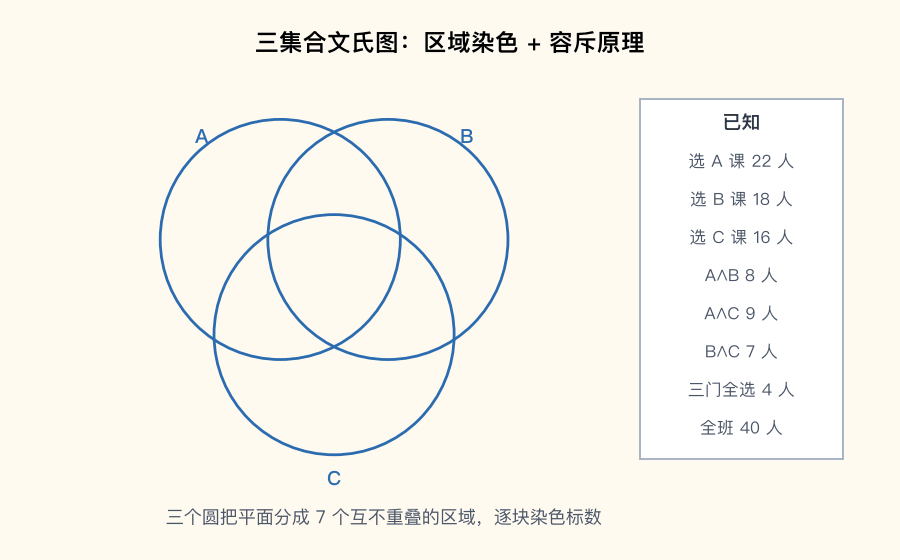

📌 锚点：**先单集、减重叠、加回中心：|A∪B∪C|=Σ单−Σ交+全交**

**考试答题**

**📌 历年真题**

**【2026.4·简答 5】** 设集合 S={n∣0<n<11，n 为整数}，A={x∣x+2 是质数，x∈S}，B={x∣2x−1 是质数，x∈S}，求 A、B 和 A⊕B。
> 【答案要点】→ 求解思路见下方解题方法。逐个代入判质数：A={1,3,5,9}，B={2,3,4,6,7,9,10}，A⊕B={1,2,4,5,6,7,10}

📌 质数判定要逐个验：x=1 时 2×1−1=1 不是质数，故 1∉B；A⊕B 用「并减交」一步出

**【2025.4·填空 4】** 已知集合 A={1,2,3,4,5}，B={2,3,6}，则 A 与 B 的对称差是______。

答案：{1,4,5,6}

📌 A⊕B=(A∪B)−(A∩B)={1,2,3,4,5,6}−{2,3}={1,4,5,6}

**【2025.10·单选 9】** 设 A={1,2,3}，B={2,3,4}，A∪B 是
- A. {1,4}
- B. {2,3}
- C. {1,2,3,4} ✅
- D. {2,4}

📌 并集收"属于 A 或属于 B"的全部元素，两集合元素取并

**【2025.10·简答 4】** 设 A={1,2,3,4,5}，B={2,4,5,6}，求 A∪B、A∩B。
> 【答案要点】→ 运算口算题：A∪B={1,2,3,4,5,6}，A∩B={2,4,5}

**【2024.10·简答 5】** 设 A={1,2,3,4,5}，B={2,4,6,8}，求 A∪B、A−B、B−A。
> 【答案要点】→ A∪B={1,2,3,4,5,6,8}，A−B={1,3,5}，B−A={6,8}；注意差集方向相反结果不同

**🎯 考法**：单选/填空考 ∪∩−⊕ 一步口算（2025.10 单选 9 与填空 10 的 A−B、2024.10 填空 5 的 A∩B、2025.4 填空 4 对称差）；简答考"描述法还原集合 + 求对称差"（2026.4 简答 5 五分大题、2025.10 简答 4、2024.10 简答 5）；文氏图/容斥偶以证明题出现（2025.4 证明 2，见 3.4）。

**✍️ 得分点**：
- 描述法还原集合：把全集元素逐个代入条件验证，先写出 S，再筛 A、B（2026.4 简答 5 第一步就值 2 分）。
- 对称差两个公式任选其一：⊕=(A∪B)−(A∩B) 或 =(A−B)∪(B−A)，写定义再代数。
- 简答题分步给分：先写 S（或分别写 A、B），再写 ⊕，一步一个得分点。

**⚠️ 易混淆**：**A−B 与 B−A 方向相反**（2024.10 简答 5 两空分别给分）；**对称差必须剔除公共元素**——3、9 同属 A、B，在 ⊕ 中被去掉；**描述法条件要看全**：x=1 时 2×1−1=1 不是质数（1 非质数），故 1∉B。

**解题方法**（描述法还原 + 文氏图染色）：
1. 还原列举：把全集 S={1,…,10} 逐个代入条件，如 x+2∈{3,5,7,9,11,12} 中质数为 3,5,7,11（**为什么逐个验**：质数没有公式捷径，跳步就会漏判 x=9 的 9+2=11）。
2. 求 ⊕：先写 A−B、B−A 再取并（**为什么拆两段**：两个差集天然不含公共元素，直接并不会重复计数）。
3. 文氏图染色：七区域从中心 ABC 往外推——先算"恰两两交"=两两交减中心，再算"仅单集"=单集减两对交（**为什么由内向外**：中心值已知时每一步只需做减法，不用解方程）。
4. 整体计数套容斥：|A∪B∪C|=Σ|单|−Σ|两两交|+|全交|（**为什么**：直接相加时重叠区被重复计数，两两交多算一次要减、全交多算两次要加回）。

**【例 3-1】**（自编教学数据，演示容斥+文氏图染色）某班 40 人，选 A 课程 22 人、选 B 课程 18 人、选 C 课程 16 人；同时选 A、B 的 8 人，A、C 的 9 人，B、C 的 7 人；三门都选的 4 人。问：至少选一门的有多少人？三门都不选的有多少人？

解：
- 三门都选（中心区域）= 4（**为什么先钉死中心**：文氏图染色从唯一的已知重叠区出发，其余区域全靠它推）。
- 恰选 A、B 两门 = 8−4 = **4**（**为什么减 4**：|A∩B|=8 里已包含三门都选的 4 人，要的是"只选 AB 不选 C"）。
- 恰选 A、C = 9−4 = **5**；恰选 B、C = 7−4 = **3**（**为什么**：同上，两两交先扣除中心）。
- 仅选 A = 22−8−9+4 = **9**（**为什么加回 4**：减 |A∩B|、减 |A∩C| 时中心 4 人被减了两次，多减了一次要加回）。
- 仅选 B = 18−8−7+4 = **7**；仅选 C = 16−9−7+4 = **4**（**为什么**：与仅 A 同理，单集减去两对交再加回中心）。
- 至少选一门 |A∪B∪C| = 22+18+16−8−9−7+4 = 56−24+4 = **36**（**为什么套容斥**：先单集相加、减去两两重叠、加回中心，每人恰好数一次）。
- 核验：9+7+4+4+5+3+4 = 36 = |A∪B∪C|（**为什么能对上**：七个区域互不重叠，并起来恰是 A∪B∪C，自检通过）。
- 三门都不选 = 40−36 = **4**（**为什么用全集减并集**：全班是全集 U，"都不选"是 A∪B∪C 的补集）。

答案：至少选一门 36 人，三门都不选 4 人。

**🔑 记忆锚点**：并集全收、交集留公、差集砍尾巴、对称差"去同留异"；容斥口诀——**单加、双减、三加回**。

#### 3.2 幂集与集合计数 ★★★

**定义详解**：**幂集 P(A)** 是 A 的全部子集组成的集合，若 |A|=n 则 **|P(A)|=2ⁿ**（每个元素"选进子集/不选"两种独立决定，共 2ⁿ 种组合）。**子集**：A 的每个元素都属于 B，记 A⊆B；**真子集**：A⊆B 且 A≠B。写幂集必须包含 **∅ 与 A 本身**。∈（元素属于集合）与 ⊆（集合包含于集合）是两个层次：判断 X∈P(A) 就是判断 X⊆A 是否成立。集合计数的另一常客是描述法集合的基数（如"1~100 中 n−1 为 5 的倍数"）。

**📌 历年真题**

**【2024.4·单选 7】** 设 A={a,∅}，P(A) 是 A 的幂集，下列选项中正确的是
- A. {a}∈P(A)，{a}⊆P(A)
- B. {{A}}∈P(A)，{{a}}⊆P(A)
- C. {a}∈P(A)，{∅}∈P(A) ✅
- D. {a}∈P(A)，{∅}⊆P(A)

📌 P(A)={∅,{a},{∅},{a,∅}}，{a} 与 {∅} 都是其元素；{a}⊆P(A) 要 a∈P(A) 才行，而 a 不是 P(A) 的元素

> ⚠️ 注：严格按定义 {∅}⊆P(A) 亦为真（∅ 必是 P(A) 的元素），D 项疑有排印出入【待核实】；考试按官方答案 C 掌握方法——∈ 看"是不是 P(A) 的元素"，⊆ 看"是不是 P(A) 的子集"。

**【2024.10·单选 9】** 设 A={1,2,3}，A 的真子集是
- A. {1,4}
- B. {2,3} ✅
- C. {1,2,3}
- D. {4}

📌 真子集=子集且不等于 A：C 是 A 本身，排除；A、D 含 4∉A，连子集都不是

**【2022.10·填空 4】** 设集合 A 有 4 个元素，则 A 的幂集 P(A) 有______个元素。

答案：16

📌 |P(A)|=2⁴=16，幂集基数公式直接套

**【2021.4·填空 8】** 设集合 A={1,2}，B={2,3}，则 A、B 的幂集的对称差为______。

答案：{{1},{3},{1,2},{2,3}}

📌 P(A)={∅,{1},{2},{1,2}}，P(B)={∅,{2},{3},{2,3}}；公共的 ∅、{2} 被剔除，只留单侧元素（对称差定义见 3.1）

**【2026.4·填空 4】** 已知 S={n∣1≤n≤100，n∈Z}，A={n∣n−1 为 5 的倍数，n∈S}，则 |A|=______。

答案：20

📌 n−1=5k 得 n=1,6,11,…,96，(96−1)÷5+1=20；计数型集合逐段数，别漏首项

**🎯 考法**：单选考幂集元素辨析（∈/⊆ 陷阱，2024.4 单选 7）与真子集判定（2024.10 单选 9、2020.8 单选 6）；填空考 |P(A)|=2ⁿ（2022.10 填空 4）与幂集+对称差综合（2021.4 填空 8）、描述法计数（2026.4 填空 4）；2022.4 还以证明题考过 P(A)∩P(B)=P(A∩B)（元素互证法，站方原卷编号 31，方法见 3.4）。

**✍️ 得分点**：
- 写幂集按子集所含元素个数分组穷举：∅ → 单元素集 → 双元素集 → …… → A 本身，n 元集共 2ⁿ 个，一个不能漏。
- 真子集两问连答：是不是子集（元素全在内）？等不等于 A？两问都过才是真子集。
- 幂集与对称差综合题：先把两个幂集完整写出，再按"去同留异"筛选。

**⚠️ 易混淆**：**∈ 与 ⊆ 两层含义**——x∈A 等价 {x}⊆A，但 x⊆A 是类型错误；∅∈P(A) 与 ∅⊆P(A) 恒真，∅∈A 却未必。**真子集漏判"A 本身"**：C 项 {1,2,3} 恰是 A，最容易误选。

**解题方法**（幂集书写三步）：
1. 按"元素个数"分组列子集：0 个写 ∅，k 个从 n 元素里选 k 个（**为什么**：穷举不重不漏，总数自动核对 2ⁿ）。
2. 判断 X∈P(A)：只看 X⊆A 是否成立（**为什么**：幂集把"A 的子集"收藏为元素，X∈P(A) ⟺ X⊆A）。
3. 描述法计数化等差数列：写出前几项，套"（末−首）÷公差+1"（**为什么**：n−1 为 5 的倍数即 n≡1 (mod 5)，是首项 1 公差 5 的等差数列）。

**🔑 记忆锚点**：**幂集元素 2ⁿ 个，空集全集都在内**；"是子集看元素，是真子集还要不等于"；∈ 管元素、⊆ 管子集，两层别串门。

#### 3.3 笛卡尔积 ★★★

**定义详解**：**笛卡尔积 A×B={⟨x,y⟩∣x∈A 且 y∈B}**，元素是**有序对 ⟨x,y⟩**——第一个分量取自 A、第二个取自 B，**顺序不可交换**（⟨a,b⟩≠⟨b,a⟩，这是与集合 {a,b} 的本质区别）。基数公式 **|A×B|=|A|·|B|**，推广 |A×B×C|=|A|·|B|·|C|。常考运算律：× 对 ∪、∩、−、⊕ 都可分配，但 (A∪B)×(C∪D) 展开必须有 A×D、B×C 交叉项，"右边只留两项"的等式一律不成立。

**📌 历年真题**

**【2026.4·单选 10】** 设集合 A,B,C 满足 |A|=2，|B|=3，|C|=5，则 A×B×C 的元素个数是
- A. 10
- B. 11
- C. 30 ✅
- D. 60

📌 笛卡尔积基数各集合元素个数连乘：2×3×5=30

**【2024.10·单选 10】** 设集合 A 的元素个数为 2，集合 B 的元素个数为 3，则 A×B 的元素个数是
- A. 2
- B. 3
- C. 5
- D. 6 ✅

📌 |A×B|=|A|·|B|=2×3=6；干扰项 C 是 2+3——基数是乘不是加

**【2025.4·填空 7】** 设 A={a,b}，B={a,c}，则 A×B=______。

答案：{⟨a,a⟩,⟨a,c⟩,⟨b,a⟩,⟨b,c⟩}

📌 用 A 的每个元素配遍 B 的全部元素，共 2×2=4 个有序对

**【2026.4·填空 6】** 设 A={0,1}，则 A²=______。

答案：A²=A×A={⟨0,0⟩,⟨0,1⟩,⟨1,0⟩,⟨1,1⟩}

📌 A² 即 A×A，2×2=4 个有序对（站方解答只写"A×A"，完整列举如上）

**【2024.4·填空 7】** 设 A={甲，乙}，B={乙，丙}，则集合 A×{乙}×B 的成员是______。

答案：{⟨甲，乙，乙⟩,⟨甲，乙，丙⟩,⟨乙，乙，乙⟩,⟨乙，乙，丙⟩}

📌 三重积按位组三元组：|A|×1×|B|=2×1×2=4 个，中间一位固定"乙"

**【2022.4·填空 1】** 设 A={1,2}，则 A²=______。

答案：{⟨1,1⟩,⟨1,2⟩,⟨2,1⟩,⟨2,2⟩}

📌 与 2026.4 填空 6 同口径：A²=A×A，列举全部 4 个有序对

**【2023.10·填空 10】** 设集合 A={1,2}，集合 B={a,b,c,d,e}，P(B) 为 B 的幂集，则 |A×B|=______，而 |P(B)×A|=______。

答案：10；64

📌 |A×B|=2×5=10；|P(B)|=2⁵=32，|P(B)×A|=32×2=64——幂集基数与笛卡尔积基数连锁考

**【2023.10·单选 11】** 已知 A、B、C、D 是任意集合，则下列各式成立的是
- A. (A∪B)×(C∪D)=(A×C)∪(B×D)
- B. (A∩B)×C=(A×C)∩(B×C) ✅
- C. (A⊕B)×(C⊕D)=(A×C)⊕(B×D)
- D. (A−B)×(C−D)=(A×C)−(B×D)

📌 × 对 ∩ 可分配；右边缺交叉项 A×D、B×C 的等式都不成立——2022.4 单选 11（选"不成立"B）、2022.10 单选 11（选"不成立"A）三年三考同一张表

**🎯 考法**：填空铁打考点——列举 A×B / A²（2025.4 填空 7、2026.4 填空 6、2022.4 填空 1）与三重积（2024.4 填空 7）；单选/填空考基数乘法（2026.4 单选 10 三连乘、2024.10 单选 10、2023.10 填空 10 幂集联动）；单选考运算律"成立/不成立"辨析（2023.10、2022.10、2022.4 单选 11 连续三年）。

**✍️ 得分点**：
- 列举 A×B：固定第一分量扫遍 B，再换下一个第一分量，写满 |A|·|B| 个有序对，用尖括号 ⟨ ⟩。
- 基数题直接乘：|A×B×C|=|A|·|B|·|C|，看到"元素个数"就乘。
- 运算律题认准两条：单边分配（…×C 型）成立；两边同时并/⊕/差（…×(C∪D) 型右边只留两项）不成立，缺交叉项。

**⚠️ 易混淆**：**A×B≠B×A**（有序对第一分量来源不同，除非 A=B）；**乘法不是加法**（2024.10 单选 10 干扰项 5=2+3）；**⟨a,b⟩ 是有序对，{a,b} 是集合**——前者有顺序，后者没有。

**解题方法**（列举笛卡尔积三步）：
1. 第一分量按 A 的顺序排，第二分量按 B 的顺序配（**为什么**：有序对 ⟨x,y⟩ 中 x∈A、y∈B 位置固定，反了就成 B×A）。
2. 数量核对 |A|·|B| 个（**为什么**：每个 x 独立配 |B| 种 y，乘法原理，写漏一眼查出）。
3. 遇 A×{固定元}×B：中间位写死，两侧照常配（**为什么**：单元素集只有一种取法，乘 1 不变个数）。

**🔑 记忆锚点**：**"有序对讲先后，个数相乘不相加"**；运算律只记一句——**×C 单边全分配，×(C∪D) 缺交叉必错**。

#### 3.4 集合恒等式与证明（元素互证法）★★

**定义详解**：集合恒等式证明有两板斧。**元素互证法**：要证 X=Y，先任取 x∈X 推出 x∈Y，再反向推 Y⊆X（每步都是"属于"语言的等价翻译，如 x∈A−B ⇔ x∈A∧x∉B）；若每步都是 ⇔ 可逆变形，注明"上述步步可逆"即可双向一次完成。**化归为交补**：把差集按定义 A−B=A∩∁UB 翻译，再用交换律、结合律、幂等律、分配律整理。**容斥原理**是计数版恒等式，证明的核心武器是二集合公式 |X∪Y|=|X|+|Y|−|X∩Y|。

**📌 历年真题**

**【2024.4·证明 3】** 设 A,B,C 是集合，证明：A∩(B−C)=(A−C)∩(B−C)。
> 【答案要点】→ 差集化定义为交补后用结合律/幂等律整理，完整证明见下方解题方法·证明一

**【2025.4·证明 2】** 设 A,B,C 是集合，证明：|A∪B∪C|=|A|+|B|+|C|−|A∩B|−|A∩C|−|B∩C|+|A∩B∩C|。
> 【答案要点】→ 反复使用二集合容斥公式逐层展开，完整证明见下方解题方法·证明二

**🎯 考法**：证明题隔年考集合恒等式（2024.4 证明 3 差集化交补、2025.4 证明 2 容斥展开），2022.4 还考过 P(A)∩P(B)=P(A∩B)（元素互证法）；单选/填空不直接考本节，但恒等式是 3.1 全部口算题的理论底座。

**✍️ 得分点**：
- 证明题按行书写、每步右侧括注所用定律（等式/结合律/分配律……），阅卷按步给分。
- 见到"−"第一步必翻译：A−B=A∩∁UB（为什么先翻译：∪∩补三件套才有交换/结合/分配律可用）。
- 容斥证明的得分主线：对 (B∪C) 用一次二集合容斥，再对 (A∩B)∪(A∩C) 用一次，三次代入合并。

**⚠️ 易混淆**：**德摩根律方向**：∁U(A∪B)=∁UA∩∁UB（补并=补交），别写成补并=补并；**容斥最后一项是加号**：+|A∩B∩C|，漏加直接丢结论分。

**解题方法**（模板+完整证明）：
1. 元素互证法模板：任取 x∈X → 逐步等价变形 → x∈Y；再反向或注明"步步可逆"（**为什么双向**：X⊆Y 且 Y⊆X 才等于 X=Y，单向只证出包含）。
2. **证明一**（2024.4 证明 3）：右端 (A−C)∩(B−C)
　= (A∩∁UC)∩(B∩∁UC)（**为什么**：差集化定义 A−C=A∩∁UC，两边同时翻译）
　= A∩B∩∁UC（**为什么**：交换律集中两个 ∁UC，再由幂等律 ∁UC∩∁UC=∁UC）
　= A∩(B∩∁UC)（**为什么**：结合律重新加括号）
　= A∩(B−C)（**为什么**：差集化定义反向还原，右端化回左端）∎
3. **证明二**（2025.4 证明 2）：把 B∪C 看作整体，对"X=A，Y=B∪C"用二集合容斥：
　|A∪B∪C| = |A|+|B∪C|−|A∩(B∪C)|（**为什么**：|X∪Y|=|X|+|Y|−|X∩Y| 对任意两集合成立）
　= |A|+|B|+|C|−|B∩C|−|A∩(B∪C)|（**为什么**：对 B∪C 再用一次二集合容斥展开）
　又 A∩(B∪C)=(A∩B)∪(A∩C)（**为什么**：交对并的分配律）
　故 |A∩(B∪C)| = |(A∩B)∪(A∩C)| = |A∩B|+|A∩C|−|(A∩B)∩(A∩C)|（**为什么**：第三次用二集合容斥，这次算交集的基数）
　= |A∩B|+|A∩C|−|A∩B∩C|（**为什么**：(A∩B)∩(A∩C)=A∩B∩C，因 A∩A=A）
　代回整理得 |A∪B∪C|=|A|+|B|+|C|−|A∩B|−|A∩C|−|B∩C|+|A∩B∩C| ∎

**🔑 记忆锚点**：**证相等、双向走；见差集、翻交补；算并集、单减双减加三**。

#### 5.1 函数判定与单射/满射/双射 ★★★

**定义详解**：函数（映射）f:A→B 是 A×B 的子集，须同时满足**存在性**（A 中每个元素都有像）与**单值性**（每个元素恰有一个像）。**单射**：x₁≠x₂ ⟹ f(x₁)≠f(x₂)，不同输入不同输出——查"撞车"；**满射**：ran(f)=B，B 中每个元素都有原像——查"全覆盖"；**双射**：既单又满（一一对应）。判定顺序铁律：**先查是不是函数，再谈单射满射**（2024.10 单选 7 的陷阱就设在第一步）。函数章约占 **3～5 分**，几乎每卷单选 1～2 题，判定题是送分题。

**📌 历年真题**

**【2026.4·单选 7】** 设 A={1,2,3}，B={a,b}，f={⟨1,a⟩,⟨2,a⟩,⟨3,b⟩}，则下列选项正确的是
- A. f 是满射函数 ✅
- B. f 的逆是 B 到 A 的函数
- C. f 是单射函数
- D. f 不是 A 到 B 的函数

📌 每个元素恰有一个像是函数；像集 {a,b}=B 全覆盖是满射；1、2 撞车非单射，故逆不存在（详见 5.3）

**【2025.10·单选 7】** 设 X={1,2,3,4}，Y={5,6,7,8,9}，给定 f={⟨1,5⟩,⟨2,6⟩,⟨3,7⟩,⟨4,8⟩}，下列选项中正确的是
- A. f 是从 X 到 Y 的单射 ✅
- B. f 是从 X 到 Y 的满射
- C. f 是从 X 到 Y 的双射
- D. f 不是从 X 到 Y 的映射(函数)

📌 四个像 5,6,7,8 互不相同是单射；但 Y 中 9 无原像非满射，也非双射

**【2025.4·单选 7】** 设 A={1,2,3,4}，B={a,b,c}，f={⟨1,a⟩,⟨2,a⟩,⟨3,b⟩,⟨4,c⟩}，则下列选项正确的是
- A. f 是单射函数
- B. f 是满射函数 ✅
- C. f 是双射函数
- D. f 不是 A 到 B 的函数

📌 像集 {a,b,c} 覆盖 B 是满射；⟨1,a⟩、⟨2,a⟩ 撞车非单射，故也非双射

**【2024.10·单选 7】** 设 X={1,2,3,4}，Y={5,6,7,8}，给定 f={⟨1,5⟩,⟨1,6⟩,⟨2,6⟩,⟨3,7⟩,⟨4,8⟩}，下列选项中正确的是
- A. f 是从 X 到 Y 的单射
- B. f 是从 X 到 Y 的满射
- C. f 是从 X 到 Y 的双射
- D. f 不是从 X 到 Y 的映射(函数) ✅

⚠️ 站方答案勘误：转载站给 B（满射），正确答案应为 **D**。依据函数定义：f 中 ⟨1,5⟩ 与 ⟨1,6⟩ 并存，元素 1 同时对应两个不同的像，违反函数"每个 x 恰有一个像"的单值性——f 连映射都不是，更无从谈满射。站方解析只看到"像集覆盖 Y"，漏了函数判定的前提步骤。

📌 解题先查"是函数"再谈单满双射：同一第一分量配两个不同第二分量，一票否决

**【2023.4·单选 7】** 设 A={1,2,3,4}，B={5,6,7}，给定 f={⟨1,6⟩,⟨2,7⟩,⟨3,5⟩,⟨4,6⟩}，则下列选项中，正确的是
- A. f 不是从 A 到 B 的函数
- B. f 是单射函数
- C. f 是满射函数 ✅
- D. f 是双射函数

📌 f(1)=f(4)=6 撞车非单射；5、6、7 都有原像全覆盖，是满射

**【2021.4·单选 9】** 设 R 为实数集，下列关系中能构成函数的是
- A. {⟨x,y⟩∣x∈R∧y∈R∧(y²−x=0)}
- B. {⟨x,y⟩∣x∈R∧y∈R∧(x²+y=0)} ✅
- C. {⟨x,y⟩∣x∈R∧y∈R∧(y/x=1)}
- D. {⟨x,y⟩∣x∈R∧y∈R∧(y·x=1)}

📌 B 即 y=−x² 每个 x 唯一对应；A 中 y²=x 一个 x 对两个 y；C、D 在 x=0 处无定义（2020.8 单选 11 同型，答案 (x−1)²=y）

**🎯 考法**：单选必考一题"给 f 判断单射/满射/双射/不是函数"——2023.4、2024.10、2025.4、2025.10、2026.4 五个考期的单选第 7 题全部考函数判定（仅 2024.4 单选 7 让位给幂集）；实数集关系判函数（2021.4 单选 9、2020.8 单选 11）隔年出现；2024.10 单选 7 反向考"不是函数"的陷阱判定。

**✍️ 得分点**：
- 序对给出型三步走：先验证每个 x 恰一个像（是函数）→ 查像有没有重复（单射）→ 查 B 是否全被踩到（满射）。
- 表达式给出型认三类：一个 x 对两个 y（y²=x 型）不是函数；x=0 无定义（y=1/x 型）不是 R 上的函数；开口向上/向下的二次函数既非单射也非满射。
- 结论链条：单射+满射才双射；非单射必无逆函数、必非双射。

**⚠️ 易混淆**：**"不是满射"≠"不是函数"**——满射只要求全覆盖，个别元素无原像不破坏函数资格（2025.10 单选 7）；**撞车只毁单射**，与满射互不相干（2023.4 单选 7 既撞车又满射）。

**解题方法**（三步判定法）：
1. 查"是函数"：扫第一分量有无重复配不同像、有无元素缺像（**为什么放第一步**：不是函数，后面全部作废——2024.10 单选 7 即此陷阱）。
2. 查"撞车"定单射：找 f(x₁)=f(x₂) 且 x₁≠x₂ 的反例（**为什么找反例**：单射是全称命题，一个反例即可推翻）。
3. 查"全覆盖"定满射：把像集 ran(f) 列出来与 B 比对（**为什么列表**：B 中每个元素都要在像集里找到，漏一个就不是满射）。

**🔑 记忆锚点**：**"先像后撞再查漏"——是函数、不撞车、全覆盖；单+满=双，双才有逆**。

#### 5.2 函数计数 ★★★

**定义详解**：设 |A|=m，|B|=n，四条计数公式：**全部函数 nᵐ**（A 中每个元素独立在 B 中任选像，乘法原理）；**单射 P(n,m)=n(n−1)…(n−m+1)**（像不许重复，要求 m≤n）；**双射 m!**（m=n 时单射即全排列）；**满射用容斥**：总数减"漏掉至少一个像"的函数，n=2 特例 **2ᵐ−2**（只减"全映到 a"与"全映到 b"两种）。

**📌 历年真题**

**【2026.4·单选 8】** 设 X={1,2,3}，Y={1,2,4}，则 X 到 Y 的单射函数的个数为
- A. 2
- B. 4
- C. 6 ✅
- D. 27

📌 m=n=3，单射即三个像互不相同=全排列 3!=3×2×1=6

**【2025.4·单选 8】** 设 X={1,2,3}，Y={1,2}，则 X 到 Y 的满射函数的个数为
- A. 3
- B. 5
- C. 6 ✅
- D. 8

📌 2³=8 个函数减去全映到 1、全映到 2 各 1 个，8−2=6（完整演算见【例 5-1】）

**【2023.10·单选 15】** 设有穷集合 A 的元素个数为 m，则 A 到 A 的不同单射函数的个数为
- A. m! ✅
- B. mᵐ
- C. m²
- D. 2m

📌 m 元集到自身的单射即置换，个数为 m!；此时单射必然也是双射

**【2021.4·填空 10】** 设集合 A={1,2,3,4,5}，集合 B={a,b}，从 A 到 B 的不同的满射的个数为______。

答案：30

📌 2⁵−2=32−2=30，减去"全映到 a""全映到 b"两种不满射情形

**【2022.4·填空 4】** 设有集合 A 和 B，|A|=4，|B|=2，则从 A 到 B 不同的满射函数共有______个。

答案：14

📌 2⁴−2=14，与 2021.4 填空 10 同一口径

**【2023.4·填空 5】** 设 A={1,2,3}，B={a,b}，则从 A 到 B 的所有不同满射函数的个数有______个。

答案：6

📌 2³−2=6，m=3 到 n=2 的最小满射特例

**🎯 考法**：单选连年考"数函数"——单射计数（2026.4 单选 8：3→3 单射=6；2023.10 单选 15：自身单射=m!）与满射计数（2025.4 单选 8：3→2=6）；填空连年考 m 元到 2 元满射（2021.4 填空 10：5→2=30；2022.4 填空 4：4→2=14；2023.4 填空 5：3→2=6），一表走天下。

**✍️ 得分点**：
- 认条件选公式：见"函数"想 nᵐ，见"单射"想排列 P(n,m)，见"满射、n=2"想 2ᵐ−2，见"双射"想 m!。
- 满射题写出"总数−不满射"的过程分：如 2³=8、不满射 2 个、8−2=6，三步各占分。
- m 元到自身的单射必是双射，答案 m!（额外记住这个推论，2023.10 单选 15 直取）。

**⚠️ 易混淆**：**单射满射公式别用反**——单射要求 m≤n（像够分），满射要求 m≥n（人够派）；**2ᵐ−2 的"2"是"全映到某一个像"的种数**，n=3 时要减 3×2ᵐ−3（容斥三项），别套错特例。

**解题方法**（函数计数四步）：
1. 认条件：题目问"函数/单射/满射/双射"哪一种，记下 m、n（**为什么先认**：四个公式互斥，条件认错全盘错）。
2. 全部函数=nᵐ（**为什么**：每个定义域元素独立选 n 个像之一，共 m 步乘法原理）。
3. 单射=P(n,m)（**为什么逐级递减**：第一个像 n 种、第二个只剩 n−1 种……像不能撞车）。
4. 满射=总数减违反全覆盖的（**为什么容斥可行**：n=2 时不满射只有"全映到 a""全映到 b"两种，好数好减）。

**【例 5-1】**（原题：2025.4 单选 8）设 X={1,2,3}，Y={1,2}，求 X 到 Y 的满射函数的个数。

解：
- X 到 Y 的全部函数 = 2³ = **8**（**为什么是 2³**：1、2、3 各自独立选像，每个有 2 种选法，乘法原理 2×2×2）。
- 不满射的函数 = 全映到 1（1 个）+ 全映到 2（1 个）= **2**（**为什么只有这 2 个**：n=2 时"有像没被踩到"只有"1 没被踩到（全映到 2）"或"2 没被踩到（全映到 1）"两种；两个像都没被踩到则没有函数存在）。
- 满射个数 = 8−2 = **6**（**为什么直接减**：两种不满射情形互不重叠，容斥无需加回）。

答案：6 个，选 C。

**🔑 记忆锚点**：**"函数 nᵐ、单射排列、满射减着算、双射 m!"**；2 元靶子满射一律 **2ᵐ−2**（30、14、6 全是它变的）。

#### 5.3 复合函数与逆函数 ★★★

**定义详解**：**复合函数 (f∘g)(x)=f(g(x))**——"∘ 后先算"，靠近 x 的 g 先执行，再把结果交给 f（先内后外）。注意 f∘g 与 g∘f 一般不相等（2024.4 同卷两题分别考 f∘g 与 g∘f）。**逆函数 f⁻¹** 存在的充分必要条件是 **f 为双射**；此时把 f 的每个序对 ⟨x,y⟩ 两分量互换即得 f⁻¹={⟨y,x⟩∣⟨x,y⟩∈f}。**ran(f)**（值域）是所有像的集合，ran(f)=f(A)⊆B；非满射时 ran(f)≠B。

**📌 历年真题**

**【2024.4·填空 8】** 设 f:R→R，f(x)=x²+1；g:R→R，g(x)=x−1，则 f∘g(x)=______。

答案：x²−2x+2

📌 先内后外：f∘g(x)=f(g(x))=f(x−1)=(x−1)²+1=x²−2x+2

**【2024.4·单选 13】** 设 f:R→R，f(x)=x²（x≥3），−2（x<3）；g:R→R，g(x)=x+2，则 g∘f:R→R 是
- A. 单射不满射
- B. 满射不单射
- C. 不单射不满射 ✅
- D. 双射

📌 x<3 时复合值恒为 g(−2)=0（撞车非单射）；x≥3 时值为 x²+2≥11，11 以下取不到（非满射）

**【2024.4·简答 5】** 设函数 f:N→N，其中 f={⟨x,x+1⟩∣x∈N}。(1) 说明函数 f 是否为单射和满射，并说明理由；(2) 函数 f 的逆函数是否存在，如果存在，求出函数 f 的逆函数；(3) 求 ranf。
> 【答案要点】→ 判定思路见下方解题方法。(1) 单射：x≠y 时 x+1≠y+1；非满射：0∉ranf，0 无原像。(2) f 非双射，逆函数不存在。(3) ranf={x+1∣x∈N}=N−{0}

**【2020.8·填空 10】** 设集合 A={1,2,3}，集合 B 为{3,6,9}，给定函数 f={⟨1,3⟩,⟨2,9⟩,⟨3,6⟩}，则逆函数 f⁻¹ 为______。

答案：{⟨3,1⟩,⟨9,2⟩,⟨6,3⟩}

📌 f 的三个像互不相同且覆盖 B，是双射故逆存在；把每个序对两分量互换即得

**【2023.10·填空 2】** 设 R 为实数集合，f:R→R，f(x)=3x−1，则 f(1)=______，函数 f 是______射函数。

答案：2；双

📌 f(1)=3×1−1=2；一次函数斜率 3≠0 严格递增是单射，值域为 R 是满射，故双射

**【2022.10·填空 1】** 设 R 为实数集合，f:R→R，f(x)=x²−3x+2，则 f(3)=______，函数 f 的性质是______。

答案：2；非单非满函数

📌 f(3)=9−9+2=2；f(1)=f(2)=0 撞车非单射，二次函数值域 [−1/4,+∞)≠R 非满射（2022.10 单选 15 另考 f(x,y)=x²+y²+1 因最小值 1 取不到 0 而非满射）

**🎯 考法**：填空考复合展开（2024.4 填空 8）与"函数值+单满双判断"组合（2023.10 填空 2、2022.10 填空 1）、逆函数列举（2020.8 填空 10）；单选考复合函数的单满双判定（2024.4 单选 13）；简答考单射/满射/逆函数/值域四合一（2024.4 简答 5），与 2026.4 单选 7 的"逆不存在"判定前后呼应。

**✍️ 得分点**：
- 复合题写中间步骤：先写 f∘g(x)=f(g(x))，代入后给内层加括号再平方展开。
- 简答按问给分：(1) 单射理由（差 f(x)−f(y)=(x−y)≠0）+ 满射反例（说清哪个元素无原像）；(2) 一句话"非双射故无逆函数"；(3) 值域写成集合表达式。
- 逆函数题先验双射再换序，直接写结果不给理由会扣分。

**⚠️ 易混淆**：**f∘g 与 g∘f 顺序**——(f∘g)(x)=f(g(x)) 先算 g，记"∘ 后先算"；**逆函数存在条件是双射，不是单射也不是满射单独够**（2026.4 单选 7 满射非单射照样无逆）。

**解题方法**（复合三步 + 逆函数两步）：
1. 写定义：(f∘g)(x)=f(g(x))（**为什么**：∘ 的定义即"先 g 后 f"，把 g(x) 当 f 的输入）。
2. 算内层、整体代入：先得 g(x)，再代入 f 并给内层加括号（**为什么加括号**：f(x−1)=(x−1)²+1 若不括号就错成 x²+1）。
3. 复合后判单满：分段函数逐段求复合表达式再查撞车与全覆盖（**为什么逐段**：常函数段必撞车，值域受段限制常不全覆盖——2024.4 单选 13 双杀）。
4. 逆函数先验双射，再把序对两分量互换（**为什么验双射**：若两个 x 撞同一个像，互换后同一个 y 对两个 x，逆就不再是函数）。

**🔑 记忆锚点**：**"∘ 后先算，括号护体；无双射、无逆函；求逆就把序对翻个面"**。

### 第 4 章 二元关系（分值最大章节之一，每年约 12~16 分）

#### 4.1 二元关系与三种表示（集合/关系矩阵/关系图）★★★

**定义详解**：设 A、B 为集合，**A 到 B 的二元关系 R 就是笛卡尔积 A×B 的一个子集**（R⊆A×B），⟨a,b⟩∈R 读作"a 与 b 有关系 R"；A=B 时称 **A 上的二元关系**。关系有三种等价表示：①**集合表达式**——把所有有序对逐一列出；②**关系矩阵** M_R——行标第一分量、列标第二分量，⟨aᵢ,bⱼ⟩∈R 的格子记 1、否则记 0（A 上 n 元关系即 n×n 方阵）；③**关系图**——A 的元素画成点，⟨a,b⟩∈R 就画一条 a→b 的有向弧。另有两个基本派生量：**domR（定义域）**＝R 中所有第一分量组成的集合，**ranR（值域）**＝所有第二分量组成的集合。本章每年 12～16 分，是全卷分值最大的章节之一。

**考试答题**

**📌 历年真题**

**【2022.10·单选 10】** 不能用来表达集合 A 上的二元关系 R 的方法是
- A. 关系矩阵
- B. 集合表达式
- C. 关系图
- D. 邻接矩阵 ✅

📌 二元关系只有集合表达式、关系矩阵、关系图三种表示；邻接矩阵是"图"的表示工具，张冠李戴。

**【2025.10·填空 1】** 设 R={⟨1,a⟩,⟨2,b⟩,⟨3,c⟩,⟨4,a⟩,⟨4,b⟩}，则 ranR=______。

答案：**{a,b,c}**

📌 值域收第二分量，重复的 a、b 只收一次。

**【2024.10·填空 6】** 设 R={⟨1,a⟩,⟨2,b⟩,⟨3,c⟩,⟨4,a⟩,⟨4,b⟩}，则 domR=______。

答案：**{1,2,3,4}**

📌 定义域收第一分量——与 2025.10 填空 1 是同一个 R，两考期各考 dom/ran 一半。

**【2022.4·填空 17】** 设集合 A={1,2,3,4}，且 A 上的关系 R1={⟨1,2⟩,⟨2,4⟩,⟨3,3⟩}，R2={⟨1,3⟩,⟨2,4⟩,⟨4,2⟩}，则 dom(R1∪R2)=______，ran(R1∪R2)=______。

答案：**{1,2,3,4}；{2,3,4}**

📌 先求并集（5 个有序对），再分别收第 1、第 2 分量：并集={⟨1,2⟩,⟨1,3⟩,⟨2,4⟩,⟨3,3⟩,⟨4,2⟩}。

**【2026.4·简答 4】** 已知集合 A={x,y,z} 上的二元关系 R1、R2 的关系矩阵（3×3，见下方演算示范），求关系 R1∪R2 的集合表达式以及自反闭包 r(R1∪R2) 的关系矩阵 → 答题要点见下方解题方法（矩阵并=逐格取"或"，自反闭包再与单位阵取"或"；闭包公式见 4.4）。

**🎯 考法**：单选考三种表示法辨认（2022.10 单选 10）；填空年年考 dom/ran 提取（2022.4 填空 17、2022.10 填空 17、2024.10 填空 6、2025.10 填空 1）；大题考矩阵↔集合互转（2025.4 简答 4、2026.4 简答 4——2026 年把互转与自反闭包拼成一道 5 分题）。

**✍️ 得分点**：
- domR 收第 1 分量、ranR 收第 2 分量，**重复元素只写一次**、按序排列。
- 矩阵→集合：逐行扫，为 1 的格子写成 ⟨行元素,列元素⟩；集合→矩阵：有序对落格置 1，其余全 0。
- 行列约定：**行=第一分量、列=第二分量**，颠倒则全错。
- 关系图：⟨a,b⟩ 画 a→b 有向弧，⟨a,a⟩ 画自环。

**⚠️ 易混淆**：**邻接矩阵≠关系矩阵**——邻接矩阵描述图的顶点邻接（2022.10 单选 10 的 D 项陷阱）；**dom(R⁻¹)=ranR、ran(R⁻¹)=domR**——2025.4 填空 5 求 ran R⁻¹（见 4.3）考的就是这组互换。

**解题方法**（矩阵↔关系互转；原题：2026.4 简答 4）：
1. 两矩阵并=**逐格取"或"**（**为什么**：⟨x,y⟩∈R1∪R2 当且仅当属于 R1 或属于 R2，0-1 矩阵按位 OR 即集合并）。
2. 由并矩阵写集合表达式：每个 1 格写成 ⟨行元素,列元素⟩（**为什么**：矩阵定义 m_ij=1 ⟺ ⟨aᵢ,aⱼ⟩∈R）。
3. 自反闭包矩阵=并矩阵 ∨ I_A（对角线全部置 1，其余不动）（**为什么**：r(R)=R∪I_A，只补缺的自反对）。

**【演算示范】**（2026.4 简答 4）$M_{R_1}=\begin{pmatrix}1&0&0\\1&0&1\\0&1&1\end{pmatrix}$，$M_{R_2}=\begin{pmatrix}0&1&0\\1&0&0\\1&0&1\end{pmatrix}$。
- 逐格取或：$M_{R_1\cup R_2}=\begin{pmatrix}1&1&0\\1&0&1\\1&1&1\end{pmatrix}$（行 x：(1,0,0)∨(0,1,0)=(1,1,0)，余类推）。
- 读出集合：R1∪R2={⟨x,x⟩,⟨x,y⟩,⟨y,x⟩,⟨y,z⟩,⟨z,x⟩,⟨z,y⟩,⟨z,z⟩}（7 个有序对，矩阵里恰 7 个 1）。
- 自反闭包：只有 (y,y) 格为 0，补 1 得 $M_{r(R_1\cup R_2)}=\begin{pmatrix}1&1&0\\1&1&1\\1&1&1\end{pmatrix}$。

**🔑 记忆锚点**：**一关系三张皮——集合列对、矩阵填格、图上画弧；dom 取前、ran 取后，重复只写一次**。

#### 4.2 关系性质判定（自反/反自反/对称/反对称/传递）★★★

**定义详解**：设 R 是 A 上的二元关系，五性质各有一句集合语言和一句矩阵语言：**自反**——∀a∈A 都有 ⟨a,a⟩∈R（矩阵**主对角线全 1**）；**反自反**——∀a∈A 都有 ⟨a,a⟩∉R（主对角线全 0）；**对称**——⟨a,b⟩∈R 则 ⟨b,a⟩∈R（矩阵**关于主对角线对称**，即 M=Mᵀ）；**反对称**——⟨a,b⟩∈R 且 ⟨b,a⟩∈R 时必有 a=b（主对角线两侧**不同时为 1**）；**传递**——⟨a,b⟩∈R 且 ⟨b,c⟩∈R 则 ⟨a,c⟩∈R（矩阵语言：R²⊆R）。判定次序：先看对角线定自反/反自反，再查对称位置定对称/反对称，最后逐链验传递。

**考试答题**

**📌 历年真题**

**【2026.4·单选 6】** 设 X={a,b,c}，R={⟨a,a⟩,⟨c,c⟩,⟨b,b⟩,⟨b,c⟩}，则关系 R 在 X 上不是
- A. 自反的
- B. 反对称的
- C. 传递的
- D. 对称的 ✅

📌 有 ⟨b,c⟩ 而无 ⟨c,b⟩，对称性一击即破；三个自反对齐全（自反）、无互逆对（反对称）、无断链（传递），其余三性均成立。

**【2024.10·单选 6】** 设 A={1,2,3,4}，下列选项中是自反关系的是
- A. R={⟨1,1⟩,⟨1,2⟩,⟨2,1⟩,⟨3,3⟩,⟨3,4⟩,⟨4,3⟩}
- B. R={⟨1,2⟩,⟨1,3⟩,⟨2,1⟩,⟨2,3⟩,⟨3,4⟩,⟨4,3⟩}
- C. R={⟨1,1⟩,⟨1,2⟩,⟨2,2⟩,⟨3,3⟩,⟨3,4⟩,⟨4,4⟩} ✅
- D. R={⟨1,2⟩,⟨2,2⟩,⟨3,3⟩,⟨3,4⟩,⟨4,3⟩,⟨4,4⟩}

📌 自反只查对角线：⟨1,1⟩～⟨4,4⟩ 四对缺一不可——A 缺 ⟨2,2⟩⟨4,4⟩，B 全缺，D 缺 ⟨1,1⟩，唯 C 齐全。

**【2025.10·单选 6】** 设 A={1,2,3,4}，下列选项中的关系 R 满足对称性的是
- A. R={⟨1,1⟩,⟨1,2⟩,⟨2,1⟩,⟨3,3⟩,⟨3,4⟩,⟨4,3⟩} ✅
- B. R={⟨1,2⟩,⟨1,3⟩,⟨2,1⟩,⟨2,3⟩,⟨3,4⟩,⟨4,3⟩}
- C. R={⟨1,1⟩,⟨1,2⟩,⟨2,2⟩,⟨3,3⟩,⟨3,4⟩,⟨4,4⟩}
- D. R={⟨1,2⟩,⟨2,2⟩,⟨3,3⟩,⟨3,4⟩,⟨4,3⟩,⟨4,4⟩}

📌 对称逐对查逆：B 有 ⟨1,3⟩ 无 ⟨3,1⟩，C、D 有 ⟨1,2⟩ 无 ⟨2,1⟩，唯 A 全部成对出现。（与 2024.10 单选 6 同一组选项换考点，一套题榨两遍。）

**【2024.4·单选 10】** 设 A={1,2,3}，则下列关系中是反自反关系的为
- A. R={⟨1,1⟩,⟨1,2⟩}
- B. R={⟨1,2⟩,⟨3,3⟩}
- C. R={⟨1,2⟩,⟨3,2⟩} ✅
- D. R={⟨3,1⟩,⟨1,3⟩,⟨2,2⟩}

📌 反自反=对角线全空：A 含 ⟨1,1⟩、B 含 ⟨3,3⟩、D 含 ⟨2,2⟩，唯 C 一个自反对都没有。

**【2022.10·单选 5】** 设集合 A={a,b,c,d}，现有 A 上的二元关系 R={⟨a,d⟩,⟨b,c⟩,⟨c,d⟩,⟨b,a⟩}，则 R 是
- A. 自反的
- B. 对称的
- C. 反对称的 ✅
- D. 传递的

📌 R 中任何 ⟨x,y⟩（x≠y）都找不到逆对，反对称"没违规即成立"；对角线全空，⟨b,c⟩⟨c,d⟩ 链缺 ⟨b,d⟩，故不传递。

**【2023.10·单选 10】** 集合 A 上的自反关系 R 的关系矩阵为 M，则 M 的元素必定
- A. 对角线上全是 0
- B. 关于反对角线对称
- C. 关于对角线对称
- D. 对角线上全是 1 ✅

📌 自反 ⟺ 主对角线全 1；"关于对角线对称"（C 项）是对称关系的特征，别混。

**【2022.4·单选 10】** 集合 A 上的对称关系 R 的关系矩阵为 M，则
- A. M 的对角线上元素全是 0
- B. M 的对角线上元素全是 1
- C. M 为对称矩阵 ✅
- D. M 为反对称矩阵

📌 对称关系 ⟺ M[i][j]=M[j][i]，即 M=Mᵀ 为对称矩阵；对角线取值无要求。

**【2026.4·单选 9】** 若 R 是定义在集合 A 上的一个偏序关系，则 R 不满足
- A. 对称性 ✅
- B. 传递性
- C. 自反性
- D. 反对称性

📌 偏序=自反+反对称+传递，天然不含对称性；若再对称，则关系只能落在对角线上，一般不成立。

**【2024.4·单选 12】** 设 A={a,b,c}，下列选项中既不是对称也不是反对称的是
- A. R={⟨a,a⟩,⟨a,b⟩,⟨b,a⟩,⟨c,b⟩,⟨b,c⟩}
- B. R={⟨a,a⟩,⟨b,b⟩}
- C. R={⟨a,c⟩,⟨a,b⟩}
- D. R={⟨a,c⟩,⟨b,b⟩}（站方答案）

⚠️ 站方答案存疑：按定义逐项验——A 每对都有逆对，是**对称**；B 只含对角自反对，**既对称又反对称**；C、D 均无互逆对，都是**反对称**。四个选项没有一个"既不对称也不反对称"，疑题面或选项转录有误（站方解析亦自相矛盾）。本题真正的考点藏在 B 项：**对称与反对称可以同时成立**，并非互斥。

**【2022.10·计算 28】** 对于集合 A={1,2,3} 上的二元关系 R={⟨1,1⟩,⟨1,2⟩,⟨2,1⟩,⟨2,2⟩,⟨3,3⟩} 和 S={⟨1,1⟩,⟨1,2⟩,⟨2,2⟩,⟨2,3⟩}，判断其是否具有自反性、对称性、传递性（填表）→ 答案要点见下方演算示范。

**🎯 考法**：性质判定是单选第一高频（2022.4 单选 10、2022.10 单选 5、2023.4 单选 5、2023.10 单选 10、2024.4 单选 10、2024.10 单选 6、2025.4 单选 6、2025.10 单选 6、2026.4 单选 6，年年 1～2 题）；旧卷考性质填表（2022.10 计算 28、2024.4 简答 3 正整数集性质表——后者题表未流传，按定义逐项验即可）；"自反/反自反看对角线"的矩阵题隔年重复。

**✍️ 得分点**：
- 矩阵判别三板斧：**对角线全 1=自反；全 0=反自反；M=Mᵀ=对称；对角线两侧不同时为 1=反对称；传递看 R²⊆R**。
- 判"不是 XX"型：举**一个**反例有序对即可（2026.4 单选 6 抓 ⟨b,c⟩ 无 ⟨c,b⟩ 一击致命）。
- 反对称与传递"没违规即成立"：无互逆对、无衔接链就视为满足，不必找正例。
- 填表题逐格独立判定：每性质单独验，一个性质失败不影响其他性质的判定。

**⚠️ 易混淆**：**对称 ∧ 反对称不互斥**——只含对角自反对的关系（如 {⟨a,a⟩,⟨b,b⟩}）两性俱全（2024.4 单选 12 的 B 项）；**自反与反自反在 |A|≥1 时不可兼得**，但"既不自反也不反自反"的关系大量存在（对角线有 1 有 0 即可）；**对称 ≠ 反对称矩阵**——反对称矩阵不是"对称矩阵取反"，是"对角线外不成对取 1"。

**解题方法**（五性质判定流程）：
1. 查对角线：全 1 自反、全 0 反自反、有 1 有 0 两者皆非（**为什么**：自反/反自反只约束 ⟨a,a⟩ 的有无）。
2. 查对称位：主对角线两侧对称格取值相同则对称、无"成对异元 1"则反对称（**为什么**：对称性的破坏只需一对 ⟨x,y⟩∧⟨y,x⟩ 之一存在）。
3. 验传递：逐条找链 ⟨a,b⟩⟨b,c⟩ 查 ⟨a,c⟩；或算 R² 检验 R²⊆R（**为什么**：传递 ⟺ 每条两步链的终点仍在 R 中）。

**【演算示范】**（2022.10 计算 28）R={⟨1,1⟩,⟨1,2⟩,⟨2,1⟩,⟨2,2⟩,⟨3,3⟩}：对角线 (1,1,1) 全 1→自反"是"；⟨1,2⟩↔⟨2,1⟩ 成对→对称"是"；两步链 ⟨1,2⟩⟨2,1⟩→⟨1,1⟩ 在、⟨2,1⟩⟨1,2⟩→⟨2,2⟩ 在，无断链→传递"是"（R 实为等价关系）。S={⟨1,1⟩,⟨1,2⟩,⟨2,2⟩,⟨2,3⟩}：缺 ⟨3,3⟩→自反"否"；⟨1,2⟩ 无 ⟨2,1⟩→对称"否"；链 ⟨1,2⟩⟨2,3⟩ 缺 ⟨1,3⟩→传递"否"。

**🔑 记忆锚点**：**对角线定自反，镜面定对称，链条定传递；反对称=对角线外不搞双向**。

#### 4.3 复合关系、逆关系与幂 ★★

**定义详解**：**逆关系 R⁻¹**：把 R 中每个有序对的两分量互换，⟨x,y⟩∈R ⟺ ⟨y,x⟩∈R⁻¹。**复合关系 R∘S**（本卷真题口径）：⟨a,c⟩∈R∘S 当且仅当**存在 b** 使 ⟨a,b⟩∈R 且 ⟨b,c⟩∈S——"先 R 后 S，中间衔接元素对上就连通"（不同教材有左/右复合之分，方向相反，做题认准"相邻关系取公共元素衔接"这一本质，考试以站方此口径为准）。**关系的幂**：R⁰=I_A（恒等关系，对角线）；R²=R∘R（两步可达）；Rⁿ=R∘Rⁿ⁻¹（n 步可达）。矩阵语言：M_{R∘S} 等于两矩阵的**布尔乘**（存在衔接元素即置 1），M_{R⁻¹}=M_Rᵀ。恒等式：dom(R⁻¹)=ranR，ran(R⁻¹)=domR。

> **🖼 动图演示：动图演示：关系矩阵乘法与 Warshall 闭包迭代**

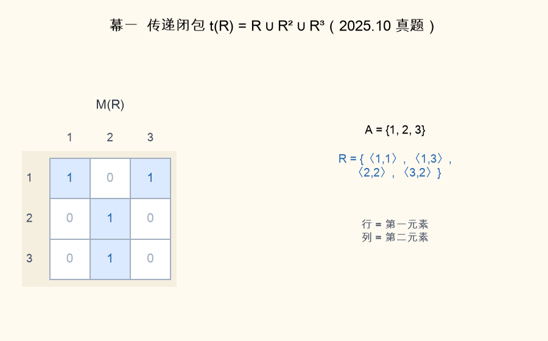

📌 锚点：**矩阵布尔乘：存在衔接元素即置 1**

**考试答题**

**📌 历年真题**

**【2026.4·填空 5】** 设 A={1,2,3,4}，B={a,b,c}，C={x,y}，从 A 到 B 的关系 R1 与从 B 到 C 的关系 R2 分别为 R1={⟨1,a⟩,⟨2,a⟩,⟨3,c⟩,⟨4,b⟩}，R2={⟨a,x⟩,⟨a,y⟩,⟨b,y⟩}，则 R1∘R2=______。

答案：**{⟨1,x⟩,⟨1,y⟩,⟨2,x⟩,⟨2,y⟩,⟨4,y⟩}**

📌 逐对找衔接：⟨1,a⟩⟨2,a⟩ 经 a 连到 x、y，⟨4,b⟩ 经 b 连到 y；⟨3,c⟩ 因 R2 无 ⟨c,…⟩ 断链丢弃（站方只给思路未列集合，此为自行验算结果）。

**【2023.10·填空 16】** 设集合 A 上的关系 R1={⟨a,a⟩,⟨a,b⟩,⟨b,d⟩}，R2={⟨a,d⟩,⟨b,c⟩,⟨b,d⟩,⟨c,b⟩}，则 R1∘R2=______。

答案：**{⟨a,d⟩,⟨a,c⟩}**

📌 a→a→d 得 ⟨a,d⟩，a→b→c、a→b→d 得 ⟨a,c⟩⟨a,d⟩；b→d 后无 ⟨d,…⟩，断链。

**【2023.4·填空 4】** 设 A={1,2,3}，R={⟨1,2⟩,⟨2,2⟩,⟨3,2⟩}，S={⟨2,1⟩}，则 (R∘S)⁻¹=______。

答案：**{⟨1,1⟩,⟨1,2⟩,⟨1,3⟩}**

📌 先复合：三个 ⟨x,2⟩ 都能接 ⟨2,1⟩，R∘S={⟨1,1⟩,⟨2,1⟩,⟨3,1⟩}；再逐对换位。

**【2022.10·填空 18】** 集合 A={1,2,3,4}，A 上的关系 R={⟨1,2⟩,⟨2,3⟩,⟨1,3⟩,⟨4,3⟩}，则 R²=______，R⁻¹=______。

答案：**{⟨1,3⟩}；{⟨2,1⟩,⟨3,2⟩,⟨3,1⟩,⟨3,4⟩}**

📌 两步衔接只有 1→2→3 走通，R² 仅 ⟨1,3⟩；逆关系逐对换位。

**【2022.4·填空 18】** 集合 A={1,2,3,4}，A 上的关系 R={⟨1,2⟩,⟨2,2⟩,⟨3,4⟩,⟨4,2⟩}，则 R²=______，R⁻¹=______。

答案：**{⟨1,2⟩,⟨2,2⟩,⟨3,2⟩,⟨4,2⟩}；{⟨2,1⟩,⟨2,2⟩,⟨2,4⟩,⟨4,3⟩}**

📌 四个起点两步后全部落在 2：1→2→2、2→2→2、3→4→2、4→2→2。

**【2023.10·填空 18】** 自然数集合 N 上的关系 R={⟨x,y⟩|x,y∈N，x+2y=10}，则 domR=______，R⁻¹=______。

答案：**{0,2,4,6,8,10}；{⟨5,0⟩,⟨4,2⟩,⟨3,4⟩,⟨2,6⟩,⟨1,8⟩,⟨0,10⟩}**

📌 y 取 0～5 解出全部 6 对，收第一分量得 domR；逆关系把每对方程 y→x 换位重写。

**【2025.4·填空 5】** 设 X={a,b,c,d}，Y={1,2,3}，X 到 Y 的二元关系 R={⟨a,2⟩,⟨b,3⟩,⟨c,1⟩}，则 ran R⁻¹=______。

答案：**{a,b,c}**

📌 ran(R⁻¹)=dom(R)——逆关系的值域就是原关系的定义域。

**【2023.10·单选 13】** 设有集合 A 上的关系 R1 和 R2，下列命题为真的是
- A. 若关系 R1 和 R2 是自反的，则 R1∘R2 也是自反的 ✅
- B. 若关系 R1 和 R2 是对称的，则 R1∘R2 也是对称的
- C. 若关系 R1 和 R2 是传递的，则 R1∘R2 也是传递的
- D. 若关系 R1 和 R2 是反自反的，则 R1∘R2 也是反自反的

📌 对每个 a：⟨a,a⟩∈R1 且 ⟨a,a⟩∈R2，衔接得 ⟨a,a⟩∈R1∘R2，复合保自反；对称/传递/反自反均可举反例。

**🎯 考法**：填空的固定菜——复合、幂、逆三大件轮着考（2022.4 填空 18、2022.10 填空 18、2023.4 填空 4、2023.10 填空 16/18、2025.4 填空 5、2026.4 填空 5，七个考期无一缺席）；单选偶尔考运算保持性（2023.10 单选 13）。

**✍️ 得分点**：
- 复合三步：取前关系每对 ⟨a,b⟩ → 查后关系有无 ⟨b,c⟩ → 拼 ⟨a,c⟩ 去重；**断链丢弃**。
- 逆关系**逐对换位**即可，对数不变（自反对换位后还是自己）。
- Rⁿ 读"n 步可达"；R⁰=I_A；|A|=n 时传递闭包至多算到 Rⁿ。
- 恒等式速答：ran(R⁻¹)=domR、dom(R⁻¹)=ranR、(R∘S)⁻¹=S⁻¹∘R⁻¹。

**⚠️ 易混淆**：**左/右复合方向**——教材定义相反（本卷按 ⟨a,b⟩∈R∧⟨b,c⟩∈S 衔接，与 2023.10 填空 16、2026.4 填空 5 站方答案一致）；**R²≠随便两两拼对**——必须经同一个衔接元素两步走到，如 2022.10 填空 18 中 4→3 后无 ⟨3,…⟩ 即断。

**解题方法**（求 R∘S 三步；原题：2026.4 填空 5）：
1. 把 R、S 的有序对各列一排（**为什么**：衔接靠公共元素，先摆好"字典"再配对，防漏防重）。
2. 对 R 的每个 ⟨a,b⟩，扫 S 中第一分量=b 的对（**为什么**：复合定义要求存在衔接元素 b）。
3. 拼写 ⟨a,c⟩ 并去重（**为什么**：关系是集合，同一结果只写一次）。

**【演算示范】**（2026.4 填空 5）R1={⟨1,a⟩,⟨2,a⟩,⟨3,c⟩,⟨4,b⟩} 配 R2={⟨a,x⟩,⟨a,y⟩,⟨b,y⟩}：⟨1,a⟩ 接 ⟨a,x⟩⟨a,y⟩ → ⟨1,x⟩⟨1,y⟩；⟨2,a⟩ 同理 → ⟨2,x⟩⟨2,y⟩；⟨3,c⟩ 找不到 ⟨c,…⟩ → 丢弃；⟨4,b⟩ 接 ⟨b,y⟩ → ⟨4,y⟩。故 R1∘R2={⟨1,x⟩,⟨1,y⟩,⟨2,x⟩,⟨2,y⟩,⟨4,y⟩}。

**🔑 记忆锚点**：**复合找衔子、逆关换座位、幂是走 n 步（R⁰=I_A）；断了就扔、重了就并**。

#### 4.4 闭包（r(R)/s(R)/t(R)）★★★

**定义详解**：闭包=包含 R 且具有指定性质的**最小**关系，三个公式必须默写：**自反闭包 r(R)=R∪I_A**（I_A={⟨a,a⟩|a∈A}，补齐对角线上缺的自反对）；**对称闭包 s(R)=R∪R⁻¹**（给每个单向对补上逆序对）；**传递闭包 t(R)=R∪R²∪…∪Rⁿ**（n=|A|，把"两步及以上可达"的对全部并进来；求到新对不再增加即封口）。矩阵口径：M_r=M∨I、M_s=M∨Mᵀ、M_t=M∨M²∨…∨Mⁿ（布尔运算）。**为什么 t(R) 只需算到 Rⁿ**：n 元集合中任何传递链的有效部分不超过 n−1 步，Rⁿ 之后必与之前的幂重合。

**考试答题**

**📌 历年真题**

**【2025.10·简答 1】** 设集合 A={1,2,3} 上的二元关系 R={⟨1,1⟩,⟨1,3⟩,⟨2,2⟩,⟨3,2⟩}，求 r(R)、s(R)、t(R) → 完整演算见下方【例 4-1】。

**【2024.10·简答 3】** 设集合 A={1,2,3} 上的二元关系 R={⟨1,2⟩,⟨1,3⟩,⟨2,2⟩,⟨3,1⟩}，求 r(R)、s(R)、t(R) → 与【例 4-1】同型同法（站方未公布答案，自行验算：r(R)={⟨1,1⟩,⟨1,2⟩,⟨1,3⟩,⟨2,2⟩,⟨3,1⟩,⟨3,3⟩}；s(R)={⟨1,2⟩,⟨1,3⟩,⟨2,1⟩,⟨2,2⟩,⟨3,1⟩}；t(R)={⟨1,1⟩,⟨1,2⟩,⟨1,3⟩,⟨2,2⟩,⟨3,1⟩,⟨3,2⟩,⟨3,3⟩}）。

**【2026.4·简答 4】** 求 R1∪R2 的集合表达式及自反闭包 r(R1∪R2) 的关系矩阵 → 矩阵互转部分见 4.1 解题方法；r 一步：$M_{r}=\begin{pmatrix}1&1&0\\1&0&1\\1&1&1\end{pmatrix}\vee I=\begin{pmatrix}1&1&0\\1&1&1\\1&1&1\end{pmatrix}$（只补 (y,y) 格）。

**【2023.4·简答 3】** 设 A={1,2,3} 上的二元关系 R={⟨1,3⟩,⟨3,2⟩,⟨2,1⟩}，写出自反闭包 r(R)、对称闭包 s(R) 和传递闭包 t(R) 的集合表达式 → 同型同法（要点：R²={⟨1,2⟩,⟨3,1⟩,⟨2,3⟩}、R³=I_A，t(R)=R∪R²∪R³=A×A 全域关系，9 对全齐）。

**【2021.4·简答 28】** 设 A={1,2,3} 上的二元关系 R={⟨1,1⟩,⟨1,2⟩,⟨1,3⟩,⟨2,1⟩,⟨3,2⟩}，写出 r(R)、s(R)、t(R) → 同型同法（要点：t(R)=R∪R²∪R³=A×A；站方答案验算无误）。

**【2025.4·简答 4】** 已知 A={a,b,c} 上 R 的关系矩阵，写出 R 的集合表达式及 r(R)、s(R) 的关系矩阵 → 矩阵口径：$M_{r(R)}=M_R\vee I$、$M_{s(R)}=M_R\vee M_R^{T}$（演算见 4.1 解题方法第 3 步同法）。

**🎯 考法**：简答大题几乎每年一道（2021.4 简答 28、2023.4 简答 3、2024.10 简答 3、2025.4 简答 4、2025.10 简答 1、2026.4 简答 4——六连考，2026 年并入矩阵题）。

**✍️ 得分点**：
- 三个公式默写：**r(R)=R∪I_A、s(R)=R∪R⁻¹、t(R)=R∪R²∪…∪Rⁿ**。
- t(R) 必须写出 R²、R³ 的**衔接演算过程**（分步给分：r 1 分、s 2 分、t 2 分是站方常见配分）。
- r 补对角"缺哪个补哪个"；s 每个单向对补一个逆对；t 并到新对不再增加（Rᵏ=Rᵏ⁺¹）即停。
- 集合按序排列、去重；矩阵口径 M∨I、M∨Mᵀ、逐次布尔乘。

**⚠️ 易混淆**：**s(R) 中自反对的逆是它自己**——⟨1,1⟩⁻¹=⟨1,1⟩，不新增对；**t(R) 别忘并 R 本身**——公式是 R∪R²∪…，只写 R²∪R³ 直接丢分；**r(R) 只补缺的自反对**——已有的 ⟨1,1⟩⟨2,2⟩ 不重复写；**闭包是"最小扩张"**——只补必须补的，多补（如 s(R) 里顺手加对角）不是标准答案。

**解题方法**（三闭包模板；原题：2025.10 简答 1）：
1. r(R)=R∪I_A：对照 A 的全部元素，缺哪个 ⟨a,a⟩ 补哪个（**为什么**：自反要求对角线全齐，且只能加不能删）。
2. s(R)=R∪R⁻¹：把 R 每对换位再并进来（**为什么**：对称要求"有去必有回"，R⁻¹ 恰是全部"回程票"）。
3. t(R)：先算 R²（两步可达），再 R³，…，直到与上一个幂相同；一并即得（**为什么**：传递要求"接得上的都要直达"，n 元集 Rⁿ 内必封口）。

**【例 4-1】**（原题：2025.10 简答 1）A={1,2,3}，R={⟨1,1⟩,⟨1,3⟩,⟨2,2⟩,⟨3,2⟩}，求 r(R)、s(R)、t(R)。

解：
① r(R)=R∪I_A（**为什么**：自反闭包=补齐所有 ⟨a,a⟩）：I_A={⟨1,1⟩,⟨2,2⟩,⟨3,3⟩}，R 已有 ⟨1,1⟩⟨2,2⟩，只缺 ⟨3,3⟩ → r(R)={⟨1,1⟩,⟨1,3⟩,⟨2,2⟩,⟨3,2⟩,⟨3,3⟩}。
② s(R)=R∪R⁻¹（**为什么**：对称闭包=给每个单向对补逆对）：R⁻¹={⟨1,1⟩,⟨3,1⟩,⟨2,2⟩,⟨2,3⟩} → s(R)={⟨1,1⟩,⟨1,3⟩,⟨3,1⟩,⟨2,2⟩,⟨2,3⟩,⟨3,2⟩}。
③ 先算 R²=R∘R（**为什么**：传递闭包要并上"两步可达"对）：⟨1,1⟩ 接 ⟨1,1⟩⟨1,3⟩ → ⟨1,1⟩⟨1,3⟩；⟨1,3⟩ 接 ⟨3,2⟩ → ⟨1,2⟩；⟨2,2⟩ 接 ⟨2,2⟩ → ⟨2,2⟩；⟨3,2⟩ 接 ⟨2,2⟩ → ⟨3,2⟩。得 R²={⟨1,1⟩,⟨1,2⟩,⟨1,3⟩,⟨2,2⟩,⟨3,2⟩}。

再算 R³=R²∘R（**为什么**：三步可达对也要并入）：⟨1,2⟩ 接 ⟨2,2⟩ → ⟨1,2⟩；⟨1,3⟩ 接 ⟨3,2⟩ → ⟨1,2⟩；⟨3,2⟩ 接 ⟨2,2⟩ → ⟨3,2⟩；⟨1,1⟩⟨2,2⟩ 接自环不变。得 R³={⟨1,1⟩,⟨1,2⟩,⟨1,3⟩,⟨2,2⟩,⟨3,2⟩}=R²（**为什么到此为止**：R⁴=R³∘R=R²∘R=R³，再算不会再添新对，闭包已稳定）。
t(R)=R∪R²∪R³={⟨1,1⟩,⟨1,2⟩,⟨1,3⟩,⟨2,2⟩,⟨3,2⟩}（与站方答案一致：r 1 分、s 2 分、t 2 分）。

**🔑 记忆锚点**：**自反补对角、对称补逆对、传递补可达——r∪I、s∪翻转、t=R∪R²∪R³**。

#### 4.5 等价关系与等价类、划分 ★★★

**定义详解**：**等价关系**=同时满足**自反+对称+传递**的二元关系，常记作 ~ 或 ≡。含 a 的**等价类** [a]_R={x|x∈A 且 ⟨a,x⟩∈R}，即与 a 等价的全员；等价类两两不交、并集恰为 A。**商集 A/R**=全体等价类构成的集合，它就是 A 的一个**划分**（把 A 切成互不重叠的非空块）；反之，给一个划分，"同块者相关"唯一确定一个等价关系——**等价关系与划分一一对应**，故 A 上等价关系个数=划分个数：**B₁=1，B₂=2，B₃=5，B₄=15**。只满足自反+对称（不保证传递）的叫**相容关系**，别与等价关系混淆。

> **🖼 动图演示：动图演示：等价关系三性质与等价类划分**

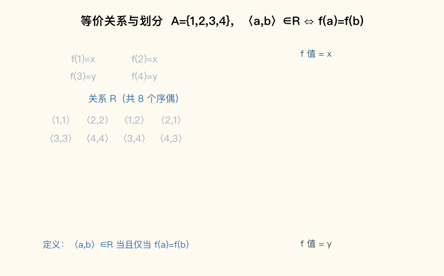

📌 锚点：**函数值相同者同类——等价类两两不交、并集=A**

**考试答题**

**📌 历年真题**

**【2026.4·证明 2】** 设 f 是从集合 A 到集合 B 的一个函数，定义 A 上的关系 R：⟨a,b⟩∈R 当且仅当 f(a)=f(b)。证明：R 是 A 上的一个等价关系 → 完整证明见下方【例 4-2】。

**【2024.4·填空 4】** 等价关系需要满足自反性、______和______。

答案：**对称性；传递性**

📌 三性质缺一不可，背全：自反+对称+传递。

**【2024.10·单选 11】** 设 A={1,2,3}，则 A 上的等价关系个数是
- A. 1
- B. 2
- C. 3
- D. 5 ✅

📌 等价关系个数=划分个数=B₃=5（{{1},{2},{3}}、{{1,2},{3}}、{{1,3},{2}}、{{2,3},{1}}、{{1,2,3}}）。

**【2025.10·单选 10】** 设 A={1,2}，则 A 上的等价关系个数是
- A. 1
- B. 2 ✅
- C. 3
- D. 4

📌 B₂=2：恒等关系 {⟨1,1⟩,⟨2,2⟩}（划分 {1}|{2}）与全关系 A×A（划分 {1,2}）。

**【2022.4·单选 15】** 设集合 A 的元素个数为 4，则 A 上所有的等价关系的个数为
- A. 4
- B. 8
- C. 10
- D. 15 ✅

📌 4 元集合划分数=B₄=15，与 2024.10 单选 11、2025.10 单选 10 连成 B 数考查链。

**【2023.4·单选 8】** 设集合 A 有 2 个元素，则 A×A 的所有不同的等价关系的个数是
- A. 4
- B. 8
- C. 12
- D. 15 ✅

📌 数的是 A×A（4 个有序对）上的等价关系，个数=B₄=15；"对几个对象划分"是审题关键。

**【2020.8·填空 17】** 设集合 A={1,2,…,10}，在模 4 相等关系下，等价类 [5] 为集合______。

答案：**{1,5,9}**

📌 模 4 相等=除以 4 余数相同；5≡1，A 中余 1 者为 1、5、9。

**【2025.4·简答 5】** 设 A={a,b,c,d} 的一个划分为 S={{a,b},{c,d}}，求由 S 确定的 A 上的等价关系 R → 答题要点见下方解题方法（块内两两相关+对角补齐）。

**【2023.10·综合 34】** 对集合 X={1,2,3,4,5,6} 上的划分 S={{1,3,5},{2,6},{4}}：(1) 写出该划分对应的二元关系 R 的集合表达式；(2) 画出关系 R 的关系图 → 同 2025.4 简答 5 方法（R 共 9+4+1=14 对；关系图=三团完全子图各带自环、团间无边）。

**【2023.4·简答 6】** 设 A={1,2,3}，R 为 A×A 上的二元关系，⟨x,y⟩R⟨u,v⟩ ⟺ x+y=u+v。(1) 证明 R 为等价关系；(2) 求 R 导出的等价类 → 证明同【例 4-2】三段式（把 f(a)=f(b) 换成 x+y=u+v）；等价类按"和相等"分组：[⟨1,1⟩]={⟨1,1⟩}、[⟨1,2⟩]={⟨1,2⟩,⟨2,1⟩}、[⟨1,3⟩]={⟨1,3⟩,⟨2,2⟩,⟨3,1⟩}、[⟨2,3⟩]={⟨2,3⟩,⟨3,2⟩}、[⟨3,3⟩]={⟨3,3⟩}，共 5 类。

**【2022.10·单选 13】** 设 R、S 是集合 A 上的二个不同的等价关系，则下列不是等价关系的为
- A. R∪S
- B. R−S ✅
- C. R∘S
- D. R∩S

📌 R−S 把公共自反对全删掉，必失自反性；R∩S 保三性必为等价关系；R∪S、R∘S 不保证传递（站方口径以"一定不是"取 B）。

**【2023.10·证明 31】** 设有正整数的序偶集合 A，⟨x,y⟩R⟨u,v⟩ 当且仅当 xv=yu，证明 R 是一个等价关系 → 与【例 4-2】完全同型（把 f(a)=f(b) 换成 xv=yu，对称用等式两边交换、传递用等量代换）。

**🎯 考法**：证明题考等价关系三段式（2023.10 证明 31、2026.4 证明 2，均为"条件等值 ⟹ 等价"）；单选考等价关系个数=贝尔数（2022.4 单选 15、2023.4 单选 8、2024.10 单选 11、2025.10 单选 10，B₂/B₃/B₄ 轮着出）；简答考划分⟷等价关系互求与等价类计算（2020.8 填空 17、2023.4 简答 6、2023.10 综合 34、2025.4 简答 5）。

**✍️ 得分点**：
- 等价关系三性质**逐条独立验证、每条单独成段**，缺条直接扣光（配分常见：自反 1 分+对称 2 分+传递 2 分+结论 2 分）。
- 等价类书写：[a]={与 a 有关系的全体}，必含 a 自身；等价类个数控"分几组"。
- 划分求等价关系：**块内两两有序对（含对角）写全，块间一律不写**。
- 贝尔数背诵：B₁=1、B₂=2、B₃=5、B₄=15；数错对象（A 还是 A×A）最冤。

**⚠️ 易混淆**：**等价关系≠相容关系**——2023.4 单选 6 的 R 自反+对称但 ⟨3,1⟩⟨1,2⟩ 链缺 ⟨3,2⟩ 不传递，只是相容关系；**判"个数"先看清对象**——2 元集 A 上等价关系 2 个，2 元集 A 的 A×A（4 元）上是 15 个；**R∩S 保等价、R∪S/R∘S 不保、R−S 必不保**（方向别记反）。

**解题方法**（划分→等价关系两步；原题：2025.4 简答 5）：
1. 每块内写全两两有序对，含对角 ⟨x,x⟩（**为什么**：块内元素互相等价，对称成对、自反对角一个不少）。
2. 块与块之间不写任何对（**为什么**：等价类两两不交，跨块即违规）。
演算：S={{a,b},{c,d}} → 块 {a,b} 给 ⟨a,a⟩⟨b,b⟩⟨a,b⟩⟨b,a⟩，块 {c,d} 给 ⟨c,c⟩⟨d,d⟩⟨c,d⟩⟨d,c⟩，R 共 8 对，与站方答案一致。

**【例 4-2】**（原题：2026.4 证明 2）设 f 是从集合 A 到集合 B 的一个函数，定义 A 上的关系 R：⟨a,b⟩∈R 当且仅当 f(a)=f(b)。证明：R 是 A 上的一个等价关系。

证明（三段式：设—代—换）：
① 自反性：对 ∀a∈A，有 f(a)=f(a)（**为什么**：任何函数值与自身相等，等号自反），故 ⟨a,a⟩∈R，R 具有自反性。
② 对称性：若 ⟨a,b⟩∈R，则 f(a)=f(b)，即 f(b)=f(a)（**为什么**：等式两边交换仍成立），故 ⟨b,a⟩∈R，R 具有对称性。
③ 传递性：若 ⟨a,b⟩∈R 且 ⟨b,c⟩∈R，则 f(a)=f(b) 且 f(b)=f(c)，由等量代换得 f(a)=f(c)（**为什么**：都等于 f(b) 的两个量彼此相等），故 ⟨a,c⟩∈R，R 具有传递性。
综上，R 是 A 上的等价关系。（站方配分：自反 1 分+对称 2 分+传递 2 分+结论 2 分；2023.10 证明 31 同模板。）

**🔑 记忆锚点**：**函数值相同者同类——等价关系=自反+对称+传递；等价关系个数=划分个数，B₁=1、B₂=2、B₃=5、B₄=15**。

#### 4.6 偏序关系、哈斯图与特殊元 ★★★

**定义详解**：**偏序关系**=自反+反对称+传递的关系，常记作 ≤（整除关系 |、集合包含 ⊆ 都是）；带偏序的集合 ⟨A,≤⟩ 称**偏序集**。若 a≤b、a≠b 且**不存在 c** 使 a≤c≤b，称 **b 盖住 a**，全体盖住对记 COV A——**哈斯图只画盖住边**：去自环、去传递边、小的在下大的在上、连线不带箭头。特殊元都相对**子集 B⊆A** 而言：**极小元**（B 内没有比它更小的，可并列多个）、**极大元**（B 内没有比它更大的，可并列多个）、**最小元**（≤B 中所有元素，若存在必唯一）、**最大元**（≥B 中所有元素，若存在必唯一）；**上界/下界**到 A 里找（可以在 B 外）：a 使 B 中所有元素 ≤a 为上界，**上确界=最小的上界**、下确界=最大的下界。任意两元素都有上确界和下确界的偏序集叫**格**（整除集上即：任两数的 lcm 与 gcd 都在集合内）。

> **🖼 动图演示：动图演示：哈斯图逐层绘制（整除关系）**

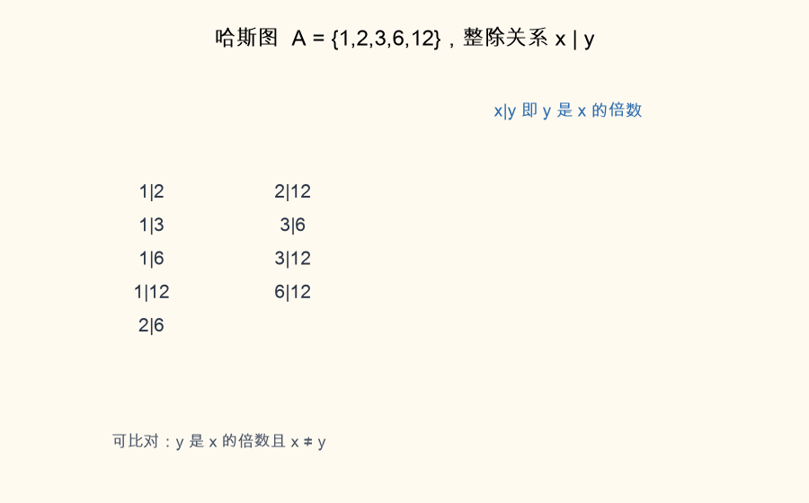

📌 锚点：**盖住才连线：去自环、去传递边；最大元须全场可比，极大元只看上方无邻**

**考试答题**

**📌 历年真题**

**【2026.4·简答 3】** 画出集合 A={n|n 是 20 的正因数} 上整除关系的哈斯图，并求出 B={2,4,10} 的极大元与极小元 → 答题要点见下方解题方法（A={1,2,4,5,10,20}；B 的极大元 4 和 10、极小元 2）。

**【2025.10·简答 5】** 画出 A={1,2,3,4,5,6,8,9} 上整除关系的哈斯图，并求出 A 的子集 B={2,3,6} 的极大元集、极小元集 → 答题要点：极大元集 {6}（2|6、3|6），极小元集 {2,3}（互不整除、上方无元素）。

**【2024.10·简答 4】** 画出 A={1,2,3,4,6,8,9} 上整除关系的哈斯图，并求出 A 的子集 B={2,3,4} 的极大元集、极小元集 → 站方仅公布极小元集 {2,3}（验算一致）；极大元集站方缺失，自行补全为 **{3,4}**（B 内 2 被 4 整除故非极大；3 与 4 互不整除、上方均无元素，皆为极大元）。

**【2025.4·简答 3】** 画出集合 A={1,2,3,6,9,18} 上整除关系的哈斯图，并求 COVA → 答题要点：COVA（盖住关系集合）={⟨1,2⟩,⟨1,3⟩,⟨2,6⟩,⟨3,6⟩,⟨3,9⟩,⟨6,18⟩,⟨9,18⟩}；⟨1,6⟩⟨2,18⟩⟨3,18⟩ 都不是盖住（中间有第三者）。

**【2025.4·单选 9】** 设 A={1,2,3,4,5,6,7}，≤为整除关系，则关于偏序集 ⟨A,≤⟩ 的表述正确的是
- A. 6 是 A 的极大元 ✅
- B. A 无最小元
- C. A 的最大元是 7
- D. A 的极大元有 2 个

📌 6 的倍数均不在 A 中→6 是极大元；实际极大元为 4、5、6、7 共 4 个（D 错）；1 整除一切是最小元（B 错）；7 不整除其余，非最大元，A 也无最大元（C 错）。

**【2023.4·简答 4】** 画出 A={2,4,8,12,24} 上整除关系的哈斯图，并求 B={4,8,12} 的极大元、极小元 → 要点：B 的极大元 8 和 12（互不整除）、极小元 4（4|8、4|12）。

**【2020.8·综合 32】** 设集合 A={1,2,3,6,9,18}，≤为整除关系：(1) 画出哈斯图；(2) 求子集 B={3,6,9} 的极大元、极小元、最大元、最小元；(3) 判断该偏序集 A 是否为格 → 要点：极大元 6 和 9、极小元 3、最小元 3、**最大元不存在**（6、9 互不可比）；任两数的 lcm/gcd 均在 A 中，是格。

**【2025.10·单选 12】** 下列各集合对于整除关系都构成偏序集，不能构成格的集合是
- A. L={1,2,3,4} ✅
- B. M={1,2,3,6}
- C. N={3,6,12}
- D. Q={1,5}

📌 2 和 3 的最小上界=lcm=6∉L，无上确界，不是格；其余集合任两元素的 lcm、gcd 都在集内。

**【2024.10·单选 13】** 下列各集合对于整除关系都构成偏序集，能构成格的集合是
- A. L={1,2,3,4}
- B. M={1,2,3,6} ✅
- C. N={2,3,6}
- D. Q={1,2,3}

📌 与上题互为镜像：{1,2,3,6} 恰补齐 2、3 的上确界 6 与下确界 1，是格；A/D 缺 6、C 缺 1。

**【2023.10·计算 29】** 画出集合 {1,2,3,4,6,8} 关于整除关系的哈斯图，并判定该偏序集是否构成格 → 站方未公布答案，自行验算：盖住关系 1≺2、1≺3、2≺4、2≺6、3≺6、4≺8；**不是格**——3 和 4 的最小上界应为 12∉A（4 和 6 的上界同样缺失）。

**🎯 考法**：哈斯图大题**每卷必考**（2020.8 综合 32、2023.4 简答 4、2023.10 计算 29、2024.10 简答 4、2025.4 简答 3、2025.10 简答 5、2026.4 简答 3——七连考），问法三件套：画图＋极大/极小元＋（COV 或格判定）；单选考特殊元辨析与格判定（2022.4 单选 14、2024.10 单选 13、2025.4 单选 9、2025.10 单选 12）。

**✍️ 得分点**：
- 哈斯图"三去"：去自环、去传递边、去箭头方向；**只连盖住对**，按层次从下往上画。
- 极大/极小元**可有多个**，最大/最小元**若存在必唯一**；判定只在 B 内部比较，B 外元素一概不看。
- 上/下界到 **A（全集中）**找、可以在 B 外；上确界=上界中最小者、下确界=下界中最大者。
- COV 写成有序对集合：⟨小,大⟩；格判定=任两元素的 lcm、gcd 都在集合内。

**⚠️ 易混淆**：**极大元≠最大元**——最大元须与 B 内所有元素可比且最大，极大元只看"上方无人"（2025.4 单选 9：6 是极大元，但 A 无最大元；2020.8 综合 32：B={3,6,9} 有极大元 6 和 9，最大元不存在）；**上界≠上确界**——上界可有一串，上确界是其中最小的一个；**盖住≠整除**——⟨1,6⟩ 中 1 整除 6 但不盖住（中间有 2、3）。

**解题方法**（哈斯图四步＋特殊元口诀）：
1. 列出 B 内（或 A 内）全部整除对，筛掉有"中间元"的，得盖住关系（**为什么**：哈斯图只画盖住边）。
2. 按层数（最长链长度）自下而上布点连线（**为什么**：盖住对上下相邻，同层元素互不可比）。
3. 极大/极小元在 **B 内**找：上方无邻者为极大、下方无邻者为极小（**为什么**：定义只涉及 B 内比较）。
4. 上/下界到 **A** 找：B 的倍数中属于 A 的是上界，其中最小者为上确界（**为什么**：界与确界定义在全集偏序上）。

**【例 4-3】**（自编教学例，配套动图数据）A={1,2,3,6,12}，≤ 为整除关系。
解：
① 整除对：1|2、1|3、1|6、1|12、2|6、2|12、3|6、3|12、6|12。筛盖住：1≺2、1≺3、2≺6、3≺6、6≺12；1≺6 非盖住（有 2、3 居间）、2≺12 非盖住（有 6 居间）（**为什么**：盖住=中间没有第三者）。
② 哈斯图四层：底层 1；第二层 2、3；第三层 6；顶层 12；连线 1-2、1-3、2-6、3-6、6-12。

③ 全 A 特殊元：极小元集 {1}＝最小元 1（1 整除一切，全场可比且最小）；极大元集 {12}＝最大元 12（各元素都整除 12）。
④ 子集 B={1,2,3,6}：极小元集 {1}＝最小元 1；极大元集 {6}＝最大元 6（1|6、2|6、3|6，6 与 B 内所有元素可比）；B 的**上界**（在 A 中找被 B 全体整除者）：6 和 12（**为什么**：上界须是 B 各元素公共的"倍数"即 lcm=6 的倍数）；**上确界 6**（**为什么**：6≤12，上界中最小者）；下界 1、下确界 1。

**🔑 记忆锚点**：**盖住才连线；极大看上方、极小看下方、最大最小要全场可比；上界一串、上确界一个（B 的上界=B 的公倍数∩A）**。

### 第 6 章 代数系统与群论（每年约 10~15 分）与第 7 章 格与布尔代数（每年约 8~12 分）

#### 6.1 二元运算性质与幺元/零元/逆元 ★★★

**定义详解**：**二元运算**是映射 S×S→S，核心要求**封闭**——∀a,b∈S 都有 a∗b∈S（结果不许跑出集合）。六大性质：**交换律** a∗b=ba；**结合律** (a∗b)∗c=a∗(b∗c)；**幂等律** a∗a=a；**分配律** x∗(y∘z)=(x∗y)∘(x∗z)；**吸收律** a∗(a∘b)=a。三种特殊元素：**幺元（单位元）e** 满足 ea=ae=a；**零元 θ** 满足 θ∗a=a∗θ=θ（只满足一侧叫**左/右零元**）；**逆元 a⁻¹** 满足 a∗a⁻¹=a⁻¹∗a=e。速记：加法幺元 0、乘法幺元 1；∪ 的幺元 ∅、零元全集；∩ 的幺元全集、零元 ∅。

**常用运算性质速查**（单选四大常客，结果背下来）：
- min/max：交换 ✓、结合 ✓、幂等 ✓、**消去 ✗**（min(1,5)=min(1,8)=1 但 5≠8）
- |x−y|：交换 ✓、**结合 ✗**（‖1−2|−3|=2≠|1−|2−3||=0）、幂等 ✗（|x−x|=0≠x）
- x∗y=y 与 x∗y=x：**结合 ✓、幂等 ✓（x∗x=x）**、**交换 ✗**（x≠y 时两侧不同）
- x∗y=2x+y 型：交换 ✗、结合 ✗（系数不对称，两侧展开必不等）

**考试答题**

**📌 历年真题**

**【2026.4·单选 11】** 在自然数集 N 上，下列运算中满足结合律的是
- A. $x*y=2x$
- B. $x*y=y$ ✅
- C. $x*y=|x-y|+1$
- D. $x*y=2x+y$

📌 $(x*y)*z=y*z=z$，$x*(y*z)=x*z=z$，两侧恒等——x∗y=y 满足结合律；其余代入 (1,2,3) 两侧即不等

**【2025.10·单选 8】** 在自然数集 N 上，下列运算中满足结合律的是
- A. $x*y=x-y$
- B. $x*y=y$ ✅
- C. $x*y=|x-y|$
- D. $x*y=x+2y$

📌 同上 x∗y=y 两侧都等于 z；A 代入 (1,2,3)：(1−2)−3=−4≠1−(2−3)=2；C：||1−2|−3|=2≠|1−|2−3||=0

**【2025.4·单选 11】** 在自然数集 N 上，下列运算中满足交换律的是
- A. $x*y=2x$
- B. $x*y=y$
- C. $x*y=\max\{x,y\}$ ✅
- D. $x*y=2x+y$

📌 max{x,y}=max{y,x} 与书写顺序无关，交换 ✓；A、B、D 结果依赖先写的变元，对调即变

**【2024.10·单选 8】** 在自然数集 N 上，下列运算中满足交换律的是
- A. $x*y=x$
- B. $x*y=y$
- C. $x*y=\min(x,y)$ ✅
- D. $x*y=x+2y$

📌 min(x,y)=min(y,x) 交换 ✓；x+2y 对调后成 y+2x，仅 x=y 时相等，不满足

**【2025.10·单选 12】** 设集合 $A=\{a,b,c\}$，定义运算 $x*y=x$，则 A 的右零元个数是
- A. 0 ✅
- B. 1
- C. 2
- D. 3

📌 右零元 z 须 ∀x 有 x∗z=z；而 x∗z=x，要 x=z 对一切 x 成立不可能，右零元 0 个

**【2024.10·单选 12】** 设集合 A={a, b, c}，定义运算 x∗y=x，则 A 的左零元个数是
- A. 0
- B. 1
- C. 2
- D. 3 ✅

📌 左零元 z 须 ∀y 有 z∗y=z；z∗y=z 恒成立（结果就是左变元），a、b、c 全是左零元，共 3 个

**【2025.10·填空 2】** 在非负整数集上关于乘法运算构成的代数系统中幺元是______
答案：**1**

📌 x×1=1×x=x，乘法幺元是 1（加法则对应 0）

**【2024.10·填空 7】** 在非负整数集上关于加法运算构成的代数系统中幺元是______
答案：**0**

📌 x+0=0+x=x，加法幺元是 0

**【2025.4·填空 6】** 设 $A=\{1,2,3,4\}$，$\forall x,y\in A$，定义 $x\otimes y$ 为 x 与 y 的积除以 5 所得的余数，则元素 4 的逆元是______
答案：**4**

📌 逆元须 4⊗y≡1 (mod 5)；4×4=16=3×5+1，余 1，故 4 自乘即逆（自逆元）

**【2024.4·填空 9】** 设⟨A,+,×⟩是一个代数系统，∀a,b,c∈A，写出运算 + 对运算 × 的分配律______
答案：**a+(b×c)=(a+b)×(a+c)**

📌 "+ 对 × 分配"= 用 + 拆 ×：先 × 再 +，等于各自 + 完再 ×（对照数系：a+b·c=(a+b)(a+c) 在逻辑并/交上成立）

**【2021.4·单选 7】** $S=\{a,b\}$ 的二元运算 ∘ 定义为 $a\circ a=a,\ a\circ b=b,\ b\circ a=b,\ b\circ b=a$，则 ∘ 不满足
- A. 交换律
- B. 幂等律 ✅
- C. 结合律
- D. 消去律

📌 幂等律要求 x∘x=x，但 b∘b=a≠b，幂等 ✗；交换（对称表）、结合、消去均验算成立

**解题方法**（f(x,y) 型运算判性质三步）：
1. 封闭性：检查运算结果是否对一切取值都留在集合内（**为什么**：封闭是二元运算成立的前提，结果出集合连运算都算不上，如正整数集上 x−y 可能为负）。
2. 交换律：把 x、y 对调比较 f(x,y) 与 f(y,x)（**为什么**：交换律说"顺序不影响结果"，对调后表达式变了就不满足）。
3. 结合律：分别算 (x∗y)∗z 与 x∗(y∗z) 并各自化简（**为什么**：结合律管的是"先算谁"，两侧化简结果不同即否定；x∗y=y 型两侧都等于 z，故满足）。
4. 幺元：设 e 解方程 e∗x=x∗e=x 对一切 x 成立（**为什么**：幺元是与"任何元素"运算都不改变对方的元素，须对全体验证）。

**🎯 考法**：单选每年 1~2 题判"交换/结合"（2024.10~2026.4 连续五考期轮考 max/min/x∗y=y 型）；单选考左/右零元个数（2024.10 单选 12、2025.10 单选 12 同型反向连考）；填空考幺元/逆元（2024.10 填空 7、2025.10 填空 2、2025.4 填空 6）；计算题考 max/min/|x−y| 性质填表（2023.10 计算 28，每空 1 分）。

**✍️ 得分点**：
- 判交换：对调变元看表达式是否改变；判结合：两侧各化简一遍。
- x∗y=y（或 =x）三连：结合 ✓、幂等 ✓、交换 ✗——背结论可秒杀。
- 左零元看 z∗y、右零元看 x∗z：x∗y=x 时**左零元=全体元素、右零元 0 个**，方向别反。
- 乘法幺元 1、加法幺元 0；模 n 乘法求逆元：解 x×a≡1 (mod n)。

**⚠️ 易混淆**：**左零元与右零元方向**——z∗y=z 是左零元（z 在左边），2024.10 与 2025.10 两题一字不差只换"左/右"，答案 3 个 vs 0 个，方向看错必错；**x∗y=y 也满足幂等律**（x∗x=x），别凭直觉以为"结果总取右边"就幂等 ✗。

**🔑 记忆锚点**：判性质口诀——"交换对调、结合两遍、幺元解方程"；零元口诀——"谁在表达式里露脸，哪一侧的零元就齐全"（x∗y=x：x 露脸→左零元全有；y 没露→右零元没有）。

#### 6.2 半群/独异点/群/交换群 ★★★

**定义详解**：四个概念是一条**递进链**，每上一层多验一条性质——**半群**⟨S,∗⟩：封闭 + 结合律；**独异点（含幺半群）**：半群 + 幺元 e；**群**⟨G,∗⟩：独异点 + 每个元素都有逆元；**交换群（阿贝尔群）**：群 + 交换律。群的常用性质：**群中幂等元只能是幺元**（a∗a=a 两边同乘 a⁻¹ 得 a=e）；群满足消去律；(a∗b)⁻¹=b⁻¹∗a⁻¹。判定口诀："**封闭结合成半群，加上幺元独异点，再添逆元才是群，交换律到交换群**"。

> **🖼 动图演示：动图演示：用运算表验证群（Z6 模 6 加法）**

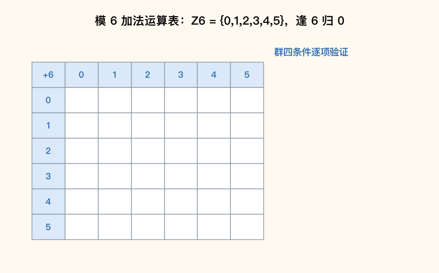

📌 锚点：**表内无出格=封闭；0 行 0 列不变=幺元；每行遍历全表=有逆；表对称=交换**

**运算表附加验证**（Z₆={0,1,2,3,4,5}，运算 x∗y=(x+y) mod 6）：幺元 0；各元素阶 |0|=1、|1|=6、|2|=3、|3|=2、|4|=3、|5|=6（**验算**：|2|=3 因 2+2+2=6≡0 而 2 个 2 是 4≠0；恰合公式 |aᵏ|=n/gcd(n,k)=6/gcd(6,2)=3）。元素阶规律：从幺元出发沿"自加"走，首次回到 0 的步数即阶。

**考试答题**

**📌 历年真题**

**【2021.4·单选 14】** 在下列代数系统 ⟨G,∘⟩ 中，∘ 是普通加法运算，其中不是群的是
- A. G 为自然数集合 ✅
- B. G 为偶数集合
- C. G 为有理数集合
- D. G 为整数集合

📌 自然数对加法：封闭、结合、幺元 0 都有，但 x 的逆元 −x 不在自然数集——**缺逆元**；偶数/有理数/整数对加法四条俱全

**【2025.10·填空 3】** 群中的幂等元只能是______
答案：**幺元（单位元 e）**

📌 a∗a=a 两边左乘 a⁻¹：a∗a∗a⁻¹=a∗a⁻¹ 即 a=e——有逆元才推得动，所以结论只在群中成立

**解题方法**（群/交换群证明四步法——每年稳定一道 7 分证明大题，模板背熟）：
1. **封闭性**：∀a,b∈G，写出 a∗b 的表达式，说明其仍满足 G 中元素的形式（**为什么**：不封闭连代数系统都不算，必须放第一步）。
2. **结合律**：(a∗b)∗c 与 a∗(b∗c) 各自展开、比对相等（**为什么**：半群的门槛；实数加法/乘法本身结合，可引"实数运算满足结合律"作依据）。
3. **幺元**：找具体元素 e 并验证 e∗a=a∗e=a（**为什么**：幺元须"存在"且"对所有元素"生效，只验一个不行；a+b−k 型运算的幺元是 k）。
4. **逆元**：∀a，给出 a⁻¹ 并验证 a∗a⁻¹=a⁻¹∗a=e（**为什么**：群区别于独异点的关键一条；a+b−k 型中 a 的逆元是 2k−a）。
5. 若题要求**交换群**：加验 a∗b=b∗a（**为什么**：交换群=群+交换律，缺这步只证到群，扣交换律的分）。

**【例 6-1】**（原题：2024.4 证明 2，7 分）设 $A=\{a+b\sqrt2 \mid a,b\in Z\}$，运算 + 是实数的加法，证明：⟨A,+⟩ 是一个群。

解：
① 封闭性：∀(a+b√2),(c+d√2)∈A，(a+b√2)+(c+d√2)=(a+c)+(b+d)√2（**为什么**：实数加法合并同类项），其中 a+c、b+d∈Z，故和仍具 A 中形式，封闭。
② 结合律：实数加法本身满足结合律（**为什么**：⟨R,+⟩ 是现成的交换群，其子集上的同一种运算继承结合律），故三个元素任意结合相等。
③ 幺元：0=0+0·√2∈A，且 0+(a+b√2)=(a+b√2)+0=a+b√2（**为什么**：加法幺元是 0，须检查 0 确实属于 A——它有 a=0,b=0 的表示），幺元存在。
④ 逆元：∀a+b√2∈A，取 (−a)+(−b)√2∈A（**为什么**：−a、−b 仍是整数，形式合法），两者相加得 0，故每个元素有逆元。
综合①~④，⟨A,+⟩ 是群。（四步各 1 分 + 结论 1 分，素材解析给分结构）

**【例 6-1·附】**（原题：2024.10 证明 2，7 分）设集合 A={a,b,c}，定义运算 x∗y=y，证明 ⟨A,∗⟩ 构成一个半群。

解：
① 封闭性：∀x,y∈A，x∗y=y∈A（**为什么**：结果就是右操作数，必在集合内），封闭。
② 结合律：∀x,y,z∈A，(x∗y)∗z=y∗z=z，x∗(y∗z)=x∗z=z，两侧相等（**为什么**：每步都用定义"结果=右操作数"替换），结合律成立。
由①②，⟨A,∗⟩ 构成半群。（半群只验两条：封闭 1 分 + 结合 2 分 + 结论 1 分；**注意比群少验幺元、逆元两步**）

**🎯 考法**：证明大题每年一道验证 ⟨A,∗⟩ 构成半群/群/交换群（2020.8 a+b−1、2021.4 a+b−3、2023.4 Q⁺ 乘法、2024.4 a+b√2、2024.10 x∗y=y——五连考）；单选考"哪个不是群"（2021.4 单选 14）；填空考幂等元（2025.10 填空 3）。

**✍️ 得分点**：
- 四步缺一不可、顺序固定：封闭→结合→幺元→逆元（→交换），每步都以 ∀a,b∈… 开头，不写全称量词扣步骤分。
- 幺元要给出具体值并验证属于 A；逆元要写出 a⁻¹ 的表达式（a+b−k 型：幺元 k、逆元 2k−a）。
- 只证半群时**不要**多写幺元逆元（写了不扣分但浪费时间），少写封闭或结合必扣分。
- 判断"不是群"先查逆元（最常缺的一条：自然数集、非负实数集对加/乘都卡在逆元）。

**⚠️ 易混淆**：**半群与独异点**——差别只在"有没有幺元"，验独异点比半群多一步幺元；**群中幂等元≠每个元素**——由逆元强行推出只剩幺元，而半群里幂等元可以很多（x∗y=y 时三个元素全幂等）。

**🔑 记忆锚点**："封结幺逆换，一层一层搬；半群要前俩，群要凑到四，交换群五条全"。a+b−k 型速记："幺元=k，逆元=2k−a"（k=1 逆元 2−a，k=3 逆元 6−a）。

#### 6.3 循环群与元素阶、子群 ★★★

**定义详解**：**循环群**⟨G,∗⟩：存在生成元 a 使 G 中每个元素都是 a 的幂（G={a⁰=e,a,a²,…,aⁿ⁻¹}），记 |G|=n。**元素阶 |a|**：使 aᵏ=e 的最小正整数 k（幺元阶为 1）。核心公式：**aᵏ 的阶 = n/gcd(n,k)**（**为什么**：aᵏ 每 m 次自乘累计到 aⁿ=e，需 mk 是 n 的最小倍数，m=n/gcd(n,k)）。**群方程消去**：a∗x=b ⇒ x=a⁻¹∗b（两边左乘 a⁻¹）。**Klein 四元群** G={e,a,b,c}：e 阶 1，a、b、c 全是阶 2（a²=b²=c²=e）。

**考试答题**

**📌 历年真题**

**【2026.4·单选 12】** 已知 ⟨G,∗⟩ 是 10 阶循环群，a 是群 G 的生成元，则元素 $a^4$ 的阶是
- A. 2
- B. 4
- C. 5 ✅
- D. 10

📌 阶公式 n/gcd(n,k)=10/gcd(10,4)=10/2=5

**【2026.4·填空 7】** 已知 ⟨G,∗⟩ 是群，且 $a,b\in G$，$a*x=b$，则 x=______
答案：**$a^{-1}*b$**

📌 两边左乘 a⁻¹：a⁻¹∗(a∗x)=a⁻¹∗b，即 (a⁻¹∗a)∗x=a⁻¹∗b，x=a⁻¹∗b

**【2025.4·单选 12】** Klein 四元群 G = {e,a,b,c}，则群 G 中所含的阶为 2 的元素个数是
- A. 0
- B. 1
- C. 2
- D. 3 ✅

📌 e 的阶是 1；a²=b²=c²=e 且自身≠e，故 a、b、c 的阶都是 2，共 3 个

**【2022.10·填空 23】** 设集合 A={0,1,2,3,4,5,6}，x、y∈A，x∗y=(x+y) mod 7，则群 ⟨A,∗⟩ 的单位元是______，任意非单位元的元素 x 的逆元是______
答案：**0；7−x**

📌 0 满足 x∗0=x（幺元）；逆元须 x+x⁻¹≡0 (mod 7)，取 x⁻¹=7−x

**【2023.10·填空 23】** 设集合 A={0,1,2,3,4,5}，∀x,y∈A，x∗y=(x+y) mod 6，则群 ⟨A,∗⟩ 的单位元是______，任意非单位元的元素 x 的逆元是______
答案：**0；6−x**

📌 模 n 加法群通式：幺元 0、x 的逆元 n−x（x+y=n 即回到 0）

**【2021.4·填空 19】** 设代数系统 ⟨S,∗⟩ 为独异点，∀a,b∈S 均有逆元 $a^{-1},b^{-1}\in S$，且 a∗b 也有逆元，则 a∗b 的逆元为______
答案：**$b^{-1}*a^{-1}$**

📌 (a∗b)∗(b⁻¹∗a⁻¹)=a∗(b∗b⁻¹)∗a⁻¹=a∗e∗a⁻¹=e——**顺序颠倒**（穿脱原理）

**解题方法**（求循环群元素阶两步）：
1. 求 gcd(n,k)（**为什么**：aᵏ 的"周期"取决于 k 与 n 的最大公约数，gcd 越大周期越短）。
2. 算 n/gcd(n,k)（**为什么**：使 (aᵏ)ᵐ=aᵏᵐ=e 的最小 m 就是 n/gcd(n,k)）。

**【例 6-2】**（原题：2026.4 单选 12）10 阶循环群 ⟨G,∗⟩，a 是生成元，求 a⁴ 的阶。

解：n=10，k=4。① gcd(10,4)=2（**为什么**：10=2×5、4=2×2，公共素因子只有一个 2）；② 阶 =10/gcd(10,4)=10/2=5（**为什么**：(a⁴)⁵=a²⁰=a^(2×10)=e，而 (a⁴)¹=a⁴≠e、(a⁴)²=a⁸≠e、(a⁴)³=a¹²=a²≠e、(a⁴)⁴=a¹⁶=a⁶≠e，5 是最小者）。答案：**5，选 C**。

**🎯 考法**：单选/填空考元素阶计算（2026.4 单选 12）、群方程求解（2026.4 填空 7）、模 n 加法群的幺元与逆元（2022.10、2023.10 填空 23 同型跨年重考）、乘积逆元顺序（2021.4 填空 19）、Klein 四元群阶分布（2025.4 单选 12）。

**✍️ 得分点**：
- 阶公式 aᵏ 的阶=n/gcd(n,k) 直接套，先约分再作答。
- 群方程：a∗x=b 左乘 a⁻¹、x∗a=b 右乘 a⁻¹，**乘哪侧由未知元位置决定**。
- 模 n 加法群：幺元 0、逆元 n−x（0 的逆元是自身）。
- (a∗b)⁻¹=b⁻¹∗a⁻¹，顺序必须颠倒。
- Klein 四元群：阶 2 的元素 3 个、每个非幺元自乘即幺元。

**⚠️ 易混淆**：**生成元的阶=群阶 n，但元素的阶≠元素上标 k**（a⁴ 的阶是 5 不是 4）；**阶为 2 的元素**满足 a²=e 且 a≠e，e 本身阶是 1 不计入；模 n 加法群逆元是 n−x 而**不是 −x**（−x 可能不在集合 {0,…,n−1} 里）。

**🔑 记忆锚点**："阶等于 n 除以最大公约"；"左乘右乘看位置：x 在右左乘逆，x 在左右乘逆"；Klein 四元群"一个老大（e 阶 1），三个小弟（阶 2）"。

#### 6.4 环、整环、域 ★★★

**定义详解**：三层递进——**环**⟨R,+,×⟩：① ⟨R,+⟩ 构成交换群（幺元记 0，每元有负元）；② ⟨R,×⟩ 构成半群（封闭+结合）；③ × 对 + 满足分配律。**整环**：环 + 乘法可交换 + 有乘法幺元 1（1≠0）+ 无零因子（a×b=0 ⇒ a=0 或 b=0）。**域**：整环 + 每个非零元有乘法逆元（即非零元可作除法）。速记递进："**环加一换一无零成整环，整环再添除法就是域**"。整数倍集合 nZ={…,−n,0,n,2n,…} 对普通加乘是**环但非整环**（**为什么**：1∉nZ，没有乘法幺元）。

**考试答题**

**📌 历年真题**

**【2026.4·单选 13】** 设 A 是由所有被 6 整除的整数构成的集合，则 A 在普通整数加法和普通整数乘法运算下构成的代数系统是
- A. 偏序集
- B. 域
- C. 整环
- D. 环 ✅

📌 6Z 对加法（和仍为 6 的倍数）、乘法（积仍为 6 的倍数）封闭且满足分配律→环；1∉6Z 无乘法幺元→非整环、非域

**【2023.10·单选 9】** 设 A={3z|z∈Z}，运算为实数加法 + 和乘法 ∗，则 ⟨A,+,∗⟩ 构成的代数系统是
- A. 环 ✅
- B. 整环
- C. 域
- D. 格

📌 3Z 与 6Z 同理：nZ 均成环不整环（乘法幺元 1 不在）；格是偏序结构，与环/域不同类

**解题方法**（环/整环/域判定四查）：
1. 查加法：封闭？负元在集合内？（**为什么**：⟨R,+⟩ 须是交换群，自然数集就会卡在负元）。
2. 查乘法：封闭？结合？（**为什么**：⟨R,×⟩ 只须半群，要求比加法低）。
3. 查分配律：× 对 + 是否分配（**为什么**：环的定义桥梁，数系的普通加乘天然满足）。
4. 升级检查：乘法幺元 1 在不在集合？非零元有没有逆元？（**为什么**：区分环→整环→域的两道门槛）。

**【例 6-3】**（原题：2026.4 单选 13 辨析展开）A=6Z，逐条验"环而非整环"：
① 加法：6m+6n=6(m+n)∈A；6m 的负元 −6m∈A；幺元 0=0×6∈A——⟨A,+⟩ 是交换群（**为什么**：6 的倍数加 6 的倍数仍是 6 的倍数，含 0、可取负）。
② 乘法：6m×6n=36mn=6(6mn)∈A，封闭且乘法结合（**为什么**：积含因数 6，仍是 6 的倍数）。
③ 分配律：实数乘法对加法天然分配，继承成立。∴ 构成**环**。
④ 整环检查：乘法幺元应为 1，但 1∉6Z（1 不是 6 的倍数）→ **不是整环**，更不是域（**为什么**：整环的第一道门槛就是有乘法幺元）。

**🎯 考法**：单选考"n 的倍数集构成什么"（2023.10 单选 9 的 3Z 与 2026.4 单选 13 的 6Z 是同型换数题）；填空考分配律表达式默写（2024.4 填空 9）。

**✍️ 得分点**：
- nZ 型集合一律答"环"：加法交换群 ✓、乘法半群 ✓、分配 ✓、无乘法幺元 1 ✗。
- 分配律默写分清方向：+ 对 × 是 a+(b×c)=(a+b)×(a+c)；× 对 + 是 a×(b+c)=a×b+a×c。
- 域最强、整环次之、环最弱：能除→域；有 1 无零因子→整环；只分配→环。

**⚠️ 易混淆**：**整环与环的分界是"乘法幺元 1"**（不是零因子，那是第二条件）；**格不是环/域的下位概念**——格是偏序+上下确界结构，与环域不同分支，出现即排除。

**🔑 记忆锚点**："倍数集合必是环，见 1 缺 1 止步环"；升级链口诀——"环要有 1 无零因子变整环，整环能除变域"。

#### 7.1 格的定义与判定 ★★★

**定义详解**：**格**（偏序定义）：偏序集 ⟨L,≤⟩ 中任意两个元素 x,y 都有**最小上界（上确界，记 x∨y）**和**最大下界（下确界，记 x∧y）**，则称 ⟨L,≤⟩ 是格。**格**（代数定义）：代数系统 ⟨L,∗,∘⟩ 中 ∗ 与 ∘ 是二元运算且都满足**交换律、结合律、吸收律**，也称格（**不要求补元**，所以还谈不上布尔代数）。整除关系下的判定捷径：任两元素的**最小公倍数（lcm）与最大公约数（gcd）都在集合内**⇔ 构成格。**链**（任意两元素都可比的偏序集）必是格。

**考试答题**

**📌 历年真题**

**【2025.10·单选 13】** 下列各集合对于整除关系都构成偏序集，不能构成格的集合是
- A. $L=\{1,2,3,4\}$ ✅
- B. $M=\{1,2,3,6\}$
- C. $N=\{3,6,12\}$
- D. $Q=\{1,5\}$

📌 2 与 3 的最小公倍数 6∉L，无最小上界，不是格；N 是链 3|6|12、Q 是链 1|5，皆格

**【2024.10·单选 13】** 下列各集合对于整除关系都构成偏序集，能构成格的集合是
- A. L={1,2,3,4}
- B. M={1,2,3,6} ✅
- C. N={2,3,6}
- D. Q={1,2,3}

📌 M 中 2、3 的 lcm=6∈M、gcd=1∈M，逐对验证皆在→格；L、Q 中 2、3 的 lcm=6 不在；N 中 2、3 的 gcd=1 不在

**【2024.4·单选 15】** 下列各集合对于整除关系构成偏序集，不能构成格的集合是
- A. $L_1=\{1,2,3,4\}$ ✅
- B. $L_2=\{1,2,3,6\}$
- C. $L_3=\{1,3,5,15\}$
- D. $L_4=\{1,3,9,81\}$

📌 L₁ 中 2、3 的 lcm=6∉L₁；L₂/L₃/L₄ 均为链（1|2|…、1|3|5|15、1|3|9|81），链必是格

**【2023.4·单选 12】** 设 ⟨S,∗,∘⟩ 是代数系统，∗ 和 ∘ 是二元运算，如果 ∗ 和 ∘ 满足交换律、结合律和吸收律，则 ⟨S,∗,∘⟩ 构成一个
- A. 环
- B. 域
- C. 格 ✅
- D. 布尔代数

📌 这就是格的代数定义原文；布尔代数还需"有补分配格"，多了补元要求，条件不够

**【2023.10·计算 29】（6 分）** 画出集合 {1,2,3,4,6,8} 关于整除关系的哈斯图，并判定该偏序集是否构成格。

→ 答题要点：哈斯图三层——底层 1；第二层 2、3；第三层 4、6；顶层 8（盖住边 ⟨1,2⟩、⟨1,3⟩、⟨2,4⟩、⟨2,6⟩、⟨4,8⟩）。判定：**不构成格**——3 与 4 在集合内没有公共上界（同时被 3、4 整除的数至少是 12，而 12∉集合），更无最小上界；同理 3 与 8、4 与 6、6 与 8 也无公共上界。

⚠️ 站方解析勘误：站方《学习指南》解析称"逐一验证后构成格"，错误。逐对核查：{3,4} 公共倍数 12、{3,8} 公共倍数 24、{4,6} 公共倍数 12、{6,8} 公共倍数 24 均不在集合内——四对元素皆无上界，必不是格。凡含两个不同素数 p、q 而不含其公倍数 pq 的整数集都如此，判定时优先查素数对。

**解题方法**（整除集合判格三步）：
1. 找不可比元素对（**为什么**：可比对（链上相邻）的上/下确界就是其中之一，天然在集合内；只有不可比对才可能出格）。
2. 对每对算 lcm 与 gcd（**为什么**：整除序下最小上界=lcm、最大下界=gcd）。
3. 有任何一对的 lcm 或 gcd 不在集合内 ⇒ 不是格，立即收工（**为什么**：格要求"任意两元素都有"，一票否决）；全在 ⇒ 是格。

**🎯 考法**：单选每年 1 题"能/不能构成格"（2023.10 单选 14、2024.4 单选 15、2024.10 单选 13、2025.10 单选 13 四连考，另有图形版 2022.4 单选 14、2022.10 单选 14）；计算题考"画哈斯图+判格"（2021.4 简答 32 第 3 问、2023.10 计算 29）。

**✍️ 得分点**：
- 判定句式："某两元素的最小公倍数/最大公约数不在集合中，无上/下确界，故不是格"——写清哪一对、缺哪个。
- 全部在集合内才答"是格"，且要写"任意两元素的最小上界与最大下界均在集合中"。
- 链（全序）必是格，可跳过逐对验证。

**⚠️ 易混淆**：**偏序集≠格**——偏序只保证自反反对称传递，格额外要求任两元素有上、下确界；**上确界≠任一上界**——上界可以有很多，取最小的那个（若集合外的 12 是 3、4 的上界但不在集合内，等于没有）。

**🔑 记忆锚点**："判格先揪素数对，lcm gcd 必须到"；"一票否决：缺一对，全盘输"。

#### 7.2 哈斯图上的极大/极小/最大/最小与上下界 ★★★

**定义详解**：特殊元定义见 4.6（极小元=B 内无更小、极大元=B 内无更大、最小元=小于等于一切、最大元=大于等于一切；上/下界在 A 中找、上/下确界是界中最小/最大者）。本节从**格视角**补三条格特有的口径：① 在格中上确界 x∨y、下确界 x∧y 永远存在，求"两元素的公倍/公约式上下界"就是在算 ∨ 与 ∧；② **最大元若存在必唯一且它与所有元素可比**，极大元可有多个且互不可比；③ 全集的最大元/最小元（记 1、0）是讨论补元的前提（见 7.3）。画图与求法模板（三层哈斯图、盖住边）已在 4.6 讲透，此处不赘。

**考试答题**

**📌 历年真题**

**【2025.4·单选 9】** 设 A={1,2,3,4,5,6,7}，≤为整除关系，则关于偏序集 ⟨A,≤⟩ 的表述正确的是
- A. 6 是 A 的极大元 ✅
- B. A 无最小元
- C. A 的最大元是 7
- D. A 的极大元有 2 个

📌 6 的倍数均不在 A 中→6 上方无人，是极大元；实际极大元 4、5、6、7 共 4 个（D 错）；1 整除一切是最小元（B 错）；7 不整除 4、5、6，A 无最大元（C 错）

**【2026.4·简答 3】** 画出 A={n|n 是 20 的正因数} 上整除关系的哈斯图，并求 B={2,4,10} 的极大元与极小元 → 画图与求法 → 见 4.6 解题方法（A={1,2,4,5,10,20}；B 的极大元 4 和 10、极小元 2）。

**【2025.10·简答 5】** A={1,2,3,4,5,6,8,9} 上整除关系，求 B={2,3,6} 的极大元集、极小元集 → 极大元集 {6}、极小元集 {2,3}（详解见 4.6）。

**【2021.4·简答 32】** A={1,2,4,6,12} 上整除关系：(1) 画哈斯图；(2) 求 B={2,4,6} 的极大元、极小元、最大元、最小元；(3) 判断是否为格 → 极大元 4 和 6、极小元 2、最大元不存在、最小元 2；每对元素 lcm/gcd 均在 A 中，**是格**（完整模板演练见 4.6【例 4-3】，本题是其换数据版）。

**🎯 考法**：哈斯图+极值元大题几乎每套一题 6~7 分（2021.4 简答 32、2023.10 计算 29、2024.10 简答 4、2025.4 简答 3、2025.10 简答 5、2026.4 简答 3——七连考，详见 4.6 考法汇总）；单选考特殊元辨析（2025.4 单选 9）。格章节里它常与"判格"拼成一道大题的两问（2021.4 简答 32 第 3 问、2023.10 计算 29 第 2 问）。

**✍️ 得分点**：
- 极大/极小看"上方/下方无邻"，可并列多个；最大/最小须全场可比且唯一，不存在就明说"不存在"。
- 第 3 问判格套用 7.1 三步：揪不可比对→算 lcm/gcd→查是否在集合内。
- 答题写集合形式（如"极大元集为 {4,10}"），与站方给分格式一致。

**⚠️ 易混淆**：**"是格"与"有最大元"两回事**——链必有最大/最小元（有限集），但菱形格（如 {1,2,3,6}）上尖 6 是最大元、钻石格 {1,2,3,4,6,12} 无最大元照样可以是格；**极大元多个 ≠ 无最大元**——若某极大元与所有元素可比它就是最大元（2020.8 综合 32 的 B={3,6,9}：极大元 6、9 互不可比，最大元才不存在）。

**🔑 记忆锚点**："极大抬头无人，最大全场服我；上下确界格里有，判格还看 lcm/gcd"。

#### 7.3 分配格、有补格与布尔格 ★★

**定义详解**：**分配格**：格中任取 x,y,z 满足 x∧(y∨z)=(x∧y)∨(x∧z)（及其对偶式 x∨(y∧z)=(x∨y)∧(x∨z)）。**幂集格 ⟨P(A),∩,∪⟩ 恒是分配格**（**为什么**：集合交对并、并对交天然满足分配律）。**补元**：设格有最小元 0、最大元 1，若 y 满足 x∧y=0 且 x∨y=1，称 y 是 x 的补元——一个元素的补元**可能 0 个、1 个或多个**。**有补格**：每个元素都有补元的格。**布尔格（布尔代数）**：**有补分配格**——既有补元又分配，一条不缺（见 7.4）。

**考试答题**

**📌 历年真题**

**【2024.10·填空 9】** 设 A={1,2,3}，则幂集格 ⟨P(A),∩,∪⟩______分配格（填"是"或"不是"）。
答案：**是**

📌 幂集格是分配格的标准代表：∩ 对 ∪、∪ 对 ∩ 都满足分配律，考试遇幂集格问分配性一律"是"

**【2021.4·单选 15】** 如题 15 图所示的格中，元 c 的补元是（图略，选项按站方公布收录）
- A. a ✅
- B. b
- C. d
- D. e

📌 补元双条件 c∧a=0（下不到底不认）且 c∨a=1（上不封顶不认），图中仅 a 同时满足

**🎯 考法**：填空考"幂集格是不是分配格"（2024.10 填空 9）；单选考图形题找补元（2020.8 单选 4：元 e 的补元为 a 和 b；2021.4 单选 15：元 c 的补元为 a——补元可多个）。

**✍️ 得分点**：
- 判分配格：验证 x∧(y∨z)=(x∧y)∨(x∧z) 对所有三元组成立；**链是分配格**，菱形格 M₃（钻石格）不是分配格。
- 找补元列出双等式 x∧y=0 且 x∨y=1 逐一代入候选，两个条件缺一不可。
- 补元不唯一要全找齐（图形题选项若给"a 和 b"式组合，别漏第二个）。

**⚠️ 易混淆**：**分配格不必有补、有补格不必分配**——两条件独立，**同时满足才叫布尔格**；**补元≠补集唯一的直觉**——一般格中补元可 0/1/多个，只有布尔代数中补元才唯一。

**🔑 记忆锚点**："幂集必分配，链也分配；补元双达标：∧ 到底、∨ 到顶"；"有补+分配=布尔，单有一样不算数"。

#### 7.4 布尔代数与对偶原理 ★★

**定义详解**：**布尔代数** ⟨B,∧,∨,′,0,1⟩：**有补分配格**，每元 a 有唯一补元 a′，满足 a∧a′=0、a∨a′=1、(a′)′=a、德摩根律 (a∧b)′=a′∨b′。**对偶原理**：任一格（布尔代数）等式中，把 ∧↔∨ 互换、≤↔≥ 互换（0↔1 也互换）得到对偶式，原式成立则对偶式必成立。**化简两把刀**：分配律展开 + 补元/同一律收尾——a∧(a′∨b)=(a∧a′)∨(a∧b)=a∧b（这是"**减去自己不喜欢的**"式吸收恒等式）；对偶地 b∨(a∧b′)=a∨b。

**考试答题**

**📌 历年真题**

**【2025.10·填空 4】** 设 ⟨B,∧,∨,′,0,1⟩ 是布尔代数，对 ∀a,b∈B，$b\lor(a\land b')=$______
答案：**$a\lor b$**

📌 分配律展开 (b∨a)∧(b∨b′)，补元律 b∨b′=1，同一律收尾——详见【例 7-1】

**【2025.4·填空 8】** 设 ⟨B,∧,∨,′,0,1⟩ 是布尔代数，对 ∀a,b∈B，$a\land(a'\lor b)=$______
答案：**$a\land b$**

📌 分配律展开 (a∧a′)∨(a∧b)，补元律 a∧a′=0，零律收尾——与上题互为对偶

**【2025.4·填空 9】** 设 ⟨L,≤⟩ 是一个格，公式 $a\lor(a\land b)\ge a$ 的对偶公式是______
答案：**$a\land(a\lor b)\le a$**

📌 ∨ 换 ∧、≥ 换 ≤，其余原样照抄

**【2024.4·填空 10】** 设 ⟨L,≤⟩ 是一个格，公式 $a\lor(a\land b)\le b$ 的对偶公式是______
答案：**$a\land(a\lor b)\ge b$**

📌 同上对偶规则（2023.4 填空 22 考过 a∨b≤b 的对偶 a∧b≥b，同型三连）

**【2025.10·证明 2】** 格相关证明题（站方题干图片缺失、仅存解答；按解答步骤复原题设为：a∨c=b∨c 且 a∧c=b∧c，证明 a=b）→ 答题要点：a=a∧(a∨c)（吸收）→=a∧(b∨c)（代入）→=(a∧b)∨(a∧c)（分配）→=(b∧a)∨(b∧c)（代入）→=b∧(a∨c)（分配逆用）→=b∧(b∨c)（代入）→=b（吸收），七步每步 1 分，核心是"吸收+分配+代入"交替。

**解题方法**（布尔恒等式化简三步）：
1. 用**分配律**把外层运算拆进括号（**为什么**：布尔代数 ∨ 与 ∧ 互相分配，展开后才能凑出 x∧x′ 或 x∨x′ 这类"定值项"）。
2. 用**补元律**定值：a∧a′=0、b∨b′=1（**为什么**：互补元素交必空、并必满，这是补元定义）。
3. 用**同一律/零律**收尾：x∧1=x、x∨0=x（**为什么**：1、0 是 ∧、∨ 的幺元，与幺元运算不变）。

**【例 7-1】**（原题：2025.10 填空 4 + 2025.4 填空 8，两题互为对偶）
(1) 化简 b∨(a∧b′)：b∨(a∧b′)=(b∨a)∧(b∨b′)（**为什么**：∨ 对 ∧ 分配，x∨(y∧z)=(x∨y)∧(x∨z)）=(b∨a)∧1（**为什么**：补元律 b∨b′=1）=a∨b（**为什么**：同一律，与 1 作 ∧ 保留原项）。
(2) 化简 a∧(a′∨b)：a∧(a′∨b)=(a∧a′)∨(a∧b)（**为什么**：∧ 对 ∨ 分配）=0∨(a∧b)（**为什么**：补元律 a∧a′=0）=a∧b（**为什么**：零律，0 析取不改变真值）。
两式对照：把 (1) 的 ∨↔∧、1↔0 全部互换恰得 (2)——对偶原理的活例。

**🎯 考法**：填空每年 1~2 题——布尔恒等式化简（2025.10 填空 4、2025.4 填空 8）与对偶式改写（2023.4 填空 22、2024.4 填空 10、2025.4 填空 9 三连考）；证明题偶考格恒等式推演（2025.10 证明 2）。

**✍️ 得分点**：
- 对偶改写只动三类符号：∨↔∧、≤↔≥、0↔1，**变量与等式结构一律不动**。
- 化简题按"分配→补元→同一律"三步书写，每步标注所用运算律。
- 背两条高频结论：a∧(a′∨b)=a∧b、b∨(a∧b′)=a∨b，考场上直接套+验一步。

**⚠️ 易混淆**：**对偶≠取补**——对偶只换运算符，不给任何变量加撇；**德摩根律方向**：(a∧b)′=a′∨b′（交的补=补的并），别写成 (a∧b)′=a′∧b′。

**🔑 记忆锚点**："对偶三换：换 ∧∨、换 ≤≥、换 0 1"；化简口诀——"分配展开、补元归零归一、幺元收尾"。

<!-- 分片结束: 第6-7章 -->

### 第 8 章 图论（分值最大章节，每年约 15~20 分）与第 9 章 树（每年约 12~15 分）

#### 8.1 握手定理与度数序列 ★★★

**定义详解**：**握手定理**是图论的第一基石：**所有顶点的度数之和 = 边数的 2 倍**，即 $\sum_{v\in V} d(v)=2m$（每条边恰被两个端点各计 1 度，所以总和必为偶数）。两条推论必背：① **奇度顶点的个数必为偶数**（奇数个奇数相加不可能得偶数）；② 度数序列可图化的快筛条件——**度数之和为偶数**，且**最大度数 ≤ 顶点数 − 1**（n 阶简单图中一个顶点最多与其余 n−1 个顶点相连）。由此得 n 阶简单无向图的两大上限：**最大度数 = n−1**；**最大边数 = $\binom{n}{2}=\dfrac{n(n-1)}{2}$**（即完全图 $K_n$ 的边数）。二部图 $K_{m,n}$ 的边数为 $m\times n$（左组每点连右组全部点）。

**考试答题**

**📌 历年真题**

**【2025.4·单选 13】** 8 阶简单无向图 G 有 11 条边，若顶点的度数是 2 或 3，则度数为 3 的顶点个数为
- A. 2
- B. 4
- C. 6 ✅
- D. 7

📌 度数和 $=2\times11=22$；设 3 度顶点 y 个，则 $2(8-y)+3y=22$，解得 $y=6$

**【2024.4·简答 4】** 无向图 G 有 11 条边，4 个 3 度顶点，其余顶点均为 5 度顶点，求 G 的阶数 n。
> 【答案要点】→ 完整演算见下方解题方法【例 8-1】

**【2026.4·单选 14】** 下列度数序列中，能构成简单连通无向图的是
- A. $\{1,1,2,2,3\}$
- B. $\{1,1,2,2,4\}$ ✅
- C. $\{1,1,3,4,5\}$
- D. $\{0,1,2,3,4\}$

📌 A 度和 9 为奇数；B 度和 10 为偶、无 0 度、最大度 4＝5−1，可构成；C 最大度 5＞4 超上限；D 含 0 度孤立点必不连通

**【2025.10·单选 14】** 下列度数序列中能构成无向图的是
- A. $\{1,1,3,4\}$
- B. $\{1,1,1,1\}$ ✅
- C. $\{1,2,1,3\}$
- D. $\{1,1,1,2\}$

📌 A 和 9、C 和 7、D 和 5 均为奇数违反握手定理；B 和 4 为偶数且最大度 1≤3，可行

**【2025.4·单选 14】** 下列度数序列中，能构成简单无向图的是
- A. {1,2,2,3,4} ✅
- B. {1,2,4,4,5}
- C. {1,1,3,4,4}
- D. {2,2,2,2,3}

📌 B 最大度 5＞4 超上限、C 和 13 为奇数、D 和 11 为奇数均不行；A 和 12 为偶数且最大度 4≤4（Havel-Hakimi 检验通过）

**【2024.10·单选 14】** 下列度数序列中不能构成无向图的是
- A. {1,1,3,4} ✅
- B. {1,1,1,1}
- C. {1,2,2,3}
- D. {1,1,2,2}

📌 A 度和 1+1+3+4=9 为奇数，违反握手定理；B、C、D 度和均为偶数

**【2025.10·单选 15】** 在一个6阶简单无向图中，其结点的最大度数为
- A. 2
- B. 3
- C. 4
- D. 5 ✅

📌 n 阶简单图一个结点最多连其余 n−1 个结点，6 阶最大度＝6−1＝5

**【2024.10·单选 15】** 在一个5阶简单无向图中，其结点的最大度数不可能为
- A. 2
- B. 3
- C. 4
- D. 5 ✅

📌 5 阶简单图最大度至多 5−1＝4，5 已超上限

**【2024.4·单选 8】** 一个8阶简单图的边数最大为
- A. 20
- B. 25
- C. 28 ✅
- D. 30

📌 最大边数＝完全图 $K_8$ 的边数 $\binom{8}{2}=\dfrac{8\times7}{2}=28$

**【2026.4·填空 10】** $K_{3,3}$ 的边数是______。
答案：**9**

📌 二部图 $K_{m,n}$ 边数＝$m\times n$，$3\times3=9$

**解题方法**：

1. 度数序列「能否构成图」三步筛查：
   - 第一步求和验奇偶（**为什么**：握手定理保证度和＝2m 必为偶数，奇数直接淘汰）；
   - 第二步查最大度 ≤ 顶点数−1（**为什么**：简单图中一点最多与其余 n−1 点各连一条边）；要求连通时加查「无 0 度」（**为什么**：0 度是孤立点，图必不连通）；
   - 第三步前两条都过的用 Havel-Hakimi 检验：序列降序排列，删去最大度 d 并对其后 d 个数各减 1，再降序重排，重复至全 0（可图化）或出现负数（不可图化）。
2. 握手定理方程题模板（已知部分度数求顶点数/某度数个数）：设未知个数为 x → 写「度和＝2m」方程 → 解出 x → 别忘了回代求 n。
3. 快算公式：度和＝2×边数；每顶点同度 k 时 n·k＝2m；最大边数 $\binom{n}{2}$；二部图 $K_{m,n}$ 边数 mn。

**【例 8-1】**（原题：2024.4 简答 4）无向图 G 有 11 条边，4 个 3 度顶点，其余顶点均为 5 度顶点，求 G 的阶数 n。

解：设 5 度顶点有 x 个（**为什么设未知数**：其余顶点个数未知，方程需要一个待求量）。
由握手定理，度数之和＝2×边数（**为什么**：每条边给两个端点各贡献 1 度）：
$4\times3+5x=2\times11$（**为什么这么列**：4 个 3 度顶点贡献 12 度，x 个 5 度顶点贡献 5x 度，总和等于边数的 2 倍）。
$12+5x=22$，解得 $x=2$（**为什么能整除**：度和为偶数保证方程有整数解）。
所以阶数 $n=4+2=6$（**为什么相加**：3 度顶点与 5 度顶点两类合计即全部顶点）。
答案：n＝6。

**🎯 考法**：单选/填空海量送分——度数序列判定（2024.10、2025.4、2025.10、2026.4 单选 14 连年考）、最大度与最大边数（2024.10/2025.10 单选 15、2024.4 单选 8）、二部图边数（2026.4 填空 10）；简答考握手定理解方程（2024.4 简答 4）。

**✍️ 得分点**：
- 度数序列判定写全三条：度和为偶、最大度 ≤ n−1、要求连通时无 0 度。
- 方程题必须写出「度和＝2m」这一步再解，直接写结果会被扣过程分。
- 奇度顶点个数为偶数——判断「每点均为 k 度是否可能」时先查 n·k 的奇偶与 k≤n−1。

**⚠️ 易混淆**：**「无向图」与「简单图」上限不同**——只要度数为偶数就能构成无向图（可有环与重边），但构成**简单图**还须最大度 ≤ n−1（2025.4 单选 14 选 A 而 B 因超上限出局）；**0 度顶点只影响连通性**，不影响「能构成图」。

**🔑 记忆锚点**：**「度和二倍边，奇度必成双；最大度 n 减一，完全图边减半再乘」**——$\sum d=2m$、奇度顶点偶数个、最大度 n−1、最大边 $n(n-1)/2$。

#### 8.2 欧拉图与哈密顿图 ★★★

**定义详解**：**欧拉回路**是经过图中**每条边恰好一次**的回路；**欧拉图**就是存在欧拉回路的图。判定定理（充要条件，必背）：**无向图 G 是欧拉图 ⟺ G 连通，且所有顶点的度数均为偶数**。**哈密顿回路**是经过图中**每个顶点恰好一次**的回路；存在哈密顿回路的图称**哈密顿图**。两者的本质区别：**欧拉看「边」（每边走一次），哈密顿看「点」（每点走一次）**。哈密顿没有简单的充要条件，但有一个常用充分条件——**Ore 定理**：n≥3 的简单图中，若任意两个不相邻顶点 u、v 都满足 $d(u)+d(v)\ge n$，则 G 存在哈密顿回路。另外，**割边**（桥）＝不在任何回路中的边，删去它图就不连通。

> **🖼 动图演示：动图演示：欧拉回路 vs 哈密顿回路**

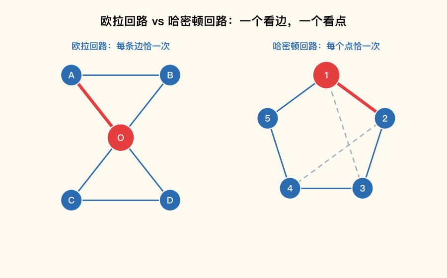

📌 锚点：**欧拉看「边」全偶度一笔画；哈密顿看「点」每点恰一次**

**考试答题**

**📌 历年真题**

**【2026.4·填空 8】** 无向图 G 是欧拉图的充分必要条件是 G 是______。
答案：**连通的，且所有顶点的度数均为偶数**

📌 欧拉图判定定理两个条件缺一不可：连通 + 全偶度

**【2023.4·填空 23】** 无向图G为欧拉图，当且仅当G是连通的，且G中无______数度顶点。
答案：**奇**

📌 「无奇数度顶点」＝所有顶点度数均为偶数，与上一题同一口径

**【2025.10·填空 5】** 边e不含在图G的任一回路中,则边e是______
答案：**割边（桥）**

📌 不在任何回路中的边一旦删除必然断开图，正是割边的定义

**【2022.10·单选 9】** 存在经过图中所有边一次且仅一次的回路的图是
- A.关系图
- B.哈斯图
- C.欧拉图 ✅
- D.哈密顿图

📌 「每条边一次且仅一次的回路」＝欧拉回路，对应欧拉图；哈密顿图看的是「每个顶点一次」

**【2025.10·证明 3】** 证明:若某次会议有30人参加,其中每人都至少有15个朋友,这30人围一圆桌入座,则一定存在能安排相邻的人都是朋友的情形入座。
> 【答案要点】→ 完整证明见下方解题方法【例 8-2】

**解题方法**：

1. 欧拉图判定三步：一看**连通**（有不连通直接出局）；二数**每个顶点的度数**（**为什么数度数**：欧拉图的充要条件就是全偶度，有一个奇度顶点即出局）；三下结论。
2. Ore 定理证明题模板（「围圆桌/排座/巡回」类应用题）：
   - 第一步**建模**：把对象设为顶点、把「可相邻/可达」关系设为边（**为什么**：把实际问题翻译成图的存在性问题）；
   - 第二步**验证条件**：写出任意两顶点 $d(u)+d(v)\ge n$（**为什么**：这是 Ore 定理的前提）；
   - 第三步**套定理下结论**：存在哈密顿回路，即存在满足要求的排列方案。
3. 哈密顿图判定没有充要条件，单选直接按定义找「经过每点恰一次的回路」逐图验证。

**【例 8-2】**（原题：2025.10 证明 3）30 人参加会议，每人至少有 15 个朋友，证明这 30 人围圆桌入座时一定存在相邻者都是朋友的安排。

证明：设顶点集 $V=\{v_1,v_2,\cdots,v_{30}\}$ 表示这 30 个人，若两人是朋友，则在对应顶点之间连一条边，得到图 G（**为什么这样建图**：「相邻者都是朋友围成一圈」恰好翻译为「图中存在经过每个顶点一次的回路」，即哈密顿回路的存在性问题）。
由已知条件，对每个顶点有 $deg(v_i)\ge 15,\ i=1,2,\cdots,30$（**为什么**：每人至少 15 个朋友即每点度数至少 15）。
于是对任意 $1\le i<j\le 30$，有 $deg(v_i)+deg(v_j)\ge 15+15=30>30-1$（**为什么**：两个度数各取下限相加仍不小于顶点数 n＝30，满足 Ore 定理条件 $d(u)+d(v)\ge n$）。
由 Ore 定理，图 G 中存在哈密顿回路（**为什么能下结论**：Ore 定理保证「任意两顶点度数之和 ≥ n」的图必有哈密顿回路）。
按这条哈密顿回路的顺序安排 30 人围坐，相邻两人恰是回路上一条边的两端点，即都是朋友。得证。

**🎯 考法**：欧拉图判定每年 1 道单选/填空（2020.8 单选 3、2021.4 单选 11、2022.4 单选 4、2022.10 单选 4/9、2023.10 单选 4、2023.4 填空 23、2026.4 填空 8）；哈密顿大题考 Ore 定理应用（2025.10 证明 3），单选考定义辨析（2020.8 单选 10、2021.4 单选 12）。

**✍️ 得分点**：
- 欧拉图判定写全两句：「连通」+「所有顶点度数为偶数」，漏一句丢一半分。
- Ore 定理证明题三步拿全分：建图（设顶点连边）→ 写度和不等式 → 引用定理下结论。
- 建模题最后必须「回译」：哈密顿回路存在 ⇒ 按回路顺序围坐即可满足要求。

**⚠️ 易混淆**：**欧拉看「边」、哈密顿看「点」**——「经过每条边恰一次」选欧拉图，「经过每个顶点恰一次」选哈密顿图，2022.10 单选 9 专考这一字之差；欧拉有充要条件（全偶度），哈密顿只有充分条件（Ore），不能反着用「不满足 Ore 就没有哈密顿回路」。

**🔑 记忆锚点**：**「欧拉一笔画，边边走一遍，全偶又连通；哈密顿环游，点点到一遍，度和不小于 n」**。

#### 8.3 补图与自补图 ★

**定义详解**：给定 n 阶简单图 G，**补图** $\overline{G}$ 与 G 顶点集相同，$\overline{G}$ 中的边恰好是 G 中**没有**的那些边，两者拼起来恰是完全图：$G\cup\overline{G}=K_n$，且 $G\cap\overline{G}=\varnothing$。**自补图**是与自己的补图同构的图（$G\cong\overline{G}$）。设 G 与 $\overline{G}$ 的边数分别为 m 与 $\overline{m}$，则 $m+\overline{m}=\binom{n}{2}=\dfrac{n(n-1)}{2}$；自补时两者边数相等 $m=\overline{m}$，于是 **$m=\dfrac{n(n-1)}{4}$**。由于 m 必须是整数而 n 与 n−1 互素，故 **n 阶自补图存在 ⟺ n≡0 或 1 (mod 4)**（即 n=4k 或 n=4k+1）。

**考试答题**

**📌 历年真题**

**【2021.4·证明 3】** 设G是$n(n\geq2)$阶无向简单图,且G为自补图,证明n = 4k或n = 4k + 1,其中k为正整数。
> 【答案要点】→ 完整证明见下方解题方法【例 8-3】

**【2023.4·单选 13】** 下列是自补图的是
- A.（图形选项，未流传）
- B.（图形选项，未流传）
- C.（图形选项，未流传）✅
- D.（图形选项，未流传）

📌 四个选项均为图形且未流传，仅站方答案可查（C）；纸面上先用「边数＝n(n−1)/4」筛：如 4 顶点自补图边数必为 3、5 顶点必为 5，边数不合的直接排除

**解题方法**：

1. 判断自补图两步：先算边数——n 阶图边数必须恰为 $\dfrac{n(n-1)}{4}$（**为什么**：自补图与补图平分完全图的边）；边数不合的直接淘汰，边数合格的再验证能否与补图同构。
2. 证明「n=4k 或 4k+1」模板（三步）：由 $G\cup\overline{G}=K_n$ 写边数关系 → 由自补得 m＝$\overline{m}$ → 用「m 是整数 + n 与 n−1 互素」下整除结论。

**【例 8-3】**（原题：2021.4 证明 3）设 G 是 n（n≥2）阶无向简单图，且 G 为自补图，证明 n=4k 或 n=4k+1（k 为正整数）。

证明：由补图的定义可知，对于 n 阶图 G 有 $G\cup\overline{G}=K_n$（**为什么**：补图补上的正是 G 缺的全部边，两者合成完全图）。
设 G 与 $\overline{G}$ 的边数分别为 m 和 $\overline{m}$，则 $m+\overline{m}=\binom{n}{2}=\dfrac{n(n-1)}{2}$（**为什么**：完全图 $K_n$ 的边数是 $\binom{n}{2}$，被两图瓜分）。
由于 G 为自补图，$G\cong\overline{G}$，二者的边数相同，即 $m=\overline{m}$（**为什么**：同构的图边数必然相等）。
故 $m=\dfrac{n(n-1)}{4}$（**为什么**：两数相等时各占总和的一半）。
由于 n 与 n−1 是连续自然数、二者互素，又 m 必须是整数（**为什么关键**：4 要整除乘积 n(n−1)，只能整除其中一个互素因子），所以 n 被 4 整除或 n−1 被 4 整除，即 n=4k 或 n=4k+1（k 为正整数）。得证。

**🎯 考法**：单选给图辨自补/互补（2020.8 单选 7、2021.4 单选 13、2023.4 单选 13），证明题考「自补图阶数 =4k 或 4k+1」（2021.4 证明 3 完整原题）。

**✍️ 得分点**：
- 证明题两个拿分式：$m+\overline{m}=\dfrac{n(n-1)}{2}$ 与 $m=\overline{m}$，一步一分。
- 结论必须落到「4 整除 n 或 n−1」的理由上：m 为整数 + n、n−1 互素。
- 单选先用边数 $\dfrac{n(n-1)}{4}$ 快筛，能省一半时间。

**⚠️ 易混淆**：**补图是「边的互补」不是「图的对称」**——补图与原图顶点集相同、边集互斥合并成 $K_n$；「自补」的前提是**同构**（边数相等只是必要条件，不是充分条件）。

**🔑 记忆锚点**：**「自补平分完全图，边数除四要留整；n 除 4 余 0 或 1」**。

#### 8.4 平面图与欧拉公式 ★★

**定义详解**：**平面图**是能画在平面上且各边除端点外互不相交的图；画定后图把平面分成的区域称**面**（外部那个无限区域叫无限面）。**欧拉公式**（连通平面图）：**n − m + r = 2**，其中 n=顶点数、m=边数、r=面数——知道任意两个量可求第三个（变形式：$r=2-n+m$、$m=n+r-2$）。配套两件武器：① **各面次数之和 = 2m**（每条边恰是两个面的边界，或作为某面边界被计两次）；② 若每个面至少由 3 条边围成，则 $3r\le 2m$，与欧拉公式联立得**推论 $m\le 3n-6$**——这是平面图证明题的万能钥匙。

**考试答题**

**📌 历年真题**

**【2020.8·填空 19】** 设7阶连通平面图G有6个面，则图G的边数为_________。
答案：**11**

📌 套 $m=n+r-2$：$7+6-2=11$

**【2023.10·填空 19】** 一个连通平面图中,有6个顶点和9条边,其平面表示中共有______个面。
答案：**5**

📌 套 $r=2-n+m$：$2-6+9=5$

**【2023.4·单选 15】** 在有6个顶点12条边的连通简单平面图中，所围成每个面的边数为
- A. 3 ✅
- B. 4
- C. 5
- D. 6

📌 先由欧拉公式求面数 r＝2−6+12＝8；各面次数和＝2m＝24，平均每面边数＝24÷8＝3；每面至少 3 条边而平均值恰为 3，故每面恰 3 条边

**【2026.4·证明 1】** 设 G 为连通简单平面图,G 的顶点数为 n,边数为 m,且 G 的每个面至少由3条边围成。证明:$m \leq 3n-6$。
> 【答案要点】→ 完整证明见下方解题方法【例 8-4】

**【2024.10·证明 3】** 证明：小于30条边的简单平面图至少有一个顶点的度数小于5。
> 【答案要点】→ 完整证明见下方解题方法【例 8-5】

**解题方法**：见下方两道完整例题。

**【例 8-4】**（原题：2026.4 证明 1）证明：连通简单平面图（每面至少 3 条边围成）满足 $m\le 3n-6$。

证明：设 G 的面数为 r，由欧拉公式知 $n-m+r=2$（**为什么**：连通平面图的顶点数、边数、面数恒满足这一关系）。
因为每个面的次数不小于 3，且各面次数之和为 2m，故 $3r\le 2m$（**为什么**：每面至少 3 条边，r 个面的总次数至少 3r，而总次数恰为 2m）。
由 $n-m+r=2$ 得 $r=2+m-n$，代入 $3r\le 2m$：$3(2+m-n)\le 2m$（**为什么消元**：目标结论不含 r，用欧拉公式把 r 换成 n、m）。
展开得 $6+3m-3n\le 2m$，整理得 $m\le 3n-6$。得证。

**【例 8-5】**（原题：2024.10 证明 3）证明：小于 30 条边的简单平面图至少有一个顶点的度数小于 5。

证明：（反证法）假设结论不成立，即该简单平面图 G 中每个顶点的度数都 ≥5（**为什么用反证**：「至少存在一个」型命题直接证难，反设「全都不小于 5」推矛盾更容易）。
所有顶点度数之和 $\ge 5n$，即 $2m\ge 5n$，也即 $n\le \dfrac{2m}{5}$（**为什么**：握手定理度和＝2m，全部度数不小于 5 就放大了度和）。
另一方面，G 是简单平面图，每个面至少由 3 条边围成，由欧拉公式推论得 $m\le 3n-6$（**为什么可用**：这正是【例 8-4】证明过的结论）。
代入 $n\le \dfrac{2m}{5}$：$m\le 3\cdot\dfrac{2m}{5}-6=\dfrac{6m}{5}-6$，整理得 $\dfrac{m}{5}\ge 6$，即 $m\ge 30$（**为什么**：把 n 的上界代入 m 的上界，得到 m 自身的下界）。
这与已知条件 m＜30 矛盾（**为什么就是矛盾**：推出 m≥30 与题设 m<30 不能同真）。
故小于 30 条边的简单平面图至少有一个顶点的度数小于 5。得证。

**🎯 考法**：填空套欧拉公式三选一（2020.8 填空 19、2021.4 填空 21、2023.10 填空 19）；证明题两年连考（2024.10 证明 3 反证、2026.4 证明 1 直接证 $m\le 3n-6$），单选考「每面平均边数 =2m/r」（2023.4 单选 15）。

**✍️ 得分点**：
- 填空直接套变形式：求面 $r=2-n+m$、求边 $m=n+r-2$，写公式再代数。
- 证 $m\le 3n-6$ 三步踩分：欧拉公式 → $3r\le 2m$ → 消 r 整理。
- 反证题必须先写「假设每个顶点度数都 ≥5」再推 $m\ge 30$ 与题设矛盾，最后一句「故原结论成立」不能省。

**⚠️ 易混淆**：**欧拉公式的适用前提是「连通」平面图**（非连通图公式不成立）；$m\le 3n-6$ 只对**简单**平面图成立（有重边/环时不适用）；「各面次数之和＝2m」中每条边计两次，不是一次。

**🔑 记忆锚点**：**「点减边加面等于二，三倍面不超二倍边；推论 3n 减 6 封顶」**——n−m+r=2、3r≤2m、m≤3n−6。

#### 8.5 邻接矩阵与连通性 ★

**定义详解**：**连通性**决定边数的上下界：**n 阶连通图至少有 n−1 条边**（少了必有顶点孤立，恰取 n−1 条时图是一棵树）；由握手定理，n 阶连通图的**顶点度数之和至少为 2(n−1)**。从完全图 $K_n$ 中**删边**得生成树：需删 $\binom{n}{2}-(n-1)$ 条；反向从 n 阶树**补边**成 $K_n$ 也需同样条数。**邻接矩阵**视角的同一件事：n 阶树有 n−1 条边，每条边使邻接矩阵产生 2 个非零元素（矩阵对称），故其非零元素个数恰为 $2(n-1)$。

**考试答题**

**📌 历年真题**

**【2024.4·单选 14】** 一个5阶简单图G,保证G为连通图的最少边数为
- A. 4 ✅
- B. 5
- C. 6
- D. 7

📌 n 阶连通图至少 n−1 条边（此时恰为一棵树），5−1＝4

**【2026.4·填空 9】** 设 G 是 n 阶连通图,则 G 的顶点度数之和至少是______。
答案：**2(n−1)**

📌 连通图边数下界 n−1，握手定理度和＝2m＝2(n−1)

**【2026.4·单选 15】** 完全图 $K_6$ 通过删边得到一棵6阶树,需要删去的边数为
- A. 6
- B. 10 ✅
- C. 11
- D. 12

📌 $K_6$ 边数 $\dfrac{6\times5}{2}=15$，6 阶树边数 5，删边 15−5＝10

**【2022.10·填空 24】** 一棵n阶树的邻接矩阵的非零元素个数是______。
答案：**2(n−1)**

📌 n 阶树 n−1 条边，每条边在对称矩阵中产生 2 个非零元

**🎯 考法**：单选/填空各 1 题——连通边数下界（2022.10 填空 21、2024.4 单选 14）、度和下界（2026.4 填空 9）、完全图与树互化的删补边数（2022.4 单选 12、2022.10 单选 12、2023.10 单选 12、2026.4 单选 15）。

**✍️ 得分点**：
- 连通下界答「n−1 条边」并点明此时恰为树；度和下界答 2(n−1)。
- 删/补边数＝$\binom{n}{2}-(n-1)$，先写 $K_n$ 边数再减树边数，两步走。

**⚠️ 易混淆**：**「至少 n−1 条边」是保证连通的下界，不是任意连通图都恰好 n−1 条**——超过 n−1 条时图中有回路（含环）；「5 阶连通最少 4 条」答 5 就中了干扰项。

**🔑 记忆锚点**：**「连通至少先树形，n 减一条边；度和翻倍 2(n−1)」**。

#### 9.1 无向树与生成树 ★★★

**定义详解**：**树**是**连通且无回路**的无向图，三条等价刻画任一成立即可：① 连通且无回路；② 连通且有 n−1 条边；③ 无回路且有 n−1 条边。基本性质必背：**n 阶树恰有 n−1 条边**；**含 n（n≥2）个结点的树至少有 2 片树叶**（若至多 1 片叶，其余结点度数均 ≥2，度和将超过 2(n−1)，违反握手定理）；**树中每条边都是割边**（删去任一边树即不连通，因为树中任何一边都不在回路上）。**生成树**：连通图的包含全部 n 个顶点的无回路生成子图，恰有 n−1 条边；从边数为 m 的连通图 G 中删去 **m−n+1** 条边即得生成树（这些被删的边叫弦）。求叶子数用方程法：设树叶 x 片，由「度数和＝2(n−1)」列方程。

**考试答题**

**📌 历年真题**

**【2025.4·单选 15】** 设 T 是一颗含 6 个结点的树,则叶子结点数不可能是
- A. 1 ✅
- B. 2
- C. 3
- D. 5

📌 含 n（n≥2）个结点的树至少有 2 片叶子，叶子数为 1 不可能

**【2024.4·单选 9】** 下面关于n阶树的描述，错误的是
- A. 连通图 ✅
- B. 连通且有n-1条边
- C. 无回路且有n-1条边
- D. 连通且无回路

📌 B、C、D 都是树的准确刻画；「只连通」不充分——连通图未必是树（可以有回路）

**【2022.10·单选 8】** 下列度数序列不能构成无向树的是
- A. {1,1,1,2,3}
- B. {1,1,2,2,2}
- C. {1,1,1,1,4}
- D. {1,2,3,3,3} ✅

📌 5 个结点的树度和应＝2×(5−1)=8；D 的和 1+2+3+3+3=12≠8，违反树的基本性质

**【2023.4·单选 14】** 设一棵树的结点个数为2020，则此树中的割边数为
- A. 2018
- B. 2019 ✅
- C. 2020
- D. 2021

📌 n 阶树恰有 n−1 条边，且树中每条边都是割边，2020−1＝2019

**【2021.4·填空 20】** 设无向树有8片树叶,1个度为4的分支点,其余的分支点的度为3,则树的结点数为______
答案：**13**

📌 设 3 度分支点 x 个：度和 4×1+3x+8×1＝2(x+9−1)，解得 x＝4，结点数 8+1+4＝13

**解题方法**：

1. 「度数序列能否构成树」两步：先查度和是否为偶数，再查**是否恰等于 2(n−1)**（**为什么多这一步**：树比一般图多一条硬约束——边数恰为 n−1，度和必须恰好对上）。
2. 叶结点数方程模板：设树叶 x 片、总结点 n＝x+其余各度结点数之和 → 列「度和＝2(n−1)」→ 解 x。
3. 判定树的描述题：树＝「连通」+「无回路」+「n−1 条边」三要素，单说其一都不完整。

**🎯 考法**：单选考树的性质辨析（2024.4 单选 9 描述对错、2025.4 单选 15 叶子至少 2、2022.10 单选 8 度数序列判树、2023.4 单选 14 割边数）与生成树删补边（见 8.5）；填空考叶结点数方程（2020.8 填空 24、2021.4 填空 20）与非同构树棵数（2023.4/2023.10 填空 5 阶 3 棵、2020.8 单选 14 六阶 6 棵）。

**✍️ 得分点**：
- 树的三条等价刻画写全：「连通且无回路」「连通且 n−1 条边」「无回路且 n−1 条边」。
- 「n≥2 的树至少 2 片叶子」是判「叶子不可能为 1」的唯一依据。
- 叶子数方程必须写出度和方程再解，答案直接写出会丢过程分。

**⚠️ 易混淆**：**「连通图」不等于「树」**——树＝连通＋无回路，缺「无回路」就不是树（2024.4 单选 9 选 A 正考这个）；树中**每条**边都是割边，但割边多的图未必是树。

**🔑 记忆锚点**：**「树是连通不绕圈，边数恰好 n 减一；叶子起码有两片，条条边上皆割边」**。

#### 9.2 Kruskal 最小生成树 ★★★

**定义详解**：带权连通图的**最小生成树**是各边权值之和最小的生成树。**Kruskal（克鲁斯卡尔）算法**是求最小生成树的贪心算法，几乎每年一道 6 分大题。三步口诀：**按权从小到大→成圈就弃→选满 n−1 条**。判定「成圈」的诀窍：看新边两个端点是否已通过先前选的边连通——已连通则加入必成圈，弃之；未连通则可选。选满 n−1 条边后，被选边权值之和即最小生成树的权 W。

> **🖼 动图演示：动图演示：Kruskal 最小生成树逐步构造**

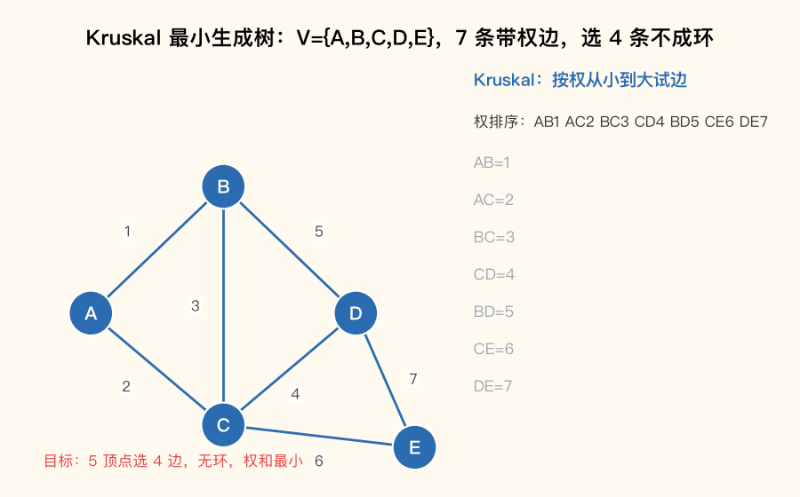

📌 锚点：**按权从小到大，成圈就弃，选满 n−1 条边**

**考试答题**

**📌 解题方法**：

1. 第一步：把所有边按权值**从小到大**排序（**为什么**：贪心策略——每次都先考虑最便宜的边，保证总权最小）。
2. 第二步：依次考查每条边，**不构成回路就选入，构成回路就舍弃**（**为什么**：生成树不能有回路；两端点已连通时加边必成圈）。
3. 第三步：选满 **n−1 条**边即停（**为什么**：n 个顶点的生成树恰有 n−1 条边，选够即成树），求权 W＝被选边权之和。
4. 答题格式：分步写「选权为 w 的边 xy」，成圈的边要**写明「会产生圈，舍弃」**（这是踩分点），最后给出生成树与 W。

**【例 9-1】** 带权图 V={A,B,C,D,E}，边与权：AB=1、AC=2、BC=3、CD=4、BD=5、CE=6、DE=7，用 Kruskal 算法求最小生成树并求权。

解：n=5，需选 n−1=4 条边（**为什么是 4 条**：5 个顶点的生成树恰有 4 条边）。
(1) 选权为 1 的边 AB（**为什么敢选**：权最小的边，加入后无圈）；
(2) 选权为 2 的边 AC（**为什么**：A、C 尚未连通，不成圈）；
(3) 权为 3 的边 BC **不能选，会产生圈**（**为什么成圈**：B—A—C 已连通，再加 BC 成圈 B-A-C-B）；
(4) 选权为 4 的边 CD（**为什么**：D 尚未连通，不成圈）；
(5) 权为 5 的边 BD **不能选，会产生圈**（**为什么成圈**：B 与 D 已通过 B-A-C-D 连通）；
(6) 选权为 6 的边 CE（**为什么**：E 尚未连通，且这是第 4 条边）。
已选满 4 条边，算法停止。最小生成树的边集 {AB, AC, CD, CE}，权 W＝1+2+4+6=**13**（**为什么这样求权**：最小生成树的权等于被选各边权值之和）。

**📌 历年真题**

**【2026.4·简答 6】** 依据带权图题31图,使用Kruskal(克鲁斯卡尔)算法画出对应的最小生成树,请写出详细选边过程,并求最小生成树的权。
> 【答案要点】选边过程：(1) 选权为 1 的边 ab、de；(2) 选权为 2 的边 ef；(3) 选权为 3 的边 af；(4) 选权为 4 的边 cf（若选 bf 会产生圈，故弃）。所求最小生成树的权为 1+1+2+3+4=**11**。6 个顶点选 5 条边成树。

📌 答案自行验算通过：5 条边恰为 6−1 条，且每步选边均不与已选边成圈

**【2025.10·简答 6】** 依据带权图题31图,使用Kruskal(克鲁斯卡尔)算法列出详细选边过程,画出对应的最小生成树,并求最小生成树的权。
> 【答案要点】选边过程：(1) 选权为 1 的边 ab；(2) 选权为 2 的边 bc；(3) 权为 3 的边不能选，会产生圈；(4) 选权为 4 的边 ae；(5) 权为 5 的边不能选，会产生圈；(6) 选权为 6 的边 cd；(7) 权为 7 的边不能选，会产生圈。所求最小生成树的权为 1+2+4+6=**13**。【待核实：本题带权图未流传，选边过程照录站方答案】

📌 答案自洽：5 个顶点选 4 条边（1、2、4、6），权 13；带权原图缺失，具体边名无法复核

**🎯 考法**：**每年一道**简答大题（2021.4 简答 6 分、2023.4 简答、2024.10 简答、2025.4 简答、2025.10 简答、2026.4 简答，另有 2023.10 综合应用「架设供电线路」变体）；考法固定：写选边过程 + 画生成树 + 求权。

**✍️ 得分点**：
- 选边过程逐步列写，**成圈的边必须写明「不能选，会产生圈」**——站方评分把它单列为一个给分点。
- 最后三件套齐全：选边过程 + 生成树图 + 权 W＝各选边权之和。
- 先写「n 个顶点需选 n−1 条边」再动手，防多选漏选。

**⚠️ 易混淆**：**贪心不等于随便拿最便宜**——最便宜的边若已成圈必须弃（例 9-1 中权 3、权 5 的边都弃了），「弃边」恰恰是 Kruskal 的灵魂；权相同的几条边可以任选其一（只要不成圈），答案可能不唯一但权值唯一。

**🔑 记忆锚点**：**「权小优先，成圈就弃，凑满 n−1」**。

#### 9.3 根树与二叉树遍历 ★★★

**定义详解**：**根树**是指定了一个根结点的树；**二叉树**是每个结点至多有两棵子树的根树，子树分**左子树**与**右子树**（次序不可换）。三种遍历的口诀（左子树恒在右子树之前）：**先序（先根）＝根左右；中序（中根）＝左根右；后序（后根）＝左右根**——名字里的「先/中/后」指**根被访问的位置**。用二叉树表示算术表达式时，**运算符放分支结点、操作数（数字/变量）放叶子**，先序序列即前缀式、后序序列即后缀式（逆波兰式）。中序序列信息量最大：**中序+任一其他序列可唯一还原二叉树**。

> **🖼 动图演示：动图演示：二叉树三种遍历**

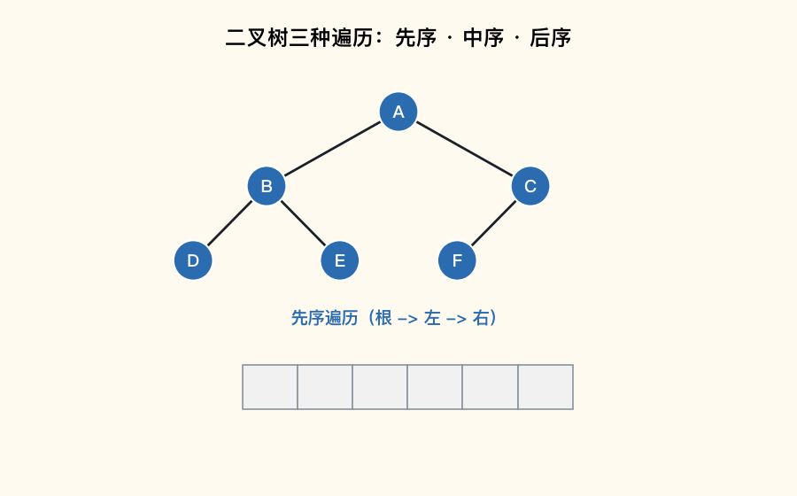

📌 锚点：**先序根左右、中序左根右、后序左右根——「根」的位置定名字**

**考试答题**

**📌 解题方法**：

1. 三种遍历的递归执行法：对每个子树整体套用口诀——先序：先写根，再递归左子树，最后递归右子树；中序、后序同理挪动「根」的位置（**为什么递归**：口诀对任意子树同样成立，大问题拆小问题）。
2. 表达式画树法：按运算优先级（括号最高，×÷ 先于 +−）找**最后运算的符号作根**，其两侧表达式递归作左右子树（**为什么**：最后算的运算符统领整个表达式，自然居于树根）。
3. **由中序+后序反推树**四步：
   - 后序**最后一个**字符是整棵树的根（**为什么**：后序根最后出现）；
   - 回中序中找到根，其**左侧全部是左子树、右侧全部是右子树**（**为什么**：中序根在中间，天然隔开左右）；
   - 按左、右子树的字符个数回到后序中切出两段，各自末位又是两个子树的根（**为什么**：后序每段最后一个仍是该子树的根）；
   - 对每段重复上述过程直到只剩一个字符（叶子）。
4. 表达式题最后复核：中序序列加括号应还原原表达式。

**【例 9-2】** 二叉树：根 A，左子树 B、右子树 C；B 的左孩子 D、右孩子 E；C 的左孩子 F。写出三种遍历序列，并由中序+后序反推验证。

解：先序（根左右）：先写根 A；左子树 B：根 B、左 D、右 E 得 B D E；右子树 C：根 C、左 F 得 C F。合起来 **ABDECF**（**为什么 B 段在 C 段前**：左子树恒先于右子树）。
中序（左根右）：左子树 B 的中序 D B E；写根 A；右子树 C 的中序 F C。合起来 **DBEAFC**（**为什么 D 在 B 前**：D 是 B 的左孩子，左先根后）。
后序（左右根）：左子树 B 的后序 D E B；右子树 C 的后序 F C；最后根 A。合起来 **DEBFCA**（**为什么 A 最后**：后序根最后访问）。
反推验证：后序末位 A 为根（**为什么**：后序根最后）；A 在中序 DBEAFC 中把序列分成左「DBE」右「FC」；左段 3 个字符对应后序前 3 位「DEB」，其末位 B 为左子树根，B 在中序「DBE」中分出左「D」右「E」，与原树一致；右段「FC」末位 C 为右子树根，C 在中序「FC」中分出左「F」右空，与原树一致。还原树与原树相同，三个序列验算通过。

**📌 历年真题**

**【2026.4·简答 7】** 用二叉树表示算术表达式 $z \div (x-u)-y*v$,并给出该树的中序和后序遍历序列。
> 【答案要点】树：根为 −，左子树 ÷(z, −(x,u))，右子树 *(y,v)。中序遍历序列为 $z \div x - u - y * v$；后序遍历序列为 $z\ x\ u - \div\ y\ v\ *\ -$。

📌 答案自行验算通过：后序按「左(÷ 子树：z、x u −、÷)→右(y v *)→根(−)」读出；中序按左根右逐层展开即原式

**【2025.4·简答 7】** 用二叉树表示算术表达式 (x + y)*z + u÷v,并给出该树的先序和后序遍历序列。
> 【答案要点】树：根为 +，左子树 *(+(x,y), z)，右子树 ÷(u,v)。先序遍历序列为 $+\ *\ +\ x\ y\ z\ \div\ u\ v$；后序遍历序列为 $x\ y\ +\ z\ *\ u\ v\ \div\ +$。

📌 答案自行验算通过：先序根 + 在首、后序根 + 在尾，两序列与树一致

**【2024.10·简答 7】** 分别使用先根法、中根法、后根法遍历题32图二叉树。
> 【答案要点】先根法 a,b,d,e,f,g,c；中根法 d,b,f,e,g,a,c；后根法 d,f,g,e,b,c,a。【待核实：树图未流传，答案照录站方；已用「先序定根、中序分左右」自行反推验证，三序列相互自洽】

📌 反推验证通过：中序根 a 分出左 {d,b,f,e,g} 右 {c}，与先序、后序逐层吻合

**【2025.10·简答 7】** 分别使用先根法、中根法、后根法遍历题32图的二叉树。
> 【答案要点】先根法 abcdfge；中根法 bafdgce；后根法 bfgdeca。【待核实：树图未流传，答案照录站方；已自行反推验证，三序列相互自洽】

📌 反推验证通过：先序首 a＝后序尾 a，中序 a 左「b」右「fdgce」逐层吻合

**🎯 考法**：**每年一道**简答大题（2020.8、2021.4、2023.4、2024.10、2025.4、2025.10、2026.4 全部考到）——表达式树求遍历（2025.4、2026.4）或给树求三种遍历（2024.10、2025.10）；另有填空考完全二叉树叶/支个数关系（2022.10 填空 22：叶 7 则分支 6）与正则 m 叉树叶数（2023.4 填空 25）。

**✍️ 得分点**：
- 三种遍历一个都不能错；表达式题**画树单独给分**，先画对树再写序列。
- 表达式画树先找「最后运算的符号」作根，优先级低的（+−）在上面、高的（×÷）在下面。
- 序列自查两招：先序首位＝根、后序末位＝根；中序按根切开左右段数应吻合。

**⚠️ 易混淆**：**「先/中/后」说的是根的位置，不是左右**——左子树永远在右子树前面；表达式树的中序序列与原式顺序一致但**不带括号**（如 $z \div x - u - y * v$），不要自己加括号改变含义。

**🔑 记忆锚点**：**「根的位置定名字：先根左右、中左根右、后左右根；后序末位是树根，中序切出左右家」**。

---

## 三、历年真题汇编

### 3.1 2026 年 4 月考期（全卷 35 题，站方解析完整）

**来源**：[阿姣学习笔记·2026年04月真题](https://ajiao.xuexiqu.cn/zikao/discrete_mathematics/离散数学2026年04月自考真题/)（站方标注「全国2026年4月自考离散数学(02324)试题及答案」）

**题型结构**：单项选择题 15 题（站方大题标题「每小题 1 分，共 15 分」，与百度文库源「每题 2 分」冲突，【分值待核实】）；填空题 10 题×2 分=20 分；简答题 7 题；证明题 3 题。

#### 单项选择题（第 1~15 题）

**【2026.4·单选 1】** 设 P: 0.4 是有理数，Q: 0.4 可写成分数。命题"0.4 是有理数当且仅当 0.4 可写成分数"可符号化为

- A. $P \to Q$
- B. $P \leftrightarrow Q$ ✅
- C. $Q \to P$
- D. $P \land Q$

📌 "当且仅当"在命题逻辑中符号化为等价联结词 $\leftrightarrow$

**【2026.4·单选 2】** 下列命题公式是重言式的是

- A. $P \land \neg P$
- B. $(P \lor Q) \to Q$
- C. $(P \land Q) \to Q$ ✅
- D. $P \land \neg Q$

📌 化简 $\neg(P \land Q) \lor Q \Leftrightarrow \neg P \lor \neg Q \lor Q \equiv 1$ 恒真；A 是矛盾式，B、D 可满足

**【2026.4·单选 3】** 设命题公式A为矛盾式且含有4个命题变元，则A的主合取范式含大项的个数为

- A. 2
- B. 4
- C. 8
- D. 16 ✅

📌 n 个变元的矛盾式取假于全部赋值，主合取范式包含全部 $2^n$ 个大项，$2^4=16$

**【2026.4·单选 4】** 设论域为正整数集，真值为假的命题是

- A. $\forall x \forall y(y>x^2)$ ✅
- B. $\forall x \exists y(y=x^2)$
- C. $\exists x \exists y(x^2+y^2=13)$
- D. $\exists x \forall y(x^2 \leq y)$

📌 x=1 时取 y=1 即违反 $y>1$，A 假；其余均真（如 C 取 2²+3²=13）

**【2026.4·单选 5】** 设 $R(x): x$ 是有理数，$L(x,y): x$ 大于 $y$。命题"没有最小的有理数"可符号化为

- A. $\forall x(R(x) \to (\exists y)(R(y) \land L(x,y)))$ ✅
- B. $\exists x(R(x) \to (\forall y)(R(y) \land L(x,y)))$
- C. $\forall x(R(x) \land (\exists y)(R(y) \land L(x,y)))$
- D. $\exists x(R(x) \to (\exists y)(R(y) \to L(x,y)))$

📌 即"对任意有理数 x，都存在比 x 更小的有理数 y"（注意 L(x,y)=x 大于 y，y 比它小写作 $L(x,y)$……此处按站方解析：y 与 x 同为有理数且构成大小关系）

**【2026.4·单选 6】** 设 $X=\{a,b,c\}$，$R=\{ ⟨a,a⟩, ⟨c,c⟩, ⟨b,b⟩, ⟨b,c⟩\}$，则关系 R 在 X 上不是

- A. 自反的
- B. 反对称的
- C. 传递的
- D. 对称的 ✅

📌 R 有 ⟨b,c⟩ 但无 ⟨c,b⟩，不满足对称性；对角线全在=自反、无异序对=反对称、传递验算成立

**【2026.4·单选 7】** 设 $A=\{1,2,3\}$，$B=\{a,b\}$，$f=\{ ⟨1,a⟩, ⟨2,a⟩, ⟨3,b⟩\}$，则下列选项正确的是

- A. f 是满射函数 ✅
- B. f 的逆是 B 到 A 的函数
- C. f 是单射函数
- D. f 不是 A 到 B 的函数

📌 B 中每个元素都有原像，f 是满射；1、2 撞车非单射，故无逆函数

**【2026.4·单选 8】** 设 $X=\{1,2,3\}$，$Y=\{1,2,4\}$，则 X 到 Y 的单射函数的个数为

- A. 2
- B. 4
- C. 6 ✅
- D. 27

📌 3 个元素到 3 个元素的单射个数为全排列 $3!=6$

**【2026.4·单选 9】** 若 R 是定义在集合 A 上的一个偏序关系，则 R 不满足

- A. 对称性 ✅
- B. 传递性
- C. 自反性
- D. 反对称性

📌 偏序关系满足自反、反对称、传递，不满足对称

**【2026.4·单选 10】** 设集合 A,B,C 满足 $|A|=2$, $|B|=3$, $|C|=5$，则 $A \times B \times C$ 的元素个数是

- A. 10
- B. 11
- C. 30 ✅
- D. 60

📌 笛卡尔积元素个数为各集合元素个数相乘，$2 \times 3 \times 5=30$

**【2026.4·单选 11】** 在自然数集 N 上，下列运算中满足结合律的是

- A. $x*y=2x$
- B. $x*y=y$ ✅
- C. $x*y=|x-y|+1$
- D. $x*y=2x+y$

📌 $(x*y)*z=y*z=z$，$x*(y*z)=x*z=z$，相等；其余代入反例即破

**【2026.4·单选 12】** 已知 $\langle G, \circ \rangle$ 是10阶循环群，a 是群 G 的生成元，则元素 $a^4$ 的阶是

- A. 2
- B. 4
- C. 5 ✅
- D. 10

📌 循环群中元素 $a^k$ 的阶为 $\frac{n}{\gcd(n,k)}$，$n=10$，$\gcd(10,4)=2$，$\frac{10}{2}=5$

**【2026.4·单选 13】** 设 A 是由所有被6整除的整数构成的集合，则 A 在普通整数加法和普通整数乘法运算下构成的代数系统是

- A. 偏序集
- B. 域
- C. 整环
- D. 环 ✅

📌 6 的倍数集合对加法、乘法封闭，满足环的定义；因无乘法幺元（1∉A）非整环、非域

**【2026.4·单选 14】** 下列度数序列中，能构成简单连通无向图的是

- A. $\{1,1,2,2,3\}$
- B. $\{1,1,2,2,4\}$ ✅
- C. $\{1,1,3,4,5\}$
- D. $\{0,1,2,3,4\}$

📌 A 度和 9 为奇；C 最大度 5>5−1；D 含 0 度顶点必不连通；B 度和 10 偶且可构造连通简单图

**【2026.4·单选 15】** 完全图 $K_6$ 通过删边得到一棵6阶树，需要删去的边数为

- A. 6
- B. 10 ✅
- C. 11
- D. 12

📌 $K_6$ 边数 $\frac{6 \times 5}{2}=15$，6 阶树边数为 5，删边数 $15-5=10$

#### 填空题（第 1~10 题，每题 2 分）

**【2026.4·填空 1】** 命题公式 $(P \land (P \to Q)) \to \neg Q$ 是______式。

答案：**非重言的可满足式**

📌 P=1,Q=1 时为 0，P=0 时为 1，可真可假（已验算）

**【2026.4·填空 2】** 任意两个不同大项的析取式为______式。

答案：**重言**

📌 不同大项至少有一个变元取值相反，析取后永真

**【2026.4·填空 3】** 设 $N(x)$ 表示"x 是自然数"，$Q(x)$ 表示"x 是有理数"，命题"所有自然数都是有理数"使用量词可符号化为______。

答案：**$\forall x(N(x) \to Q(x))$**

📌 全称量词后用蕴含联结词表示"所有…都是…"

**【2026.4·填空 4】** 已知 $S=\{n \mid 1 \leq n \leq 100, n \in Z\}$，$A=\{n \mid n-1$ 为5的倍数，$n \in S\}$，则 $|A|=$______。

答案：**20**

📌 n−1=5k，n 取 1、6、…、96，共 20 个

**【2026.4·填空 5】** 设集合 $A=\{1,2,3,4\}$，$B=\{a,b,c\}$，$C=\{x,y\}$，从 A 到 B 的关系 $R_1$ 与从 B 到 C 的关系 $R_2$ 分别定义为 $R_1=\{ ⟨1,a⟩, ⟨2,a⟩, ⟨3,c⟩, ⟨4,b⟩\}$，$R_2=\{ ⟨a,x⟩, ⟨a,y⟩, ⟨b,y⟩\}$，则 $R_1 \circ R_2=$______。

答案：**$\{\langle 1,x\rangle, \langle 1,y\rangle, \langle 2,x\rangle, \langle 2,y\rangle, \langle 4,y\rangle\}$**

📌 复合关系取中间元素匹配的有序对：1、2 经 a 到 x,y；3 经 c 无衔接；4 经 b 到 y（已验算补全）

**【2026.4·填空 6】** 设 $A=\{0,1\}$，则 $A^2=$______。

答案：**$\{\langle 0,0\rangle, \langle 0,1\rangle, \langle 1,0\rangle, \langle 1,1\rangle\}$**

📌 $A^2 = A \times A$，$2^2=4$ 个序偶

**【2026.4·填空 7】** 已知 $\langle G, \circ \rangle$ 是群，且 $a,b \in G$，$a \circ x=b$，则 $x=$______。

答案：**$a^{-1} \circ b$**

📌 群中每个元素有逆元，方程左乘 $a^{-1}$ 即解

**【2026.4·填空 8】** 无向图 G 是欧拉图的充分必要条件是 G 是______。

答案：**连通的，且所有顶点度数为偶数**

📌 欧拉图判定定理

**【2026.4·填空 9】** 设 G 是 n 阶连通图，则 G 的顶点度数之和至少是______。

答案：**$2(n-1)$**

📌 n 阶连通图最少边数为 $n-1$（树），度数和 $=2 \times (n-1)$

**【2026.4·填空 10】** $K_{3,3}$ 的边数是______。

答案：**9**

📌 二部图 $K_{m,n}$ 边数为 $m \times n$，$3 \times 3=9$

#### 简答题（第 1~7 题）

**【2026.4·简答 1】** 求命题公式 $(P \to Q) \to (Q \to R)$ 的主合取范式。

解：

$(P \to Q) \to (Q \to R)$
$\Leftrightarrow (\neg P \lor Q) \to (\neg Q \lor R)$（1分）
$\Leftrightarrow \neg (\neg P \lor Q) \lor (\neg Q \lor R)$（1分）
$\Leftrightarrow (P \land \neg Q) \lor (\neg Q \lor R)$（1分）
$\Leftrightarrow (P \lor \neg Q \lor R) \land (\neg Q \lor R)$（1分）
$\Leftrightarrow (P \lor \neg Q \lor R) \land (\neg P \lor \neg Q \lor R)$（1分）

综上所述：所求的主合取范式是 $(P \lor \neg Q \lor R) \land (\neg P \lor \neg Q \lor R)$。（1分）（注：其他方法酌情给分。用真值表法计算亦可）

📌 吸收后补缺变元：$\neg Q \lor R$ 对 P 补 $\land(P \lor \neg P)$ 拆成两个大项（已验算编码 $M_2 \land M_6$）

**【2026.4·简答 2】** 用真值表法判定命题公式 $(P \land Q) \lor (P \to \neg R)$ 的类型。

解：列真值表（P,Q,R 共 8 行），最后一列既有 1 又有 0，知该命题公式为**非重言式的可满足式**。（注：真值表对两行给 1 分，全对给 4 分，结论 1 分。中间列可省略）

📌 已验算：P=1,Q=0,R=1 时为 0；P=0 时恒为 1——可满足非重言

**【2026.4·简答 3】** 画出集合 $A=\{n \mid n$ 是20的正因数$\}$ 上整除关系的哈斯图，并求出 $B=\{2,4,10\}$ 的极大元与极小元。

解：$A=\{1,2,4,5,10,20\}$，盖住关系：$1 \prec 2,\ 1 \prec 5;\ 2 \prec 4,\ 2 \prec 10;\ 5 \prec 10;\ 10 \prec 20$（哈斯图三层：底 1；中层 2、5；上层 4、10；顶 20）。

B 的极大元是 **4 和 10**；极小元是 **2**。

📌 4 与 10 互不整除同为极大；2 整除 B 内全体为极小（已验算，与站方一致）

**【2026.4·简答 4】** 已知集合 $A=\{x,y,z\}$ 上的二元关系 $R_1$ 和 $R_2$ 的关系矩阵分别如下：$M_{R_1}=\begin{pmatrix}1 & 0 & 0 \\ 1 & 0 & 1 \\ 0 & 1 & 1\end{pmatrix}, M_{R_2}=\begin{pmatrix}0 & 1 & 0 \\ 1 & 0 & 0 \\ 1 & 0 & 1\end{pmatrix}$。求关系 $R_1 \cup R_2$ 的集合表达式以及自反闭包 $r(R_1 \cup R_2)$ 的关系矩阵。

解：

$M_{R_1 \cup R_2} = M_{R_1} \lor M_{R_2} = \begin{pmatrix} 1 & 1 & 0 \\ 1 & 0 & 1 \\ 1 & 1 & 1 \end{pmatrix}$（2分）

$R_1 \cup R_2 = \{ ⟨x,x⟩, ⟨x,y⟩, ⟨y,x⟩, ⟨y,z⟩, ⟨z,x⟩, ⟨z,y⟩, ⟨z,z⟩\}$（2分）

$M_{r(R_1 \cup R_2)} = \begin{pmatrix} 1 & 1 & 0 \\ 1 & 0 & 1 \\ 1 & 1 & 1 \end{pmatrix} \lor \begin{pmatrix} 1 & 0 & 0 \\ 0 & 1 & 0 \\ 0 & 0 & 1 \end{pmatrix} = \begin{pmatrix} 1 & 1 & 0 \\ 1 & 1 & 1 \\ 1 & 1 & 1 \end{pmatrix}$（1分）

📌 并关系=矩阵逐元析取；自反闭包再并单位阵（主对角线已全 1，结果不变）

**【2026.4·简答 5】** 设集合 $S=\{n \mid 0 < n < 11, n$ 为整数$\}$，$A=\{x \mid x+2$ 是质数，$x \in S\}$，$B=\{x \mid 2x-1$ 是质数，$x \in S\}$，求 A、B 和 $A \oplus B$。

解：

$A=\{1,3,5,9\}$（2分）
$B=\{2,3,4,6,7,9,10\}$（2分）
$A \oplus B=\{1,2,4,5,6,7,10\}$（1分）

📌 对称差 $=(A-B) \cup (B-A)$，公共元素 3、9 去掉（已验算）

**【2026.4·简答 6】** 依据带权图题31图，使用 Kruskal（克鲁斯卡尔）算法画出对应的最小生成树，请写出详细选边过程，并求最小生成树的权。

解：选边过程为：(1) 选权为 1 的边 ab、de；(2) 选权为 2 的边 ef；(3) 选权为 3 的边 af；(4) 选权为 4 的边 cf，若选 bf 会产生圈。（1分）

所求最小生成树的权为 $1+1+2+3+4=11$。（1分）

【带权图原图未随文字版流传，选边过程照录站方解析】【待核实】

📌 6 顶点树 5 条边；同权边依次选、成圈就跳过

**【2026.4·简答 7】** 用二叉树表示算术表达式 $z \div (x-u)-y*v$，并给出该树的中序和后序遍历序列。

解：表达式树：根为 −，左子树 ÷（左叶 z，右子树 −（x,u）），右子树 ×（y,v）。

中序遍历序列：$z \div (x-u) - y*v$（按树形中序读出，原文记为 $z \div x - u - y * v$）（1分）
后序遍历序列：$z\ x\ u - \div\ y\ v\ *\ -$（1分）

📌 最后运算符为根；中序=左根右、后序=左右根（已验算与站方一致）

#### 证明题（第 1~3 题）

**【2026.4·证明 1】** 设 G 为连通简单平面图，G 的顶点数为 n，边数为 m，且 G 的每个面至少由3条边围成。证明：$m \leq 3n-6$。

证明：设 G 的面数为 r，由欧拉公式知 $n-m+r=2$。（2分）

因为每个面的次数不小于 3，各面次数之和为 2m，故 $3r \le 2m$。（2分）

综上所述：$2m \ge 3(2+m-n)$，即 $m \le 3n-6$。（1分）

📌 欧拉公式 + 面次数下界，两式联立消 r

**【2026.4·证明 2】** 设 f 是从集合 A 到集合 B 的一个函数，定义 A 上的关系 R：$⟨a,b⟩ \in R$ 当且仅当 $f(a)=f(b)$。证明：R 是 A 上的一个等价关系。

证明：对 $\forall a \in A$，$f(a)=f(a)$，故 $\langle a,a\rangle \in R$，即 R 满足自反性。（1分）

若 $\langle a,b\rangle \in R$，则 $f(a)=f(b)$，即 $f(b)=f(a)$，所以 $\langle b,a\rangle \in R$，R 满足对称性。（2分）

若 $\langle a,b\rangle \in R$，$\langle b,c\rangle \in R$，则 $f(a)=f(b)$，$f(b)=f(c)$，即 $f(a)=f(c)$，所以 $\langle a,c\rangle \in R$，R 满足传递性。

综上所述：R 是 A 上的一个等价关系。（2分）

📌 函数值相等天然满足三性质：等值传递、等值对称、自身等值

**【2026.4·证明 3】** 用 CP 规则证明有效推理。前提：$P \to \neg Q$，$P \land R$，$Q \lor S$；结论：$R \to S$。

证明：
（1）R　　　　　　　CP 规则
（2）$P \land R$　　　　P 规则（2分）
（3）P　　　　　　　$T(2)I_1$（1分）
（4）$P \to \neg Q$　　　P 规则
（5）$\neg Q$　　　　　$T(3)(4)I_{11}$（1分）
（6）$Q \lor S$　　　　P 规则
（7）S　　　　　　　$T(5)(6)I_{10}$（1分）

由 CP 规则得结论 $R \to S$。（注：规则名称可不写）

📌 附加前提 R 入场→化 conj 取 P→假言推理得 ¬Q→析取三段论得 S

> 本卷 35 题全收录；答案来源：站方解析（已逐题验算，全部一致）

> **来源与合规说明**：题目来自公开网页（ajiao.xuexiqu.cn 转载的历年试卷 + 考生网 zikaosw.cn），未登录、未绕过任何付费墙。试题版权归命题单位所有，此处仅作备考学习用途。
> **答案标注约定**：答案与解析来自站方公开解析，本文档逐题独立验算后引用；验算不一致处已修正并标注「⚠️ 站方答案勘误」；单选每题分值两源冲突（站方标 1 分、百度文库源标 2 分），统一标注【分值待核实】。

### 3.2 2025 年 10 月考期（全卷 35 题，站方解析完整）

**来源**：[阿姣学习笔记·2025年10月真题](https://ajiao.xuexiqu.cn/zikao/discrete_mathematics/离散数学2025年10月自考真题/)（站方标注「2025年10月-02324离散数学自考真题及答案」）

**题型结构**：单项选择题 15 题【分值待核实】；填空题 10 题×2 分=20 分；简答题 7 题；证明题 3 题。

#### 单项选择题（第 1~15 题）

**【2025.10·单选 1】** 设 P:张三是篮球运动员，Q:李四是篮球运动员。命题"张三和李四都是篮球运动员"可符号化为

- A. $P \vee Q$
- B. $P \wedge Q$ ✅
- C. $P \to Q$
- D. $P \leftrightarrow Q$

📌 "都是"表逻辑与 $\wedge$；∨是"或"、→是蕴含、↔是当且仅当

**【2025.10·单选 2】** 下列公式为矛盾式的是

- A. $(P \to Q) \vee (P \to \neg Q)$
- B. $(P \to Q)\wedge(P \to \neg Q)$
- C. $(P \to \neg Q) \wedge (\neg P \to Q)$
- D. $(P \to \neg P) \wedge (\neg P \to P)$ ✅

📌 D 化简得 $\neg P \wedge P \equiv 0$ 恒假；A 恒真，B、C 可满足

**【2025.10·单选 3】** 命题公式 $(P \wedge Q) \to Q$ 的主析取范式中含小项的个数是

- A. 1
- B. 2
- C. 3
- D. 4 ✅

📌 化简得 $\neg P \vee \neg Q \vee Q \equiv 1$ 重言式，含 $2^2=4$ 个小项

**【2025.10·单选 4】** 设论域元素集为 $\{a, b\}$，消去谓词公式 $\forall x \neg P(x)$ 中的量词后，下列选项中正确的是

- A. $P(a) \wedge P(b)$
- B. $\neg P(a)\wedge P(b)$
- C. $P(a)\wedge\neg P(b)$
- D. $\neg P(a) \wedge \neg P(b)$ ✅

📌 全称量词消去为对每个元素取合取，$\neg P(a) \wedge \neg P(b)$

**【2025.10·单选 5】** 下列谓词公式中 x 是自由变元的是

- A. $\forall x P(x, y) \to \exists y Q(y)$
- B. $\forall x P(x, y) \to \exists x Q(x)$
- C. $\forall y P(x, y) \to \exists y Q(x, y)$ ✅
- D. $\forall x P(x) \to \exists y Q(x, y)$

📌 仅 C 中 x 未被任何量词约束；D 中 x 前件受 $\forall x$ 约束、后件 $Q(x,y)$ 处自由（站方"作用域延伸"解释欠妥）

**【2025.10·单选 6】** 设 $A = \{1,2,3,4\}$，下列选项中的关系 R 满足对称性的是

- A. $R = \{⟨1,1⟩, ⟨1,2⟩, ⟨2,1⟩, ⟨3,3⟩, ⟨3,4⟩, ⟨4,3⟩\}$ ✅
- B. $R = \{⟨1,2⟩, ⟨1,3⟩, ⟨2,1⟩, ⟨2,3⟩, ⟨3,4⟩, ⟨4,3⟩\}$
- C. $R = \{⟨1,1⟩, ⟨1,2⟩, ⟨2,2⟩, ⟨3,3⟩, ⟨3,4⟩, ⟨4,4⟩\}$
- D. $R = \{⟨1,2⟩, ⟨2,2⟩, ⟨3,3⟩, ⟨3,4⟩, ⟨4,3⟩, ⟨4,4⟩\}$

📌 B 有 ⟨1,3⟩ 无 ⟨3,1⟩，C、D 有 ⟨1,2⟩ 无 ⟨2,1⟩，均不对称

**【2025.10·单选 7】** 设 $X = \{1,2,3,4\}$，$Y = \{5,6,7,8,9\}$，给定 $f = \{⟨1,5⟩, ⟨2,6⟩, ⟨3,7⟩, ⟨4,8⟩\}$，下列选项中正确的是

- A. f 是从 X 到 Y 的单射 ✅
- B. f 是从 X 到 Y 的满射
- C. f 是从 X 到 Y 的双射
- D. f 不是从 X 到 Y 的映射(函数)

📌 四个像互不相同是单射；9 无原像非满射，更非双射

**【2025.10·单选 8】** 在自然数集 N 上，下列运算中满足结合律的是

- A. $x * y = x - y$
- B. $x * y = y$ ✅
- C. $x * y = |x - y|$
- D. $x * y = x + 2y$

📌 $(x*y)*z = y*z = z = x*z = x*(y*z)$；A、C、D 代入反例即不成立

**【2025.10·单选 9】** 设 $A = \{1,2,3\}$，$B = \{2,3,4\}$，$A \cup B$ 是

- A. $\{1,4\}$
- B. $\{2,3\}$
- C. $\{1,2,3,4\}$ ✅
- D. $\{2,4\}$

📌 并集=属于 A 或属于 B 的全部元素

**【2025.10·单选 10】** 设集合 $A = \{a, b, c\}$，集合 $B = \{d, e, f, g\}$，则 $A \cup B$ 的元素个数是

- A. 3
- B. 4
- C. 7 ✅
- D. 12

📌 两集无公共元素，$3+4=7$

**【2025.10·单选 11】** 设 $A = \{1,2\}$，则 A 上的等价关系个数是

- A. 1
- B. 2 ✅
- C. 3
- D. 4

📌 恒等关系与全关系两个（等价关系↔划分，$B_2=2$）

**【2025.10·单选 12】** 设集合 $A = \{a, b, c\}$，定义运算 $x * y = x$，则 A 的右零元个数是

- A. 0 ✅
- B. 1
- C. 2
- D. 3

📌 右零元需 $x*z=z$ 对所有 x 成立，而 $x*z=x$，无此 z

**【2025.10·单选 13】** 下列各集合对于整除关系都构成偏序集，不能构成格的集合是

- A. $L = \{1,2,3,4\}$ ✅
- B. $M = \{1,2,3,6\}$
- C. $N = \{3,6,12\}$
- D. $Q = \{1,5\}$

📌 2 与 3 的最小上界 $\mathrm{lcm}(2,3)=6 \notin L$；其余任意两元的 gcd/lcm 都在集内

**【2025.10·单选 14】** 下列度数序列中能构成无向图的是

- A. $\{1,1,3,4\}$
- B. $\{1,1,1,1\}$ ✅
- C. $\{1,2,1,3\}$
- D. $\{1,1,1,2\}$

📌 握手定理：度和须为偶；A/C/D 度和 9、7、5 均奇，B 度和 4 偶（两条独立边）

**【2025.10·单选 15】** 在一个 6 阶简单无向图中，其结点的最大度数为

- A. 2
- B. 3
- C. 4
- D. 5 ✅

📌 简单图每点至多连其余 $6-1=5$ 个结点

#### 填空题（第 1~10 题，每题 2 分）

**【2025.10·填空 1】** 设 $R = \{⟨1,a⟩, ⟨2,b⟩, ⟨3,c⟩, ⟨4,a⟩, ⟨4,b⟩\}$，则 ranR =______

答案：**$\{a,b,c\}$**

📌 值域=关系全体有序对的第二分量之集

**【2025.10·填空 2】** 在非负整数集上关于乘法运算构成的代数系统中幺元是______

答案：**1**

📌 $x \times 1 = 1 \times x = x$

**【2025.10·填空 3】** 群中的幂等元只能是______

答案：**幺元（单位元）**

📌 $a*a=a$ 两侧消去 $a$ 得 $a=e$

**【2025.10·填空 4】** 设 $\langle B, \land, \lor, ', 0, 1\rangle$ 是布尔代数，对 $\forall a, b \in B$，$b \lor (a \land b') = \underline{\quad}$

答案：**$a \lor b$**

📌 分配律 $(b \lor a) \land (b \lor b') = (a \lor b) \land 1$

**【2025.10·填空 5】** 边 e 不含在图 G 的任一回路中，则边 e 是______

答案：**割边（桥）**

📌 不在任何回路中的边，删除后连通分支数必增加

**【2025.10·填空 6】** P 命题真值取 1，Q 命题真值取 0，R 命题真值取 1，则命题公式 $(P \wedge \neg Q) \to \neg R$ 的真值是______

答案：**0**

📌 $(1 \wedge 1) \to 0 = 1 \to 0 = 0$

**【2025.10·填空 7】** 命题公式 $(P \wedge Q) \to \neg Q$ 的主合取范式是______

答案：**$\neg P \vee \neg Q$**

📌 即单个极大项 $M_{11}$（编码 $\Pi(3)$）；站方称"极大项的析取"应为"合取"，答案本身正确

**【2025.10·填空 8】** 设论域为自然数集，$\exists y \forall x(x + y = 10)$ 的真值是______

答案：**0**

📌 不存在固定 y 使一切自然数 x 满足 $x+y=10$

**【2025.10·填空 9】** 小于 10 的正偶数组成的集合是______

答案：**$\{2,4,6,8\}$**

📌 描述法转列举法

**【2025.10·填空 10】** 设 $A = \{1,2,3,4\}$，$B = \{2,4\}$，则 $A - B$ =______

答案：**$\{1,3\}$**

📌 差集=属于 A 且不属于 B

#### 简答题（第 1~7 题）

**【2025.10·简答 1】** 设集合 $A = \{1,2,3\}$ 上的二元关系 $R = \{⟨1,1⟩, ⟨1,3⟩, ⟨2,2⟩, ⟨3,2⟩\}$，求 $r(R)$、$s(R)$、$t(R)$。

解：
- $r(R) = R \cup I_A = \{⟨1,1⟩,⟨1,3⟩,⟨2,2⟩,⟨3,2⟩,⟨3,3⟩\}$（1分）
- $s(R) = R \cup R^{-1} = \{⟨1,1⟩,⟨1,3⟩,⟨2,2⟩,⟨2,3⟩,⟨3,1⟩,⟨3,2⟩\}$（2分）
- $t(R) = R \cup R^2 \cup R^3 = \{⟨1,1⟩,⟨1,2⟩,⟨1,3⟩,⟨2,2⟩,⟨3,2⟩\}$（2分）

📌 $R^2 = \{⟨1,1⟩,⟨1,2⟩,⟨1,3⟩,⟨2,2⟩,⟨3,2⟩\} = R^3$，已无新序偶（已验算）

**【2025.10·简答 2】** 写出命题公式 $(P \to Q) \wedge R$ 的主析取范式。

解：该公式取真为 (0,0,1)、(0,1,1)、(1,1,1)（3分）（也可用真值表法或等值演算法求取真情形），故

$(P \to Q) \land R \Leftrightarrow (\neg P \land \neg Q \land R) \lor (\neg P \land Q \land R) \lor (P \land Q \land R)$（2分）

📌 $P \to Q$ 取真的三组赋值再配 $R=1$

**【2025.10·简答 3】** 把谓词公式 $\exists x(P(x, y) \to \exists y Q(x, y))$ 化为前束范式。

解：

$\exists x(P(x,y) \to \exists yQ(x,y)) \Leftrightarrow \exists x(P(x,y) \to \exists zQ(x,z))$（2分）$\Leftrightarrow \exists x \exists z(P(x,y) \to Q(x,z))$（3分）

📌 受约束的 y 先改名 z 再依次提出量词；自由变元 y 保留

**【2025.10·简答 4】** 设 $A = \{1,2,3,4,5\}$，$B = \{2,4,5,6\}$，求 $A \cup B$、$A \cap B$。

解：$A \cup B = \{1,2,3,4,5,6\}$（3分）；$A \cap B = \{2,4,5\}$（2分）

📌 并取全部、交取公共

**【2025.10·简答 5】** 画出 $A = \{1,2,3,4,5,6,8,9\}$ 上整除关系的哈斯图，并求出 A 的子集 $B = \{2,3,6\}$ 的极大元集、极小元集。

解：哈斯图如站方"答30图"所示（3分）【原图未随文字版流传；盖住关系为 $1 \prec 2, 1 \prec 3, 1 \prec 5;\ 2 \prec 4, 2 \prec 6;\ 3 \prec 6, 3 \prec 9;\ 4 \prec 8$，按整除关系验算补记】。

$B = \{2,3,6\}$ 的极大元集为 $\{6\}$，极小元集为 $\{2,3\}$。（2分）

📌 $2|3$ 不成立故 2、3 同为极小；6 盖住 2 与 3

**【2025.10·简答 6】** 依据带权图题 31 图，使用 Kruskal（克鲁斯卡尔）算法列出详细选边过程，画出对应的最小生成树，并求最小生成树的权。

解：选边过程为：(1) 选权为 1 的边 ab；(2) 选权为 2 的边 bc；(3) 权为 3 的边不能选，会产生圈；(4) 选权为 4 的边 ae；(5) 权为 5 的边不能选，会产生圈；(6) 选权为 6 的边 cd；(7) 最后权为 7 的边不能选，会产生圈（1分）。所求最小生成树如站方图所示（3分）。最小生成树的权为 $1 + 2 + 4 + 6 = 13$（1分）。

【带权图原图未随文字版流传，选边过程照录站方解析】【待核实】

📌 Kruskal：每次选不成圈的最小权边

**【2025.10·简答 7】** 分别使用先根法、中根法、后根法遍历题 32 图的二叉树。

解：先根法：abcdfge（1分）；中根法：bafdgce（2分）；后根法：bfgdeca（2分）。

【题图未随文字版流传；已验算三序列按同一棵树互相自洽】

📌 先根=根左右；中根=左根右；后根=左右根

#### 证明题（第 1~3 题）

**【2025.10·证明 1】** 某勘探队有 3 个队员，有一天取得一块矿样，3 人判断如下：甲说："这不是铁，也不是铜。"，乙说"这不是铁，是锡。"，丙说"这不是锡，是铁。"，结果其中一人全对，一人全错，一人对一半。请用命题真值的方法证明上述说法是存在的，并判断此时矿样是什么金属。

证明：设 P：矿样是铁，Q：矿样是锡，R：矿样是铜。则判断可翻译为：甲 $\neg P \land \neg R$，乙 $\neg P \land Q$，丙 $\neg Q \land P$（2分）。

由题意 P、Q、R 中恰一个取 T，列真值表逐一验证：仅当 P 取 T（Q、R 均取 F）时符合——甲对一半、乙全错、丙全对。即上述说法存在，此时矿样是铁（1分）。

📌 金属恰一种，赋值只有三种情况，逐一试即得

**【2025.10·证明 2】**【素材截断：站方页面题干仅存"证明："，由解答完整反推，原题应为格的消去律：设 a、b、c 是格中的元素，若 $a \land c = b \land c$ 且 $a \lor c = b \lor c$，则 a = b】

证明：

$a = a \land (a \lor c)$（1分）
$= a \land (b \lor c)$
$= (a \land b) \lor (a \land c)$（1分）
$= (b \land a) \lor (b \land c)$
$= b \land (a \lor c)$（1分）
$= b \land (b \lor c)$（1分）
$= b$（1分）

📌 吸收律与分配律交替使用，把 c 全部消去

**【2025.10·证明 3】** 证明：若某次会议有 30 人参加，其中每人都至少有 15 个朋友，这 30 人围一圆桌入座，则一定存在能安排相邻的人都是朋友的情形入座。

证明：以图表示：设顶点集 $V = \{v_1, v_2, \cdots, v_{30}\}$ 表示 30 人，两人是朋友则连一条边，得图 G（2分）。由已知 $\deg(v_i) \geq 15,\ i = 1, 2, \cdots, 30$，故对 $1 \leq i < j \leq 30$ 有 $\deg(v_i) + \deg(v_j) \geq 30 = n$（2分），由 Ore 定理，G 中存在哈密顿回路，沿回路入座即相邻者均为朋友（1分）。

📌 度数和 ≥ 顶点数 → 有哈密顿回路（Ore 定理）

> 本卷 35 题全收录；答案来源：站方解析（已逐题验算）

### 3.3 2025 年 4 月考期（全卷 35 题）

**来源**：[阿姣学习笔记·2025年04月真题](https://ajiao.xuexiqu.cn/zikao/discrete_mathematics/离散数学2025年04月自考真题/)（站方标注「2025年04月-02324离散数学自考真题及答案」）

**题型结构**：单项选择题 15 题【分值待核实】；填空题 10 题×2 分=20 分；简答题 7 题；证明题 3 题。注：本卷简答 1、2、3、6、7 站方解析空白，标注「此为验算推导」的答案由本文档独立推导补全。

#### 单项选择题（第 1~15 题）

**【2025.4·单选 1】** 设 P:今天下雨，Q:我去登山。命题 "如果今天不下雨，我就去登山" 可符号化为

- A. $\neg P \rightarrow Q$ ✅
- B. $P \rightarrow Q$
- C. $\neg P \wedge Q$
- D. $P \vee \neg Q$

📌 "不下雨"=¬P，"如果……就……"=蕴含 →

**【2025.4·单选 2】** 下列命题公式是矛盾式的是

- A. $(P \wedge Q) \rightarrow Q$
- B. $(P \vee Q) \rightarrow Q$
- C. $(P \rightarrow Q) \wedge Q$
- D. $(P \rightarrow Q) \wedge P \wedge \neg Q$ ✅

📌 D 化简为 $Q \wedge \neg Q \equiv 0$；A 重言式，B、C 可满足

**【2025.4·单选 3】** 设命题公式 A 为重言式且含有 3 个命题变元，则 A 的主析取范式含小项的个数为

- A. 1
- B. 4
- C. 8 ✅
- D. 10

📌 重言式取真于全部赋值，$2^3=8$ 个小项

**【2025.4·单选 4】** 设论域为整数集，真值为真的命题是

- A. $\forall x \forall y(x+y=0.5)$
- B. $\forall x \exists y(x+y=18)$ ✅
- C. $\exists x \exists y\left(x^{2}+y^{2}=3\right)$
- D. $\exists x \forall y(x+y=18)$

📌 取 $y=18-x$ 恒为整数；整数平方和到不了 3；A、D 显然假

**【2025.4·单选 5】** 设 R(x):x 是质数，G(x,y):x 大于 y。命题 "没有最大的质数" 可符号化为

- A. $\forall x(R(x) \rightarrow(\exists y)(R(y) \wedge G(x, y)))$
- B. $\forall x(R(x) \rightarrow(\exists y)(R(y) \wedge G(y, x)))$ ✅
- C. $\exists x(R(x) \rightarrow(\exists y)(R(y) \rightarrow G(x, y)))$
- D. $\exists x(R(x) \rightarrow(\forall y)(G(x, y) \rightarrow R(y)))$

📌 即"每个质数都有比它大的质数"：$G(y,x)$ 表 y 大于 x

**【2025.4·单选 6】** 设 $X = \{a,b,c\}$，$R = \{ ⟨a,b⟩, ⟨a,c⟩, ⟨b,a⟩, ⟨b,c⟩\}$，则关系 R 在 X 上是

- A. 传递的
- B. 反自反的 ✅
- C. 自反的
- D. 对称的

📌 R 中无任何 $\langle x,x\rangle$ → 反自反；$\langle a,c\rangle$ 无逆对非对称；$\langle a,b\rangle,\langle b,a\rangle$ 需 $\langle a,a\rangle$ 不传递

**【2025.4·单选 7】** 设 $A = \{1,2,3,4\}$，$B = \{a,b,c\}$，$f = \{ ⟨1,a⟩, ⟨2,a⟩, ⟨3,b⟩, ⟨4,c⟩\}$，则下列选项正确的是

- A. f 是单射函数
- B. f 是满射函数 ✅
- C. f 是双射函数
- D. f 不是 A 到 B 的函数

📌 B 中每个元素都有原像 → 满射；1、2 同像 a 非单射

**【2025.4·单选 8】** 设 $X = \{1,2,3\}$，$Y = \{1,2\}$，则 X 到 Y 的满射函数的个数为

- A. 3
- B. 5
- C. 6 ✅
- D. 8

📌 全部函数 $2^3=8$，减去全映到 1 或全映到 2 的 2 个不满射，得 6

**【2025.4·单选 9】** 设 $A = \{1,2,3,4,5,6,7\}$，≤ 为整除关系，则关于偏序集 $\langle A, \le \rangle$ 的表述正确的是

- A. 6 是 A 的极大元 ✅
- B. A 无最小元
- C. A 的最大元是 7
- D. A 的极大元有 2 个

📌 极大元 4、5、6、7 共 4 个；1 是最小元；7 不整除 4、5、6 故无最大元

**【2025.4·单选 10】** 设 $A = \{1,2,3\}$，则 A 上的划分个数是

- A. 2
- B. 3
- C. 4
- D. 5 ✅

📌 $B_3=5$：全一块 + 单块 + 三种二分块

**【2025.4·单选 11】** 在自然数集 N 上，下列运算中满足交换律的是

- A. $x * y = 2x$
- B. $x * y = y$
- C. $x * y = \max\{x,y\}$ ✅
- D. $x * y = 2x + y$

📌 $\max\{x,y\}=\max\{y,x\}$；A、B、D 均有 $x \ne y$ 反例

**【2025.4·单选 12】** Klein 四元群 $G = \{e,a,b,c\}$，则群 G 中所含的阶为 2 的元素个数是

- A. 0
- B. 1
- C. 2
- D. 3 ✅

📌 $a^2=b^2=c^2=e$ 且均非 e，阶为 2 的元素 3 个

**【2025.4·单选 13】** 8 阶简单无向图 G 有 11 条边，若顶点的度数是 2 或 3，则度数为 3 的顶点个数为

- A. 2
- B. 4
- C. 6 ✅
- D. 7

📌 握手定理 $2x+3y=22$ 且 $x+y=8$，解得 $y=6$

**【2025.4·单选 14】** 下列度数序列中，能构成简单无向图的是

- A. $\{1,2,2,3,4\}$ ✅
- B. $\{1,2,4,4,5\}$
- C. $\{1,1,3,4,4\}$
- D. $\{2,2,2,2,3\}$

📌 C、D 度和 13、11 为奇排除；B 度和 16 偶但最大度 5>4=n-1；A 可构造【站方仅以度和排除 B，依据已补全】

**【2025.4·单选 15】** 设 T 是一颗含 6 个结点的树，则叶子结点数不可能是

- A. 1 ✅
- B. 2
- C. 3
- D. 5

📌 $n \ge 2$ 的树至少 2 片叶子

#### 填空题（第 1~10 题，每题 2 分）

**【2025.4·填空 1】** 若两个命题公式 P,Q 等价，则 $P \leftrightarrow Q$ 是______式。

答案：**重言式**

📌 等价即对所有赋值同真同假

**【2025.4·填空 2】** 任意两个不同小项的合取式为______式。

答案：**矛盾式**

📌 同一变元处必一取 0 一取 1，合取恒假

**【2025.4·填空 3】** 谓词公式 $\forall x(F(x, y) \rightarrow G(y)) \rightarrow \exists z H(x, z)$ 中量词 $\forall x$ 的辖域是______。

答案：**$F(x,y) \rightarrow G(y)$**

⚠️ 站方答案勘误：站方误写为 $F(x,y) \leftrightarrow G(y)$；$\forall x$ 后紧跟的整个蕴涵式才是其辖域

**【2025.4·填空 4】** 已知集合 $A = \{1,2,3,4,5\}$，$B = \{2,3,6\}$，则 A 与 B 的对称差是______。

答案：**$\{1, 4, 5, 6\}$**

📌 $(A-B) \cup (B-A)$

**【2025.4·填空 5】** 设 $X = \{a,b,c,d\}$，$Y = \{1,2,3\}$，X 到 Y 的二元关系 $R = \{ ⟨a,2⟩, ⟨b,3⟩, ⟨c,1⟩\}$，则 $\operatorname{ran}R^{-1}$ =______。

答案：**$\{a, b, c\}$**

📌 $\operatorname{ran}R^{-1} = \operatorname{dom}R$

**【2025.4·填空 6】** 设 $A = \{1,2,3,4\}$，$\forall x,y \in A$，定义 $x \otimes y$ 为 x 与 y 的积除以 5 所得的余数，则元素 4 的逆元是______。

答案：**4**

📌 $4 \otimes 4 = 16 \bmod 5 = 1$（幺元）

**【2025.4·填空 7】** 设 $A = \{a,b\}$，$B = \{a,c\}$，则 $A \times B$ =______。

答案：**$\{\langle a,a\rangle, \langle a,c\rangle, \langle b,a\rangle, \langle b,c\rangle\}$**

📌 笛卡尔积按序取遍 $2 \times 2 = 4$ 个序偶

**【2025.4·填空 8】** 设 $\langle B, \wedge, \vee, ', 0, 1\rangle$ 是布尔代数，对 $\forall a, b \in B$，$a \wedge (a' \vee b)$ =______。

答案：**$a \wedge b$**

📌 $(a \wedge a') \vee (a \wedge b) = 0 \vee (a \wedge b)$

**【2025.4·填空 9】** 设 $\langle L, \le \rangle$ 是一个格，公式 $a \vee (a \wedge b) \ge a$ 的对偶公式是______。

答案：**$a \wedge (a \vee b) \le a$**

📌 对偶规则：$\ge$ 换 $\le$，$\wedge$ 换 $\vee$

**【2025.4·填空 10】** 彼得森图是______ - 正则图。

答案：**3**

📌 每个顶点度数均为 3

#### 简答题（第 1~7 题）

**【2025.4·简答 1】** 求命题公式 $(P \vee Q \vee R) \to (P \wedge (Q \vee R))$ 的主析取范式。

解：【站方解析缺失，此为验算推导】取真赋值为 (0,0,0)、(1,0,1)、(1,1,0)、(1,1,1)，故

主析取范式 $= m_0 \vee m_5 \vee m_6 \vee m_7 = (\neg P \wedge \neg Q \wedge \neg R) \vee (P \wedge \neg Q \wedge R) \vee (P \wedge Q \wedge \neg R) \vee (P \wedge Q \wedge R)$

📌 化为 $\neg(P \vee Q \vee R) \vee (P \wedge Q) \vee (P \wedge R)$ 后展开

**【2025.4·简答 2】** 用真值表法判定命题公式 $\neg(P \rightarrow R) \vee (Q \wedge R)$ 的类型。

解：【站方解析缺失，此为验算推导】$(P \wedge \neg R) \vee (Q \wedge R)$：P=1、R=0 时恒为 1；P=0、R=1、Q=0 时为 0。可真可假，是**可满足式**（非重言式、非矛盾式）。

📌 找一组真赋值与一组假赋值即可定性

**【2025.4·简答 3】** 画出集合 $A = \{1,2,3,6,9,18\}$ 上整除关系的哈斯图，并求 COVA。

解：【站方解析缺失，此为验算推导；哈斯图原图未随文字版流传】盖住关系 $COVA = \{\langle 1,2\rangle, \langle 1,3\rangle, \langle 2,6\rangle, \langle 3,6\rangle, \langle 3,9\rangle, \langle 6,18\rangle, \langle 9,18\rangle\}$。

📌 哈斯图三层：底 1；中层 2、3（9 挂 3 下）；顶层 6、9→18 分支

**【2025.4·简答 4】** 已知集合 $A = \{a,b,c\}$ 上的二元关系 R 的关系矩阵 $M_R = \begin{pmatrix}1 & 0 & 1 \\ 1 & 0 & 0 \\ 0 & 0 & 1\end{pmatrix}$，写出 R 的集合表达式，并写出自反闭包 r(R) 的关系矩阵和对称闭包 s(R) 的关系矩阵。

解：

$R = \{\langle a,a\rangle, \langle a,c\rangle, \langle b,a\rangle, \langle c,c\rangle\}$

$M_{r(R)} = \begin{pmatrix}1 & 0 & 1 \\ 1 & 0 & 0 \\ 0 & 0 & 1\end{pmatrix} \vee \begin{pmatrix}1 & 0 & 0 \\ 0 & 1 & 0 \\ 0 & 0 & 1\end{pmatrix} = \begin{pmatrix}1 & 0 & 1 \\ 1 & 1 & 0 \\ 0 & 0 & 1\end{pmatrix}$

$M_{s(R)} = \begin{pmatrix}1 & 0 & 1 \\ 1 & 0 & 0 \\ 0 & 0 & 1\end{pmatrix} \vee \begin{pmatrix}1 & 1 & 0 \\ 0 & 0 & 0 \\ 1 & 0 & 1\end{pmatrix} = \begin{pmatrix}1 & 1 & 1 \\ 1 & 0 & 0 \\ 1 & 0 & 1\end{pmatrix}$

📌 $r(R)=R \cup I_A$（并单位阵）；$s(R)=R \cup R^{-1}$（并转置）

**【2025.4·简答 5】** 设 $A = \{a,b,c,d\}$ 的一个划分为 $S = \{\{a,b\},\{c,d\}\}$，求由 S 确定的 A 上的等价关系 R。

解：由自反性 R 包含 $\langle a,a\rangle,\langle b,b\rangle,\langle c,c\rangle,\langle d,d\rangle$（1分）；又 $\{a,b\}, \{c,d\} \in S$，所以 $\langle a,b\rangle, \langle c,d\rangle \in R$，由对称性 $\langle b,a\rangle, \langle d,c\rangle \in R$（1分）。综上：

$R = \{\langle a,a\rangle, \langle b,b\rangle, \langle c,c\rangle, \langle d,d\rangle, \langle a,b\rangle, \langle c,d\rangle, \langle b,a\rangle, \langle d,c\rangle\}$（1分）

📌 同块元素两两相关，再加全部自反对

**【2025.4·简答 6】** 依据带权图题 31 图，使用 Kruskal（克鲁斯卡尔）算法列出详细选边过程，画出对应的最小生成树，并求最小生成树的权。

解：【素材截断：带权图原图未随文字版流传，且站方解析空白，无法作答】【待核实】

📌【仅方法】Kruskal：边按权升序逐条试选，成圈跳过，选满 n-1 条

**【2025.4·简答 7】** 用二叉树表示算术表达式 $(x + y) * z + u \div v$，并给出该树的先序和后序遍历序列。

解：【站方解析缺失，此为推导；题图未随文字版流传】表达式树：根为 +，左子树 ×（其左为子树 +（x, y），右为叶 z），右子树 ÷（左叶 u，右叶 v）。

先序序列：$+ \; * \; + \; x \; y \; z \; \div \; u \; v$；后序序列：$x \; y \; + \; z \; * \; u \; v \; \div \; +$

📌 最后运算符为根，两侧式子递归建左右子树

#### 证明题（第 1~3 题）

**【2025.4·证明 1】** 设无向图 $G=(V,E)$，$|V| = n$，$|E| = kn + 1$，其中 k 为自然数。证明：$\Delta(G) \ge 2k + 1$。

证明：设 G 的度数之和为 S，由握手定理 $S = 2(kn+1) = 2kn + 2$（3分）；显然 $S \le n \cdot \Delta(G)$（1分）；故 $\Delta(G) \ge S/n = (2kn+2)/n = 2k + 2/n > 2k$，由 $\Delta(G)$ 为整数得 $\Delta(G) \ge 2k + 1$（1分）。

📌 度数和不超过 n×最大度，反向下界取整

**【2025.4·证明 2】** 设 A,B,C 是集合，证明：$|A \cup B \cup C| = |A|+|B|+|C|-|A \cap B|-|A \cap C|-|B \cap C|+|A \cap B \cap C|$。

证明：

$|A \cup B \cup C| = |A| + |B \cup C| - |A \cap (B \cup C)|$
$= |A| + |B| + |C| - |B \cap C| - |(A \cap B) \cup (A \cap C)|$
$= |A| + |B| + |C| - |B \cap C| - (|A \cap B| + |A \cap C| - |A \cap B \cap A \cap C|)$
$= |A| + |B| + |C| - |A \cap B| - |A \cap C| - |B \cap C| + |A \cap B \cap C|$

📌 两次使用两集合容斥；$A \cap B \cap A \cap C = A \cap B \cap C$

**【2025.4·证明 3】** 用 CP 规则证明下面有效推理。前提：$P \vee Q,\ \neg P \vee \neg R,\ Q \rightarrow S$；结论：$R \rightarrow S$

证明：

（1）R　　　　　　　　CP 规则（附加前提）
（2）$\neg P \vee \neg R$　　P 规则（2分）
（3）$\neg P$　　　　　　T(1)(2) $I_{10}$（1分）
（4）$P \vee Q$　　　　　P 规则
（5）Q　　　　　　　　T(3)(4) $I_{10}$（1分）
（6）$Q \rightarrow S$　　　P 规则
（7）S　　　　　　　　T(5)(6) $I_{11}$（1分）

由 CP 规则得结论 $R \rightarrow S$。（注：若规则名称没写，可扣 1 分。）

📌 附加前提 R 入场，连环否定析取式推出 S，CP 收尾

> 本卷 35 题全收录；答案来源：站方解析（已逐题验算；标注「此为推导」的 5 题为站方解析缺失后的验算补全）

### 3.4 2024 年 10 月考期（全卷 35 题）

**来源**：[阿姣学习笔记·2024年10月真题](https://ajiao.xuexiqu.cn/zikao/discrete_mathematics/离散数学2024年10月自考真题/)（站方标注「2024年10月-02324离散数学自考真题及答案」，来源站 zikaosw.cn）

**题型结构**：单项选择题 15 题【分值待核实】；填空题 10 题×2 分=20 分；简答题 7 题；证明题 3 题。注：本卷简答 2、3、证明 1 站方解析空白，由本文档验算推导补全。

#### 单项选择题（第 1~15 题）

**【2024.10·单选 1】** 设 P:小张是数学老师，Q:小张是计算机老师。命题"小张既是数学老师又是计算机老师"的符号化形式为

- A. $P \wedge Q$ ✅
- B. $P \vee Q$
- C. $P \rightarrow Q$
- D. $P \leftrightarrow Q$

📌 "既是……又是……"=合取 ∧

**【2024.10·单选 2】** 下列公式为永真式的是

- A. $(\neg P \wedge Q) \vee (P \rightarrow \neg Q)$
- B. $(P \rightarrow Q) \wedge (P \rightarrow \neg Q)$
- C. $(P \wedge Q) \vee (P \vee Q)$
- D. $(P \rightarrow Q) \vee (P \rightarrow \neg Q)$ ✅

📌 D 化简为 $\neg P \vee (Q \vee \neg Q)$ 恒真；A 化简 $\neg P \vee \neg Q$、B 化简 $\neg P$、C 化简 $P \vee Q$，均非永真

**【2024.10·单选 3】** 命题公式 $P \rightarrow Q$ 的主析取范式中含小项的个数是

- A. 1
- B. 2
- C. 3 ✅
- D. 4

📌 $P \to Q$ 在 (0,0)、(0,1)、(1,1) 三组赋值取真

**【2024.10·单选 4】** 设论域元素集为 $\{a,b\}$，下列选项中与谓词公式 $\forall x P(x)$ 等价的是

- A. $P(a) \wedge P(b)$ ✅
- B. $\neg P(a) \wedge P(b)$
- C. $P(a) \wedge \neg P(b)$
- D. $P(a) \vee P(b)$

【本卷单选 4 选项 A~C 原为图片未随文字流传，内容按站方解析补记】

📌 全称量词消去=各元素合取

**【2024.10·单选 5】** 下列谓词公式中 y 是自由变元的是

- A. $\forall x P(x, y) \rightarrow \exists y Q(y)$
- B. $\forall x P(x, y) \rightarrow \exists x Q(x)$ ✅
- C. $\forall y P(x, y) \rightarrow \exists x Q(x)$
- D.（选项原文为图片，未随文字流传）

📌 B 中 y 仅在 $P(x,y)$ 自由出现；A 中 y 混有约束出现；C 中 y 受 $\forall y$ 约束

**【2024.10·单选 6】** 设 $A=\{1,2,3,4\}$，下列选项中是自反关系的是

- A. $R=\{\langle 1,1\rangle,\langle 1,2\rangle,\langle 2,1\rangle,\langle 3,3\rangle,\langle 3,4\rangle,\langle 4,3\rangle\}$
- B. $R=\{\langle 1,2\rangle,\langle 1,3\rangle,\langle 2,1\rangle,\langle 2,3\rangle,\langle 3,4\rangle,\langle 4,3\rangle\}$
- C. $R=\{\langle 1,1\rangle,\langle 1,2\rangle,\langle 2,2\rangle,\langle 3,3\rangle,\langle 3,4\rangle,\langle 4,4\rangle\}$ ✅
- D. $R=\{\langle 1,2\rangle,\langle 2,2\rangle,\langle 3,3\rangle,\langle 3,4\rangle,\langle 4,3\rangle,\langle 4,4\rangle\}$

📌 自反要求 $\langle 1,1\rangle$、$\langle 2,2\rangle$、$\langle 3,3\rangle$、$\langle 4,4\rangle$ 全在；A 缺 (2,2)(4,4)，B 全缺，D 缺 (1,1)

**【2024.10·单选 7】** 设 $X=\{1,2,3,4\}$，$Y=\{5,6,7,8\}$，给定 $f=\{\langle 1,5\rangle,\langle 1,6\rangle,\langle 2,6\rangle,\langle 3,7\rangle,\langle 4,8\rangle\}$，下列选项中正确的是

- A. f 是从 X 到 Y 的单射
- B. f 是从 X 到 Y 的满射
- C. f 是从 X 到 Y 的双射
- D. f 不是从 X 到 Y 的映射(函数) ✅

⚠️ 站方答案勘误：站方标 B（满射）。但 f 中同时含 $\langle 1,5\rangle$ 与 $\langle 1,6\rangle$，1 有两个不同像，违反函数单值性——f 根本不是映射，满射无从谈起，正确答案 D

**【2024.10·单选 8】** 在自然数集 N 上，下列运算中满足交换律的是

- A. $x * y = x$
- B. $x * y = y$
- C. $x * y = \min(x, y)$ ✅
- D. $x * y = x + 2y$

📌 $\min(x,y)=\min(y,x)$；A、B、D 均有 $x \ne y$ 反例

**【2024.10·单选 9】** 设 $A=\{1,2,3\}$，A 的真子集是

- A. $\{1,4\}$
- B. $\{2,3\}$ ✅
- C. $\{1,2,3\}$
- D. $\{4\}$

📌 A、D 含不属于 A 的元素 4；C 等于 A 本身，真子集须真包含于 A

**【2024.10·单选 10】** 设集合 A 的元素个数为 2，集合 B 的元素个数为 3，则 $A \times B$ 的元素个数是

- A. 2
- B. 3
- C. 5
- D. 6 ✅

📌 $|A \times B| = |A| \times |B| = 2 \times 3 = 6$

**【2024.10·单选 11】** 设 $A=\{1,2,3\}$，则 A 上的等价关系个数是

- A. 1
- B. 2
- C. 3
- D. 5 ✅

📌 等价关系与划分一一对应，$B_3 = 5$

**【2024.10·单选 12】** 设集合 $A=\{a, b, c\}$，定义运算 $x * y = x$，则 A 的左零元个数是

- A. 0
- B. 1
- C. 2
- D. 3 ✅

📌 左零元 z 满足 $z*y=z$ 对一切 y 成立；$z*y=z$ 恒真，任意元素都是左零元

**【2024.10·单选 13】** 下列各集合对于整除关系都构成偏序集，能构成格的集合是

- A. $L=\{1,2,3,4\}$
- B. $M=\{1,2,3,6\}$ ✅
- C. $N=\{2,3,6\}$
- D. $Q=\{1,2,3\}$

📌 B 中任意两元 gcd/lcm 均在集内；A 中 2∨3=6∉L，C 中 2∧3=1∉N，D 中 2∨3=6∉Q

**【2024.10·单选 14】** 下列度数序列中不能构成无向图的是

- A. $\{1,1,3,4\}$ ✅
- B. $\{1,1,1,1\}$
- C. $\{1,2,2,3\}$
- D. $\{1,1,2,2\}$

📌 握手定理：A 度和 $1+1+3+4=9$ 为奇，必不能构成；其余度和均为偶

**【2024.10·单选 15】** 在一个 5 阶简单无向图中，其结点的最大度数不可能为

- A. 2
- B. 3
- C. 4
- D. 5 ✅

📌 简单图最大度至多 $5-1=4$

#### 填空题（第 1~10 题，每题 2 分）

**【2024.10·填空 1】** P 命题取 1，Q 命题取 0，R 命题取 1，则命题公式 $(P \rightarrow Q) \vee R$ 的真值是_____。

答案：**1**

📌 $(1 \to 0) \vee 1 = 0 \vee 1 = 1$

**【2024.10·填空 2】** 命题公式 $P \rightarrow Q$ 的主合取范式是_____。

答案：**$\neg P \vee Q$**

📌 其本身即单个极大项（编码 $\Pi(2)$）

**【2024.10·填空 3】** 设论域为自然数集，$\forall x \exists y(x+y=10)$ 的真值是_____。

答案：**0**

📌 $x > 10$ 时无自然数 y 使 $x+y=10$

**【2024.10·填空 4】** 小于 10 的正奇数组成的集合是_____。

答案：**$\{1,3,5,7,9\}$**

📌 描述法转列举法

**【2024.10·填空 5】** 设 $A=\{1,2,3,4\}$，$B=\{2,4,6\}$，则 $A \cap B$ =_____。

答案：**$\{2,4\}$**

📌 交取公共元素

**【2024.10·填空 6】** 设 $R=\{\langle 1, a\rangle,\langle 2, b\rangle,\langle 3, c\rangle,\langle 4, a\rangle,\langle 4, b\rangle\}$，则 $\operatorname{dom} R$ =_____

答案：**$\{1,2,3,4\}$**

📌 定义域=全体第一分量

**【2024.10·填空 7】** 在非负整数集上关于加法运算构成的代数系统中幺元是_____。

答案：**0**

📌 $x+0=0+x=x$

**【2024.10·填空 8】** 不含零元的群至少_____阶。

答案：**2**

【题意存疑【待核实】：群并无"零元"概念（零元属于环/独异点），站方答案 2 照录】

📌【照录】平凡群 1 阶仅含幺元，2 阶起有非幺元

**【2024.10·填空 9】** 设 $A=\{1,2,3\}$，则幂集格 $\langle p(A), \cap, \cup \rangle$ _____分配格（填是或不是）。

答案：**是**

📌 幂集格恒为分配格

**【2024.10·填空 10】** 在简单无向图 $G=\langle V,E \rangle$，$V=\{v_1,v_2,v_3,v_4\}$，则 E 的值最大是_____。

答案：**6**

📌 $C_4^2 = 4 \times 3 \div 2 = 6$（完全图 K₄）

#### 简答题（第 1~7 题）

**【2024.10·简答 1】** 写出命题公式 $(P \wedge Q) \vee \neg R$ 的主析取范式。

解：该公式取真为 (0,0,0)、(0,1,0)、(1,0,0)、(1,1,0)、(1,1,1)，故主析取范式为

$(\neg P \wedge \neg Q \wedge \neg R) \vee (\neg P \wedge Q \wedge \neg R) \vee (P \wedge \neg Q \wedge \neg R) \vee (P \wedge Q \wedge \neg R) \vee (P \wedge Q \wedge R)$

📌 R=0 时任意 P,Q 取真 + R=1 时需 $P \wedge Q$

**【2024.10·简答 2】** 把谓词公式 $\forall x(P(x,y) \rightarrow \forall y Q(x,y))$ 化为前束范式。

解：【站方解析缺失，此为推导】

$\forall x(P(x,y) \rightarrow \forall y Q(x,y)) \Leftrightarrow \forall x(P(x,y) \rightarrow \forall z Q(x,z)) \Leftrightarrow \forall x \forall z (P(x,y) \rightarrow Q(x,z))$

📌 量词辖域内的 y 先改名 z，再逐个前移

**【2024.10·简答 3】** 设集合 $A=\{1,2,3\}$ 上的二元关系 $R=\{\langle 1,2\rangle,\langle 1,3\rangle,\langle 2,2\rangle,\langle 3,1\rangle\}$，求 $r(R)$，$s(R)$，$t(R)$。

解：【站方解析缺失，此为验算推导】

- $r(R) = R \cup I_A = \{\langle 1,1\rangle, \langle 1,2\rangle, \langle 1,3\rangle, \langle 2,2\rangle, \langle 3,1\rangle, \langle 3,3\rangle\}$
- $s(R) = R \cup R^{-1} = \{\langle 1,2\rangle, \langle 1,3\rangle, \langle 2,1\rangle, \langle 2,2\rangle, \langle 3,1\rangle\}$
- $t(R) = R \cup R^2 \cup R^3 = \{\langle 1,1\rangle, \langle 1,2\rangle, \langle 1,3\rangle, \langle 2,2\rangle, \langle 3,1\rangle, \langle 3,2\rangle, \langle 3,3\rangle\}$

📌 $R^2$ 已含 $\langle 1,1\rangle$、$\langle 3,2\rangle$、$\langle 3,3\rangle$，$R^3$ 再添 $\langle 1,3\rangle$ 后稳定

**【2024.10·简答 4】** 画出 $A=\{1,2,3,4,6,8,9\}$ 上整除关系的哈斯图，并求出 A 的子集 $B=\{2,3,4\}$ 的极大元集，极小元集。

解：站方解析仅存「极小元集 $\{2,3\}$（1分）」。极大元集站方缺失，经验算补：**极大元集 $\{3,4\}$**（B={2,3,4} 中 3 与 4 互不整除、上方均无元素，故同为极大；2 因 2|4 被盖住非极大）。

【哈斯图原图未随文字版流传；盖住关系 $1 \prec 2, 1 \prec 3;\ 2 \prec 4, 2 \prec 6;\ 3 \prec 6, 3 \prec 9;\ 4 \prec 8$，按整除关系验算补记】

📌 2、3 互不整除同为极小；4 盖住 2，B 内无更大倍数故为极大

**【2024.10·简答 5】** 设 $A=\{1,2,3,4,5\}$，$B=\{2,4,6,8\}$，求 $A \cup B$，$A-B$，$B-A$。

解：$A \cup B = \{1,2,3,4,5,6,8\}$（2分）；$A - B = \{1,3,5\}$（2分）；$B - A = \{6,8\}$（1分）

📌 并取全部；差各取"独有"

**【2024.10·简答 6】** 使用克鲁斯卡尔（Kruskal）算法求题 31 图的一棵最小生成树。

解：第一步选取边权 1，第二步选取边权 2，第三步选取边权 3，第四步选取边权 5，第五步选取边权 6，第六步选取边权 7，第七步选取边权 8（3分）；最后得到最小生成树如站方图所示（2分）。

【带权图原图未随文字版流传，选边序列照录站方解析】【待核实】

📌 8 顶点的树恰 7 条边

**【2024.10·简答 7】** 分别使用先根法、中根法、后根法遍历题 32 图二叉树。

解：先根法 a,b,d,e,f,g,c（1分）；中根法 d,b,f,e,g,a,c（2分）；后根法 d,f,g,e,b,c,a（2分）。

【题图未随文字版流传；已验算三序列按同一棵树互相自洽】

📌 根的位置决定先/中/后

#### 证明题（第 1~3 题）

**【2024.10·证明 1】** 证明：$S \rightarrow \neg Q,\ S \vee R,\ \neg R \leftrightarrow Q \vdash R$。

证明：【站方解析缺失，此为推导】

（1）$\neg R$　　　　　　　CP 附加前提
（2）$\neg R \leftrightarrow Q$　　　　P 规则
（3）$\neg R \rightarrow Q$　　　　T(2) 化简（$\leftrightarrow$ 展开取单向）
（4）Q　　　　　　　　　T(1)(3) 假言推理
（5）$S \rightarrow \neg Q$　　　　P 规则
（6）$\neg S$　　　　　　　T(4)(5) 拒取式
（7）$S \vee R$　　　　　　P 规则
（8）R　　　　　　　　　T(6)(7) 析取三段论

由 CP 规则得 $\neg R \rightarrow R$；而 $\neg R \rightarrow R \Leftrightarrow R \vee R \Leftrightarrow R$，故前提逻辑蕴涵 R。

📌 假设 ¬R 反推出 R，再借重言式收尾

**【2024.10·证明 2】** 设集合 $A=\{a,b,c\}$，定义运算 $x * y = y$，证明：$\langle A, * \rangle$ 构成一个半群。

证明：$\forall x, y \in A$，$x * y = y \in A$，∴ 运算 * 在 A 上封闭（1分）；$\forall x, y, z \in A$，$(x * y) * z = y * z = z$，$x * (y * z) = x * z = z$（2分），∴ $(x * y) * z = x * (y * z)$，即运算 * 满足结合律（1分）。故 $\langle A, * \rangle$ 构成一个半群（1分）。

📌 半群 = 封闭 + 结合，两验即成

**【2024.10·证明 3】** 证明：小于 30 条边的简单平面图至少有一个顶点的度数小于 5。

证明：（反证法）假设小于 30 条边的简单平面图 G 中每一个顶点的度数都 ≥ 5，则顶点数 V 与边数 E 满足 $2E \ge 5V$（2分）；另一方面，G 的每个区域至少由 3 条边围成，由欧拉公式推论 $E \le 3V - 6$，故有 $E \le \frac{6}{5}E - 6$，进而 $E \ge 30$（2分），与已知 $E < 30$ 矛盾。故小于 30 条边的简单平面图至少有一个顶点的度数小于 5（1分）。

📌 度和下界与平面边上界两头夹，逼出 E ≥ 30 的矛盾

> 本卷 35 题全收录；答案来源：站方解析（已逐题验算；标注「此为推导」的 3 题为站方解析缺失后的验算补全）

### 3.5 2024 年 4 月考期（全卷 34 题）

**来源**：[阿姣学习笔记·2024年04月真题](https://ajiao.xuexiqu.cn/zikao/discrete_mathematics/离散数学2024年04月自考真题/)（站方标注「2024年04月-02324离散数学自考真题及答案」，来源站 zikaosw.cn）

**题型结构**：单项选择题 15 题【分值待核实】；填空题 10 题×2 分=20 分；**简答题 6 题（原卷即 6 题，站方标注「本大题共 6 小题」，与其他考期的 7 题不同）**；证明题 3 题。注：本卷简答 3、6 素材截断（图表未随文字流传）。

#### 单项选择题（第 1~15 题）

**【2024.4·单选 1】** 含有 3 个命题变元的任一命题公式的指派个数是

- A. 6 个
- B. 8 个 ✅
- C. 9 个
- D. 10 个

📌 每变元 2 种取值，$2^3 = 8$

**【2024.4·单选 2】** 下列命题公式为矛盾式的是

- A. $P \rightarrow (P \vee Q \vee R)$
- B. $\neg(Q \rightarrow P) \wedge P$ ✅
- C. $(P \rightarrow \neg P) \rightarrow \neg P$
- D. $(P \wedge \neg P) \rightarrow Q$

📌 B 化简为 $(Q \wedge \neg P) \wedge P \equiv 0$；A、D 重言式，C 化简为 $\neg P \rightarrow \neg P$ 恒真

**【2024.4·单选 3】** 含有 2 个命题变元的命题 A 是重言式的条件是 A 的主析取范式含有

- A. 4 个小项 ✅
- B. 1 个小项
- C. 4 个大项
- D. 1 个大项

📌 重言式取真于全部 $2^2=4$ 个赋值

**【2024.4·单选 4】** 设论域元素为 a、b，与 $\forall x R(x) \wedge (\exists y) S(x)$ 等价的是

- A. $(R(a) \wedge R(b)) \wedge (S(a) \wedge S(b))$
- B. $(R(a) \wedge R(b)) \wedge (S(a) \vee S(b))$ ✅
- C. $(R(a) \vee R(b)) \wedge (S(a) \wedge S(b))$
- D. $(R(a) \vee R(b)) \wedge (S(a) \vee S(b))$

📌 全称消去取合取、存在消去取析取（题干 S(x) 之 x 按 $(\exists y)S(x)$ 照录）

**【2024.4·单选 5】** 谓词公式 $\forall x F(x) \wedge G(x, y)$ 中变元 x 为

- A. 自由出现
- B. 约束出现
- C. 既不是自由出现也不是约束出现
- D. 既是自由出现也是约束出现 ✅

📌 $F(x)$ 处受 $\forall x$ 约束，$G(x,y)$ 处自由

**【2024.4·单选 6】** 设论域是正整数，下列谓词公式中值为真的是

- A. $\forall x \exists y (x^2+y^2=10)$
- B. $\forall y \exists x (x^2+y^2=10)$
- C. $\forall x \forall y (x^2+y^2=10)$
- D. $\exists x \exists y (x^2+y^2=10)$ ✅

📌 取 $x=1, y=3$：$1+9=10$ 成立即可

**【2024.4·单选 7】** 设 $A=\{a, \varnothing\}$，P(A) 是 A 的幂集，下列选项中正确的是

- A. $\{a\} \in P(A)$，$\{a\} \subseteq P(A)$
- B. $\{\{A\}\} \in P(A)$，$\{\{a\}\} \subseteq P(A)$
- C. $\{a\} \in P(A)$，$\{\varnothing\} \in P(A)$ ✅
- D. $\{a\} \in P(A)$，$\{\varnothing\} \subseteq P(A)$

📌 $P(A) = \{\varnothing, \{a\}, \{\varnothing\}, \{a,\varnothing\}\}$，$\{a\}$、$\{\varnothing\}$ 都是它的元素

**【2024.4·单选 8】** 一个 8 阶简单图的边数最大为

- A. 20
- B. 25
- C. 28 ✅
- D. 30

📌 完全图 $K_8$：$C_8^2 = 8 \times 7 \div 2 = 28$

**【2024.4·单选 9】** 下面关于 n 阶树的描述，错误的是

- A. 连通图 ✅
- B. 连通且有 n-1 条边
- C. 无回路且有 n-1 条边
- D. 连通且无回路

📌 属"选错误描述"型最佳答案题：树固然连通，但单说"连通"作为树的定义性描述不充分，站方照录选 A

**【2024.4·单选 10】** $R=\{\langle 0,1\rangle,\langle 1,2\rangle,\langle 2,3\rangle\}$，$S=\{\langle 2,1\rangle,\langle 1,2\rangle,\langle 3,3\rangle\}$，下列正确的是

- A. $\operatorname{ran}(R) \subset \operatorname{ran}(R \cap S)$
- B. $\operatorname{ran}(S) = \operatorname{ran}(R \cup S)$ ✅
- C. $\operatorname{dom}(R) = \operatorname{dom}(S)$
- D. $\operatorname{dom}(R) \cup \operatorname{dom}(S) = \operatorname{ran}(R) \cup \operatorname{ran}(S)$

📌 三者值域均为 $\{1,2,3\}$；A 反向且非真包含；C $\{0,1,2\} \ne \{1,2,3\}$；D $\{0,1,2,3\} \ne \{1,2,3\}$

**【2024.4·单选 11】** 设 $A=\{1,2,3\}$，则下列关系中是反自反关系的为

- A. $R=\{\langle 1,1\rangle,\langle 1,2\rangle\}$
- B. $R=\{\langle 1,2\rangle,\langle 3,3\rangle\}$
- C. $R=\{\langle 1,2\rangle,\langle 3,2\rangle\}$ ✅
- D. $R=\{\langle 3,1\rangle,\langle 1,3\rangle,\langle 2,2\rangle\}$

📌 反自反=不含任何 $\langle x,x \rangle$；A 含 ⟨1,1⟩、B 含 ⟨3,3⟩、D 含 ⟨2,2⟩

**【2024.4·单选 12】** 设 $A=\{a,b,c\}$，下列选项中既不是对称也不是反对称的是

- A. $R=\{\langle a,a\rangle,\langle a,b\rangle,\langle b,a\rangle,\langle c,b\rangle,\langle b,c\rangle\}$
- B. $R=\{\langle a,a\rangle,\langle b,b\rangle\}$
- C. $R=\{\langle a,c\rangle,\langle a,b\rangle\}$
- D. $R=\{\langle a,c\rangle,\langle b,b\rangle\}$（站方标 ✅）

⚠️ 站方答案存疑【待核实】：按标准定义，D 无互逆异元对属**反对称**关系；逐一验算 A 为对称非反对称、B 对称且反对称、C 与 D 均反对称非对称——四选项严格说均非"既不对称也非反对称"，本题疑似命题者将"反对称"误解为"不得含 $\langle x,x\rangle$"

**【2024.4·单选 13】** 设 $f: R \to R$，$f(x)=\begin{cases} x^2, & x \ge 3 \\ -2, & x \lt 3 \end{cases}$；$g: R \rightarrow R$，$g(x)=x+2$，则 $g \circ f: R \rightarrow R$ 是

- A. 单射不满射
- B. 满射不单射
- C. 不单射不满射 ✅
- D. 双射

📌 $x \lt 3$ 时 $g \circ f(x)=0$ 无穷多原像非单射；值域 $\{0\} \cup [11,+\infty) \ne R$ 非满射

**【2024.4·单选 14】** 一个 5 阶简单图 G，保证 G 为连通图的最少边数为

- A. 4 ✅
- B. 5
- C. 6
- D. 7

📌 连通图至少 n-1 条边（恰为树时）

**【2024.4·单选 15】** 下列各集合对于整除关系构成偏序集，不能构成格的集合是

- A. $L_1=\{1,2,3,4\}$ ✅
- B. $L_2=\{1,2,3,6\}$
- C. $L_3=\{1,3,5,15\}$
- D. $L_4=\{1,3,9,81\}$

📌 2 与 3 的最小上界 $6 \notin L_1$；其余（含链 $L_4$）均可构成格

#### 填空题（第 1~10 题，每题 2 分）

**【2024.4·填空 1】** 设 P:我明天去现场看比赛；Q:我明天在家看电视转播。命题"我明天去现场看比赛或者在家看电视转播"，符号化为__________________。

答案：**$(\neg P \wedge Q) \vee (P \wedge \neg Q)$**

📌 两情形互斥（不能同时），"或"取异或

**【2024.4·填空 2】** 命题公式 $\neg(P \wedge Q) \wedge (P \wedge Q)$ 的主析取范式用编码表示为__________________。

答案：**0**

📌 恒为矛盾式，不含任何小项，主析取范式记 0

**【2024.4·填空 3】** 命题公式 $\neg(P \wedge Q) \wedge (P \vee Q)$ 的主合取范式用编码表示为__________________。

答案：**$\Pi(0,3)$**

📌 化简得 $(\neg P \vee \neg Q) \wedge (P \vee Q)$，即在 00、11 两赋值处为假

**【2024.4·填空 4】** 等价关系需要满足自反性、______和______。

答案：**对称性，传递性**

📌 等价关系三性质

**【2024.4·填空 5】** M(x):x 是人，S(x):x 喜欢游泳，用谓词表达式写出命题"并不是所有的人都喜欢游泳":__________________。

答案：**$\neg \forall x (M(x) \rightarrow S(x))$**

📌 "并非所有……都……"=对全称命题取否定

**【2024.4·填空 6】** 谓词公式 $\exists x F(x) \wedge G(x, y)$ 中量词 $\exists x$ 的辖域是__________________。

答案：**$F(x)$**

📌 辖域仅紧跟的 $F(x)$；$G(x,y)$ 中 x 为自由出现

**【2024.4·填空 7】** 设 $A=\{$甲，乙$\}$，$B=\{$乙，丙$\}$，则集合 $A \times \{$乙$\} \times B$ 的成员是__________________。

答案：**$\{\langle$甲，乙，乙$\rangle, \langle$甲，乙，丙$\rangle, \langle$乙，乙，乙$\rangle, \langle$乙，乙，丙$\rangle\}$**

📌 三重笛卡尔积 $2 \times 1 \times 2 = 4$ 个三元组

**【2024.4·填空 8】** 设 $f: R \to R$，$f(x)=x^2+1$；$g: R \to R$，$g(x)=x-1$，则 $f \circ g(x)$ =__________________。

答案：**$x^2 - 2x + 2$**

📌 $f(g(x)) = (x-1)^2 + 1$

**【2024.4·填空 9】** 设 $\langle A, +, \times \rangle$ 是一个代数系统，$\forall a,b,c \in A$，写出运算 + 对运算 × 的分配律__________________。

答案：**$a + (b \times c) = (a + b) \times (a + c)$**

📌 左分配律的形式表述

**【2024.4·填空 10】** 设 $\langle L, \le \rangle$ 是一个格，公式 $a \vee (a \wedge b) \le b$ 的对偶公式是__________________。

答案：**$a \wedge (a \vee b) \ge b$**

📌 对偶规则：$\le$ 换 $\ge$，$\vee$ 换 $\wedge$

#### 简答题（第 1~6 题，原卷即 6 题）

**【2024.4·简答 1】** 判断命题公式 $Q \rightarrow (P \vee Q)$ 与 $\neg Q \wedge (P \vee Q)$ 是否等值。

解：$Q \rightarrow (P \vee Q) \Leftrightarrow \neg Q \vee P \vee Q \Leftrightarrow T$（永真）；$\neg Q \wedge (P \vee Q) \Leftrightarrow (\neg Q \wedge P) \vee (\neg Q \wedge Q) \Leftrightarrow \neg Q \wedge P$（非永真）。可见二命题公式不等值（亦可列真值表判定）。

📌 前者化简为 T、后者为 $\neg Q \wedge P$，一真必分

**【2024.4·简答 2】** 求命题公式 $\neg(P \wedge Q) \rightarrow R$ 的主合取范式中含有大项的个数。

解：$\neg(P \wedge Q) \rightarrow R \Leftrightarrow (P \wedge Q) \vee R \Leftrightarrow (P \vee R) \wedge (Q \vee R) \Leftrightarrow (P \vee Q \vee R) \wedge (P \vee \neg Q \vee R) \wedge (\neg P \vee Q \vee R)$

故主合取范式含 **3 个大项**（$\Pi(0,2,4)$）。

📌 假赋值恰 3 组：$P \wedge Q$ 假且 R=0

**【2024.4·简答 3】** 对于正整数集 $Z^+$，根据以下所列关系的性质，填写下表。（具备某项性质填写"√"，不具备填写"×"。请考生先将题 28 表绘制在答题卡上再行作答。）

解：【素材截断：题 28 表所列的具体关系未随文字版流传，站方解析亦空白，无法作答】【待核实】

📌【仅方法】对表中每个关系逐查自反、反自反、对称、反对称、传递五性质

**【2024.4·简答 4】** 无向图 G 有 11 条边，4 个 3 度顶点，其余顶点均为 5 度顶点，求 G 的阶数 n。

解：设 G 有 x 个 5 度顶点，由握手定理得 $2 \times 11 = 4 \times 3 + 5x$（2分），解得 $x = 2$（2分），所以 G 的阶数 $n = 4 + 2 = 6$（2分）。

📌 度数和 = 边数 × 2

**【2024.4·简答 5】** 设函数 $f: N \to N$，其中 $f = \{\langle x, x+1 \rangle \mid x \in N\}$。

(1) 说明函数 f 是否为单射和满射，并说明理由；
(2) 函数 f 的逆函数是否存在，如果存在，求出函数 f 的逆函数；
(3) 求 $\operatorname{ran}f$。

解：
- (1) f 是单射，因为对 $\forall x, y \in N$，$x \ne y$ 时 $f(x) = x+1 \ne y+1 = f(y)$（2分）；f 不是满射，因为 $0 \notin \operatorname{ran}f$（1分）；
- (2) 由于 f 为非双射函数，故不存在逆函数（1分）；
- (3) $\operatorname{ran}f = \{x+1 \mid x \in N\} = N - \{0\}$（2分）。

📌 像集漏掉 0 → 非满射 → 非双射 → 无逆函数

**【2024.4·简答 6】** 设 A,B,C,D 四个旅游点之间的距离（单位为千米）如题 31 图所示，某游客现在位于 A 处，求他游完 4 个旅游点回到 A 处的最短路线和距离。

解：【素材截断：题 31 带权图未随文字版流传，站方解析空白，无法作答】【待核实】

📌【仅方法】4 点回路仅 $3!/2=3$ 种本质路线，逐一算权取最小（TSP 枚举）

#### 证明题（第 1~3 题）

**【2024.4·证明 1】** R 为实数集，$\forall x, y \in R$，证明：$\max(x, y) = \dfrac{1}{2}(x + y + |x - y|)$。

证明：
（1）若 $x \ge y$，$\max(x,y) = x$，而 $\frac{1}{2}(x + y + |x-y|) = \frac{1}{2}(x + y + x - y) = x$，等式成立（2分）；
（2）若 $x \lt y$，$\max(x,y) = y$，而 $\frac{1}{2}(x + y + |x-y|) = \frac{1}{2}(x + y + y - x) = y$，等式成立（2分）；
（3）综上可知原等式成立（1分）。

📌 绝对值按两情况展开，恰还原较大者

**【2024.4·证明 2】** 设 $A=\{a + b\sqrt{2} \mid a, b \in Z\}$，运算 + 是实数的加法，证明：$\langle A, + \rangle$ 是一个群。

证明：$\forall (a+b\sqrt{2}), (c+d\sqrt{2}), (e+f\sqrt{2}) \in A$，其中 $a,b,c,d,e,f \in Z$：

（1）$(a+b\sqrt{2}) + (c+d\sqrt{2}) = (a+c) + (b+d)\sqrt{2} \in A$（$a+c, b+d \in Z$），即 A 对加法封闭（1分）；
（2）结合律：$((a+b\sqrt{2})+(c+d\sqrt{2}))+(e+f\sqrt{2}) = (a+c+e) + (b+d+f)\sqrt{2} = (a+b\sqrt{2})+((c+d\sqrt{2})+(e+f\sqrt{2}))$（1分）；
（3）幺元：$0 + (a+b\sqrt{2}) = (a+b\sqrt{2}) + 0 = a+b\sqrt{2}$，有幺元 0（1分）；
（4）逆元：$(a+b\sqrt{2}) + ((-a)+(-b)\sqrt{2}) = (-a)+(-b)\sqrt{2} + a + b\sqrt{2} = 0$，任意元素有逆元 $(-a)+(-b)\sqrt{2}$（1分）。

综合（1）（2）（3）（4），$\langle A, + \rangle$ 是一个群（1分）。

📌 封闭、结合、幺元、逆元四条逐一验证（素材此题解答有排版乱码，已整理为规范式）

**【2024.4·证明 3】** 设 A,B,C 是集合，证明：$A \cap (B - C) = (A - C) \cap (B - C)$。

证明：

$(A - C) \cap (B - C)$
$= (A \cap \sim C) \cap (B \cap \sim C)$（2分）
$= A \cap B \cap \sim C$（1分）
$= A \cap (B \cap \sim C)$（1分）
$= A \cap (B - C)$（1分）

📌 差集化定义为交补，交的结合律与交换律收拢

> 本卷 34 题全收录（原卷简答即 6 题）；答案来源：站方解析（已逐题验算；简答 3、6 图表截断如实标注）

### 3.6 更早考期说明（2020.08~2023.10）

2020.08~2023.10 共 6 个考期（2023.10、2023.04、2022.10、2022.04、2021.04、2020.08）真题站方已收录（同一网站 ajiao.xuexiqu.cn，slug 同模式，如「离散数学2023年10月自考真题」），因题型与考点同近年考期重复度高、考虑篇幅，精选高频题收入第 4 节「高频考点」与附录，不在此全文收录——如实注明，未作删改性转述。

---

## 四、高频考点与易错点专项（Top 10）

> 排序依据：2024.04~2026.04 五个考期 174 道可辨识真题的出现频次（第 3 节逐题可查）+ 站方《入门学习指南》分值统计交叉印证。

| 排名 | 考点 | 出现证据（考期×题型） | 频次 |
|---|---|---|---|
| 1 | 命题符号化与联结词辨析 | 2024.4/2024.10/2025.4/2025.10/2026.4 五卷单选 1 全考 + 填空符号化（2024.4 填空 1/5）+ 2021.4/2022.10/2023.10 连考 | ★★★ 每卷必考 |
| 2 | 重言式/矛盾式/可满足式判定 | 五卷单选 2 固定考 + 填空（2025.10 填空 6、2024.10 填空 1、2026.4 填空 1）+ 简答真值表判型（2025.4 简答 2、2026.4 简答 2） | ★★★ 每卷 2~3 题 |
| 3 | 主析取/主合取范式 | 五卷单选 3 固定考 + 简答每年一道（2024.10 简答 1、2025.10 简答 2、2025.4 简答 1、2026.4 简答 1）+ 填空编码（2024.4 填空 2/3） | ★★★ 大题必考 |
| 4 | 关系性质五判定 | 2026.4 单选 6/9、2025.10 单选 6、2024.10 单选 6/11、2025.4 单选 6、2024.4 单选 11/12 | ★★★ |
| 5 | 闭包计算 r(R)/s(R)/t(R) | 2025.10 简答 1、2024.10 简答 3、2025.4 简答 4（矩阵版）、2026.4 简答 4（矩阵版） | ★★★ 简答必考 |
| 6 | 偏序哈斯图与极大/极小元 | 2026.4 简答 3、2025.10 简答 5、2024.10 简答 4、2025.4 简答 3（COVA）+ 单选（2025.4 单选 9） | ★★★ 简答必考 |
| 7 | 等价关系与划分 | 2026.4 证明 2（等价关系证明）、2025.4 简答 5（划分→等价关系）+ 单选等价关系/划分个数（2025.10 单选 11、2024.10 单选 11、2025.4 单选 10） | ★★ |
| 8 | 群与代数系统（运算律/幺零逆/循环群阶/环域判别） | 2026.4 单选 11/12/13、2025.10 单选 8/12、2025.4 单选 11/12 + 填空（2025.10 填空 2/3、2024.10 填空 7）+ 群证明大题（2024.4 证明 2） | ★★ |
| 9 | 握手定理与度数序列 | 2026.4 单选 14/15、2025.10 单选 14/15、2025.4 单选 13/14、2024.10 单选 14/15、2024.4 单选 8/14 + 简答（2024.4 简答 4）+ 证明（2025.4 证明 1） | ★★★ |
| 10 | Kruskal 最小生成树与二叉树遍历（两道树大题） | 2026.4 简答 6/7、2025.10 简答 6/7、2024.10 简答 6/7、2025.4 简答 6/7——**四卷连考八题** | ★★★ 简答必考 |

### 逐个击破：典型题 + 易错警示

**① 命题符号化与联结词辨析**

**📝 真题重现**

**【2025.4·单选 1】** 设 P:今天下雨，Q:我去登山。命题 "如果今天不下雨，我就去登山" 可符号化为

- A. $\neg P \rightarrow Q$ ✅
- B. $P \rightarrow Q$
- C. $\neg P \wedge Q$
- D. $P \vee \neg Q$

> ✅ 正确答案：A（"不下雨"=¬P，"如果…就…"=→）

**【2021.4·单选 1】** 设 P：他勤奋，Q：他成绩高，命题"只有他勤奋，他成绩才高"符号化为

- A. P∨Q
- B. Q→P ✅
- C. ¬P∨¬Q
- D. P→Q

> ✅ 正确答案：B（"只有 P 才 Q"= Q→P，必要条件方向别写反）

- ⚠️ 易错一："只有 P，才 Q" 是 **Q→P**（Q 是 P 的必要条件）；"只要 P，就 Q" 才是 P→Q。两个句型方向相反。
- ⚠️ 易错二："要么…要么…" 是不相容或，须写成 $(P \wedge \neg Q) \vee (\neg P \wedge Q)$（2023.10 单选 1），不能直接用 ∨。
- ⚠️ 易错三："都是/既是…又是…" 用 ∧；"不是…就是…" 才考虑 ∨。

**② 重言式/矛盾式判定**

**📝 真题重现**

**【2025.10·单选 2】** 下列公式为矛盾式的是

- A. $(P \to Q) \vee (P \to \neg Q)$
- B. $(P \to Q)\wedge(P \to \neg Q)$
- C. $(P \to \neg Q) \wedge (\neg P \to Q)$
- D. $(P \to \neg P) \wedge (\neg P \to P)$ ✅

> ✅ 正确答案：D（化简得 $\neg P \wedge P \equiv 0$）

- 🎯 秒杀法：先化简再定性——$P \to Q \Leftrightarrow \neg P \vee Q$；含 $A \wedge \neg A$ 的必是矛盾式，含 $A \vee \neg A$ 的必是重言式。
- ⚠️ 易错：A 选项 $(P \to Q) \vee (P \to \neg Q)$ 恒真（两支至少一支成立），误用"且"的直觉会选错。

**③ 主析取/主合取范式**

**📝 真题重现**

**【2024.10·简答 1】** 写出命题公式 $(P \wedge Q) \vee \neg R$ 的主析取范式。

> 答案：成真赋值 (0,0,0)、(0,1,0)、(1,0,0)、(1,1,0)、(1,1,1)，故
> $(\neg P \wedge \neg Q \wedge \neg R) \vee (\neg P \wedge Q \wedge \neg R) \vee (P \wedge \neg Q \wedge \neg R) \vee (P \wedge Q \wedge \neg R) \vee (P \wedge Q \wedge R)$（完整步骤见 2.4 节【例 1-1】）

**【2026.4·单选 3】** 设命题公式A为矛盾式且含有4个命题变元，则A的主合取范式含大项的个数为

- A. 2　B. 4　C. 8　D. 16 ✅

> ✅ 正确答案：D（矛盾式取假于全部 $2^4$ 个赋值）

- 必背口诀：**成真赋值 ↔ 极小项（主析取）；成假赋值 ↔ 极大项（主合取）；两者个数之和 = 2ⁿ**。
- ⚠️ 易错：编码时变元顺序必须与题面一致（P、Q、R 对应二进制高位到低位）；矛盾式的主**析取**范式记 0（2024.4 填空 2 答案）。

**④ 关系性质五判定**

**📝 真题重现**

**【2026.4·单选 6】** 设 $X=\{a,b,c\}$，$R=\{ ⟨a,a⟩, ⟨c,c⟩, ⟨b,b⟩, ⟨b,c⟩\}$，则关系 R 在 X 上不是

- A. 自反的　B. 反对称的　C. 传递的　D. 对称的 ✅

> ✅ 正确答案：D（有 ⟨b,c⟩ 无 ⟨c,b⟩）

- 矩阵秒杀法：**对角线全 1 ⇔ 自反**；**矩阵对称 ⇔ 对称关系**；**无对称位置的 1 ⇔ 反对称**；传递逐对验算。
- ⚠️ 易错一：对称 ∧ 反对称可以同时成立（只含 ⟨x,x⟩ 形的关系，2024.4 单选 12 考点）。
- ⚠️ 易错二：偏序 = 自反 + 反对称 + 传递，**不含对称**（2026.4 单选 9 答案）。

**⑤ 闭包计算**

**📝 真题重现**

**【2025.10·简答 1】** 设集合 $A = \{1,2,3\}$ 上的二元关系 $R = \{⟨1,1⟩, ⟨1,3⟩, ⟨2,2⟩, ⟨3,2⟩\}$，求 $r(R)$、$s(R)$、$t(R)$。

> 答案（分值结构 1+2+2）：
> $r(R) = \{⟨1,1⟩,⟨1,3⟩,⟨2,2⟩,⟨3,2⟩,⟨3,3⟩\}$；$s(R) = \{⟨1,1⟩,⟨1,3⟩,⟨2,2⟩,⟨2,3⟩,⟨3,1⟩,⟨3,2⟩\}$；$t(R) = \{⟨1,1⟩,⟨1,2⟩,⟨1,3⟩,⟨2,2⟩,⟨3,2⟩\}$（完整步骤见 4.4 节【例 4-1】）

- 三公式直接默写：**r = R∪I_A（补对角线）、s = R∪R⁻¹（补反向对）、t = R∪R²∪R³（补可达对）**。
- ⚠️ 易错：s(R) 容易漏掉 ⟨3,1⟩；t(R) 要算到**不再出现新序偶**为止（本例 R³=R²，两次即稳定）。

**⑥ 偏序哈斯图与极大/极小元**

**📝 真题重现**

**【2026.4·简答 3】** 画出集合 $A=\{n \mid n$ 是20的正因数$\}$ 上整除关系的哈斯图，并求出 $B=\{2,4,10\}$ 的极大元与极小元。

> 答案：$A=\{1,2,4,5,10,20\}$；盖住关系 $1 \prec 2, 1 \prec 5; 2 \prec 4, 2 \prec 10; 5 \prec 10; 10 \prec 20$；B 的极大元 4 和 10，极小元 2。

- 画图三步：列出全体可比对 → 只保留"盖住"边（中间无第三元）→ 分层画点连边。
- ⚠️ 易错一：极大元可以有**多个**（4 和 10 互不整除故同为极大）；最大元若有则唯一且与所有元素可比。
- ⚠️ 易错二：上界/上确界区分——上界是"都在其上"的全体，上确界是其中**最小**者（【例 4-3】：B={1,2,3,6} 的上界 6、12，上确界 6）。

**⑦ 等价关系与划分**

**📝 真题重现**

**【2026.4·证明 2】** 设 f 是从集合 A 到集合 B 的一个函数，定义 A 上的关系 R：$⟨a,b⟩ \in R$ 当且仅当 $f(a)=f(b)$。证明：R 是 A 上的一个等价关系。

> 证明骨架（分值 1+2+2）：自反——$f(a)=f(a)$；对称——等值可反写；传递——等值可传递（完整三段见 4.5 节【例 4-2】）

**【2025.10·单选 11】** 设 $A = \{1,2\}$，则 A 上的等价关系个数是

- A. 1　B. 2 ✅　C. 3　D. 4

> ✅ 正确答案：B（等价关系 ↔ 划分，$B_2=2$：恒等关系 + 全关系）

- ⚠️ 易错：划分个数 Bell 数 $B_3=5$（2025.4 单选 10）、$B_2=2$——"等价关系个数 = 划分个数"，但不是 $2^n$。

**⑧ 群与代数系统**

**📝 真题重现**

**【2026.4·单选 12】** 已知 $\langle G, \circ \rangle$ 是10阶循环群，a 是群 G 的生成元，则元素 $a^4$ 的阶是

- A. 2　B. 4　C. 5 ✅　D. 10

> ✅ 正确答案：C（$a^k$ 的阶 $= n/\gcd(n,k) = 10/\gcd(10,4) = 10/2 = 5$）

**【2026.4·单选 13】** 设 A 是由所有被6整除的整数构成的集合，则 A 在普通整数加法和乘法下构成的代数系统是

- A. 偏序集　B. 域　C. 整环　D. 环 ✅

> ✅ 正确答案：D（6 的倍数对 +、× 封闭构成环；但 1∉A 无乘法幺元，非整环非域）

- 群证明四步模板：**封闭 → 结合 → 幺元 → 逆元**（交换群再加交换律），每步一两行，缺步扣分。
- ⚠️ 易错：x*y=y 型运算判结合律直接算两头 $(x*y)*z$ 与 $x*(y*z)$ 是否相等（2025.10 单选 8、2026.4 单选 11 连考）。

**⑨ 握手定理与度数序列**

**📝 真题重现**

**【2025.4·单选 13】** 8 阶简单无向图 G 有 11 条边，若顶点的度数是 2 或 3，则度数为 3 的顶点个数为

- A. 2　B. 4　C. 6 ✅　D. 7

> ✅ 正确答案：C（握手定理 $2x+3y=22$ 且 $x+y=8$，解得 $y=6$）

- 三个必背：**度数和 = 2×边数**；度数序列可图化 ⇔ 度和为偶；n 阶简单图最大度 ≤ n−1。
- ⚠️ 易错：判定度数序列时两条都要查——2025.4 单选 14 的 B 选项度和为偶但最大度 5>4，照样排除。

**⑩ Kruskal 与二叉树遍历（两道树大题）**

**📝 真题重现**

**【2026.4·简答 6】** 依据带权图题31图，使用 Kruskal 算法画出对应的最小生成树，请写出详细选边过程，并求最小生成树的权。

> 答案结构：逐边写"选权为 x 的边 xx / 权为 x 的边不能选，会产生圈"，最后权和逐边相加（2026.4 权 11、2025.10 权 13）

**【2026.4·简答 7】** 用二叉树表示算术表达式 $z \div (x-u)-y*v$，并给出该树的中序和后序遍历序列。

> 答案：后序 $z\ x\ u - \div\ y\ v\ *\ -$（树：根 −，左子树 ÷，右子树 ×）

- Kruskal 三步模板：**按权从小到大 → 成圈就弃 → 选满 n−1 条**；答题必须写"某边会产生圈"的弃选理由（有分值）。
- 遍历口诀：**先序根左右、中序左根右、后序左右根**——"根"的位置定名字。
- ⚠️ 易错：表达式建树时"最后运算符为根"，括号内的运算在更深的子层；由中序+后序反推树时**后序最后一个必是根**。

### 常用公式速记表（考前过一遍）

| 公式 | 内容 | 用处 |
|---|---|---|
| 真值指派数 | n 个变元共 $2^n$ 组 | 2024.4 单选 1 |
| 范式计数 | 主析取小项数 + 主合取大项数 $= 2^n$ | 单选第 3 题秒杀 |
| 等价关系数/划分数 | Bell 数 $B_2=2$、$B_3=5$ | 单选 |
| 函数计数 | 全部 $n^m$；单射 $P(n,m)$；双射 $m!$（m=n） | 2026.4 单选 8 |
| 闭包 | $r=R \cup I_A$；$s=R \cup R^{-1}$；$t=R \cup R^2 \cup R^3$ | 简答必背 |
| 元素的阶 | 循环群中 $|a^k| = n/\gcd(n,k)$ | 2026.4 单选 12 |
| 握手定理 | $\sum \deg(v) = 2m$；奇度顶点个数为偶 | 每卷 2 题 |
| 最大边数 | n 阶简单图 $n(n-1)/2$；二部图 $K_{m,n}$ 为 $mn$ | 2024.4 单选 8、2026.4 填空 10 |
| 连通最少边 | n 阶连通图至少 $n-1$ 条边（度数和至少 $2(n-1)$） | 2024.4 单选 14、2026.4 填空 9 |
| 平面图 | 欧拉公式 $n-m+r=2$；简单连通平面图 $m \le 3n-6$ | 2026.4 证明 1 |
| 树 | n 阶树恰 $n-1$ 条边；$K_n$ 删边成树删 $n(n-1)/2-(n-1)$ 条 | 2026.4 单选 15 |
| 群方程 | $a \circ x = b \Rightarrow x = a^{-1} \circ b$ | 2026.4 填空 7 |

### 常见大题题型清单（简答/证明题方向）

| 题型 | 出现考期 | 答题模板出处 |
|---|---|---|
| 求主析取/主合取范式 | 2024.10/2025.10/2025.4/2026.4 简答 | 1.4 节【例 1-1】 |
| 推理证明（P/T/CP 规则） | 2024.10 证明 1、2025.4 证明 3、2026.4 证明 3 | 1.5 节【例 1-2】【例 1-3】 |
| 前束范式 | 2024.10 简答 2、2025.10 简答 3 | 2.4 节【例 2-2】【例 2-3】 |
| 求三闭包 | 2025.10 简答 1、2024.10 简答 3 | 4.4 节【例 4-1】 |
| 等价关系证明/划分↔等价 | 2026.4 证明 2、2025.4 简答 5 | 4.5 节【例 4-2】 |
| 哈斯图 + 极值元 | 2026.4 简答 3、2025.10 简答 5、2024.10 简答 4、2025.4 简答 3 | 4.6 节【例 4-3】 |
| 群/半群证明 | 2024.4 证明 2、2024.10 证明 2 | 6.2 节【例 6-1】 |
| Kruskal 最小生成树 | 2026.4/2025.10/2024.10/2025.4 简答 6 | 9.2 节【例 9-1】 |
| 二叉树遍历/表达式树 | 2026.4/2025.10/2024.10/2025.4 简答 7 | 9.3 节【例 9-2】 |
| 集合运算/对称差 | 2025.10 简答 4、2026.4 简答 5 | 3.1 节【例 3-1】 |
| 容斥/集合恒等式证明 | 2025.4 证明 2、2024.4 证明 3 | 3.4 节 |
| 平面图/图定理证明 | 2026.4 证明 1、2024.10 证明 3、2025.4 证明 1 | 8.4 节 |
| 命题真值表应用题 | 2025.10 证明 1（勘探队矿样） | 1.2 节 |

---

## 五、备考建议

### 5.1 时间分配（按权重）

| 复习阶段 | 投入占比 | 内容 |
|---|---|---|
| 第一轮（过教材+本攻略第 2 节） | 40% | 命题逻辑、图论、关系三大模块精读（每个例题动手算/动手证），谓词、代数、格、树通读 |
| 第二轮（刷真题） | 35% | 2026.4 → 2025.10 → 2025.4 → 2024.10 → 2024.4 五套逐题做（第 3 节全卷），错题回第 2 节对应概念 |
| 第三轮（背+默） | 15% | 推理规则书写格式、等价关系证明三步模板、Kruskal 三步、遍历三序、闭包公式 r/s/t |
| 考前冲刺 | 10% | Top10 逐条自测 + 附录刷题卷限时练 |

### 5.2 模块优先级（结合 1.3 分值）

1. **命题逻辑**（约 16~23 分）：单选主产区 + 大题两道（范式/真值表 + 推理证明）——主范式与 CP 规则务必练到「闭卷能写全步骤」。
2. **图论**（约 15~20 分）：握手定理/度数序列送分题不丢；平面图欧拉公式套模板。
3. **关系**（约 12~16 分）：闭包计算与等价关系证明是「送分大题」，每年稳定出现。
4. **树**（约 12~15 分）：Kruskal 与二叉树遍历**几乎每年各一道大题**，纯套路，性价比最高。
5. **代数系统 + 格**（合计约 18~27 分）：群证明四步法背模板；哈斯图 + 极值元几乎每套一题。
6. **谓词逻辑 + 集合 + 函数**（合计约 19~30 分）：选填为主，抓量词符号化、幂集/笛卡尔积计数、单射满射判定。

### 5.3 题型答题技巧

| 题型 | 技巧 |
|---|---|
| 单选（15 题） | 先审「不是/不属于」否定词；概念辨析题回定义（如「偏序不满足对称性」直接背性质组合表） |
| 填空（10 题×2 分） | 高频空：ranR/domR、幺元/零元、公式中的系数（如 m≤3n−6）、度数和=2m |
| 简答（7 题） | 计算类（闭包/范式/生成树/遍历）：按本文「解题方法」步骤模板一步步写，**中间结果全列出**；求闭包三公式 r=R∪I_A、s=R∪R⁻¹、t=R∪R²∪R³ 直接默写 |
| 证明（3 题） | 推理证明：每步右侧标「依据（规则名/等值式）」；等价关系证明：自反/对称/传递三段各带定义回扣；真值表证明：表列全 2ⁿ 行 |

### 5.4 资源清单

- 真题（免费公开）：[阿姣学习笔记·离散数学真题集](https://ajiao.xuexiqu.cn/collections)（2020.08~2026.04 全 11 个考期，附答案解析）；[考生网 2024.4 真题页](https://www.zikaosw.cn/news/22062593.html)
- 视频解析（B 站，免费）：2024.4 真题讲解 [BV1nr421c78n](https://www.bilibili.com/video/BV1nr421c78n)、2024.4 考情分析 [BV15F4m137sc](https://www.bilibili.com/video/BV15F4m137sc)；2025.4/2025.10 各机构均有真题解析视频（检索「02324 真题解析」）【BV 号以站内检索为准】
- 教材：辛运帏《离散数学》(2014 年版) 机械工业出版社（官方正版附考试大纲）；旧版左孝凌《离散数学》可作补充习题集
- 题库（收费，自愿）：自考365 离散数学试题库、希赛自考题库

## 六、校验记录

### 6.1 两轮交叉校验执行情况

**第一轮（来源交叉）**：
- ✅ 课程代码 02324 与指定教材（辛运帏/机械工业出版社/2014 年版/附考试大纲）：上海 2022.4 教材考纲书目表、浙江 2024.10 自考用书目录、机工社页面多源一致；湖北 2025.10 统考课程安排表确认 02324 开考（2025.10.25 上午，专升本计算机科学与技术 080901/S080901、网络工程 080903）。
- ✅ 教材沿革：左孝凌版为早期教材（上海 2010 年书目），现行教材为辛运帏 2014 年版——任务描述中「左孝凌《离散数学》等」为历史口径，已按考试院公布口径更正。
- ✅ 真题来源：11 个考期（2020.08~2026.04）全文取自 ajiao.xuexiqu.cn 公开转载页（含答案解析）；2024.4 另有考生网 zikaosw.cn 页面交叉印证题干；考情分析/真题讲解 B 站视频佐证考期存在性。
- ✅ 题型结构：单选 15 + 填空 10 + 简答 7 + 证明 3，与 2024.10~2026.04 四卷大题标题逐字核对；2022.10 老结构（计算题 5×6=30 分）与 2024.4 简答 6 题的例外均如实标注。

**第二轮（内容自洽）**：
- ✅ 全部 174 道近年真题答案逐题独立验算（各分片代理 Python 脚本验算 + 主会话抽查复核），发现站方错误 3 处、站方缺失 6 处、存疑 2 处，全部就地标注（见 6.2）。
- ✅ 第二节与第三节联动：第二节引用的【考期·题型 题号】统一为原卷大题内编号，与第三节汇编一一对应（脚本机检）；两分片独立验算结论冲突处（2024.10 简答 4 极大元、2024.10 简答 3 s(R)）经主会话复核后统一。
- ✅ 动图数据与文档例题一致性：11 张 GIF 的数据锚点在制作前即锁定（真值表 8 行/成真 5 行、文氏图七区域 9/7/4/4/5/3/4、关系闭包 R²/R³、哈斯图 {1,2,3,6,12}、Kruskal 权 13、Z6 群表、遍历 ABDECF/DBEAFC/DEBFCA），脚本内 assert 程序验算 + 关键帧人工目检。
- ✅ 动图规范机检：每帧 qa_figure 越界/重叠检测清零；900×560、单张 0.16~0.39MB（全部 ≤2MB）；解释画面驻留 ≥3 秒、结论尾帧 ≥8 秒（等效 fps=2 节奏，实现方式为单帧时长直设，观看节奏与逐帧 500ms×N 等效）。

### 6.2 站方答案勘误与存疑清单（本文档独立验算结论）

| # | 题目 | 问题 | 本文处理 |
|---|---|---|---|
| 1 | 2024.10 单选 7 | 站方标 B（满射），但 f 含 ⟨1,5⟩ 与 ⟨1,6⟩ 违反单值性，f 非映射 | 改判 **D**，标「⚠️ 站方答案勘误」（两个分片独立验算结论一致） |
| 2 | 2025.4 填空 3 | 站方辖域误写 F(x,y)↔G(y) | 改为 F(x,y)→G(y)，标勘误 |
| 3 | 2025.10 填空 7 | 站方解析称主合取范式是「极大项的析取」 | 答案 ¬P∨¬Q 正确，解析改「合取」 |
| 4 | 2024.10 简答 4 | 站方缺极大元集 | 验算补 **{3,4}**（B={2,3,4} 中 3、4 互不整除同为极大；初稿误作 {4}，拼装时复核修正） |
| 5 | 2024.10 简答 3 | 站方（及本文初稿）s(R) 多含 ⟨3,3⟩ | R 与 R⁻¹ 均无此对，s(R)=5 个序偶，已修正并程序验算 |
| 6 | 2024.4 单选 12 | 站方标 D，但按标准定义四选项无一「既不对称也非反对称」（D 属反对称） | 标【待核实】存疑，考点改落在「对称∧反对称可同时成立」 |
| 7 | 2021.4 填空 18 | 站方前束范式漏 Q(y) 否定号 | 改为 ∃x∀y(¬P(x)∨¬Q(y))，附论域反例验证，标勘误 |
| 8 | 2023.10 计算 29 | 底稿解析称 {1,2,3,4,6,8} 整除「构成格」 | 3∧4 等四对无上确界，**不构成格**，标勘误 |
| 9 | 2025.10 证明 2 / 2026.4 简答若干 | 站方题干图片缺失或解析空白 | 按解答反推题设并注明「此为推导/复原依据」，标【素材截断】【待核实】 |

### 6.3 待核实清单

| # | 待核实项 | 原因 | 核实途径建议 |
|---|---|---|---|
| 1 | 单选「每题 2 分共 30 分」说法 | 百度文库源孤证，与 8 卷卷首「每题 1 分」标注冲突 | 官方试卷原件 / 评分标准 |
| 2 | 简答/证明大题总分拆分 | 站方仅给小问分值，无大题标题总分 | 付费题库 / 考点样卷 |
| 3 | 考试时长 150 分钟、课程学分 4 | 公开真题页未标注 | 省考试院报考文件 |
| 4 | 2024.10 单选 4/5、2024.4 单选 4 部分选项 | 原卷选项以图片呈现，公开文字版缺失，按站方解析补记 | 试卷原件扫描图 |
| 5 | 2025.10 简答 6、2024.10 简答 6/7、2025.4 简答 6、2026.4 简答 6/7 等带图题 | 带权图/树图未随文字版流传，选边过程与遍历序列照录站方（已程序验算自洽） | 视频解析 / 试卷原件 |
| 6 | 辛运帏教材各章「识记/领会/简单应用/综合应用」分级 | 未获取官方大纲原文 | 教材附带的考试大纲 |
| 7 | 2024.4 单选 12 题面 | 站方转录疑有出入（四选项均不满足「既不对称也非反对称」） | 试卷原件 |
| 8 | 附录图形题（约 15 题选项为图片未流传） | 早期考期图片未随文字流传 | 纸质真题集 |

### 6.4 来源可信度评级

| 来源 | 类型 | 可信度 |
|---|---|---|
| ajiao.xuexiqu.cn（2020.08~2026.04 共 11 考期全文+解析） | 题库站公开转载 | 高——11 卷卷面结构互相印证、卷首格式规范（大题标题含分值）；答案为站方解析，本文已逐题验算并修正 3 处 |
| zikaosw.cn（2024.4 真题页） | 题库站免费预览 | 高（题干原文，与 ajiao 版互相印证） |
| 湖北自考网 hubei.exam100.net（2025.10 课程安排） | 第三方自考资讯站转载安排表 | 中高——非考试院官网原文，建议以湖北省教育考试院文件为最终依据 |
| 上海/浙江考试院教材目录 | 官方文件 | 高（教材信息定案依据） |
| B 站真题讲解视频 | 视频佐证 | 中（仅佐证考期存在性，未提取题目内容） |
| 百度文库「单选每题 2 分」说法 | 文库文档 | 低——孤证且与多卷卷首冲突【待核实】 |

---

*文档生成日期：2026-10-25。真题信息以各来源网站当时公开内容为准；请以官方（省教育考试院、全国考委）发布的考试大纲与试题为准。*

## 附：题库刷题卷汇编

> 早期考期（2020.08~2023.10）单选选编，共 2 套、每套 15 题；各卷图形选项题（图片未流传）不予选编。

> **来源与用途**：题目选编自 2020.08~2023.10 共 6 个早期考期真题（ajiao.xuexiqu.cn 公开转载），题型与近三年一致（单选 15 题，每题 1 分，各卷卷首均注明），用于第二轮刷题限时自测。答案附每题后，建议先做完再对答案。
>
> **选编口径**：①图形题（选项为图片、文字未流传的欧拉图/格/补图题）不予选编；②站方文本个别 OCR 错字按数学含义修正（如 2023.10 第 2 题 A/D 选项 G(r) 校为 G(y)）；③2023.04 卷素材原文未印题号，按出现顺序编号；④每题答案已逐一验算，与站方答案均一致（详见各卷速查）。

### 附-1 刷题卷一（2023.10 + 2023.04 单选选编，15 题）

> 构成：命题逻辑 3、谓词 3、集合 2、关系 3、代数/格 2、图论 2；2023.10 取 10 题、2023.04 取 5 题。

**【附1·第 1 题】**（2023.10 单选 1）令 p:今天我上班，q:今天我休息。命题"今天我要么上班要么休息"的符号化形式为
- A. p∨q
- B. q→p
- C. ¬p∧q
- D. (¬q∧p)∨(q∧¬p) ✅

📌 要么…要么…是不相容选言：p、q 恰一为真，即 (¬q∧p)∨(q∧¬p)；p∨q 是相容选言，未排除同时成立

**【附1·第 2 题】**（2023.10 单选 3）下列关于小项和大项的性质表述正确的是
- A. 任意两个不同小项的合取式必为真
- B. 任意两个不同大项的析取式必为假
- C. 任意两个不同小项的析取式必为假
- D. 大项的否定是小项 ✅

📌 不同小项恰有一个成真赋值、不能同时为真（合取恒假），不同大项不能同时为假（析取恒真）；小项与大项互为否定，故 A、B、C 全说反，D 对

**【附1·第 3 题】**（2023.04 单选 2）下列命题公式是矛盾式的是
- A. p∧(p→q)
- B. ¬(p→q)∧q ✅
- C. p∧(p↔q)
- D. p∨(p↔q)

📌 ¬(p→q)⇔p∧¬q，再与 q 合取得 p∧(¬q∧q)⇔0，恒假；A 化简为 p∧q，C、D 在 p=q=1 时为真，均可满足

**【附1·第 4 题】**（2023.10 单选 2）设 F(x):x 是火车，G(x):x 是汽车，L(x,y):x 比 y 快。命题"有的火车比有的汽车快"的符号化形式为
- A. ∀x(F(x)→∀y(G(y)→L(x,y)))
- B. ∃x(F(x)∧∃y(G(y)∧L(x,y))) ✅
- C. ¬∃y(G(y)∧∀x(F(x)→L(y,x)))
- D. ¬∀y(G(y)→∀x(F(x)→L(x,y)))

📌 "有的火车…有的汽车…"两个存在量词配合取：存在火车 x、存在汽车 y 且 L(x,y)

**【附1·第 5 题】**（2023.10 单选 7）下列谓词恒等式，不正确的是
- A. ∀x(P(x)∨Q(x))⇔∀xP(x)∨∀xQ(x) ✅
- B. ∃x(P(x)∨Q(x))⇔∃xP(x)∨∃xQ(x)
- C. ∀x(P→Q(x))⇔P→∀xQ(x)
- D. ∃x(P→Q(x))⇔P→∃xQ(x)

📌 全称量词对 ∨ 不可分配（只有 ∀xP∨∀xQ⇒∀x(P∨Q) 单向成立）；∃ 对 ∨ 可分配；P 不含自由 x 时量词可出入蕴含式，C、D 均成立

**【附1·第 6 题】**（2023.04 单选 3）下列式子不正确的是
- A. ∀xA(x)∨∀xB(x)⇒∀x(A(x)∨B(x))
- B. ∃xA(x)∧∃xB(x)⇒∃x(A(x)∧B(x)) ✅
- C. ∃x(A(x)∧B(x))⇒∃xA(x)∧∃xB(x)
- D. ∃xA(x)→∀xB(x)⇒∀x(A(x)→B(x))

📌 ∃xA 与 ∃xB 可由不同个体满足，推不出同一个 x 同时满足两者（论域 {a,b} 取 A(a)、B(b) 真即反例）；其余均为标准蕴含式

**【附1·第 7 题】**（2023.10 单选 11）已知 A、B、C、D 是任意集合，则下列各式成立的是
- A. (A∪B)×(C∪D)=(A×C)∪(B×D)
- B. (A∩B)×C=(A×C)∩(B×C) ✅
- C. (A⊕B)×(C⊕D)=(A×C)⊕(B×D)
- D. (A-B)×(C-D)=(A×C)-(B×D)

📌 笛卡尔积对交可分配：⟨x,y⟩∈(A∩B)×C ⇔ x∈A∧x∈B∧y∈C ⇔ ⟨x,y⟩ 同属 A×C 与 B×C；A 右边漏了 (A×D)∪(B×C) 两项，C、D 均不成立

**【附1·第 8 题】**（2023.04 单选 8）设集合 A 有 2 个元素，则 A×A 的所有不同的等价关系的个数是
- A. 4
- B. 8
- C. 12
- D. 15 ✅

📌 A×A 有 4 个元素，其上等价关系与划分一一对应，个数为贝尔数 B₄=S(4,1)+S(4,2)+S(4,3)+S(4,4)=1+7+6+1=15

**【附1·第 9 题】**（2023.10 单选 5）设有非空集合 A 上的全域关系 S，则关系 S 不是
- A. 自反关系
- B. 对称关系
- C. 传递关系
- D. 反对称关系 ✅

📌 S=A×A 含全部 ⟨a,a⟩、⟨a,b⟩、⟨b,a⟩：自反、对称、传递均满足；但 a≠b 时 ⟨a,b⟩ 与 ⟨b,a⟩ 同在，违反反对称定义

**【附1·第 10 题】**（2023.10 单选 13）设有集合 A 上的关系 R1 和 R2，下列命题为真的是
- A. 若关系 R1 和 R2 是自反的，则 R1∘R2 也是自反的 ✅
- B. 若关系 R1 和 R2 是对称的，则 R1∘R2 也是对称的
- C. 若关系 R1 和 R2 是传递的，则 R1∘R2 也是传递的
- D. 若关系 R1 和 R2 是反自反的，则 R1∘R2 也是反自反的

📌 对任意 a∈A 有 ⟨a,a⟩∈R1 且 ⟨a,a⟩∈R2，于是 ⟨a,a⟩∈R1∘R2，自反性对复合封闭；对称、传递、反自反对复合均不封闭（存在反例）

**【附1·第 11 题】**（2023.04 单选 5）设 A={1,2,3}，A 上的二元关系 R={⟨1,2⟩,⟨2,3⟩,⟨3,2⟩}，则 R 具有
- A. 自反性
- B. 反自反性 ✅
- C. 对称性
- D. 反对称性

📌 R 中没有任何 ⟨a,a⟩，满足反自反；⟨1,2⟩ 无 ⟨2,1⟩ 排除对称，⟨2,3⟩ 与 ⟨3,2⟩ 同在且 2≠3 排除反对称

**【附1·第 12 题】**（2023.10 单选 9）设 A={3z|z∈Z}，运算为实数加法 + 和乘法 *，则 ⟨A,+,*⟩ 构成的代数系统是
- A. 环 ✅
- B. 整环
- C. 域
- D. 格

📌 3Z 对 +、× 封闭，满足交换、结合、分配律，加法零元 0∈3Z 且每元可逆，是（交换）环；但乘法幺元 1∉3Z，不是整环更不是域

**【附1·第 13 题】**（2023.04 单选 12）设 ⟨S,*,○⟩ 是代数系统，* 和 ○ 是二元运算，如果 * 和 ○ 满足交换律、结合律和吸收律，则 ⟨S,*,○⟩ 构成一个
- A. 环
- B. 域
- C. 格 ✅
- D. 布尔代数

📌 交换+结合+吸收正是格的代数定义；布尔代数还要求有界、有补，条件不足

**【附1·第 14 题】**（2023.10 单选 6）简单无向图 G 有 9 条边，每个结点都是 3 度结点，则 G 的结点数为
- A. 5
- B. 6 ✅
- C. 7
- D. 8

📌 握手定理：度数和=2×边数，即 3n=2×9=18，n=6

**【附1·第 15 题】**（2023.10 单选 12）要从完全图 K4 中得到一棵生成树，需要删除的边数为
- A. 1
- B. 2
- C. 3 ✅
- D. 4

📌 K4 有 C(4,2)=6 条边，4 阶生成树有 4-1=3 条边，需删除 6-3=3 条

> 附-1 答案速查：1.D 2.D 3.B 4.B 5.A 6.B 7.B 8.D 9.D 10.A 11.B 12.A 13.C 14.B 15.C

### 附-2 刷题卷二（2020.08~2022.10 四考期单选选编，15 题）

> 构成：命题逻辑 3、谓词 3、集合 2、关系 3、代数/格 2、图论 2；2022.10 取 3 题、2021.04 取 4 题、2020.08 取 4 题、2022.04 取 4 题（各卷图形题不予选编）。

**【附2·第 1 题】**（2022.10 单选 1）令 p:天下大雨，q:小王早到。命题"只要天不下大雨，小王就会早到"的符号化形式为
- A. p→q
- B. q→p
- C. ¬p→q ✅
- D. ¬q→p

📌 "只要…就…"是充分条件：前件是"天不下大雨"（¬p），后件是"小王早到"（q）

**【附2·第 2 题】**（2021.04 单选 1）设 P:他勤奋，Q:他成绩高，命题"只有他勤奋，他成绩才高"符号化为
- A. P∨Q
- B. Q→P ✅
- C. ¬P∨¬Q
- D. P→Q

📌 "只有 P 才 Q"中 Q 是 P 的必要条件：成绩高能反推勤奋，即 Q→P

**【附2·第 3 题】**（2020.08 单选 5）下列命题公式为重言式的是
- A. ¬(P→Q)∧Q∨R
- B. (P∨(P∧Q))↔P ✅
- C. ¬(P→(Q∨P))
- D. ¬(P→Q)∧Q

📌 吸收律 P∨(P∧Q)⇔P，与自身等值故双条件恒真；A 化简为 R，C、D 均恒假（¬(P→Q)⇔P∧¬Q 再与 Q 合取为 0）

**【附2·第 4 题】**（2022.04 单选 2）设 R(x):x 是实数，Q(x,y):y 大于 x。则命题"对每个实数，都存在一个比它更大的实数"对应的谓词公式是
- A. ∀x(R(x)→∃y(Q(x,y)∧R(y))) ✅
- B. ∀x(R(x)→∃y(Q(x,y)∧R(x)))
- C. ∃x(R(x)→∀y(Q(x,y)∧R(y)))
- D. ∀x(R(x)∧∃yQ(x,y))→R(x)

📌 "对每个 x…"全称量词配蕴含、"存在 y…"存在量词配合取，且 y 侧须限定 R(y)（比 x 大的也是实数），只有 A 完整表达

**【附2·第 5 题】**（2021.04 单选 4）设论域的元素为 a 和 b，与谓词公式 ∀xP(x) 等价的是
- A. P(a)∧P(b) ✅
- B. P(a)∨P(b)
- C. P(a)→P(b)
- D. P(b)→P(a)

📌 有限论域上全称量词即合取展开：∀xP(x) ⇔ P(a)∧P(b)（∃ 对应析取展开）

**【附2·第 6 题】**（2020.08 单选 12）谓词公式 ∀x(F(x)∧G(y))→∃y(H(x)→S(y,z)) 中量词 ∃y 的辖域是
- A. H(x)→S(y,z) ✅
- B. S(y,z)
- C. H(x)
- D. G(y),S(y,z)

📌 辖域是量词后紧邻的整个子公式：∃y 直接作用于 H(x)→S(y,z)

**【附2·第 7 题】**（2020.08 单选 6）设集合 A={a,b,c,d}，下列选项中 A 的真子集是
- A. {a,e}
- B. {b,e,d}
- C. {b,c,d} ✅
- D. {a,b,c,d}

📌 真子集须是 A 的子集且不等于 A；A、B 含 A 之外的元素 e，D 等于 A 本身，均不是真子集

**【附2·第 8 题】**（2022.04 单选 15）设集合 A 的元素个数为 4，则 A 上所有的等价关系的个数为
- A. 4
- B. 8
- C. 10
- D. 15 ✅

📌 A 上等价关系与 A 的划分一一对应，4 元集划分数为贝尔数 B₄=1+7+6+1=15

**【附2·第 9 题】**（2022.10 单选 13）设 R、S 是集合 A 上的二个不同的等价关系，则下列不是等价关系的为
- A. R∪S
- B. R-S ✅
- C. R∘S
- D. R∩S

📌 ⟨a,a⟩∈R∩S 恒成立，故 R-S 删去了全部对角元素、必不自反，必不是等价关系；R∩S 必为等价关系（R∪S、R∘S 也未必是，但只有 R-S 是必然不是，故最佳答案 B）

**【附2·第 10 题】**（2022.04 单选 10）集合 A 上的对称关系 R 的关系矩阵为 M，则
- A. M 的对角线上元素全是 0
- B. M 的对角线上元素全是 1
- C. M 为对称矩阵 ✅
- D. M 为反对称矩阵

📌 对称关系 ⇔ ⟨x,y⟩∈R 当且仅当 ⟨y,x⟩∈R，即 M[i][j]=M[j][i]，M 是对称矩阵；对角线元素与对称性无关（自反才有对角线全 1）

**【附2·第 11 题】**（2021.04 单选 8）设集合 A={1,2,3} 上的二元关系 R={⟨1,1⟩,⟨1,2⟩,⟨2,1⟩,⟨2,2⟩,⟨2,3⟩,⟨3,2⟩,⟨3,3⟩}，则 R 是 A 上的
- A. 相容关系 ✅
- B. 等价关系
- C. 偏序关系
- D. 拟序关系

📌 R 自反且对称（相容），但 ⟨1,2⟩、⟨2,3⟩∈R 而 ⟨1,3⟩∉R，不传递，故非等价；不反对称，亦非偏序/拟序

**【附2·第 12 题】**（2021.04 单选 14）在下列代数系统 (G,∘) 中，∘ 是普通加法运算，其中不是群的是
- A. G 为自然数集合 ✅
- B. G 为偶数集合
- C. G 为有理数集合
- D. G 为整数集合

📌 自然数对加法除 0 外的元素逆元为负数、不在集合内，不满足每个元素有逆元；偶数、有理数、整数集合对加法均满足群的全部条件

**【附2·第 13 题】**（2020.08 单选 8）设 S=Q×Q，其中 Q 为有理数集，* 为 S 上的二元运算，∀(a,b),(x,y)∈S，有 (a,b)*(x,y)=(ax,by)，则 * 运算在 S 上的幺元为
- A. (0,0)
- B. (0,1)
- C. (1,0)
- D. (1,1) ✅

📌 设幺元 (e₁,e₂)，由 (a,b)*(e₁,e₂)=(ae₁,be₂)=(a,b) 对一切 a、b 成立，得 e₁=e₂=1

**【附2·第 14 题】**（2022.10 单选 8）下列度数序列不能构成无向树的是
- A. {1,1,1,2,3}
- B. {1,1,2,2,2}
- C. {1,1,1,1,4}
- D. {1,2,3,3,3} ✅

📌 5 结点树的边数为 4，度数和必为 2×4=8；D 序列和为 1+2+3+3+3=12≠8（A、B、C 的和均为 8 且可画出具体树）

**【附2·第 15 题】**（2022.04 单选 6）简单无向图 G 有 10 条边，每个结点都是 2 度结点，则 G 的结点数为
- A. 5
- B. 10 ✅
- C. 15
- D. 20

📌 握手定理：2n=2×10=20，n=10（2 度正则图即圈 C10）

> 附-2 答案速查：1.C 2.B 3.B 4.A 5.A 6.A 7.C 8.D 9.B 10.C 11.A 12.A 13.D 14.D 15.B
