# 13015《计算机系统原理》考试备考全攻略

> **课程代码**：13015　|　**课程名称**：计算机系统原理　|　**课程性质**：全国统考课程（笔试）
> **指定教材**：《计算机系统原理》（2023 年版），袁春风 主编，机械工业出版社（附考试大纲，全国高等教育考试指导委员会组编）
> **适用对象**：计算机科学与技术等专业（专升本/独立本科段）考生；湖北省 2025 新计划中为学位课程
>
> ⚠️ **准确性说明**：本文档中所有题目均来自公开网络渠道（每题标注来源 URL），**官方答案均被收费墙阻隔未能获取**，文中答案为教研推导，统一标注【推导答案】；未能核实的内容一律标注【待核实】。详见第 6 节校验记录。

---

## 目录

1. [考试概况与分值分布](#一考试概况与分值分布)
2. [必考概念详解](#二必考概念详解按章)
3. [历年真题汇编](#三历年真题汇编)
4. [高频考点与易错点专项（Top 10）](#四高频考点与易错点专项top-10)
5. [备考建议](#五备考建议)
6. [校验记录](#六校验记录)

---

## 一、考试概况与分值分布

### 1.1 基本信息表

| 项目 | 内容 | 核实状态 |
|---|---|---|
| 课程代码 | 13015 | ✅ 已核实（多省考试院文件） |
| 学分 | 4 学分 | ✅ 已核实 |
| 考试时间 | 150 分钟 | ✅ 已核实（希赛 2024.10 试卷元数据） |
| 总分 | 100 分，60 分及格 | ✅ 已核实 |
| 开考历史 | 2023.10 首考（新计划课程），已考 2023.10 / 2024.04 / 2024.10 / 2025.04 / 2025.10 / 2026.04 共 6 次 | ⚠️ 2023.10 首考时间【待核实】 |
| 指定教材 | 《计算机系统原理》(2023 年版) 袁春风主编，机械工业出版社，ISBN 9787111738527 | ✅ 已核实（机工社 cmpedu.com） |

### 1.2 题型与分值

| 题型 | 题量 | 每题分值 | 小计 | 核实状态 |
|---|---|---|---|---|
| 单项选择题 | 10 | 2 分 | 20 分 | ✅ 2026.04 试卷原件大题标题："每小题 2 分，共 20 分"；历史考期是否同分值【待核实】 |
| 填空题 | 10（每题 1~2 空） | 2 分 | 20 分 | ✅ 四次真题均为 10 题；2026.04 原件确认每题 2 分 |
| 名词解释 | 2 | 5 分 | 10 分 | ✅ 2026.04 原件确认；2024.10 实考（"重定位、主频"）题量一致 |
| 简答题 | 4 | 5 分 | 20 分 | ✅ 2026.04 原件确认"4 小题，每小题 5 分，共 20 分" |
| 计算题 | 2 | 9 分 | 18 分 | ✅ 2026.04 原件确认"2 小题，每题 9 分，共 18 分" |
| 分析设计题 | 2 | 6 分 | 12 分 | ✅ 2026.04 原件确认"2 小题，每小题 6 分，共 12 分" |
| **合计** | **30 题** | — | **100 分** | ✅ 四次真题均为 30 题（考生网试卷页元数据 + 2026.04 原件） |

> 2026.04 试卷原件（扫描图）各 大题标题明确标注分值，上表据此更新，推翻了此前"单选每题 1 分、名词解释约 3 分"的推算；历史考期（2024/2025）的单选分值是否也为 2 分【待核实】。

### 1.3 教材章节结构与考核要求

依据指定教材目录及章节串讲资料整理（章节边界以教材为准，【出处待核：未获取到官方大纲原文】）：

| 章 | 章名 | 核心考核知识点 | 要求层次概览 | 出题倾向 |
|---|---|---|---|---|
| 第 1 章 | 计算机系统概述 | 冯·诺依曼结构、五大部件、层次结构、ISA 位置、用户分类、软件分类、主频/CPI/性能 | 识记 + 领会 | 高频（单选/填空/名词解释"主频"） |
| 第 2 章 | 数据的表示与运算 | 进制转换、BCD 码、真值/机器数、补码运算、溢出判定、浮点数表示与加减（对阶/规格化）、ALU | 识记 + 领会 + **综合应用** | **最高频**（计算题、分析题常客） |
| 第 3 章 | 程序的转换及机器级表示 | 机器语言/汇编语言/助记符、ISA、寻址方式、通用寄存器、栈与栈帧、CISC/RISC、Intel 与 AT&T(GCC) 汇编格式 | 识记 + 领会 + 简单应用 | 高频（填空 + 汇编格式转换分析题） |
| 第 4 章 | 可执行文件的生成与加载执行 | 预处理/编译/汇编/链接四步骤、可重定位文件、静态/动态链接、重定位、加载、进程、fork/execve | 识记 + 领会 + 简单应用 | 高频（单选/填空/名词解释"重定位"/简答） |
| 第 5 章 | 程序的存储访问 | 存储器分类（RAM/ROM/易失性）、SRAM/DRAM、磁盘存取、存储层次、局部性、cache 三种映射与命中率、虚拟存储（页式/段式/段页式） | 领会 + **综合应用** | **最高频**（cache 分析题几乎必考） |
| 第 6 章 | 程序中的 I/O 操作实现 | I/O 子系统层次、系统调用及开销、文件描述符/流缓冲、程序直接控制/中断控制/DMA、I/O 端口编址、中断嵌套 | 识记 + 领会 | 高频（简答"中断控制 I/O""系统调用开销"） |

### 1.4 章节分值权重估算（基于 2024.04 / 2024.10 / 2025.04 / 2026.04 四次真题统计）

| 章 | 四次考试出现题次（约） | 估算权重 | 频次 |
|---|---|---|---|
| 第 2 章 数据的表示与运算 | 17+ | 约 25% | ★★★ 高频 |
| 第 5 章 程序的存储访问 | 15+ | 约 22% | ★★★ 高频 |
| 第 1 章 计算机系统概述 | 12+ | 约 13% | ★★ 中高频 |
| 第 3 章 程序的转换及机器级表示 | 15+ | 约 15% | ★★★ 高频 |
| 第 4 章 可执行文件的生成与加载 | 13+ | 约 16% | ★★ 中高频 |
| 第 6 章 I/O 操作实现 | 12+ | 约 12% | ★★★ 中高频（2026.04 出 4 题含分析题） |

> 统计口径：以四次真题中可辨识章节归属的题干计数；主观题按题计。为估算值，非官方权重。

---

## 二、必考概念详解（按章）

> 每条概念给出三块内容：**① 定义详解**（讲清原理，可直接当名词解释/简答的答题素材）；**② 考试答题**（历年真题列表 + 考法 + 得分点 + 易混淆，真题题干/选项/答案逐字照录第三节汇编）；**③ 计算方法**（计算类概念附步骤化模板 + 完整例题，例题按章编号【例 章-序号】，如【例 2-11】；标注"原题"的为真题，标注"自编教学数据"的为照真题题型自编）。部分计算例题与核心概念配 **🖼 动图演示**（GIF，慢速分步讲解， fps=2、每个画面驻留 3 秒），配合"为什么"括注对照观看。"必考"判定均附真题证据（考期×题型），与第三节真题汇编对应。

### 第 1 章 计算机系统概述


> **🖼 图解：计算机系统层次结构（实际机器级 vs 虚拟机器级）**
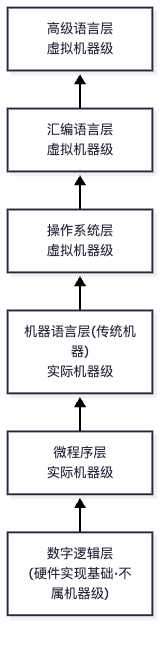
📌 锚点：**实际机器级=微程序+机器语言；题库"由低到高"题选：微程序→机器语言→高级语言（数字逻辑不算机器级）**。

#### 1.1 冯·诺依曼结构与五大部件 ★★★

**定义详解**：冯·诺依曼计算机的核心是**存储程序（stored program）**工作方式——程序（指令序列）和数据预先存入存储器，计算机启动后由控制器按地址自动、逐条地"取指令→分析指令→执行指令"，直到程序结束。硬件五大部件：**运算器**（算术逻辑运算）、**控制器**（指挥协调）、**存储器**（存放程序和数据）、**输入设备**、**输出设备**。层级关系：运算器+控制器=CPU；CPU+主存=主机；输入/输出设备+外存=外围设备。

> **🖼 动图演示：冯·诺依曼存储程序与五大部件数据流**

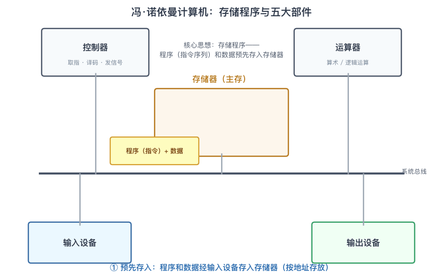

📌 锚点：**程序（指令+数据）预先存入存储器；控制器按地址取指→分析→执行，控制信号调度五大部件协同**。

**考试答题**

**📌 历年真题**

**【2026.4·单选 1】（2 分）** 属于计算机 I/O 设备的是（　）
- A. CPU
- B. 算术逻辑部件
- C. 内存
- D. 显示器 ✅

**【2026.4·单选 9】（2 分）** 下列设备中，属于输出设备的是（　）
- A. 扫描仪
- B. 数字化仪
- C. 控制杆
- D. 绘图仪 ✅

**【2025.4·填空 14】（2 分）** 冯·诺依曼计算机硬件由运算器、____、存储器、输入设备和输出设备五大部件组成。
答案：控制器

**【2024.10·单选 2】** 冯·诺依曼计算机工作方式的基本特点是（　）
- A. 多指令流单数据流
- B. 存储程序工作方式 ✅
- C. 堆栈操作
- D. 存储器按内部选择地址

**【2024.4·单选 1】** 完整的计算机系统应包括（　）
- A. 运算器、存储器、控制器
- B. 硬件和软件 ✅
- C. 主机和实用程序
- D. 外部设备和主机

**🎯 考法**：单选考"工作方式基本特点"（答存储程序）与 I/O 设备辨析（2026.4 新考法，单选 1、9 连考两题）；填空默写五大部件。

**✍️ 得分点**：
- 单选"工作方式的基本特点"→ 答存储程序；干扰项"多指令流单数据流"是并行机分类，与工作方式无关。
- 填空"五大部件"→ 运算器、控制器、存储器、输入设备、输出设备，一个不能少。
- I/O 设备辨析：输入=扫描仪、数字化仪、键盘、鼠标、控制杆；输出=显示器、打印机、**绘图仪**。

**⚠️ 易混淆**：**"完整的计算机系统"=硬件+软件**（2024.4 单选 1 选 B），而"冯·诺依曼结构"只讲硬件——两个题眼别混。


> **🖼 知识点图：冯·诺依曼结构与五大部件**

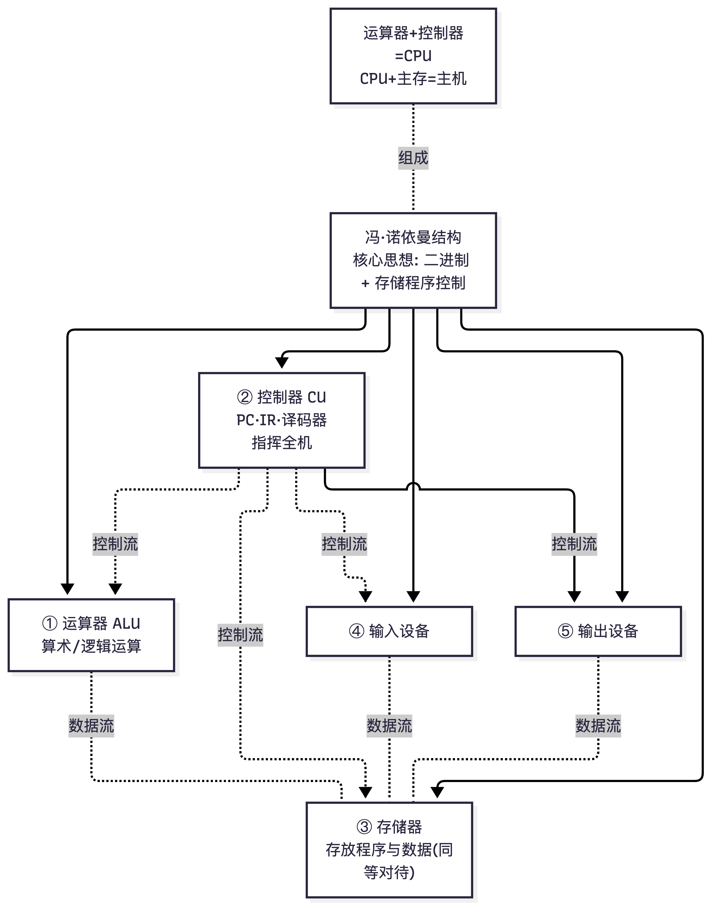

📌 锚点：构想核心=二进制+存储程序控制；运算器+控制器=CPU，CPU+主存=主机。

#### 1.2 主频与 CPU 时间 ★★★

**定义详解**：主频是 CPU 时钟信号的频率，即一秒内的时钟周期数，单位 Hz（GHz=10⁹Hz）。时钟周期=1/主频，是 CPU 最小的时间单位。**CPU 时间（程序执行时间）= 指令条数 × CPI ÷ 主频**——三个因素共同决定，主频高不一定快。

**考试答题**

**📌 历年真题**

**【2026.4·简答 23】（5 分）** 简述计算机系统基本性能指标和 CPU 的性能指标。
> 【答案要点】→ 答题要点见下方得分点

**【2024.10·名词解释 22】（5 分）** 主频
> 【答案要点】→ 答题要点见下方得分点

**🎯 考法**：主频是名词解释常客（三个得分点缺一扣一）；简答考两层性能指标体系。

**✍️ 得分点**：
- 名词解释模板：一句话定义 + 单位 + 与性能的关系（"主频越高时钟周期越短，但性能还取决于 CPI 与指令条数"）。就三个得分点，缺一扣一。
- 简答"基本性能指标和 CPU 性能指标"分两层答——机器级：**字长、主频、存储容量**；CPU 级：**主频、CPI、MIPS、程序执行时间**，并写出 CPU 时间公式。

**计算方法**：
- 时钟周期 = 1/主频（**为什么取倒数**：主频是"每秒有多少个周期"，取倒数即"每个周期多长时间"）。例：500MHz → 1 个周期 2ns。
- CPU 时间 = 指令条数 × CPI ÷ 主频（**为什么这么乘除**：每条指令平均耗 CPI 个周期 → 程序共 IC×CPI 个周期；每个周期 1/主频 秒 → 周期数×周期长 = 总秒数）。例：10⁹ 条、CPI=2、主频 2GHz → 10⁹×2/2×10⁹ = 1s。
- MIPS = 指令条数 ÷ (执行时间×10⁶) = 主频 ÷ (CPI×10⁶)（**含义**：每秒执行的百万条指令数）。


> **🖼 知识点图：主频与 CPU 时间计算流程（例题演算）**

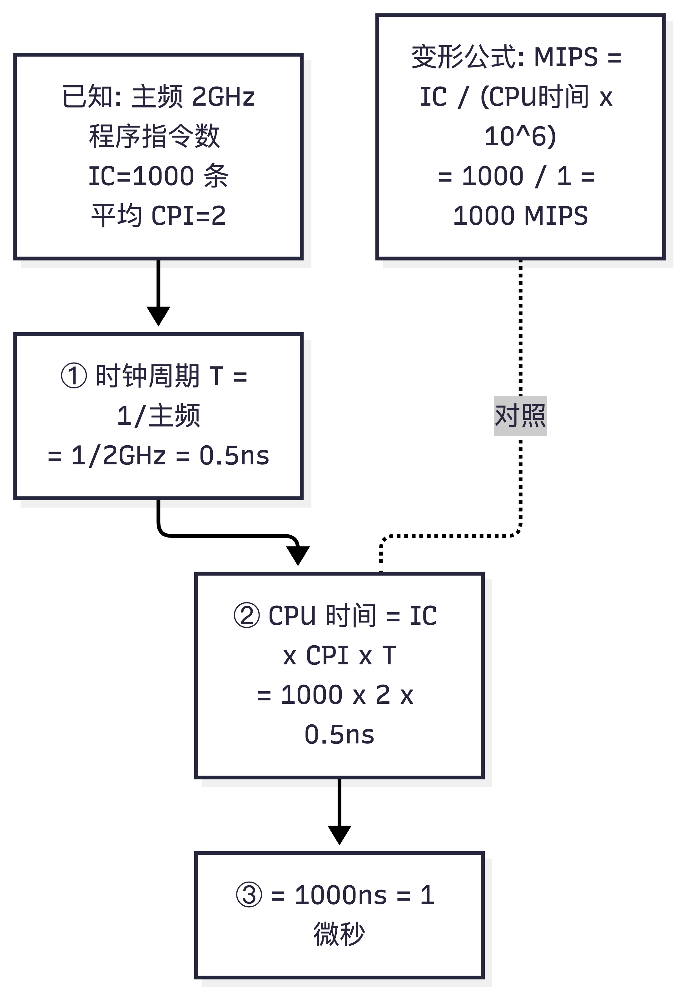

📌 锚点：CPU 时间 = 指令数 × CPI × 时钟周期；主频 2GHz 时钟周期 0.5ns。

#### 1.3 CPI ★★★

**定义详解**：CPI（Cycles Per Instruction）= 执行一条指令所需的**平均**时钟周期数。不同指令类型周期数不同（访存慢、运算快），所以 CPI 是全部指令的加权平均：CPI = 总时钟周期数 ÷ 总指令条数。

**考试答题**

**📌 历年真题**

**【2026.4·计算题 28】（9 分）** 两个指令序列 S1/S2 在 500MHz 机器上运行，指令分 A、B、C、D 四类，CPI 及条数如题 28 表。求：(1) 各有多少条指令；(2) 各自 CPI；(3) 时钟周期数；(4) 执行时间。【待核实：扫描图中"各指令的 CPI"一行数值模糊；可辨识数据：S1 条数（A~D）= 1、2、3、4；S2 条数（A~D）= 5、2、2、1】
> 【答案要点】→ 答题要点见下方得分点与"计算方法"四步模板

**【2024.10·计算题 27】** 假定某程序 P 编译后生成的目标代码由 A、B、C、D 四类指令组成……（CPI 计算型，题干截断）
> 【答案要点】从汇编解析浓缩：①总周期数 Σ(条数ᵢ×CPIᵢ)；②总指令数 N=Σ条数ᵢ；③平均 CPI=总周期数/N；④执行时间=总周期数/主频。注意"平均 CPI"与"加权求和"两种问法。

**🎯 考法**：计算题必出（2024.10 计算题 27、2026.4 计算题 28 连续考）。题目给"A/B/C/D 四类指令的 CPI 与条数表"，四问固定套路（见下）。

**✍️ 得分点**：
- 四问各占分值，每问都单独写一行公式 + 代入 + 结果；四步模板见下方"计算方法"。
- 题目若再问 MIPS：MIPS = N ÷ (执行时间×10⁶)。

**计算方法**（四步模板，务必列式）：
1. 总指令条数 N = 各类条数之和（**为什么直接相加**：每条指令必属且只属一类，程序总条数就是各类条数的总和）；
2. 总时钟周期数 = Σ(条数ᵢ × CPIᵢ)（逐类相乘再相加；**为什么这样乘加**：条数ᵢ 条、每条耗 CPIᵢ 个周期 → 该类共耗 条数ᵢ×CPIᵢ 个，四类相加即程序总周期）；
3. 平均 CPI = 总周期数 ÷ N（**为什么是除法**：CPI 的定义就是"平均每条指令花的周期数"——把总周期摊到每条指令头上）；
4. 执行时间 = 总周期数 ÷ 主频 = 总周期数 × 时钟周期（**为什么**：主频=每秒周期数，周期总数÷每秒周期数即得秒数；乘时钟周期是同一件事的另一种写法）。

**【例 1-1】CPI 四问完整计算（2024.10 计算题 27 / 2026.4 计算题 28 同型，数据为自编教学数据）**

某程序的目标代码由 A、B、C、D 四类指令组成，在主频 500MHz 的机器上运行：

| 指令类 | CPI | 条数 |
|---|---|---|
| A | 1 | 4 |
| B | 2 | 2 |
| C | 3 | 3 |
| D | 4 | 1 |

求：(1) 程序共有多少条指令；(2) 平均 CPI；(3) 总时钟周期数；(4) 执行时间。

解（四步依次列式，每步都写公式再代数）：
① 总指令条数 N = 4 + 2 + 3 + 1 = **10 条**（**为什么直接加**：每条指令必属四类之一，总条数 = 各类条数求和）
② 总时钟周期数 = Σ(条数ᵢ×CPIᵢ) = 4×1 + 2×2 + 3×3 + 1×4 = 4 + 4 + 9 + 4 = **21 个周期**（**为什么逐类相乘再相加**：A 类 4 条、每条 1 个周期 → 贡献 4 个周期，其余类同理；程序总周期 = 各类贡献之和）
　（⚠️ 顺序建议先算周期数再算 CPI——CPI 是"周期数 ÷ 条数"的商）
③ 平均 CPI = 21 ÷ 10 = **2.1**（**为什么除以 N**：CPI 定义 = 平均每条指令耗的周期数，21 个周期摊到 10 条指令上即 2.1）
④ 执行时间 = 21 ÷ 500×10⁶ Hz = 42×10⁻⁹ s = **42ns**（**为什么除以主频**：主频=每秒周期数，21 个周期除以"每秒 500M 个"即得秒数；500MHz → 每周期 2ns，21×2ns = 42ns 互相验算 ✓）

> **🖼 动图演示：CPI 四问（条数 × CPI → 总周期 → 执行时间）**

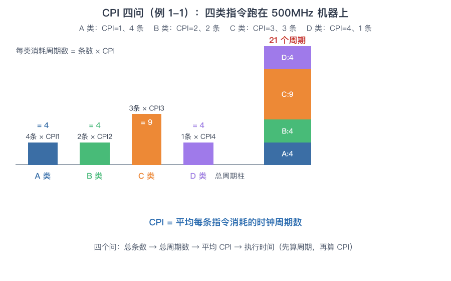

📌 锚点：**总周期 = Σ(条数×CPI)；CPI = 总周期 ÷ 总条数；执行时间 = 总周期 ÷ 主频**。

答题提醒：四个问各占分值，**每问都单独写一行公式 + 代入 + 结果**；题目若再问 MIPS，MIPS = N ÷ (执行时间×10⁶) = 10 ÷ (42ns×10⁶) ≈ 238 MIPS（或用公式 主频÷(CPI×10⁶) = 500M÷2.1 ≈ 238M 条/s）。


> **🖼 知识点图：CPI 计算流程（例题演算）**

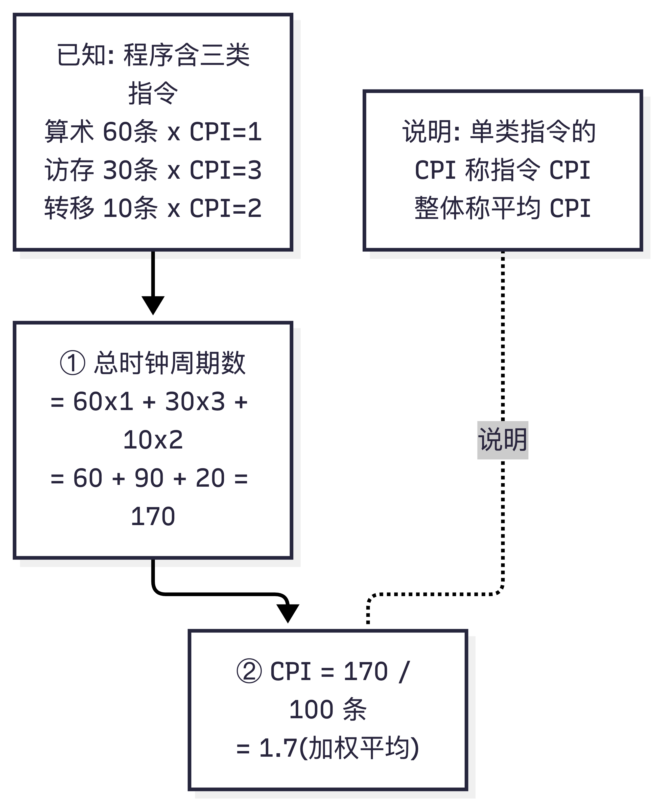

📌 锚点：CPI = 总时钟周期数 ÷ 总指令数；混合指令按出现频率加权平均。

#### 1.4 计算机系统层次结构与 ISA ★★★

**定义详解**：计算机系统是多层抽象：高级语言程序 →（翻译）→ 汇编/机器语言 → **ISA（指令集体系结构）** → 微程序/硬件数字电路。**ISA 是软硬件的分界面**：上面是软件（编译器、OS、应用），下面是硬件（数据通路、控制器）。ISA 的内容 = 指令集合 + 数据类型 + 寄存器 + 寻址方式 + I/O 控制方式等。

**考试答题**

**📌 历年真题**

**【2025.4·单选 5】** 下列不属于指令集体系结构（ISA）设计所追求的目标是（　）
答案：CISC 化（"增加指令条数/增强单条指令功能"）一类选项（选项未流传；RISC 追求规整、简单、利于流水）

**【2024.4·填空 12】（2 分）** 指令集体系结构（ISA）是整个计算机系统的核心部分，ISA 层上面是____部分，下面是____部分。
答案：软件；硬件

**【2024.4·单选 4】** 下列说法中不正确的是（　）
- A. 任何可以由软件实现的操作也可以由硬件来实现
- B. 固件就功能而言类似于软件，而从形态来说又类似于硬件
- C. 在计算机系统的层次结构中，指令集体系结构属于硬件级
- D. 面向高级语言程序设计的机器是完全可以实现的 ✅

**🎯 考法**：填空考 ISA 上下面；单选考 ISA 归属判断与设计目标辨析。

**✍️ 得分点**：
- 填空"ISA 层上面是____部分，下面是____部分"→ **软件；硬件**。
- 单选判断"ISA 属于硬件级"→ 正确（2024.4 单选 4 的选项 C 表述；该题因 D 不正确而选 D）。

**⚠️ 易混淆**："指令集体系结构"≠"指令系统"本身，它还包括数据类型、寄存器、寻址方式等完整接口约定。


> **🖼 知识点图：ISA 规定的内容（软硬件交界面）**

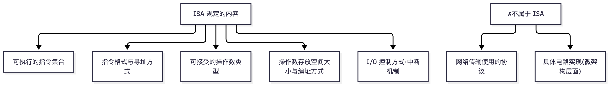

📌 锚点：ISA=指令集体系结构：指令集合、指令格式与寻址方式、操作数类型、编址方式等；不含网络协议与微架构电路实现。

#### 1.5 软件分类与用户分类 ★★

**定义详解**：软件分**系统软件**（为使用和管理计算机提供服务：OS、编译器、汇编器、DBMS、文件系统等）与**应用软件**（解决具体应用问题）。固件 = 功能像软件、形态像硬件（固化在 ROM 中的微程序），体现"软硬件逻辑等价性"。用户分四类：**最终用户、系统管理员、应用程序员、系统程序员**。

**考试答题**

**📌 历年真题**

**【2024.4·单选 5】** 介于计算机硬件与应用程序之间，包括为有效、安全地使用和管理计算机以及为开发和运行应用软件而提供的各种软件，称为（　）
- A. 应用软件
- B. 系统软件 ✅
- C. 操作软件
- D. 用户软件

**【2024.4·填空 13】（2 分）** 按照在计算机上完成任务的不同，可以把使用计算机的用户分成以下 4 类：____、____、应用程序员和系统程序员。
答案：最终用户（终端用户）；系统管理员

**【2024.4·单选 3】** 下列不属于翻译程序种类的是（　）
- A. 汇编程序
- B. 解释程序
- C. 编译程序
- D. 链接程序 ✅

**🎯 考法**：定义型单选考系统软件定义；填空考四类用户；单选考翻译程序种类辨析。

**✍️ 得分点**：
- 定义型单选："介于硬件与应用程序之间……的软件"→ 系统软件。
- 填空四类用户顺序：最终用户（终端用户）、系统管理员在前。

**⚠️ 易混淆**：翻译程序（汇编/编译/解释）是系统软件；**链接程序不是翻译程序**。

---


> **🖼 知识点图：软件分类（系统软件 vs 应用软件）**

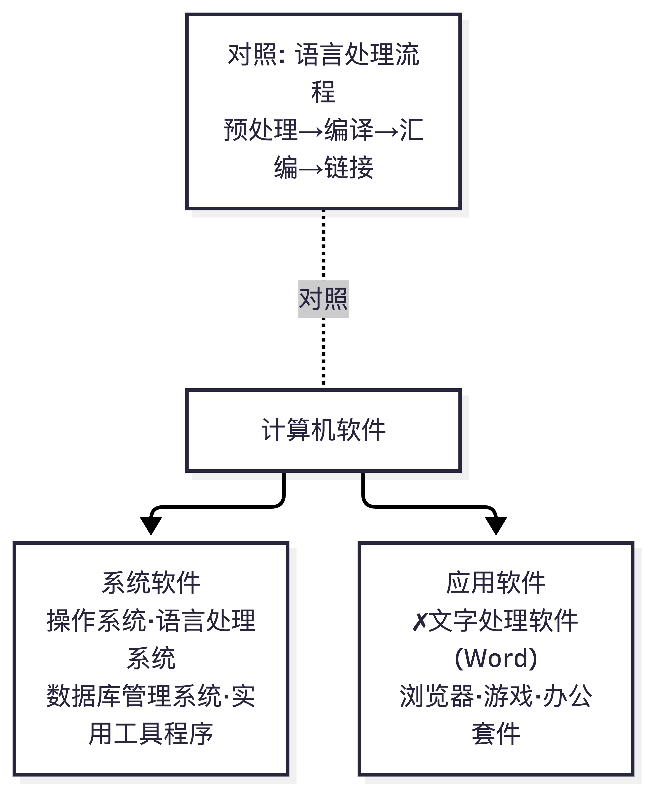

📌 锚点：文字处理软件=应用软件；操作系统/语言处理系统/DBMS=系统软件。

### 第 2 章 数据的表示与运算（计算题核心章）

> **本章是全卷计算题的核心来源**（约 25% 分值）。六个计算模块：进制转换 → 原码/反码/补码/移码 → 补码加减 → 溢出判定 → IEEE 754 浮点数 → 浮点加减。每个模块下面都配了**完整算到底的例题**——每一步竖式、中间过程、验算全部写出，照着动手算一遍胜过看十遍结论。


> **🖼 图解 ①：原码 → 反码 → 补码转换流程**
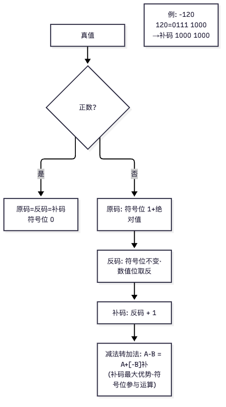
#### 2.1 进制转换与 BCD 码 ★★★（每卷第 1 题常客）

**定义详解**：计算机内部用二进制（器件只有高低电平两个稳定状态）；人机界面用十进制（人类习惯）和十六进制（二进制的紧凑缩写，4 位二进制 ↔ 1 位十六进制）。

**核心原理：按权展开**。十进制数 458 之所以是"四百五十八"，是因为 4 在百位、5 在十位、8 在个位：458 = 4×10² + 5×10¹ + 8×10⁰。任何进制的数都能这样拆：R 进制数每一位的权值是 R 的幂，把每一位数字乘以权值再相加，就得到十进制真值。这是所有进制转换的根基。

**二↔八/十六互转的本质**：8 = 2³、16 = 2⁴，所以 **3 位二进制恰好对应 1 位八进制、4 位二进制恰好对应 1 位十六进制**——按位分组直接翻译，不用做任何乘除。

**方法卡片**（先记法则，再看例题）：

| 转换方向 | 法则 |
|---|---|
| 十→二（整数） | 除 2 取余，**余数逆序**排列；或权值拼凑法 |
| 二→十 | 按权展开相加 |
| 二→十六 | 从小数点向两侧每 **4 位**一组，每组独立转十六进制 |
| 十六→二 | 每位十六进制展开成 4 位二进制 |
| 二→八 | 每 **3 位**一组 |
| 十→十六 | 除 16 取余，余数逆序 |
| 十→二（小数） | **乘 2 取整**，整数顺次排列 |

**考试答题**

**📌 历年真题**

**【2026.4·单选 3】（2 分）** 十进制 192 对应的二进制是（　）
- A. 10100000B
- B. 11000000B ✅
- C. 11100000B
- D. 11010000B

**【2025.4·单选 1】** 下列数中最小的数是（　）
答案：A（选项未流传，搜索线索显示参考答案为 A【待核实】；方法：把各数统一化为二进制再比较）

**【2024.10·单选 1】** 下列数中最大的数是（　）
答案：C（选项未流传，搜索线索显示参考答案为 C【待核实】）

**【2024.4·单选 2】** 某数在计算机中用 8421BCD 码表示为 0111 1000 1001，其真值为（　）
- A. 789 ✅
- B. 789H
- C. 1929
- D. 11110001001B

**🎯 考法**：单选给 3~4 个不同进制的数比大小/求某十进制数的二进制——**四次考期第 1~3 题全部是进制题**。策略：全部统一化成十进制（或二进制）再比。

**✍️ 得分点**：
- 比大小先统一进制再比；BCD 码按每 4 位一组逐组翻译，别按二进制权值展开（1929 正是干扰项，见下方【例 2-8】）。

**计算方法**：

**【例 2-1】十→二（整数）：把 45 转换成二进制**

除 2 取余，一直除到商为 0（**为什么**：二进制每一位就是"45 里有几个 2ⁿ"的系数——每除一次 2，就把最低位（2⁰ 位）的系数分离成余数，剩下的商继续处理更高位）：

```
45 ÷ 2 = 21 …… 1   ← 第 1 次余数是最低位（它是 2⁰ 位的系数）
21 ÷ 2 = 10 …… 1
10 ÷ 2 = 5  …… 0
 5 ÷ 2 = 2  …… 1
 2 ÷ 2 = 1  …… 0
 1 ÷ 2 = 0  …… 1   ← 最后一次余数是最高位（商为 0，停止）
```

余数**从下往上**读（**为什么逆序**：先除出来的余数是低位系数、后除出来的是高位系数，书写习惯高位在左）：**45 = 101101B**。

> **🖼 动图演示：十 → 二进制（整数除 2 取余 / 小数乘 2 取整）**

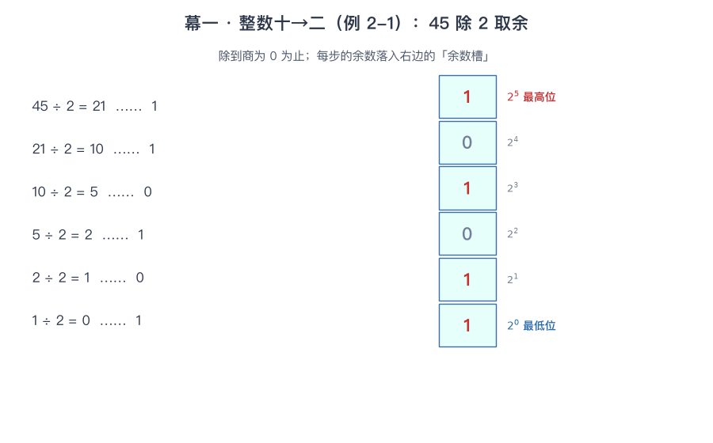

📌 锚点：**整数除 2 取余、逆序读；小数乘 2 取整、顺序读**。

验算（按权展开）：1×2⁵ + 0×2⁴ + 1×2³ + 1×2² + 0×2¹ + 1×2⁰ = 32 + 8 + 4 + 1 = 45 ✓（把每一位系数乘回它代表的权值 2ⁿ，还原出原数，用于确认转换无误）

**【例 2-2】十→二（权值拼凑法，考场更快）：把 192 转换成二进制**（2026.4 单选 3 原题）

先记常用权值：2⁷=128、2⁶=64、2⁵=32、2⁴=16、2³=8、2²=4、2¹=2、2⁰=1（**为什么要背权值**：二进制每一位的系数只能是 0 或 1，所以每个权值最多"用一次"，从大往小贪心凑数就等于逐位填 0/1）。

从最大的权值往下"贪心"凑：192 里含 1 个 128（剩 64）→ 含 1 个 64（剩 0，结束）→ 其余位全 0（**为什么从大往小贪心**：只要剩余数 ≥ 当前权值，该位系数必为 1、减去后继续往下；否则填 0 跳过——先定高位后定低位，是按权展开的逆过程）：

192 = 128 + 64 = 2⁷ + 2⁶ → **192 = 11000000B**（第 7、6 位为 1，其余为 0）。

**【例 2-3】二→十（按权展开）：11011010B = ?**

| 位 | b7 | b6 | b5 | b4 | b3 | b2 | b1 | b0 |
|---|---|---|---|---|---|---|---|---|
| 数字 | 1 | 1 | 0 | 1 | 1 | 0 | 1 | 0 |
| 权值 | 128 | 64 | 32 | 16 | 8 | 4 | 2 | 1 |

只把数字为 1 的位相加（**为什么 0 的位不算**：按权展开是每位数字 × 对应权值再求和，0×权 = 0 对总和零贡献，只有 1 的位贡献其权值）：128 + 64 + 16 + 8 + 2 = **218**。

**【例 2-4】二↔十六、二↔八：11011010B = ?H = ?O**

二→十六：从小数点（此题为整数，即从右端）起每 4 位一组，不足 4 位整数部分左补 0（**为什么 4 位一组**：16 = 2⁴，4 位二进制 0000~1111 恰好一一对应十六进制的 0~F，分组后每组独立翻译、互不借位进位）：

```
11011010B → 1101 | 1010
              D      A     （1101B=13=DH，1010B=10=AH）
```

→ **11011010B = DAH**。

二→八：每 3 位一组（**为什么 3 位一组**：8 = 2³，3 位二进制 000~111 恰好一一对应八进制 0~7，与二→十六的"4 位一组"逻辑相同，只是把 4 换成 3）：

```
11011010B → 11 | 011 | 010
             3    3    2
```

→ **11011010B = 332O**。

两个答案互相验算：DAH = 13×16+10 = 218 ✓；332O = 3×64+3×8+2 = 218 ✓（与例 2-3 一致）。

**【例 2-5】十→十六（除 16 取余）：723 = ?H**

（**为什么除 16**：除 2 取余的推广——目标进制基数是几就除以几；每除一次 16 分离出一个十六进制数位（恰 4 位二进制），余数即该位系数）

```
723 ÷ 16 = 45 …… 3   ← 最低位（16⁰ 位系数，即该位十六进制数字）
 45 ÷ 16 =  2 …… 13  ← 13 = DH（十六进制里 10~15 依次记作 A~F）
  2 ÷ 16 =  0 …… 2   ← 最高位
```

余数从下往上读（逆序原因同除 2 取余：先得低位、后得高位）：**723 = 2D3H**。验算：2×256 + 13×16 + 3 = 512 + 208 + 3 = 723 ✓（**为什么能这样验算**：按权展开是转换的逆过程——各位系数乘回 16 的幂（256=16²、16=16¹）再求和，应还原出原数 723）

**【例 2-6】十进制小数→二进制（乘 2 取整）：0.6875 = ?B**

小数部分反复乘 2，每次取走乘积的整数部分，直到小数部分为 0（或达到精度要求）（**为什么乘 2 取整**：乘 2 会把小数第一位（2⁻¹ 位）的值"抬"进整数部分——抬出来是 1 就说明该位系数为 1，是 0 则系数为 0；先得到的是高位 2⁻¹ 位）：

```
0.6875 × 2 = 1.375  → 取 1   ← 最高小数位（2⁻¹ 位）
0.375  × 2 = 0.75   → 取 0
0.75   × 2 = 1.5    → 取 1
0.5    × 2 = 1.0    → 取 1   ← 小数部分已为 0，停止
```

整数**从上往下**顺次排列（**为什么正序**：与整数转换的逆序相反——第一次乘出来的恰是最高小数位 2⁻¹ 位、越往后权值越小，而小数书写正是从左到右由高到低）：**0.6875 = 0.1011B**。

验算：0.1011B = 1×2⁻¹ + 0×2⁻² + 1×2⁻³ + 1×2⁻⁴ = 0.5 + 0.125 + 0.0625 = 0.6875 ✓

⚠️ 很多十进制小数（如 0.3）乘 2 永远乘不尽，只能截断到指定位数——**这正是浮点数无法精确表示 0.3 这类数的根源**（呼应 2.5/2.6 节）。

**【例 2-7】整数 + 小数复合：45.6875 = ?B**

整数部分用例 2-1 的结果（101101），小数部分用例 2-6 的结果（1011），小数点两边直接拼接（**为什么能各自转换再拼接**：整数位与小数位分属 2ⁿ 与 2⁻ⁿ 两套权值体系、互不干扰，小数点正是分界——45 与 0.6875 转换时彼此无影响）：

**45.6875 = 101101.1011B**

**【例 2-8】BCD 码（8421 码）：0111 1000 1001 表示的十进制真值是？**（2024.4 单选 2 原题）

BCD 码用**每 4 位二进制独立表示 1 位十进制数字**，各组之间互不进位（**为什么 4 位一组、逐组翻译**：8421 码得名于 4 位二进制各位的权值 8、4、2、1——每组恰好装下一个十进制数字 0~9，组与组之间没有权值关系，所以绝不能跨组按权展开）：

```
0111 | 1000 | 1001
  7      8      9
```

→ 真值 = **789**。

⚠️ 千万别按二进制权值展开——那会算出 011110001001B = 1929，正是本题的干扰选项（**为什么恰好差这么多**：按权展开抹掉了"逐组独立"的结构，把组间也接上了 2 的权值链——BCD 与二进制是同一串数字的两种解读，结果自然不同）。判断口诀：**题目明说"8421 码/BCD 码"→ 4 位一组逐组翻译；明说"二进制"→ 按权展开**。

**【例 2-9】多进制比大小（每卷第 1 题题型）：101001B、50O、2AH、43D 中最小的是？**

统一化成十进制再比（**为什么先统一**：进制不同则同一位的权值完全不同——"50"在八进制里只有 40；必须换到同一"度量衡"后，数值大小才有可比性）：
- 101001B = 32 + 8 + 1 = **41**
- 50O = 5×8 = **40**
- 2AH = 2×16 + 10 = **42**
- 43D = **43**

→ 最小的是 **50O**。⚠️ 别被"位数多=数值大"的直觉骗了——进制基数不同不能直接比位数。


> **🖼 知识点图：各种进制转换方法**

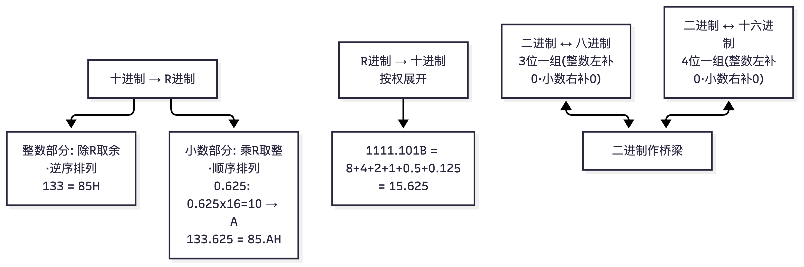

📌 锚点：整数除基取余逆排、小数乘基取整顺排；二进制是八/十六进制的桥梁（3 位/4 位一组）。

#### 2.2 真值、机器数与原码/反码/补码/移码 ★★★

**定义详解**：**机器数** = 数及其符号在机器中的数字化表示（正负号也用 0/1 编码，约定 **0 表正、1 表负**）；**真值** = 机器数代表的实际数值（带 +/− 号的数）。

四种编码规则（n 位编码，最高位为符号位）：

| 编码 | 正数 | 负数 | 0 的表示 | 用途 |
|---|---|---|---|---|
| 原码 | 符号位 0 + 数值位 | 符号位 1 + 绝对值数值位 | 有 +0/−0 两种 | 乘除运算、直观 |
| 反码 | 同原码 | **符号位不变，数值位按位取反** | 也有两种 | 求补码的过渡 |
| 补码 | 同原码 | 反码末位 +1 | **唯一** | **整数加减运算（主流）** |
| 移码 | 补码**符号位取反** | 补码**符号位取反** | 唯一（1000…0） | **浮点数阶码** |

**补码的本质 = 模运算**（理解了就再也不用死记）。想象 12 格时钟：现在 12 点，想调到 9 点，可以**倒拨 3 格，也可以正拨 9 格**——因为 3 + 9 = 12（模），倒 3 与正 9 在"模 12"的意义下等价。8 位机的模是 2⁸ = 256：计算 x − y 时，−y 与 +(256 − y) 等价，于是**减法变成了加法**；而 (256 − |x|) 恰好就是负数 x 的补码。由此得到补码运算系统两大意义（2026.4 填空 12 两空正好考这两点）：**①可用加法实现减法运算；②符号位可以和数值位一起参加运算**，且 0 表示唯一、运算线路简单——机器中整数普遍用补码表示。

**考试答题**

**📌 历年真题**

**【2026.4·名词解释 21】（5 分）** 机器数
> 【答案要点】→ 答题要点见下方得分点

**【2026.4·简答 24】（5 分）** 简述原码补码运算过程。
> 【答案要点】→ 答题要点见下方得分点

**🎯 考法**：名词解释考"机器数"定义；简答考原码/补码运算过程两条线。

**✍️ 得分点**：
- 名词解释"机器数"：定义（符号数值化）+ 与真值的关系。
- 简答"原码补码运算过程"分原码、补码两条线写——原码：符号位单独处理，同号绝对值相加，异号先比大小、大减小、符号随大数；补码：符号数值一起按模 2ⁿ 运算，减法化加（加 [−y]补），最高位进位自然丢弃。

**计算方法**：

⚠️ **先分清两个"取反"，这是最容易混的地方**：
- **负数求补码（标准三步）**：写出 |x| → 配上符号位得原码 → 求**反码（符号位不变，数值位取反）** → 末位 +1 得补码；
- **已知 [y]补 求 [−y]补（快捷法）**：**连同符号位在内**全部取反，末位 +1。

前者的"取反"不动符号位，后者的"取反"连符号位一起动——两者对象不同，考试写过程时务必用对。

**【例 2-10】正数的四种编码：x = +77，求原码、反码、补码、移码（8 位）**

① 77 = 64 + 8 + 4 + 1 = 01001101B（权值拼凑：这四项对应 2⁶、2³、2²、2⁰ 位为 1，其余位为 0；**为什么这样拆**：把 77 分解成 2 的幂之和，每一位的系数 0/1 就直接读出来了）
② 正数：原码 = 反码 = 补码 = **01001101**（**为什么三码相同**：三种编码对正数的规定完全一致——符号位 0 + 绝对值本身，差异只在负数上出现）
③ 移码 = 补码符号位取反：0→1 → **[x]移 = 11001101**（**为什么**：移码 = 真值 + 偏置 128，真值越大编码越大，阶码可直接按无符号数比较大小；操作上恰好等于把补码的符号位翻过来）

**【例 2-11】负数的四种编码（重点，完整三步）：x = −68，求原码、反码、补码、移码（8 位）**

① |x| = 68 = 64 + 4 = 01000100B
② 原码：符号位 1 + 绝对值（**为什么符号位写 1**：机器数约定 0 表正、1 表负，负号数字化为 1；数值位照抄 |x|）→ **[x]原 = 1 1000100 = 11000100**
③ 反码：符号位 1 不变，数值位 1000100 逐位取反（**为什么数值位取反**：反码的定义就是负数在原码基础上数值位逐位翻转、符号位不动）→ **[x]反 = 1 0111011 = 10111011**
④ 补码：反码末位 +1（**为什么取反再加 1**：负数补码定义 = 2⁸ − |x| = (1111 1111 − |x|) + 1——前一步"取反"正好就是拿 8 个 1 减一遍，所以再补一个 1 即完成）→ 10111011 + 1 = **[x]补 = 10111100 = BCH**
⑤ 移码：补码符号位取反（1→0）→ **[x]移 = 00111100 = 3CH**（**为什么取反符号位即得**：移码 = 真值 + 偏置 128，与补码恰好相差一个符号位；负数补码符号位是 1，翻成 0 后移码反而"看起来像正数"——这正是移码可比大小的特点）

**【例 2-12】补码→真值（逆运算）：[x]补 = BCH（8 位），求真值 x**

方法一（取反加一求绝对值）：符号位是 1 → 负数；全部位取反：10111100 → 01000011；末位 +1：01000011 + 1 = 01000100 = 68 → **x = −68**（**为什么取反加一能还原绝对值**：负数补码 = 2⁸ − |x|，从模里把编码"减回去"就得 |x|；而"连同符号位取反+1"正是位级上的 2⁸−编码——求补做两遍回到原值）。

方法二（按权展开，符号位权值取 −2⁷）：10111100B = (−128) + 32 + 16 + 8 + 4 = **−68**（**为什么符号位按 −128 算**：补码定义里最高位的权值是 −2ⁿ⁻¹ 而非 +2ⁿ⁻¹——正因如此，补码才能"符号位参与运算"且比原码/反码多表示一个 −128；一位乘一个权、一步到位）。

> **🖼 动图演示：补码本质 = 模运算时钟**

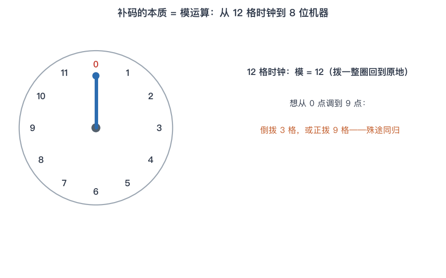

📌 锚点：**钟表倒拨 = 正拨（模 12）；8 位模 256：−68 的补码 = 256 − 68 = 188（10111100B）；补码 = 模 − |x|**。

两种方法结果一致；方法二更快。

**【例 2-13】十六进制补码快速求真值（真题型铺垫）：[x]补 = FFFAH（16 位），求 x**

最高位（F 的最高二进制位）是 1 → 负数（**为什么看最高位**：补码最高位即符号位，为 1 必是负数）。利用"补码 = 模 − |x|"，模 = 2¹⁶ = 10000H：

|x| = 10000H − FFFAH = 6H = 6 → **x = −6**（**为什么用模减编码**：负数补码的定义就是 模 − |x|，变形即 |x| = 模 − 编码——十六进制下一次减法搞定，比转二进制再"取反+1"快且不易错）

（16 位寄存器运算的真题——如 2024.10 分析题 29 的 R[ax]=FFFAH——就用这个方法快速读出真值。）

**【例 2-14】表示范围端点：8 位补码为什么能多表示一个 −128？**

- 最大正数：01111111B = +127（三种编码相同）；
- 原码/反码的负数范围到 −127（11111111 原码 = −127）；
- 补码的 10000000B：按权展开 = −128 + 0 = **−128**（**为什么补码能多表示一个数**：原/反码里 +0 与 −0 占了两个编码、浪费一个；补码的 0 只有唯一编码，空出的 10000000 便派给了 −128）。⚠️ 它没有对应的原码（**为什么没有**：原码要写出绝对值 128 需 9 位，8 位数值位最大只到 127；"取反加一"会得到 9 位的 110000000，超出 8 位装不下），只能按权展开读值。

| 编码 | 8 位表示范围 | 0 的编码 |
|---|---|---|
| 原码 | −127 ~ +127 | 00000000（+0）/ 10000000（−0） |
| 反码 | −127 ~ +127 | 00000000 / 11111111 |
| **补码** | **−128 ~ +127** | 仅 00000000 |

通式：n 位补码范围为 −2ⁿ⁻¹ ~ +2ⁿ⁻¹−1。


> **🖼 知识点图：原码 / 反码 / 补码 / 移码对比（8 位例：+53 / -53）**

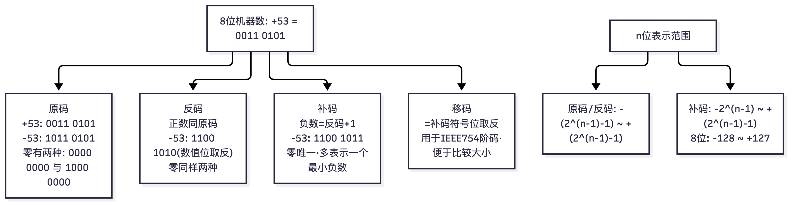

📌 锚点：原码=符号位+绝对值；负数反码=数值位取反；补码=反码+1；移码=补码符号位取反（IEEE754 阶码用）。

#### 2.3 补码加减运算 ★★★（分析题必考）

**定义详解**：补码加减公式：
- [X+Y]补 = [X]补 + [Y]补
- [X−Y]补 = [X]补 + [−Y]补，其中 [−Y]补 = [Y]补**连同符号位一起取反、末位加 1**

运算时**符号位与数值位一起参加加法**；最高位超出 n 位的进位**自然丢弃**——这不是错误，而是模运算的正常现象（就像时钟正拨 25 小时 = 正拨 1 小时，25 − 24 = 1，模 24 自动消去）。

**考试答题**

**📌 历年真题**

**【2026.4·简答 24】（5 分）** 简述原码补码运算过程。
> 【答案要点】→ 答题要点见下方得分点

**【2024.10·分析题 29】** 假设 R[ax]=FFFAH，R[bx]=FFF?H……（补码运算型，题干截断）
> 【答案要点】从汇编解析浓缩：①把十六进制写成 16 位二进制、最高位按补码符号位识别；②按补码加减规则运算（减法转加 [−y]补 = 取反加一）；③同号相加结果变号 → 溢出（或双符号位法）；④CF=最高位进位、OF=符号位进位⊕次高位进位。完整算例见下方【例 2-17】。

**🎯 考法**：简答考"原码补码运算过程"（按本节与 2.2 节要点作答）；分析题给十六进制寄存器值做加减并判断 CF/OF——完整流程见例 2-17。

**✍️ 得分点**：
- 分析题务必写 CF 与 OF 两个标志并说明各自视角：CF 看无符号进位、OF 看带符号溢出（详见 2.4 节）。

**计算方法**：

**【例 2-15】补码加法（逐位竖式）：x = −68，y = +80，求 x+y（8 位）**

> **🖼 动图演示：补码加法竖式与溢出判定（两幕：本例 + 正溢出例 2-18）**

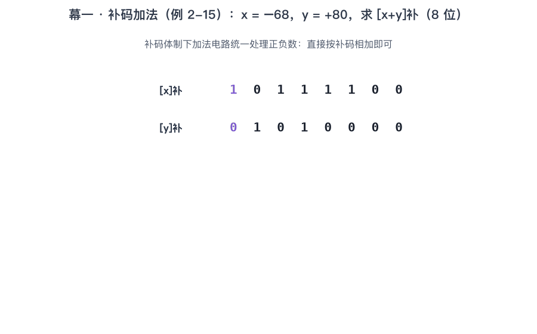

📌 锚点：**直接按补码相加、最高位进位丢弃（模 2⁸）、看符号位判溢出（双符号位 01=正溢、10=负溢）；异号相加永不可能溢出。**

[x]补 = 10111100（例 2-11 已求）；80 = 64+16 = 01010000B（**为什么 80 的补码直接写**：正数补码 = 符号位 0 + 自身，同例 2-10②）。

逐位竖式（小号数字标注来自低位的进位；**为什么逐位竖式加**：每一位相加满 2 进 1——本位留下和的最低位、向左边高位送出进位；符号位 b7 也当普通位参与，所以 b7 的进位会"顶出"到第 9 位）：

```
    进位   1 1 1 1        ← 各位产生的进位
           ↓ ↓ ↓ ↓
    被加数  1 0 1 1 1 1 0 0   (−68)
  + 加数   0 1 0 1 0 0 0 0   (+80)
  ─────────────────────
  (1)      0 0 0 0 1 1 0 0   ← 最高位进位 1 被丢弃
```

结果 [x+y]补 = 00001100 = +12。验算：−68 + 80 = 12 ✓（**为什么竖式这样加**：补码加法规定符号位与数值位一起逐位相加、满 2 进 1；最高位超出 8 位的进位自然丢弃——模 2⁸ 意义下不影响真值；本题异号相加本就不可能溢出）

两点观察：①最高位的进位 1 丢了，结果依然正确——模 2⁸ 自动消去；②一负一正相加，**结果绝对值不会超过较大操作数，永远在表示范围内**，所以异号相加不可能溢出。

**【例 2-16】减法转加法：x = 52，y = −37，求 x−y（8 位）**

思路：x−y = x+(−y)（**为什么**：补码体制下没有"减法电路"，减一个数等价于加它的相反数，只需求出 [−y]补 再做一次加法）。

① [x]补：52 = 32+16+4 = 00110100（**为什么直接写**：x 为正数，补码 = 符号位 0 + 自身）
② [y]补：37 = 00100101 → 负数：反码 11011010（符号位不变·数值位取反）→ +1 → [y]补 = 11011011（**为什么取反+1**：负数补码 = 反码+1 的标准三步）
③ [−y]补：连同符号位取反（00110100）再 +1 → **00100101**（恰好是 +37 的补码——合理，−y = +37 ✓；"连符号位取反+1"对任何 [y]补 做一遍都得到 [−y]补，这是补码的对称性）
④ 相加：

```
    0011 0100   (52)
  + 0010 0101   (+37)
  ───────────
    0101 1001   = 64+16+8+1 = 89
```

验算：52 − (−37) = 52 + 37 = 89 ✓（**为什么符号位直接参与加**：补码体制下加减共用同一套加法器，符号位当普通位一起加即可——减法早在第③步就化成了加法）

**【例 2-17】十六进制寄存器真题型**（2024.10 分析题 29 原型；真题题干数字模糊，本例数据为自编教学数据）：设 R[ax] = FFFAH，R[bx] = FFF6H（16 位补码），求 ax + bx 并判断 CF、OF。

① 读真值：FFFAH = −6、FFF6H = −10（**为什么一眼读出负数**：最高十六进制位 F 的最高二进制位是 1 → 符号位为负；例 2-13 方法：|x| = 10000H − 编码）
② 十六进制直接相加（或先转二进制）（**为什么能直接加**：十六进制只是二进制的缩写，满 16 进 1 与满 2 进 1 完全等价；补码加法符号位照加，无需特殊处理）：

```
      F F F A
  +   F F F 6
  ─────────
    1 F F F 0     ← 产生第 17 位的进位 1
```

③ 取低 16 位（丢弃进位）：[ax+bx]补 = FFF0H → 真值 = −(10000H − FFF0H) = −16（**为什么丢弃进位**：16 位寄存器只有 16 个位，进位"装不下"自动丢掉——在模 2¹⁶ 意义下丢进位不影响结果正确）。
验算：−6 + (−10) = −16 ✓
④ 判标志：CF = 最高位有进位 = **1**（CF 看**无符号数**视角：进位说明无符号和超出 16 位）；OF：负 + 负 = 负（符号未变）→ **无溢出，OF = 0**（OF 看**带符号数**视角：同号相加结果未变号就不溢出）。

**对照例**：7FFFH(+32767) + 0001H(+1) = 8000H(−32768)。最高位**无**进位（CF = 0），但正 + 正 = 负 → 溢出（OF = 1）。
两个例子合看：**CF 与 OF 完全独立**——一个看无符号进位，一个看带符号溢出（详见 2.4 节）。


> **🖼 知识点图：补码加减运算计算流程（例题：-5+3 与 100+50）**

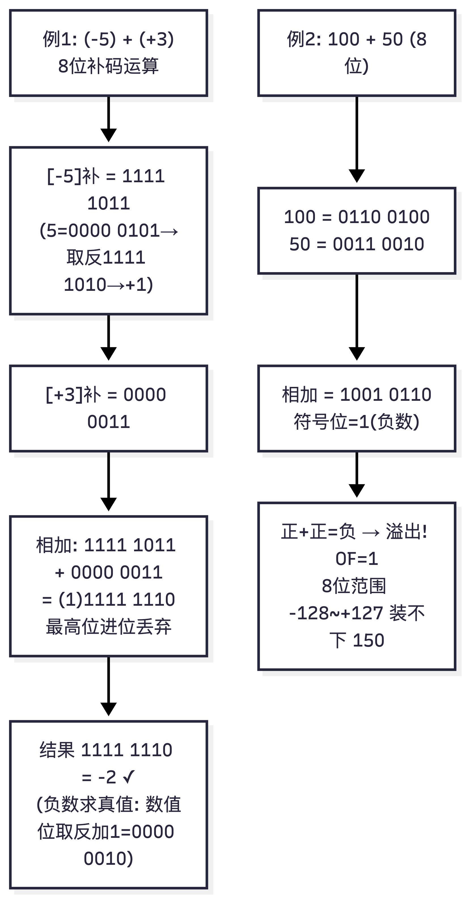

📌 锚点：补码加法符号位一起参加运算；最高位进位丢弃；正+正=负即溢出。

#### 2.4 溢出判定与 CF/OF ★★★

**定义详解**：运算结果超出机器数可表示的范围称**溢出**（overflow，OF）。**只有同号相加（或异号相减）才可能溢出**——两个同号数相加，和的绝对值变大，可能冲出 [−2ⁿ⁻¹, +2ⁿ⁻¹−1] 的边界；而异号相加时和的绝对值介于两操作数之间，必然在范围内（见例 2-15 的观察②）。

**CF 与 OF 是两回事**：
- **CF**（进位/借位标志）= 最高位向外产生的进位——**无符号数**视角的"溢出"；
- **OF**（溢出标志）= 结果超出带符号数范围——**带符号数**视角的溢出。
同一串二进制加法，CPU 同时算出这两个标志：按无符号数解读结果看 CF，按补码解读看 OF，两者互不干扰。

**考试答题**

**📌 历年真题**

**【2024.10·填空 15】（2 分）** 在两个同号数相加时，当相加得到的____超出了 n 位数可表示的范围时，发生了____现象。
答案：结果（和）；溢出

**【2024.10·分析题 29】** 假设 R[ax]=FFFAH，R[bx]=FFF?H……（补码运算型，题干截断）
> 【答案要点】→ 答题要点见下方得分点（本题考点：补码加法最高位进位被丢弃是模运算正常现象，不等于溢出）

**【2024.4·填空 14】（2 分）** 整数加减运算中，同号相加时，若结果的符号不同于____的符号，则会发生____。
答案：操作数（两个加数）；溢出

**🎯 考法**：填空高频（2024.4 填空 14、2024.10 填空 15——两期连考）；分析题常与 CF/OF 一起考。

**✍️ 得分点**：
- 填空定式："同号数相加，当____超出 n 位数可表示范围时发生____"→ 结果（和）；溢出。
- 2024.10 分析题 29 考点：补码加法最高位进位被丢弃是模运算正常现象，不等于溢出。

**计算方法**（三种判定法，同一道题三种方法对照）：

**【例 2-18】正溢出经典题：65 + 65 = ?（8 位补码）**

先老老实实算：65 = 01000001。

```
    0100 0001   (+65)
  + 0100 0001   (+65)
  ───────────
    1000 0010   → 按补码读 = −126
```

正确答案应为 130，但 8 位补码最大只能到 +127——**溢出**，机器得到 −126，完全错误。这就是溢出的危害。三种方法判定：

- **方法一（符号比较法，最常用）**：正 + 正 = 负 → **溢出**。（口诀：同号相加，结果变号，即溢出。）
- **方法二（双符号位法/变形补码）**：用两位符号位重写（65 的变形补码 = 00 1000001）：

```
    00 1000 0001
  + 00 1000 0001
  ────────────
    01 0000 0010
    ↑↑
    双符号位 = 01 → 正溢出
```

  双符号位 00/11 → 正常；**01 → 正溢；10 → 负溢**（两符号位不同即溢出）（**为什么**：正常时加法不会改变符号位对，两位应始终一致；一旦进位冲进符号位区，两位就变成 01/10——直接暴露溢出事实）。
- **方法三（进位异或法）**：逐位算进位（例 2-15 的竖式记法）：b0 位 1+1 进 1；b1 位 0+0+1 不进；b2~b5 位 0+0 不进；**b6 位（最高数值位）1+1 → 向符号位进 1**；b7 位（符号位）0+0+1 → 向前**进 0**。判定：最高数值位的进位 ⊕ 符号位的进位 = 1 ⊕ 0 = 1 → **溢出**（**为什么异或可行**：b6 的进位是"按真值本该写进符号位的符号"，b7 的进位是"实际被推出去的"；两者不同说明符号位被进位改动 → 结果变号 → 溢出）。

三种方法结论一致：65+65 溢出（正溢）。

**【例 2-19】负溢：−68 + (−80) = ?（8 位补码）**

[x]补 = 10111100；−80 的补码：80 = 01010000 → 连同符号位取反 10101111 → +1 → 10110000。

```
    1011 1100   (−68)
  + 1011 0000   (−80)
  ───────────
 (1)0110 1100   → 丢弃进位 → +108
```

负 + 负 = 正 → **溢出（负溢）**（**为什么这就是溢出**：真值 −148 已越出 8 位补码下界 −128——两负数之和只可能更小，机器却给出正数 +108，说明数值位进位把符号位冲掉导致变号）。真值应为 −148，超出了 −128 的下界，机器得到 +108，错。双符号位验证：11 + 11 → 结果双符号位 10 → 负溢 ✓（**为什么 10 即负溢**：两负数符号位 11+11，正常结果符号仍应是 11；出现 10 说明进位冲进符号位区、真值变正）

**【例 2-20】CF/OF 四种组合对照（16 位补码加法）**

| 算式 | CF（有无进位） | OF（带符号溢出） | 说明 |
|---|---|---|---|
| FFFAH + FFF6H → FFF0H | **1** | **0** | 有进位、无溢出（−6−10=−16 正常） |
| 7FFFH + 0001H → 8000H | **0** | **1** | 无进位、有溢出（+32767+1 变 −32768） |
| 8001H + 8001H → 0002H | **1** | **1** | 又进位又溢出（−32767×2 超出范围） |
| 0001H + 0002H → 0003H | **0** | **0** | 两者皆无 |

（**为什么每一行都要同时给两个标志**：同一串结果如 FFF0H，按无符号读是 65520、按带符号读是 −16——CF 报告"无符号解释下装没装得下"、OF 报告"带符号解释下对不对"，两个问题各自独立作答，所以每行都要双视角各判一次）

结论：CF 管无符号数、OF 管带符号数，**四种组合都可能出现，二者没有必然联系**（**为什么独立**：同一次加法，硬件把"最高位向外进位"引给 CF、把"符号位进位⊕次高位进位"引给 OF——两个电路各看各的进位信号，无符号视角不溢出不代表带符号视角不溢出，反之亦然）。


> **🖼 知识点图：溢出判定计算流程（单符号位/双符号位）**

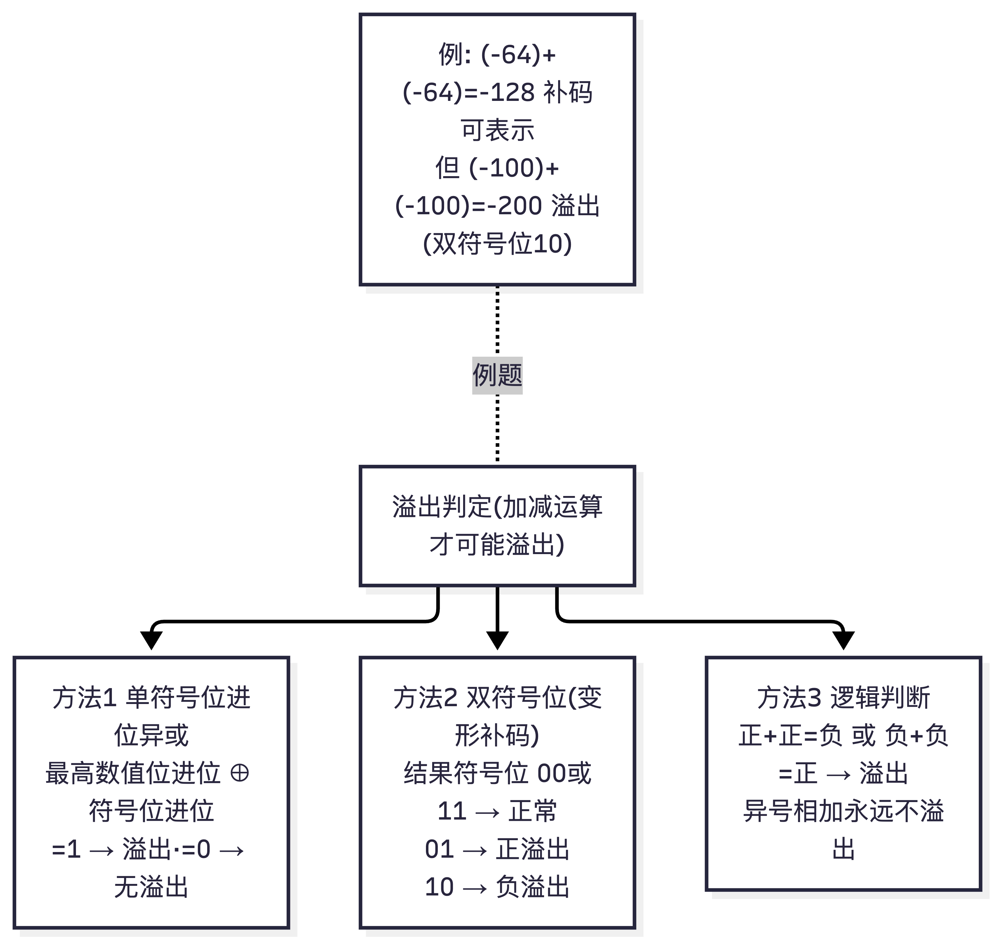

📌 锚点：单符号位：最高数值位进位⊕符号位进位=1 则溢出；双符号位 01 正溢、10 负溢；异号相加永不溢出。

#### 2.5 IEEE 754 浮点数 ★★★

**定义详解**：浮点数 = **阶码 + 尾数**，思路同科学计数法：1.997×10³ 里尾数 1.997 决定有效数字（精度），指数 3 决定数量级（范围）。二进制浮点数同理：**尾数位数决定精度，阶码位数决定表示范围**——总位数一定时，阶码分得多则范围大但精度低，鱼与熊掌不可兼得（2024.10 填空 14 相关、2025.4 填空 13："尾数决定____、阶码决定____"）。

通用格式：**N = (−1)^S × M × R^E**（S 数符、M 尾数、R 基数、E 阶码；基数 R 固定为 2）。

**IEEE 754 标准格式**（单精度 float / 双精度 double）：

```
单精度 32 位：| 1 位数符 S | 8 位阶码 E |      23 位尾数 M      |
双精度 64 位：| 1 位数符 S | 11 位阶码 E |      52 位尾数 M      |
```

| 类型 | 数符 | 阶码 | 尾数 | 总位数 | 偏置值 |
|---|---|---|---|---|---|
| 单精度 float | 1 | 8 | 23 | 32 | **127** |
| 双精度 double | 1 | 11 | 52 | 64 | **1023** |

三个设计要点（理解了格式就不用死背）：
1. **隐含前导 1**：规格化数的尾数实际是 1.M（小数点前有个不存储的 1）——白赚 1 位精度，23 位尾数实际有 24 位有效精度。
2. **偏置值（移码）**：存储的阶码 E = 真实指数 e + 偏置值（127/1023），把可能为负的指数平移成非负数。好处：**阶码变成非负整数后，比较两个浮点数大小 = 先比阶码再比尾数，硬件按无符号数比较即可**，无需带符号比较器。
3. **特殊值编码**（高频考点）：

| 阶码 E | 尾数 M | 表示值 |
|---|---|---|
| E=0，M=0 | 全 0 | **±0** |
| E=0，M≠0 | 非全 0 | 非规格化数：(−1)^S × 0.M × 2^(1−偏置) |
| 1≤E≤254（单精度） | 任意 | **规格化数**：(−1)^S × **1.M** × 2^(E−127) |
| E=255，M=0 | 全 0 | **±∞** |
| E=255，M≠0 | 非全 0 | **NaN**（非数，如 0/0 的结果） |

**真值公式**（考试直接用）：

```
单精度 = (−1)^S × 1.M × 2^(E−127)
双精度 = (−1)^S × 1.M × 2^(E−1023)
```

**考试答题**

**🎯 考法**：教材例题级的编码转换属"综合应用"考纲范围（分析/计算题）；特殊值表（E=0/255 的四种情况）是选择题高频。

**✍️ 得分点**：
- 概念题抓两个题眼："尾数定精度、阶码定范围""阶码用移码、尾数隐含 1"。

**计算方法**：

**【例 2-21】十进制 → 单精度机器码（完整七步）：把 −12.75 转成 IEEE 754 单精度，结果用十六进制表示**

① **拆整数与小数**：12.75 → 整数 12 = 1100B；小数 0.75 = 0.11B（乘 2 取整：0.75×2=1.5 取 1；0.5×2=1.0 取 1）
② **合并写二进制**：12.75 = 1100.11B
③ **规格化**：小数点左移 3 位，使小数点前只剩 1 位（得到 1.M 形式）（**为什么必须 1.M**：规格化让同一个数只有唯一表示，且最高有效位 1 隐藏不占字段、白赚 1 位精度）；1100.11 = 1.10011 × 2³ → 真实指数 e = 3（**为什么指数是 3**：左移 3 位相当于除了一次 2³，要乘 2³ 才能还原）
④ **定数符**：负数 → S = 1
⑤ **算阶码**：E = e + 127 = 3 + 127 = 130 = 10000010B（**为什么 +127**：真实指数 e 可正可负，加上偏置 127 后 E 恒为非负数，就能用无符号移码直接比较阶码大小、免去专门处理阶码符号）
⑥ **写尾数**：M = 10011，右侧补 0 到 23 位：100110000000000000000 00（23 位）（**为什么右侧补 0**：M 存的是小数部分 1.M 的小数段，右侧补 0 = 分数分母变大、数值不变）
⑦ **拼装并转十六进制**：

```
S    E          M
1  10000010  10011000000000000000000

4 位一组：1100 0001 0100 1100 0000 0000 0000 0000
            C    1    4    C    0    0    0    0
```

→ **−12.75 的单精度表示 = C14C0000H**

验算思路：C14C0000H → S=1、E=130、e=3、M=10011 → −1.10011×2³ = −1100.11B = −12.75 ✓

> **🖼 动图演示：IEEE 754 单精度装箱七步**

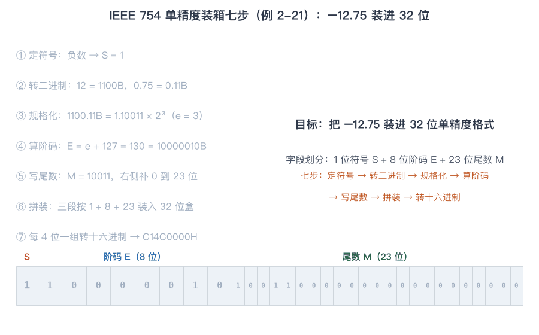

📌 锚点：**定符号 → 转二进制 → 规格化 → E=M+127 → 尾数补零 → 拼装 → 十六进制（−12.75 = C14C0000H）**。

**【例 2-22】单精度机器码 → 十进制：41C80000H 表示的真值是？**

① 十六进制 → 32 位二进制（**为什么要展开**：IEEE 754 三个字段按"位"切分，十六进制一位顶四位，须还原成二进制才能看清字段边界）：0100 0001 1100 1000 0000 0000 0000 0000
② **拆字段**（按 1+8+23 切；**为什么这样切**：单精度格式固定从左到右 S 占 1 位、E 占 8 位、M 占 23 位）：S = 0；E = 10000011B；M = 1001000…0
③ **算指数**：E = 128+2+1 = 131（按权展开：E 字段各位乘回权值）→ e = 131 − 127 = 4（**为什么减 127**：编码时加过偏置 127，读出时逆运算减回来还原真实指数）
④ **写真值**：(−1)⁰ × 1.1001B × 2⁴ = 11001B = 16+8+1 = **+25.0**（**为什么套这个式子**：真值公式 (−1)^S×1.M×2^(E−127) 是编码规则的逆过程——把隐含的 1 补回小数点前、E−127 抵消偏置还原指数、再移位小数点化回十进制）

验算思路：25 = 11001B = 1.1001×2⁴；E = 4+127 = 131 = 10000011B；S = 0——与拆出的字段一致 ✓

**【例 2-23】特殊值识别：说出下列编码表示什么**

| 编码 | 拆位 | E | M | 判定 |
|---|---|---|---|---|
| FF800000H | 1 11111111 000…0 | 255 | 全 0 | 数符 1 + E满 + M全0 → **−∞** |
| 7FC00000H | 0 11111111 100…0 | 255 | 非全 0 | E 满 + M 非零 → **NaN** |
| 80000000H | 1 00000000 000…0 | 0 | 全 0 | E=0 + M=0 + 数符 1 → **−0** |
| 00000001H | 0 00000000 000…1 | 0 | 非全 0 | E=0 + M≠0 → 最小正**非规格化数**（= 2⁻¹⁴⁹） |

判定顺序：**先看 E**（E=0 或 E=255 走特殊值表）→ 再看 M 是否全 0 → 最后看 S 定正负（**为什么先看 E**：E=0 和 E=255 是标准保留的两个编码区，专用于表示 ±0、非规格化数、±∞、NaN——E 落在保留区就绝不能套规格化公式；E 保留区内由 M 细分到哪种特殊值，S 最后只管正负号）。

**【例 2-24】双精度要点**：字段加宽为 1+11+52，偏置 1023（**为什么偏置不同**：阶码加宽到 11 位，偏置取 2¹⁰−1 = 1023——仍是"把可正可负的指数平移成非负、便于无符号比较"的同一设计），方法完全相同。例如 +25.0 的双精度表示：e=4 → E = 4+1023 = 1027 = 10000000011B（**为什么 +1023**：与单精度 +127 同理，存储的是平移后的移码 E = e + 偏置）；M = 1001 补 0 到 52 位：

0 10000000011 1001…0 → 0100 0000 0011 1001 … → **4039000000000000H**

（与例 2-22 的单精度 41C80000H 对照：同一个数，双精度阶码字段更宽、尾数补零更多，换算套路一模一样。）


> **🖼 知识点图：IEEE 754 单精度表示计算流程（例题：-133.625）**

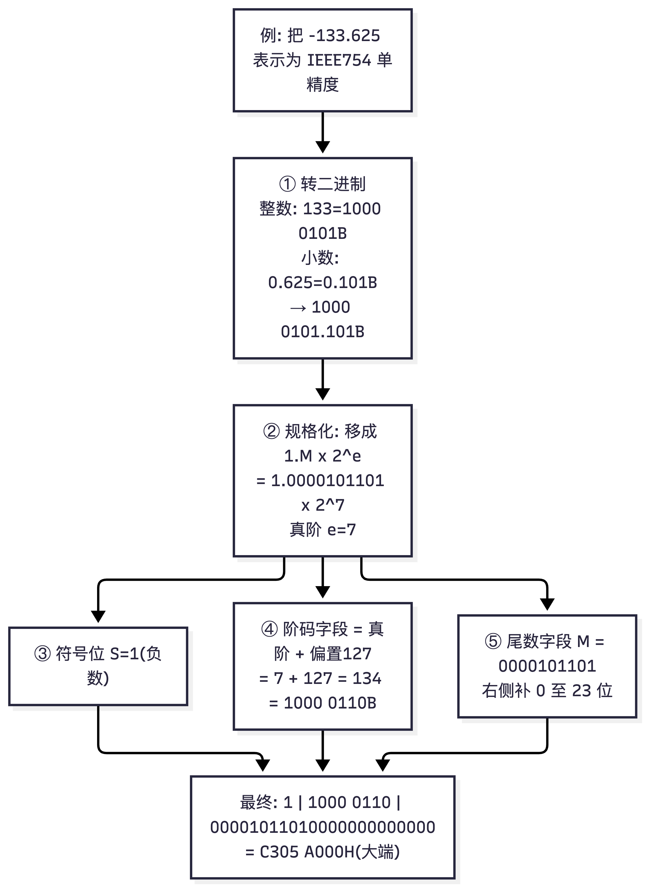

📌 锚点：五步：转二进制→规格化 1.M→定符号→阶码+127→尾数补零。

#### 2.6 浮点数加减运算 ★★★（三次考期填空连考，全卷最高频考点）

**定义详解**——四步口诀：**对阶 → 尾数加减 → 规格化 → 舍入**（考试口径为 4 步；溢出判断作为收尾检查）。每一步先想清楚"为什么"：

1. **对阶**：两个数的阶码不同，尾数的权值就对不齐（10²×1.5 与 10³×2.3 相加，不能直接 1.5+2.3），必须先把阶码变成一样。方向口诀：**小阶向大阶看齐**——阶小的尾数右移 |ΔE| 位、阶码加 |ΔE|。为什么不能反向？右移丢的是低位（小权值，损失小头）；左移丢的是高位（大权值，灾难性错误）。移位位数 = 两阶之差的绝对值（2024.4 填空 15 原文口径）。
2. **尾数加减**：对阶后两尾数按定点数加减运算（连同符号位）。
3. **规格化**：把尾数调整回规格化形式，判定规则按编码：
   - **原码尾数**：最高数值位必须为 1（即尾数在 [1/2, 1) 内）；
   - **补码尾数**：符号位与最高数值位**相反**（正数 00.1xxx，负数 11.0xxx）。
   方向：尾数溢出（|M| ≥ 1，如 01.xxx/10.xxx）→ **右规**（尾数右移 1 位、阶码+1）；有效位不足（如 00.0xxx）→ **左规**（尾数左移 1 位、阶码−1，可能连续多次）。
4. **舍入**：右移（对阶或右规）丢掉低位后要处理误差，常用**"0 舍 1 入"**：丢的位是 0 → 直接舍去；丢的是 1 → 尾数末位 +1（类似十进制四舍五入）。⚠️ "入"之后尾数可能又溢出，需再右规一次。另一种简单办法是"恒置 1"（末位永远置 1），了解即可。
5. **（收尾）溢出判断**：**浮点溢出看阶码**——阶码超出可表示范围才是真溢出；尾数溢出可通过右规修复，不算溢出。

**考试答题**

**📌 历年真题**

**【2025.4·填空 13】（2 分）** 浮点数加减运算需要经过对阶、____、规格化和舍入 4 个步骤。
答案：尾数加减

**【2024.10·填空 14】（2 分）** 浮点数加减运算过程中，需要经过____、尾数加减、____和舍入 4 个步骤。
答案：对阶；规格化

**【2024.4·填空 15】（2 分）** 对阶时，使小阶向大阶看齐，使小阶的____向右移位，移位的位数等于两个阶的____的绝对值。
答案：尾数；差

**🎯 考法**：填空考"4 步骤名称"、考"对阶方向 + 右移的是谁"（**小阶的尾数**；移位位数 = 阶差绝对值）、考"缺的步骤名"（**尾数加减**）；简答要求完整写出四步并说明对阶方向。

**⚠️ 易混淆**：写"大阶向小阶看齐"直接 0 分。

**计算方法**（三道递进例题 + 一张判定表，全部手工可验算）：

**【例 2-25】基础加法（对阶一次、无舍入）：x = 2¹⁰ × 0.1100，y = 2¹¹ × 0.1000，求 x+y**

① **对阶**：阶差 ΔE = Eₓ − Eᵧ = 10 − 11 = −1 < 0 → x 的阶小 → x 的尾数右移 1 位、阶码加 1（**为什么向大阶看齐且右移**：右移丢的是小权值低位、误差可控；若让大阶左移会丢高位、数值直接错。移位位数 = 阶差绝对值，阶码每加 1 抵消右移 1 位对真值的影响）：
　　x = 2¹⁰ × 0.1100 → 2¹¹ × **0.0110**（右移丢 0，无舍入问题）
② **尾数相加**（双符号位补码竖式；**为什么用双符号位**：正常加法两符号位始终相同（00/11），一旦变 01/10 立刻暴露尾数溢出，为第③步判断提供依据）：

```
    00.0110   (x 对阶后)
  + 00.1000   (y)
  ─────────
    00.1110
```

③ **规格化判定**：符号 00、最高数值位 1——符号与最高数值位相反 → **已规格化**，无需调整（**为什么"相反"即规格化**：补码尾数规格化 = |M|∈[1/2,1)，正数必形如 00.1xx、负数必形如 11.0xx——符号位与紧随其后的数值位天然相反）。
④ **舍入**：全程未丢 1 → 不处理（**为什么没丢位就不用**：舍入是对右移丢位误差的补偿，没发生丢 1 就无误差可补）。
结果：**x+y = 2¹¹ × 0.1110**

验算（化十进制）：x = 1024 × 0.75 = 768；y = 2048 × 0.5 = 1024；和 = 1792；而 2¹¹ × 0.1110B = 2048 × 0.875 = 1792 ✓

**【例 2-26】尾数和溢出 → 右规：x = 2² × 0.1011，y = 2² × 0.1001，求 x+y（尾数 4 位）**

① **对阶**：两阶相等（ΔE = 0）→ 跳过（**为什么可跳过**：对阶的目的是把两数阶码变相同，本就相等则尾数权值天然对齐，直接相加）。
② **尾数相加**（**为什么 01 判溢出**：双符号位正常应恒为 00/11；两正数相加得 01，说明数值部分产生进位、冲进了符号位区）：

```
    00.1011
  + 00.1001
  ─────────
    01.0100    ← 双符号位 01：尾数溢出！
```

③ **右规**：尾数右移 1 位（丢末位 0，不需舍入）、阶码 +1：01.0100 → 00.1010，阶变 2³（**为什么右规**：双符号位 01 说明两正数相加尾数冲出了 1 位——把尾数右移 1 位"挤回去"、阶码 +1 补偿真值，尾数即可恢复 00.x 规格形式）
④ **舍入**：丢的是 0 → 舍去即可（**为什么丢 0 不用"入"**：0 舍 1 入——丢 0 没有造成误差，只有丢 1 才需末位 +1 补偿）。
结果：**x+y = 2³ × 0.1010**

验算：x = 4 × 11/16 = 2.75；y = 4 × 9/16 = 2.25；和 = 5.0；2³ × 10/16 = 5.0 ✓（本题无精度损失）

**【例 2-27】全流程（对阶丢 1 → 0 舍 1 入 → 右规）：x = 2⁴ × 0.1100，y = 2³ × 0.1111，求 x+y（尾数 4 位）**

① **对阶**：ΔE = 4 − 3 = 1 > 0 → y 的阶小 → y 尾数右移 1 位、阶码 +1：
　　y = 2³ × 0.1111 → 2⁴ × 0.0111（右移出 1 位，**丢掉的是 1**）（**为什么是 y 右移**：小阶向大阶看齐——右移丢的是低位、误差小，让大阶左移会丢高位、数值直接错）
② **舍入（0 舍 1 入）**：丢 1 → 尾数末位 +1：0.0111 + 0.0001 = **0.1000**（此时 y 已从 7.5 变成 8.0）（**为什么丢 1 要进 1**：与十进制四舍五入同理——丢掉的部分占保留末位的一半以上时向上补偿，使整体误差最小）
③ **尾数相加**：

```
    00.1100   (x = 12)
  + 00.1000   (y 对阶舍入后 = 8)
  ─────────
    01.0100    ← 溢出 → 右规
```

④ **右规**：尾数右移 1 位（丢 0）、阶 +1 → 2⁵ × 0.1010（**为什么还要右规**：竖式结果双符号位 01，尾数冲出 1 位——右移挤回、阶码 +1 补偿真值）
⑤ **溢出判断**：阶码 5 在范围内 → 无溢出（**为什么看阶码**：尾数溢出可右规修复、不算真溢出，只有阶码超范围才无法挽回——阶码承载数量级）。
结果：**x+y = 2⁵ × 0.1010 = 20.0**

⚠️ **精度剖析（本题的教学价值）**：精确和 = 12 + 7.5 = 19.5，浮点结果却是 20.0，误差 0.5。来源有两处：对阶丢 1 入了 +0.5、右规取整又 +0.5/−0.5。根因是**尾数只有 4 位**，天然只能把数表示到 1/16 的 granularity——这就是"尾数位数决定精度"的活例子。考试写过程按四步走即可，但若题目问"为什么有误差"，答案就是舍入。

**【例 2-28】规格化判定练习：判断下列补码尾数（双符号位）是否规格化，未规格化的指出左规还是右规**

| 尾数 | 判定 | 处理 |
|---|---|---|
| 00.0110 | ✗ 正数但最高数值位为 0（与符号相同） | **左规** 1 位 → 00.1100（阶−1） |
| 00.1110 | ✓ 符号 00 与最高数值位 1 相反 | 无 |
| 01.0110 | ✗ 双符号位 01 = 尾数溢出 | **右规** 1 位 → 00.1011（阶+1，看丢位舍入） |
| 11.0110 | ✓ 负数：符号 1 与最高数值位 0 相反 | 无 |
| 11.1010 | ✗ 符号 1 与最高数值位 1 相同 | **左规** 1 位 → 11.0100（阶−1） |

（**为什么双符号位 00/11 才可能规格化、01/10 必未规格化**：01/10 两符号位相异 = 数值进位冲进了符号位 = 尾数 |M|≥1，直接违反规格化范围必未规格化；00/11 时再看符号后第一位——正数 00.1xx、负数 11.0xx 即 |M|∈[1/2,1) 落在规格化区间）

记忆锚点：**补码规格化 = 符号位紧跟的数值位与之相反**（**为什么这么判**：补码尾数规格化即 |M|∈[1/2,1)——正数形如 00.1xx（符号 0 后必是 1）、负数形如 11.0xx（符号 1 后必是 0），"符号与最高数值位相反"等价于已规格化，一眼可判）；原码规格化 = 最高数值位恒为 1。正数补码尾数形如 0.1xx…，负数形如 1.0xx…。

**浮点加减答题模板**（大题按此写，每步都有分）：
```
① 对阶：ΔE = Eₓ−Eᵧ = __；小阶者尾数右移 |ΔE| 位、阶 +|ΔE|
② 尾数加减：（双符号位竖式）
③ 规格化：判定依据（符号与最高数值位相反）→ 左规/右规/已规格化
④ 舍入：丢 0 舍去 / 丢 1 末位+1
（⑤ 阶码未超范围，无溢出）
```


> **🖼 知识点图：浮点数加减运算计算流程（例题：6 + 1.25 = 7.25）**

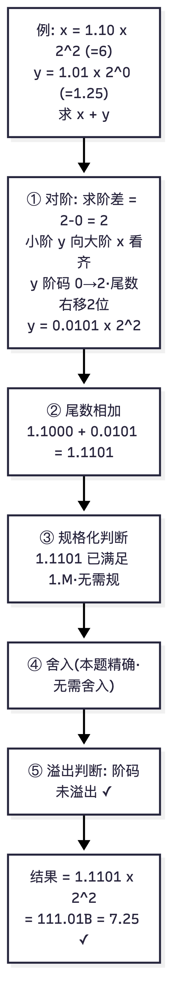

📌 锚点：五步：对阶(小阶向大阶)→尾数加减→规格化→舍入→溢出判断。

#### 2.7 ALU 与运算器组成 ★★★

**定义详解**：**ALU（算术逻辑运算单元）是运算器的核心部件**，完成算术（加减等）与逻辑（与或非等）运算；属组合逻辑电路。配套：暂存操作数的寄存器、移位器、多路选择器、标志寄存器（存放 OF/CF/ZF 等状态标志——标志不存放在 ALU 内）。数据通路中专门进行数据运算的部件统称**组合逻辑元件与时序逻辑元件**（组合输出仅由当前输入决定；时序含状态记忆，如寄存器）——2026.4 填空 16。

**考试答题**

**📌 历年真题**

**【2026.4·单选 2】（2 分）** CPU 中用来进行算术逻辑运算的部件是（　）
- A. ALU ✅
- B. 加法器
- C. 移位器
- D. 多路选择器

**【2024.10·单选 3】** 运算器的核心部件是（　）
- A. 数据总线
- B. 通用寄存器
- C. 多路开关
- D. 算术逻辑运算单元 ✅

**【2024.10·单选 4】** 下列关于浮点运算器的描述，正确的是（　）
- A. 浮点运算器可用阶码部件和尾数部件来实现 ✅
- B. 阶码部件可实现加减乘除四种运算
- C. 阶码部件可进行阶码相加、相减和相乘操作
- D. 尾数部件只进行乘法和除法运算

**🎯 考法**：单选"运算器核心部件"（2024.10 单选 3、2026.4 单选 2——两期同考点）；浮点运算器组成（2024.10 单选 4）。

**✍️ 得分点**：
- 单选"运算器核心部件"→ **ALU**；干扰项加法器/移位器只是 ALU 的子部件。
- 浮点运算器 = **阶码部件（只做加减）+ 尾数部件（加减乘除）**。

---


> **🖼 知识点图：ALU 与运算器组成**

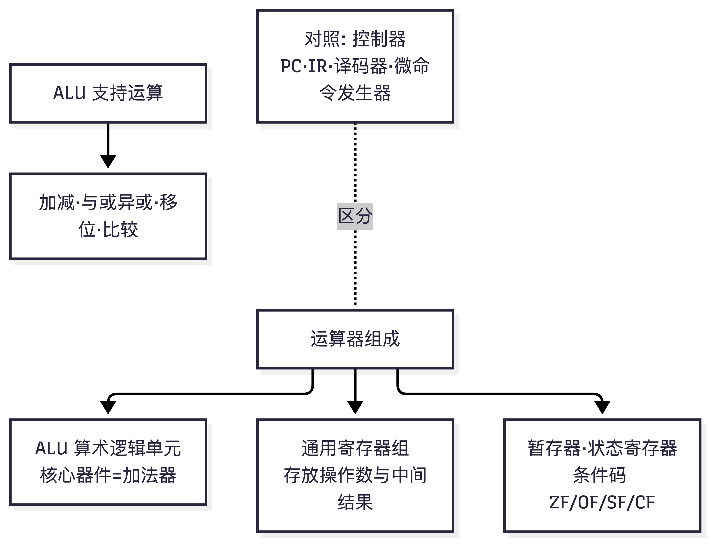

📌 锚点：运算器=ALU+通用寄存器组+状态寄存器；ALU 核心器件=加法器。

### 第 3 章 程序的转换及机器级表示

#### 3.1 机器语言、汇编语言与翻译程序 ★★★

**定义详解**：机器语言=二进制机器指令；汇编语言=用**助记符、标号、寄存器名**等符号表示的、与机器指令**一一对应**的语言。翻译程序三种：**汇编程序**（汇编语言→机器语言）、**编译程序**（高级语言→目标代码）、**解释程序**（边翻译边执行）。反汇编 = 机器→汇编（逆向）。"用若干符号表示的、与机器指令一一对应的指令称为汇编指令"（2024.4 填空 11）。

**考试答题**

**📌 历年真题**

**【2026.4·单选 5】（2 分）** 反汇编程序是一种语言转换程序，它的功能是（　）
- A. 将汇编指令翻译成机器指令
- B. 将机器指令翻译成汇编指令 ✅
- C. 将高级语言程序翻译成汇编指令
- D. 将高级语言程序翻译成机器指令

**【2026.4·单选 6】（2 分）** 实现汇编语言代码转换为机器语言代码的是（　）
- A. 预处理
- B. 编译
- C. 汇编 ✅
- D. 链接

**【2024.10·填空 12】（2 分）** 与机器语言相对应的符号化表示语言称为____语言；其中的英文单词或缩写、标号、变量名等称为____。
答案：汇编；（汇编）助记符（符号）

**【2024.4·单选 3】** 下列不属于翻译程序种类的是（　）
- A. 汇编程序
- B. 解释程序
- C. 编译程序
- D. 链接程序 ✅

**🎯 考法**：单选考方向：**汇编 = 汇编语言→机器语言；反汇编 = 机器→汇编**（2026.4 单选 5、6 连考两题）；填空考定义。

**⚠️ 易混淆**：**链接程序不是翻译程序**；汇编程序是工具，汇编语言程序是翻译对象。


> **🖼 知识点图：机器语言·汇编语言与翻译程序对照**

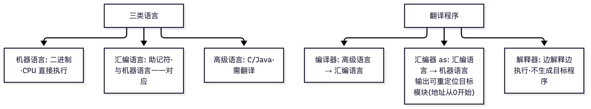

📌 锚点：高级语言→汇编由编译器完成；汇编→机器语言由汇编器完成；汇编器输出可重定位目标模块。

#### 3.2 指令执行过程 ★★（2026.4 新增高频）

**定义详解**：CPU 执行一条指令的六个步骤：**取指令 → 指令译码 → 计算源操作数地址并取操作数 → 执行数据操作 → 计算目的操作数地址并存结果 → 计算下条指令地址**。

支撑这一流程的 CPU 基本组成：**寄存器组**（PC、IR、MAR、MDR、通用寄存器等）+ **运算器**（ALU）+ **控制器**（产生时序控制信号）+ **中断机构** + **总线控制逻辑**。指令周期 = 取指周期 + 执行周期。

**考试答题**

**📌 历年真题**

**【2026.4·填空 17】（2 分）** CPU 执行一条指令的大致过程，分成取指令、______、计算源操作数地址并取操作数、执行数据操作、计算______并存结果、计算下条指令地址这几个步骤。
答案：（指令）译码；目的操作数地址

**🎯 考法**：填空挖两空：第 2 步"指令译码"、第 5 步"目的操作数地址"。答题时按顺序背，注意"源操作数在前、目的操作数在后"。

**✍️ 得分点**：
- 指令周期=取指周期+执行周期；取指结束后 PC 已指向下条指令。


> **🖼 知识点图：指令执行过程（数据通路）**

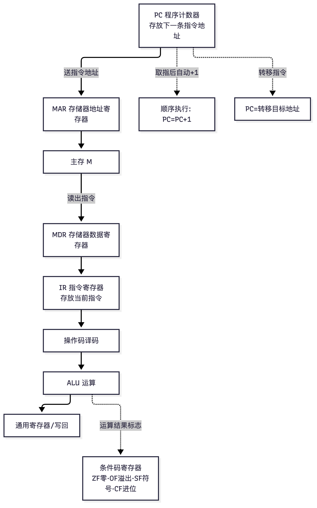

📌 锚点：PC→MAR→主存→MDR→IR→译码→ALU；取指后 PC+1，转移指令 PC=目标地址。

#### 3.3 指令格式与寻址方式 ★★

**定义详解**：一条机器指令 = **操作码(OP) + 地址码(操作数)**。按地址码个数分四种指令格式：

| 类型 | 格式 | 示例 |
|---|---|---|
| 三地址 | OP DST, SRC1, SRC2 | ADD R1, R2, R3（R1←R2+R3） |
| 二地址 | OP DST, SRC | MOV R1, R2 |
| 一地址 | OP SRC | INC R1（R1←R1+1，另一个操作数隐含为累加器） |
| 零地址 | OP | RET（操作数隐含在栈顶） |

寻址方式 = 寻找指令操作数**有效地址 EA** 的方式。常见八种：

| 寻址方式 | 有效地址 EA / 取数方式 | 典型应用 |
|---|---|---|
| 立即寻址 | 操作数直接写在指令中（无 EA） | 常数赋值 |
| 寄存器寻址 | 操作数在寄存器中（无 EA） | 局部变量 |
| 直接寻址 | EA = 指令中的地址 A | 全局变量 |
| 间接寻址 | EA = (A)：先取 A 单元的内容作地址，再取一次 | 指针操作 |
| 寄存器间接 | EA = (Ri)：寄存器内容是地址 | 灵活指针 |
| 变址寻址 | **EA = A + (变址寄存器 Rix)** | 数组元素 |
| 基址寻址 | **EA = (基址寄存器 Rb) + A** | 程序重定位（面向 OS） |
| 相对寻址 | **EA = (PC) + 偏移量 D** | 跳转/转移指令 |

**考试答题**

**📌 历年真题**

**【2024.10·单选 5】** 指令系统中采用不同寻址方式的目的主要是（　）
- A. 实现存储程序和程序控制
- B. 缩短指令长度，扩大寻址空间，提高编程灵活性 ✅
- C. 可以直接访问外存
- D. 提供扩展操作码的可能并降低指令译码难度

**🎯 考法**：单选"采用多种寻址方式的目的"——完整背下"缩短指令长度、扩大寻址空间、提高编程灵活性"三点。

**✍️ 得分点**：
- 判断各方式适用场景：数组循环→变址；程序浮动→基址/相对。

**⚠️ 易混淆**：干扰项"实现存储程序""降低译码难度"都不对。

**计算方法**：

**【例 3-1】变址寻址取数组元素**：指令 `MOV R0, 0800H(Rix)`（形式地址 A = 0800H），变址寄存器 Rix = 6，主存 0806H 单元的内容为 40H。求取到的操作数。

① EA = A + (Rix) = 0800H + 6 = **0806H**（**为什么两者相加**：变址寻址的地址合成逻辑——形式地址 A 是指令里写死的基准（数组首地址），变址寄存器 (Rix) 提供可变偏移（下标 i），基准 + 偏移 = 元素有效地址）
② 操作数 = (0806H) = **40H**（**为什么外面再套一层括号**：①算出的 0806H 只是"地址"，操作数存在该地址的单元里——还要再访一次存，取出单元内容 40H）

> **🖼 动图演示：变址寻址取数组元素（A + (IX)）**

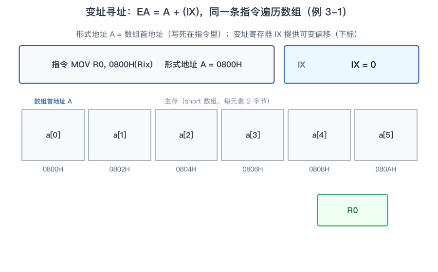

📌 锚点：**有效地址 = 形式地址（数组首址）+ 变址寄存器（下标）；同一条指令遍历整个数组，只改 IX**。
　变址寻址处理数组的道理：A 是数组首地址，Rix 存下标 i，改下标不改指令——循环里只需让 Rix 递增（**为什么适合遍历**：A+(IX) 恰是"首地址 + 第 i 个元素的位移量"，i 每加 1 就沿数组前进一个元素，指令本身一字不变）。

**【例 3-2】相对寻址算转移目标地址**：转移指令存放在主存 2000H 处，指令长 2 字节，指令中的位移量 D = −6（8 位补码 FAH）。求该指令跳转的目标地址。

① 取指结束后 PC 已自动加上指令长度：PC = 2000H + 2 = **2002H**（相对寻址的基准是"取指后的 PC"，不是指令自己的地址——最常见的失分点）
② 位移量 −6 的补码 = 11111010B = FAH（机器里存的正是它；**为什么负位移要写成补码**：位移量可正可负，机器统一按补码存放——转移时与 PC 直接做一次二进制加法即可，硬件无需区分正负）
③ 目标地址 = (PC) + D = 2002H − 6 = **1FFCH**（**为什么此时 PC 已自增**：取指周期结束 PC 自动 +指令长度、指向下一条指令，执行阶段算转移目标时读到的正是这个自增后的值——所以 D 是"相对下一条指令"的偏移，硬件只需一个加法器）

> **🖼 动图演示：相对寻址转移目标（PC + 偏移量）**

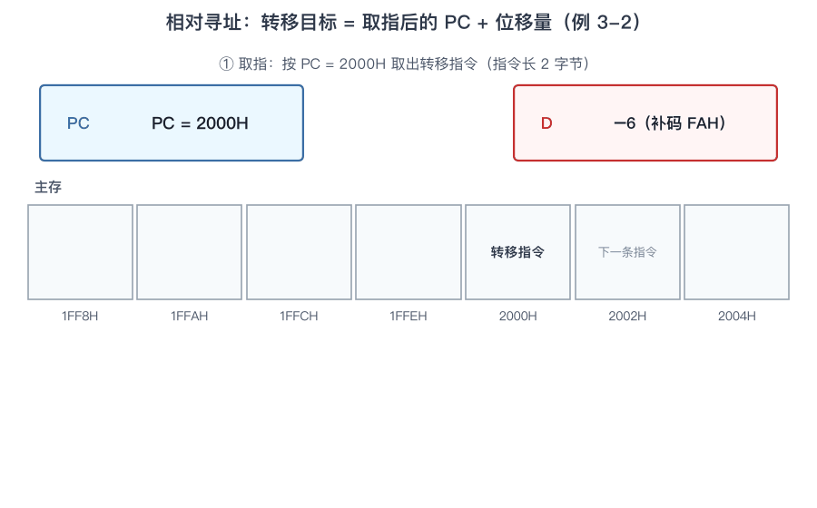

📌 锚点：**取指后 PC 已自增指向下一条；转移目标 = 自增后的 PC + 偏移量（补码，可正可负）**。
　相对寻址的好处：目标地址随程序整体平移而平移（D 不变），程序放在内存任何位置都能正确跳转——这就是"与位置无关"。


> **🖼 知识点图：指令格式与寻址方式**

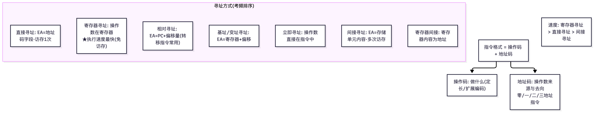

📌 锚点：指令=操作码+地址码；寄存器寻址执行最快，间接寻址需多次访存，相对寻址 EA=PC+偏移。

#### 3.4 寄存器分类：通用与专用 ★★★

**定义详解**：**通用寄存器**（EAX/EBX/ECX/EDX/ESI/EDI 等）可编程任意使用；**专用寄存器**各有唯一用途。完整清单：

| 寄存器 | 缩写 | 唯一用途 |
|---|---|---|
| 程序计数器 | **PC/IP** | 存放**下一条**指令的地址（取指后自动加指令长度） |
| 指令寄存器 | **IR** | 临时存放刚从主存取来的指令，供译码 |
| 存储器地址寄存器 | **MAR** | 存放要访问的主存单元地址（CPU→主存的地址通道） |
| 存储器数据寄存器 | **MDR** | 暂存与主存之间读/写的数据（CPU↔主存的数据通道） |
| 栈指针 | **SP** | 总是指向**栈顶**元素 |
| 帧指针 | **FP/EBP** | 界定当前栈帧 |
| 标志寄存器 | PSW/Flags | 存放 OF、CF、ZF 等状态标志 |

**考试答题**

**📌 历年真题**

**【2025.4·单选 4】** 下列不属于通用寄存器的部件是（　）
答案：SP（栈指针寄存器）/PC（指令指针寄存器）/标志寄存器等**专用**寄存器（选项未流传，视选项而定）

**【2025.4·填空 15】（2 分）** 栈的操作原则；SP（栈指针）总是指向____。
答案：栈顶元素（当前栈顶）

**🎯 考法**：单选"不属于通用寄存器的是"→ 在 SP/PC/BP/Flag 中选；填空"SP 总是指向____"→ **栈顶元素**。

**⚠️ 易混淆**：SP 是专用不是通用。


> **🖼 知识点图：寄存器分类：通用与专用**

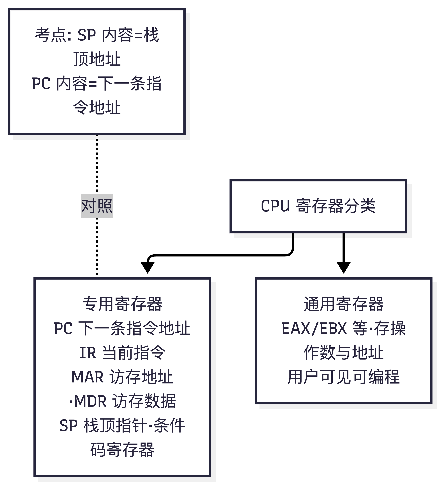

📌 锚点：专用寄存器：PC/IR/MAR/MDR/SP/条件码；通用寄存器可存数据与地址。

#### 3.5 Intel 与 AT&T(GCC) 汇编格式 ★★★（分析题常客）

**定义详解**：两种汇编语法对照（必须逐条背）：
| 区别点 | Intel 格式 | AT&T(GCC) 格式 |
|---|---|---|
| 操作数顺序 | **目的在前** `mov dst, src` | **源在前** `mov src, dst` |
| 寄存器 | 直接写 `eax` | 加 % 前缀 `%eax` |
| 立即数 | 直接写 `10` | 加 $ 前缀 `$10` |
| 操作数长度 | `mov eax, ...`（寄存器名体现） | 指令加后缀 b/w/l（字节/字/双字） |
| 内存地址 | `[ebp+8]` | `8(%ebp)` |

**考试答题**

**📌 历年真题**

另有 2024.10 分析题 28（Intel→GCC 汇编格式改写，汇编未收录全文）。

**🎯 考法**：分析题给 Intel 指令序列，要求改写为 GCC 默认格式。

**✍️ 得分点**：
- 答题四查：①先交换操作数顺序 ②寄存器补 % ③立即数补 $ ④按长度加 b/w/l 后缀。反向题同理。


> **🖼 知识点图：Intel 与 AT&T(GCC) 汇编格式对比**

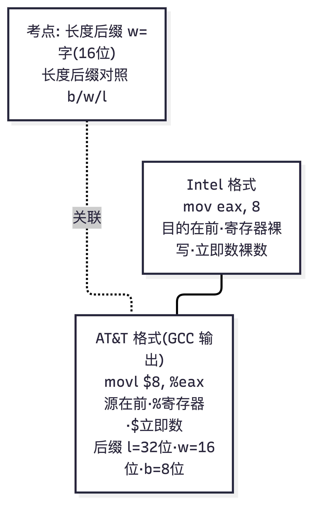

📌 锚点：AT&T 源在前目的在后、寄存器带 %、立即数带 $；Intel 反之。

#### 3.6 栈、栈帧与递归开销 ★★

**定义详解**：栈按"后进先出"原则操作，向低地址增长。**栈帧**=每次过程（函数）调用在栈中分配的一块区域，含返回地址、保存的寄存器、参数、局部变量，由 FP 与 SP 界定；调用结束栈帧释放。

**考试答题**

**📌 历年真题**

**【2024.10·简答 23】** 简述在递归深度较深时，递归调用的时间开销和空间开销。
> 【答案要点】→ 答题要点见下方得分点

**🎯 考法**：简答"递归调用的时空开销"。答题分"空间、时间"两段各写两点，最后加一句结论。

**✍️ 得分点**：
- 空间——每层调用一个栈帧，额外空间 O(递归深度)，过深**栈溢出**。
- 时间——每层都有 call/ret 与栈帧建立/拆除开销，且破坏 Cache 局部性，额外时间 O(n)。


> **🖼 知识点图：栈、栈帧与递归开销**

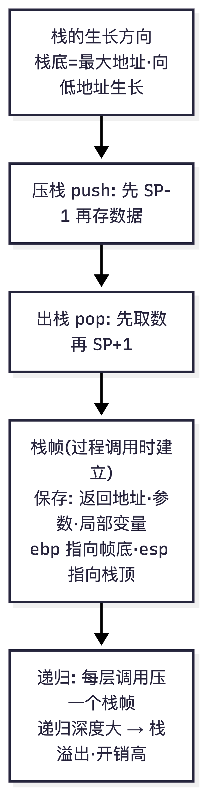

📌 锚点：栈底为最大地址向低生长：压栈先 SP-1 再存；栈帧保存参数/返回地址/局部变量。

#### 3.7 C 语言相关考点 ★★（2026.4 新增）

**定义详解**：C 循环结构三种：**while、do-while、for**（do-while 先执行后判断、至少执行一次）。数组：`static short A[4];` 定义静态短整型数组；**数组名 A 代表首地址 = 第一个元素 A[0] 的地址**；数组按行优先连续存放，元素地址 = 首地址 + 下标 × 元素长度。

**考试答题**

**📌 历年真题**

**【2026.4·填空 15】（2 分）** "static short A[4];" 语句是指定义一个具有 4 个元素的______short 数据类型数组 A，其首地址就是第一个元素______的地址。
答案：静态（static）；A[0]

**【2026.4·填空 14】（2 分）** C 语言中循环结构有三种：______语句、do~while 语句和______语句。
答案：while；for

**🎯 考法**：计算型填空/分析考"数组第 i 个元素的地址"；填空考循环三语句与 static 数组定义。

**✍️ 得分点**：
- 循环三语句缺 while 和 for；static（静态）short 数组、首地址=第一个元素 A[0] 的地址。

**计算方法**：

**【例 3-3】数组元素地址计算**：static short A[4]; 数组 A 首地址为 1000H，short 占 2 字节，求数组按行优先存放时 A[2] 的地址。

① 元素地址 = 首地址 + 下标 × 元素长度（**为什么这样算**：数组按行优先连续存放——A[2] 之前排着 2 个元素、每个 2 字节，其地址即首地址往后挪 2×2 字节）
② &A[2] = 1000H + 2×2 = 1000H + 4 = **1004H**（**为什么偏移是 2×下标**：主存按字节编址、每个地址对应 1 字节，而 short 元素占 2 字节——跳过 2 个元素就是跳过 4 个字节地址）
③ A[2] 本身存放在 1004H~1005H 两个字节（short = 2 字节，取数要访问一个"字"）

⚠️ 单位陷阱：sizeof(short) = **2** 字节不是 4；数组名 A 是**地址**（首地址 = &A[0]），不是第一个元素的值。


> **🖼 知识点图：C 语言相关考点速查**

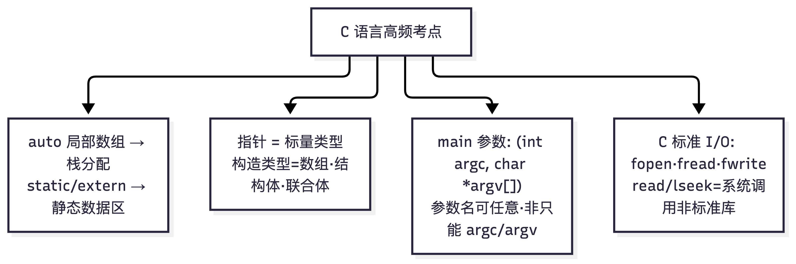

📌 锚点：auto 数组在栈、static 在静态区；指针是标量类型非构造类型；main 参数名可任意。

#### 3.8 CISC 与 RISC ★

**定义详解**：CISC（复杂指令集计算机）与 RISC（精简指令集计算机）对比：

| 特性 | CISC（x86） | RISC（ARM/MIPS/RISC-V） |
|---|---|---|
| 指令数量 | 多（200+ 条） | 少（<100 条） |
| 指令长度 | 变长 | 定长（通常 4 字节） |
| 访存限制 | 不限制 | **仅 Load/Store 指令可访存** |
| 寻址方式 | 多种复杂 | 少而简单 |
| 控制方式 | 多用微程序控制 | 多用硬布线控制 |
| 单条指令功能 | 强（一条指令干多件事） | 简单（大多单周期完成，利于流水线） |

**考试答题**

**🎯 考法**：单选/判断考 RISC 特征（规整、简单、流水友好）。

**⚠️ 易混淆**：干扰项常拿"增强单条指令功能、指令更复杂"混入——那是 CISC。

---


> **🖼 知识点图：CISC 与 RISC 对比**

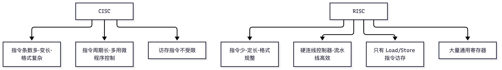

📌 锚点：RISC 指令少而定长、硬连线、只有 Load/Store 访存；CISC 微程序控制。

### 第 4 章 可执行文件的生成与加载执行

#### 4.1 源程序→可执行文件四步骤 ★★★

**定义详解**：**预处理 → 编译 → 汇编 → 链接**：
1. 预处理（cpp）：处理 #include/#define，宏展开，生成 .i 纯高级语言文件；
2. 编译（gcc）：.i → .s 汇编代码；
3. 汇编（as）：.s → .o **可重定位目标文件**（二进制，地址未定）；
4. 链接（ld）：多个 .o + 库 → **可执行目标文件**（地址确定）。

**考试答题**

**📌 历年真题**

**【2026.4·单选 6】（2 分）** 实现汇编语言代码转换为机器语言代码的是（　）
- A. 预处理
- B. 编译
- C. 汇编 ✅
- D. 链接

**【2024.10·单选 6】** 从源程序变为可执行文件的第一个步骤是（　）
- A. 链接
- B. 编译
- C. 汇编
- D. 预处理 ✅

**🎯 考法**：单选"第一步"（易错选"编译"）、单选"汇编语言→机器语言的一步"；填空按序默写四个名词。

**✍️ 得分点**：
- 单选"第一步"→ **预处理**；单选"汇编语言→机器语言的一步"→ 汇编。


> **🖼 图解 ②：IEEE 754 单精度格式与浮点加减流程**
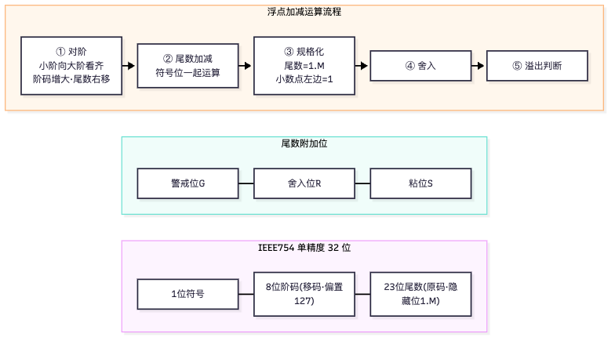
📌 锚点：**偏置单精度 127/双精度 1023；规格化尾数小数点左边=1（题库第 6 题答案 B）；对阶右规**。

#### 4.2 链接与符号表 ★★★（2026.4 分析题新考法）

**定义详解**：链接器把若干可重定位目标文件与库组合成一个可执行文件，做三件事：**符号解析**（每个引用绑定到唯一定义）+ **重定位**（确定最终地址、修改引用）。Linux/Unix 下目标文件与可执行文件采用 **ELF 格式**，三种类型：

| ELF 类型 | 说明 |
|---|---|
| 可重定位文件（.o） | 编译产物，地址未定，需链接 |
| 可执行文件 | 链接完成，地址确定，可直接加载运行 |
| 共享目标文件（.so） | 动态链接库，加载/运行时被映射进进程 |

可重定位目标文件中的符号三类：**全局符号**（本模块**定义**、可被其他模块引用的非静态函数与全局变量）、**外部符号**（本模块**引用**、定义在别处的符号，extern 声明）、局部符号（static，仅本模块可见）。

**考试答题**

**📌 历年真题**

**【2026.4·分析设计题 30】（6 分）** C 程序含 main.c（`int buf[2]={1,2}; extern void swap(); int main(){ swap(); return 0; }`）与 swap.c（`extern int buf[]; int *bufp0=&buf[0]; int *bufp1; void swap(){ int temp; bufp1=&buf[1]; temp=*bufp0; *bufp0=*bufp1; *bufp1=temp; }`）。问 main.o 与 swap.o 符号表中的全局符号、外部符号。
> 【答案要点】main.o：全局符号 = buf、main，外部符号 = swap；swap.o：全局符号 = bufp0、bufp1、swap，外部符号 = buf

**【2025.4·单选 6】** 程序使用链接的好处不包括（　）
答案：**"缩短程序执行时间"**一类选项（选项未流传；链接的好处=模块化开发、代码复用、便于维护更新）

**【2024.4·单选 6】** 用来将若干可重定位目标文件组合起来，生成一个可执行目标文件的过程称为（　）
- A. 预处理
- B. 编译
- C. 汇编
- D. 链接 ✅

**🎯 考法**：分析题考符号表归属（2026.4 分析题 30）；单选考链接定义与"链接的好处不包括"（2025.4 反向考）。

**✍️ 得分点**：
- 单选"可重定位目标文件→可执行目标文件的过程"→ 链接。
- 简答"链接的好处"→ 模块化开发、代码复用（共享库）、便于维护更新；好处**不含**"缩短执行时间"。
- 符号表判断口诀——**本模块定义的函数名/全局变量名 = 全局符号；本模块只声明（extern）而未定义、用到了的 = 外部符号**。算例见第三节 3.1 节（2026.4）第 30 题详解。


> **🖼 知识点图：链接与符号表解析流程**

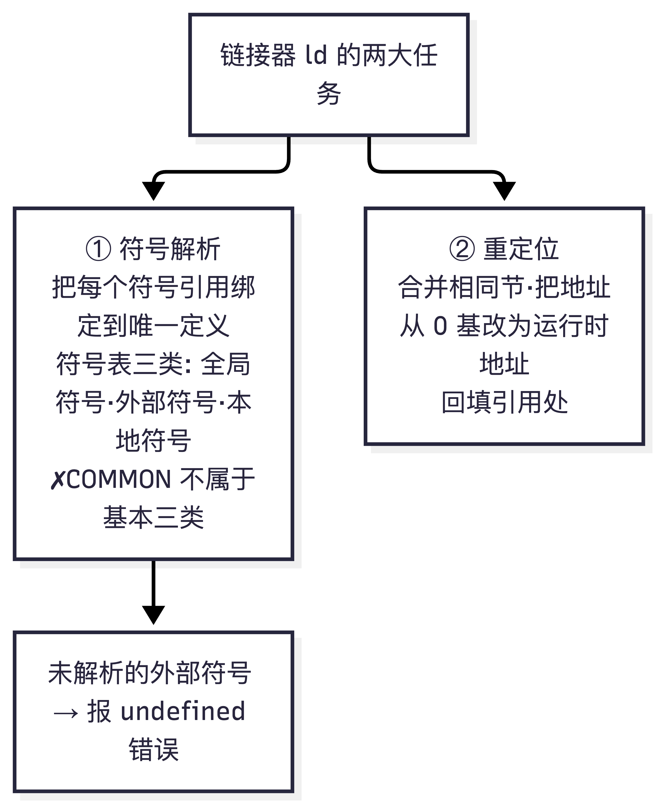

📌 锚点：符号表三类：全局/外部/本地；链接器完成符号解析与重定位。

#### 4.3 静态链接与动态链接 ★★★

**定义详解**：**静态链接**：链接时把库代码**复制**进可执行文件——文件大、内存中每个进程各带一份，但运行时不再依赖库；**动态链接**：链接推迟到**加载时或运行时**，可执行文件只记录引用信息，运行时把共享库**映射**进内存并绑定地址——内存中一份库代码多进程**共享**，库升级只需替换库文件。

**考试答题**

**📌 历年真题**

**【2026.4·简答 26】（5 分）** 简述静态链接和动态链接的差别。
> 【答案要点】→ 答题要点见下方得分点

**【2024.10·简答 25】** 简述动态链接的共享性和动态性。
> 【答案要点】→ 答题要点见下方得分点

**🎯 考法**：简答必背两特性（2024.10 简答 25 考"共享性与动态性"、2026.4 简答 26 考"两者差别"）。

**✍️ 得分点**：
- 共享性：一份库代码多个进程共享，省内存省磁盘；
- 动态性：链接时机推迟到加载/运行时才完成符号绑定（地址重定位）；
- 差别再补两点：库代码处理方式（复制 vs 映射）、更新维护（重新链接 vs 替换即生效）、动态链接有运行时开销。
- 答题按"时机、方式、共享、维护、开销"五维分条写，每条一行。


> **🖼 知识点图：静态链接与动态链接对比**

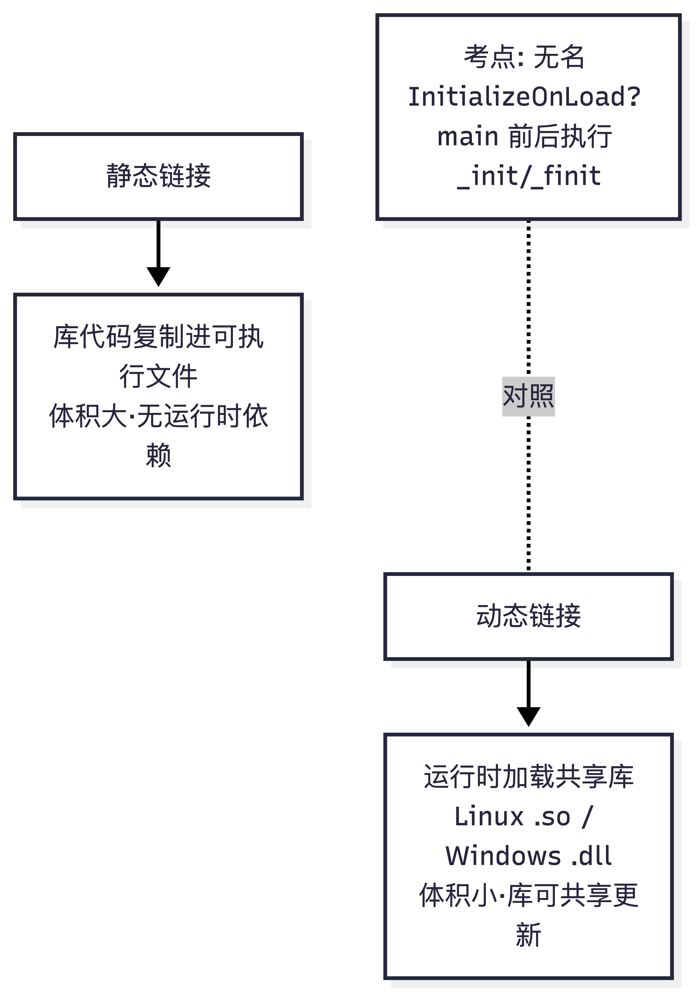

📌 锚点：静态=复制进可执行文件（体积大无依赖）；动态=运行时加载共享库（.so/.dll）。

#### 4.4 重定位 ★★★

**定义详解**：把程序中的**逻辑地址调整为运行时的实际内存地址**的过程。三种时机：**链接时静态重定位**（地址在链接后写死，不能移动）、**加载时重定位**（装入时按起始地址统一修改，移动需重做）、**运行时动态重定位**（借助基址/重定位寄存器，程序运行中可移动，现代 OS 主流）。

**考试答题**

**📌 历年真题**

**【2024.10·名词解释 21】（5 分）** 重定位
> 【答案要点】→ 答题要点见下方得分点

**🎯 考法**：名词解释高频（2024.10 名词解释 21）。

**✍️ 得分点**：
- 名词解释模板 = 一句话定义（"地址修改过程"必须出现）+ 两种以上时机 + 由谁完成（链接器/加载器）。三个得分点缺一不可。


> **🖼 知识点图：重定位流程（可重定位文件→运行时地址）**

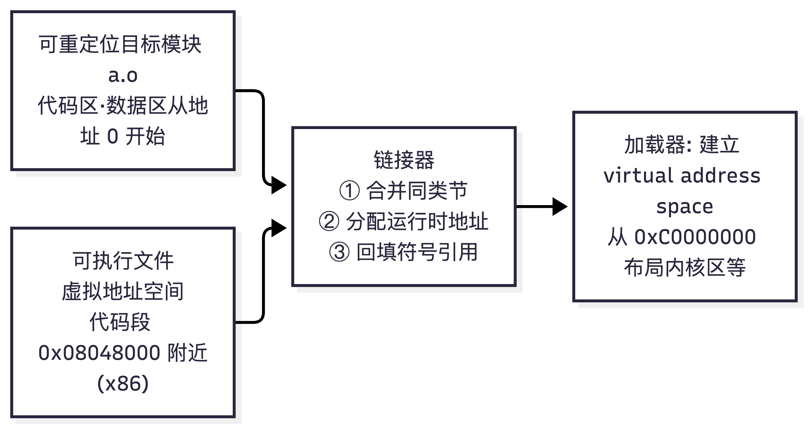

📌 锚点：可重定位文件代码/数据区都从 0 开始；链接时合并节并回填运行地址。

#### 4.5 进程、fork/execve 与地址空间 ★★★

**定义详解**：**进程 = 程序的一次运行过程**（程序是静态文件，进程是动态实体，有独立地址空间与上下文）。每个进程用唯一正整数 **PID** 标识（2026.4 单选 7）。虚拟地址空间分为**内核空间与用户空间**两部分（2026.4 填空 19）。核心函数：**fork**——复制当前进程创建子进程，**一次调用、两次返回**（父进程返回子进程 PID，子进程返回 0）；**execve**——在**当前进程**上下文中加载并运行新程序（替换进程映像，**不创建**新进程）；**lseek**——调整文件当前读写位置。

**考试答题**

**📌 历年真题**

**【2024.10·单选 7】** 在父进程中创建一个子进程，用到的函数是（　）
- A. main
- B. fork ✅
- C. execve
- D. add

**【2024.10·填空 19】（2 分）** 进程可以看成是____的一次运行过程，因而它具有……（题干截断）
答案：程序

**【2024.4·单选 7】** 在当前进程的上下文中加载并运行一个新程序，用到的函数是（　）
- A. main
- B. fork
- C. execve ✅
- D. add

**【2024.4·单选 10】** 需要调整文件的当前读/写位置，用到的函数是（　）
- A. open
- B. stat
- C. lseek ✅
- D. write

**🎯 考法**：单选配对题："创建子进程"→fork；"加载运行新程序"→execve；"调整读写位置"→lseek。

**✍️ 得分点**：
- 填空"进程是____的一次运行过程"→ 程序。

**⚠️ 易混淆**：execve 不产生新 PID。

---


> **🖼 知识点图：进程、fork/execve 与虚拟地址空间**

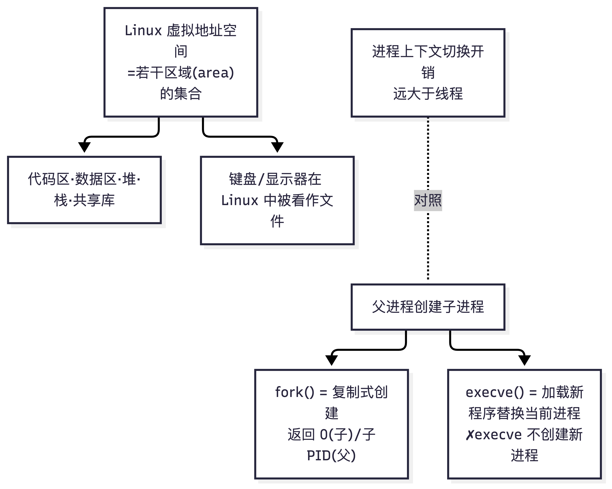

📌 锚点：fork 复制创建子进程、execve 加载替换；Linux 虚址空间=区域集合。

### 第 5 章 程序的存储访问（cache 大题章）


> **🖼 动图演示：存储层次金字塔（速度 / 容量 / 价格）**

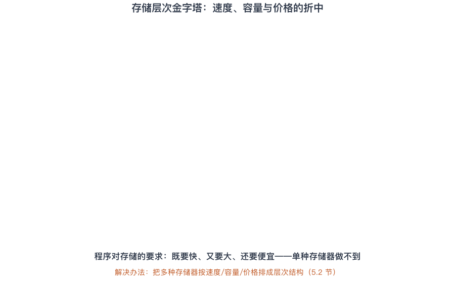

📌 锚点：**越往上越快越贵越小；cache 的存在理由 = 用层次结构逼近寄存器的速度、外存的容量**。

> **🖼 图解 ①：存储层次金字塔**
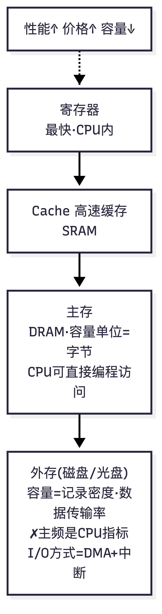
> **🖼 图解 ②：层次结构核心原则与 Cache 映射**
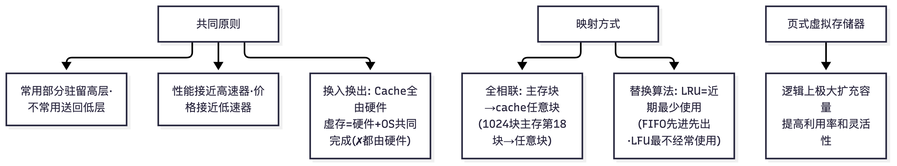
📌 锚点：**虚存换页=硬件+OS（不是纯硬件）；全相联=任意映射；LRU=近期最少使用**。

#### 5.1 存储元件与存储器分类 ★★★

**定义详解**：存储元件三种材料：**半导体器件、磁（性）材料、光介质**（2026.4 填空 18）。按断电后信息是否丢失分：**易失性**（RAM：SRAM、DRAM，即主存/cache）与**非易失性**（ROM、磁表面、光盘）。按存取方式分：随机存取（RAM/半导体 ROM）、顺序存取（磁带）、直接存取（磁盘）。

**考试答题**

**📌 历年真题**

**【2026.4·名词解释 22】（5 分）** 易失性存储器
> 【答案要点】→ 答题要点见下方得分点

**【2024.10·单选 8】** 属于易失性存储器的是（　）
- A. ROM
- B. 磁表面存储器
- C. 主存储器 ✅
- D. 光存储器

**【2024.4·单选 8】** 原题重复（同 2024.10·单选 8，选项不同），答案：A（随机存取存储器）

**🎯 考法**：名词解释"易失性存储器" = 定义 + 举例 + 对比；单选"属于易失性存储器"（2024.4、2024.10 连考，选项换了但答案同类）。

**✍️ 得分点**：
- 名词解释三段：定义（断电信息丢失）+ 举例（SRAM/DRAM/主存）+ 对比（ROM/磁/光非易失）。
- 单选"属于易失性存储器"→ RAM/主存。

**⚠️ 易混淆**：ROM 中可改写的（EEPROM/Flash）依然算非易失。

**计算方法**：

**【例 5-1】由地址范围算存储容量**（2024.10 计算题 28 同型）：某主存按字节编址，已配有 0000H～7FFFH 的存储区，求该存储区容量。

① 单元数 = 末地址 − 首地址 + 1 = 7FFFH − 0000H + 1 = **8000H**（**为什么 +1**：地址是单元编号，编号区间的单元个数 = 末编号 − 首编号 + 1——如 3 号到 7 号房间共 7−3+1=5 间，直接相减会漏掉首单元）
② 8000H = 8×16³ = 2¹⁵ = **32768 个单元**（**为什么往 2ⁿ 上化**：存储容量惯用 K/M 计量（1K = 2¹⁰），先把单元数写成 2 的幂才能直接换算成 KB）
③ 按字节编址（每单元 1 字节）→ 容量 = 32768B = **32KB**（**为什么 32768B = 32KB**：1KB = 2¹⁰B = 1024B，32768 ÷ 1024 = 32——除以 2¹⁰ 即把 B 换成 KB）
　（快速判定：16 位地址空间共 2¹⁶ = 64KB；0000H~7FFFH 是其中最高位为 0 的一半 → 恰 32KB。⚠️ 别把 8000H 误算成 2¹³——8×16³ = 8×2¹² = 2¹⁵。）
④ 若扩展位/芯片数在题目中出现：所需芯片数 = 总容量 ÷ 单片容量。


> **🖼 知识点图：存储元件与存储器分类**

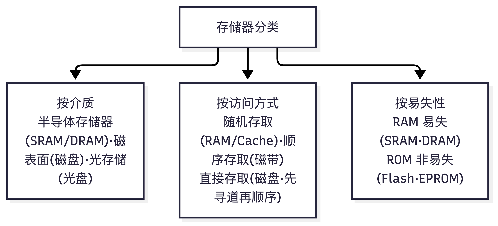

📌 锚点：按介质：半导体/磁/光；按访问：随机/顺序/直接；易失性区分 RAM 与 ROM。

#### 5.2 存储层次结构 ★★★

**定义详解**：层次自上而下：**寄存器 → cache（SRAM）→ 主存（DRAM）→ 磁盘 → 磁带/光盘**。规律：越往上**速度越快、容量越小、位价越高**。建立层次结构的依据是**程序访问的局部性原理**（时间局部性+空间局部性）——刚被访问过的项及其邻居很快还会被访问，所以把常用数据放上层。

**考试答题**

**📌 历年真题**

**【2025.4·单选 8】** 存取时间最小的存储器是（　）
答案：cache（选项未流传；若含寄存器选项则为寄存器）

**【2024.10·填空 18】（2 分）** 层次结构存储系统可以在____、____和价格方面达到……（题干截断）
答案：速度（存取时间）、容量

**🎯 考法**：填空考层次结构在哪些方面折中；单选考"存取时间最小的存储器"。

**✍️ 得分点**：
- 填空"层次结构存储系统在____、____和价格方面折中"→ 速度、容量。
- 单选"存取时间最小的存储器"→ 层次顶端：cache（有寄存器选项则选寄存器）。


> **🖼 图解：可执行文件生成四步流程（C 标准 I/O vs 系统调用）**
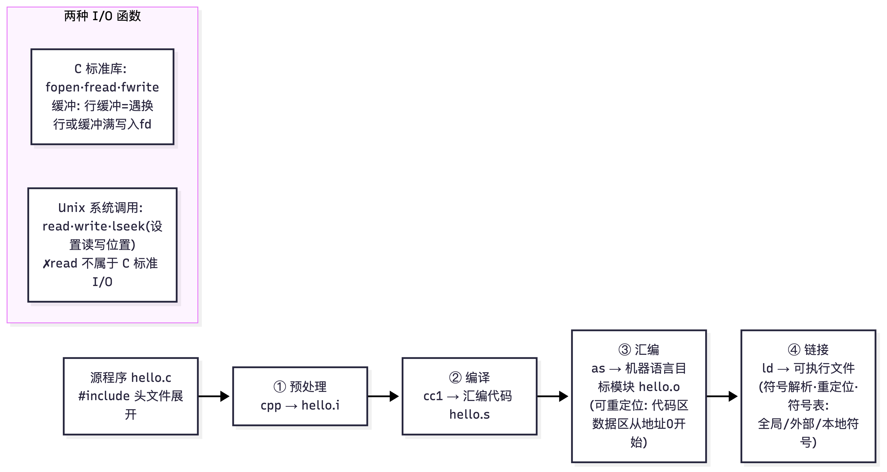
📌 锚点：**汇编器把汇编转机器语言；lseek 设置读写位置；read 是系统调用不是标准库**。

#### 5.3 SRAM 与 DRAM ★★

**定义详解**：SRAM（静态 RAM）：**触发器**存储信息，只要不断电信息不丢、**无需刷新**，快、贵、密度低 → 做 **cache**；DRAM（动态 RAM）：**电容**存储信息，电容会漏电、需**定时刷新**，慢、便宜、密度高 → 做**主存**。

**考试答题**

**🎯 考法**：单选/填空配对：cache—SRAM—触发器—不刷新；主存—DRAM—电容—刷新。

**⚠️ 易混淆**：**DRAM 刷新 ≠ cache 替换**，两回事。


> **🖼 知识点图：SRAM 与 DRAM 对比**

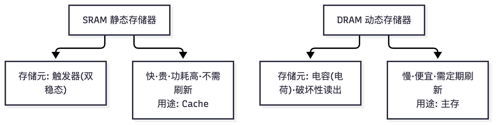

📌 锚点：SRAM 触发器·快·贵·做 Cache；DRAM 电容·需刷新·便宜·做主存。

#### 5.4 磁盘存取与存取时间 ★★

**定义详解**：磁盘读写定位三阶段：**寻道时间**（磁头沿半径移动到目标磁道）+ **旋转等待时间**（盘片旋转，等目标扇区转到磁头下，平均为半转）+ **数据传输时间**（读写数据并通过接口送出）。三者**串行发生，总时间 = 三者之和**。

**磁盘阵列 RAID** 常考级别：

| 级别 | 特点 |
|---|---|
| RAID 0 | 条带化分布，无冗余，性能最好、无容错 |
| RAID 1 | 镜像备份，100% 冗余，利用率 50% |
| RAID 5 | 分布式奇偶校验，兼顾性能与容错（坏一块盘可恢复） |
| RAID 10 | 先镜像再条带（1+0），高性能高可靠 |

**考试答题**

**📌 历年真题**

**【2024.4·单选 9】** 磁盘读/写操作不包括（　）【推导答案 D，待核实】
- A. 寻址操作
- B. 寻道操作
- C. 旋转等待操作
- D. 读/写申请操作 ✅

**🎯 考法**：单选"磁盘读写不包括的操作"→ 排除三阶段之外的选项；计算题给转速求平均旋转等待/总存取时间（见下例）。

**✍️ 得分点**：
- 寻道与旋转等待是两个先后发生的独立动作，别合并成一项。

**计算方法**：

**【例 5-2】磁盘一次读写总时间**：磁盘转速 7200 转/分，平均寻道时间 8ms，数据传输率 200MB/s，求读写 1KB 数据的平均存取时间。

① 平均寻道时间（题给）：**8ms**（**是什么**：磁头移动到目标磁道所需的时间，机械动作、题干直接给）
② 平均旋转等待 = 半转时间（**为什么取半圈**：目标扇区可能刚转过也可能快转来，平均下来正好半圈）：一转 = 60s ÷ 7200 = 8.33ms → 平均等待 = 8.33 ÷ 2 ≈ **4.17ms**
③ 传输时间 = 数据量 ÷ 传输率 = 1KB ÷ 200MB/s = 1024B ÷ (200×10⁶ B/s) ≈ 0.005ms ≈ **5μs**（**为什么**：扇区从磁头下方扫过的时间，取决于数据量和线速度）
④ 总时间 ≈ 8 + 4.17 + 0.005 ≈ **12.17ms**（**为什么三段相加**：先找道、再等转、后传输，串行发生，总时间 = 各段之和）

结构提示：磁盘时间大头是寻道和旋转（机械动作），传输（电子动作）几乎可忽略——这正是 cache 和预读存在的理由。

> **🖼 动图演示：磁盘一次读写总时间（寻道 → 旋转延迟 → 传输）**

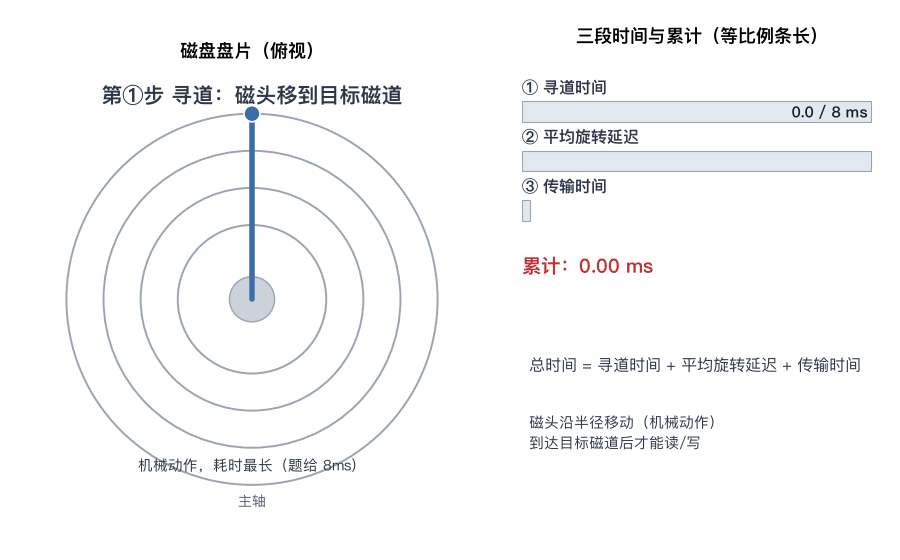

📌 锚点：**寻道 8ms（机械）+ 平均旋转延迟 4.17ms（等半圈）+ 传输 ≈5μs（电子可忽略）≈ 12.17ms；大头是机械动作，这正是 cache 与预读存在的理由。**


> **🖼 知识点图：磁盘存取时间计算流程（例题演算）**

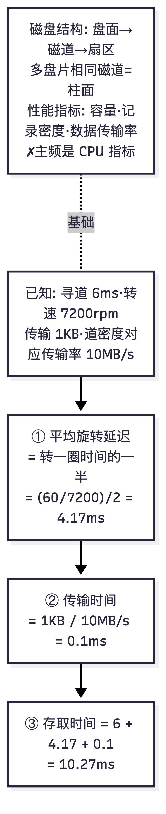

📌 锚点：存取时间=寻道时间+平均旋转延迟(半圈)+传输时间。

#### 5.5 cache 三种映射方式与地址划分 ★★★（分析/计算题必考）

**定义详解**：cache—主存以**块**为单位交换信息（2026.4 单选 8）。主存地址按映射方式切分：
| 映射方式 | 主存地址结构 | 去向约束 | Tag 比较次数 |
|---|---|---|---|
| 直接映射 | Tag + **行号** + 块内地址 | 每块只能去**唯一固定**行（行号=块号 mod 行数） | 1 次 |
| 全相联 | Tag + 块内地址（**无行号**） | 任意块可放**任意**行 | 全部行 |
| 组相联 | Tag + **组号** + 块内地址 | 组间直接（组号固定）、**组内全相联** | 组内所有行 |

**考试答题**

**📌 历年真题**

**【2026.4·计算题 27】（9 分）** 主存地址空间 64MB，按字节编址；cache 数据区 4KB，4 路组相联，LRU + 回写，块大小 64B。（1）主存地址字段如何划分？（2）cache 总容量多少位？
> 【答案要点】→ 答题要点见下方得分点与"计算方法"六步模板（本题完整算例；结果：地址划分 Tag(16)|组号(4)|块内(6)，总容量 530×64=33920 位）

**【2024.10·分析题 30】** 假定 cache 采用全相联方式，主存块大小为 64B……（cache 映射型，题干截断）
> 【答案要点】从汇编解析浓缩：①块内地址位数 = log₂64 = 6 位；②全相联：主存地址 = Tag + 块内地址（无行号字段），任意主存块可放入任意 cache 行；③比较次数 = cache 行数（全相联需与所有行的 Tag 比较）；④命中率/平均访问时间 = H×t_cache+(1−H)×t_主存。

**🎯 考法**：大题固定三问——地址字段划分 / cache 总容量 / 命中率或比较次数（2024.10 分析题 30 全相联、直接映射题各一道；2026.4 计算题 27 组相联）。

**✍️ 得分点**：
- 写"映射特征"一句话：直接映射"一对一、冲突率高但硬件简单"；全相联"任意放、利用率高但比较器贵"；组相联"折中"。
- 六步计算模板见下方"计算方法"。

**计算方法**（六步模板，配合 2026.4 计算题 27 算例：主存 64MB、cache 数据区 4KB、4 路组相联、块 64B）：
1. 主存地址位数 = log₂(主存容量) = log₂64MB = **26 位**（**为什么**：按字节编址时，容量是 2ⁿ 字节就需要 n 位地址才能给每个字节编上号）；
2. 块内地址位数 = log₂(块大小) = log₂64B = **6 位**（**为什么**：块内 64 个字节各需一个位置编号，6 位恰好覆盖 2⁶ 个位置）；
3. cache 行数 = 数据区容量 ÷ 块大小 = 4KB ÷ 64B = **64 行**（**为什么**：主存—cache 按块交换、每行恰好装一个块，数据区总量 ÷ 每块大小即行数）；
4. 组数 = 行数 ÷ 路数 = 64 ÷ 4 = **16 组** → 组号 log₂16 = **4 位**（**为什么组号决定去向**：组间直接映射——主存块号 mod 组数即它只能进的那组，组号字段就是主存地址中间那 4 位）；
5. Tag 位数 = 26 − 4 − 6 = **16 位**（**为什么 Tag = 总位数 − 组号 − 块内**：地址的低段已由组号/块内用掉，剩下的高位全是 Tag——用来区分"映射到同一组的那些不同主存块"）→ 地址结构 `Tag(16) | 组号(4) | 块内(6)`；
6. cache 总容量 = 行数 × 每行总位数，每行 = 数据位(64×8=512) + Tag(16) + 有效位(1) + 脏位(1，回写法才有；若计 LRU，4 路组内每行再加 2 位) = 530 位 → 总容量 = 64×530 = **33920 位**（**为什么加有效位/脏位**：有效位标记"该行数据是否可用"，脏位标记"改过没写回主存"——它们是管理开销，不是数据本身）。

（直接映射时第 4 步换成：行号位数 = log₂(行数)；全相联：无行号字段，Tag = 主存位数 − 块内位数。）

**【例 5-3】直接映射完整例**（2025.4 推荐预览第 1 题 / 2024.10 分析题 30 同型）：主存 64MB，按字节编址；cache 数据区 4KB，**直接映射**，块大小 64B。求主存地址字段划分与 Tag 位数。

① 主存地址位数 = log₂(64×2²⁰) = log₂2²⁶ = **26 位**
② 块内地址 = log₂64B = **6 位**（**为什么**：块内 64 个字节各需一个位置编号，6 位恰好覆盖 2⁶ 个位置）
③ cache 行数 = 4KB ÷ 64B = 64 行 → **行号 = log₂64 = 6 位**（**为什么行数 = 数据区÷块大小**：主存—cache 按块交换、每行恰好装一个块，数据区总量 ÷ 每块大小即行数；64 行需 6 位编号）
④ Tag = 26 − 6 − 6 = **14 位** → 地址结构 `Tag(14) | 行号(6) | 块内地址(6)`（**为什么 Tag 只存高位**：块内 6 位到 cache 后隐含可知、行号 6 位指明去哪一行——这两段不必存储，只剩高 14 位在"同一行内"无法区分不同主存块，必须存下来比对）
⑤ 行号定位规则：主存块号 mod 64（每块只能进唯一行；**为什么是 mod**：直接映射的约束就是"块号 ÷ 行数取余定行"，而 mod 64 恰好等于截取主存地址中间那 6 位行号字段——硬件无需真做除法、连线即得）；Tag 只需与该行比较 **1 次**（**为什么只比 1 次**：候选行已被行号唯一锁定，不存在第二个可能位置）
⑥ 对照上题同数据的组相联（组号 4 位 + Tag 16 位）：**直接映射行号字段更宽、Tag 更窄、比较次数最少（1 次）但冲突率高**；全相联则无行号字段（Tag = 26 − 6 = 20 位）、需与全部 64 行比较。三种映射一图看懂取舍。

> **🖼 动图演示：cache 直接映射（地址拆分 → 行号定位 → Tag 比对）**

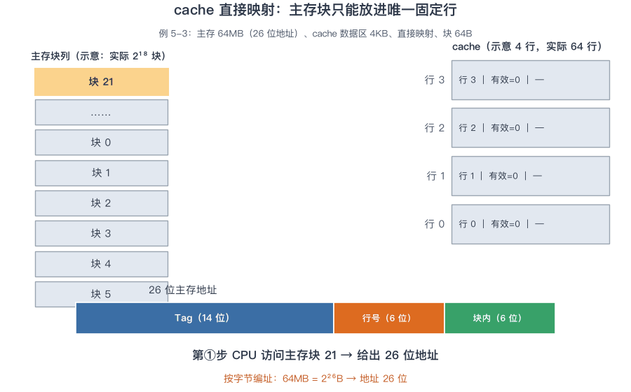

📌 锚点：**地址 26 位 = Tag(14) | 行号(6) | 块内(6)；行号 = 块号 mod 行数；Tag 只存高位、只比较 1 次**。

**cache 替换算法**（cache 满后新块挤掉旧块的规则，2026.4 计算题 27 提到 LRU）：

| 算法 | 规则 | 特点 |
|---|---|---|
| 随机 RAND | 随机选一行替换 | 实现最简单，效果不稳定 |
| 先进先出 FIFO | 替换**最早调入**的块 | 实现简单，可能换掉常用块 |
| **LRU 最近最少使用** | 替换**最久没有被访问**的块 | 命中率最高，最常用（需记录使用历史） |
| LFU 最不经常使用 | 替换**访问次数最少**的块 | 对"曾经频繁、如今冷门"的数据不敏感 |

**cache 写策略**（写命中时如何保持 cache 与主存一致）：

| 策略 | 做法 | 特点 |
|---|---|---|
| **写回法 Write Back** | 只写 cache，置**脏位**；该块被替换时才写回主存 | 速度快、总线流量小；一致性弱（断电丢数据），需脏位 |
| **写贯穿 Write Through** | 同时写 cache 和主存 | 一致性好；每次写都访存，速度慢 |

（2026.4 计算题 27 中"回写法需加脏位 1 位/行"正是写回法代价的体现。）


> **🖼 知识点图：cache 映射与地址划分计算（例题演算）**


📌 锚点：直接映射：地址=tag|行号|块内偏移；例：主存 1MB、cache 8KB、块 64B。

#### 5.6 命中率与平均访问时间 ★★★

**定义详解**：命中率 H = 命中次数 ÷ 访问总次数（N 命中 + N 缺失）。**平均访问时间 = H×t_cache + (1−H)×t_主存**。

**考试答题**

**📌 历年真题**

**【2024.10·分析题 30】** 假定 cache 采用全相联方式，主存块大小为 64B……（cache 映射型，题干截断；分析题末问常考命中率/平均访问时间）
> 【答案要点】命中率 H = 命中次数 ÷ 访问总次数；平均访问时间 = H×t_cache + (1−H)×t_主存

**🎯 考法**：分析题末问常考（2024.10 分析题 30）。

**✍️ 得分点**：
- 计算例：命中 1900 次、缺失 100 次 → H = 1900/2000 = 95%（命中率=命中次数÷总次数）；t_cache=10ns、t_主存=100ns → 平均 = 0.95×10 + 0.05×100 = 9.5+5 = **14.5ns**（公式的加权平均含义：95% 的访问走快速 cache 花费 10ns、5% 的访问缺失走主存花费 100ns，按概率加权）。
- 若题目按"同时访问"口径（cache 与主存并行启动，缺失代价 = t_cache+t_主存），则 Ta = 0.95×10 + 0.05×110 = 15ns——两种口径教材均有，按题目给定算式作答。

**⚠️ 易混淆**：别把 (1−H) 写成 H；缺失后的时间按整个主存访问算（不命中才去主存）。


> **🖼 知识点图：命中率与平均访问时间计算（例题演算）**

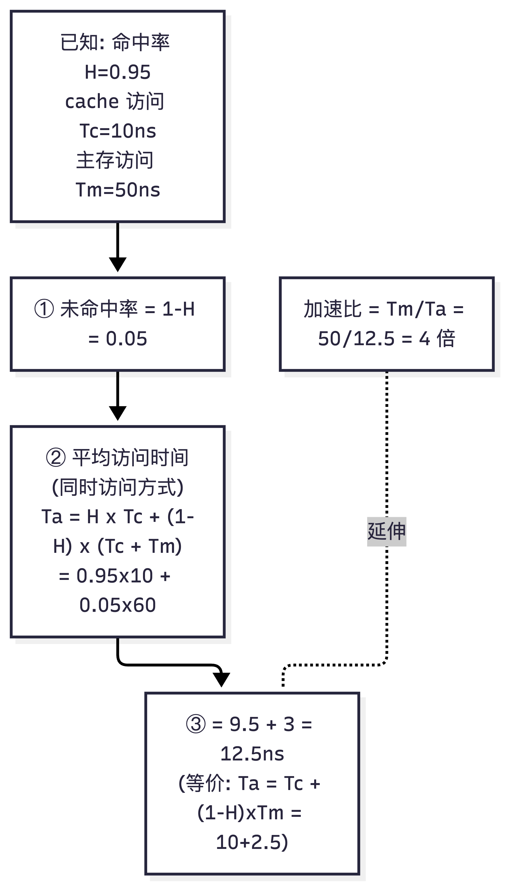

📌 锚点：Ta = Tc + (1-H)×Tm（同时访问）；缺失代价含 cache 访问时间。

#### 5.7 虚拟存储与页式地址转换 ★★★

**定义详解**：虚拟存储用磁盘扩充主存逻辑容量——程序用**虚拟地址**编程，运行时由硬件(MMU)+OS 转换为物理地址；同时解决**主存容量受限**与**程序重定位**两个问题（2024.10 填空 17）。管理方式：**页式**（等长页、碎片少内耗、无逻辑分段）、**段式**（按逻辑划分、易共享保护、有外部碎片）、**段页式**（先分段再分页，现代 OS 实际主流，2025.4 单选 10）。

**考试答题**

**📌 历年真题**

**【2026.4·填空 19】（2 分）** 虚拟地址空间分为两大部分：______内核区和______存储空间，分别简称为内核空间和用户空间。
答案：操作系统；用户程序

**【2025.4·单选 10】** 现代操作系统主要采用的虚拟存储管理方式是（　）
答案：段页式（选项未流传）

**🎯 考法**：单选"现代 OS 主要采用"→ **段页式**；计算题考页式虚拟地址转换。

**✍️ 得分点**：
- 计算题：虚拟地址 = **页号 + 页内偏移**（页 4KB → 页内 12 位；虚拟 64MB → 页号 14 位）；物理地址 = **页帧号 + 页内偏移**（偏移照抄，页号查页表替换）。
- 虚拟地址空间分为**操作系统内核区与用户程序存储空间**两大部分=内核空间/用户空间。

**TLB（快表 / 转址旁路缓冲）**：页表本身的 **Cache**——用相联存储器存放最近使用的页表项。地址转换先查 TLB（命中则免访存查页表，纳秒级），未命中再查主存中的页表并把结果装入 TLB。作用：加速虚地址→物理地址的转换。

**计算方法**：

**【例 5-4】页式虚拟地址转换完整计算**：某机虚拟地址 32 位，页面大小 4KB，按字节编址；页表中第 5 号虚拟页对应的物理页帧号为 12FH。求虚拟地址 0050A8H 转换后的物理地址。

① 定字段宽度：页 4KB = 2¹²B → **页内偏移 12 位**（**为什么偏移 12 位**：一页内 4096 个字节各自要一个页内位置编号，12 位恰好覆盖 2¹² 个位置；页大小是 2 的幂保证了"页内偏移 = 地址低若干位"）；虚拟地址 32 位 → 虚拟页号 VPN = 32 − 12 = **20 位**
② 拆虚拟地址（二进制按 12 位切；**为什么从第 12 位切开**：页内偏移恒为地址最低 12 位、转换前后不变，剩下高位全是虚拟页号）：
```
虚拟地址 0050A8H = 0000 0000 0101 0000 1010 1000B
                   └────── VPN ──────┘└── 页内偏移 ──┘
VPN = 高 20 位 = 0005H = 5        偏移 = 低 12 位 = 0A8H
```
③ 查页表：第 5 页 → 物理页帧号 **12FH**（**为什么查页表**：页表逐页登记"虚拟页号 → 物理页帧号"的映射，以 VPN 为索引查到那一行即得帧号）
④ 拼物理地址 = 帧号 × 页大小 + 偏移 = 12FH × 1000H + 0A8H = **12F0A8H**（**为什么这样拼**：帧号 12FH 指明"物理内存中第 12FH 页的起始地址"，偏移是页内相对位置——页内相对位置转换前后不变，所以低 12 位原样照抄、只把高位页号换成帧号）
　（验算：12F0A8H 右移 12 位 = 12FH ✓，低 12 位 = 0A8H ✓）

三条铁律：**页内偏移原样照抄（不参与转换）；VPN 整体查表换成帧号；页大小是 2 的幂所以"乘页大小"就是左移。** 若题目再问 TLB：命中则省去第 ③ 步访存（直接得到帧号）。

> **🖼 动图演示：页式虚拟地址 → 物理地址（查页表）**

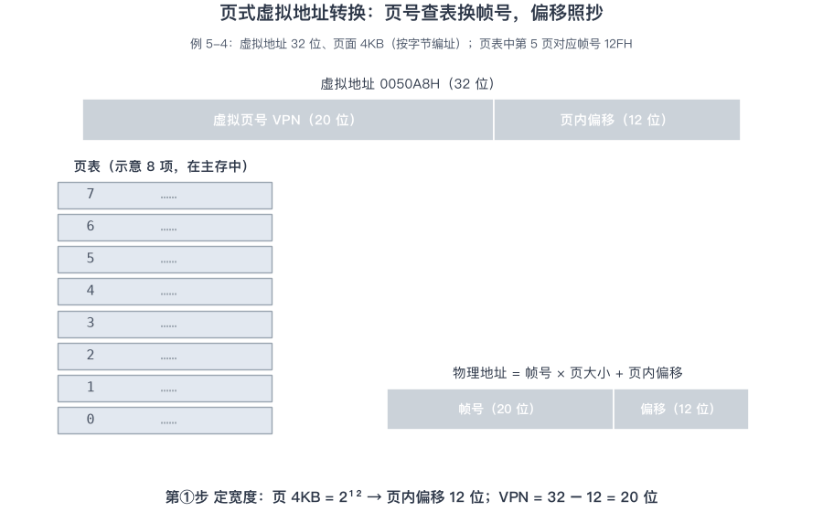

📌 锚点：**页内偏移原样照抄；虚页号整体查页表换帧号；物理地址 = 帧号 × 页大小 + 偏移**。

---


> **🖼 知识点图：页式虚拟存储地址转换计算（例题演算）**

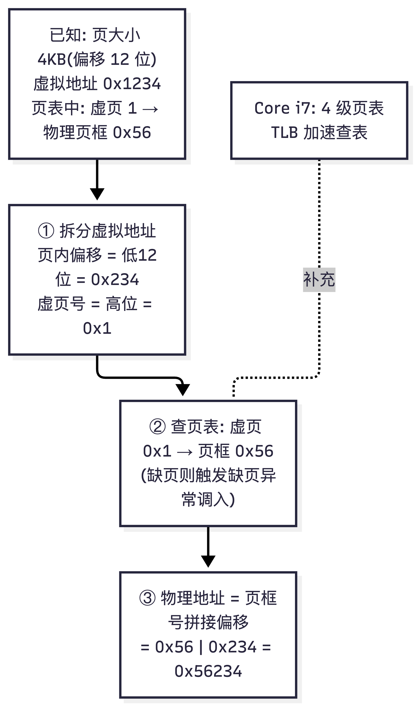

📌 锚点：虚拟地址拆成 页号+页内偏移；查页表得页框号；页大小 4KB=偏移 12 位。

### 第 6 章 程序中的 I/O 操作实现


> **🖼 图解 ①：三种 I/O 控制方式对比**
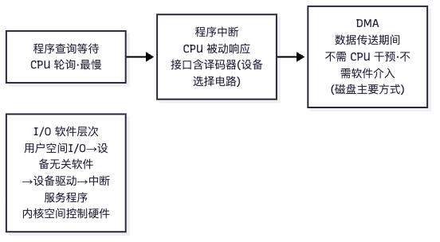
> **🖼 图解 ②：磁盘结构与堆栈操作速查**
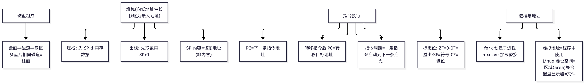
📌 锚点：**DMA=不干预不介入；柱面=多盘同磁道；压栈先减后存；转移后 PC=目标地址**。

#### 6.1 I/O 子系统层次 ★★★

**定义详解**：自上而下两层八级：**用户空间 I/O 软件**（运行时系统：库函数等 I/O 封装）→ 内核空间：**文件系统 → 与设备无关的 I/O 软件（设备命名/保护/缓冲/差错处理）→ 设备驱动程序 → 中断服务程序（最底层）** → I/O 硬件。层次化的目的：设备无关性、统一接口、便于维护。

**考试答题**

**📌 历年真题**

**【2026.4·单选 10】（2 分）** 下列不属于内核空间 I/O 软件部分的是（　）
- A. 与设备无关的 I/O 软件
- B. 设备驱动程序
- C. 中断服务程序
- D. 运行时系统 ✅

**【2024.10·单选 9】** 与设备无关的 I/O 软件不含（　）
- A. 缓存层
- B. 文件系统
- C. 中断服务程序 ✅
- D. 通用块设备 I/O 层

**【2024.10·填空 16】（2 分）** 内核空间的 I/O 软件由与设备无关的 I/O 软件、____、____（等）组成。（题干截断）
答案：设备驱动程序、中断服务程序（处理程序）；此外还有文件系统

**🎯 考法**：单选考层次归属辨析；填空考内核空间 I/O 软件组成。两级辨析题眼：看到"运行时系统/库函数"选用户空间；看到"中断服务"选最底层。

**✍️ 得分点**：
- 单选"不属于内核空间 I/O 软件的是"→ **运行时系统**（它在用户空间）。
- 单选"与设备无关的 I/O 软件**不含**"→ **中断服务程序**（它与硬件强相关，属最底层）。
- 填空"内核空间 I/O 软件由____组成"→ 设备驱动程序、中断服务程序（+文件系统）。


> **🖼 知识点图：I/O 子系统层次结构**

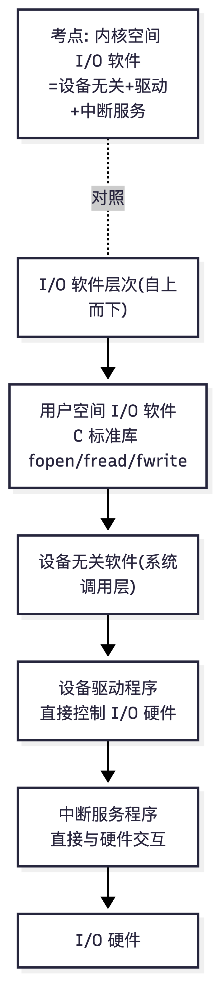

📌 锚点：用户空间 I/O → 设备无关软件 → 设备驱动程序 → 中断服务程序 → 硬件。

#### 6.2 系统调用及其开销 ★★★

**定义详解**：系统调用是用户程序请求内核服务的接口（打开/读/写/关闭文件等）。开销高的原因：①**用户态↔内核态切换**（陷入 trap 与返回）；②**保存/恢复现场**（寄存器上下文）；③参数与结果在**用户/内核空间之间拷贝**；④破坏 **Cache/TLB 局部性**（缓存污染）；⑤内核内还有系统调用处理程序→服务例程的间接分发。

**考试答题**

**📌 历年真题**

**【2025.4?·简答】（归属【待核实】）** 简述系统调用的开销非常高的原因。
> 【答案要点】→ 答题要点见下方得分点

**🎯 考法**：简答按上述五点分条写（跨考期高频简答；该题出自考生网推荐预览，第三节标注归属 2025.4 或其他考期【待核实】）。

**✍️ 得分点**：
- 见上方"定义详解"五点：用户态↔内核态切换（陷入 trap 与返回）、保存/恢复现场、参数与结果在用户/内核空间之间拷贝、破坏 Cache/TLB 局部性、内核内系统调用处理程序→服务例程的间接分发。

**⚠️ 易混淆**：库函数（printf）本身在**用户态**执行，内部用到系统调用时才陷内核；系统调用开销 ≠ 函数调用开销（后者无模式切换）。


> **🖼 知识点图：系统调用及其开销**


📌 锚点：系统调用经陷阱(trap)陷入内核态，开销远大于普通函数调用。

#### 6.3 程序直接控制 I/O（轮询） ★★

**定义详解**：最原始方式：CPU 执行 I/O 指令启动设备后，**反复读取设备状态寄存器查询是否就绪**（轮询/忙等），就绪后在 CPU 控制下传送数据。CPU 与设备串行工作。

**考试答题**

**📌 历年真题**

**【2026.4·简答 25】（5 分）** 简述程序直接控制 I/O 方式的基本思想。
> 【答案要点】→ 答题要点见下方得分点

**🎯 考法**：简答模板题（2026.4 简答 25）。答题必须写"忙等/查询状态"这个关键词。

**✍️ 得分点**：
- ①CPU 启动设备并**反复查询状态**；②就绪后由 CPU 传送一个字/字节；③缺点——CPU 忙等、与设备串行、利用率低；④适用——CPU 不忙、设备较快或实时性要求高的场景。


> **🖼 知识点图：程序直接控制 I/O（轮询）流程**


📌 锚点：CPU 反复读状态寄存器等设备就绪，效率最低。

#### 6.4 中断控制 I/O 与中断服务三阶段 ★★★

**定义详解**：CPU 启动设备后**不再等待**、继续执行程序；设备就绪时经中断请求线向 CPU 发**中断请求**；CPU 在每条指令执行结束时检查中断，响应后：**准备阶段**（关中断、保存断点和现场）→ **处理阶段**（执行中断服务程序完成数据传送）→ **恢复阶段**（恢复现场与断点、开中断、返回）。三阶段名称填空连考（2026.4 填空 20）。

**考试答题**

**📌 历年真题**

**【2026.4·填空 20】（2 分）** 中断服务程序包含三个阶段：准备阶段、______阶段和______阶段。
答案：处理；恢复

**【2025.4·单选 7】** 下列属于内部异常的是（　）
答案：非法操作码（选项未流传；内部异常=缺页、非法操作码、除 0、越权访问等）

**【2024.10·简答 26】** 简述中断控制 I/O 方式的基本思想。
> 【答案要点】→ 答题要点见下方得分点

**🎯 考法**：简答考"基本思想"四点；填空考中断服务三阶段名称（2026.4 填空 20）。

**✍️ 得分点**：
- 简答四点：①启动后 CPU 不等待（并行工作）②就绪发中断请求 ③响应后保护现场→中断服务→恢复现场 ④对比程序直接控制消除了忙等。

**⚠️ 易混淆**：**内部异常**（缺页、非法操作码、除 0——来自 CPU 内部）≠ **外部中断**（I/O 完成、时钟——来自外设）。


> **🖼 知识点图：中断控制 I/O 与中断服务三阶段**


📌 锚点：设备就绪主动发中断；CPU 每条指令周期末查询中断请求；中断服务三阶段。

> **🖼 动图演示：中断处理三阶段（请求 → 响应 → 服务返回）**


📌 锚点：**准备（关中断/保存断点现场）→ 处理（执行服务程序）→ 恢复（恢复现场、开中断、返回断点）**。

#### 6.5 DMA 与主机占用率计算 ★★★

**定义详解**：DMA（直接存储器存取）：设备与主存之间开辟**直接数据通路**，由 **DMA 控制器**控制整块数据的传送，CPU 只在传送**前**（初始化/预处理）和传送**结束**（中断处理）介入，传送期间 CPU 可继续执行其他程序。适合磁盘等**成块、高速**传送。

**DMA 控制器四大组成部件**：

| 部件 | 作用 |
|---|---|
| 数据寄存器 DR | 暂存设备与主存之间传送的数据 |
| 内存地址寄存器 MAR | 存放数据在主存中的地址（传送后自动增减） |
| 数据计数器 DC | 存放尚未传送的字节数（减到 0 传送结束） |
| 命令/状态寄存器 CR | 接收 CPU 的 I/O 命令、反映设备状态 |

DMA 与主存争用总线的三种方式：

| 方式 | 做法 | CPU 效率 |
|---|---|---|
| 停止 CPU 访问 | DMA 传送期间 CPU 挂起让出总线 | 低（简单粗暴） |
| **周期挪用（窃取）** | DMA 每"偷"一个存储周期传送一个数据 | 较高（**最常用**） |
| CPU 与 DMA 交替访问 | 一个 CPU 周期拆成两半分时复用 | 最高（硬件代价大） |

**考试答题**

**📌 历年真题**

**【2026.4·分析设计题 29】（6 分）** 处理器主频执行（图中数字为 5000MHz【待核实，教材同型例题为 500MHz】）；磁盘控制器有 16B 数据缓冲器，磁盘传输速率 4MB/s；若用中断方式，每次传送开销 500 个时钟周期；磁盘只用 5% 的时间传输。求主机占用率。
> 【答案要点】从汇编解析浓缩：①中断间隔 = 16B÷4MB/s = 4μs；②单次开销 = 500 周期÷500MHz = 1μs（若按 5000MHz 则为 0.1μs）；③连续传输占用率 = 1μs÷4μs = 25%（5000MHz 则为 2.5%）；④计入磁盘 5% 忙碌时间 → 平均占用率 = 1.25%（5000MHz 则为 0.125%）。完整演算见下方【例 6-1】

**🎯 考法**：分析题考"中断方式 vs DMA 方式的主机占用率"（2026.4 分析题 29）。

**✍️ 得分点**：
- 简答"DMA 优点"——CPU 介入极少、无逐字传送的指令级开销、成块传送效率高；注意 DMA 预处理/后处理仍需 CPU。

**计算方法**：

**【例 6-1】中断方式 I/O 的主机占用率**（2026.4 分析题 29 原型）：磁盘控制器数据缓冲器 16B，磁盘传输速率 4MB/s，采用中断方式，每次中断（含处理）开销 500 个时钟周期，处理器主频 500MHz；磁盘仅有 5% 的时间在传输数据。求主机被磁盘 I/O 占用的时间比例。

① **算中断间隔**：缓冲器装满 16B 就发一次中断 → 两次中断的间隔 = 16B ÷ 4MB/s = 16 ÷ (4×10⁶) s = **4μs**（**为什么**：每传满 16B 缓冲器就触发一次中断，两次中断之间设备恰好传完一个缓冲器的数据，所以间隔 = 缓冲容量 ÷ 传输速率）
② **算单次开销**：500 周期 ÷ 500×10⁶ Hz = **1μs**（**为什么除以主频**：主频=每秒的周期数，周期数÷每秒周期数 = 秒数）
③ **连续传输时的占用率** = 开销 ÷ 间隔 = 1μs ÷ 4μs = **25%**（**为什么**：每 4μs 的时间里有 1μs CPU 在处理中断，这个比例就是 CPU 被磁盘 I/O 占去的份额）
④ **计入磁盘忙碌比例**：实际平均占用率 = 25% × 5% = **1.25%**（**为什么乘 5%**：磁盘并非一直在传数据——只有传输的那 5% 时间才产生中断，其余时间 CPU 占用为 0，所以按时间占比加权）
口诀：**占用率 = 每次开销时间 ÷ 中断时间间隔**（再乘设备忙碌比例）。

**对照——若改用 DMA**：一整块数据（如 4KB）传完才中断一次，中断间隔变为 4KB ÷ 4MB/s = 4096B ÷ (4×10⁶ B/s) ≈ 1.024ms，占用率 ≈ 1μs ÷ 1.024ms ≈ **0.098%**（约 0.1%），骤降两个数量级——这正是 DMA 适合成块传送的原因。

> **🖼 动图演示：中断方式 I/O 的主机占用率**


📌 锚点：**占用率 = 单次中断开销 ÷ 中断间隔（再乘设备忙碌比例）；改用 DMA 占用率骤降两个数量级**。

**四种 I/O 控制方式总对比**（简答/选择题一表定音）：

| 方式 | CPU 参与程度 | 传输单位 | 效率 | 适用场景 |
|---|---|---|---|---|
| 程序直接控制（轮询） | 全程忙等查询 | 字节 | 最低 | 简单低速设备 |
| 中断控制 | 每个数据完成时介入 | 字 | 中 | 中低速、随机数据 |
| DMA | 仅开始/结束介入 | **数据块** | 高 | 磁盘等高速批量 |
| 通道 | 几乎不介入（通道是专用处理器） | 一组块 | 最高 | 大型机多设备 |


> **🖼 知识点图：DMA 方式与主机占用率计算（例题演算）**


📌 锚点：DMA 传送不需 CPU 干预；占用率=每秒 DMA 处理时间÷总时间。

#### 6.6 流缓冲区与 I/O 端口编址 ★★

**定义详解**：标准库流缓冲三种属性：**全缓冲**（缓冲区满才刷新，普通文件）、**行缓冲**（遇换行刷新，终端 stdin/stdout）、**无缓冲**（立即写，stderr）。I/O 端口编址两种：**独立编址**（I/O 地址空间独立，需专用 I/O 指令 IN/OUT）、**统一编址**（存储器映射 I/O，端口占主存地址，用访存指令即可访问，无需专用指令）。

**考试答题**

**📌 历年真题**

**【2024.10·单选 10】** 普通文件的缓冲区属性为（　）
- A. 全缓冲 ✅
- B. 行缓冲
- C. 列缓冲
- D. 非缓冲

另有 2024.10 填空（流缓冲三属性名默写，汇编未收录该题）。

**🎯 考法**：单选"普通文件缓冲属性"→ **全缓冲**；填空考三属性名默写；统一/独立编址考名词解释或单选，抓题眼"是否占用主存地址空间"。

**⚠️ 易混淆**：终端是**行缓冲**不是全缓冲。

---


> **🖼 知识点图：流缓冲区与 I/O 端口编址**


📌 锚点：行缓冲遇换行或满即写 fd；I/O 端口编址=统一编址/独立编址。

## 三、历年真题汇编

> **来源与合规说明**：以下题目均通过搜索引擎从公开网页合法获取（来源优先级：省考试院官网 > 正规辅导机构/题库站 > 权威博客）。未登录、未绕过任何付费墙。各省考试试题由国家统一命制，题目版权归命题单位所有，此处仅作备考学习用途的题干与教研解析。
> **答案标注约定**：官方标准答案未能公开获取，下述答案均为【推导答案】（依据教材知识体系推导），其中选项为图片且无法辨识的题目已明确标注。

### 3.1 2026 年 4 月考期（全卷 30 题，试卷原件扫描图转录）

**来源**：[百分考试网 exam100.net 试题页](https://www.exam100.net/html/2026/lgl_0509/58931.html)（页面内嵌 4 张试卷原件扫描图，本节为逐字转录；图片带"百分考试网"水印）。试卷抬头："2026 年 4 月高等教育考试 计算机系统原理试题 课程代码：13015"，密级"绝密★考试结束前"，与真实试卷格式一致。

**题型结构（原件大题标题原文）**：单选 10×2=20 分；填空 10×2=20 分；名词解释 2×5=10 分；简答 4×5=20 分；计算 2×9=18 分；分析设计 2×6=12 分。

#### 单项选择题（第 1~10 题，每题 2 分）

**【2026.4·单选 1】** 属于计算机 I/O 设备的是

- A. CPU
- B. 算术逻辑部件
- C. 内存
- D. 显示器 ✅

📌 CPU/ALU/内存均属主机（存储/运算部件），显示器是输出设备

**【2026.4·单选 2】** CPU 中用来进行算术逻辑运算的部件是

- A. ALU ✅
- B. 加法器
- C. 移位器
- D. 多路选择器

📌 ALU 同时覆盖算术与逻辑运算；加法器/移位器只完成单一功能，是 ALU 的组成部件

**【2026.4·单选 3】** 十进制 192 对应的二进制是

- A. 10100000B
- B. 11000000B ✅
- C. 11100000B
- D. 11010000B

📌 192=128+64=2⁷+2⁶=11000000B

**【2026.4·单选 4】** 目前计算机中使用最广泛的西文字符集及其编码是

- A. ASCII 码 ✅
- B. 国标码
- C. 外码
- D. BCD 码

📌 国标码是汉字编码；BCD 是十进制二进制编码，不是字符集

**【2026.4·单选 5】** 反汇编程序是一种语言转换程序，它的功能是

- A. 将汇编指令翻译成机器指令
- B. 将机器指令翻译成汇编指令 ✅
- C. 将高级语言程序翻译成汇编指令
- D. 将高级语言程序翻译成机器指令

📌 反汇编 = 汇编的逆过程（机器→汇编）

**【2026.4·单选 6】** 实现汇编语言代码转换为机器语言代码的是

- A. 预处理
- B. 编译
- C. 汇编 ✅
- D. 链接

📌 汇编程序完成汇编语言→机器语言；编译是高级语言→汇编/机器语言

**【2026.4·单选 7】** 用一个唯一的正整数标识一个进程，简写为

- A. UID
- B. GID
- C. PID ✅
- D. NID

📌 PID=进程标识符（Process ID）；UID/GID 是用户/组标识

**【2026.4·单选 8】** cache 和主存之间的信息交换单位是

- A. 块 ✅
- B. 段
- C. 页
- D. 槽

📌 cache—主存层次以"块"为单位交换；"页"是主存—磁盘（虚拟存储）层次的单位，注意区分

**【2026.4·单选 9】** 下列设备中，属于输出设备的是

- A. 扫描仪
- B. 数字化仪
- C. 控制杆
- D. 绘图仪 ✅

📌 扫描仪/数字化仪是输入设备，控制杆（操纵杆）是输入设备，绘图仪输出图形

**【2026.4·单选 10】** 下列不属于内核空间 I/O 软件部分的是

- A. 与设备无关的 I/O 软件
- B. 设备驱动程序
- C. 中断服务程序
- D. 运行时系统 ✅

📌 运行时系统（含库函数等 I/O 封装）属**用户空间** I/O 软件；内核空间 I/O 软件 = 文件系统 → 与设备无关 I/O 软件 → 设备驱动 → 中断服务程序

#### 填空题（第 11~20 题，每题 2 分）

**【2026.4·填空 11】** 指挥计算机如何操作的指令序列称为______，指令操作的对象是______。

答案：**程序；数据**

📌 指令的有序序列即程序，其操作对象是数据

**【2026.4·填空 12】** 补码运算系统是一种模运算系统，可用加法实现______运算，且符号位可以和______一起参加运算。

答案：**减法；数值位**

📌 补码把减法化为加法，符号位可与数值位一起参与运算

**【2026.4·填空 13】** 指令所处理的基本数据类型分为______和______两种。

答案：**数值数据；非数值数据**

📌 对照 2024.10 填空第 11 题"非数值数据主要包括逻辑数据和字符数据"，可互相印证

**【2026.4·填空 14】** C 语言中循环结构有三种：______语句、do~while 语句和______语句。

答案：**while；for**

📌 C 语言三种循环：while、do~while、for

**【2026.4·填空 15】** "static short A[4];" 语句是指定义一个具有 4 个元素的______short 数据类型数组 A，其首地址就是第一个元素______的地址。

答案：**静态（static）；A[0]**

📌 static 定义静态存储数组；数组首地址即首元素 A[0] 的地址

**【2026.4·填空 16】** 通常把数据通路中专门进行数据运算的部件称为______元件或______元件。

答案：**组合（逻辑）；时序（逻辑）**

📌 数据通路运算部件分组合逻辑元件与时序逻辑元件

**【2026.4·填空 17】** CPU 执行一条指令的大致过程，分成取指令、______、计算源操作数地址并取操作数、执行数据操作、计算______并存结果、计算下条指令地址这几个步骤。

答案：**（指令）译码；目的操作数地址**

📌 指令执行步骤：取指 → 译码 → 取操作数 → 执行 → 计算目的地址并存结果 → 计算下条指令地址

**【2026.4·填空 18】** 目前使用的存储元件主要有______器件、______材料和光介质。

答案：**半导体；磁（性）**

📌 存储介质三大类：半导体、磁介质、光介质

**【2026.4·填空 19】** 虚拟地址空间分为两大部分：______内核区和______存储空间，分别简称为内核空间和用户空间。

答案：**操作系统；用户程序**

📌 内核区属操作系统，用户区属用户程序

**【2026.4·填空 20】** 中断服务程序包含三个阶段：准备阶段、______阶段和______阶段。

答案：**处理；恢复**

📌 中断服务三阶段：准备 → 处理 → 恢复

#### 名词解释（第 21~22 题，每题 5 分）

**21. 机器数**
> 【推导答案要点】数及其符号在计算机中的数字化表示——把符号"数值化"（用 0/1 表示正/负）后连同数值位一起编码存在机器里的数；对应的实际数值称为真值。

**22. 易失性存储器**
> 【推导答案要点】断电后所存信息随即丢失的存储器，如 SRAM/DRAM（主存、cache）；与之相对，ROM、磁表面、光存储器为非易失性存储器。

#### 简答题（第 23~26 题，每题 5 分）

**23. 简述计算机系统基本性能指标和 CPU 的性能指标。**
> 【推导答案要点】
> - 机器基本性能指标：机器字长（一次能处理的二进制位数）、主频、存储容量、运算速度等；
> - CPU 性能指标：主频（时钟频率）、CPI（执行一条指令的平均时钟周期数）、MIPS（每秒执行百万条指令数）、程序执行时间（CPU 时间 = 指令条数 × CPI ÷ 主频）；
> - 点题：性能由三者共同决定，不能只看主频。

**24. 简述原码补码运算过程。**
> 【推导答案要点】
> - 原码加减：符号位与数值位分开处理。同号相加数值位相加、符号不变；异号相减转为加负数的补…（实际按教材口径：异号相加时先比较绝对值大小，用大数减小数，符号取绝对值大的操作数符号）；
> - 补码加减：符号位与数值位**一起**按模 2ⁿ 运算；减法化为加法（加 [−y]补 = 对 y 补码取反加一）；最高位进位自然丢弃；
> - 结论：补码把减法统一为加法、简化运算器线路，故机器中整数普遍用补码表示。

**25. 简述程序直接控制 I/O 方式的基本思想。**
> 【推导答案要点】
> - CPU 直接执行 I/O 指令启动设备，并**反复查询（轮询）设备状态**；
> - 查到"就绪"后才在 CPU 控制下传送一个字/字节的数据；
> - 缺点：CPU 与设备串行工作、忙等（查询期间不能做其他事），CPU 利用率低；适合设备快、CPU 不忙的场景。

**26. 简述静态链接和动态链接的差别。**
> 【推导答案要点】
> - 链接时机：静态在**链接时**一次性完成；动态推迟到**加载时或运行时**；
> - 库代码：静态把库代码复制进可执行文件（文件大、每个进程各带一份）；动态只在引用处记录信息、运行时映射共享库（内存中一份库代码多进程共享）；
> - 更新维护：静态库升级须重新链接所有程序；动态库替换文件即可生效；
> - 开销：动态链接有加载/运行时地址绑定的额外开销。

#### 计算题（第 27~28 题，每题 9 分）

**27.** 主存地址空间 64MB，按字节编址；cache 数据区 4KB，4 路组相联，LRU + 回写，块大小 64B。
- （1）主存地址字段如何划分？（2）cache 总容量多少位？

> 【推导答案】
> ① 主存 64MB=2²⁶B → 主存地址 26 位；块 64B → 块内地址 6 位；
> ② cache 行数 = 4KB ÷ 64B = 64 行；4 路组相联 → 组数 = 64 ÷ 4 = 16 组 → 组索引 4 位；
> ③ Tag = 26 − 4 − 6 = **16 位**。地址划分：`Tag(16) | 组号(4) | 块内地址(6)`；
> ④ 总容量 = 每行（数据 64×8=512 位 + Tag 16 位 + 有效位 1 位 + 脏位 1 位）= 530 位 × 64 行 = **33920 位**（回写方式需脏位；若计入 LRU 替换信息，4 路组内每行还需 2 位，共再加 128 位）。

**28.** 两个指令序列 S1/S2 在 500MHz 机器上运行，指令分 A、B、C、D 四类，CPI 及条数如题 28 表。求：(1) 各有多少条指令；(2) 各自 CPI；(3) 时钟周期数；(4) 执行时间。

> ⚠️ 扫描图中"各指令的 CPI"一行的数值模糊，A/B/C/D 各自的 CPI【待核实】。可辨识数据：S1 条数（A~D）= 1、2、3、4；S2 条数（A~D）= 5、2、2、1。
> 【解题模板】①N = Σ条数ᵢ；②CPI = Σ(条数ᵢ×CPIᵢ) ÷ N；③周期数 = Σ(条数ᵢ×CPIᵢ)；④执行时间 = 周期数 ÷ 500MHz（周期数 × 2ns）。与 2024.10 第 27 题（同型 CPI 题）共用此模板。

#### 分析设计题（第 29~30 题，每题 6 分）

**29.** 处理器主频执行（图中数字为 5000MHz【待核实，教材同型例题为 500MHz】）；磁盘控制器有 16B 数据缓冲器，磁盘传输速率 4MB/s；若用中断方式，每次传送开销 500 个时钟周期；磁盘只用 5% 的时间传输。求主机占用率。

> 【推导答案】
> ① 每次传送 16B，中断间隔 = 16B ÷ 4MB/s = 4μs；
> ② 每次中断开销 = 500 周期 ÷ 500MHz = 1μs（若按 5000MHz 则为 0.1μs）；
> ③ 磁盘连续传输时主机占用率 = 1μs ÷ 4μs = **25%**（5000MHz 则为 2.5%）；
> ④ 仅 5% 时间传输 → 平均占用率 = 25% × 5% = **1.25%**（5000MHz 则为 0.125%）。

**30.** C 程序含 main.c（`int buf[2]={1,2}; extern void swap(); int main(){ swap(); return 0; }`）与 swap.c（`extern int buf[]; int *bufp0=&buf[0]; int *bufp1; void swap(){ int temp; bufp1=&buf[1]; temp=*bufp0; *bufp0=*bufp1; *bufp1=temp; }`）。问 main.o 与 swap.o 符号表中的全局符号、外部符号。
> 【推导答案】
> - **main.o**：全局符号（本模块定义）= `buf`、`main`；外部符号（本模块引用、他处定义）= `swap`；
> - **swap.o**：全局符号 = `bufp0`、`bufp1`、`swap`；外部符号 = `buf`。
> 解析：定义的非静态全局变量与函数名是全局符号（定义者）；`extern` 声明且未在本模块定义的是外部符号（引用者）。

---

### 3.2 2025 年 4 月考期（第 15~30 题官方渠道仅见收费预览）

**来源**：[考生网 paper-120991](https://www.zikaosw.cn/kaoshi/paper-120991.html)（试卷元数据：30 题）

#### 单项选择题（第 1~10 题；每题分值按 2026.04 原件推定为 2 分【待核实】）

**【2025.4·单选 1】** 下列数中最小的数是（选项为图片，无法辨识）

答案：A（选项未流传）

📌 【无法作答——选项内容未能获取】搜索线索显示参考答案为 A【待核实】；方法：把各数统一化为二进制（BCD 码按每 4 位折算十进制）再比较

**【2025.4·单选 2】** 计算机系统中采用补码运算的目的是

答案：简化加减法运算（符号位参与运算，减法可转换为加法）（选项未流传）

📌 补码把减法统一为加法、使符号位与数值位一起参与运算，且 0 的表示唯一

**【2025.4·单选 3】** 下列说法不正确的是（涉及堆栈指针 SP、变址寻址、数据交换指令等表述）【选项完整内容待核实】

答案：需逐项核对（选项未流传）

📌 【推导答案】需逐项核对；注意 SP 是专用寄存器、变址寻址适合处理数组等定式

**【2025.4·单选 4】** 下列不属于通用寄存器的部件是

答案：SP（栈指针寄存器）/PC（指令指针寄存器）/标志寄存器等**专用**寄存器（视选项而定）（选项未流传）

📌 通用寄存器 = EAX、EBX、ECX、EDX、ESI、EDI 等；SP、BP、PC、Flag 属专用寄存器

**【2025.4·单选 5】** 下列不属于指令集体系结构（ISA）设计所追求的目标是

答案："增加指令条数/增强单条指令功能（CISC 化）"一类选项（选项未流传）

📌 RISC 追求规整、简单、便于流水

**【2025.4·单选 6】** 程序使用链接的好处不包括

答案："缩短程序执行时间"类选项（选项未流传）

📌 链接的好处=模块化开发、代码复用（共享库）、便于更新维护；好处不在"运行更快"

**【2025.4·单选 7】** 下列属于内部异常的是

答案：非法操作码（选项未流传）

📌 内部异常=缺页、非法操作码、除 0、越权访问等；外设 I/O 完成、时钟滴答属外部中断

**【2025.4·单选 8】** 存取时间最小的存储器是

答案：cache（若含寄存器选项则为寄存器）（选项未流传）

📌 层次越高速度越快：寄存器 > cache > 主存 > 磁盘

**【2025.4·单选 9】** 下列不是 I/O 子系统特性的是【选项完整内容待核实】

答案：未获取（选项未流传）

📌 I/O 子系统特性从"层次化、设备无关性、共享与保护"角度判断

**【2025.4·单选 10】** 现代操作系统主要采用的虚拟存储管理方式是

答案：段页式（选项未流传）

📌 纯页式/段式各有缺陷（页式无逻辑分段、段式易产生外部碎片），现代 OS（如 Linux/Windows）实际采用段页式（或以页式为基础的段页机制）

#### 填空题（第 11~15 题，每题 2 分）

**【2025.4·填空 11】** 程序设计语言按抽象层次：机器语言 → ____语言 → 高级语言。

答案：**汇编**

📌 三层抽象：机器语言 → 汇编语言 → 高级语言

**【2025.4·填空 12】** CPU 访问主存的总线信号包括：____、数据线和控制线。

答案：**地址线**

📌 总线三组信号：地址线、数据线、控制线

**【2025.4·填空 13】** 浮点数加减运算需要经过对阶、____、规格化和舍入 4 个步骤。

答案：**尾数加减**

📌 浮点加减四步：对阶 → 尾数加减 → 规格化 → 舍入

**【2025.4·填空 14】** 冯·诺依曼计算机硬件由运算器、____、存储器、输入设备和输出设备五大部件组成。

答案：**控制器**

📌 五大部件：运算器、控制器、存储器、输入设备、输出设备

**【2025.4·填空 15】** 栈的操作原则；SP（栈指针）总是指向____。

答案：**栈顶元素（当前栈顶）**

📌 SP 始终指向当前栈顶

#### 主观题（第 16~30 题）

官方渠道未公开该部分文字内容。考生网三个试卷页共用的推荐预览中出现以下 6 道主观题题干，**可能属于 2025.4 或其他考期，归属【待核实】**：

1. 【分析题】假定 cache 采用**直接映射**方式，主存块大小为 64B……（题干截断）
2. 【分析题】将以下 **Intel 格式的汇编指令转换为 GCC 默认（AT&T）格式**……（题干截断）
3. 【计算题】某计算机主存最大寻址空间为 **4GB**，按字节编址……（题干截断）
4. 【计算题】假设计算机 M 的指令集中包含 A、B、C、D 四类指令……（题干截断，CPI 计算型）
5. 【简答题】简述**系统调用的开销非常高**的原因。
6. 【分析设计题】某计算机的主存空间大小为 **512MB**，按字节编址……（题干截断）

**参考解析（推导）——系统调用开销高的原因**：
- 需要从用户态切换到内核态（陷入 trap），有模式切换开销；
- 需要保存/恢复现场（寄存器上下文）；
- 参数与结果需要在用户空间与内核空间之间拷贝；
- 破坏 Cache/TLB 局部性（缓存污染），返回后命中率下降；
- 内核中还需经过系统调用处理程序→服务例程的间接分发。

---

### 3.3 2024 年 10 月考期（全卷 30 题题干均可获取，前 15 题选项完整）

**来源**：[考生网 paper-120993](https://www.zikaosw.cn/kaoshi/paper-120993.html)（试卷元数据：30 题）；题型结构另见[希赛网题库页](https://www.educity.cn/zhuanjieben/tiku/389935.html)（总分 100、150 分钟）

#### 单项选择题（第 1~10 题；每题分值按 2026.04 原件推定为 2 分【待核实】）

**【2024.10·单选 1】** 下列数中最大的数是（选项为图片，无法辨识）

答案：C（选项未流传）

📌 【无法作答——选项内容未能获取】搜索线索（[Scribd 文档标题页](https://www.scribd.com/document/1015318831/)及百度知道快照）显示参考答案为 **C**【待核实】

**【2024.10·单选 2】** 冯·诺依曼计算机工作方式的基本特点是

- A. 多指令流单数据流
- B. 存储程序工作方式 ✅
- C. 堆栈操作
- D. 存储器按内部选择地址

📌 存储程序 = 程序（指令+数据）事先存入存储器，CPU 按地址自动逐条取指执行；A 是并行体系结构分类，C 是栈式计算机特点

**【2024.10·单选 3】** 运算器的核心部件是

- A. 数据总线
- B. 通用寄存器
- C. 多路开关
- D. 算术逻辑运算单元 ✅

📌 ALU 完成算术与逻辑运算；寄存器、总线是配套部件

**【2024.10·单选 4】** 下列关于浮点运算器的描述，正确的是

- A. 浮点运算器可用阶码部件和尾数部件来实现 ✅
- B. 阶码部件可实现加减乘除四种运算
- C. 阶码部件可进行阶码相加、相减和相乘操作
- D. 尾数部件只进行乘法和除法运算

📌 阶码部件只做加减（对阶、规格化移位用），B/C 错；尾数部件做加减乘除，D 错

**【2024.10·单选 5】** 指令系统中采用不同寻址方式的目的主要是

- A. 实现存储程序和程序控制
- B. 缩短指令长度，扩大寻址空间，提高编程灵活性 ✅
- C. 可以直接访问外存
- D. 提供扩展操作码的可能并降低指令译码难度

📌 A 是存储程序概念；C 寻址方式不解决外存访问；D 与寻址方式无直接关系

**【2024.10·单选 6】** 从源程序变为可执行文件的第一个步骤是

- A. 链接
- B. 编译
- C. 汇编
- D. 预处理 ✅

📌 预处理（# 处理、宏展开、头文件包含）→编译→汇编→链接

**【2024.10·单选 7】** 在父进程中创建一个子进程，用到的函数是

- A. main
- B. fork ✅
- C. execve
- D. add

📌 execve 是在当前进程上下文中加载新程序，不创建新进程

**【2024.10·单选 8】** 属于易失性存储器的是

- A. ROM
- B. 磁表面存储器
- C. 主存储器 ✅
- D. 光存储器

📌 主存=RAM，断电丢失；ROM、磁、光均非易失

**【2024.10·单选 9】** 与设备无关的 I/O 软件不含

- A. 缓存层
- B. 文件系统
- C. 中断服务程序 ✅
- D. 通用块设备 I/O 层

📌 内核空间 I/O 软件（自上而下）= 文件系统 → 与设备无关 I/O 软件（含缓冲、设备命名保护、通用块设备层等）→ 设备驱动程序 → 中断服务程序；中断服务程序与设备硬件强相关，属最底层

**【2024.10·单选 10】** 普通文件的缓冲区属性为

- A. 全缓冲 ✅
- B. 行缓冲
- C. 列缓冲
- D. 非缓冲

📌 全缓冲（普通文件，缓冲区满才刷新）、行缓冲（终端，遇换行刷新）、无缓冲（stderr）；参考：[百度知道答案页](http://set.baidu.com/view/fa4f44b451ea551810a6f524ccbff121dc36c55a.html)、[稀土掘金 13015 填空整理](https://juejin.cn/post/7624418298994769971)

#### 填空题（第 11~20 题，每题 2 分；16~20 题干截断）

**【2024.10·填空 11】** 指令所处理的非数值数据主要包括____数据和____数据。

答案：**逻辑（位串）；字符**

📌 非数值数据主要包括逻辑数据与字符数据

**【2024.10·填空 12】** 与机器语言相对应的符号化表示语言称为____语言；其中的英文单词或缩写、标号、变量名等称为____。

答案：**汇编；（汇编）助记符（符号）**

📌 汇编语言中的英文缩写/标号即助记符（符号）

**【2024.10·填空 13】** 用来管理整个计算机系统的资源，包括对它们进行____、管理、监视和服务等的软件称为____。

答案：**分配；操作系统**

📌 操作系统对资源进行分配、管理、监视和服务

**【2024.10·填空 14】** 浮点数加减运算过程中，需要经过____、尾数加减、____和舍入 4 个步骤。

答案：**对阶；规格化**

📌 浮点加减四步：对阶 → 尾数加减 → 规格化 → 舍入

**【2024.10·填空 15】** 在两个同号数相加时，当相加得到的____超出了 n 位数可表示的范围时，发生了____现象。

答案：**结果（和）；溢出**

📌 同号相加、结果（和）超出 n 位可表示范围即溢出

**【2024.10·填空 16】** 内核空间的 I/O 软件由与设备无关的 I/O 软件、____、____（等）组成。（题干截断）

答案：**设备驱动程序、中断服务程序（处理程序）；此外还有文件系统**

📌 题干截断；内核 I/O 软件完整层次见本考期单选第 9 题

**【2024.10·填空 17】** 虚拟存储技术既解决了____受限的问题，又解决了多个程序……（题干截断）

答案：**主存容量（物理内存）**

📌 题干截断；虚拟存储突破主存容量限制

**【2024.10·填空 18】** 层次结构存储系统可以在____、____和价格方面达到……（题干截断）

答案：**速度（存取时间）、容量**

📌 题干截断；层次存储在速度、容量与价格三方面取得平衡

**【2024.10·填空 19】** 进程可以看成是____的一次运行过程，因而它具有……（题干截断）

答案：**程序**

📌 题干截断；进程是程序的一次运行过程

**【2024.10·填空 20】** 链接器在将多个可重定位文件组合成一个____时，主要完成……（题干截断）

答案：**可执行目标文件**

📌 题干截断；链接器把多个可重定位文件组合成可执行目标文件

#### 名词解释（第 21~22 题）

**21. 重定位**
> 【推导答案要点】①定义：把程序中的逻辑地址调整/修改为内存中的实际（物理）地址的过程；②时机：链接时的静态重定位、加载时/运行时的动态重定位；③实现：由链接器/加载器根据起始地址修改地址引用。
> 得分点：写"地址修改过程"1 分 + "两种时机"1 分 + "由谁完成"1 分（分值拆分为推测）。

**22. 主频**
> 【推导答案要点】CPU 时钟信号的频率，即每秒出现的时钟周期数，单位 Hz（GHz=10⁹Hz）；主频越高，一个时钟周期越短；但性能还取决于 CPI 与指令条数。

#### 简答题（第 23~26 题）

**23. 简述在递归深度较深时，递归调用的时间开销和空间开销。**
> 【推导答案要点】
> - 空间：每次调用压入一个栈帧（返回地址、保存的寄存器、参数、局部变量），空间开销随递归深度线性增长，过深会**栈溢出**；
> - 时间：每次调用/返回都有 call/ret 指令开销、栈帧建立与拆除、参数压栈；且破坏 Cache 局部性；
> - 结论：深度为 n 的递归，额外空间 O(n)、额外时间 O(n)（相对迭代版多 n 次调用返回开销）。

**24. 简述计算机内部和外部需要进行数制转换的原因。**
> 【推导答案要点】
> - 内部用二进制：器件只有两个稳定状态（高低电平），二进制易于物理实现、运算规则简单、抗干扰可靠；
> - 外部（人机交互）用十进制/十六进制：人类习惯十进制；二进制太长不易读，十六进制是二进制的紧凑缩写（每 4 位二进制对应 1 位十六进制）；
> - 所以输入输出、显示、地址表示时常需在二/十六/十进制间转换。

**25. 简述动态链接的共享性和动态性。**
> 【推导答案要点】
> - 共享性：动态库（共享库）在内存中只保留一份代码，多个进程可共享同一副本，节省内存和磁盘空间；库升级时替换库文件即可，无需重新链接各个程序；
> - 动态性：链接时机推迟到**加载时或运行时**，在程序加载/调用处才把共享库映射进来并完成符号绑定（地址重定位），甚至可在运行时按需装入（延迟绑定）。

**26. 简述中断控制 I/O 方式的基本思想。**
> 【推导答案要点】
> - CPU 启动 I/O 后**不等待**，继续执行其他程序（程序并行）；
> - 设备完成（或就绪）时通过中断请求线向 CPU 发**中断请求**；
> - CPU 响应后：保存断点和现场 → 执行**中断服务程序**完成数据传送 → 恢复现场返回被中断程序；
> - 与程序直接控制方式相比，CPU 无需反复查询设备状态（消除忙等），效率提高。

#### 计算/分析题（第 27~30 题，题干截断，按题型给出解题模板）

**27.【计算题】** 假定某程序 P 编译后生成的目标代码由 A、B、C、D 四类指令组成……（CPI 计算型）
> 【推导解题模板】①各总周期数 Σ(条数ᵢ×CPIᵢ)；②总指令数 N=Σ条数ᵢ；③平均 CPI=总周期数/N；④执行时间=总周期数/主频。注意"平均 CPI"与"加权求和"两种问法。
> 同型真题练习见 CSDN 章节笔记：[计算机系统原理13015【计算机系统概述】](https://blog.csdn.net/qq_23872947/article/details/137093142)（序列 S1/S2 CPI 计算，含完整算式）

**28.【计算题】** 某计算机按字节编址，其中已配有 0000～7FFFH 的存储区……（主存编址型）
> 【推导解题模板】①地址空间大小 = 末地址−首地址+1（7FFFH−0000H+1=8000H=2¹⁵=32768 单元）；②按字节编址则容量 = 2¹⁵ B = 32KB；③所需芯片数 = 总容量/单片容量；④扩展位= 地址线数差。（完整算例见第 2 节【例 5-1】。勘误：本文档早期版本此处误写 2¹³/8KB，已修正——8000H = 8×16³ = 2¹⁵。）

**29.【分析题】** 假设 R[ax]=FFFAH，R[bx]=FFF?H……（补码运算型）
> 【推导解题模板】①把十六进制写成 16 位二进制；②识别为补码时最高位为符号位；③按补码加减规则运算（减法转加 [−y]补=取反加一）；④判断溢出：同号相加结果变号 → 溢出（或双符号位法）；⑤CF=最高位进位（加法），OF=符号位进位⊕次高位进位。同型真题详解见 [计算机系统原理13015【数据的表示与运算】](https://blog.csdn.net/qq_23872947/article/details/137093142)（含 x=−68、y=80 的 CF/OF 完整算例）

**30.【分析题】** 假定 cache 采用全相联方式，主存块大小为 64B……（cache 映射型）
> 【推导解题模板】①块内地址位数 = log₂64 = 6 位；②全相联：主存地址 = Tag + 块内地址（无行号字段），任意主存块可放入任意 cache 行；③比较次数 = cache 行数（全相联需与**所有**行的 Tag 比较）；④命中率/平均访问时间 = H×t_cache+(1−H)×t_主存。对照直接映射题（第 3.2 节推荐预览第 1 题）：主存地址 = Tag + 行号 + 块内地址，行号 = log₂(cache 行数)。

---

### 3.4 2024 年 4 月考期（前 15 题选项完整）

**来源**：[考生网 paper-120992](https://www.zikaosw.cn/kaoshi/paper-120992.html)（试卷元数据：30 题）

#### 单项选择题（第 1~10 题；每题分值按 2026.04 原件推定为 2 分【待核实】）

**【2024.4·单选 1】** 完整的计算机系统应包括

- A. 运算器、存储器、控制器
- B. 硬件和软件 ✅
- C. 主机和实用程序
- D. 外部设备和主机

📌 计算机系统=硬件系统+软件系统；A 只是硬件的一部分

**【2024.4·单选 2】** 某数在计算机中用 8421BCD 码表示为 0111 1000 1001，其真值为

- A. 789 ✅
- B. 789H
- C. 1929
- D. 11110001001B

📌 0111→7，1000→8，1001→9，即十进制 789；切勿按二进制权值展开（那是 D 的错误来源）

**【2024.4·单选 3】** 下列不属于翻译程序种类的是

- A. 汇编程序
- B. 解释程序
- C. 编译程序
- D. 链接程序 ✅

📌 翻译程序=汇编程序、编译程序、解释程序；链接是"组合目标文件"，不翻译语言

**【2024.4·单选 4】** 下列说法中不正确的是

- A. 任何可以由软件实现的操作也可以由硬件来实现
- B. 固件就功能而言类似于软件，而从形态来说又类似于硬件
- C. 在计算机系统的层次结构中，指令集体系结构属于硬件级
- D. 面向高级语言程序设计的机器是完全可以实现的 ✅

📌 A 对——软硬件在逻辑功能上等价（软硬件逻辑等价性）；B 对——固件=固化在 ROM 中的微程序；C 对——ISA 是软硬件交界面、划入硬件（机器语言）级；D 错——直接面向高级语言的机器效率低、缺乏实用性，并非"完全可以实现"的合理表述

**【2024.4·单选 5】** 介于计算机硬件与应用程序之间，包括为有效、安全地使用和管理计算机以及为开发和运行应用软件而提供的各种软件，称为

- A. 应用软件
- B. 系统软件 ✅
- C. 操作软件
- D. 用户软件

📌 这是教材中系统软件的定义；OS 是系统软件的核心

**【2024.4·单选 6】** 用来将若干可重定位目标文件组合起来，生成一个可执行目标文件的过程称为

- A. 预处理
- B. 编译
- C. 汇编
- D. 链接 ✅

📌 抓题眼"可重定位目标文件→可执行目标文件"，这是链接的定义

**【2024.4·单选 7】** 在当前进程的上下文中加载并运行一个新程序，用到的函数是

- A. main
- B. fork
- C. execve ✅
- D. add

📌 fork=创建子进程；execve=替换当前进程映像、加载新程序

**【2024.4·单选 8】** 属于易失性存储器的是

- A. 随机存取存储器 ✅
- B. 只读存储器
- C. 磁表面存储器
- D. 光存储器

📌 随机存取存储器（RAM）断电后信息丢失，属易失性存储器

**【2024.4·单选 9】** 磁盘读/写操作不包括

- A. 寻址操作
- B. 寻道操作
- C. 旋转等待操作
- D. 读/写申请操作 ✅

📌 【推导答案】D【待核实】——磁盘一次读写 = 寻道（磁头移到目标磁道，即"寻址"）+ 旋转等待 + 数据读写传输；"读/写申请"不属于磁头动作本身（A 与 B 在部分教材表述中均视为寻道环节，此处按三阶段排除 D）

**【2024.4·单选 10】** 需要调整文件的当前读/写位置，用到的函数是

- A. open
- B. stat
- C. lseek ✅
- D. write

📌 open 打开、stat 取文件元数据、write 写、lseek 定位读写偏移

#### 填空题（第 11~15 题，每题 2 分）

**【2024.4·填空 11】** 用若干个____表示的、与机器指令一一对应的指令称为____指令。

答案：**符号（助记符、标号等）；汇编**

📌 汇编指令用助记符表示、与机器指令一一对应

**【2024.4·填空 12】** 指令集体系结构（ISA）是整个计算机系统的核心部分，ISA 层上面是____部分，下面是____部分。

答案：**软件；硬件**

📌 ISA 是软硬件交界面：上为软件、下为硬件

**【2024.4·填空 13】** 按照在计算机上完成任务的不同，可以把使用计算机的用户分成以下 4 类：____、____、应用程序员和系统程序员。

答案：**最终用户（终端用户）、系统管理员**

📌 四类用户：最终用户、系统管理员、应用程序员、系统程序员

**【2024.4·填空 14】** 整数加减运算中，同号相加时，若结果的符号不同于____的符号，则会发生____。

答案：**操作数（两个加数）；溢出**

📌 同号相加、结果符号不同于操作数即溢出（与 2024.10 填空第 15 题互证）

**【2024.4·填空 15】** 对阶时，使小阶向大阶看齐，使小阶的____向右移位，移位的位数等于两个阶的____的绝对值。

答案：**尾数；差**

📌 对阶规则：小阶向大阶看齐，小阶尾数右移两阶差绝对值位

#### 第 16~30 题

该考期后 15 题在公开渠道未见文字版（考生网仅展示每卷前 15 题）。可参照 2024.10（第 3.3 节）与 2025.04（第 3.2 节）的题型分布备考：名词解释 2 + 简答 4 + 计算/分析 4。

---

### 3.5 未获取到文字版的考期（如实报告）

| 考期 | 公开渠道现状 | 佐证 |
|---|---|---|
| **2023 年 10 月**（首考，待核实） | 该考期真题被[知乎专栏《考试赢家APP题库》收录](https://zhuanlan.zhihu.com/p/1954860141166961235)（标题明确列出"2023年10月考试《13015计算机系统原理》真题+答案+解析"），但正文仅为 APP 引流文字，**题目内容需在其 APP 内查看**，文字版未能合法获取 | 知乎专栏页（2025-09-26 发布） |
| **2025 年 10 月** | 仅有 B 站视频解析（5 条：选择题/填空/名词解释等），**无文字版** | [B站 BV1mewAzCE4F](https://www.bilibili.com/video/BV1mewAzCE4F/)（UP 主：修计算机的老John） |
| 2024.10 完整答案 | 题干全部获取，官方答案在希赛网/考生网收费墙内 | 见第 3.3 节标注 |

**结论**：截至目前，能合法获取到题干的考期为 **2024.04（15 题）、2024.10（30 题全卷）、2025.04（15 题+6 道归属待核实主观题）、2026.04（30 题全卷，试卷原件扫描图转录）**，共 4 个考期 96 道题；2023.10 与 2025.10 的文字版真题在公开网络渠道未能找到，不作凭记忆重建。

---

## 四、高频考点与易错点专项（Top 10）

> 排序依据：上述 4 个考期 96 道可辨识真题 + 2 次视频解析考期的考点评述中出现频次。

| 排名 | 考点 | 出现证据（考期×题型） | 频次 |
|---|---|---|---|
| 1 | 浮点数加减四步骤（对阶/尾数加减/规格化/舍入） | 2024.4 填空 + 2024.10 填空 + 2025.4 填空 | ★★★ 三连考 |
| 2 | 溢出判定与补码运算（同号相加变号） | 2024.4 填空 + 2024.10 填空 + 2024.10 分析题 + 2025.4 单选 + 2026.4 填空（补码模运算）+ 简答（原码补码运算过程） | ★★★ |
| 3 | cache 映射方式（全相联/直接映射/组相联）与命中率 | 2024.10 分析题×2（全相联 64B + 直接映射）+ 2026.4 单选（交换单位=块）+ 计算题（4 路组相联） | ★★★ 大题必考 |
| 4 | 冯·诺依曼结构与五大部件 | 2024.4 单选×2 + 2024.10 单选 + 2025.4 填空 + 2026.4 单选（I/O 设备） | ★★★ |
| 5 | 源程序→可执行文件四步骤与链接 | 2024.4 单选×2 + 2024.10 单选 + 填空 + 2025.4 单选 + 2026.4 单选（汇编）+ 简答（静态/动态链接差别）+ 分析题（main.o/swap.o 符号表） | ★★★ |
| 6 | I/O 控制方式（中断控制/DMA/层次结构） | 2024.10 单选 + 填空 + 简答 + 2025.4 单选×2 + 2026.4 单选（运行时系统属用户空间）+ 填空（中断服务三阶段）+ 简答（程序直接控制 I/O）+ 分析题（中断 I/O 主机占用率） | ★★★ |
| 7 | 存储器分类与存储层次（易失性/存取时间） | 2024.4 单选 + 2024.10 单选×2 + 填空 + 2025.4 单选 + 2026.4 名词解释（易失性存储器）+ 填空（存储元件三种材料） | ★★★ |
| 8 | 汇编/机器语言/ISA/寄存器分类 | 2024.4 填空×2 + 2024.10 填空×2 + 2025.4 单选×3 + Intel→GCC 分析题 + 2026.4 单选×2（反汇编/汇编）+ 填空×2（C 循环语句、数组首地址） | ★★★ |
| 9 | 进程与系统调用函数（fork/execve/lseek/PID） | 2024.4 单选×2 + 2024.10 单选 + 填空 + 2026.4 单选（PID）+ 填空（内核空间/用户空间） | ★★ |
| 10 | 进制转换与 BCD 码（每卷第 1 题常客） | 2024.4 单选第 2 题 + 2024.10 单选第 1 题 + 2025.4 单选第 1 题 + 简答（数制转换原因）+ 2026.4 单选（192→11000000B）+ 名词解释（机器数） | ★★ |

### 逐个击破：典型题 + 易错警示

**① 浮点数加减四步骤**

**📝 真题重现**

**【2024.10·填空 14】** 浮点数加减运算过程中，需要经过____、尾数加减、____和舍入 4 个步骤。

> 答案：==对阶==；==规格化==

**【2024.4·填空 15】** 对阶时，使小阶向大阶看齐，使小阶的____向右移位，移位的位数等于两个阶的____的绝对值。

> 答案：==尾数==；==差==

- 必背口诀：**对阶 → 尾数加减 → 规格化 → 舍入**。
- ⚠️ 易错：对阶时"**小阶向大阶**"（小阶尾数右移）；写"大阶向小阶"直接 0 分。规格化有左规、右规两个方向。

**② 溢出判定与补码运算**

**📝 真题重现**

**【2025.4·单选 2】** 计算机系统中采用补码运算的目的是（原资料未公开选项）

> ✅ 正确答案：简化加减法运算（符号位参与运算，减法可转换为加法）

**【2026.4·填空 12】** 补码运算系统是一种模运算系统，可用加法实现____运算，且符号位可以和____一起参加运算。

> 答案：==减法==；==数值位==

- ⚠️ 易错一：把"最高位产生进位被丢弃"当作溢出。进位丢弃是补码模运算的正常现象，溢出只看**同号相加（或异号相减）结果符号是否改变**。
- ⚠️ 易错二：CF 与 OF 混淆。CF=无符号借位/进位，OF=带符号溢出，两者独立。

**③ cache 映射方式与命中率**

**📝 真题重现**

**【2026.4·单选 8】** cache 和主存之间的信息交换单位是

- A. 块 ✅
- B. 段
- C. 页
- D. 槽

> ✅ 正确答案：A（cache—主存层次以"块"为单位交换；"页"是主存—磁盘（虚拟存储）层次的单位，注意区分。）

- 做题三步：块内地址位数（64B→6 位）→ 按映射方式切分主存地址字段 → 算 Tag 位数/比较次数/命中率。
- ⚠️ 易错：全相联地址中**没有行号字段**、需与所有行比较；直接映射每块只能去固定行。组相联 = 组间直接 + 组内全相联。

**④ 冯·诺依曼结构与五大部件**

**📝 真题重现**

**【2024.10·单选 2】** 冯·诺依曼计算机工作方式的基本特点是

- A. 多指令流单数据流
- B. 存储程序工作方式 ✅
- C. 堆栈操作
- D. 存储器按内部选择地址

> ✅ 正确答案：B【推导答案】

- ⚠️ 易错："基本特点"答"存储程序"，不是列五大部件；五大部件是填空题答法（运算器/控制器/存储器/输入/输出）。

**⑤ 源程序→可执行文件四步骤与链接**

**📝 真题重现**

**【2026.4·单选 6】** 实现汇编语言代码转换为机器语言代码的是

- A. 预处理
- B. 编译
- C. 汇编 ✅
- D. 链接

> ✅ 正确答案：C（汇编程序完成汇编语言→机器语言；编译是高级语言→汇编/机器语言。）

**【2025.4·单选 6】** 程序使用链接的好处不包括（原资料未公开选项）

> ✅ 正确答案："缩短程序执行时间"类选项

- ⚠️ 易错：链接程序**不是**翻译程序；第一步是**预处理**不是编译；动态链接"共享性、动态性"简答要分开写两点。

**⑥ 中断控制 I/O**

**📝 真题重现**

**【2024.10·简答 26】** 简述中断控制 I/O 方式的基本思想。

> - 启动后 CPU 不等待（与设备并行工作）
> - 设备就绪后发中断请求
> - 保护现场 → 中断服务 → 恢复现场
> - 对比程序直接控制：消除了忙等

- ⚠️ 易错：内部异常（缺页、非法操作码、除 0）≠ 外部中断（I/O、时钟）。

**⑦ 存储层次**

**📝 真题重现**

**【2024.10·单选 8】** 属于易失性存储器的是

- A. ROM
- B. 磁表面存储器
- C. 主存储器 ✅
- D. 光存储器

> ✅ 正确答案：C（主存=RAM，断电丢失；ROM、磁、光均非易失。）

**【2025.4·单选 8】** 存取时间最小的存储器是（原资料未公开选项）

> ✅ 正确答案：cache（若选项含寄存器则为寄存器）

- ⚠️ 易错：主存、cache 都是 RAM 都易失；ROM 中也有"可改写"的（EEPROM/Flash），但依然算非易失。"存取时间最小"= 层次最顶端。

**⑧ 汇编与寄存器**

**📝 真题重现**

**【2025.4·单选 4】** 下列不属于通用寄存器的部件是（原资料未公开选项）

> ✅ 正确答案：SP（栈指针）/PC（指令指针）/标志寄存器等**专用**寄存器（视选项而定）

- ⚠️ 易错：机器指令（二进制）↔ 汇编指令（符号）一一对应；SP/PC/Flag 是**专用**寄存器，别选进"通用寄存器"。Intel 与 AT&T 格式：**操作数顺序相反**，AT&T 寄存器加 %、立即数加 $。

**⑨ fork/execve/lseek**

**📝 真题重现**

**【2024.10·单选 7】** 在父进程中创建一个子进程，用到的函数是

- A. main
- B. fork ✅
- C. execve
- D. add

> ✅ 正确答案：B（execve 是在当前进程上下文中加载新程序，不创建新进程。）

- ⚠️ 易错：fork 创建子进程（一次调用、两次返回）；execve **不创建**新进程，是替换当前进程映像。

**⑩ 进制与 BCD**

**📝 真题重现**

**【2024.4·单选 2】** 某数在计算机中用 8421BCD 码表示为 0111 1000 1001，其真值为

- A. 789 ✅
- B. 789H
- C. 1929
- D. 11110001001B

> ✅ 正确答案：A（0111→7，1000→8，1001→9，即十进制 789。切勿按二进制权值展开——那是 C 选项的干扰来源。）

- ⚠️ 易错：BCD 码**每 4 位一组对应 1 位十进制**，0111 1000 1001 是 789，而按二进制权值展开是 1929（正是本题 C 选项干扰项）；进制比较题先统一进制再比。

### 常用公式速记表（考前过一遍）

| # | 公式 | 用途 | 例题索引 |
|---|---|---|---|
| 1 | 时钟周期 = 1 ÷ 主频 | 主频↔周期换算（500MHz→2ns） | 1.2 节 |
| 2 | 总周期数 = Σ(条数ᵢ×CPIᵢ)；CPI = 总周期数 ÷ N | CPI 四问计算题 | 【例 1-1】 |
| 3 | 执行时间 = 总周期数 ÷ 主频；MIPS = 主频 ÷ (CPI×10⁶) | 性能计算 | 【例 1-1】 |
| 4 | 十→二：整数除 2 取余、小数乘 2 取整 | 进制转换 | 【例 2-1/2-6】 |
| 5 | 负数补码 = 反码+1（反码：符号不变数值取反） | 原反补转换 | 【例 2-11】 |
| 6 | [−Y]补 = [Y]补连同符号位取反+1 | 减法转加法 | 【例 2-16】 |
| 7 | n 位补码范围 = −2ⁿ⁻¹ ~ +2ⁿ⁻¹−1 | 范围/端点判断 | 【例 2-14】 |
| 8 | 溢出判定：同号相加结果变号；或 cₙ₋₁⊕cₙ = 1 | 溢出三法 | 【例 2-18】 |
| 9 | IEEE 754：真值 = (−1)^S × 1.M × 2^(E−127/1023) | 浮点编码转换 | 【例 2-21/2-22】 |
| 10 | 浮点加减：对阶→尾数加减→规格化→舍入 | 浮点大题 | 【例 2-25~2-27】 |
| 11 | 存储单元数 = 末地址−首地址+1 | 编址容量计算 | 【例 5-1】 |
| 12 | cache：块内位数=log₂块大小；行数=数据区÷块大小；Tag=主存位数−行号−块内 | cache 地址划分 | 【例 5-3】、5.5 节六步模板 |
| 13 | 平均访问时间 = H×t_cache + (1−H)×t_主存 | 命中率计算 | 5.6 节 |
| 14 | 物理地址 = 页帧号×页大小 + 页内偏移（偏移照抄） | 页式地址转换 | 【例 5-4】 |
| 15 | 磁盘存取时间 = 寻道 + 平均旋转（半转）+ 传输 | 磁盘计算 | 【例 5-2】 |
| 16 | 主机占用率 = 每次开销时间 ÷ 中断间隔时间 | 中断/DMA 分析题 | 【例 6-1】 |

### 常见大题题型清单（计算/分析题方向）

每个题型配一道例题 + 步骤化解题思路。标注「实考」的是真题（完整题干见第三节），标注【例 x-x】的是正文完整演算例题。

**1. CPI 与执行时间**（2024.10 计算题 27、2026.4 计算题 28 实考同型）

📝 例题（【例 1-1】，自编教学数据）：四类指令在 500MHz 机器上运行——A 类 CPI=1×4 条、B 类 CPI=2×2 条、C 类 CPI=3×3 条、D 类 CPI=4×1 条。求：(1) 总指令数；(2) 平均 CPI；(3) 总时钟周期数；(4) 执行时间。

💡 解题思路：
- ① N = Σ条数ᵢ = 10 条
- ② 总周期数 = Σ(条数ᵢ×CPIᵢ) = 4+4+9+4 = 21（⚠️ 先算周期数再算 CPI）
- ③ 平均 CPI = 21 ÷ 10 = 2.1
- ④ 执行时间 = 21 ÷ 500MHz = **42ns**（每周期 2ns，21×2ns 互相验算）

→ 答题提醒：四问各占分，**每问单独一行"公式+代入+结果"**；再问 MIPS = 主频÷(CPI×10⁶) ≈ 238。完整演算见【例 1-1】。

**2. IEEE 754 浮点数表示与转换**（考纲"综合应用"）

📝 例题（【例 2-21】）：把 −12.75 转成 IEEE 754 单精度，结果用十六进制表示。

💡 解题思路（十进制→机器码七步）：
- ① 拆整数/小数分别转二进制：12=1100B、0.75=0.11B → 1100.11B
- ② 规格化成 1.M 形式：1100.11 = 1.10011×2³
- ③ 定数符：负数 S=1
- ④ 阶码 E = e+127 = 130 = 10000010B
- ⑤ 尾数 M = 10011 右补 0 至 23 位
- ⑥ 拼装 S|E|M 转 4 位一组十六进制 = **C14C0000H**

→ 反向（机器码→十进制）用【例 2-22】：拆 1+8+23 字段 → e=E−127 → ±1.M×2ᵉ。特殊值（∞/NaN/±0/非规格化）先看 E 是否全 0/全 1。完整演算见【例 2-21~2-23】。

**3. 补码运算与溢出判断**（2024.10 分析题 29 实考，R[ax]=FFFAH 型）

📝 例题（2024.10 分析题 29，题干扫描截断）：假设 R[ax]=FFFAH、R[bx]=FFF?H，执行补码加减运算后求寄存器内容与 CF/OF。

💡 解题思路（五步）：
- ① 十六进制写成 16 位二进制，最高位即符号位
- ② 减法转加法：[−y]补 = [y]补连同符号位取反+1
- ③ 按二进制加法求和，最高位进位自然丢弃（模运算）
- ④ 判溢出：**同号相加结果变号 → 溢出**（或双符号位法、cₙ₋₁⊕cₙ=1）
- ⑤ CF=最高位进位（加法），OF=符号位进位⊕次高位进位——两者独立，别混

→ 同型完整算例（x=−68、y=80 的 CF/OF）见第三节 3.3 引用的 CSDN 章节笔记。

**4. 浮点加减四步骤**（填空 2024.4/2024.10/2025.4 三连考，大题化风险高）

📝 例题（【例 2-25】）：x = 2¹⁰×0.1100，y = 2¹¹×0.1000，求 x+y。

💡 解题思路：
- ① 对阶：**小阶向大阶看齐**——x 阶(10)小，x 尾数右移 1 位 → x = 2¹¹×0.0110
- ② 尾数相加：0.0110+0.1000 = 0.1110
- ③ 规格化：结果已是 0.1×× 规格形式则不动；若需左规/右规按规则移
- ④ 舍入：按题目要求的位数处理

→ ⚠️ 大题作答必须逐步写出"对阶后的 x、和、规格化结果"三个中间态。完整演算见【例 2-25~2-27】。

**5. cache 映射分析与地址划分**（2024.10 分析题 30×2、2026.4 计算题 27 实考）

📝 例题（2026.4 计算题 27 实考）：主存地址空间 64MB，按字节编址；cache 数据区 4KB，4 路组相联，LRU+回写，块大小 64B。(1) 主存地址字段如何划分？(2) cache 总容量多少位？

💡 解题思路（三步定字段+容量公式）：
- ① 主存 64MB=2²⁶ → 地址 26 位；块 64B → 块内地址 6 位
- ② 行数 = 4KB÷64B = 64 行；4 路组相联 → 组数 = 16 → 组索引 4 位；Tag = 26−4−6 = **16 位** → `Tag(16) | 组号(4) | 块内(6)`
- ③ 总容量 = 每行（数据 512 位+Tag 16+有效位 1+脏位 1【回写才有】）× 64 行 = **33920 位**

→ ⚠️ 三种映射的地址结构：全相联=Tag+块内（无行号、与所有行比较）；直接映射=Tag+行号+块内；组相联=Tag+组号+块内。完整演算见【例 5-3】（直接映射同型）与第三节 3.1 第 27 题。

**6. 页式虚拟地址转换**（含 TLB 命中分析）

📝 例题（【例 5-4】）：虚拟地址 32 位，页面 4KB；第 5 号虚拟页对应页帧号 12FH。求虚拟地址 0050A8H 的物理地址。

💡 解题思路：
- ① 页 4KB=2¹² → 页内偏移 12 位；VPN = 32−12 = 20 位
- ② 拆地址：0050A8H → VPN=005H、偏移=0A8H
- ③ 查页表：第 5 页 → 帧号 12FH（TLB 命中则省一次访存）
- ④ 拼物理地址 = 帧号拼接偏移 = **12F0A8H**（低 12 位偏移原样照抄）

→ 三条铁律：**偏移照抄；VPN 整体查表换帧号；页大小是 2 的幂所以"乘页大小"就是左移**。完整演算见【例 5-4】。

**7. 主存编址与容量计算**（2024.10 计算题 28 实考同型）

📝 例题（【例 5-1】）：某主存按字节编址，已配有 0000H～7FFFH 的存储区，求该存储区容量。

💡 解题思路：
- ① 地址空间 = 末地址−首地址+1 = 7FFFH−0000H+1 = 8000H = 2¹⁵ = 32768 单元
- ② 按字节编址 → 容量 = 2¹⁵ B = **32KB**
- ③ 若问芯片数 = 总容量÷单片容量；位扩展/字扩展按地址线差判断

→ ⚠️ 勘误提示：+1 别漏（7FFFH−0000H=7FFFH 是错的，正确是 8000H）。完整演算见【例 5-1】。

**8. 中断/DMA 主机占用率**（2026.4 分析题 29 实考）

📝 例题（2026.4 分析题 29 实考，主频按教材同型例题取 500MHz【原件扫描为 5000MHz，两口径均给出】）：磁盘控制器 16B 缓冲，传输速率 4MB/s；中断方式每次开销 500 时钟周期；磁盘仅 5% 时间传输。求主机占用率。

💡 解题思路（四步）：
- ① 中断间隔 = 16B ÷ 4MB/s = 4μs
- ② 单次开销 = 500 周期 ÷ 500MHz = 1μs（5000MHz 则 0.1μs）
- ③ 连续传输占用率 = 1μs ÷ 4μs = **25%**（5000MHz 则 2.5%）
- ④ 平均占用率 = 25% × 5% = **1.25%**（5000MHz 则 0.125%）

→ ⚠️ DMA 题同套路：把"每次中断开销"换成"DMA 预处理+后处理开销"、传输期间不再占用 CPU。完整演算见【例 6-1】与第三节 3.1 第 29 题。

---

## 五、备考建议

### 5.1 时间分配（按权重）

| 复习阶段 | 投入占比 | 内容 |
|---|---|---|
| 第一轮（过教材） | 40% | 第 2、5 章精读（含全部例题动手算），第 1、3、4、6 章通读 |
| 第二轮（刷真题） | 35% | 2026.4 / 2024.10 / 2024.4 / 2025.4 四套至少做两遍（2026.4 为全卷原件转录，含题型分值，优先做）；主观题动笔写 |
| 第三轮（背+默） | 15% | 名词解释（重定位、主频、cache、虚拟存储、DMA 等）、简答模板背诵 |
| 考前冲刺 | 10% | 错题重做 + 第 1 题进制比较 + 填空高频空（对阶、四步骤、五大部件） |

### 5.2 各章优先级（结合 1.4 权重）

1. **第 2 章**（约 25%）：计算题唯一必出章节——补码运算、浮点加减、溢出判定务必动手算 10 道以上。
2. **第 5 章**（约 22%）：cache 三种映射的大题模板必须滚瓜烂熟（见 4.③）。
3. **第 3、4 章**（合计约 30%）：概念密度高，填空题主要出处——用第 2 节概念详解逐条自测。
4. **第 1、6 章**（合计约 23%）：名词解释与简答主要出处——按"得分点"背，不背整段。

### 5.3 题型答题技巧

| 题型 | 技巧 |
|---|---|
| 单选（10 分） | 每卷第 1 题固定是进制比较，先统一进制；注意"不正确/不属于"的否定词 |
| 填空（20 分） | 高频空极其集中：浮点四步骤、五大部件、溢出、ISA 上下（软件/硬件）、对阶细节——先背这些 |
| 名词解释（约 6 分） | 公式 = **一句话定义 + 关键限定词 + （能写则写）分类/时机**。如"重定位"必须含"地址修改过程"和"静态/动态两种时机" |
| 简答（约 24 分） | 按"得分点"分条写，每条一行、关键词开头；如"中断控制 I/O"写 4 条（见 4.⑥），宁多勿少但每条要短 |
| 计算/分析（约 40 分） | ①写公式 ②代数值 ③得结果 ④下结论，四步俱全；cache 题先算块内地址位数；CPI 题先列"条数×CPI"加权表；补码题先写 16 位二进制 |

### 5.4 资源清单

- 真题：考生网 3 个试卷页（见第 3 节来源链接）；2025.10 视频解析 [B站 BV1mewAzCE4F](https://www.bilibili.com/video/BV1mewAzCE4F/)、2024.4 解析 [BV11gtjeEExP](https://www.bilibili.com/video/BV11gtjeEExP/)、2024.10 解析 [BV1aLcxeQEd3](https://www.bilibili.com/video/BV1aLcxeQEd3/)
- 章节笔记（名词解释/简答题库）：CSDN 博主 qq_23872947 的 13015 系列笔记（第 1~6 章，[入口](https://blog.csdn.net/qq_23872947/article/details/137093142)）；[稀土掘金 13015 填空整理](https://juejin.cn/post/7624418298994769971)
- 题库（收费，自愿）：[希赛 2024.10](https://www.educity.cn/zhuanjieben/tiku/389935.html)、[考试365](http://www.zikao365.com/shiti/downlist-7-4416.html)、[考生网题库](https://www.zikaosw.cn/kaoshi/sub-6890.html)

---

## 六、校验记录

### 6.1 两轮交叉校验执行情况

**第一轮（来源交叉）**：
- ✅ 课程代码 13015 与教材（袁春风/机工社/2023 版）：机工社官网 cmpedu.com、四川/福建等省考试院文件、希赛/考生网课程页，多源一致。
- ✅ 考试结构（30 题/100 分/150 分钟/五种题型）：希赛 2024.10 题库页元数据 = 考生网三个试卷页元数据，互相印证。
- ✅ 2024.10 题目归属：考生网 paper-120993 页面标题"2024年10月"与 Scribd《计算机系统原理最新真题2024年10月》文档（其第 1、10 题与本文 3.3 节一致）交叉印证；"普通文件缓冲区=全缓冲"另有百度知道答案页独立印证。
- ✅ 2024.4 / 2025.4 题目归属：分别以考生网 paper-120992 / paper-120991 页面标题与题干为准。
- ✅ 2026.4 题目归属与转录：百分考试网（exam100.net）试卷页内嵌 4 张试卷原件扫描图（带"绝密★考试结束前/课程代码 13015/2026 年 4 月"标准试卷头 + 站点水印），逐字转录两轮互校（单选 1~10 两轮转录一致；第 28 题 CPI 数值与第 29 题主频两轮均模糊，标注【待核实】）。同一试卷另有 [Scribd 13015 文档](https://www.scribd.com/document/1052344700/13015)存在，可作为第三方交叉源（未抓取正文）。
- ✅ 题型分值交叉印证：2026.4 原件大题标题（单选 2 分/题、名词 5 分/题等）与题库站元数据（30 题/100 分/150 分钟）总分自洽（10×2+10×2+2×5+4×5+2×9+2×6=100）。
- ✅ 章节结构：CSDN 章节笔记系列（第 1~6 章名词解释清单）与云考试串讲课章节列表一致。

**第二轮（内容自洽）**：
- ✅ 各题解析与教材知识体系核对（补码/浮点/cache/链接/中断的定义性表述）；
- ✅ 三套真题内部无重复题干冲突；2024.4 与 2024.10 的"易失性存储器"两题选项不同（RAM vs 主存储器），已分别作答；
- ✅ 统计口径复核：Top10 频次表中每条证据均可在第 3 节找到对应题目。

### 6.2 已修复问题

| 问题 | 处理 |
|---|---|
| 用户初称课程代码 14263 | 查证后 14263=《数字逻辑设计》；经用户确认改为 13015《计算机系统原理》 |
| 知乎专栏链接失效 | 原抓取链接（p/195488…）已删帖；更正为 p/195486…（有效），确认其 2023.10 真题仅存于 APP，如实报告 |
| 考生网试卷页尾部"推荐预览"混杂多卷题目 | 判定为跨页共享推荐块；其中 6 道主观题归属不明，统一标注【归属待核实】，未冒充 2025.4 真题 |
| 2024.10 计算题 28 模板中 8000H 误算为 2¹³/8KB | 2026-09-09 勘误：8000H = 8×16³ = 2¹⁵ = 32KB；已在 3.3 节模板与【例 5-1】中修正 |
| 原独立速查文档《计算机系统原理.md》与本文档并存 | 2026-09-09 整合：其全部内容（IEEE 754、指令格式、CISC/RISC 对比、ELF、cache 替换算法/写策略、TLB、RAID、DMA 组成、常用公式表等）已并入本文档对应章节并补充完整计算例题，原文件删除 |

### 6.3 待核实清单

| # | 待核实项 | 原因 | 核实途径建议 |
|---|---|---|---|
| 1 | 名词解释/简答/计算题的分值拆分 | 官方答案与评分标准在收费墙内 | 希赛/考生网付费题库、或向考点索取样卷 |
| 2 | 全部【推导答案】 | 非官方 | 对照付费题库标准答案 |
| 3 | 2024.10 第 1 题、2025.4 第 1 题的选项内容 | 选项以图片呈现，公开页未含图片内容描述 | 视频解析：BV1aLcxeQEd3、BV1mewAzCE4F |
| 4 | 2025.4 第 16~30 题 | 未公开 | 等题库站更新或看 B 站 2025.10 解析视频对照 |
| 5 | 6 道推荐预览主观题的考期归属 | 页面未标注 | 逐题在希赛题库检索 |
| 6 | 首考是否为 2023.10 | 知乎专栏提及但未展示内容 | 考试赢家 APP / 各省考试院历年考试安排表 |
| 7 | 教材各章的官方"识记/领会/简单应用/综合应用"分级 | 未获取到大纲原文 | 教材附带的考试大纲纸质版 |
| 8 | 2026.4 第 28 题 A/B/C/D 各类指令的 CPI 数值 | 试卷扫描图该行数字模糊，两轮转录均无法辨认 | 视频解析 / Scribd 13015 PDF / 付费题库 |
| 9 | 2026.4 第 29 题处理器主频读数（转录为 5000MHz，教材同型例题为 500MHz） | 扫描图数字部分模糊 | 同上 |
| 10 | 历史考期（2024/2025）单选是否也是每题 2 分 | 此前希赛/考生网元数据未标明单选分值，本文曾按 1 分推算 | 付费题库 / 历史试卷原件 |

### 6.4 各考期来源可信度评级

| 考期 | 来源 | 类型 | 可信度 |
|---|---|---|---|
| 2025.04 | zikaosw.cn paper-120991 | 题库站免费预览（题干原文） | 高（题干为服务器端渲染原文）；答案低（未获取） |
| 2024.10 | zikaosw.cn paper-120993 + Scribd 文档 + 百度知道答案快照 | 三源交叉 | 高；答案部分印证 |
| 2024.04 | zikaosw.cn paper-120992 | 题库站免费预览 | 高（同上） |
| 2023.10 | 知乎专栏（仅目录性提及） | 引流页 | 中低——考期存在性可信，内容未获取 |
| 2025.10 | B 站视频 | 视频解析 | 中——无法提取文字，题目内容未纳入本文档 |
| 2026.04 | exam100.net 试卷页内嵌 4 张试卷原件扫描图（公开可访问，未登录、未付费） | 试卷原件扫描图 + OCR 逐字转录 | 高——试卷头格式（绝密/课程代码/大题分值标注）符合官方试卷规范；模糊数字处已标注【待核实】 |

---

*文档生成日期：2026-09-01；2026-09-09 整合原《计算机系统原理.md》速查文档并为全文计算点补充完整例题（第二章全面重写扩充）。真题信息以各来源网站当时公开内容为准；请以官方（省教育考试院、全国考委）发布的考试大纲与试题为准。*

---

## 附：题库刷题卷汇编（2026 年 10 月刷题，共 5 套，每套单选 15 题）

> 来源：湖北刷题平台题库抽卷。附-3（两卷合并）、附-4 整卷经平台标准答案核对；附-1 第 5 题经平台答案修正（✅）；附-2、附-5 为推导答案。

### 附-1 题库卷一（异常/运算/存储/总线混编，单选 15×2 = 30 分）✅整卷已验证

**【卷一·单选 1】** 不属于内部异常

- A. 结果溢出
- B. 访问超时
- C. 非法操作码
- D. I/O 操作 ✅

📌 I/O 是外部事件（中断请求）

**【卷一·单选 2】** 求补操作的助记符

- A. ADD
- B. COM
- C. AND
- D. NEG ✅

📌 NEG=取负/求补

**【卷一·单选 3】** 父进程创建子进程用

- A. execve
- B. fork ✅
- C. main
- D. shell

📌 execve 是加载替换，不是创建

**【卷一·单选 4】** 函数执行顺序

- A. main,_finit,_init
- B. main,_init,_finit
- C. _init,_finit,main
- D. _init,main,_finit ✅

📌 初始化→main→终结处理

**【卷一·单选 5】** 高级语言翻译成机器语言不正确的说法

- A. 两种解释和编译
- B. 两种解释和执行 ✅
- C. 解释边解释边执行不产生目标程序
- D. 解释先成目标程序再执行

📌 平台判 B 直接错；注意 C 与 D 矛盾但答案给 B；⚠️ 按题库口径记忆

**【卷一·单选 6】** CPU 可直接编程访问的存储器

- A. 光盘
- B. 虚拟
- C. 磁盘
- D. 主存储器 ✅

📌 虚存是程序级概念

**【卷一·单选 7】** 指令系统说法正确

- A. RISC 比CISC 复杂
- B. CISC 周期短
- C. RISC 指令长度一致 ✅
- D. CISC 用硬连线

📌 RISC 定长、少、规整

**【卷一·单选 8】** 8 位无符号整数最大值

- A. 127
- B. 128
- C. 256
- D. 255 ✅

📌 2⁸−1

**【卷一·单选 9】** Linux 虚拟地址空间组织成若干（ ）的集合

- A. 区域 ✅
- B. 节
- C. 段
- D. 页

📌 区域（vm_area_struct）

**【卷一·单选 10】** 原码加减交替除法（不恢复余数法）

- A. 不存在恢复
- B. 不够减就恢复
- C. 仅最后一步余数为负时恢复 ✅
- D. 任一步余数为负就恢复

📌 —

**【卷一·单选 11】** I/O 硬件在（ ）软件控制下完成具体 I/O

- A. C 语言空间
- B. 用户空间
- C. 运行时空间
- D. 内核空间 I ✅
- E. O

📌 驱动+中断服务程序

**【卷一·单选 12】** 设备选择电路主要组成部件

- A. 计数器
- B. 译码器 ✅
- C. 锁存器
- D. 加法器

📌 端口地址译码

**【卷一·单选 13】** CISC 正确描述

- A. 格式规整
- B. 周期短
- C. 采用微程序控制 ✅
- D. 采用硬连线

📌 CISC 与微程序对应

**【卷一·单选 14】** 遇换行符或缓冲区满即写入 fd

- A. 列缓冲
- B. 非缓冲
- C. 全缓冲
- D. 行缓冲 ✅

📌 —

**【卷一·单选 15】** 不属于磁盘性能指标

- A. 容量
- B. 记录密度
- C. 数据传输率
- D. 主频 ✅

📌 主频是 CPU 指标

### 附-2 题库卷二（数据表示/指令/进程，单选 15×2 = 30 分）☆推导

**【卷二·单选 1】** 运算器和控制器合称

- A. 主机
- B. 外设
- C. ALU
- D. CPU ✅

📌 CPU+主存=主机

**【卷二·单选 2】** CPU 内部整数运算数据通路宽度

- A. 字节
- B. 字长 ✅
- C. 主频
- D. 容量

📌 —

**【卷二·单选 3】** 不属于 C 标准 I/O 函数

- A. fopen
- B. fread
- C. fwrite
- D. read ✅

📌 read 是 Unix 系统调用

**【卷二·单选 4】** 十进制 133.625 的十六进制

- A. 21.5
- B. 25.5
- C. 85.5
- D. 85.A ✅

📌 133=85H，0.625=0.AH

**【卷二·单选 5】** 表示浮点操作速度的指标

- A. CPI
- B. MIPS
- C. MFLOPS ✅
- D. 时钟频率

📌 MIPS 衡量整数指令

**【卷二·单选 6】** 长度后缀 w 表示

- A. 字节
- B. 字 ✅
- C. 双字
- D. 位

📌 b 字节、w 字、l 双字

**【卷二·单选 7】** DMA 传送期间

- A. 不需 CPU 干预不需软件介入 ✅
- B. 不需 CPU 需软件
- C. 需 CPU 不需软件
- D. 都需

📌 DMA 控制器全权负责

**【卷二·单选 8】** −120 的 8 位补码

- A. 11111000
- B. 1111000
- C. 10001000 ✅
- D. 10000111

📌 120=0111 1000，取反+1

**【卷二·单选 9】** 转移指令执行后 PC 存放

- A. 本指令地址
- B. 顺序下条
- C. 转移目标地址 ✅
- D. 任意

📌 —

**【卷二·单选 10】** 零的原码可表示为

- A. 11111111
- B. 10000000 ✅
- C. 1111111
- D. 11000000

📌 ±0 两种：0000 0000 与 1000 0000

**【卷二·单选 11】** 直接执行微指令的是

- A. 编译程序
- B. 微程序
- C. 硬件 ✅
- D. 汇编程序

📌 微指令由硬件直接执行

**【卷二·单选 12】** 将汇编代码转换为机器语言代码的是

- A. 预处理
- B. 汇编 ✅
- C. 链接
- D. 编译

📌 as 汇编器

**【卷二·单选 13】** 补码加减运算是指

- A. 符号位单独处理
- B. 连同符号位一起相加 ✅
- C. 加数变补
- D. 被加数变补

📌 符号位参与运算

**【卷二·单选 14】** 不是衡量计算机基本性能的

- A. 机器价格 ✅
- B. 字长
- C. 内存容量
- D. 运算速度

📌 价格非性能指标

**【卷二·单选 15】** 设置读/写位置的函数

- A. close
- B. lseek ✅
- C. fopen
- D. stat

📌 移动文件偏移量

### 附-3 题库卷三（层次结构/Cache/虚拟存储，单选 15×2 = 30 分）✅整卷已验证（第 1 题为 B）

**【卷三·单选 1】** 实际机器级由低到高顺序正确

- A. 机器语言-微程序-数字逻辑
- B. 微程序-机器语言-高级语言 ✅
- C. 高级-汇编-机器
- D. 数字逻辑-微程序-机器语言

📌 平台判 B；数字逻辑层是硬件实现基础不属"机器级"，选项须严格递增；⚠️ 按题库口径记忆

**【卷三·单选 2】** I/O 子系统描述错误

- A. 含软硬件两部分
- B. 含用户与内核空间
- C. 内核含设备无关+驱动+中断
- D. 直接控制硬件的是驱动而不是中断服务程序 ✅

📌 驱动与中断服务程序共同直接控制硬件

**【卷三·单选 3】** 补码加减法说法错误

- A. 两正数相加不会溢出 ✅
- B. 两负数相加可能溢出
- C. 两负数相减不会溢出
- D. 正负相减可能溢出

📌 127+1 上溢为 −128，两正数相加会溢出

**【卷三·单选 4】** Core i7 采用（ ）级页表

- A. 2
- B. 4 ✅
- C. 3
- D. 5

📌 PML4→PDPT→PD→PT

**【卷三·单选 5】** IEEE754 单精度阶码偏置常数

- A. 127 ✅
- B. 128
- C. 255
- D. 256

📌 双精度 1023

**【卷三·单选 6】** 主存容量常用单位

- A. 数据块数
- B. 字节数 ✅
- C. 扇区数
- D. 记录项数

📌 —

**【卷三·单选 7】** 用 1K×4 芯片组成 4KB 存储器需（ ）片

- A. 8 ✅
- B. 4
- C. 2
- D. 1

📌 (4K÷1K)×(8÷4)=8

**【卷三·单选 8】** 页式虚拟存储器正确说法

- A. 页面越小越快
- B. 程序须全部装入
- C. 逻辑上极大扩充容量，提高利用率和灵活性 ✅
- D. 页面大小由程序模块决定

📌 —

**【卷三·单选 9】** 关于"栈"不正确

- A. 特殊线性表
- B. 只在一端插删
- C. 顶插为入栈删为出栈
- D. 遵循先进先出 ✅

📌 栈是 LIFO，先进先出是队列

**【卷三·单选 10】** 堆栈指针 SP 的内容

- A. 栈顶地址 ✅
- B. 栈顶内容
- C. 栈底地址
- D. 栈底内容

📌 —

**【卷三·单选 11】** Windows 采用的 Unicode 编码属于

- A. 输入码
- B. 内码 ✅
- C. 字模点阵码
- D. 区位码

📌 系统内处理存储用码

**【卷三·单选 12】** 系统级总线连接

- A. CPU 内部运算器寄存器
- B. 系统板所有部件
- C. 系统板各芯片
- D. 系统中各功能模块或设备 ✅

📌 —

**【卷三·单选 13】** 主存/外存与 Cache/主存层次共同原则错误的说法

- A. 常用部分驻留高层
- B. 不常用送回下层
- C. 换入换出都由硬件完成对用户透明 ✅
- D. 性能近高速价格近低速

📌 虚存层次由硬件+OS 共同完成

**【卷三·单选 14】** 关于 main 参数不正确

- A. 可不用参数
- B. 第一参数整数
- C. 第二参数字符串数组（表述）
- D. 参数名只能 argc argv ✅

📌 参数名可任意

**【卷三·单选 15】** 全相联 cache 主存 1024 块、cache 16 块，主存第 18 块映射到

- A. 第 2
- B. 3
- C. 1 块
- D. 任意块 ✅

📌 全相联可映射任意块

### 附-4 题库卷四（补码/浮点/替换算法，单选 15×2 = 30 分）✅整卷已验证（第 6 题为 B）

**【卷四·单选 1】** 结果为零反映的标志位

- A. ZF/OF ✅
- B. SF
- C. CF

📌 Zero Flag

**【卷四·单选 2】** 操作数来自存储单元和立即数

- A. RR
- B. SI/RS ✅
- C. SS

📌 Storage+Immediate

**【卷四·单选 3】** 定点小数一位原码乘法正确的说法

- A. 符号位同数值位一起运算
- B. 符号位不参加，积符号=两符号位异或 ✅
- C. 按数值结果定号
- D. 符号参加并改号

📌 —

**【卷四·单选 4】** 冯·诺依曼构想核心是二进制和

- A. 执行指令
- B. 存储程序控制 ✅
- C. 总线连接
- D. 运算器控制器分开

📌 —

**【卷四·单选 5】** 紧跟尾数右边那一位

- A. 符号位
- B. 警戒位 ✅
- C. 粘位
- D. 舍入位

📌 附加位顺序 G→R→S

**【卷四·单选 6】** 浮点乘法乘积尾数规格化后，小数点左边两位是

- A. 0
- B. 1 ✅
- C. 10
- D. 11

📌 平台判 B：规格化尾数=1.M，小数点左边为 1（隐藏位）；⚠️ 按题库口径记忆

**【卷四·单选 7】** 磁盘 I/O 数据传送方式

- A. 只查询
- B. 只中断
- C. 只 DMA
- D. 既有 DMA 也有中断 ✅

📌 块传送用 DMA

**【卷四·单选 8】** 总是替换近期最少使用主存块的算法

- A. FIFO
- B. LRU ✅
- C. 随机
- D. LFU

📌 Least Recently Used

**【卷四·单选 9】** 补码相对原码反码的优势

- A. 直观
- B. 计算复杂
- C. 可做乘法
- D. 便于减法运算 ✅

📌 减法转加法

**【卷四·单选 10】** 不属于构造类型

- A. 结构体
- B. 数组
- C. 联合体
- D. 指针 ✅

📌 指针是标量类型

**【卷四·单选 11】** 不属于 ISA 内容

- A. 编址方式
- B. 指令集合
- C. 操作数类型
- D. 网络传输协议 ✅

📌 —

**【卷四·单选 12】** 浮点加减对阶操作

- A. 小阶增大尾数右移 ✅
- B. 小阶增大尾数左移
- C. 大阶减小尾数左移
- D. 大阶减小尾数右移

📌 小阶向大阶看齐，尾数右移

**【卷四·单选 13】** 不属于系统软件

- A. 操作系统
- B. 语言处理系统
- C. 文字处理软件 ✅
- D. 数据库管理系统

📌 文字处理是应用软件

**【卷四·单选 14】** IEEE754 规定

- A. 尾原码阶补码
- B. 尾数为原码，阶码为移码 ✅
- C. 尾补码阶移码
- D. 都补码

📌 隐藏位 1.M

**【卷四·单选 15】** 不属于符号表中的符号类型

- A. 全局
- B. 外部
- C. 本地
- D. COMMON 符号 ✅

📌 COMMON 是弱符号处理机制

### 附-5 题库卷五（虚拟地址/寻址/堆栈方向，单选 15×2 = 30 分）☆推导

**【卷五·单选 1】** 虚拟地址说法正确

- A. 访问内存实际用
- B. 程序中使用的地址 ✅
- C. 虚存空间比物理小
- D. 一虚对多实

📌 物理地址才是访问实际使用

**【卷五·单选 2】** 产生微操作控制命令的微命令发生器属于

- A. 控制器 ✅
- B. 存储器
- C. 运算器
- D. IO 接口

📌 —

**【卷五·单选 3】** 跳转目标间接存于寄存器或存储单元

- A. 间接跳转 ✅
- B. 相对跳转
- C. 偏移跳转
- D. 直接跳转

📌 —

**【卷五·单选 4】** 反映计算机基本功能

- A. 操作系统
- B. 系统软件
- C. 指令系统 ✅
- D. 数据库系统

📌 软硬件交界面

**【卷五·单选 5】** （ ）型数组被分配在栈

- A. static
- B. extern
- C. auto ✅
- D. 都是

📌 局部自动变量

**【卷五·单选 6】** 执行速度最快的寻址

- A. 寄存器寻址 ✅
- B. 寄存器间接
- C. 直接
- D. 相对

📌 无需访存

**【卷五·单选 7】** 二进制 1111.101 的十进制

- A. 15.625 ✅
- B. 15.5
- C. 14.625
- D. 14.5

📌 15+0.5+0.125

**【卷五·单选 8】** Linux 中键盘和显示器被看作

- A. 输入设备
- B. 输出设备
- C. 文件 ✅
- D. 外围设备

📌 一切皆文件

**【卷五·单选 9】** 可重定位文件代码区数据区从地址（ ）开始

- A. 0 ✅
- B. 0xC0000000
- C. 0x8048000
- D. 任意

📌 链接时才重定位

**【卷五·单选 10】** 程序计数器 PC 是

- A. 存放指令的寄存器
- B. 存 PSW
- C. 具计数移位逻辑
- D. 存放下一条指令地址的寄存器 ✅

📌 —

**【卷五·单选 11】** 一条指令启动到下一条指令启动的间隔

- A. 时钟周期
- B. 机器周期
- C. 工作周期
- D. 指令周期 ✅

📌 —

**【卷五·单选 12】** 十六进制 123456H 大端方式字节顺序

- A. 12H,34H,56H ✅
- B. 34,12,56
- C. 56,34,12
- D. 56,12,34

📌 高位字节存低地址

**【卷五·单选 13】** 不属于 ISA 规定内容

- A. 指令格式
- B. 寻址方式
- C. 数据类型
- D. 操作系统 ✅

📌 —

**【卷五·单选 14】** 栈底为最大地址时压栈操作

- A. 先 SP−1 再存数 ✅
- B. 先 SP+1 再存
- C. 先存再 SP−1
- D. 先存再 SP+1

📌 向低地址生长

**【卷五·单选 15】** 多个盘片上相同磁道形成一个

- A. 柱面 ✅
- B. 磁道
- C. 扇区
- D. 盘面

📌 Cylinder

