# 00023《高等数学（工本）》考试备考全攻略

> **课程代码**：00023　|　**课程名称**：高等数学（工本）　|　**课程性质**：全国统考课程（笔试）
> **指定教材**：《高等数学（工本）自学考试学习读本》（2023 年版），陈兆斗、马鹏 主编，北京大学出版社（附自学考试大纲）
> **适用对象**：计算机科学与技术（080901）等专业（专升本）考生；湖北省 2025 新计划中为统考必考课程
>
> ⚠️ **准确性说明**：本文档中所有题目均转录自公开网络渠道的**试卷原件扫描图**（每考期标注来源），2025.4 与 2022.10 两个考期带**官方《试题答案及评分参考》扫描件**；无官方答案的考期答案为按教材规范解法推导，统一标注【推导】；未能核实的内容一律标注【待核实】。详见第 6 节校验记录。

---

## 目录

1. [考试概况与分值分布](#一考试概况与分值分布)
2. [必考概念详解](#二必考概念详解按模块)
3. [历年真题汇编](#三历年真题汇编)
4. [高频考点与易错点专项（Top 10）](#四高频考点与易错点专项top-10)
5. [备考建议](#五备考建议)
6. [校验记录](#六校验记录)

---

## 一、考试概况与分值分布

### 1.1 基本信息表

| 项目 | 内容 | 核实状态 |
|---|---|---|
| 课程代码 | 00023 | ✅ 已核实（试卷原件抬头"课程代码 00023"） |
| 课程名称 | 高等数学（工本） | ✅ 已核实 |
| 学分 | —— | 【未核实】（各省计划表未逐一核对） |
| 考试时间 | 150 分钟 | ✅ 已核实（湖北 2025.10 排期 14:30-17:00；希赛试卷页元数据同为 150 分钟） |
| 总分 | 100 分，60 分及格 | ✅ 已核实（试卷大题标题分值合计） |
| 指定教材 | 《高等数学（工本）自学考试学习读本》（2023 年版），陈兆斗、马鹏主编，北京大学出版社，附考试大纲 | ✅ 已核实（北大社教材目录/京东自营/多省考试院教材名录） |
| 湖北开考安排 | 2025 年 10 月 25 日（周六）下午 14:30-17:00，080901 计算机科学与技术统考课 | ✅ 已核实（湖北考试院课程安排，经 exam100 转载页核对） |

### 1.2 题型与分值

依据 2022.10 / 2024.04 / 2025.04 / 2026.04 四个考期**试卷原件扫描件**，大题标题逐字一致：

| 题型 | 题量 | 每题分值 | 小计 | 核实状态 |
|---|---|---|---|---|
| 单项选择题 | 10 | 3 分 | 30 分 | ✅ 四期原件大题标题："每小题 3 分，共 30 分" |
| 计算题 | 10 | 6 分 | 60 分 | ✅ 四期原件大题标题："每小题 6 分，共 60 分" |
| 综合题 | 2 | 5 分 | 10 分 | ✅ 四期原件大题标题："每小题 5 分，共 10 分" |
| **合计** | **22 题** | — | **100 分** | ✅ 10×3+10×6+2×5=100 |

### 1.3 全卷出题模式（五次真题验证的"固定座位表"）

00023 最重要的事实：**22 个题位各有固定考点**，五个考期（2022.10~2026.04）几乎逐题位复现。背下这张"座位表"，考前就知道每一题要考什么。

| 题位 | 固定考点 | 五期真题证据（考期×题号） |
|---|---|---|
| 单选 1 | 向量运算（模/点积/平行/垂直/线性组合） | 2022.10-1、2024.4-1、2025.4-1、2025.10-1、2026.4-1（2023.10-1 为空间坐标系位置判断，同章） |
| 单选 2 | 全微分计算 | 2022.10-2、2024.4-2、2025.4-2、2026.4-2 |
| 单选 3 | 微分方程类型判别（可分离变量/通解形式） | 2022.10-3、2024.4-3、2024.10-3、2026.4-3（2025.4-3 一阶线性通解，同章） |
| 单选 4 | 级数敛散条件/收敛域取值 | 2022.10-4、2024.4-4、2025.4-4、2026.4-4 |
| 单选 5 | 二重积分（对称性/圆域） | 2022.10-5、2023.10-5、2024.4-5、2025.4-5、2026.4-5 |
| 单选 6 | 旋转曲面方程 / 平面与直线方程 | 2022.10-6、2024.4-6、2024.10-6、2025.4-6、2025.10-6、2026.4-6 |
| 单选 7 | 驻点/梯度/极值点判别 | 2022.10-7（梯度）、2024.10-7、2025.4-7、2025.10-7、2026.4-7 |
| 单选 8 | 三重积分（对称性/长方体/球域） | 2022.10-8、2023.10-8、2024.4-8、2025.4-8、2026.4-8 |
| 单选 9 | 级数求和（等比/裂项） | 2022.10-9、2024.4-9、2025.4-9、2026.4-9 |
| 单选 10 | y″=f(x) 两次积分求通解 | 2022.10-10、2024.4-10、2025.4-10、2025.10-10、2026.4-10 |
| 计算 11 | 直线与平面（垂线/夹角/交点） | 2022.10-11、2024.4-11（两直线夹角）、2025.4-11、2025.10-11、2026.4-11 |
| 计算 12 | 平面夹角/截距/点面距离 | 2022.10-12、2023.10-12、2024.10-12、2025.4-12、2025.10-12 |
| 计算 13 | 切平面/法平面 | 2022.10-13、2023.10-13、2024.4-13、2025.4-13、2025.10-13、2026.4-13 |
| 计算 14 | 梯度/方向导数 | 2022.10-7（梯度单选）、2023.10-15、2025.4-14、2025.10-14、2026.4-14 |
| 计算 15 | 隐函数求导 / 极值判别 | 2022.10-14、2022.10-15、2024.4-15、2025.4-15、2026.4-15 |
| 计算 16 | 二重积分（X 型/Y 型区域） | 2023.10-16、2024.4-16、2025.4-16、2026.4-16 |
| 计算 17 | 对弧长的曲线积分 | 2022.10-17、2023.10-17、2024.4-17、2025.4-17、2026.4-17 |
| 计算 18 | 对坐标的曲线积分（格林公式） | 2022.10-18、2023.10-18、2024.4-18、2025.4-18、2026.4-18 |
| 计算 19 | 级数敛散判别 / 傅里叶系数 / 幂级数展开 | 2022.10-19、2023.10-19、2024.4-19、2025.4-19、2026.4-19 |
| 计算 20 | 二阶常系数齐次 / 一阶线性微分方程 | 2022.10-20、2023.10-20、2024.4-20、2025.4-20、2026.4-20 |
| 综合 21 | 幂级数收敛半径/收敛域/收敛区间 | 2022.10-21、2023.10-21（敛散性）、2024.4-21、2025.4-21、2026.4-21 |
| 综合 22 | 对坐标的曲面积分（投影法） | 2022.10-22、2023.10-22、2024.4-22、2025.4-22、2026.4-22 |

> 📌 **解读**：一元函数的极限/导数/不定积分/定积分**不单独出题**，只作为工具内嵌在各级考点的计算中（如 y″=f(x) 靠两次积分、曲线积分化为定积分）。复习 priorities 应向**空间解析几何、多元微积分、级数、微分方程**四大模块集中。

### 1.4 模块分值权重估算（基于 2022.10 / 2024.4 / 2025.4 / 2026.4 四次全卷统计）

| 模块 | 覆盖题位 | 每卷分值（约） | 权重 | 频次 |
|---|---|---|---|---|
| 多元函数积分学（二重/三重/曲线/曲面积分） | 单选 5、8，计算 16、17、18，综合 22 | 3+3+6+6+6+5 = 29 分 | ★★★ 约 29% | 必考 |
| 多元函数微分学（全微分/偏导/梯度/极值） | 单选 2、7，计算 14、15（隐函数年份） | 3+3+6+6 = 18 分（含切平面法平面年份更高） | ★★★ 约 18%~24% | 必考 |
| 空间解析几何与向量代数 | 单选 1、6，计算 11、12、13 | 3+3+6+6+6 = 24 分 | ★★★ 约 24% | 必考 |
| 无穷级数 | 单选 4、9，计算 19，综合 21 | 3+3+6+5 = 17 分 | ★★★ 约 17% | 必考 |
| 常微分方程 | 单选 3、10，计算 20 | 3+3+6 = 12 分 | ★★ 约 12% | 必考 |

> 统计口径：以四次真题逐题归属计数；"切平面/法平面"计入微分学（几何应用）。各模块为估算值，非官方权重。

---

## 二、必考概念详解（按模块）

> 每条概念给出三块内容：**① 定义详解**（把几何意义讲透，可直接当名词解释/简答的答题素材）；**② 考试答题**（历年真题 + 🎯 考法 + ✍️ 得分点 + ⚠️ 易混淆，真题题干、选项、数值一律逐字照录真题转录底稿，绝不改动）；**③ 计算方法**（步骤化模板 + 按模块编号的完整例题，如【例 A-1】；每一步末尾括注（**为什么**）说明所用定理/法则/变形依据——这是本课程文档的生命线，一步都不能少）。部分计算模板配 **🖼 动图演示**（GIF，fps=2、每个解释性画面驻留 ≥6 帧），动图分步画面与"为什么"括注一一对照观看；本模块为文字底稿，动图资产由绘图任务按各概念的 📌 锚点句统一渲染后以三行式嵌入。真题答案来源说明：**2025.4、2022.10 两期为官方答案扫描件转录**（对应题目标注【官方】）；2026.4、2024.4、2024.10、2025.10、2023.10 各期无官方公开答案，答案均为按教材规范解法推导【推导】。

### 模块 A 空间解析几何与向量代数 ★★★（每卷单选 2 题 + 计算题 2~3 题，约 24 分）

> 考区分布：单选第 1 题固定考向量运算（五期全考）；单选第 6 题轮考平面方程、直线方程、旋转曲面；计算题 11~13 固定考垂线、夹角、切平面（方向余弦、截距式、点面距离轮换出现）。五期全覆盖、套路高度固定，是全卷拿分最稳的模块。分值口径：单选每题 3 分、计算每题 6 分（五期试卷结构一致：单选 10×3 + 计算 10×6 + 综合 2×5）。本模块共收录真题 27 道（单选 12 + 计算 15），全部照录转录底稿。如实说明：2025.10 与 2024.10 两期仅部分题目公开预览，未公开题目本篇不收录（2024.10 切平面题即为可见的计算 14 题）。

#### A1 向量及其运算 ★★★（每卷单选第 1 题固定考点，五期全考）

**定义详解**：向量（矢量）是既有大小又有方向的量，几何上用有向线段表示，坐标记法 a={x,y,z}。**模** |a|=√(x²+y²+z²)——几何意义是有向线段的长度（分量平方和的算术根）。**点积（数量积）** a·b=x₁x₂+y₁y₂+z₁z₂=|a||b|cos⟨a,b⟩——**结果是一个数**，几何意义为"a 的模乘 b 在 a 方向上的投影"。**数乘** λa={λx,λy,λz}——结果是与 a 共线的向量。**向量 AB=终点坐标−起点坐标**（逐分量）。两条判据必背：**垂直 ⇔ a·b=0**；**平行 ⇔ 对应分量成比例**（x₁/x₂=y₁/y₂=z₁/z₂）。

运算律三条（选择题的底层依据）：交换律 a·b=b·a；数乘结合 (λa)·b=λ(a·b)（**为什么 2026.4-1 能把 2 提到点积外**：就是这条）；分配律 (a+b)·c=a·c+b·c。

**考试答题**

**📌 历年真题**

**【2026.4·单选 1】（3 分）** 设向量 a={1,-1,-1} 且 b={2,1,0}，则 2a·b =
- A. -2
- B. -1
- C. 1
- D. 2 ✅

📌 一句话解析：2a·b=2(a·b)=2×(1×2+(-1)×1+(-1)×0)=2×1=2（**为什么数乘能提到点积外**：数乘与点积满足结合律）。

**【2025.4·单选 1】（3 分）【官方】** 已知两点 A(0,-1,2) 和 B(1,1,-1)，则与向量 AB 垂直的向量是
- A. {1,-1,1}
- B. {1,-1,-1}
- C. {-1,-1,1}
- D. {1,1,1} ✅

📌 一句话解析：AB={1,2,-3}（**为什么终点减起点**：B−A 逐分量相减）；逐项点积验证，仅 {1,1,1}·AB=1+2-3=0 → 垂直。

**【2024.4·单选 1】（3 分）** 设向量 a={-1,0,1} 且 b={1,-1,1}，则 2a+b =
- A. {1,-1,3}
- B. {-1,-1,-3}
- C. {0,-1,3}
- D. {-1,-1,3} ✅

📌 一句话解析：2a={-2,0,2}（**为什么逐分量乘**：数乘的定义），再与 b={1,-1,1} 逐分量相加得 {-1,-1,3}。

**【2022.10·单选 1】（3 分）【官方】** 设两点 A(4,0,5) 和 B(7,1,3)，则向量 AB 的模为
- A. 1/14
- B. 1/√14
- C. √14 ✅
- D. 14

📌 一句话解析：AB={3,1,-2}，|AB|=√(9+1+4)=√14（**为什么**：模=分量平方和开方；A、B 是用错方向诱导的干扰项）。

**【2025.10·单选 1】（3 分）** 设向量 a={k,2,-6} 与 b={2,-1,3} 平行，则常数 k=
- A. -10
- B. -4 ✅
- C. 4
- D. 10

📌 一句话解析：平行 ⇔ 对应分量成比例 k/2=2/(-1)（**为什么**：共线向量分量成同一比例），交叉相乘解得 k=-4。

**【2023.10·单选 6】（3 分）** 设向量 α={2,1,-9}，β={1,0,1}，则 α·β=
- A. -9
- B. -7 ✅
- C. 1
- D. 2

📌 一句话解析：α·β=2×1+1×0+(-9)×1=2+0-9=-7（**为什么**：点积=对应分量乘积之和）。

**🎯 考法**：单选第 1 题五期全考，三种题型轮换——数值型点积（2026.4、2023.10）、模长（2022.10）、数乘组合（2024.4）；垂直/平行判定型给向量选向量（2025.4、2025.10）。题干短、套路死，属"必拿 3 分"。

判定型真题的保底做法：不用背任何结论，把四个选项逐个与目标向量做点积/列比例式，30 秒内必出答案（2025.4-1、2025.10-1 都可以这样稳拿）。

**✍️ 得分点**：
- 点积=对应分量乘积之和，**结果是一个数**——选项若以向量形式出现直接排除。
- 求模先求向量：AB=B−A（终点减起点），再 √(x²+y²+z²)。
- 垂直判定：选项逐个与目标向量做点积，**哪个得 0 选哪个**，口算即可。
- 平行判定：列比例式交叉相乘解 k，注意分母为负时的符号。
- 夹角公式 cos⟨a,b⟩=(a·b)/(|a||b|)——分子**不取绝对值**（与后面线线/面面角不同），负值=钝角是有效信息。

**⚠️ 易混淆**：AB 与 BA 差一个负号——**AB=B−A（终点减起点）**；"2a·b"整体是一个数（数乘提出点积外），别当成向量去选。

另注意：点 (1,2,3) 与向量 {1,2,3} 数值同形但含义不同——点的坐标是位置，向量的坐标是分量；起点不在原点的向量必须用终点减起点求坐标，不能照抄点的坐标。

**计算方法**（三件套模板）：
1. 求向量：AB={x_B−x_A, y_B−y_A, z_B−z_A}（**为什么终点减起点**：从 A 指向 B 的位移分量）。
2. 点积 a·b=x₁x₂+y₁y₂+z₁z₂（数）；模 |a|=√(a·a)（**为什么**：模的平方就是自身点积）。
3. 判定：垂直 ⇔ a·b=0；平行 ⇔ 对应分量成比例（**为什么**：a=λb 时逐分量相等）。
4. 夹角 cos⟨a,b⟩=(a·b)/(|a||b|)（**为什么**：由点积的第二种定义反解出 cos，分子保留符号）。
5. 两点距离 = 向量 AB 的模（**为什么**：连接两点的向量长度就是两点间距离）。

**【例 A-1】点积 + 模 + 垂直判定综合（自编教学数据）**

设 a={1,-2,2}，b={2,1,-2}，c={2,m,-2}。求：(1) a·b；(2) |a|；(3) 若 c 与 a 垂直，求常数 m；(4) cos⟨a,b⟩。

解：
① a·b=1×2+(-2)×1+2×(-2)=2-2-4=**-4**（**为什么逐分量乘再相加**：点积的坐标定义）。
② |a|=√(1²+(-2)²+2²)=√(1+4+4)=**3**（**为什么平方和开方**：模的定义——负分量平方后为正）。
③ c⊥a ⇔ c·a=0（**为什么点积为 0**：垂直的充要条件）→ 2×1+m×(-2)+(-2)×2=2-2m-4=-2-2m=0 → **m=-1**（**为什么只解一次方程**：点积展开后 m 仅一次项）。
④ cos⟨a,b⟩=(-4)/(3×3)=**-4/9**（**为什么分子不取绝对值**：点积为负说明夹角是钝角，负号有几何含义，须保留）。

📌 锚点：**点积是数、数乘是向量；垂直点积为 0，平行分量成比例**。

---

#### A2 平面与直线方程 ★★★（单选 6 + 计算 11/12 考区）

**定义详解**：平面由"一点+法向量"唯一确定——法向量 n={A,B,C} 是与平面垂直的非零向量，**点法式** A(x-x₀)+B(y-y₀)+C(z-z₀)=0（几何意义：平面上任一点 M 与定点 M₀ 的连线向量 MM₀ 始终 ⊥ n，即 n·MM₀=0）；**一般式** Ax+By+Cz+D=0 的系数就是法向量；**截距式** x/a+y/b+z/c=1 中 a、b、c 是平面在三坐标轴上的截距。直线由"一点+方向向量"唯一确定——方向向量 s={m,n,p} 平行于直线，**点向式**（对称式）(x-x₀)/m=(y-y₀)/n=(z-z₀)/p。夹角公式两类：**线面夹角** sinφ=|s·n|/(|s||n|)（**为什么用 sin**：线面角是直线与其在平面内投影的夹角，与直线跟法向量的夹角互余）；**面面夹角** cosφ=|n₁·n₂|/(|n₁||n₂|)、**线线夹角** cosθ=|s₁·s₂|/(|s₁||s₂|)（取绝对值是因为夹角定义为不超过 π/2 的角）。**点面距离** d=|Ax₀+By₀+Cz₀+D|/√(A²+B²+C²)。

**考试答题**

**📌 历年真题（单选）**

**【2026.4·单选 6】（3 分）** 经过点 P(-1,-1,2) 且法向量为 n={-1,1,-1} 的平面方程是
- A. x+y-2z-2=0
- B. x-y+z-2=0 ✅
- C. (x+1)/(-1)=(y+1)/1=(z-2)/(-1)
- D. (x+1)/(-1)=(y-1)/(-1)=(z+1)/2

📌 一句话解析：点法式 -(x+1)+(y+1)-(z-2)=0，展开整理得 x-y+z-2=0（**为什么乘 -1 整理**：法向量乘非零常数仍是法向量，系数化为正更简洁）；C、D 是对称式（直线方程形式），直接排除。

**【2024.4·单选 6】（3 分）** 过点 M(1,2,-1) 且与直线 (x-2)/(-1)=(y+4)/3=(z+1)/1 平行的直线是
- A. (x-1)/(-1)=(y-2)/3=(z+1)/1 ✅
- B. (x+1)/1=(y-3)/2=(z-1)/(-1)
- C. x+2y-z-4=0
- D. x-3y-z+4=0

📌 一句话解析：平行直线方向向量照抄 {-1,3,1}，换过定点 M(1,2,-1) 得 (x-1)/(-1)=(y-2)/3=(z+1)/1（**为什么分母照抄**：平行 ⇔ 方向向量相同）；C、D 是平面方程，排除。

**【2025.10·单选 6】（3 分）** 经过点 P(1,-3,-2) 且方向向量为 v={2,1,1} 的直线方程是（题干可见；选项为图片未获取）

📌 一句话解析（推导）：点向式 **(x-1)/2=(y+3)/1=(z+2)/1**（**为什么这样写**：定点进括号变号、方向向量作分母）。

**📌 历年真题（计算，答案直接写在题目下）**

> 2025.4 与 2022.10 两期有官方评分参考（按给分点拆分，下列解答括注分值）；其余考期按相同步骤给分。

**【2025.4·计算 11】（6 分）【官方】** 求过点 P(0,2,-1) 且与平面 x+3y-4z-6=0 垂直的直线方程。

解：直线⊥平面 → 取方向向量 v=n={1,3,-4}（**为什么**：垂线的方向向量就是平面的法向量，3 分）；过 P 得 **x/1=(y-2)/3=(z+1)/(-4)**（3 分）。

**【2022.10·计算 11】（6 分）【官方】** 求过点 M(2,-3,4) 且与平面 3x-y+2z+4=0 垂直的直线方程。

解：v=n={3,-1,2}（**为什么**：同上，垂线方向=平面法向量）；**(x-2)/3=(y+3)/(-1)=(z-4)/2**。

**【2026.4·计算 11】（6 分）** 求直线 (x+3)/1=(y-1)/(-2)=(z-4)/(-1) 与平面 2x-y+z+2=0 的夹角 φ。

解：s={1,-2,-1}，n={2,-1,1}（**为什么**：对称式分母读方向向量、一般式系数读法向量）；sinφ=|s·n|/(|s||n|)=|2+2-1|/(√6·√6)=3/6=1/2（**为什么用 sin 且取绝对值**：线面角与直线跟法向量的夹角互余，取 [0,π/2]）→ **φ=π/6**。

**【2024.4·计算 11】（6 分）** 求两直线 L₁: (x-1)/1=(y-5)/(-2)=(z+8)/1 与 L₂: (x+1)/1=(y-1)/1=z/(-2) 的夹角 θ。

解：s₁={1,-2,1}，s₂={1,1,-2}；cosθ=|s₁·s₂|/(|s₁||s₂|)=|1-2-2|/(√6·√6)=3/6=1/2（**为什么用 cos**：线线角即两方向向量夹角的锐角）→ **θ=π/3**。

**【2022.10·计算 12】（6 分）【官方】** 求两平面 x-2y+z=0 和 x+y-2z-9=0 的夹角 φ。

解：n₁={1,-2,1}，n₂={1,1,-2}（2 分）；cosφ=|1-2-2|/(√6·√6)=1/2（2 分，**为什么加绝对值**：夹角取 [0,π/2]）→ **φ=π/3**（2 分）。

**【2024.10·计算 12】（6 分）** 求两平面 x-2y-z+8=0 和 x+y+2z+3=0 的夹角 θ。

解：n₁={1,-2,-1}，n₂={1,1,2}；cosθ=|1-2-2|/(√6·√6)=1/2 → **θ=π/3**（口径同上：面面角用 cos、取绝对值）。

**【2025.4·计算 12】（6 分）【官方】** 求两平面 2x-y-2z+6=0 和 4x+y-z+9=0 的夹角 φ。

解：n₁={2,-1,-2}，n₂={4,1,-1}（2 分）；n₁·n₂=8-1+2=9，|n₁|=√9=3，|n₂|=√18=3√2（**为什么提因数**：√18=√(9×2) 便于约分）；cosφ=9/(3×3√2)=1/√2=√2/2（2 分）→ **φ=π/4**（2 分）。

**【2024.4·计算 12】（6 分）** 求平面 x-2y+2z-3=0 的法向量的方向余弦。

解：n={1,-2,2}，|n|=√(1+4+4)=3（**为什么先算模**：方向余弦=各分量除以模）；cosα=1/3，cosβ=-2/3，cosγ=2/3（**为什么有负号**：方向余弦保号，与法向量指向一致）。

**【2023.10·计算 12】（6 分）** 已知常数 k>0，且原点到平面 x+ky-2z=9 的距离为 3，求常数 k 的值。

解：d=|0+0-0-9|/√(1+k²+4)=9/√(k²+5)=3（**为什么**：点面距离公式，原点代入左边得 -9 取绝对值）；√(k²+5)=3 → k²+5=9 → k²=4 → **k=2**（**为什么舍 -2**：题设 k>0）。

**【2025.10·计算 12】（6 分）** 写出平面 x-2y+5z-10=0 的截距式方程，并求该平面在三条坐标轴上的截距。

解：常数项移右：x-2y+5z=10；两边除以 10：**x/10+y/(-5)+z/2=1**（**为什么除以 10**：截距式要求右边为 1）；截距依次为 **10、-5、2**（**为什么 y 截距是负的**：分母 -5 表示平面与 y 轴负半轴相交）。

**🎯 考法**：单选第 6 题轮考"点法式写平面"与"点向式写直线"（选项里常混入对称式/平面方程作干扰，先认形式再验算）；计算 11/12 轮考垂线、线线角、线面角、面面角；2023.10 反考点面距离求参数、2025.10 考截距式与方向余弦。

单选辨析技巧：先认方程形式——**含等号分式=直线对称式，纯三元一次=平面方程**；再把题给定点代入选项，不满足的直接排除。

**✍️ 得分点**：
- 写平面：定点 M₀ + 法向量 n → 点法式展开；法向量两条获取路——一般式系数直接读 / 垂直于平面的直线方向向量直接用。
- 垂线：方向向量=平面法向量，公式秒写。
- **线面角用 sin、线线角与面面角用 cos**——分子都加绝对值，结果落在 [0,π/2]，反求出 sin/cos=1/2、√2/2 对应 π/6、π/4、π/3。
- 截距式：常数移右边后**全式除以常数**，各分母即截距；反求一般式则两边同乘 abc（2025.10-12 的逆操作，备用）。
- 方向余弦：法向量每个分量除以模，**负号要保留**。

**⚠️ 易混淆**：**线面夹角用 sinφ，面面夹角用 cosφ**——三期真题 φ 分别为 π/6、π/4、π/3，公式用反 6 分全丢；方向余弦必须除以模 |n|，且保留负号，别丢 β 的负值。

点向式分母出现 0 的写法：如 s={1,0,2} 时写作 (x-x₀)/1=(z-z₀)/2，y 分母缺省表示 y=y₀（这是约定记法，不是除以零）。

**计算方法**（五条模板）：
1. 平面点法式 A(x-x₀)+B(y-y₀)+C(z-z₀)=0（n 从系数读或从垂线方向取）。
2. 直线点向式 (x-x₀)/m=(y-y₀)/n=(z-z₀)/p（s 从分母读或从平行直线抄）。
3. 夹角：线面 sinφ=|s·n|/(|s||n|)；线线 cosθ=|s₁·s₂|/(|s₁||s₂|)；面面 cosφ=|n₁·n₂|/(|n₁||n₂|)。
4. 距离/截距：d=|Ax₀+By₀+Cz₀+D|/√(A²+B²+C²)；截距式右边必化成 1。
5. 方向余弦 cosα=A/|n|，cosβ=B/|n|，cosγ=C/|n|（**为什么**：法向量单位化后的分量，即法向量与三轴夹角的余弦）。

**三类夹角公式对照（一表记牢）**：

| 夹角类型 | 公式 | 记法 |
|---|---|---|
| 线线角（两直线） | cosθ=\|s₁·s₂\|/(\|s₁\|\|s₂\|) | 都是方向向量 → 用 cos |
| 线面角（直线与平面） | sinφ=\|s·n\|/(\|s\|\|n\|) | 一线一面 → 用 sin（与法向量夹角互余） |
| 面面角（两平面） | cosφ=\|n₁·n₂\|/(\|n₁\|\|n₂\|) | 都是法向量 → 用 cos |

**【例 A-2】面面夹角 + 点面距离 + 垂线三合一（自编教学数据）**

已知平面 π₁: x-y+2z-3=0 与 π₂: 2x+y+z+1=0。求：(1) 两平面的夹角 φ；(2) 点 P(1,1,0) 到 π₁ 的距离；(3) 过点 P(1,1,0) 且垂直于 π₁ 的直线方程。

解：
① n₁={1,-1,2}，n₂={2,1,1}（**为什么直接读系数**：一般式 Ax+By+Cz+D=0 的系数即法向量）。
② n₁·n₂=1×2+(-1)×1+2×1=2-1+2=3（**为什么逐分量乘加**：点积定义）。
③ |n₁|=√(1+1+4)=√6，|n₂|=√(4+1+1)=√6（**为什么**：模=分量平方和开方）。
④ cosφ=|3|/(√6·√6)=3/6=1/2（**为什么加绝对值**：夹角取 [0,π/2]，法向量指向可能相反）→ **φ=π/3**（**为什么**：cosφ=1/2 对应 60°）。
⑤ d=|1×1+(-1)×1+2×0-3|/√6=|-3|/√6=3/√6=√6/2（**为什么把点代入左边取绝对值再除以 |n|**：点面距离公式；3/√6 分母有理化=3√6/6=√6/2）。
⑥ (3) 垂直于 π₁ → 方向向量 v=n₁={1,-1,2}（**为什么**：垂线方向向量=平面法向量）→ 直线 **(x-1)/1=(y-1)/(-1)=z/2**（**为什么 z 不带括号**：P 的 z 坐标为 0，z-0=z）。

📌 锚点：**面面角用 cos、线面角用 sin；点面距离=|代入值|/|n|；垂线方向=平面法向量**。

---

#### A3 旋转曲面 ★★（单选 6 常客：2024.10-6、2022.10-6、2025.4-6）

**定义详解**：一条平面曲线绕同一平面内一条定直线旋转一周所成的曲面叫**旋转曲面**。坐标方程的替换口径：曲线在某个坐标面上，**绕哪个坐标轴旋转，该轴对应的坐标不变，另一坐标换成"另外两个坐标平方和的平方根"**。例如 Oyz 面上的曲线 F(y,z)=0 绕 y 轴 → F(y, ±√(x²+z²))=0（**为什么这样换**：旋转中纵坐标 y 不变，动点到转轴的距离恒等于原曲线上的点到轴的距离——旋转半径 r=√(x²+z²)）。

**绕轴替换口径对照**：

| 曲线所在面 | 绕轴 | 不变量 | 替换口径 |
|---|---|---|---|
| Oxy 面 F(x,y)=0 | x 轴 | x 不变 | y→±√(y²+z²) |
| Oxy 面 F(x,y)=0 | y 轴 | y 不变 | x→±√(x²+z²) |
| Oyz 面 F(y,z)=0 | y 轴 | y 不变 | z→±√(x²+z²) |
| Oyz 面 F(y,z)=0 | z 轴 | z 不变 | y→±√(x²+y²) |

**考试答题**

**📌 历年真题**

**【2025.4·单选 6】（3 分）【官方】** 将 Oyz 平面上的曲线 y²+4z²=16 绕 y 轴旋转一周，所得旋转曲面方程是
- A. x²+y²+4z²=16
- B. y²+4(x²+z²)=16 ✅
- C. (x+y)²+4z²=16
- D. y²+4(x+z)²=16

📌 一句话解析：绕 y 轴 y 不变，z→±√(x²+z²)，即 z²→x²+z² → y²+4(x²+z²)=16（**为什么**：替换量整体平方，系数 4 在括号外不动）。

**【2024.10·单选 6】（3 分）** 将 Oyz 平面上的曲线 y²-z²=4 绕 z 轴旋转一周，所得旋转曲面的方程为
- A. -x²+y²-z²=4
- B. x²+y²-z²=4 ✅
- C. -x²-y²-z²=4
- D. x²+y²+z²=4

📌 一句话解析：绕 z 轴 z 不变，y→±√(x²+y²)，即 y²→x²+y² → x²+y²-z²=4（旋转双曲面）。

**【2022.10·单选 6】（3 分）【官方】** 将 Oxy 面上的曲线 4x²-y²=16 绕 y 轴旋转一周，所得旋转曲面方程为
- A. 4x²-(y²+z²)=16
- B. 4x²-(y+z)²=16
- C. 4(x²+z²)-y²=16 ✅
- D. 4(x+z)²-y²=16

📌 一句话解析：绕 y 轴 y 不变，x→±√(x²+z²)，即 x²→x²+z² → 4(x²+z²)-y²=16。

**🎯 考法**：单选第 6 题常客（2025.4、2024.10、2022.10 三期连考同型题）——给坐标面曲线+旋转轴，四选一；干扰项常是"把不该换的坐标也换了"或"把系数塞进根号/括号"。

干扰项识别捷径：正确项必满足"**转轴坐标原样保留**"——选项中转轴坐标若被改写（如绕 y 轴时 y² 变成 y²+z²），先排除再细算。

**✍️ 得分点**：
- 先认转轴：绕 y 轴 → y 不动，z→±√(x²+z²)；绕 z 轴 → z 不动，y→±√(x²+y²)；绕 x 轴 → x 不动，y→±√(y²+z²)。
- 代入时**把替换量整体平方**，系数留在括号外：4z²→4(x²+z²)，不是 (4x+z)²。
- 反向识别题（曲面→曲线）：找"平方和"项——平方和=旋转半径的平方，剩下的坐标即转轴。

**⚠️ 易混淆**：绕 y 轴时不变的是 y、换掉的是 z——不少人误记成"绕谁换谁"；口诀是**绕谁谁不变，另一个换成另外两个的平方和开方**。

名称不必纠结：椭圆绕轴转出椭球面、双曲线绕轴转出旋转双曲面，选择题认准方程正确即可，写不出名称不扣分。

**计算方法**（三步模板）：
1. 认轴定不变量：转轴坐标原样保留（**为什么**：转轴上的点旋转时不动）。
2. 另一坐标 t 换成 ±√(其余两坐标平方和)，即 t²→另两坐标平方和（**为什么只换平方项**：旋转半径的平方=动点到轴距离的平方）。
3. 常见旋转曲面速认：球面（圆绕直径）x²+y²+z²=R²；圆柱面（直线绕平行轴）x²+z²=R²；圆锥面（直线绕相交轴）z²=x²+y²；旋转抛物面（抛物线绕对称轴）z=x²+y²。

**【例 A-3】旋转曲面方程正反两向（自编教学数据）**

(1) 将 Oxy 平面上的曲线 y²=4x 绕 x 轴旋转一周，求所得旋转曲面方程，并指出曲面名称。
① 绕 x 轴 → x 不变，y→±√(y²+z²)（**为什么**：动点到 x 轴的距离 √(y²+z²) 旋转中恒等于原曲线点到轴的距离）。
② 代入 y²=4x：y²+z²=4x，即 **y²+z²-4x=0**（**为什么直接平方代入**：替换量的平方恰为 y²+z²）。
③ 曲面名称：**旋转抛物面**（顶点在原点、开口沿 x 轴正向）。

(2)（反向还原）曲面 x²+y²-z²=4 可由哪条坐标面曲线绕哪个轴旋转而来？
① x²+y² 是"平方和"项 → 对应旋转半径，转轴为 z 轴（**为什么**：旋转中只有转轴坐标不变）。
② 还原：把 x²+y² 换回 y² → Oyz 面曲线 **y²-z²=4**（与 2024.10-6 恰为正反两问）。

📌 锚点：**绕谁谁不变，另一坐标换 ±√(另两个坐标的平方和)**。

---

#### A4 曲面的切平面与曲线的切线/法平面 ★★★（计算 13 考区，五期全考；另含曲线积分前的空间曲线知识）

**定义详解**：**显式曲面** z=f(x,y) 在切点 (x₀,y₀,z₀) 处的法向量取 n={z_x, z_y, -1}，切平面 **z-z₀=f_x(x-x₀)+f_y(y-y₀)**（几何意义：切平面内过切点的任何直线方向 {dx,dy,dz} 都满足 dz=z_x dx+z_y dy——全微分就是切平面的增量）。**隐式曲面** F(x,y,z)=0 的法向量取梯度 n={F_x, F_y, F_z} 在切点的值（**为什么梯度就是法向量**：曲面上过该点任何光滑曲线的切向量都与梯度垂直，故全体切向量共面于切平面）。**空间参数曲线** r(t)={x(t),y(t),z(t)} 的切向量 s={x′(t₀), y′(t₀), z′(t₀)}（**为什么求导**：参数方程的导数即速度向量，方向沿曲线切线；这套参数化与切向量也是第 5 章对弧长曲线积分 ds=√(x′²+y′²+z′²)dt 的前置知识）。**切线**用 s 作方向向量（点向式）；**法平面**（过切点、以 s 为法向量的平面）用 s 作法向量（点法式）。

**考试答题**

**📌 历年真题（计算，答案直接写在题目下）**

> 本考区固定套路：求偏导/反解参数 t 是前一半给分点，写出平面/直线方程是后一半给分点。

**【2026.4·计算 13】（6 分）** 求曲面 z=6-2x²-y² 在点 P(1,0,4) 处的切平面方程。

解：z_x=-4x|(1,0)=-4，z_y=-2y|(1,0)=0（**为什么先求偏导代点**：切平面系数就是切点处的两个偏导值）；z-4=-4(x-1)+0×(y-0)（**为什么**：套 z-z₀=z_x(x-x₀)+z_y(y-y₀)）→ **4x+z-8=0**。

**【2024.4·计算 13】（6 分）** 求曲面 z=4-x²-y² 在点 (1,1,2) 处的切平面方程。

解：令 F=x²+y²+z-4，n={F_x,F_y,F_z}={2x,2y,1}|_{(1,1,2)}={2,2,1}（**为什么转隐式做**：统一梯度口径，F_z=1≠0 保证可行）；2(x-1)+2(y-1)+(z-2)=0 → **2x+2y+z-6=0**。（显式做等价：z_x=-2x|(1)=-2，z_y=-2|(1)=-2。）

**【2022.10·计算 13】（6 分）【官方】** 求曲面 3x²+y²+z²=16 上点 (-1,-2,3) 处的切平面方程。

解：F=3x²+y²+z²-16，F_x=6x，F_y=2y，F_z=2z（3 分）；n={6x,2y,2z}|_{(-1,-2,3)}={-6,-4,6}（**为什么**：隐式法向量=梯度在切点的值）；-6(x+1)-4(y+2)+6(z-3)=0 → 两边约去 -2 → **3x+2y-3z+16=0**（3 分，**为什么可约**：法向量乘非零常数仍表示同一平面）。

**【2025.4·计算 13】（6 分）【官方】** 求曲线 x=t³, y=1-3t, z=2t²-1 在点 P(1,-2,1) 处的法平面方程。

解：由 1=t³ 得 t=1（y=1-3×1=-2、z=2×1²-1=1 验证一致，3 分）；s={x′,y′,z′}={3t²,-3,4t}|_{t=1}={3,-3,4}（**为什么求导代 t**：导数即切向量分量）；法平面以 s 为法向量：3(x-1)-3(y+2)+4(z-1)=0 → **3x-3y+4z-13=0**（3 分）。

**【2024.10·计算 14】（6 分）** 求空间曲线 L: x=t+1, y=t², z=t³ 在点 (2,1,1) 处的切线方程。

解：由 2=t+1 得 t=1（y=1、z=1 验证一致）；s={1,2t,3t²}|_{t=1}={1,2,3}；切线 **(x-2)/1=(y-1)/2=(z-1)/3**（**为什么**：切线点向式，切向量放分母）。

**🎯 考法**：计算题 13 考区五期全考，三种轮换——显式曲面切平面（2026.4、2024.4）、隐式曲面切平面（2022.10）、参数曲线法平面/切线（2025.4、2024.10，2024.10 出现在 14 题）。

显式与隐式可互化：把 z=f(x,y) 移项成 F=f(x,y)-z=0 后两法通用（**为什么结果一致**：同一曲面同一法向量），选顺手的角度写。

**✍️ 得分点**：
- 显式：先求 z_x、z_y → 代切点 → 套 z-z₀=z_x(x-x₀)+z_y(y-y₀) → 整理成一般式。
- 隐式：F 三元求偏导 → n=梯度|切点 → 点法式；法向量可整体约简（如 {-6,-4,6}÷(-2)）。
- 参数曲线：先由切点坐标**反解 t₀ 并用另两个坐标验证**，再求导代 t₀。
- 法平面以切向量 s 为**法向量**；切线以 s 为**方向向量**。
- 显式题可转隐式做（移项补 z 项），两法结果一致——2024.4-13 两种写法互为验算。

**⚠️ 易混淆**：**切线把 s 放分母、法平面把 s 乘进括号**——同一个 s={x′,y′,z′} 两用，位置放反整题写错；隐式曲面别忘了先代切点再写法向量（2022.10 的 n 是 {-6,-4,6} 而不是含 x,y,z 的式子）。

**计算方法**（四步模板）：
1. 显式 z=f(x,y)：求 z_x、z_y → 代点 → z-z₀=z_x(x-x₀)+z_y(y-y₀)。
2. 隐式 F=0：n={F_x,F_y,F_z}|_M → A(x-x₀)+B(y-y₀)+C(z-z₀)=0。
3. 参数曲线：反解 t₀ → s={x′,y′,z′}|_{t₀} → 切线点向式 / 法平面点法式。
4. 自检：切平面/法平面方程代回切点必须 =0（**为什么**：切点同时在曲面与切平面上）。

**两种曲面形式对照**：

| 曲面形式 | 法向量取法 | 切平面写法 |
|---|---|---|
| 显式 z=f(x,y) | n={z_x, z_y, -1}（代切点） | z-z₀=z_x(x-x₀)+z_y(y-y₀) |
| 隐式 F(x,y,z)=0 | n={F_x, F_y, F_z}（代切点） | F_x(x-x₀)+F_y(y-y₀)+F_z(z-z₀)=0 |

**【例 A-4】切平面 + 切线/法平面两型连练（自编教学数据）**

(1) 求曲面 z=x²+y² 在点 M(1,2,5) 处的切平面方程。
① z_x=2x|(1,2)=2，z_y=2y|(1,2)=4（**为什么先求偏导**：切平面系数=切点偏导值）。
② z-5=2(x-1)+4(y-2)（**为什么**：显式切平面公式）。
③ 整理：**2x+4y-z-5=0**（**为什么**：移项合并为一般式；代回 M：2+8-5-5=0 ✓ 自检）。

(2) 求曲线 x=t, y=t², z=t³ 在点 M(1,1,1) 处的切线与法平面方程。
① 由 {1,1,1}={t,t²,t³} 得 t=1（**为什么反解参数**：切向量必须在指定点处取值，三个分量互相验证）。
② s={x′,y′,z′}={1,2t,3t²}|_{t=1}={1,2,3}（**为什么求导代 t**：导向量即切向量）。
③ 切线：**(x-1)/1=(y-1)/2=(z-1)/3**；法平面：1(x-1)+2(y-1)+3(z-1)=0 → **x+2y+3z-6=0**（**为什么一个 s 两用**：切线的方向向量=法平面的法向量）。

答题提醒：法平面/切平面答案代切点自检只需 10 秒（如 x+2y+3z-6 在 (1,1,1) 处=0 ✓），可防整理时抄错系数导致整题作废。

📌 锚点：**显式 z=f：n={z_x,z_y,-1}；隐式 F=0：n=梯度；参数曲线：s=导向量——切线放分母，法平面放系数**。

---

#### 🎯 模块 A 速记表

| 考点 | 口诀 | 考期证据 |
|---|---|---|
| 点积/模/数乘/垂直平行 | 点积是数、垂直积为 0；AB=终点−起点；平行分量成比例 | 2026.4-1、2022.10-1、2024.4-1、2025.10-1、2023.10-6 |
| 平面点法式 | 法向量=一般式系数，定点进括号变号 | 2026.4-6 |
| 直线点向式 | 分母即方向向量；垂线方向=平面法向量 | 2024.4-6、2025.10-6、2025.4-11、2022.10-11 |
| 线面夹角 | sinφ=\|s·n\|/(\|s\|\|n\|) | 2026.4-11 |
| 线线/面面夹角 | cos=\|点积\|/(\|模积\|)，结果不超 π/2 | 2024.4-11、2022.10-12、2024.10-12、2025.4-12 |
| 距离/截距/方向余弦 | d=\|代入值\|/\|n\|；截距式右边化成 1；方向余弦=分量除模且保号 | 2023.10-12、2025.10-12、2024.4-12 |
| 旋转曲面 | 绕谁谁不变，另一坐标换 ±√(另两个坐标的平方和) | 2025.4-6、2024.10-6、2022.10-6 |
| 常用角度反查 | sin/cos=1/2→π/6；√2/2→π/4；√3/2→π/3 | 2026.4-11、2025.4-12、2024.4-11 |
| 切平面（显/隐） | 显式 n={z_x,z_y,-1}；隐式 n=梯度代切点 | 2026.4-13、2024.4-13、2022.10-13 |
| 切线/法平面 | s=导向量；切线放分母、法平面放系数 | 2025.4-13、2024.10-14 |

### 模块 B 多元函数微分学 ★★★（每卷单选 2 题 + 计算 1~2 题，约 18~24 分）

> 考情说明：本模块是计算题第二主力——单选固定 2 题（全微分 + 极值/梯度，各 3 分），计算题固定 1~2 题（梯度/方向导数 6 分、隐函数偏导 6 分、极值 6 分轮流出）。五个考期（2026.4、2025.10、2025.4、2024.10、2024.4）全覆盖，2022.10、2023.10 作旁证。答案口径：**2025.4、2022.10 有官方答案及评分参考**；2026.4、2024.4、2025.10、2023.10 无官方公开，为按教材规范解法的推导答案（与第三节真题汇编逐字一致）；个别题干 OCR 缺损处如实标注【待核实】。

> 小节导航：B1 极限与连续（单选偶考）→ B2 偏导数与全微分（单选第 2 题固定 + 隐函数计算）→ B3 梯度与方向导数（计算 14 考区）→ B4 极值（单选 7 + 计算 15 考区）。

---

#### B1 多元函数的极限与连续 ★（单选偶考：2024.4-7、2023.10-2）

**定义详解**：二重极限 lim(x,y)→(x₀,y₀) f(x,y) = A，指点 P(x,y) 以**任何方式**趋近 P₀(x₀,y₀) 时，函数值 f(x,y) 无限接近常数 A（对比一元极限只有左右两个方向，二元是"平面八方围拢"，但本课程只考求值、不考存在性证明）。连续的定义：极限值 = 函数值，即 limP→P₀ f(P) = f(P₀)。求二重极限的常用三板斧：①**凑重要极限**——把 xy 看成整体 u，用 limu→0 sin u/u = 1；②**无穷小 × 有界量 = 0**——如 sin(1/(x²+y²)) 有界、x 是无穷小，乘积必为 0；③**代入**——初等函数在连续点处极限值 = 函数值。极限与连续的关系：limP→P₀ f(P) = f(P₀) 时 f 在 P₀ 连续（**为什么先讲这个**：极限是"趋势值"，连续多一条"趋势值 = 本值"，本课程求极限基本都发生在连续点或可去点上）。

> **🖼 动图演示：极限的逼近过程（sinx/x → 1）**

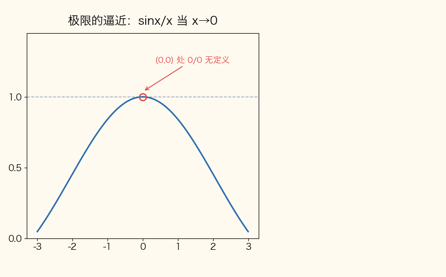

📌 锚点：**重要极限 lim(x→0) sinx/x = 1；sin(xy)/y = x·sin(xy)/(xy) → 0×1 = 0**

**考试答题**

**📌 历年真题**

**【2024.4·单选 7】（3 分）** 极限 lim(x,y)→(0,0) (1/y)sin(xy) =
- A. 0 ✅
- B. 1
- C. 2
- D. ∞

📌 一句话解析：sin(xy)/y = x·sin(xy)/(xy) → 0×1 = 0（凑重要极限 + 无穷小乘有界量），选 A。

**【2023.10·单选 2】（3 分）** 极限 lim(x,y)→(0,0) x·sin(1/(x²+y²)) =（　）【题干公式经 OCR 有缺损，此为按选项与常见题型复原，待核实】
- A. 等于 0 ✅
- B. 等于 1
- C. 等于 3
- D. 不存在

📌 一句话解析：x → 0 是无穷小，sin(1/(x²+y²)) 振荡但有界 |sin|≤1，无穷小×有界量 = 0，选 A。

**🎯 考法**：单选偶考（五期里仅 2024.4、2023.10 各一题），只考"求得出"的极限：要么凑重要极限、要么无穷小×有界量=0，从不考极限存在性证明。

**✍️ 得分点**：
- 看到 **sin(□)/□ 且 □→0** → 凑 limu→0 sin u/u = 1（□ 是整体，常见 u=xy）。
- 看到 **无穷小 × sin(1/□) 这类有界振荡量** → 极限直接写 0，一步得分。
- 选项里出现 ∞ 基本是干扰项：无穷大 × 有界量不一定无穷大（2024.4-7 的 D 就是坑）。

**⚠️ 易混淆**：sin(xy)/**y** ≠ sin(xy)/**xy**——分母是 y 时必须自己凑一个 x 进出（分子分母同乘 x）才能用重要极限；直接把 sin(xy)/y 当成 sin u/u = 1 是最常见错误。

**计算方法**（凑重要极限两步模板）：
1. 变形：把目标式凑出 sin(□)/□ 结构（**为什么可以凑**：过程点处 □≠0，分子分母同乘非零因子是恒等变形，极限值不变）；
2. 拆乘积求极限：各因子极限都存在时乘积极限 = 极限乘积（**为什么可以拆**：极限四则运算法则要求各因子极限存在，凑型后两因子分别 →0 和 →1，都存在）。

**【例 B-1】凑重要极限求二重极限（2024.4 单选 7 原题重讲）**

求 lim(x,y)→(0,0) (1/y)sin(xy)。

解：
① 变形：sin(xy)/y = x·sin(xy)/(xy)（**为什么分子分母同乘 x**：(x,y)→(0,0) 的过程中 x≠0，同乘非零因子不改变极限值——这是凑型的标准手法）
② 认整体：令 u = xy，当 (x,y)→(0,0) 时 u→0，于是 sin(xy)/(xy) → 1（**为什么能整体代换**：重要极限 limu→0 sin u/u = 1 对任何趋于 0 的变量 u 都成立，xy 只是复合进去的整体）
③ 拆乘积：原式 = x·sin(xy)/(xy)，两因子极限分别存在：x → 0，sin(xy)/(xy) → 1（**为什么可以拆开算**：极限四则法则——乘积的极限 = 极限的乘积，前提是各因子极限存在，这里 0 和 1 都存在）
④ 结论：0×1 = **0**，选 A（**为什么乘积是 0**：无穷小 x 与极限为 1 的有界量相乘，结果仍趋于 0）

**【例 B-1 变式】无穷小×有界（2023.10-2 同型，自编教学数据）**

求 lim(x,y)→(0,0) (x²+y²)·sin(1/(x²+y²))。

解：
① 因子一：x²+y² → 0 是无穷小（**为什么**：两个平方项都非负，(x,y)→(0,0) 时和只能趋于 0）
② 因子二：sin(1/(x²+y²)) 有界（**为什么**：正弦函数值域恒为 [-1,1]，不管 1/(x²+y²) 多大、振荡多快，函数值都出不了这个范围）
③ 结论：乘积 → **0**（**为什么**：无穷小×有界量 = 无穷小——与【例 B-1】的凑重要极限殊途同归，是二重极限两大标准手法中的另一手）

---

#### B2 偏导数与全微分 ★★★（每卷单选第 2 题固定考点 + 隐函数求导计算题）

**定义详解**：偏导数——z = f(x,y) 对 x 的偏导 ∂z/∂x，就是把 y **当作常数**、对 x 求一元导数；对 y 的偏导同理（**本质**：多元问题一元化，"求偏导 = 冻结其他变量"）。全微分——若 z = f(x,y) 可微，则全微分 **dz = (∂z/∂x)dx + (∂z/∂y)dy**：先求两个偏导、（代点后）各乘一个微分再相加。隐函数求导——方程 F(x,y,z) = 0 确定 z = z(x,y) 时，**∂z/∂y = -F_y/F_z**（F_y、F_z 是把 F 看成三元函数分别对 y、z 的偏导）。

> **🖼 动图演示：割线逼近切线（导数=切线斜率）**

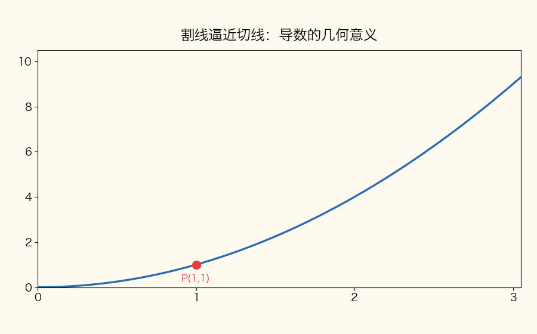

📌 锚点：**偏导数把另一变量当常数，本质仍是一元导数——割线斜率的极限**

> **🖼 动图演示：偏导数的几何意义（两条截线上的切线）**

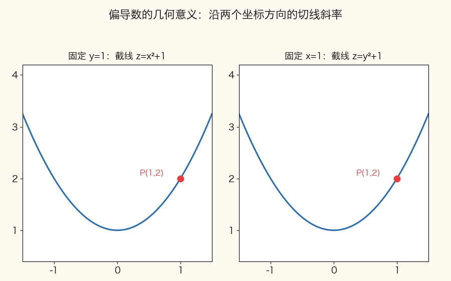

📌 锚点：**∂z/∂x = 固定 y 沿 x 方向截线的切线斜率；∂z/∂y 同理**

**考试答题**

**📌 历年真题（全微分单选——每卷第 2 题固定）**

**【2026.4·单选 2】（3 分）** 设函数 z = 2x³-3y²，则全微分 dz|(1,1) =
- A. 0
- B. dx-dy
- C. 6dx-6dy ✅
- D. 6dx+6dy

📌 一句话解析：z_x = 6x²、z_y = -6y，代 (1,1) 得 dz = 6dx-6dy，选 C（B 漏了系数 6）。

**【2025.4·单选 2】（3 分）** 设函数 z = x^y，则全微分 dz =
- A. x^y ln x dx + yx^(y-1) dy
- B. yx^(y-1)(dx+dy)
- C. x^y ln x (dx+dy)
- D. yx^(y-1) dx + x^y ln x dy ✅

📌 一句话解析：幂指函数对 x 求导按**幂函数**得 yx^(y-1)、对 y 求导按**指数函数**得 x^y ln x，选 D（A 把两个方向对调）。

**【2024.4·单选 2】（3 分）** 设函数 z = x²+y²，则全微分 dz|(1,1) =
- A. 4
- B. dx+dy
- C. 2(dx+dy) ✅
- D. 4(dx+dy)

📌 一句话解析：z_x = 2x、z_y = 2y，代 (1,1) 得 dz = 2dx+2dy = 2(dx+dy)，选 C（A 是"微分=数"的概念错误，dz 是含 dx、dy 的线性式）。

**【2022.10·单选 2】（3 分）** 设函数 z = ln(xy)，则全微分 dz =
- A. y dx+x dy
- B. x dx+y dy
- C. (1/y)dx+(1/x)dy
- D. (1/x)dx+(1/y)dy ✅

📌 一句话解析：z_x = y/(xy) = 1/x、z_y = x/(xy) = 1/y（链式：外层 1/u 乘内层导数），选 D。

**📌 历年真题（隐函数求导计算题——每题 6 分，答案在题目下）**

**【2026.4·计算 15】（6 分）** 设函数 z = z(x,y) 由方程 z²-e^(xy) = 2 所确定，求 ∂z/∂y。

解（公式法三步）：
① 令 F = z²-e^(xy)-2，F_y = -xe^(xy)（**为什么 z² 项求导得 0**：F_y 是把 F 当三元函数对 y 求偏导，此时 z 与 x 都是独立常数，只有 e^(xy) 项含 y——链式法则：e^(xy) 对 y 求导 = e^(xy)·x）
② F_z = 2z（**为什么**：z² 对 z 求导得 2z，e^(xy) 不含 z）
③ ∂z/∂y = -F_y/F_z = -(-xe^(xy))/(2z) = **xe^(xy)/(2z)**（**为什么负负得正**：公式自带负号，F_y 本身是负的，两个负号相消）

**【2025.4·计算 15】（6 分）** 设函数 z = z(x,y) 由方程 z⁴-2x²y²z² = 1 所确定，求 ∂z/∂y。【官方】

解（官方评分：F_y、F_z 各占一半给分点）：
① 令 F = z⁴-2x²y²z²-1，F_y = -4x²yz²（**为什么**：-2x²y²z² 对 y 求导时 x²、z² 都当常数，只留 y² 求导的 2y：-2x²·2y·z² = -4x²yz²）
② F_z = 4z³-4x²y²z（**为什么**：z⁴ 求导 4z³；-2x²y²z² 对 z 求导 -2x²y²·2z = -4x²y²z）
③ ∂z/∂y = -F_y/F_z = 4x²y²z²/(4z³-4x²y²z) = **x²yz/(z²-x²y²)**（**为什么分子分母同除 4z**：z=0 时方程左边为 0≠1 不成立，故 z≠0、F_z≠0，约去公因子 4z 化简）

**【2022.10·计算 14】（6 分）** 设 z = z(x,y) 由方程 z³-3xyz = a³ 所确定，求 ∂z/∂y。【官方】

解（官方评分：F_y、F_z（3 分）；结果（3 分））：
① 令 F = z³-3xyz-a³，F_y = -3xz（**为什么**：-3xyz 对 y 求导，x、z 当常数，得 -3xz）
② F_z = 3z²-3xy（**为什么**：z³ 求导 3z²；-3xyz 对 z 求导 -3xy）
③ ∂z/∂y = -F_y/F_z = 3xz/(3z²-3xy) = **xz/(z²-xy)**（**为什么分子分母同除 3**：公因数约分化简到最简，与官方答案形式一致）

**另解（直接求导法，以本题对照公式法）**：方程 z³-3xyz = a³ 两边直接对 y 求导（z 视为 y 的函数）：3z²·(∂z/∂y) - 3x·(z + y·∂z/∂y) = 0（**为什么 xy 项求导出 (z + y·z_y)**：乘积法则——x 冻结为常数，y 与 z 各是 y 的函数，分别求导再相加）；整理 (3z²-3xy)·∂z/∂y = 3xz，解出 ∂z/∂y = xz/(z²-xy)（**为什么结果与公式法一致**：直接法只是把 -F_y/F_z 背后的移项过程摊开写——两条路解同一个方程，公式法步骤少不易错，推荐主用）

**🎯 考法**：单选第 2 题**每卷必考**全微分（四期口径一致：求偏导 → 代点 → 写 dz），难度等于"会求导就满分"；计算题考**隐函数求 ∂z/∂y**（2026.4-15、2025.4-15、2022.10-14 三期连考），固定公式法两步。

**✍️ 得分点**：
- 全微分三步拿满分：① z_x、z_y 分别求对（**幂指函数 x^y 双面性**：对 x 按幂函数 yx^(y-1)、对 y 按指数函数 x^y ln x）；② 题目带 |(1,1) 就代点；③ 写 dz = A dx + B dy 两项齐全。
- 隐函数公式法只考 ∂z/∂y：写出 F_y、F_z 各得约 3 分（官方评分参考就是按此拆分），套 ∂z/∂y = -F_y/F_z 再得 3 分。
- 结果能约分要约到最简（2025.4-15、2022.10-14 官方答案都是约简后的形式）。
- 验算习惯：用"另解直接法"把求出的 ∂z/∂y 代回方程核对（**为什么值得**：2022.10-14 的另解对照表明两条路必须同解，花 30 秒防整题翻车）。

**⚠️ 易混淆**：
- **dz 是两项之和**，不是一项（漏 dy 项是高频错，2026.4-2 的 B 就是这种坑）；dz|(1,1) 是"代点后的系数 + dx dy"，仍是含微分的式子，不能写成纯数字（2024.4-2 的 A）。
- **公式法负号别丢**：∂z/∂y = **-**F_y/F_z，为什么带负号——把 z = z(x,y) 代回方程得 F(x,y,z(x,y)) ≡ 0，两边对 y 求导（z 是 y 的函数，链式法则）：F_y·1 + F_z·(∂z/∂y) = 0，移项解出 ∂z/∂y = -F_y/F_z——**负号是解方程解出来的，不是规定的**。
- **F_y 里 z 当常数**：公式法中 F 是三元函数，F_y ≠ "原方程对 y 求导"（那是隐函数直接求导法，结果一样但过程不同，别混着写）。

**计算方法**：
- 全微分模板：z_x = "对 x 冻结 y 求导"、z_y = "对 y 冻结 x 求导" → dz = z_x dx + z_y dy → 带点代点。
- 隐函数模板：① 写 F = 左边 - 右边；② 算 F_y（z 当常数）、F_z（x、y 当常数）；③ 套 ∂z/∂y = -F_y/F_z，约分到最简。

**【例 B-2】全微分完整计算（自编教学数据，照 2026.4-2 题型）**

设 z = e^(xy²)，求 dz|(1,1)。

解：
① z_x = y²·e^(xy²)（**为什么**：对 x 求导冻结 y——外层 e^u 的导数还是 e^u，内层 u = xy² 对 x 求导得 y²，链式相乘）
② z_y = 2xy·e^(xy²)（**为什么**：对 y 求导冻结 x——内层 xy² 对 y 求导得 2xy，链式乘 e^(xy²)）
③ 代 (1,1)：z_x = 1²·e^(1×1²) = e，z_y = 2×1×1×e = 2e（**为什么现在才代点**：偏导是函数，先求完导再代值，顺序反了就错）
④ dz|(1,1) = **e dx + 2e dy**（**为什么这样写**：dz = z_x dx + z_y dy，代入数值系数，两项一项不能少）

**【例 B-3】隐函数求 ∂z/∂y 完整计算（自编教学数据，照 2022.10-14 题型）**

设 z = z(x,y) 由方程 x²+y²+z²-2z = 0 确定，求 ∂z/∂y。

解：
① 令 F = x²+y²+z²-2z，F_y = 2y（**为什么**：F 是三元函数，对 y 求偏导时 x、z 都是常数，只剩 y² 一项）
② F_z = 2z-2（**为什么**：z² 求导 2z，-2z 求导 -2）
③ ∂z/∂y = -F_y/F_z = -2y/(2z-2) = **y/(1-z)**（**为什么化简后负号"消失"**：-2y/(2(z-1)) 约去 2 得 -y/(z-1)，再把负号挪进分母 -y/(z-1) = y/(1-z)——两种写法等价，阅卷都认）

答题提醒：题干带 |(1,1) 记号的（2026.4-2、2024.4-2）答案必须代点；不带记号的（2025.4-2、2022.10-2）答案保留含 x、y 的函数式（**为什么**：dz|(1,1) 问的是"该点处的微分"，dz 问的是"任意点的微分表达式"——动笔前先看清有没有代点记号，这决定最后一步）

---

#### B3 梯度与方向导数 ★★★（计算 14 考区 + 2022.10-7 单选，五期考四期）

**定义详解**：梯度——grad u = ∇u = {∂u/∂x, ∂u/∂y, ∂u/∂z}，是一个**向量**，三个分量就是三个偏导在该点的值（求梯度 = 求三个偏导 + 代点，一步不多）。方向导数——u 沿方向 l 的变化率：**∂u/∂l = u_x cosα + u_y cosβ + u_z cosγ**，其中 cosα、cosβ、cosγ 是方向 l 的**方向余弦**（即单位化后 l 的三个分量）。两者的关系：∂u/∂l = ∇u·e_l = |∇u|cosθ（θ 是梯度与 l 的夹角）→ **最大方向导数 = |∇u|，方向即梯度方向；最小值 = -|∇u|**。

**考试答题**

**📌 历年真题（答案在题目下）**

**【2026.4·计算 14】（6 分）** 求函数 u = xyz² 在点 P(1,1,1) 处沿方向 l = {-3,4,0} 的方向导数。

解（"先梯度、再单位化、后点乘"三步）：
① 三个偏导：u_x = yz²，u_y = xz²，u_z = 2xyz（**为什么**：分别冻结另两个变量求导；z² 对 z 求导 2z 再乘 xy 得 2xyz），在 P(1,1,1) 处 ∇u = {1,1,2}（**为什么代点**：方向导数是"在某点"的值，偏导必须先代成数）
② 单位化：|l| = √((-3)²+4²+0²) = √25 = 5（**为什么必须先求模**：方向导数公式里的 cosα、cosβ、cosγ 是单位向量的分量，不单位化点乘出来会多乘一个 |l|），方向余弦 cosα = -3/5，cosβ = 4/5，cosγ = 0
③ ∂u/∂l = 1×(-3/5) + 1×(4/5) + 2×0 = (-3+4)/5 = **1/5**（**为什么逐项乘加**：方向导数 = 梯度点乘单位方向向量，就是对应分量相乘再求和）

**【2025.4·计算 14】（6 分）** 求函数 u = ln(x²+y²+z²) 在点 P(1,1,-1) 处的梯度。【官方】

解（官方评分：三个偏导（3 分）；代点结果（3 分））：
① u_x = 2x/(x²+y²+z²)，u_y = 2y/(x²+y²+z²)，u_z = 2z/(x²+y²+z²)（**为什么是"2x 比分母"**：外层 ln u 的导数是 1/u，内层 u = x²+y²+z² 对 x 求导 2x，链式相除；y、z 方向同理）
② 代 P(1,1,-1)：分母 = 1+1+1 = 3，得 grad u = **{2/3, 2/3, -2/3}**（**为什么 z 分量是负的**：分子 2z = 2×(-1) = -2，代点时负号跟着走）

**【2024.4·计算 14】（6 分）** 求函数 u = 2xy-z² 在点 (2,-1,1) 处的梯度。

解：
① u_x = 2y，u_y = 2x，u_z = -2z（**为什么**：2xy 对 x 求导得 2y、对 y 求导得 2x（互相交换）；-z² 对 z 求导 -2z）
② 代 (2,-1,1)：grad u = **{-2, 4, -2}**（**为什么第一个分量是 -2**：u_x = 2y = 2×(-1) = -2，别把 x、y 的值代反）

**【2025.10·计算 14】（6 分）** 求函数 u = x³+y³+z³ 在点 P(-1,0,1) 处的最大方向导数。
> 【答案要点】最大方向导数 = |∇u| = 3√2（**为什么取模长**：∂u/∂l = |∇u|cosθ ≤ |∇u|，θ=0 即沿梯度方向时取等号）→ 完整演算见下方【例 B-4】

**【2023.10·计算 15】（6 分）** 设函数 f(x,y) = eˣcos y，求梯度 grad f(0,0)。

解：
① f_x = eˣcos y（**为什么**：对 x 求导冻结 y——eˣ 的导数还是 eˣ，cos y 当常数直接抄下来）
② f_y = -eˣsin y（**为什么带负号**：cos y 对 y 求导得 -sin y，再乘 eˣ）
③ 代 (0,0)：grad f = **{1, 0}**（**为什么是 {1,0}**：e⁰cos0 = 1，-e⁰sin0 = 0）

**【2022.10·单选 7】（3 分）** 函数 z = xe^y 在点 M(1,0) 处的梯度为
- A. {1,1} ✅
- B. {0,1}
- C. {1,0}
- D. {1,2}

📌 一句话解析：z_x = e^y|(0) = 1，z_y = xe^y|(1) = 1，grad z = {1,1}，选 A。

**🎯 考法**：计算题 14 号位高频固定（2026.4-14 方向导数、2025.4-14 梯度、2024.4-14 梯度、2025.10-14 最大方向导数、2023.10-15 梯度——五期考四期）；单选也考过纯梯度计算（2022.10-7）。题目三变体：**求梯度 / 求方向导数 / 求最大方向导数**，核心都是先求梯度。

**✍️ 得分点**：
- 求梯度两步拿满分：① 三个偏导各求对（官方按偏导 3 分 + 代点 3 分拆分给分）；② 代点写 grad u = {a, b, c}，花括号向量形式。
- 求方向导数三步：梯度代点 → l 单位化 → 点乘，**单位化那步必须写**（|l| = 5 不写直接扣分，这是该题唯一"易错给分点"）。
- 问"最大方向导数"答 |∇u| 的模；若再问方向，答"沿梯度方向"。

**⚠️ 易混淆**：
- **l 必须单位化**：l = {-3,4,0} 不是单位向量，方向余弦是 {-3/5, 4/5, 0} 而不是 {-3,4,0}——为什么：公式 ∂u/∂l = u_x cosα+u_y cosβ+u_z cosγ 中的方向余弦定义在单位向量上，不除模长相当于算了 5 倍。
- **梯度是向量、方向导数是数**：答案形式分别是 {a,b,c} 和一个数值，别把方向导数写成向量。
- **u_z 别漏**：三元函数梯度有三个分量，漏 z 分量是常见失分（2026.4-14 里 u_z = 2xyz 恰好点乘后贡献 0，但过程分量不能省）。
- **二元函数梯度只有两个分量**：z = f(x,y) 的 grad z = {z_x, z_y}（2022.10-7），别照三元的样子多写第三个分量（**为什么**：二元函数只有两个自变量，第三个方向根本不存在）。

**计算方法**（方向导数三步模板）：
1. 求梯度：u_x、u_y、u_z（**为什么**：方向导数公式的三个系数就是梯度分量）；
2. 单位化 l：|l| = √(a²+b²+c²)，cosα = a/|l|、cosβ = b/|l|、cosγ = c/|l|（**为什么除模长**：方向余弦 = 单位方向向量的分量）；
3. 点乘：∂u/∂l = u_x cosα + u_y cosβ + u_z cosγ（**为什么是加权和**：梯度与单位方向向量的数量积，几何上是梯度在 l 方向的投影）。
- 关系速记：∂u/∂l = ∇u·e_l = |∇u|cosθ（**为什么成立**：数量积按定义展开恰是"对应分量乘积之和"，与方向导数公式一字不差）→ 最大值 |∇u|、最小值 -|∇u|、l 与梯度垂直时为 0（沿等高线走不动）。

**【例 B-4】最大方向导数（2025.10 计算 14 原题重讲）**

求函数 u = x³+y³+z³ 在点 P(-1,0,1) 处的最大方向导数。

解：
① 求梯度：u_x = 3x²，u_y = 3y²，u_z = 3z²（**为什么**：幂函数求导，x³ → 3x²，其余变量冻结）
② 代点：∇u|(-1,0,1) = {3×(-1)², 3×0², 3×1²} = {3, 0, 3}（**为什么 -1 的平方是 1**：先平方后乘系数，负号被平方吃掉——这一步代错全题皆错）
③ 最大方向导数 = |∇u| = √(3²+0²+3²) = √18 = **3√2**（**为什么取模长**：∂u/∂l = |∇u|cosθ，cosθ 最大取 1，即 l 沿梯度方向 {1,0,1}/√2 时方向导数最大，值就是梯度的模）

举一反三：本题若改问"沿 l = {1,0,1} 方向的方向导数"→ 套三步模板：∇u = {3,0,3}、|l| = √2、∂u/∂l = 3×(1/√2)+0+3×(1/√2) = 6/√2 = 3√2（**为什么恰好等于最大值**：l = {1,0,1} 与梯度 {3,0,3} 同方向，θ = 0，方向导数达到上界 |∇u|——反过验证了"最大方向导数沿梯度方向取得"）

---

#### B4 多元函数的极值 ★★★（单选 7 + 计算 15 考区，五期全覆盖）

**定义详解**：极值——f(x,y) 在点 P₀ 的某邻域内恒有 f(x,y) ≤ f(P₀)（或 ≥），称 P₀ 为极大（小）值点（**局部概念**，只跟旁边一圈比）。驻点——满足 **f_x = 0 且 f_y = 0** 的点（**必要条件**：可微函数的极值点必是驻点，但驻点不一定是极值点）。充分条件判别法：在驻点处记 **A = f_xx，B = f_xy，C = f_yy**，算 **AC-B²**：
- AC-B² > 0：有极值，且 **A < 0 极大、A > 0 极小**（**为什么看 A 定大小**：A = f_xx < 0 说明该方向上曲面开口向下，山峰 → 极大）；
- AC-B² < 0：不是极值（鞍点类，2025.10-7 考的就是这种）；
- AC-B² = 0：判别失效，另想办法（本课程基本不考）。

> **🖼 动图演示：导数符号与单调性（f′>0 增、f′<0 减）**

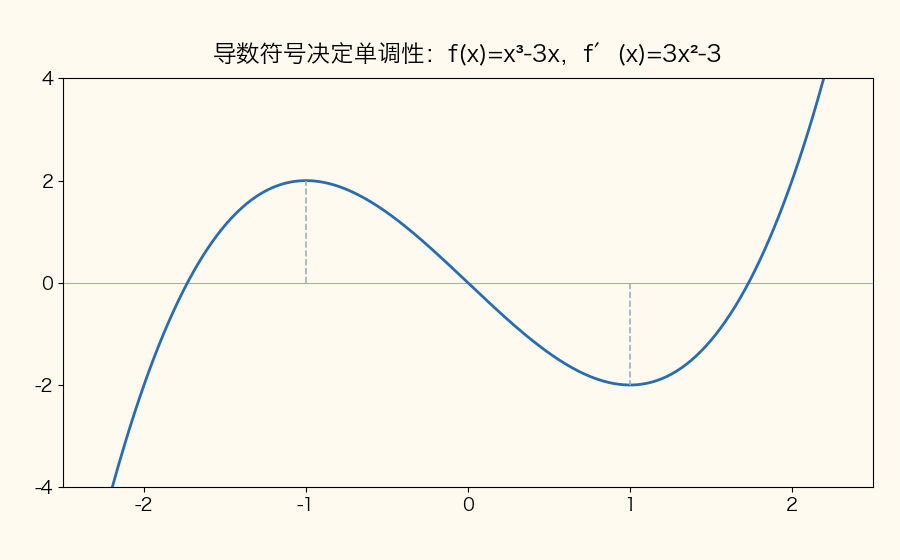

📌 锚点：**驻点两侧导数变号才取极值；AC-B²>0 才有极值，A 的符号定极大/极小**

**考试答题**

**📌 历年真题（单选——驻点与极值点辨析）**

**【2026.4·单选 7】（3 分）** 下列点是函数 z = (6x-x²)(4y-y²) 的驻点的是
- A. (3,2) ✅
- B. (3,0)
- C. (0,2)
- D. (3,4)

📌 一句话解析：z_x = (6-2x)(4y-y²)、z_y = (6x-x²)(4-2y)，x=3 使 6-2x=0 且 y=2 使 4-2y=0，两方程同时满足的只有 (3,2)（(3,0)、(3,4) 代入 z_y≠0，(0,2) 代入 z_x≠0），选 A。

**【2025.4·单选 7】（3 分）** 下列点是函数 z = 4(x+y)-x²+y² 的驻点的是
- A. (2,-2) ✅
- B. (2,0)
- C. (0,2)
- D. (2,2)

📌 一句话解析：z_x = 4-2x = 0 → x=2，z_y = 4+2y = 0 → y=-2，驻点 (2,-2)，选 A（y 方向注意 +2y 求导后是 +2，解出的是负值）。

**【2025.10·单选 7】（3 分）** 设函数 z = x⁴-y⁴-8x²+4y，则点 (2,1) 是该函数的
- A. 驻点 ✅
- B. 间断点
- C. 极大值点
- D. 极小值点

📌 一句话解析：z_x = 4x³-16x|(2) = 0、z_y = -4y³+4|(1) = 0 → 是驻点；再判 A = 12x²-16|(2) = 32，B = 0，C = -12y²|(1) = -12，AC-B² = -384 < 0 非极值 → 只是驻点，选 A。

**【2024.10·单选 7】（3 分）** 函数 z = 3(x+y)-x³-y³ 的驻点是
- A. (2,-1)
- B. (1,-2)
- C. (-1,-1) ✅
- D. (-1,2)

📌 一句话解析：z_x = 3-3x² = 0 → x=±1，z_y = 3-3y² = 0 → y=±1，驻点共四个组合，选项中在列的是 (-1,-1)，选 C。

**📌 历年真题（计算题——求极值，答案在题目下）**

**【2024.4·计算 15】（6 分）** 求函数 f(x,y) = 4(x-y)-x²-y² 的极值。
> 【答案要点】极大值 f(2,-2) = 8（**为什么**：解驻点 (2,-2)，AC-B² = 4 > 0 且 A = -2 < 0）→ 完整演算见下方【例 B-5】

**【2022.10·计算 15】（6 分）** 判断函数 f(x,y) = 2x²-5x+xy²+2y 在点 (1,-1) 处是否取得极值？若取得极值，说明是极大值还是极小值。【官方】

解（官方评分：驻点验证（2 分）；A、B、C 与判别式（2 分）；结论（2 分））：
① 验证驻点：f_x = 4x-5+y²（**为什么**：xy² 对 x 求导时 y² 是常数得 y²），f_y = 2xy+2（**为什么**：xy² 对 y 求导 2xy）；代 (1,-1)：f_x = 4-5+1 = 0，f_y = -2+2 = 0 → (1,-1) 是驻点（**为什么先验驻点**：判别法只在驻点处适用，题目给的点必须先核验）
② 求二阶：A = f_xx = 4，B = f_xy = 2y|(1,-1) = -2（**为什么代 y 的值**：f_xy 是先对 x 再对 y 求导，2y 里带 y，代 y = -1），C = f_yy = 2x|(1,-1) = 2
③ 判别：AC-B² = 4×2-(-2)² = 8-4 = 4 > 0 且 A = 4 > 0 → **取得极小值**（**为什么 A>0 是极小**：f_xx > 0 说明 x 方向开口向上，谷底 → 极小；官方评分参考写作 B²-AC = 4-8 < 0 且 A>0，同一判别式的相反记号，结论一致）

**🎯 考法**：单选 7 与计算 15 两个考区五期全覆盖——单选只考**找驻点**（解 f_x = 0、f_y = 0，或验证给定点）与**驻点≠极值点**的辨析（2025.10-7）；计算题考**完整求极值**三步：驻点 → 判别 → 下结论报值。

**✍️ 得分点**：
- 单选找驻点：两个偏导**分别解方程再取公共解**（2026.4-7 因式相乘型，找"两个因子同时归零"的点）。
- 计算题三步各占约 2 分（官方拆分口径）：① f_x、f_y 并解出驻点；② A、B、C 三个二阶偏导 + AC-B²；③ 结论句"取得极大/极小值 f(a,b) = 数值"——**结论必须带值**，只说"是极大值"不给满分。
- 二阶混合偏导 B = f_xy：先对 x 后对 y，含 y 的别忘代点（2022.10-15 的 B = -2 就是代 y = -1 得来）。

**⚠️ 易混淆**：
- **驻点 ≠ 极值点**：驻点只保证一阶导为零；是否极值要靠 AC-B² 判别——2025.10-7 整道题就考"是驻点"而非"极值点"，四个选项里"极大/极小值点"全是坑。
- **AC-B² 与 B²-AC 两套写法**：判别式方向相反——AC-B² > 0 有极值 ↔ B²-AC < 0 有极值。考场上认准一套用到底，别两个口径混着套结论（官方参考 2022.10-15 用 B²-AC，2024.4 推导口径用 AC-B²，结论相同）。
- **极大/极小由 A 的符号定，不是由函数值正负定**：A < 0 极大、A > 0 极小（2024.4-15 极大值是 +8，别以为"极大值"必须算出负数关系）。

**单选速判示范（2026.4-7 四选项逐验）**——因式乘积型函数，驻点 = "两个归零开关同时打开"：

| 候选点 | z_x = (6-2x)(4y-y²) | z_y = (6x-x²)(4-2y) | 判定 |
|---|---|---|---|
| (3,2) | 0×4 = 0 ✓ | 9×0 = 0 ✓ | 驻点 ✅ |
| (3,0) | 0×0 = 0 ✓ | 9×4 = 36 ✗ | 排除 |
| (0,2) | 6×4 = 24 ✗ | 0×0 = 0 ✓ | 排除 |
| (3,4) | 0×0 = 0 ✓ | 9×(-4) = -36 ✗ | 排除 |

**计算方法**（求极值三步模板）：
1. 解方程组 f_x = 0、f_y = 0 得全部驻点（**为什么必须联立**：驻点要求两个偏导同时为零，缺一不可）；
2. 对每个驻点算 A = f_xx、B = f_xy、C = f_yy 与 AC-B²（**为什么逐点算**：不同驻点的 A、B、C 值不同，结论可能一个极大一个无极值）；
3. 下结论：AC-B² > 0 且 A < 0 极大 / A > 0 极小，并**代回原函数算出极值**（**为什么代回**：极值是数 f(P₀)，不是点 P₀——求"极值"答数值，求"极值点"答坐标）。
- 变体速答：题目直接给点问"是否取得极值"（2022.10-15 型）→ 跳过解方程组，只验证该点满足 f_x = 0、f_y = 0 再做第 2、3 步（**为什么**：点已给定，工作量只剩"验证 + 判别"）；单选问"该点是不是驻点"（2025.10-7 型）→ 只做第 1 步验证，AC-B² 顺手一算即可排除"极值点"选项。

**【例 B-5】求极值完整三步（2024.4 计算 15 原题重讲）**

求函数 f(x,y) = 4(x-y)-x²-y² 的极值。

解：
① 求驻点：f_x = 4-2x（**为什么**：4(x-y) 对 x 求导得 4（y 冻结为常数），-x² 求导 -2x，-y² 对 x 求导 0），f_y = -4-2y（**为什么是 -4**：4(x-y) 对 y 求导得 -4，-y² 求导 -2y）；令 f_x = 0 得 x = 2，f_y = 0 得 y = -2，驻点 (2,-2)
② 二阶判别：A = f_xx = -2，B = f_xy = 0（**为什么 B = 0**：f_x = 4-2x 中不含 y，再对 y 求导为 0），C = f_yy = -2；AC-B² = (-2)×(-2)-0² = 4 > 0（**为什么先看它**：正负决定有无极值，4 > 0 说明确有极值）且 A = -2 < 0 → 极大值
③ 算极值：f(2,-2) = 4×(2-(-2))-2²-(-2)² = 4×4-4-4 = **8**（**为什么代回原函数**：极大值是驻点处的函数值——注意是"数值 8"，不是"点 (2,-2)"，题目问极值答值）

---

#### 🎯 模块 B 速记表

> 用法：考前 10 分钟扫这张表——左列是题眼，中列是落笔公式，右列考期可回查本节真题与第三节汇编原题。

| 考点 | 核心公式/结论 | 考期证据 |
|---|---|---|
| 二重极限 sin 型 | sin(xy)/y = x·sin(xy)/(xy) → 0×1 = 0 | 2024.4-7、2023.10-2 |
| 全微分 | dz = z_x dx + z_y dy（代点写两项） | 2026.4-2、2025.4-2、2024.4-2、2022.10-2 |
| 幂指函数求导 | x^y：对 x 得 yx^(y-1)、对 y 得 x^y ln x | 2025.4-2 |
| 隐函数求导 | ∂z/∂y = -F_y/F_z（负号是移项解出的） | 2026.4-15、2025.4-15、2022.10-14 |
| 梯度 | grad u = {u_x, u_y, u_z}（向量，代点） | 2025.4-14、2024.4-14、2023.10-15、2022.10-7 |
| 方向导数 | ∂u/∂l = u_x cosα+u_y cosβ+u_z cosγ（l 先单位化） | 2026.4-14 |
| 最大方向导数 | = \|grad u\|（方向即梯度方向） | 2025.10-14 |
| 驻点 | 解 f_x = 0 且 f_y = 0（驻点≠极值点） | 2026.4-7、2025.4-7、2025.10-7、2024.10-7 |
| 极值判别 | AC-B² > 0 有极值；A<0 极大、A>0 极小 | 2024.4-15、2022.10-15 |

### 模块 C 多元函数积分学 ★★★（每卷单选 2 题 + 计算 3 题 + 综合 1 题，约 29 分，全卷最重）

> 每条概念给出三块内容：**① 定义详解**（讲清原理，可直接当答题素材）；**② 考试答题**（历年真题 + 考法 + 得分点 + 易混淆，真题题干/选项/答案逐字照录真题数据源）；**③ 计算方法**（步骤化模板 + 完整例题，例题按模块编号【例 C-序号】）。计算题与综合题答案直接写在题目下，每一步括注（**为什么…**：…），达到"可直接背"的程度。本模块分值构成：单选第 5 题（二重积分）+ 第 8 题（三重积分）各 3 分，计算 16/17/18 各 6 分，综合 22 共 5 分，合计 29 分——五个考期（2026.4 / 2025.4 / 2024.4 / 2022.10 / 2023.10）题型位置无一例外。

#### C1 二重积分 ★★★（单选 5 固定 + 计算 16 固定）

**定义详解**：二重积分 ∬_D f(x,y) dA 是二元函数在平面闭区域 D 上的和式极限——把 D 任意分割成 n 个小块，第 i 块面积为 ΔAᵢ，在其上任取一点 (ξᵢ,ηᵢ)，作乘积 f(ξᵢ,ηᵢ)·ΔAᵢ 并求和，当各小区域直径的最大值 λ→0 时，和式的极限就是 ∬_D f(x,y) dA。几何意义：f(x,y)≥0 时，二重积分 = 以 D 为底、曲面 z=f(x,y) 为顶的**曲顶柱体体积**——这与「定积分 = 曲边梯形面积」是同一套「分割→近似→求和→取极限」思想从一维到二维的推广；特别地，f≡1 时 ∬_D dA = 区域 D 的面积（圆域面积 πR² 是单选秒杀的基础数据）。

**两条高频性质**：①区域可加性——D = D₁∪D₂（不重叠）时 ∬_D = ∬_{D₁}+∬_{D₂}（**为什么**：分块求和）；②线性性——∬(af+bg)dA = a∬f dA + b∬g dA（**为什么**：和式极限逐项分配）——单选拆项消项、计算分步积分都靠这两条。

> **🖼 动图演示：矩形细分逼近——定积分=曲边梯形面积**
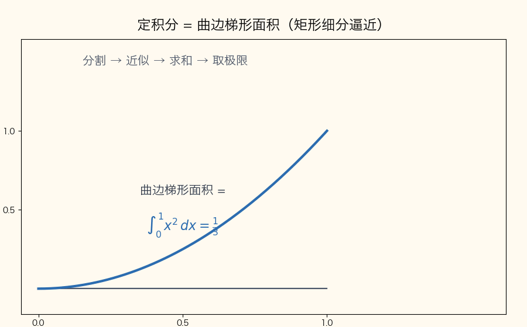
📌 锚点：**二重积分=曲顶柱体体积，与定积分同一「分割→近似→求和→取极限」思想**

> **🖼 动图演示：微元法（取窄条→写 dA→积分累加）**
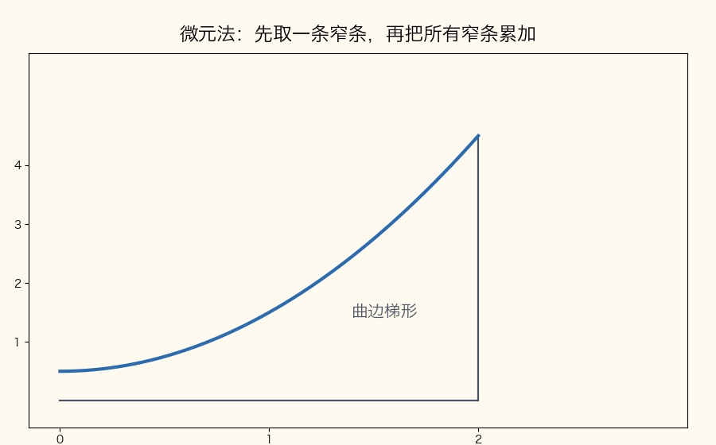
📌 锚点：**先写被积微元，再定积分限——积分就是把微元加起来**

> **🖼 动图演示：极坐标换元（dA = r dr dθ）**
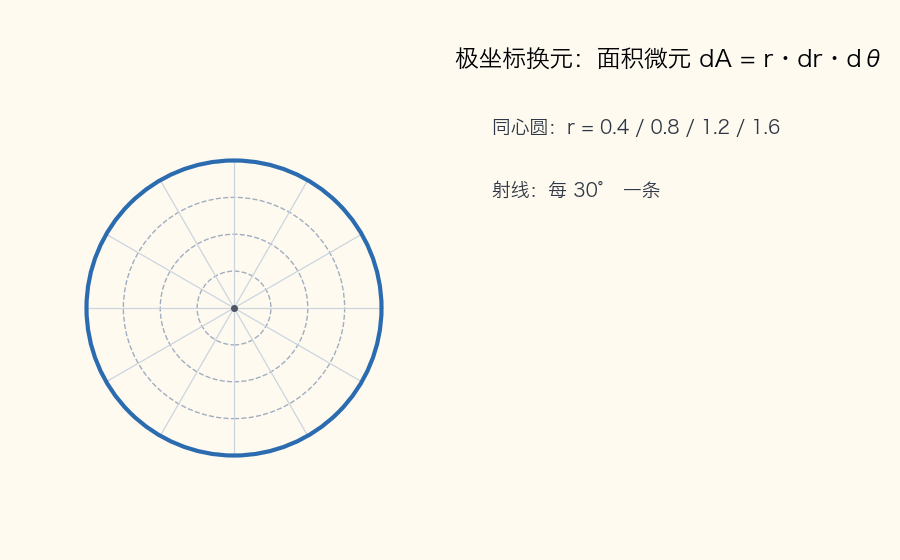
📌 锚点：**圆域/扇形域优先极坐标；x=r cosθ, y=r sinθ，面积微元多乘一个 r**

**考试答题**

**📌 历年真题（单选第 5 题每卷固定考二重积分，五考期全考）**

**【2026.4·单选 5】（3 分）** 设积分区域 D: x²+y²≤2，则二重积分 ∬_D (x²+y²−x) dxdy =
- A. 2π ✅
- B. 4π
- C. 6π
- D. 8π

**【2025.4·单选 5】（3 分）** 设积分区域 D: −2≤x≤2, 0≤y≤1，则二重积分 ∬_D (x+y−2) dxdy =
- A. −6 ✅
- B. −4
- C. 0
- D. 4

**【2024.4·单选 5】（3 分）** 设积分区域 D: x²+y²≤R²，则二重积分 ∬_D (x²+y²) dxdy =
- A. (1/2)πR³
- B. (3/2)πR³
- C. (1/2)πR⁴ ✅
- D. πR⁴

**【2022.10·单选 5】（3 分）** 设积分区域 D: x²+y²≤a²，则二重积分 ∬_D (2+x+y) dxdy =
- A. πa²
- B. 2πa² ✅
- C. 3πa²
- D. 4πa²

**【2023.10·单选 5】（3 分）** 设积分区域 D: x²+y²≤4，则二重积分 ∬_D (2−x−y) dxdy =
- A. 0
- B. 4π
- C. 8π ✅
- D. 16π

**单选五题一法——对称性秒杀对照**：

- **2026.4**：圆域关于 y 轴对称 → −x 项消 0；主项 ∬(x²+y²)dA = 2π·(√2)⁴/4 = 2π → **A**（**为什么**：极坐标 ∫₀^{2π}dθ∫₀^{√2}r³dr）；
- **2025.4**：矩形关于 x=0 对称 → x 项消 0；∬y dA = ȳ·S = (1/2)×4 = 2；∬(−2)dA = −2×4 = −8；2−8 = **−6** → **A**（**为什么 y 能加权**：矩形上 ∬y dA = ȳ×面积，ȳ 是几何中心纵坐标 1/2）；
- **2024.4**：极坐标 ∫₀^{2π}dθ∫₀^R r³dr = 2π·R⁴/4 = πR⁴/2 → **C**（**为什么 B、D 是陷阱**：R³ 是漏乘 r、πR⁴ 是漏了 ÷4）；
- **2022.10**：圆域关于两轴对称 → x、y 项全消；2×πa² = **2πa²** → **B**；
- **2023.10**：同理奇项全消；2×4π = **8π** → **C**（**为什么五题同构**：出题人只换常数与区域半径——认出「对称消项 + 常数×面积」就秒杀）。

**🎯 考法（单选）**：区域全是规则图形（圆域/矩形），被积函数全是「奇函数项 + 常数项 + 圆域上的 x²+y²」拼盘——考对称性消项与「常数×面积」，不用真积分。

**📌 历年真题（计算 16 每卷固定，6 分，答案直接写在题目下）**

**【2025.4·计算 16】（6 分）** 计算二重积分 ∬_D e^(x+y) dxdy，其中积分区域 D 是由 x+y=2, y=x 及 y=0 所围的闭区域。【官方】

解：
① 画区域：三条边界两两交于 (0,0)、(1,1)、(2,0)，是 x 轴上方的三角形（**为什么先画**：交点是积分限的来源，不画图定限必错）；
② 取 Y 型：0≤y≤1，x 从左边界 x=y 到右边界 x=2−y（**为什么选 Y 型**：X 型在 x=1 左右两侧上边界不同（y=x 与 x+y=2）要分两段；Y 型左右边界各一条，不分段）；
③ I = ∫₀¹dy ∫_y^{2−y} e^(x+y) dx；内层：e^(x+y) = e^y·e^x，对 x 积分时 e^y 是常数提出，= e^y·[e^x]_y^{2−y} = e^y(e^(2−y)−e^y) = e²−e^(2y)（**为什么**：指数法则 e^y·e^(2−y) = e²，e^y·e^y = e^(2y)——对哪个变量积分，另一个变量就当常数）；
④ 外层：I = ∫₀¹(e²−e^(2y))dy = [e²y − (1/2)e^(2y)]₀¹ = (e²−(1/2)e²)−(0−(1/2)) = (1/2)e²+(1/2) = **(e²+1)/2**（**为什么乘 1/2**：∫e^(2y)dy 的指数内导数是 2，凑微分要配系数 1/2）。

**【2024.4·计算 16】（6 分）** 计算二重积分 ∬_D (x/y²) dxdy，其中积分区域 D 是由 y=1/x, y=x 及 x=2 所围的闭区域。

解：
① 画区域：交点 (1,1)、(2,1/2)、(2,2)（**为什么**：y=1/x 与 y=x 交于 (1,1)；二者分别与 x=2 交于 (2,1/2)、(2,2)——不画图，下边界交点 (2,1/2) 极易丢）；
② 取 X 型：1≤x≤2，y 从下边界 y=1/x 到上边界 y=x（**为什么选 X 型**：x 端点 1、2 都是常数，上、下边界各由一条曲线包干，累次积分一次成型）；
③ I = ∫₁²dx ∫_{1/x}^{x} x·y⁻² dy；内层对 y 积分（x 是常数）：= x·[−y⁻¹]_{1/x}^{x} = x(−1/x+x) = x²−1（**为什么上限减下限**：牛顿—莱布尼茨公式，−1/y 代 y=x 得 −1/x、代 y=1/x 得 −x，上减下 = x−1/x，再乘 x 得 x²−1）；
④ 外层：I = ∫₁²(x²−1)dx = [x³/3−x]₁² = (8/3−2)−(1/3−1) = 2/3−(−2/3) = **4/3**（**为什么分开算**：先代上限得 2/3，再代下限得 −2/3，相减即 4/3）。

**【2022.10·计算 16】（6 分）** 计算二重积分 ∬_D (y/x²) dxdy，其中积分区域 D 是由 y=1/x, y=x 及 y=2 所围的闭区域。【官方】

解：
① 画区域：交点 (1,1)、(2,2)、(1/2,2)（**为什么**：y=1/x 与 y=x 交于 (1,1)；二者分别与 y=2 交于 (1/2,2)、(2,2)）；
② 取 Y 型：1≤y≤2，x 从左边界 x=1/y 到右边界 x=y（**为什么选 Y 型**：顶边 y=2 是水平线，Y 型的 y 端点 1、2 是常数，左右边界各一条，不分段）；
③ I = ∫₁²dy ∫_{1/y}^{y} y·x⁻² dx；内层对 x 积分（y 是常数）：= y·[−x⁻¹]_{1/y}^{y} = y(−1/y+y) = y²−1（**为什么与上题同构**：本题把 2024.4 的 x、y 角色互换——直线围边从 x=2 换成 y=2，选型随之从 X 型换成 Y 型）；
④ 外层：I = ∫₁²(y²−1)dy = [y³/3−y]₁² = **4/3**（**为什么数值与 2024.4 相同**：两区域互为镜像、被积函数同步换位，积分值自然一致——同构题值得对照记忆）。

**【2023.10·计算 16】（6 分）** 计算二重积分 ∬_D (2x−y) dxdy，其中积分区域 D 是由 x+y=2, y=x 及 x 轴所围的闭区域。

解：
① 画区域：顶点 (0,0)、(1,1)、(2,0)（**为什么**：y=x 过原点，x+y=2 截 x 轴于 (2,0)，两线交于 (1,1)）；
② 取 Y 型：0≤y≤1，x 从左边界 x=y 到右边界 x=2−y（**为什么选 Y 型**：X 型在 0≤x≤1 段上边界是 y=x、1≤x≤2 段是 y=2−x，必须分两段；Y 型只需左右各一条边界）；
③ I = ∫₀¹dy ∫_y^{2−y}(2x−y)dx；内层：[x²−yx]_y^{2−y} = (2−y)²−y(2−y) = 4−4y+y²−2y+y² = 4−6y+2y²（**为什么先代限再展开**：牛顿—莱布尼茨代限后得到 y 的一元函数，展开合并便于外层逐项积分）；
④ 外层：I = ∫₀¹(4−6y+2y²)dy = [4y−3y²+(2/3)y³]₀¹ = 4−3+2/3 = **5/3**（**为什么逐项积**：幂函数积分「指数加 1 作分母」，2y² 积成 (2/3)y³）。

**🎯 考法（计算 16）**：给「两条曲线 + 一条直线」围成的曲边区域算初等函数二重积分——考画图定限 + 两次定积分，被积函数不超出幂函数与 e^x。

**✍️ 得分点**：
- 官方按步给分（3+3 或 2+2+2）：写出正确累次积分（含积分限）约 3 分，内层积分约 2 分，外层算出数值约 1~2 分——**每一行单独写、先定限后计算**。
- 选型判断写进过程（一句「取 Y 型，0≤y≤1」），阅卷人据此给定限分。

**⚠️ 易混淆**：X 型下限是「下边界曲线」不是「较小交点」；与双曲线的交点（如 (2,1/2)）漏画必错；e^(x+y) 对 x 积分时 e^y 是**常数**；结果是分数不化小数、不约成假小数。

**计算方法**（三步模板）：
1. **画区域找交点**：所有边界两两求交、标出顶点——交点是积分限的候选（**为什么**：积分限就是边界曲线方程，交点是边界「换岗」的位置）；
2. **选型定限**：X 型 ∫_a^b dx ∫_{y₁(x)}^{y₂(x)} f dy / Y 型 ∫_c^d dy ∫_{x₁(y)}^{x₂(y)} f dx；规则：**上（左）下（右）边界各一条曲线、不分段**者优先（**为什么能随便选**：二重积分的值与累次次序无关，选型只影响计算量）；
3. **两次定积分**：内层把另一变量当常数，逐层用牛顿—莱布尼茨。

**对称性与极坐标（单选专用三招）**：
- 奇对称消项：D 关于 y 轴对称（x→−x 区域不变）且被积项是 x 的奇函数 → 该项积分 =0（**为什么**：左右两半上函数值反号、贡献相消）；同理关于 x 轴对称消 y 的奇函数项；
- 常数项：∬_D c dA = c×S_D，矩形 S=长×宽、圆 S=πR²，直接乘；
- 圆域转极坐标：x=r cosθ, y=r sinθ, dA=r dr dθ；特别地 ∬_{x²+y²≤R²}(x²+y²)dA = ∫₀^{2π}dθ ∫₀^R r³dr = 2π·R⁴/4 = πR⁴/2（**为什么多乘 r**：极坐标小面积元 ≈ 弧长×径向长 = (r dθ)·dr，比直角坐标多出因子 r；**为什么半径是 R**：x²+y²≤R² 即 r≤R）；
- **极坐标秒杀公式族**：∬_{x²+y²≤R²}(x²+y²)ⁿ dA = 2π·R^{2n+2}/(2n+2)（n=0 时即面积 πR²、n=1 时即 πR⁴/2——一式盖住两道真题）（**为什么**：∫r^{2n+1}dr = r^{2n+2}/(2n+2) 的通式）。

**计算 16 四题同构对照**：

| 考期 | 区域边界 | 选型 | 积分限 | 结果 |
|---|---|---|---|---|
| 2025.4 | x+y=2, y=x, y=0 | Y 型 | 0≤y≤1, y≤x≤2−y | (e²+1)/2 |
| 2024.4 | y=1/x, y=x, x=2 | X 型 | 1≤x≤2, 1/x≤y≤x | 4/3 |
| 2022.10 | y=1/x, y=x, y=2 | Y 型 | 1≤y≤2, 1/y≤x≤y | 4/3 |
| 2023.10 | x+y=2, y=x, x 轴 | Y 型 | 0≤y≤1, y≤x≤2−y | 5/3 |

（**为什么放这张表**：2023.10 与 2025.4 连积分限都相同、2022.10 与 2024.4 互为镜像——计算 16 本质上只有「三角形区域」与「双曲线尖角区域」两个模板。）

**【例 C-1】对称性单选重讲（2026.4 单选 5，原题）**

∬_D (x²+y²−x) dxdy，D: x²+y²≤2。
① 拆项：∬(x²+y²)dA − ∬x dA（**为什么能拆**：积分的线性性——和的积分等于积分的和）；
② 消奇项：D 关于 y 轴对称、x 是 x 的奇函数 → ∬x dA = 0（**为什么**：左半圆上每点 (x,y) 与右半圆对应点 (−x,y) 的函数值反号，两半相加为零）；
③ 极坐标算主项：∬(x²+y²)dA = ∫₀^{2π}dθ ∫₀^{√2} r²·r dr = 2π·[(√2)⁴/4] = 2π×4/4 = 2π（**为什么上限是 √2**：x²+y²≤2 即 r²≤2、r≤√2；**为什么原函数是 r⁴/4**：∫r³dr）；
④ 结论：原式 = 2π−0 = 2π，选 **A**（**为什么 30 秒能完成**：对称消一项 + 一个标准极坐标积分，就是单选第 5 题的固定节奏）；
⑤ 验算：五个选项全是 π 的倍数，专门接住「漏乘 r」「漏除 4」「忘消奇项」三类失误（**为什么**：干扰项就是按典型错误设计的——对上口径 2π 才是全对）。

**【例 C-2】X 型定限完整重讲（2024.4 计算 16，原题）**

∬_D (x/y²) dxdy，D 由 y=1/x, y=x 及 x=2 围成。
① **先画区域**（**为什么必须先画**：本题两条曲线边界只在 1≤x≤2 段「管事」，三线围出尖朝左的曲边形，不画图不知道 y 从哪积到哪）：三边界交点 (1,1)（双曲线与直线）、(2,2)（直线与竖线）、(2,1/2)（双曲线与竖线）；
② **判断选型**：竖直线 x=2 说明 x 范围是常数区间 [1,2]；在区间内任一点竖直向上引线，先穿 y=1/x、后穿 y=x——上下边界各一条，X 型一次成型（**为什么不用 Y 型**：Y 型要在 y=1 处换左、右边界，分两段，工作量翻倍）；
③ **写出累次积分**：I = ∫₁²dx ∫_{1/x}^{x} (x/y²) dy（**为什么下限 1/x、上限 x**：竖直方向区域从下边界 y=1/x 长到上边界 y=x，「下小上大」）；
④ **内层积分**（x 当常数）：∫_{1/x}^{x} x·y⁻² dy = x·[−1/y]_{1/x}^{x} = x²−1；
⑤ **外层积分**：∫₁²(x²−1)dx = [x³/3−x]₁² = **4/3**（**为什么验算**：被积函数 x/y²>0，结果必为正——若算出负数，先查上下限是否写反）。

答题提醒（定限三查）：**查交点**——三条边界两两求交、一个不漏；**查上下**——整段区间上「下限函数 ≤ 上限函数」必须成立；**查正负**——被积函数恒正则结果必为正，否则回头查限。

---

#### C2 三重积分 ★★★（单选 8 固定，全靠对称性 + 常数×体积 + 形心加权）

**定义详解**：三重积分 ∭_Ω f(x,y,z) dV 是三元函数在空间闭区域 Ω 上的和式极限（分割→近似→求和→取极限，微元从面积 dA 换成体积 dV）。物理意义：f 是密度时积分值 = 立体的总质量；f≡1 时 ∭_Ω dV = 立体 Ω 的**体积**。本课程三重积分只考单选且题型铁定：Ω 是长方体或球，被积函数是「常数 + 一次项」的多项式——**不需要真正做累次积分**，用三招口算：奇对称消项、常数×体积、一次项按形心加权。

**考试答题**

**📌 历年真题（单选第 8 题每卷固定考三重积分，五考期全考）**

**【2026.4·单选 8】（3 分）** 设积分区域 Ω: −1≤x≤1, 0≤y≤2, 0≤z≤1，则三重积分 ∭_Ω (3+x+2z) dxdydz =
- A. −8
- B. 4
- C. 8
- D. 16 ✅

**【2025.4·单选 8】（3 分）** 设积分区域 Ω: x²+y²+z²≤4，则三重积分 ∭_Ω (2x+y+4z+3) dxdydz =
- A. (32/3)π
- B. 16π
- C. 32π ✅
- D. 96π

**【2024.4·单选 8】（3 分）** 设积分区域 Ω: x²+y²+z²≤10，则三重积分 ∭_Ω (2x−z) dxdydz =
- A. 0 ✅
- B. (4/3)π
- C. (8/3)π
- D. 4π

**【2022.10·单选 8】（3 分）** 设积分区域 Ω: 0≤x≤1, 0≤y≤2, −1≤z≤1，则三重积分 ∭_Ω (2−x−z) dxdydz =
- A. 0
- B. 6 ✅
- C. 7
- D. 8

**【2023.10·单选 8】（3 分）** 设积分区域 Ω: |x|≤1, |y|≤1, |z|≤1，则三重积分 ∭_Ω 2 dxdydz =（　）【被积函数经 OCR 为"2"，待核实】
- A. 2
- B. 4
- C. 8
- D. 16 ✅

**🎯 考法**：给对称立体（球/长方体）配「常数 + 奇函数项」被积函数，考三件事——奇函数项消成 0、常数项 = 常数×体积、区域不对称时一次项用形心坐标加权（x̄V、z̄V）。

**✍️ 得分点**：
- 奇对称：Ω 关于 x=0 对称（球体；含 |x|≤a 或 −a≤x≤a 的长方体）且被积项是 x 的奇函数 → ∭x dV = 0（**为什么**：对称两半上 x 反号相消）；
- 常数项：∭c dV = c·V；球体积 V = (4/3)πR³，长方体 V = 三边长乘积；
- 一次项：∭x dV = x̄·V——由形心公式 x̄ = (∭x dV)/V 移项而来；**长方体的形心就是几何中心**（区间中点）。
- 复习自查骨架：**V=…；奇项=0；x̄/z̄=…；合计=…** 四行——单选不必写过程，但背题时按这四行走一遍，考场上 30 秒出答案。

**⚠️ 易混淆**：−a≤x≤a 的长方体才对 x 奇对称；**0≤x≤1 这种半边长方体没有对称性**，x 项老实用 x̄V = (1/2)V 算——2022.10 单选 8 正是考这个陷阱，想当然消成 0 就错选 A。

**计算方法**（四招模板，专治本课程单选题型）：
1. **认区域**：球（对三根轴都对称）还是长方体（只对含 ±a 区间的轴对称）——先定哪些项能消（**为什么第一步是认区域**：对称性是「区域+函数」的公共属性，只看函数不看区域必错）；
2. **奇对称消项**：Ω 关于 x=0 对称 + 被积项是 x 的奇函数 → 该项 =0（**为什么**：对称两半反号相消）；
3. **常数×体积**：∭c dV = c·V；球 V = (4/3)πR³，长方体 V = 三边乘积（**为什么 f≡1 是体积**：单位密度下质量即体积）；
4. **一次项形心加权**：区域不对称时 ∭x dV = x̄·V（**为什么**：形心定义 x̄ = (∭x dV)/V 移项；长方体 x̄ = 区间中点，如 0≤x≤1 → x̄ = 1/2；球心在原点的球 x̄ = ȳ = z̄ = 0）。真要写累次积分时，长方体上可分离：∭f dV = ∫dx∫dy∫dz（**为什么**：积分限全为常数）。

**【例 C-3】2026.4 单选 8 完整重讲（原题）**

∭_Ω (3+x+2z) dxdydz，Ω: −1≤x≤1, 0≤y≤2, 0≤z≤1。
① 体积 V = 2×2×1 = 4（**为什么**：长方体体积 = 三边长乘积，三边分别长 |−1−1|=2、2、1）；
② ∭3 dV = 3×4 = 12（**为什么**：常数提到积分号外，剩下的 ∭dV 就是体积）；
③ ∭x dV = 0（**为什么**：x∈[−1,1] 关于 x=0 对称，x 是奇函数，左右两半正负抵消）；
④ ∭2z dV = 2·z̄·V = 2×(1/2)×4 = 4（**为什么用形心**：∭z dV = z̄·V 是形心公式移项；长方体在 z 方向的几何中心 z̄ = (0+1)/2 = 1/2）；
⑤ 合计 12+0+4 = **16**，选 **D**（**为什么逐项拆**：积分线性性——三项各算各的再相加，每项都有「为什么」支撑，口算不慌）。

---

#### C3 对弧长的曲线积分（第一类） ★★★（计算 17 固定）

**定义详解**：对弧长的曲线积分 ∫_L f(x,y) ds 是把曲线 L 分成小段，每段弧长 Δsᵢ 乘该段上任取点的函数值 f，求和后取极限——被积对象是**弧长**，与曲线方向无关（**第一类无向**：从 A 积到 B 与从 B 积到 A 同值）。计算核心是**参数化后化成定积分**：曲线 x=x(t), y=y(t)（, z=z(t)），则 ds = √(x′(t)²+y′(t)²(+z′(t)²)) dt（**为什么**：一小段弧长是勾股定理的极限——Δs ≈ √(Δx²+Δy²(+Δz²))，除以 Δt 再取极限，各增量比收敛为分量导数，于是弧长微分 = 各分量导数平方和开根号乘 dt）。折线边界则逐段算再相加（**为什么可以**：线积分对路径分段可加）。

**考试答题**

**📌 历年真题（计算 17 每卷固定，6 分，答案直接写在题目下）**

**【2026.4·计算 17】（6 分）** 计算对弧长的曲线积分 I = ∫_L xy ds，其中 L 是螺旋线 x=3cost, y=3sint, z=4t（0≤t≤π/2）。

解：
① 求各分量导数：x′ = −3sint, y′ = 3cost, z′ = 4（**为什么先求导**：ds 公式要的就是各分量的导数）；
② ds = √(9sin²t+9cos²t+16) dt = √(9+16) dt = 5dt（**为什么根号内能合并成常数**：sin²t+cos²t = 1，参数式选得好时根号自动化简——螺旋线是为此设计的经典参数曲线）；
③ 代入被积函数：I = ∫₀^{π/2} (3cost)(3sint)·5dt = 45∫₀^{π/2} sint cost dt（**为什么直接乘开**：xy 就是两个坐标函数相乘，代入参数式即得一元定积分）；
④ 凑微分：sint dt = d(−cost) 同类，令 u = sint，则 ∫₀^{π/2} sint d(sint) = [sin²t/2]₀^{π/2} = 1/2（**为什么**：sin t 在 [0,π/2] 上单调，d(sint) = cost dt 正好配对）；I = 45×1/2 = **45/2**。

**【2025.4·计算 17】（6 分）** 计算对弧长的曲线积分 I = ∫_L (x²+3y²−4) ds，其中 L 为半圆 x=√(4−y²)。【官方】

解：
① 参数化：x = 2cost, y = 2sint（−π/2≤t≤π/2），ds = √(4sin²t+4cos²t) dt = 2dt（**为什么用参数式**：圆弧用参数式后 ds = R dt 最省事；x=√(4−y²)≥0 是右半圆，对应 t∈[−π/2,π/2]）；
② 代入化简：x²+3y²−4 = 4cos²t+12sin²t−4 = 8sin²t（**为什么能化成单项**：4cos²t−4 = −4sin²t，借恒等式合并——圆的参数式自带 x²+y²=4 的信息）；
③ I = ∫_{−π/2}^{π/2} 8sin²t·2dt = 16∫_{−π/2}^{π/2} sin²t dt = 32∫₀^{π/2} sin²t dt（**为什么区间折半**：sin²t 是偶函数，对称区间积分 = 半区间的 2 倍）；
④ ∫₀^{π/2} sin²t dt = π/4（**为什么**：降幂 sin²t = (1−cos2t)/2，在整半周期上积分 = (1/2)·(π/2) = π/4——此常用值直接背）；
⑤ I = 32×π/4 = **8π**。

**【2024.4·计算 17】（6 分）** 计算对弧长的曲线积分 I = ∫_L y ds，其中 L 是由点 A(1/2,−1) 沿 y²=2x 到点 B(2,2) 的一段弧。

解：
① 选 y 作参数：曲线即 x = y²/2，y 从 −1 到 2（**为什么用 y 作参数**：抛物线对 y 是单值函数 x=y²/2，一条参数干到底；若对 x 积分要分上下两支）；
② dx/dy = y，ds = √(1+(dx/dy)²) dy = √(1+y²) dy（**为什么公式里是「1+斜率平方」**：同一 ds 公式换参数的写法——把 x 看成 y 的函数，dx² 换成 (dx/dy)²dy²）；
③ I = ∫_{−1}^{2} y√(1+y²) dy = (1/2)∫_{−1}^{2} √(1+y²) d(1+y²) = (1/3)(1+y²)^(3/2)|_{−1}^{2}（**为什么凑微分**：y dy 恰是 d(1+y²) 的一半，幂函数积分公式直接用）；
④ 代限：= (1/3)[(1+4)^(3/2)−(1+1)^(3/2)] = (1/3)(5√5−2√2) = **(5√5−2√2)/3**。

**【2022.10·计算 17】（6 分）** 计算对弧长的曲线积分 I = ∮_L (x+y) ds，其中 L 是连接点 O(0,0), A(2,0) 和 B(0,2) 的三角形区域的边界闭曲线。【官方】

解：
① 拆三段：L = L₁+L₂+L₃，逐段算再相加（**为什么逐段**：三角形边界是折线，不是一条光滑曲线；第一类线积分对路径分段可加）；
② L₁（x=0 竖直边，0≤y≤2）：ds = dy，∫_{L₁}(x+y)ds = ∫₀² y dy = 2（**为什么 ds=dy**：x 恒为 0、dx=0，弧长就是 y 的增量；被积函数在 x=0 上就是 y）；
③ L₂（斜边 x+y=2 即 x=2−y，0≤y≤2）：dx/dy = −1，ds = √2 dy，∫_{L₂} = ∫₀² 2·√2 dy = 4√2（**为什么被积函数是常数 2**：沿斜线 x+y≡2——曲线上点的坐标满足曲线方程，代入即化常）；
④ L₃（y=0 水平边，0≤x≤2）：ds = dx，∫_{L₃} = ∫₀² x dx = 2（**为什么与 L₁ 同型**：y=0 时被积函数就是 x，水平边弧长就是 x 的增量）；
⑤ 相加：I = 2+4√2+2 = **4+4√2**。

**🎯 考法**：给一条参数曲线/圆弧/抛物线弧/折线边界，被积函数是低次多项式——考「参数化 + ds 公式 + 定积分」一条龙。

**考法补充**：被积函数总能在曲线上「借力化简」——xy 代参数乘开、半圆上 x²+y²=4、斜边上 x+y≡2（**为什么**：曲线积分的点受曲线方程约束，与曲面积分「代入消元」同一原理）。

**✍️ 得分点**：①参数化并求出 ds（2 分）②代入被积函数化简（2 分）③定积分算出数值（2 分）——官方按 3+3 或 2+2+2 给分（2025.4 为 3+3、2022.10 为 2+2+2），三步各自成行。
- 常用 ds 速查：圆 x=Rcost, y=Rsint → ds=Rdt；水平/竖直线段 → ds=dx（或 dy）；斜线 x=2−y → ds=√2 dy（**为什么速查**：考场上 5 秒落笔，不现推）。

**⚠️ 易混淆**：第一类（对弧长）ds 与方向**无关**，第二类（对坐标）dx、dy 带方向、反向来积要变号；圆弧优先参数式让 ds=Rdt；抛物线弧选单值变量作参数；折线逐段算再相加，**别把三段并成一段积**。

**计算方法**（参数化四步模板）：
1. **选参数**：圆/半圆 x=Rcost, y=Rsint；抛物线选单值变量；空间曲线直接用题目给的参数 t（**为什么参数化优先**：ds 在参数式下最简）；
2. **求 ds**：平面 ds = √(x′²+y′²)dt，空间 ds = √(x′²+y′²+z′²)dt（**为什么加 z′**：勾股定理多一维；螺旋线 3²+4²=5² 正好凑整）；
3. **代入化简**：用足曲线方程信息——圆上 x²+y²=R²、斜边上 x+y≡2、螺旋线上 xy = 9sint cost（**为什么敢代入**：曲线积分的点受曲线方程约束）；
4. **定积分收数值**：常用值 ∫₀^{π/2}sin²t dt = π/4 直接背（**为什么能背**：降幂公式一推就出，考场上省 1 分钟）。

**【例 C-4】2022.10 计算 17 完整重讲——三段各自的 ds 为什么（原题）**

见上【2022.10·计算 17】，此处专讲三段 ds 的来历：
- 竖直段 x=0：以 y 为参数，dx/dy = 0，ds = √(0²+1²) dy = dy（**为什么退化成 dy**：竖直线上动点只纵向移动，弧长 = y 的增量）；
- 斜边段 x=2−y：dx/dy = −1，ds = √((−1)²+1²) dy = √2 dy（**为什么是 √2 倍**：斜线与坐标轴成 45°，斜向长度是纵向增量的 √2 倍——勾股定理；导数平方与符号无关）；
- 水平段 y=0：以 x 为参数，ds = √(1+0²) dx = dx（**为什么换参数**：水平线上 y′=0、用 x 干净利落；一段曲线用什么参数由形态定，ds 公式本身不变）。

---

#### C4 对坐标的曲线积分与格林公式 ★★★（计算 18 固定，模板性最强的大题）

**定义详解**：对坐标的曲线积分 ∫_L P dx + Q dy 是向量场 (P,Q) 沿有向曲线 L 的「做功」积分，**与方向有关**（第二类有向：曲线反向，积分值变号）。当 L 是闭曲线、P 与 Q 在 L 所围区域 D 上有一阶连续偏导数时，**格林公式**成立：∮_L P dx + Q dy = ∬_D (∂Q/∂x − ∂P/∂y) dA（**为什么可以换**：格林定理指出——闭曲线上的第二类线积分与区域上的二重积分是同一量的两种积分表达，内部「旋度」沿面积累加恰好等于沿边界环行一周的总量；本课程直接当换算公式用）。L 的**正向** = 沿边界走时区域在左手边（单连通区域外边界即逆时针）。

> **🖼 动图演示：格林公式（闭曲线积分 ↔ 区域二重积分）**
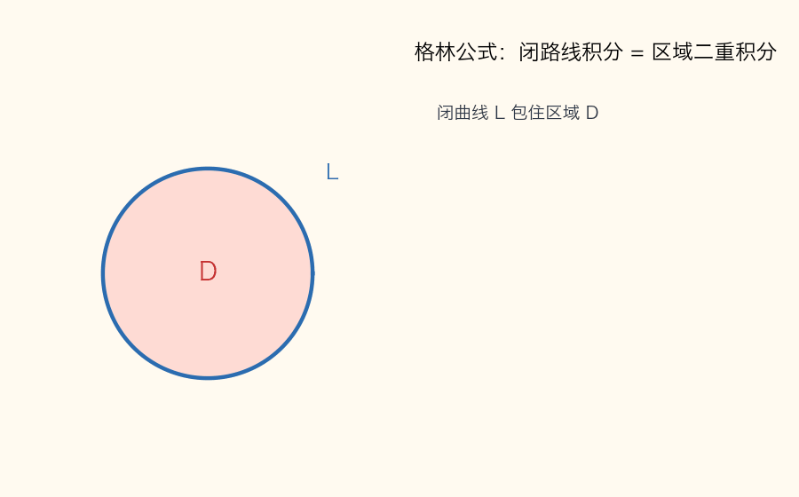
📌 锚点：**闭曲线上的第二类线积分 → ∂Q/∂x−∂P/∂y 的二重积分；L 必须取正向**

**考试答题**

**📌 历年真题（计算 18 每卷固定，6 分，答案直接写在题目下）**

**【2026.4·计算 18】（6 分）** 计算对坐标的曲线积分 I = ∮_L (3x²y²−yeˣ+20)dx + (2x³y+xy−24)dy，其中 L 是 D: |x|≤1, |y|≤2 取正向的边界曲线。

解：
① 认 P、Q 并求偏导：P = 3x²y²−yeˣ+20，Q = 2x³y+xy−24；∂P/∂y = 6x²y−eˣ，∂Q/∂x = 6x²y+y（**为什么先算这两个偏导**：格林公式右端只要它们——无论原式多长，求导后立刻变短）；
② 相减化简：∂Q/∂x − ∂P/∂y = (6x²y+y)−(6x²y−eˣ) = y+eˣ（**为什么 6x²y 消掉**：P、Q 中成对设计的 3x²y² 与 2x³y 就是求导后互相抵消的）；
③ 写格林公式：I = ∬_{|x|≤1,|y|≤2} (y+eˣ) dA；其中 ∬y dA = 0（**为什么是 0**：矩形关于 x 轴对称，y 是 y 的奇函数）；∬eˣ dA = ∫_{−2}^{2}dy ∫_{−1}^{1} eˣdx（**为什么能拆**：矩形区域上被积函数可分离变量，二重积分 = 两个定积分的乘积）；
④ 收数值：∫_{−2}^{2}dy = 4，∫_{−1}^{1}eˣdx = e−e⁻¹；I = 4(e−e⁻¹) = **4e−4/e**；
⑤ 验算：4(e−e⁻¹) ≈ 4×(2.718−0.368) ≈ 9.4，为正、量级合理（**为什么小数验一下**：格林公式的错常出在符号，数值量级是最快的报警器）。

**【2025.4·计算 18】（6 分）** 计算对坐标的曲线积分 I = ∮_L (2xe^(x²+y)+x²y−y²+1)dx + (e^(x²+y)−xy²+3y)dy，其中 L 为圆周 x²+y²=a²（a>0）沿逆时针方向。【官方】

解：完整四步见【例 C-5】。

**【2024.4·计算 18】（6 分）** 计算对坐标的曲线积分 I = ∮_L (e^y cosx−y+1)dx + (e^y sinx+x²)dy，其中 L 是由 y=x, y=1 及 x=0 所围闭区域 D 取正向的边界曲线。

解：
① ∂P/∂y = e^y cosx−1，∂Q/∂x = e^y cosx+2x（**为什么 e^y sinx 对 x 求导还是含 e^y cosx**：sinx 的导数是 cosx，e^y 对 x 不动——P、Q 的三角函数对同样是抵消设计）；
② 相减：∂Q/∂x − ∂P/∂y = 2x+1；定区域：D: 0≤y≤1, 0≤x≤y（**为什么是 Y 型**：三角形顶点 (0,0)、(0,1)、(1,1)，横向看 0≤x≤y 不分段，纵向 0≤y≤1 端点是常数）；
③ 写格林公式：I = ∫₀¹dy ∫₀^y (2x+1)dx（**为什么**：三角形边界取正向即逆时针，直接套公式）；内层 = [x²+x]₀^y = y²+y；
④ 外层：I = ∫₀¹(y²+y)dy = 1/3+1/2 = **5/6**（**为什么逐项积**：幂函数法则，1/3 与 1/2 通分前不必合并）。

**【2022.10·计算 18】（6 分）** 计算对坐标的曲线积分 I = ∮_L (3x²y+2y²−yeˣ)dx + (x³+4xy+xe^y)dy，其中 L 是 D: |x|≤1, |y|≤1 的取正向的边界曲线。【官方】

解：
① ∂P/∂y = 3x²+4y−eˣ，∂Q/∂x = 3x²+4y+e^y（**为什么逐项求**：x³ 对 x 是 3x²，4xy 对 x 是 4y，xe^y 对 x 是 e^y——P 里的 −yeˣ 对 y 是 −eˣ）；
② 相减：∂Q/∂x − ∂P/∂y = e^y+eˣ（**为什么 3x²、4y 全消**：成对项的设计规律——见到第一类样子的长式子，相减后必剩简单函数）；
③ 写格林公式：I = ∬_{|x|≤1,|y|≤1} (e^y+eˣ) dxdy = ∫_{−1}^{1}dx ∫_{−1}^{1} (e^y+eˣ) dy（**为什么能拆**：矩形区域可分离，逐项分别积）；
④ 收数值：∬e^y dA = 2(e−e⁻¹)，∬eˣ dA = 2(e−e⁻¹)（**为什么两项相等**：x、y 地位对等——∫_{−1}^{1}e^y dy = ∫_{−1}^{1}eˣdx = e−e⁻¹，另一维长都是 2）；I = **4(e−e⁻¹)**。

**🎯 考法**：给一个长得吓人的 P dx+Q dy 沿闭曲线——一律用格林公式；成对项相减后只剩一个简单函数（y+eˣ / e^y+eˣ / 2x+1 / −x²−y²+2y），区域是矩形、三角形或圆域。

**✍️ 得分点**：①分别求出 ∂P/∂y、∂Q/∂x（3 分）②相减化简并代入格林公式（1 分）③算二重积分得数值（2 分）——官方按 3+3 或 2+2+2 给分（2025.4 为 3+3、2022.10 为 2+2+2），**偏导计算单独占一半分值，不容马虎**。

**⚠️ 易混淆**：L 必须**正向**（逆时针/区域在左手），负向结果反号；非闭曲线要先补线成闭曲线再减去补线段（本课程真题全是闭曲线，直接套）；圆域上 ∬(x²+y²)dA 必须转极坐标，别用 πR⁴/2 之外想当然。

**计算方法**（四步模板）：
1. 认 P、Q，分别对 y、x 求偏导 ∂P/∂y、∂Q/∂x（**为什么两个都要**：公式要的是差 Q_x−P_y，缺一不可）；
2. 相减化简——成对项必消，剩下通常是低次多项式或 eˣ/e^y；
3. 写 ∮_L = ∬_D (∂Q/∂x−∂P/∂y) dA，给 D 定限（矩形/三角形直角坐标、圆域极坐标）；
4. 算二重积分收数值；奇函数项在对称区域上直接置 0（**为什么敢置 0**：区域对称 + 被积项奇，两半相消）。
（备用思路：若 L 非闭——本课程真题未考过——先补直线段 L₁ 成闭曲线套格林公式，再减去 ∫_{L₁} 的积分值（**为什么要减**：补线是人为添加的，必须扣回去）。）

**命题「对偶设计」规律**（2022.10 / 2024.4 / 2025.4 / 2026.4 四卷验证）：P 与 Q 中故意放一对「镜像项」（3x²y² ↔ 2x³y；e^y sinx ↔ e^y cosx；−yeˣ ↔ xe^y），求偏导相减后几乎全消，只剩一两个简单项——**看到长式子别害怕，Q_x−P_y 一减天地宽**，这正是「模板性最强的大题」评语的由来。

**【例 C-5】2025.4 计算 18 完整重讲（原题）**

I = ∮_L (2xe^(x²+y)+x²y−y²+1)dx + (e^(x²+y)−xy²+3y)dy，L: x²+y²=a²（a>0）逆时针。
① 认 P、Q：P = 2xe^(x²+y)+x²y−y²+1，Q = e^(x²+y)−xy²+3y；
② 求偏导：∂Q/∂x = 2xe^(x²+y)−y²，∂P/∂y = 2xe^(x²+y)+x²−2y（**为什么 ∂/∂x[e^(x²+y)] = 2xe^(x²+y)**：指数函数求导后要乘指数对 x 的导数 2x——链式法则；y² 对 x 是 0）；
③ 相减：∂Q/∂x − ∂P/∂y = (2xe^(x²+y)−y²)−(2xe^(x²+y)+x²−2y) = −x²−y²+2y（**为什么 2xe^(x²+y) 消掉**：又是成对设计——指数项、y² 与 −2y 项交叉相消）；
④ 写格林公式（圆域转极坐标）：I = ∬_{x²+y²≤a²} (−x²−y²+2y) dA；∬(−x²−y²)dA = −∫₀^{2π}dθ ∫₀^a r²·r dr = −2π·a⁴/4 = −πa⁴/2（**为什么 r² 变 r³**：dA = r dr dθ 多乘一个 r）；∬2y dA = 0（**为什么**：圆域关于 x 轴对称，2y 是 y 的奇函数）；
⑤ 结论：I = **−πa⁴/2**（**为什么结果为负别慌**：被积主项是 −r²，方向已按题目取逆时针正向——负号是算出来的，不是方向错误）。

---

#### C5 对坐标的曲面积分（第二类） ★★★（综合 22 固定，5 分送分题模板）

**定义详解**：对坐标的曲面积分 ∬_Σ f dxdy（或 dxdz、dydz）是**有向曲面** Σ 上的积分——曲面有两侧（上/下、右/左、前/后），积分号下写哪种坐标微分就向哪个坐标面投影，侧的选择由「上侧/下侧」「右侧/左侧」约定。**投影法三步**：①把曲面表成显式 z=z(x,y)（dxdy 型）或 y=y(x,z)（dxdz 型）；②曲面在相应坐标面的投影区域 D 写成不等式组；③按侧定号：上/右侧法向量与相应坐标轴正向夹角小于 90°（cosγ>0 / cosβ>0）取 +、下/左侧取 −（**为什么**：第二类曲面积分带方向，方向由法向量承载，投影号的正负就是法向量相应分量的正负）。另有两条铁律：被积函数中的 z（或 y）可用曲面方程代入消掉（**为什么能代入**：积分只在曲面上进行，曲面上点的坐标满足曲面方程）；闭曲面/组合曲面逐块算再相加。

**考试答题**

**📌 历年真题（综合 22 每卷固定，5 分，答案直接写在题目下）**

**【2026.4·综合 22】（5 分）** 计算对坐标的曲面积分 I = ∬_Σ (2−2x−y) dxdy，其中 Σ 是 z=√(4−x²−y²) 的上侧。

解：
① 定侧：上半球面取上侧 → cosγ>0，投影取正号（**为什么**：上侧法向量朝上，与 z 轴正向夹角小于 90°）；
② 投影：被积函数不含 z，无需解方程，投影区域 D: x²+y²≤4（**为什么是这个圆**：半球面 z=√(4−x²−y²) 与 Oxy 面的投影关系——底圆即半径 2 的圆盘）；
③ 化二重积分：I = +∬_D (2−2x−y) dA = 2×4π−0−0 = **8π**（**为什么两项是 0**：圆域关于两条坐标轴都对称，−2x、−y 都是奇函数项全消；常数项 = 2×圆面积，S = πR² = 4π）。

**【2025.4·综合 22】（5 分）** 计算对坐标的曲面积分 I = ∬_Σ (2x+y+z) dxdz，其中 Σ 是平面 x+y+z=1 被三个坐标面所截得部分平面的右侧。【官方】

解：
① 解曲面方程：dxdz 型缺 dy，把 y 解出来：y = 1−x−z（x≥0, y≥0, z≥0）（**为什么解 y**：dxdz 投影到 Oxz 面，曲面必须表成 y=y(x,z)）；
② 投影区域：D_xz: 0≤z≤1−x, 0≤x≤1（**为什么**：平面块被三坐标面所截，在 Oxz 面的影子是 x+z≤1、x≥0、z≥0 的三角形）；
③ 定号：右侧 → 法向量与 y 轴正向夹角小于 π/2，取 +（**为什么是 +**：平面 x+y+z=1 的法向量 {1,1,1} 的 y 分量为正，指向「右/前」）；
④ 代入消元：I = +∬_{D_xz} (2x+(1−x−z)+z) dxdz = ∬_{D_xz} (x+1) dxdz（**为什么 z 消掉了**：y = 1−x−z 代入后 y+z = 1−x——「曲面方程代入消元」的直接体现）；
⑤ 算二重积分：∬(x+1)dxdz = ∫₀¹dx ∫₀^{1−x} (x+1)dz = ∫₀¹ (x+1)(1−x)dx = ∫₀¹(1−x²)dx = 1−1/3 = **2/3**。

**【2024.4·综合 22】（5 分）** 计算对坐标的曲面积分 I = ∬_Σ (x²+y²+z²−1) dxdy，其中 Σ 是半球面 z=√(3−x²−y²) 的上侧。

解：完整四步见【例 C-6】。

**【2022.10·综合 22】（5 分）** 计算对坐标的曲面积分 I = ∬_Σ (2−y²) dxdz，其中 Σ 是半球面 y=√(1−x²−z²) 被三个坐标面所截得在第一卦限部分曲面的右侧。【官方】

解：
① 解曲面方程：Σ: y=√(1−x²−z²)（x≥0, z≥0），dxdz 型正对口（**为什么省一步**：题目已把 y 解成 x、z 的显式）；
② 投影区域：D_xz: x²+z²≤1, x≥0, z≥0——第一卦限的 1/4 圆盘（**为什么是 1/4**：第一卦限限定 x、z 均非负，圆盘被两轴切出四分之一）；
③ 定号：右侧 → 法向量与 y 轴正向夹角小于 π/2，取正号（**为什么**：球面在此卦限的外法向量 y 分量为正）；
④ 代入消元：2−y² = 2−(1−x²−z²) = 1+x²+z²（**为什么**：球面上 y² = 1−x²−z²，被积函数化成 x、z 的函数）；
⑤ 算二重积分：I = ∬_{D_xz} (1+x²+z²) dxdz = π/4 + ∫₀^{π/2}dθ ∫₀¹ r³dr = π/4 + π/8 = **3π/8**（**为什么拆两项**：常数项 = 1/4 圆面积 π/4；r² 项转极坐标 dA = r dr dθ，θ 只扫 0→π/2）。

**【2023.10·综合 22】（5 分）** 计算曲面积分 ∬_Σ x dxdy，其中 Σ 是平面 x+y+z=3 被三个坐标面所截得部分，取上侧。

解：
① 解曲面方程并定侧：Σ: z = 3−x−y，上侧 → 法向量 {1,1,1} 的 z 分量为正，取正号（**为什么是上侧**：法向量指向上方，cosγ>0）；
② 投影区域：D: x+y≤3, x≥0, y≥0（Oxy 面上的三角形）（**为什么**：平面截三轴于 (3,0,0)、(0,3,0)、(0,0,3)，投影是前两条截线围出的三角形）；
③ 化二重积分并计算：I = +∬_D x dA = ∫₀³x dx ∫₀^{3−x} dy = ∫₀³ x(3−x)dx = [3x²/2−x³/3]₀³ = 27/2−9 = **9/2**（**为什么内层是 (3−x)**：y 从 0 积到 3−x，内层积分长度即 3−x）。

**🎯 考法**：综合 22 每卷固定给一块有向曲面（球面块/半球面/平面块），被积函数是低次多项式——投影法三步套模板，5 分钟稳拿 5 分。

**✍️ 得分点**：①投影区域不等式（1~2 分）②按侧定号（1 分）③代入消元并算出二重积分（2~3 分）——官方按 1+2+2 或 2+3 给分（2025.4 为 1+2+2、2022.10 为 2+3），定号那 1 分是全模块最便宜的「为什么」。
- 时间预算：综合题 5 分建议 6 分钟内完成——模板熟了，这是全卷性价比最高的题。

**⚠️ 易混淆**：dxdy 型投影到 Oxy 面（表成 z=z(x,y)）、dxdz 型投影到 Oxz 面（表成 y=y(x,z)）——**缺哪个变量的微分就解哪个变量**；上/下（右/左）侧取号取反是综合题第一大坑；球面上的 x²+y²+z² 一定先用球面方程换成常数再积分，不要硬积。

**计算方法**（投影法三步模板）：
1. **解显式**：dxdy 型解出 z=z(x,y)，dxdz 型解出 y=y(x,z)（**为什么**：投影前必须知道曲面「盖在」投影面哪个区域上）；
2. **投影 + 定号**：投影区域 D 写不等式组；上/右侧取 +、下/左侧取 −；
3. **代入消元 + 算二重积分**：被积函数里的曲面坐标用曲面方程替换，再在 D 上算二重积分（圆域转极坐标）。

**常见曲面投影速查**：上半球面 z=√(R²−x²−y²) → 投影 x²+y²≤R²；第一卦限球面块 y=√(1−x²−z²) → 1/4 圆盘 x²+z²≤1（x,z≥0）；截距式平面块 x/a+y/b+z/c=1 → 直角三角形（**为什么背这个**：五张卷的综合 22 只考过这三类曲面）。

**【例 C-6】2024.4 综合 22 完整重讲——被积函数为什么能化成常数 2（原题）**

I = ∬_Σ (x²+y²+z²−1) dxdy，Σ: z=√(3−x²−y²) 上侧。
① 认曲面：半球面方程两边平方得 x²+y²+z² = 3——Σ 是半径 √3 的球面的上半块（**为什么先平方**：认出球面才有下一步的「常数化」）；
② **代入消元**：积分只在曲面 Σ 上进行，Σ 上每一点都满足 x²+y²+z² = 3 → 被积函数恒等于 3−1 = 2（**为什么能代入**：曲面积分的积分变量取遍曲面上的点，这些点的坐标受曲面方程约束——这是曲面积分区别于二重积分的本质特征：二重积分区域 D 内的点没有方程约束，曲面积分的点有）；
③ 定号 + 投影：上侧 → cosγ>0 取正号；投影 D: x²+y²≤3（**为什么半径是 √3**：球面与 Oxy 面的交线 x²+y²=3）；
④ 收尾：I = +∬_D 2dA = 2×π(√3)² = **6π**（**为什么一步出结果**：常数×圆面积，πR² = 3π——「消元化常数」是本题型最华丽的一步，也是送分关键）；
⑤ 验算：6π ≈ 18.8；若跳过消元、直接在 D 上硬积 x²+y²+z²−1，会得出另一个数——**先消元后积分**是本题唯一的路（**为什么**：投影区域 D 上的点不在球面上，z² 无从消起，不消元就没有常数化的捷径）。

答题提醒：综合 22 要**同时核对两件事**——「dxdy 对应投影到 Oxy 面（解出 z）」与「上/右侧定 + 号」；2022.10 的 dxdz 配右侧、2023.10 的 dxdy 配上侧，记号与侧一致才不丢定号分（**为什么**：投影面与法向方向是两套独立信息，错一个全题变号）。

---

五类积分同一个本质——都是「分割→近似→求和→取极限」的微元累加，差别只在「底」是面积、体积、弧长还是有向投影。一表在手，本模块 29 分全图如下：

**🎯 模块 C 速记表**

| 积分类型 | 每卷位置（五考期固定） | 核心公式/方法 | 秒杀口诀 |
|---|---|---|---|
| 二重积分（单选） | 单选 5（2026.4/2025.4/2024.4/2022.10/2023.10） | 奇对称消项；常数×面积；圆域 ∬(x²+y²)dA = πR⁴/2 | 区域对称+奇函数=0 |
| 二重积分（计算） | 计算 16（同上五考期） | 画图定限：X 型 ∫dx∫f dy / Y 型 ∫dy∫f dx | 先画区域再定限，Y 型不分段 |
| 三重积分（单选） | 单选 8（同上五考期） | 奇对称消 0；常数×体积；一次项 x̄V 加权；球 V=(4/3)πR³ | 长方体不对称项用形心算 |
| 对弧长曲线积分 | 计算 17（同上五考期） | 参数化 ds=√(x′²+y′²(+z′²))dt；折线逐段 | 第一类无向；圆弧 ds=Rdt |
| 对坐标曲线积分 | 计算 18（同上五考期） | 格林公式 ∮Pdx+Qdy=∬(∂Q/∂x−∂P/∂y)dA | L 取正向；成对项必消 |
| 曲面积分（综合） | 综合 22（同上五考期） | 投影法：解显式→投影定号→代入消元 | 缺哪个变量解哪个；上/右取 + |

（注：表中五考期 = 2026.4 / 2025.4 / 2024.4 / 2022.10 / 2023.10，题型位置逐卷一致；2023.10 单选 8 被积函数【待核实】。）

### 模块 D 无穷级数 ★★★（每卷单选 2 题 + 计算/综合 2 题，约 17 分）

> **固定座位表**：单选 4（级数敛散条件/收敛取值）+ 单选 9（等比/裂项求和）+ 计算 19（敛散判别 / 傅里叶系数 / 幂级数展开三选一轮换）+ 综合 21（幂级数收敛半径与收敛域），合计 3+3+6+5 = **17 分**，五期真题（2022.10~2026.4）逐题位复现、零缺席。四条概念：D1 数项级数的收敛与求和、D2 敛散判别、D3 幂级数、D4 傅里叶系数。
> 计算 19 三选一的近五年分布：2022.10 判别、2023.10 展开、2024.4 判别、2025.4 傅里叶、2026.4 傅里叶——三类都要备，傅里叶连庄两期值得加码。
> 本模块配两张动图：部分和数列的摆动与收敛（D1）、分部积分公式的来源（D3，直接服务 D4 的傅里叶系数计算）——推演时对照观看。
> 真题题干、选项与答案数值与第三节真题汇编逐字一致；答案标注沿用数据源口径：【官方】=官方答案扫描件转录，【推导】=按教材规范解法推导（无官方答案的考期）。

#### D1 数项级数的收敛与求和 ★★★（单选 4、9 固定 + 计算 19 交替考）

**定义详解**：级数 Σₙ₌₁^∞ uₙ 的**和**定义为部分和数列 Sₙ = u₁+u₂+…+uₙ 的极限（**为什么用部分和定义**：无穷多项相加无法逐个算完，唯一能算的是前 n 项和 Sₙ；lim Sₙ 存在才称级数收敛，极限值就是和）。两大**基准级数**必须背死——①**等比级数** Σa₁qⁿ⁻¹：|q|<1 时收敛且 S = a₁/(1−q)，|q|≥1 时发散；②**p-级数** Σ1/nᵖ：p>1 收敛，p≤1 发散（p=1 的调和级数发散）。两条必考**性质**：①级数乘非零常数敛散性不变；②通项 lim uₙ ≠ 0 必发散（注意反方向不成立：通项趋于 0 不保证收敛，调和级数就是反例）。

> **🖼 动图演示：部分和数列的摆动与收敛**

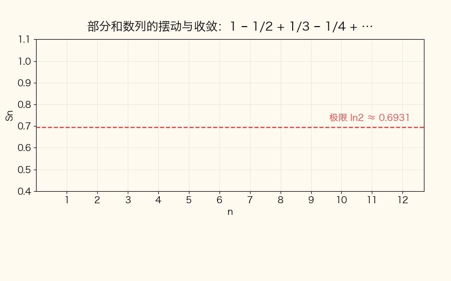

📌 锚点：**级数收敛 = 部分和数列有极限；交错级数摆动但振幅递减**

**基准级数对照表（判别与求和全靠它们，背死）**：

| 级数 | 收敛条件 | 和 / 结论 | 考期证据 |
|---|---|---|---|
| 等比 Σa₁qⁿ⁻¹ | |q|<1 | S = a₁/(1−q) | 2024.4-4、2022.10-4、2022.10-9 |
| p-级数 Σ1/nᵖ | p>1 收敛 | p≤1 发散 | 2026.4-4 |
| 调和 Σ1/n（p=1 特例） | 发散 | 只当判别基准 | 2024.4-19、2026.4-21 |

**为什么等比求和公式成立**：qSₙ 与 Sₙ 错位相减（Sₙ − qSₙ = a₁ − a₁qⁿ），左边提出 (1−q) 解出 Sₙ = a₁(1−qⁿ)/(1−q)；|q|<1 时 qⁿ → 0 → S = a₁/(1−q)（**为什么必须 |q|<1 才能用**：公式分母 (1−q) 固定，极限是否存在全看分子 qⁿ 的去向——这正是 2022.10-9 与 2025.4-9 只差起点、答案从 1 变 2 的根源：n=0 起 a₁=1，n=1 起 a₁=q）。

**考试答题**

**📌 历年真题（单选 4：敛散条件与收敛取值）**

**【2026.4·单选 4】（3 分）** 设级数 Σ 1/nᵖ 收敛，则 p 应满足（　）
- A. 0<p≤1
- B. p≥1
- C. 0<p<1
- D. p>1 ✅

> 【推导】p-级数结论：p>1 收敛、p≤1 发散。

📌 **p-级数只向 p>1 一侧收敛**：B 多收了 p=1、A/C 把方向写反——p=1 调和级数发散是判别关键。

**【2025.4·单选 4】（3 分）** 设常数 a≠0，如果级数 Σ uₙ 发散，则级数 Σ a uₙ（　）
- A. 发散 ✅
- B. 收敛
- C. 可能发散，也可能收敛
- D. 收敛性由 a 值确定

📌 **乘非零常数不改变敛散性**【官方 A】：部分和同乘 a，lim aSₙ 与 lim Sₙ 的存在性同步；a 的正负大小都救不了发散级数。

**【2024.4·单选 4】（3 分）** 设级数 Σₙ₌₀^∞ 2xⁿ 收敛，则 x 的取值可为下列数值中的（　）
- A. 1
- B. 1/2 ✅
- C. 3/2
- D. 2

> 【推导】这是公比 q=x 的等比级数：|x|<1 才收敛，四个选项只有 1/2。

📌 **先认出等比再谈收敛**：|q|<1 是硬门槛，x=1/2 代入 |x|<1 ✓。

**【2022.10·单选 4】（3 分）** 设级数 Σₙ₌₀^∞ xⁿ/2ⁿ 收敛，则 x 的取值可为下列数值中的（　）
- A. -2
- B. -1 ✅
- C. 2
- D. 5/2

> 【官方 B】公比是 x/2 而不是 x：|x/2|<1 → |x|<2，四个选项只有 -1。

📌 **别把公比看成 x**：xⁿ/2ⁿ = (x/2)ⁿ，收敛条件是 |x/2|<1；此题正是 D3 收敛半径思想的单选版。

**📌 历年真题（单选 9：级数求和）**

**【2026.4·单选 9】（3 分）** 级数 Σₙ₌₁^∞ 1/(n(n+3)) 的和是（　）
- A. 11/18 ✅
- B. 3/4
- C. 5/6
- D. 11/12

> 【推导】裂项相消求和：(1/3)(1+1/2+1/3) = 11/18。完整重讲见【例 D-1】。

📌 **1/(n(n+3)) 型 → 裂项**：分母两因子相差 k=3，提出 1/3 后错位相消。

**【2025.4·单选 9】（3 分）** 级数 Σₙ₌₀^∞ 1/2ⁿ 的和是（　）
- A. 1/2
- B. 1
- C. 2 ✅
- D. 3/2

📌 **等比求和公式**【官方 C】：首项 a₁=1（n=0 起）、q=1/2 → S = 1/(1−1/2) = 2。

**【2024.4·单选 9】（3 分）** 级数 Σₙ₌₀^∞ 1/2ⁿ 的和为（　）
- A. 1
- B. 3/2
- C. 2 ✅
- D. 5/2

> 【推导】与 2025.4-9 同题：n=0 起，S = 1/(1−1/2) = 2。

📌 **看清起点再代公式**：n=0 起首项是 1，不是 1/2。

**【2022.10·单选 9】（3 分）** 级数 Σₙ₌₁^∞ 1/2ⁿ 的和为（　）
- A. 1/2
- B. 3/4
- C. 1 ✅
- D. 5/4

📌 **起点不同答案不同**【官方 C】：n=1 起首项 a₁=1/2 → S = (1/2)/(1−1/2) = **1**。与上两题只差起点，答案从 2 变 1——考场上先画下标再动笔。

**⚠️ 易混淆（单选 9 三连的坑）**：S = a₁/(1−q) 里的 a₁ 是**实际首项**——Σₙ₌₀^∞ qⁿ 的 a₁=1，Σₙ₌₁^∞ qⁿ 的 a₁=q；起点看错，2 和 1 就选反。
**⚠️ 易混淆（单选 4 两连的坑）**：2024.4-4 的 |x|<1 与 2022.10-4 的 |x|<2 是同一件事不同公比——先认公比（q=x 还是 q=x/2），再谈收敛范围，别盯着 x 本身猜。

**📌 历年真题（计算 19：敛散判别，答案在题目下）**

**【2024.4·计算 19】（6 分）** 判断级数 Σₙ₌₁^∞ (1+n)/(1+n²) 的敛散性。

> 【推导】答案：**发散**。
> 取基准 vₙ = 1/n（**为什么跟 1/n 比**：uₙ 分子分母最高次为 n¹ 与 n²，量级 ~ n/n² = 1/n，比较对象由最高次决定）：
> lim uₙ/vₙ = lim n(1+n)/(1+n²) = lim (n+n²)/(1+n²) = 1（**为什么是同阶**：分子分母同除 n²，得 (1/n+1)/(1/n²+1) → 1，c 有限且不为 0）；
> 由比较判别法极限形式与调和级数 Σ1/n **同敛散**（**为什么引用调和**：0<c<∞ 时两通项只差常数倍，敛散一致），调和级数发散 → 原级数**发散**。

**【2022.10·计算 19】（6 分）** 判断级数 Σₙ₌₁^∞ 1/((n+1)(n+2)) 的敛散性。

> 【官方】（评分 2+2+2）写出 uₙ = 1/((n+1)(n+2))（2 分）；放缩 1/((n+1)(n+2)) < 1/n²，而 Σ1/n² 收敛（p=2>1）（2 分）；由比较判别法知**收敛**（2 分）。（**为什么放缩方向对**：分母 (n+1)(n+2) > n²，分母大则分数小，正项级数"小于收敛级数"必收敛。）

> 判别题的方法纵深（极限形式 vs 放缩的适用场景、基准库、判断流）统一收在下方 D2 方法卡，两题对照观看。

**🎯 考法**：单选 4 考敛散条件（p-级数 / 非零常数性质 / 等比收敛范围）；单选 9 考求和（等比公式 / 裂项相消）；计算 19 在判别 / 傅里叶 / 展开三类中轮换（傅里叶见 D4、展开见 D3）。

**✍️ 得分点**：
- 单选求和两步走：认出型（等比 / 裂项）→ 代对公式（首项与起点！）。
- 判别计算题按官方评分三段给分：写 uₙ → 选基准并比较 → 下结论"收敛/发散"，三段缺一扣分。
- 通项判别法是"快筛"：见到通项明显不趋 0 的选项（含参数 n 不消尽的），直接按发散处理，省一步。
- 求和题代公式前先画下标（Σₙ₌₀ 还是 Σₙ₌₁），首项写错全题错——单选 9 三期连考这个坑。

**计算方法（求和与判别工具箱）**：
- **p-级数**：Σ1/nᵖ，p>1 收敛、p≤1 发散（结论直接用）。
- **等比级数**：|q|<1 收敛，S = a₁/(1−q)（a₁ 为实际首项）。
- **裂项**：1/(n(n+k)) = (1/k)(1/n − 1/(n+k))（**为什么能裂**：部分分式分解——设 1/(n(n+k)) = A/n + B/(n+k)，通分得 1 = A(n+k)+Bn，比对系数解出 A=1/k、B=−1/k）。
- **比较判别法极限形式**：lim uₙ/vₙ = c 且 0<c<∞ → 同敛散（**为什么**：c 有限正说明 n 充分大后 uₙ 与 vₙ 是同阶无穷小量、只差常数倍，部分和成比例同生共死，敛散性必然相同）。
- **通项判别法（快筛）**：lim uₙ ≠ 0 → 发散（**为什么**：uₙ = Sₙ − Sₙ₋₁，若 Sₙ 有极限则两项之差必趋 0；逆否命题即"通项不趋 0 必发散"）。

**【例 D-1】裂项求和完整重讲（原题：2026.4 单选 9）**

求级数 Σₙ₌₁^∞ 1/(n(n+3)) 的和。

解：
① **裂项**：1/(n(n+3)) = (1/3)(1/n − 1/(n+3))（**为什么提出 1/3**：两因子相差 3，代公式 1/(n(n+k)) = (1/k)(1/n − 1/(n+k)) 即得）。
② **写部分和**：Sₙ = (1/3)[(1−1/4) + (1/2−1/5) + (1/3−1/6) + (1/4−1/7) + … + (1/n − 1/(n+3))]（**为什么展开写**：裂项求和靠错位相消，必须展开观察哪些项留下）。
③ **相消**：−1/4 与 +1/4、−1/5 与 +1/5……逐对抵消，只剩开头三个正项与末尾三个负项：Sₙ = (1/3)[(1+1/2+1/3) − (1/(n+1)+1/(n+2)+1/(n+3))]（**为什么只剩这些**：每个负项 −1/(n+3) 与它后面第 n+3 项的正项 1/(n+3) 相消；开头 1、1/2、1/3 没有前导项来配对，末尾三项没有后续项来配对）。
④ **取极限**：n→∞ 时末尾三项 →0（**为什么趋 0**：1/(n+k) → 0，k=1,2,3），故 S = (1/3)(1+1/2+1/3) = (1/3)·(6/6+3/6+2/6) = (1/3)·(11/6) = **11/18**，选 A。

**【例 D-1 补练】同型自测（自编教学数据，仿 2026.4-9 题型）**

求 Σₙ₌₁^∞ 1/(n(n+2)) 的和。

解：① 裂项：1/(n(n+2)) = (1/2)(1/n − 1/(n+2))（**为什么提出 1/2**：两因子相差 k=2，代通式即得）；② 部分和错位相消，只剩开头两项与末尾两项：Sₙ = (1/2)[(1+1/2) − (1/(n+1)+1/(n+2))]（**为什么开头只剩 1 和 1/2**：同例 D-1，负项 1/(n+2) 与后面正项逐对相消）；③ 取极限 S = (1/2)·(3/2) = **3/4**（**为什么末尾归零**：1/(n+1)、1/(n+2) → 0）。

（本题为自编教学数据，仅用于补练裂项手法；真题数值一律以【例 D-1】与真题区为准。）

#### D2 正项级数与交错级数的敛散判别 ★★（计算 19 考区）

**定义详解**：正项级数（uₙ ≥ 0）敛散的本质是**部分和有界**（**为什么**：正项级数的部分和单调不减，单调有界数列必有极限）；判别不必求和，只须与基准级数比"量级"。交错级数 u₁−u₂+u₃−… 可用**莱布尼茨判别法**：通项绝对值单调递减且趋于 0 → 收敛（如 Σ(−1)ⁿ⁻¹/n）。

**方法卡**：
- 第一步先算 lim uₙ：不为 0 → 直接发散（**为什么**：收敛级数通项必趋 0，这是必要条件）；为 0 → 进入比较。
- **比较判别法极限形式**：lim uₙ/vₙ = c，0<c<∞ → 同敛散（**为什么同阶同敛散**：c 有限正 = 同阶无穷小量，n 大后两通项只差常数倍，部分和成比例，敛散一致）。
- **基准库只三个**：调和 Σ1/n（发散）、p-级数 Σ1/nᵖ（p>1 收敛）、等比 Σqⁿ（|q|<1 收敛）——考卷上的 uₙ 都能"看最高次"归到这三个量级。
- **比较判别法（非极限形式也要会）**：0 ≤ uₙ ≤ vₙ 且 Σvₙ 收敛 → Σuₙ 收敛（**为什么放缩可行**：正项级数部分和单调不减，通项被压小不会破坏收敛）——2022.10-19 官方用的正是这种放缩写法 1/((n+1)(n+2)) < 1/n²；题目用哪种形式比，答案就照哪种形式写。

**⚠️ 易错清单**：
- 与 1/n 比还是与 1/n² 比？**看 uₙ 的量级**：(1+n)/(1+n²) ~ 1/n（2024.4-19 发散）；1/((n+1)(n+2)) ~ 1/n²（2022.10-19 收敛）。
- "通项趋于 0"**不是**收敛理由，只是必要条件。
- 结论必须落成"收敛 / 发散"二字并写明引用的基准级数——官方评分按段给分（2022.10-19 的 2+2+2）。基准选定后结论词跟着基准走：比调和（发散）则答发散，比 1/n²（收敛）则答收敛，别比完忘了下结论。
- 端点判敛时遇到的 Σ1/nᵖ 是数项级数不是幂级数——直接读 p：p=1 发散、p=2 收敛。
- 放缩法记方向（正项级数）："大收则小收，小散则大散"。

**莱布尼茨判验示范**：Σ(−1)ⁿ⁻¹/n（即 1 − 1/2 + 1/3 − 1/4 + …）：1/n 单调递减 ✓、lim 1/n = 0 ✓ → 收敛（**为什么两条件缺一不可**：通项不趋 0 直接发散；不单调递减则部分和摆动幅度不收窄，收敛无保证）。这条结论正是 2026.4-21 与 2025.4-21 判端点 x=−1（或 x=−2）收敛、2023.10-19 判端点 x=1 收敛的依据——D2 的方法直接供给 D3 的端点判敛。

**考场判断流（计算 19 判别题四步）**：
1. 先快筛：lim uₙ 不为 0 → 发散收工（通项判别法）；
2. 看量级：分子分母最高次相约（(1+n)/(1+n²) → 1/n；1/((n+1)(n+2)) → 1/n²）；
3. 挑基准（调和 / p-级数 / 等比），用极限形式或放缩作比较；
4. 下结论"收敛 / 发散"——官方评分的三段给分点恰对应第 2、3、4 步。

> 真题演算已在 D1 展开（2024.4-19 发散、2022.10-19 收敛），此处不重复。

#### D3 幂级数 ★★★（单选 4 + 综合 21 固定 + 2023.10-19 展开）

**定义详解**：幂级数 Σaₙxⁿ 的收敛范围是**以原点为中心的对称区间**。收敛半径：ρ = lim|aₙ₊₁/aₙ|，R = 1/ρ（**为什么相邻系数比决定 R**：对通项用比值判别法，|aₙ₊₁xⁿ⁺¹|/|aₙxⁿ| = |aₙ₊₁/aₙ|·|x| → ρ|x|，小于 1 即 |x| < 1/ρ——系数衰减越慢（ρ 越大），允许的 |x| 越小）。三组术语**分清**：收敛区间 = 开区间 (−R, R)（不管端点）；收敛域 = 收敛区间 ∪ 收敛端点（x=±R 时退化成数项级数，须**逐个代入**判敛散，用的正是 D1 的 p-级数/交错/等比结论）；平移型 Σaₙ(x−x₀)ⁿ 先换元 t = x−x₀ 化为标准型。（五期真题只考收敛半径 / 区间 / 域，未考过和函数——复习按真题优先。）

**考试答题**

**📌 历年真题（综合 21：收敛半径/收敛域，答案在题目下）**

**【2026.4·综合 21】（5 分）** 求幂级数 Σₙ₌₁^∞ xⁿ/n 的收敛域。

> 【推导】ρ = lim|aₙ₊₁/aₙ| = lim n/(n+1) = 1 → R = 1（**为什么**：系数 1/n，相邻系数比趋 1）；
> x = 1：Σ1/n 发散（调和）（**为什么只剩端点要判**：区间内部必收敛，待定的只有两端）；
> x = −1：Σ(−1)ⁿ/n 收敛（交错级数，1/n 单调减趋 0）→ 收敛域 **[−1, 1)**。
（与 2025.4-21 的差异只在系数 2ⁿ——收敛域整体放大 2 倍：[−1, 1) → [−2, 2)，两题互为镜像验算。）

**【2025.4·综合 21】（5 分）** 求幂级数 Σₙ₌₁^∞ xⁿ/(2ⁿn) 的收敛域。

> 【官方】（评分 2+2+1）ρ = lim|aₙ₊₁/aₙ| = lim n/(2(n+1)) = 1/2（2 分）→ R = 2；
> x = −2：代入得 Σ(−1)ⁿ/n（**为什么收敛**：交错级数，1/n 单调减趋 0，莱布尼茨），x = 2：代入得 Σ1/n（**为什么发散**：调和级数）（2 分）→ 收敛域 **[−2, 2)**（1 分）。
（**为什么系数多 2ⁿ 半径就变 2**：aₙ = 1/(2ⁿn)，相邻系数比 = n/(2(n+1)) → 1/2 = ρ，系数里"藏"的 2ⁿ 平方进半径。另视角：令 t = x/2，级数即 Σtⁿ/n，与 2026.4-21 同型，其收敛域 [−1,1) 回代 x = 2t 即 [−2,2)，两条路互为验算。）

**【2024.4·综合 21】（5 分）** 求幂级数 Σₙ₌₁^∞ (2ⁿ/(2n+1))xⁿ 的收敛半径和收敛区间。

> 【推导·已对照原卷勘误】R = lim|aₙ/aₙ₊₁| = lim [2ⁿ/(2n+1)]·[(2n+3)/2ⁿ⁺¹] = lim (2n+3)/(2(2n+1)) = **1/2**（**为什么这次不用取倒数**：相邻系数比的极限 lim|aₙ/aₙ₊₁| 本身就是 R；若按 ρ=lim|aₙ₊₁/aₙ| 定义则 ρ=2、R=1/ρ=1/2，两种口径同值）；收敛区间 **(−1/2, 1/2)**（题目只要区间，不判端点）。
> ⚠️ 勘误说明：初版误写 R=2——那是把本题与 2025.4-21（分母含 2ⁿ）混淆；本题 2ⁿ 在**分子**上，半径反而缩小。主会话已对照 zikao365 原卷扫描件放大核验：分子确为 2ⁿ。

**【2022.10·综合 21】（5 分）** 求幂级数 Σₙ₌₁^∞ (x−1)ⁿ/(n·3ⁿ) 的收敛半径和收敛区间。

> 【官方】（评分 1+2+2）令 t = x−1，原级数化为 Σtⁿ/(n·3ⁿ)（1 分，**为什么换元**：系数公式按标准型 xⁿ 的系数定义，(x−1)ⁿ 的系数要对 tⁿ 读）；ρ = lim|aₙ₊₁/aₙ| = 1/3（2 分）；R = 3，收敛区间 **(−2, 4)**（2 分）。完整重讲见【例 D-2】。

**📌 历年真题（计算 19：函数展开）**

**【2023.10·计算 19】（6 分）** 将函数 f(x)=ln(1+x) 展开为 x 的幂级数。

> 【推导】f⁽ⁿ⁾(0) = (−1)ⁿ⁻¹(n−1)!（**为什么带阶乘**：逐阶求导后出现 1/(1+x) 的幂，n 阶导数在 x=0 处为 (−1)ⁿ⁻¹(n−1)!）→ 系数 aₙ = f⁽ⁿ⁾(0)/n! = (−1)ⁿ⁻¹/n；
> 故 ln(1+x) = Σₙ₌₁^∞ (−1)ⁿ⁻¹xⁿ/n，R=1；x=1 收敛（交错）、x=−1 发散 → 收敛域 **−1 < x ≤ 1**。完整重讲见【例 D-3】。

**🎯 考法**：综合 21 五期全考"收敛半径 + 收敛区间/收敛域"，系数轮换花样（n、2ⁿn、2ⁿ/(2n+1)、(x−1) 平移）；计算 19 轮到"展开"时考 ln(1+x)（2023.10）。展开题的系数路线只有两条：泰勒系数（本条）与逐项积分/求导（五期真题未考，按真题优先不展开）。

**✍️ 得分点**：
- 求收敛域四步固定：写 ρ → R=1/ρ → 端点逐个判敛 → 下结论（半开半闭区间最常见）。
- 问"收敛**区间**"不判端点（2024.4、2022.10），问"收敛**域**"必判端点（2025.4、2026.4）——审题先看清问法。
- 展开题答案必须带**收敛域**，漏写扣分。
- 系数花样速识别（**规律**：系数分母里的 cⁿ 把半径放大 c 倍——本质是 |aₙ₊₁/aₙ| 里约出 1/c）：
  - 1/n → R=1（2026.4-21）；1/(2ⁿn) → R=2（2025.4-21）；1/(n·3ⁿ) → R=3（2022.10-21）。
  - 分子含 cⁿ（如 2ⁿ/(2n+1)，2024.4-21）：半径反缩为 1/c → R=1/2——**系数里的 cⁿ 在分子还是分母，方向刚好相反，别背反**。

**问法对照（审题三秒）**：问"收敛半径"→ 只答 R；问"收敛区间"→ R + 开区间（2024.4、2022.10 这样问）；问"收敛域"→ R + 端点判定 + 并入（2025.4、2026.4 这样问）。问法决定要不要做模板第 4 步。

**计算方法（收敛域四步模板）**：
0. 审问法：问"收敛**区间**"只写开区间，问"收敛**域**"必判端点（前者见 2024.4、2022.10，后者见 2025.4、2026.4）；
1. 化标准型：有 (x−x₀) 先换元 t = x−x₀；
2. 求 ρ = lim|aₙ₊₁/aₙ|，R = 1/ρ；
3. 写开区间 |t| < R；
4. 端点 t=±R 逐个代入化成数项级数，用 p-级数/交错/等比判敛，收敛端点并入得收敛域。

**端点判敛对照表（综合 21 与展开题的端点去向）**：

| 题目 | 端点代入 | 端点级数 | 判定 | 结论 |
|---|---|---|---|---|
| 2026.4-21 Σxⁿ/n | x=1 / x=−1 | Σ1/n / Σ(−1)ⁿ/n | 发散 / 收敛 | [−1, 1) |
| 2025.4-21 Σxⁿ/(2ⁿn) | x=2 / x=−2 | Σ1/n / Σ(−1)ⁿ/n | 发散 / 收敛 | [−2, 2) |
| 2023.10-19 ln(1+x) | x=1 / x=−1 | Σ(−1)ⁿ⁻¹/n / −Σ1/n | 收敛 / 发散 | (−1, 1] |
| 2024.4-21、2022.10-21 | 不判（问的是区间） | — | — | (−1/2, 1/2)、(−2, 4) |

📌 **半开半闭的规律**：符号交错化的一端靠莱布尼茨保住收敛，同号化的一端被调和级数拉垮——三道判端点的真题全是这个格局，方向（左闭右开还是左开右闭）由通式的符号因子落在哪端决定。

> **🖼 动图演示：分部积分公式的来源**

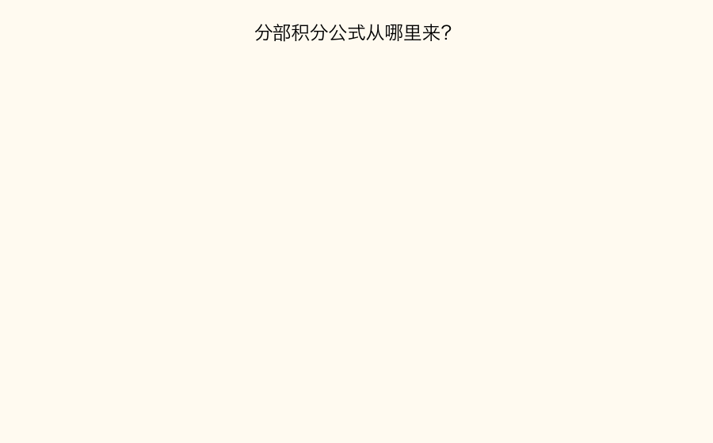

📌 锚点：**∫u dv = uv − ∫v du（由乘积求导法则两边积分移项而来）——傅里叶系数 a₃/b₅ 就靠它算**

（这张动图挂在 D3 看似超前，实为 D4 铺垫：傅里叶系数 ∫x sin nx dx、∫x cos nx dx 全靠分部积分一次降幂；而求收敛域的端点判敛又回到 D1 工具箱——模块 D 内部就是这样咬合的。）

**【例 D-2】平移型幂级数完整重讲（原题：2022.10 综合 21，官方评分 1+2+2）**

求 Σₙ₌₁^∞ (x−1)ⁿ/(n·3ⁿ) 的收敛半径和收敛区间。

解：
① **换元**：令 t = x−1，级数化为 Σtⁿ/(n·3ⁿ)（**为什么换元**：ρ=lim|aₙ₊₁/aₙ| 是对 xⁿ 标准型的系数定义的；换元后中心平移到 t=0，算完再把区间平移回去）。
② **求 ρ**：aₙ = 1/(n·3ⁿ)，ρ = lim|aₙ₊₁/aₙ| = lim [1/((n+1)·3ⁿ⁺¹)]·[n·3ⁿ] = lim (1/3)·n/(n+1) = 1/3（**为什么极限是 1/3**：3ⁿ 与 3ⁿ⁺¹ 约出 1/3，n/(n+1) → 1）。
③ **收敛半径**：R = 1/ρ = **3**（**为什么取倒数**：比值判别法要求 ρ|t| < 1，即 |t| < 1/ρ）。
④ **收敛区间**：|t| < 3 → −3 < x−1 < 3 → −2 < x < 4，即 **(−2, 4)**（**为什么两端加回 1**：t = x−1 把中心平移到了 1，区间两端都要平移回去；题目只要收敛区间，端点不必判）。
⑤ **延伸（本题不要求，但同型题考过收敛域）**：若问收敛域，判端点——x = −2（t = −3）：Σ(−1)ⁿ/n 收敛（莱布尼茨）；x = 4（t = 3）：Σ1/n 发散（调和）→ 收敛域为 **[−2, 4)**（**为什么左闭右开**：t 的系数 1/(n·3ⁿ) 恒正，端点级数的符号只由 (±1)ⁿ 定，与 2026.4-21、2025.4-21 同格局）。

**【例 D-3】ln(1+x) 的幂级数展开（原题：2023.10 计算 19）**

解：
① **求系数**：f(x)=ln(1+x)，f′=(1+x)⁻¹，逐阶求导得 f⁽ⁿ⁾(x) = (−1)ⁿ⁻¹·(n−1)!/(1+x)ⁿ（**为什么带阶乘又翻转符号**：每求一阶导，(1+x) 的幂次加一、符号翻转一次，分子按 (n−1)! 规律增长）；代 x=0：f⁽ⁿ⁾(0) = (−1)ⁿ⁻¹(n−1)!。
　自查前三阶：f′(0)=1、f″(0)=−1、f‴(0)=2 → 前三项系数 a₁=1、a₂=−1/2!=−1/2、a₃=2/3!=1/3（**为什么要自查**：与通式 (−1)ⁿ⁻¹/n 在 n=1,2,3 处逐项吻合，1 − x/2 + x²/3 − … 正是 ln(1+x) 的泰勒展开，公式可信）。
② **除以 n!**：aₙ = f⁽ⁿ⁾(0)/n! = (−1)ⁿ⁻¹(n−1)!/n! = (−1)ⁿ⁻¹/n（**为什么能约**：(n−1)!/n! = 1/n）。
③ **写出展开式**：ln(1+x) = Σₙ₌₁^∞ (−1)ⁿ⁻¹xⁿ/n（**为什么 n 从 1 起**：常数项 f(0)=ln1=0，级数无常数项）。
④ **判端点**：R=1；x=1 → Σ(−1)ⁿ⁻¹/n 收敛（交错级数，1/n 单调减趋 0）；x=−1 → 各项同号化为 −Σ1/n 发散（调和）（**为什么两端点敛散不同**：x=±1 只差符号翻转，交错结构恰在 x=+1 一侧保住收敛）→ 收敛域 **−1 < x ≤ 1**。
⑤ **回代抽查**：x=0.1 → 级数前四项 0.1 − 0.005 + 0.000333 − 0.000025 ≈ 0.09531，与 ln(1.1) ≈ 0.09531 吻合（**为什么抽查有效**：收敛域内级数和恒等于函数值，取小 x 让前几项主导，口算即可核验通式符号）。

#### D4 傅里叶系数 ★★★（计算 19：2026.4-19 b₅=1/5；2025.4-19 a₃=-4/(9π)，后者官方）

**定义详解**：周期 2π 的函数 f(x) 的傅里叶级数为 a₀/2 + Σ(aₙcos nx + bₙsin nx)，系数**定义式**：
- aₙ = (1/π)∫(−π→π) f(x)cos nx dx（n=0,1,2,…）
- bₙ = (1/π)∫(−π→π) f(x)sin nx dx（n=1,2,…）
- a₀ = (1/π)∫(−π→π) f(x)dx（n=0 代入 aₙ 公式即得；级数常数项写作 a₀/2，**为什么不直接写 a₀**：保证 n=0 时公式与通式统一）

（**为什么系数是"除以 π 的积分"**：{cos nx, sin nx} 在 [−π,π] 上正交——不同函数乘积积分为 0、cos²nx 积分为 π，用正交性在展开式两端乘 cos mx（或 sin mx）再积分，即解出系数。）**奇偶简化**：f 为奇函数 → aₙ=0 只算 bₙ；f 为偶函数 → bₙ=0，aₙ = (2/π)∫(0→π) f(x)cos nx dx（**为什么折半**：偶函数 × cos nx 仍是偶函数，全区间积分 = 2 倍半区间；奇函数 × sin nx 是偶函数同理）。**两个求值锚点**：sin(nπ) = 0，cos(nπ) = (−1)ⁿ。被积函数 x·sin nx、x·cos nx 都是"幂 × 三角"，**分部积分**一次降幂搞定（动图回看 D3）。

- 奇偶判断小技巧：先整体验证 f(−x) = ±f(x) 是否成立；不成立（如 2026.4-19 的分段函数）就不折半，逐段积分——值为 0 的段直接删。

**考试答题**

**📌 历年真题（答案在题目下）**

**【2026.4·计算 19】（6 分）** 设 f(x) 是周期为 2π 的函数，它在区间 [−π,π) 上表达式为 f(x)=x（−π≤x<0），0（0≤x<π）。其傅里叶级数展开式为 a₀/2 + Σ(aₙcos nx + bₙsin nx)，求系数 b₅。

> 【推导】答案：**b₅ = 1/5**。完整重讲见【例 D-4】。

**【2025.4·计算 19】（6 分）** 设 f(x) 是周期为 2π 的函数，它在区间 [−π,π) 上表达式为 f(x)=|x|，其傅里叶级数展开式为 a₀/2 + Σ aₙcos nx，求系数 a₃。

> 【官方】（评分 4+2）a₃ = (1/π)∫(−π→π)|x|cos3x dx = (2/π)∫(0→π) x cos3x dx（4 分，**为什么折半**：|x| 与 cos3x 都是偶函数，偶×偶=偶，全区间积分 = 2 倍半区间）；
> = (2/(3π))∫(0→π) x d(sin3x) = (2/(3π))([x sin3x]₀^π − ∫(0→π) sin3x dx)（**为什么分部**：x cos3x 是幂×三角，分部把幂降为常数；sin3x 在 0、π 处均为 0，边界项消失）
> = (2/(9π))[cos3x]₀^π = (2/(9π))(−1−1) = **−4/(9π)**（2 分，**为什么是负的**：cos3π=−1、cos0=1，差为 −2）。注意 ∫sin3x dx = −cos3x/3，负负得正后上限减下限剩 (−1−1)/3。

**🎯 考法**：计算 19 近三年两考傅里叶（2025.4 偶函数求 a₃、2026.4 分段函数求 b₅），套路完全固定：写系数公式 → 奇偶简化区间 → 分部积分 → 代 sin(nπ)=0、cos(nπ)=(−1)ⁿ。该题位在级数三考点（判别 / 展开 / 傅里叶）间循环轮换——备考按全覆盖准备。

**✍️ 得分点**：
- 第一步**必须写出系数定义式**再代函数——官方评分第一段就给在公式与奇偶简化上。
- 奇偶简化要写明理由（"偶×偶=偶，故 2 倍半区间"），直接对应给分点。
- 分部后**边界项逐个代值**（sin(nπ)=0、cos(nπ)=(−1)ⁿ），别整块略去——符号错误是本题最大失分点。
- 2025.4-19 官方按 4+2 给分：系数公式与奇偶折半占 4 分、分部求值占 2 分——公式和折半理由写全就拿到大头。
- 题目只求 b₅ 就不算 aₙ——傅里叶系数各算各的，别顺手多算浪费时间（2026.4-19 只需 bₙ 公式）。

**计算方法（傅里叶系数四步模板）**：
1. 认奇偶：分段函数逐段看（如 2026.4-19 在 [−π,0) 上 f=x，0 段不贡献积分）；
2. 写系数公式，用奇偶性把 ∫(−π→π) 折成 2∫(0→π)（或直接删掉为零的一段）；
3. 分部积分：∫x sin nx dx = −x cos nx/n + sin nx/n²（取 u=x、dv=sin nx dx；**为什么这样选**：让 x 去求导降幂，三角函数凑进 d 里原函数好写）；
4. 代端点求值，用 sin(nπ)=0、cos(nπ)=(−1)ⁿ 收拢成 (−1)ⁿ⁺¹/n 型通项，再代具体 n。

（注：若题面给的展开式只含 cos 项或只含 sin 项，照题面形式答即可——2025.4-19 题面即写作 a₀/2 + Σ aₙcos nx，只求 aₙ 不必写 bₙ。）

**系数选择速查（先判断再动笔）**：

| 函数形态 | 求哪个系数 | 理由 |
|---|---|---|
| f 为奇函数（如 f(x)=x，−π<x<π） | 只算 bₙ（aₙ=0） | 奇×cos nx=奇函数，积分为 0 |
| f 为偶函数（如 f(x)=|x|，2025.4-19） | 只算 aₙ（bₙ=0） | 偶×sin nx=奇函数，积分为 0 |
| 分段（如 2026.4-19） | 按题意求 aₙ 或 bₙ，逐段积分 | 奇偶性不整体成立时不可套用折半 |

**【例 D-4】分段函数求 b₅ 完整重讲（原题：2026.4 计算 19）**

f(x) 周期 2π，[−π,π) 上 f(x)=x（−π≤x<0）、0（0≤x<π），求 b₅。

解：
① **写公式并删零段**：bₙ = (1/π)∫(−π→π) f(x)sin nx dx = (1/π)∫(−π→0) x sin nx dx（**为什么只剩前半段**：0≤x<π 上 f≡0，该段积分恒为 0，直接不写）。
② **分部积分**：取 u=x、dv=sin nx dx → du=dx、v=−cos nx/n（**为什么这么选**：x 求一次导变常数，三角函数的原函数现成）：
∫(−π→0) x sin nx dx = [−x cos nx/n]（−π→0）+ (1/n)∫(−π→0) cos nx dx = [−x cos nx/n + sin nx/n²]（−π→0）（**为什么多出 sin nx/n²**：∫cos nx dx = sin nx/n；第二项为正是分部公式里 "−∫v du" 与 v=−cos nx/n 的负号相消的结果）。
③ **代端点**：x=0 处 = −0·cos0/n + sin0/n² = 0（**为什么为 0**：x=0 把第一项乘没，sin0=0）；x=−π 处 = −(−π)cos(−nπ)/n + sin(−nπ)/n² = πcos(nπ)/n + 0（**为什么**：−x=π；cos(−nπ)=cos nπ 是偶函数；sin(−nπ)=−sin nπ=0）。
④ **收拢通项**：定积分 = 0 − πcos(nπ)/n，故 bₙ = (1/π)·(−πcos(nπ)/n) = −cos(nπ)/n = (−1)ⁿ⁺¹/n（**为什么翻转符号**：−(−1)ⁿ = (−1)ⁿ⁺¹）。
⑤ **代 n=5**：b₅ = (−1)⁶/5 = **1/5**（**为什么是正**：n=5 奇数，n+1=6 偶，(−1)⁶=1）。
**验算**：取 n=1 单独算一遍——F(x) = −x cos x + sin x，F(0)=0，F(−π) = π·cos(−π) = −π → ∫(−π→0) x sin x dx = 0−(−π) = π → b₁ = (1/π)·π = 1 = (−1)²/1 ✓（**为什么验算**：通项靠 (−1) 指数收拢，指数差 1 就全错；用 n=1 这个最便宜的特例核对符号与数值，考场上 30 秒抓错）。

---

> 下表每行结论的完整依据都在正文对应小节（考期×题号可回查 D1~D4 与【例 D-1】~【例 D-4】）。本模块共收录 15 道真题 + 4 道例题（含 1 道自编补练），全部数值与数据源逐字核对一致；2024.4-21 一处推导错误已对照原卷勘误（R=1/2，见该题勘误说明）。

**🎯 模块 D 速记表**

| 考点 | 结论 | 考期证据 |
|---|---|---|
| p-级数 | p>1 收敛，p≤1 发散 | 2026.4-4 |
| 发散级数 × 非零常数 | 仍发散 | 2025.4-4 |
| 等比收敛范围 | 实际公比 ∣q∣<1 | 2024.4-4、2022.10-4 |
| 等比求和 | S=a₁/(1−q)；n=0 起和为 2，n=1 起和为 1 | 2025.4-9、2024.4-9、2022.10-9 |
| 裂项 | 1/(n(n+k))=(1/k)(1/n−1/(n+k)) | 2026.4-9 → 11/18 |
| 比较判别法极限形式 | 同阶（0<c<∞）则同敛散 | 2024.4-19、2022.10-19 |
| 收敛半径 | ρ=lim∣aₙ₊₁/aₙ∣，R=1/ρ；平移型先换元 | 2022.10-21、2024.4-21 |
| 收敛域 | 端点逐个判敛后并入 | 2025.4-21 [−2,2)、2026.4-21 [−1,1) |
| ln(1+x) 展开 | Σ(−1)ⁿ⁻¹xⁿ/n，−1<x≤1 | 2023.10-19 |
| 傅里叶系数 | 奇偶折半 + 分部 + sin nπ=0、cos nπ=(−1)ⁿ | 2026.4-19 b₅=1/5、2025.4-19 a₃=−4/(9π) |

### 模块 E 常微分方程 ★★（每卷单选 2 题 + 计算 1 题，约 12 分）

**考情定位**（每个可见考期固定出三道微分方程题，题号几乎不变）：
- 单选 3：类型识别 / 通解形式（3 分）；
- 单选 10：可降阶 y″=f(x)（3 分）；
- 计算 20：二阶常系数齐次通解/特解，或验证型（6 分）；
- 三道合计约 12 分，全是**机械步骤题**——识别类型、积分两次、特征方程，是全卷最稳的得分板块。

> **🖼 动图演示：微分方程的解曲线族（通解 → 特解）**

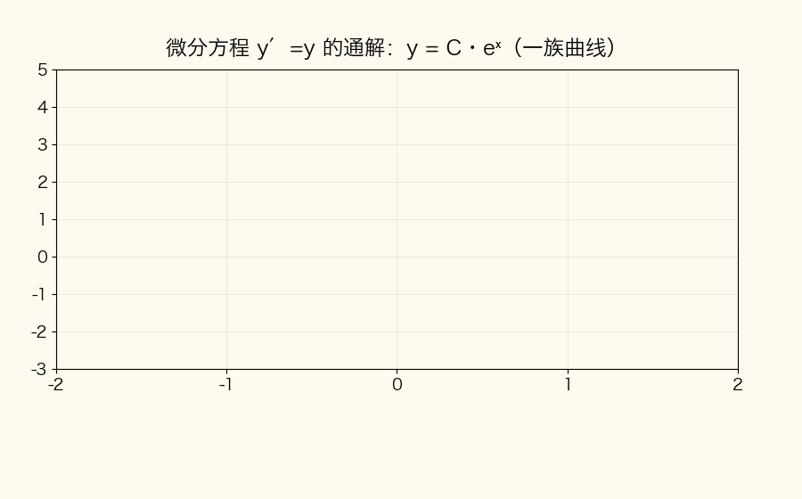

📌 锚点：**通解=含任意常数的解曲线族；初始条件从族里挑出唯一的特解**。

#### E1 微分方程的类型识别 ★★★

**定义详解**：
- **微分方程**：含未知函数 y=y(x) 的导数的方程；导数的最高阶数叫方程的**阶**——y′+(1/x)y=1 是一阶，y″-3y′-4y=0 是二阶。本模块只涉及一阶与二阶。
- **解 / 通解 / 特解**：使方程成立的函数叫解；含**个数等于阶数**的独立任意常数的解叫通解（一阶 1 个 C，二阶 2 个 C₁、C₂）；不含任意常数的解叫特解。
- **初始条件**：如 y(0)=0、y′(0)=-5——用来从通解（一族曲线）里定出 C₁、C₂，挑出唯一一条曲线即特解（呼应本模块开头动图）。
- **可分离变量方程**：能变形整理成 g(y)dy=f(x)dx 的一阶方程——左边纯 y 配 dy、右边纯 x 配 dx，两边各自积分即解。
- **解曲线族**：通解里的 C 每取一个值对应一条曲线——如 e^x+e^y=C 确定一族曲线，初始条件从中挑出一条（与开头动图对照）。

**考试答题**

**📌 历年真题**

**【2024.4·单选 3】（3 分）** 下列微分方程中，可分离变量的微分方程是
- A. dy/dx=-y/x ✅
- B. dy/dx=e^(xy)
- C. dy/dx=x sin(x+y)
- D. dy/dx=x²+y²

**【2022.10·单选 3】（3 分）** 下列微分方程中，可分离变量的微分方程是
- A. dy/dx=e^(xy) ✅
- B. dy/dx=2x+y
- C. dy/dx=tan(x+y)
- D. dy/dx=x²-y²

> 【口径说明】该题官方答案为 A=e^(xy)【官方】。e^(xy) 中 x、y 以乘积锁在指数里，按通行教材口径**不可**分离变量，与常见「e^(xy) 不可分离」的表述冲突；此卷应试按**官方口径**记忆：2022.10 单选 3 选 A。B 项 dy/dx=2x+y 是一阶线性方程（见 E2），不能直接分离。

**【2024.10·单选 3】（3 分）** 下列微分方程中，可分离变量的微分方程是（　）
- A. y′=y²eˣ【OCR，或有缺损】
- B. y′-y=x
- C. xy′=2y ✅
- D. y′+y²=x²

> 【口径说明】xy′=2y → dy/y=2dx/x 确可分离，选 C。但按转录文本 A 项 y′=y²eˣ（dy/y²=eˣdx）同样可分离——A 项文字经 OCR 或有缺损，按考生网呈现的选项文本以 C 为标准答案口径【选项文本待核实】。

**【2026.4·单选 3】（3 分）** 下列函数中是微分方程 e^(-x)dy + e^(-y)dx = 0 的通解的是
- A. e^(-x)+e^(-y)=C
- B. e^x+e^y=C ✅
- C. e^(-x)+e^y=C
- D. e^x+e^(-y)=C

**【2025.4·单选 3】（3 分）** 下列函数中是微分方程 y′+(1/x)y=1 的通解的是
- A. y=C/x+x
- B. y=Cx+1/x
- C. y=C/x+x/2 ✅
- D. y=Cx+x/2

> 【观察】C 项的结构是「C/x＋x/2」——一阶线性通解 = 齐次解 + 特解的拼装（拆解过程见 E2）。

**🎯 考法**：单选 3 固定，考期全覆盖（2022.10、2024.4、2024.10、2025.4、2026.4），两种题型轮换：①四选一挑「可分离变量」方程；②给方程挑通解形式。
- 题型分布：五考期中 3 次考「判定」（2022.10、2024.4、2024.10）、2 次考「通解」（2025.4、2026.4）——两型都要熟。

**✍️ 得分点**：
- 判定口诀：**x、y 能完全拆开才算**——整理后一边纯 y（配 dy）、一边纯 x（配 dx），即 g(y)dy=f(x)dx。
- 拆不开黑名单：**e^(xy)**（乘积锁进指数）、**sin(x+y)、tan(x+y)**（和锁进三角函数）、**x²+y²、2x+y**（加法纠缠）；能拆的对照：**-y/x**（商可拆）、**xy′=2y**（左边的乘积可移项，拆成 dy/y=2dx/x）、**y²eˣ**（乘积可拆）。
- 通解选择题两条路：①老老实实分离变量积分；②**验证法**——把选项（隐函数）两边微分后回代原方程，吻合者即通解，四选一验证往往更快。
- 验证法实操（2026.4-3）：选项 A 的 e^(-x)+e^(-y)=C 微分得 -e^(-x)dx-e^(-y)dy=0，dx 配 e^(-x)、dy 配 e^(-y)，与原方程（dx 配 e^(-y)、dy 配 e^(-x)）对不上 → 排除；选项 B 微分得 e^x dx+e^y dy=0，同除 e^x·e^y 恰为原方程 → 选 B。

**⚠️ 易混淆**：e^(x+y) 与 e^(xy)——前者=eˣ·eʸ（乘积，可拆），后者拆不开；sin(x+y) 是整体，绝不能拆成 sinx+siny。2022.10-3 与 2024.4-3 同型却存在「官方口径 vs 教材口径」分歧——考场上遇 e^(xy) 当选项，先看同卷其它选项：有明确可拆项选可拆项，实在没有再按本卷官方口径处理。

**计算方法**：
- 判定两步：①把 dy/dx 的右端因式分解；②x 因子与 y 因子按乘除关系搬移，各归一边即可分离。
- 判定提示：右端能因式分解不等于能分离——x sin(x+y) 已分解，但 sin(x+y) 整体不可再拆，判定到此为止。
- 求通解三步：①分离成 g(y)dy=f(x)dx；②两边积分（**为什么可以各积各的**：等式两边同取原函数，等式仍成立，两边各产生的常数合并记作 C）；③整理成显式 y=φ(x,C) 或保留隐函数形式（**为什么隐式也算通解**：e^x+e^y=C 同样确定一族曲线，考试直接写隐式不扣分）。
- 五类方程可拆性对照：

| 方程 | 变形尝试 | 能否分离 | 真题出处 |
|---|---|---|---|
| dy/dx=-y/x | dy/y=-dx/x | ✅ 可 | 2024.4-3（选 A）|
| xy′=2y | dy/y=2dx/x | ✅ 可 | 2024.10-3（选 C）|
| y′=y²eˣ | dy/y²=eˣdx | ✅ 可（按 OCR 文本）| 2024.10-3 选项 A【文本待核实】|
| dy/dx=e^(xy) | x、y 乘积锁在指数里 | ❌ 教材口径不可（2022.10 官方却以此项为答案，按官方口径记 A）| 2022.10-3 |
| dy/dx=x sin(x+y)、x²+y²、2x+y | 和式/函数整体纠缠 | ❌ 不可 | 2024.4-3 选项 C、D；2022.10-3 选项 B、C |

**【例 E-1】（原题）2026.4 单选 3 完整重讲：求 e^(-x)dy+e^(-y)dx=0 的通解**

解：
① 移项（**为什么**：把含 dx、含 dy 的项分居等号两侧）：e^(-x)dy = -e^(-y)dx
② 两边同乘 e^x·e^y（**为什么**：把负指数翻成正指数，x 与 y 彻底分离）：e^y dy = -e^x dx
③ 两边积分（**为什么**：微分等式两边同取原函数，等式仍成立）：∫e^y dy = -∫e^x dx → e^y = -e^x + C₁
④ 整理（**为什么**：移项后把 -C₁ 改写为 C，仍是任意常数）：e^x + e^y = C
故选 **B**。
- 易错提醒：②中两个因子要一起乘——只乘 e^y 不乘 e^x，方程里仍留着 e^(-x)，分离就失败了。

🔑 记忆锚点：**识别看「能不能拆」，通解必有 C；单选拿不准就用验证法回代**。

#### E2 一阶线性微分方程 y′+p(x)y=q(x) ★★

**定义详解**：未知函数 y 与其导数 y′ 都是**一次幂**（没有 y²、sin y、y·y′ 之类）的方程：y′+p(x)y=q(x)。q(x)≡0 称**齐次**（此时必可分离变量）；q(x)≠0 称**非齐次**，用通解公式或常数变易法求解。前提：必须先化**标准式**——把 y′ 的系数归一为 1。
- **为什么叫「线性」**：y 与 y′ 都是一次且不作乘积，与线性代数的「线性」同源。
- **齐次、非齐次与可分离的关系**：齐次一阶线性必可分离（y′+py=0 → dy/y=-p dx）；非齐次不可分离（多出的 q(x) 让 x、y 拆不开），必须走公式。
- **结构定理**：非齐次通解 = 齐次通解 + 非齐次的一个特解——2025.4-3 选项 C 正是「C/x＋x/2」的拼装。
- **常数变易法**：先解齐次得 y=C·e^(-∫p dx)，把常数 C 换成待定函数 u(x) 代回原方程解出 u(x)——通解公式正是这么做出来的。
- **与可分离变量的边界**：y′=y²eˣ 可分离但**不是**线性方程（y 是二次）——「可分离」与「线性」是两个独立的分类标签，先分类再选方法。

**考试答题**

**📌 历年真题**

**【2022.10·计算 20】（6 分）** 求微分方程 dy/dx=2x+y 的通解。
> 【官方】化为 y′-y=2x（2 分）；通解 y=e^(∫dx)(∫2xe^(-x)dx+C)=eˣ(-2xe^(-x)-2e^(-x)+C)（2 分）=Ceˣ-2x-2（2 分）

**【2025.4·单选 3】（3 分）** 一阶线性方程 y′+(1/x)y=1 的通解识别（题干与选项全文见 E1，选 C：齐次解 C/x＋特解 x/2 的拼装，拆解过程见下方「计算方法」）。

**🎯 考法**：计算题 20 考过一次（2022.10，官方按三步给分、每步 2 分）；单选考通解形式识别（2025.4-3）。
- 结构判断先行：看到 dy/dx=2x+y 先移项——y 与 x 相加拆不开 → 不是可分离变量 → 走一阶线性公式。

**✍️ 得分点**：
- 三步各占 2 分：①化标准式（y′-y=2x）读出 p、q；②套公式（内含分部积分）；③化简成 Ceˣ-2x-2 型显式解。
- 分部积分 ∫2x·e^(-x)dx 是必经关：u=2x、dv=e^(-x)dx，别在「∫e^(-x)dx=-e^(-x)」的负号上翻车。
- 通解 Ceˣ-2x-2 里 Ceˣ 来自齐次项、-2x-2 来自右端 2x——与结构定理互相印证，可用来快速自查。

**⚠️ 易混淆**：**搬移要带符号**——dy/dx=2x+y 移项是 y′**-y**=2x，p=-1 不是 +1；公式两个指数一负一正：外面 e^(-∫p dx)、里面 e^(∫p dx)，写反全盘皆输。本题 p 恰为常数 -1，∫p dx=-x，不必慌。

**计算方法**（四步模板）：
1. 化标准式 y′+p(x)y=q(x)（**为什么**：通解公式只对 y′ 系数为 1 的标准式成立）；
2. 读出 p(x)、q(x)；
3. 套通解公式 y=e^(-∫p dx)·(∫q·e^(∫p dx)dx+C)（**为什么**：这是常数变易法推出的现成结论，直接代入）；
4. 算出积分（幂×指数用分部积分）并化简。
- 2025.4-3 的拼装拆解：齐次方程 y′+(1/x)y=0 分离变量得 dy/y=-dx/x → ln|y|=-ln|x|+C₁ → **y=C/x**；特解按右端常数设 y=ax（**为什么**：右端是常数，设一次函数特解最简单）：a+(1/x)·ax=2a=1 → a=1/2 → **y=x/2**；通解 y=C/x+x/2 → 选 C。
- 2025.4-3 也可直接套公式验证：p=1/x、q=1，∫p dx=ln|x| → e^(-∫p dx)=1/x、e^(∫p dx)=x（**为什么**：指数与对数互逆，e^(ln x)=x）；∫1·x dx=x²/2 → y=(1/x)(x²/2+C)=C/x+x/2，殊途同归。
- 特解速算法（备用）：q 为多项式时直接设同次多项式定系数（**为什么可行**：求导把次数降一，同次多项式必能配平）——对 y′-y=2x 设 y=ax+b：y′-y=a-(ax+b)=-ax+(a-b)=2x → a=-2、b=-2，特解 y=-2x-2，与公式结果一致。

**【例 E-2】（原题）2022.10 计算 20 完整重讲：求 dy/dx=2x+y 的通解**

解：
① 化标准式（**为什么**：把 y 项移到左边、让 y′ 系数为 1，才能读准 p、q）：y′-y=2x，得 p=-1，q=2x
② 套通解公式（**为什么**：一阶线性非齐次有固定公式）：y=e^(-∫p dx)·(∫q·e^(∫p dx)dx+C)=e^(-∫(-1)dx)·(∫2x·e^(∫(-1)dx)dx+C)=eˣ·(∫2x·e^(-x)dx+C)
③ 分部积分（**为什么**：幂函数×指数函数直接积不出；设 u=2x、dv=e^(-x)dx，则 v=-e^(-x)）：∫2x·e^(-x)dx=-2x·e^(-x)+2∫e^(-x)dx=-2x·e^(-x)-2e^(-x)
④ 代回化简（**为什么**：eˣ·e^(-x)=1，负指数消掉）：y=eˣ·(-2x·e^(-x)-2e^(-x)+C)=-2x-2+Ceˣ
即通解 **y=Ceˣ-2x-2**。验证：y′=Ceˣ-2，y′-y=(Ceˣ-2)-(Ceˣ-2x-2)=2x ✓（**为什么**：代回原方程检验是最后一道保险）
- 三处自检：p 的符号、分部积分的负号、最后代回——这道题的扣分基本都在这三处。
- 公式忘了的备用路线（常数变易法）：先解齐次 y′-y=0 得 y=Ceˣ；令 y=u(x)·eˣ 代入原方程 → u′·eˣ=2x → u=∫2x·e^(-x)dx（同③）→ 结果一致。

🔑 记忆锚点：**先化标准式再谈公式；p 带符号进公式；幂×指数必分部**。

#### E3 可降阶方程 y″=f(x) 型 ★★★

**定义详解**：二阶方程右端**只含 x**（不含 y、不含 y′）时，连续积分两次即可求解：第一次积分得 y′（同时产生 C₁），第二次积分得 y（再产生 C₂）。
- **为什么能直接积分**：方程里 y 与 y′ 都不现身，把 y′ 看作未知函数 u(x)，方程就是 u′=f(x)——纯不定积分问题。
- **边界**：右端一旦含 y′（如 y″=1+y′²）或含 y，就不能直接积两次——本课程只考最简单的 y″=f(x) 型。
- 通解必含**两个**独立任意常数——五个可见考期的单选 10 全部以此命题，题干固定写「设 C₁,C₂ 是任意常数」，这个措辞就是「答案含两个常数」的暗示；若考特解会另附初始条件。
- **通解与特解在本型的分工**：单选 10 只问通解（带 C₁、C₂）；若题目另给 y(0)、y′(0)，则积分两次后再代值定常数——定常数的联立流程与 E4 相同。

**考试答题**

**📌 历年真题**

**【2026.4·单选 10】（3 分）** 设 C₁,C₂ 是任意常数，则微分方程 y″=2eˣ+1 的通解是
- A. y=2eˣ+C₁x+C₂
- B. y=2eˣ+x²+C₁x+C₂
- C. y=2eˣ+(1/2)x²+C₁x+C₂ ✅
- D. y=2eˣ+C₁x²+C₂

**【2025.4·单选 10】（3 分）** 设 C₁,C₂ 是任意常数，则微分方程 y″=sinx 的通解是
- A. y=-cosx+C₁x+C₂
- B. y=-sinx+C₁x+C₂ ✅
- C. y=-sinx+C₁
- D. y=-cosx+C₁

**【2024.4·单选 10】（3 分）** 设 C₁,C₂ 是任意常数，则微分方程 y″=2x+1 的通解 y =
- A. (1/3)x³+x²+C₁x+C₂
- B. (1/2)x²+C₁x+C₂
- C. x³+x²+C₁x+C₂
- D. (1/3)x³+(1/2)x²+C₁x+C₂ ✅

**【2022.10·单选 10】（3 分）** 设 C₁、C₂ 是任意常数，则微分方程 y″=x+sinx 的通解 y =
- A. (1/6)x³-C₁sinx+C₂
- B. (1/6)x³+C₁sinx+C₂x
- C. (1/6)x³-cosx+C₁x+C₂
- D. (1/6)x³-sinx+C₁x+C₂ ✅

**【2025.10·单选 10】（3 分）** 设 C₁,C₂ 是任意常数，则微分方程 y″=2x-1 的通解是（选项为图片未获取）

> 按两次积分推得通解 y=x³/3-x²/2+C₁x+C₂（转录页未公开选项，答案口径以此为准）。

**🎯 考法**：单选 10 固定题型，五个可见考期连考五次（2022.10、2024.4、2025.4、2025.10、2026.4）——「积分两次」就能选出答案，全卷性价比最高的 3 分。
- 五次考试的正确选项字母分散（D、D、B、—、C），别背选项位置，背解法本身。

**✍️ 得分点**：
- 积分路线：y″ →（积一次）y′=∫f(x)dx+**C₁** →（再积一次）y=∫[∫f(x)dx]dx+**C₁x**+**C₂**——常数 C₁ 积分后变 C₁x，不能丢。
- 基本积分零失误清单（与不定积分章节联动，五次真题只用到这五个）：∫eˣdx=eˣ；∫sinx dx=-cosx；∫cosx dx=sinx；∫x dx=x²/2；∫1 dx=x。
- 干扰项三套路：①少积分项（2026.4-10 选项 A 漏掉 x²/2）；②系数错一半（选项 B 的 x² 不带 1/2）；③常数位置错（选项 D 把 C₁ 放到 x² 上；2025.4-10 选项 C、D 只带一个常数，直接排除）。
- 考试策略：先数选项里独立常数的个数——只有一个 C 的直接排除（2025.4-10 的 C、D）；再核对最高次项系数（1/2、1/6）。

**⚠️ 易混淆**：**∫sinx dx=-cosx、∫cosx dx=sinx，方向别写反**——2022.10-10 正确项 D 含 **-sinx**（sinx 先积成 -cosx，-cosx 再积成 -sinx），干扰项 C 的 -cosx 是「只积了一次」的半成品；另外 C₁ 与 C₂ 的位置——C₁ 在 y′ 层、C₂ 在 y 层，漏写 C₁x 或把 C₁ 积成 C₂ 都是错。
- 右端含 x 时通解必含三次项（积两次升两阶）——2024.4-10 选项 B 连 x³ 项都没有，一眼排除。

**计算方法**（两步模板）：
1. y′=∫f(x)dx+C₁（**为什么**：y″ 是 y′ 的导数，反过来 y′ 就是 y″ 的原函数）；
2. y=∫[∫f(x)dx+C₁]dx+C₂（**为什么**：从 y′ 再积分回到 y；常数 C₁ 的原函数是 C₁x，这一轮再产生新常数 C₂）。
3. 逐项分别积分（**为什么**：和的积分=积分的和，∫(x+sinx)dx 拆成 ∫x dx 与 ∫sinx dx 各积各的，绝不能凑成 ∫x·sinx dx）。
- 考场 40 秒流程：①看右端是否纯 x；②心算第一次积分；③心算第二次积分；④对照选项查最高次系数（1/2、1/6）与常数个数。

**五考期单选 10 答案一览**：

| 考期·题号 | 方程 | 通解 | 答案 |
|---|---|---|---|
| 2022.10-10 | y″=x+sinx | y=(1/6)x³-sinx+C₁x+C₂ | D |
| 2024.4-10 | y″=2x+1 | y=(1/3)x³+(1/2)x²+C₁x+C₂ | D |
| 2025.4-10 | y″=sinx | y=-sinx+C₁x+C₂ | B |
| 2025.10-10 | y″=2x-1 | y=x³/3-x²/2+C₁x+C₂ | 选项未获取 |
| 2026.4-10 | y″=2eˣ+1 | y=2eˣ+(1/2)x²+C₁x+C₂ | C |

**【例 E-3】（原题）2022.10 单选 10 完整重讲：求 y″=x+sinx 的通解**

解：
① 第一次积分（**为什么**：y″ 的原函数是 y′；∫x dx=x²/2，∫sinx dx=-cosx）：y′=x²/2-cosx+C₁
② 第二次积分（**为什么**：y′ 的原函数是 y；∫x²/2 dx=x³/6，∫(-cosx)dx=-sinx，常数 C₁ 积分为 C₁x）：y=x³/6-sinx+C₁x+C₂
即 y=(1/6)x³-sinx+C₁x+C₂，选 **D**。验证：y′=x²/2-cosx+C₁，再求导 y″=x+sinx ✓（**为什么**：两次求导回到方程右端）
- 复盘：干扰项 C 的 -cosx 恰是第一步 y′ 里的项——出题人把「半成品」放进选项，积分次数别搞错。

🔑 记忆锚点：**右端只含 x → 积两次；每次积分各 +C；sinx 积一次 -cosx、积两次 -sinx**。

#### E4 二阶常系数线性齐次方程 y″+py′+qy=0 ★★★

**定义详解**：y″、y′、y 各乘常数后相加、右端为 0 的二阶方程（p、q 为常数）。
- **与 E3 的区别**：E3 右端是纯 x 的函数、可以直接积分；本节 y″、y′、y 同时出现（右端为 0），不能直接积分，必须走**特征方程** r²+pr+q=0。
- **为什么设 y=e^(rx)**：指数函数求导不改变函数类型——(e^(rx))′=r·e^(rx)、(e^(rx))″=r²·e^(rx)；代入方程后提出公因子 e^(rx)（恒不为 0，可约去），二阶微分方程就降成了代数方程 r²+pr+q=0。
- **为什么求导降阶反而要解代数方程**：每求一次导，e^(rx) 就多乘一个 r——y″、y′、y 分别贡献 r²、r、1，恰好拼出特征方程。
- 「齐次」指右端为 0；「常系数」指 p、q 是常数而非 x 的函数。特征根的性质（两实根 / 重根 / 共轭复根）决定通解形态，三种情形见「计算方法」速查表。

**考试答题**

**📌 历年真题**

**【2026.4·计算 20】（6 分）** 求微分方程 y″-3y′-4y=0 满足初始条件 y(0)=0，y′(0)=-5 的特解。
> 【答案】y=-e^(4x)+e^(-x)（完整过程见【例 E-4】）

**【2024.4·计算 20】（6 分）** 求微分方程 y″-2y′-3y=0 的通解。
> 【答案】特征方程 r²-2r-3=0 → r=3, r=-1；通解 y=C₁e^(3x)+C₂e^(-x)

**【2023.10·计算 20】（6 分）** 求微分方程 y″+5y′+6y=0 的通解。
> 【答案】特征方程 r²+5r+6=0 → r=-2, r=-3；通解 y=C₁e^(-2x)+C₂e^(-3x)

**【2025.4·计算 20】（6 分）** 验证 y=eˣ 是微分方程 xy′-y ln y=0 的一个特解，并求该微分方程满足初始条件 y(1)=e² 的特解。
> 【官方】代 y=eˣ：y′=eˣ，xy′-y ln y=x·eˣ-eˣ·x=0（2 分）；分离变量 dy/(y ln y)=dx/x（2 分）；∫dy/(y ln y)=ln|ln y|=ln|x|+C₁ → 通解 y=e^(Cx)（2 分）；代 y(1)=e² 得 C=2 → 特解 y*=e^(2x)（2 分）

**🎯 考法**：计算题 20 的固定席位（2023.10、2024.4、2026.4 三考期考齐次方程通解/特解；2025.4 变格为「验证特解＋分离变量」——方程 xy′-y ln y=0 属可分离变量型，方法回指 E1，套路是「验证→求解→定 C」）。
- 三卷特征方程系数表：(-3,-4)、(-2,-3)、(+5,+6)——常数项为负必有一正一负两根，常数项与中项同为正则根全负。

**✍️ 得分点**：
- 常规四步各占分：①写特征方程；②求两根；③按 Δ>0 写通解 y=C₁e^(r₁x)+C₂e^(r₂x)；④初始条件定 C₁、C₂ 后写特解。
- **为什么定 C₁、C₂ 必须联立两个方程**：一个初始条件只给一个方程，定不出两个未知数——必须把通解对 x 求导得 y′ 表达式，y(0)、y′(0) 各代一次，得二元一次方程组。
- 2025.4 验证型拆两段拿分：验证段=代入算出 0；求解段=分离变量积分得通解、代初始条件定 C——两段分数独立给。
- ∫dy/(y ln y)=ln|ln y| 的来历（**为什么**：凑微分 dy/y=d(ln y)，变成 ∫du/u=ln|u|）。
- 本课程三道常系数计算题的十字相乘全部一次到位：r²-3r-4=(r-4)(r+1)、r²-2r-3=(r-3)(r+1)、r²+5r+6=(r+2)(r+3)。
- 三道真题的特征根符号各异（一正一负 ×2、双负 ×1）——写通解时每个指数的符号逐个核对。

**⚠️ 易混淆**：
- 特征根别代反：r²-3r-4=0 的根是 **4 和 -1**，最终解里 e^(4x) 与 e^(-x) 一正一负指数，负号别丢（2026.4-20）；e^(4x) 求导多出的系数 4，就是 y′(0) 方程 4C₁-C₂=-5 里那个 4。
- Δ 的计算别马虎：Δ=b²-4ac，r²-3r-4 的 Δ=(-3)²-4×1×(-4)=9+16=25，不是 9-16。
- Δ=0 重根通解是 **(C₁+C₂x)e^(rx)**——多出来的「x」别漏；Δ<0 共轭复根 r=α±βi 写 e^(αx)(C₁cosβx+C₂sinβx)——本课程真题尚未考过后两型，但不能不会。
- 「通解」必须带 C₁、C₂，「特解」是定了常数的——题目问什么答什么，问特解却只写通解要扣分。
- 验证型方程分离变量时，dy/(y ln y) 的分母两个因子（y 与 ln y）都别丢——漏一个积分就错。

**计算方法**（四步模板）：
1. 写特征方程 r²+pr+q=0（**为什么**：设 y=e^(rx) 代入后 e^(rx)≠0 可约去，求导降阶变成 r 的幂次）；
2. 解根判型（**为什么**：根的三种形态对应三种解结构）；
3. 有初始条件 → 先求 y′ 再联立（**为什么**：y 与 y′ 各代一次初始条件，两个方程解两个常数）；无初始条件、题目只问通解，则到第 2 步收笔；
4. 写特解并回代验证（**为什么**：把 y(0)、y′(0) 复算一遍，防止根代反）。

**特征根三情形速查**：

| 判别式 | 特征根 | 通解 | 真题落点 |
|---|---|---|---|
| Δ>0 | 两相异实根 r₁, r₂ | y=C₁e^(r₁x)+C₂e^(r₂x) | 2023.10-20、2024.4-20、2026.4-20 |
| Δ=0 | 二重根 r | y=(C₁+C₂x)e^(rx) | 未考，须会 |
| Δ<0 | 共轭复根 α±βi | y=e^(αx)(C₁cosβx+C₂sinβx) | 未考，须会 |

- 未考两型的自编小例（自编教学数据）：y″+2y′+y=0 → (r+1)²=0 → y=(C₁+C₂x)e^(-x)；y″+y′+y=0 → Δ=1-4=-3<0，r=(-1±i√3)/2 → y=e^(-x/2)(C₁cos(√3x/2)+C₂sin(√3x/2))。

**【例 E-4】（原题）2026.4 计算 20 完整重讲：y″-3y′-4y=0，y(0)=0，y′(0)=-5**

解（每一步对应阅卷给分点，逐行书写）：
① 写特征方程（**为什么**：设 y=e^(rx) 代入方程，约去 e^(rx)）：r²-3r-4=0
② 因式分解（**为什么**：十字相乘——(-4)×1=-4 是常数项、4+(-1)=3 取负得中项系数 -3）：(r-4)(r+1)=0 → r₁=4，r₂=-1
③ 写通解（**为什么**：Δ=(-3)²-4×1×(-4)=25>0，两相异实根）：y=C₁e^(4x)+C₂e^(-x)
④ 代第一个初始条件（**为什么**：x=0 时 e^(4×0)=e⁰=1，指数因子全变 1，只剩常数）：y(0)=C₁+C₂=0
⑤ 求导后代的第二个初始条件（**为什么**：链式法则 (e^(4x))′=4e^(4x)、(e^(-x))′=-e^(-x)）：y′=4C₁e^(4x)-C₂e^(-x) → y′(0)=4C₁-C₂=-5
⑥ 联立求解（**为什么**：两式相加消去 C₂）：C₁+C₂=0 与 4C₁-C₂=-5 相加 → 5C₁=-5 → C₁=-1，回代得 C₂=1
⑦ 写特解：**y=-e^(4x)+e^(-x)**
验证：y(0)=-1+1=0 ✓；y′=-4e^(4x)-e^(-x)，y′(0)=-4-1=-5 ✓（**为什么**：两个初始条件都复算，确认特征根没代反）
- 复盘：⑥消元方向先看系数——相加直接消 C₂，若相减得 3C₁+2C₂=-5 反而更繁。

🔑 记忆锚点：**一写（特征方程）、二解（两根）、三通解、四定 C——定 C 必求 y′ 联立**。

**答题书写建议**（计算题 20 按步给分，每步独立成行）：
- 第一行：特征方程 r²+pr+q=0；
- 第二行：两根 r₁、r₂；
- 第三行：通解 y=C₁e^(r₁x)+C₂e^(r₂x)；
- 第四、五行：代 y(0) 与 y′(0) 得两个方程；
- 第六行：解出 C₁、C₂；
- 末行：特解。

模块总口诀：**一阶看拆不拆——拆开就积分、拆不开套公式；二阶看右端——纯 x 积两次、出现 y 就走特征方程**。

---

**🎯 模块 E 速记表**

| 考点 | 识别特征 | 解法 | 考期 |
|---|---|---|---|
| 可分离变量判定 | 能写成 g(y)dy=f(x)dx | 拆开即选 | 2022.10-3、2024.4-3、2024.10-3 |
| 拆不开黑名单 | e^(xy)、sin(x+y)、tan(x+y)、x²+y² | 直接排除 | 2022.10-3、2024.4-3 |
| 分离变量求通解 | e^(-x)dy+e^(-y)dx=0 型 | 分离→两边积分+C | 2026.4-3 |
| 一阶线性（单选） | y′+(1/x)y=1 | 齐次解 C/x＋特解 x/2 拼装 | 2025.4-3 |
| 一阶线性（计算） | dy/dx=2x+y → y′-y=2x | 化标准式→公式→分部积分→化简 | 2022.10-20 |
| 可降阶 y″=f(x) | 右端只含 x | 积两次：+C₁ → +C₁x+C₂ | 2022.10-10、2024.4-10、2025.4-10、2025.10-10、2026.4-10 |
| sin/cos 积分方向 | ∫sinx dx=-cosx、∫cosx dx=sinx | 别写反 | 2022.10-10、2025.4-10 |
| 二阶常系数齐次 Δ>0 | r²+pr+q=0 两实根 | y=C₁e^(r₁x)+C₂e^(r₂x) | 2023.10-20、2024.4-20 |
| 初始条件定特解 | 给 y(0)、y′(0) | 先求 y′ 再联立解 C₁、C₂ | 2026.4-20 |
| 验证特解型 | 代入验算=0 → 分离变量 → 定 C | 验证分与求解分分开拿 | 2025.4-20 |

注：题号以本篇转录数据为准——2025.10 仅免费预览部分、2024.10-3 选项文本经 OCR 待核实。
> 本模块全部题干、选项、答案数值与真题转录数据源逐字一致；2022.10-3 的官方口径冲突与 2024.10-3 的选项缺损已在正文相应位置标注。

## 三、历年真题汇编

> **来源与合规说明**：以下题目均转录自公开网络渠道的**试卷原件扫描图/官方答案扫描件**（每考期标注来源），未登录、未绕过任何付费墙。自考真题由国家统一命制，题目版权归命题单位所有，此处仅作备考学习用途的题干与教研解析。
> **答案标注约定**：2025.4 与 2022.10 两个考期带官方《试题答案及评分参考》扫描件，解答逐字转录并保留官方给分点，标【官方】；2026.4 与 2024.4 无官方答案公开，解答为按教材规范解法推导，标【推导】；考生网免费预览的三个部分考期（2025.10 / 2024.10 / 2023.10）答案均付费未获取，可见题按推导解答并如实注明缺项。
> **题型分值（五期原件一致）**：单选 10×3=30 分；计算 10×6=60 分；综合 2×5=10 分；共 22 题 100 分，考试 150 分钟。

### 3.1 2026 年 4 月考期（全卷 22 题）

**来源**：[百分自考网 exam100 试卷页](https://www.exam100.net/html/2026/ggk_0507/58616.html)（页面内嵌 3 张试卷原件扫描图，带"绝密★考试结束前/2026 年 4 月/课程代码 00023"标准卷头与站点水印，本节逐字转录）。**答案无官方公开 → 全部【推导】**。

#### 一、单项选择题（第 1~10 题，每题 3 分）

**【2026.4·单选 1】** 设向量 a={1,-1,-1} 且 b={2,1,0}，则 2a·b =

- A. -2
- B. -1
- C. 1
- D. 2 ✅

📌 2a·b = 2(a·b) = 2(2-1+0) = 2——数乘可以提到点积外面

**【2026.4·单选 2】** 设函数 z=2x³-3y²，则全微分 dz|(1,1) =

- A. 0
- B. dx-dy
- C. 6dx-6dy ✅
- D. 6dx+6dy

📌 z_x=6x²、z_y=-6y，代 (1,1) 得 6dx-6dy（B 漏了系数 6）

**【2026.4·单选 3】** 下列函数中是微分方程 e^(-x)dy+e^(-y)dx=0 的通解的是

- A. e^(-x)+e^(-y)=C
- B. e^x+e^y=C ✅
- C. e^(-x)+e^y=C
- D. e^x+e^(-y)=C

📌 分离变量 e^y dy=-e^x dx → e^y=-e^x+C → e^x+e^y=C

**【2026.4·单选 4】** 设级数 Σ 1/n^p 收敛，则 p 应满足

- A. 0<p≤1
- B. p≥1
- C. 0<p<1
- D. p>1 ✅

📌 p-级数结论：p>1 收敛，p≤1 发散

**【2026.4·单选 5】** 设积分区域 D: x²+y²≤2，则二重积分 ∬_D (x²+y²-x) dxdy =

- A. 2π ✅
- B. 4π
- C. 6π
- D. 8π

📌 x 项奇对称积分为 0；∬(x²+y²)dA=∫₀^{2π}dθ∫₀^{√2}r³dr=2π·((√2)⁴/4)=2π

**【2026.4·单选 6】** 经过点 P(-1,-1,2) 且法向量为 n={-1,1,-1} 的平面方程是

- A. x+y-2z-2=0
- B. x-y+z-2=0 ✅
- C. (x+1)/(-1)=(y+1)/1=(z-2)/(-1)
- D. (x+1)/(-1)=(y-1)/(-1)=(z+1)/2

📌 点法式 -(x+1)+(y+1)-(z-2)=0 → x-y+z-2=0；C/D 是直线形式，排除

**【2026.4·单选 7】** 下列点是函数 z=(6x-x²)(4y-y²) 的驻点的是

- A. (3,2) ✅
- B. (3,0)
- C. (0,2)
- D. (3,4)

📌 z_x=(6-2x)(4y-y²)=0 且 z_y=(6x-x²)(4-2y)=0 → x=3 与 y=2 同时成立 → (3,2)

**【2026.4·单选 8】** 设积分区域 Ω: -1≤x≤1, 0≤y≤2, 0≤z≤1，则三重积分 ∭_Ω (3+x+2z) dxdydz =

- A. -8
- B. 4
- C. 8
- D. 16 ✅

📌 V=4；3×12……即 ∭3dV=12，x 项奇对称=0，∭2z dV=2×(z̄=1/2)×4=4，合计 16

**【2026.4·单选 9】** 级数 Σ_{n=1}^∞ 1/(n(n+3)) 的和是

- A. 11/18 ✅
- B. 3/4
- C. 5/6
- D. 11/12

📌 裂项 (1/3)(1/n-1/(n+3))，和=(1/3)(1+1/2+1/3)=(1/3)(11/6)=11/18

**【2026.4·单选 10】** 设 C₁,C₂ 是任意常数，则微分方程 y″=2eˣ+1 的通解是

- A. y=2eˣ+C₁x+C₂
- B. y=2eˣ+x²+C₁x+C₂
- C. y=2eˣ+(1/2)x²+C₁x+C₂ ✅
- D. y=2eˣ+C₁x²+C₂

📌 两次积分：y′=2eˣ+x+C₁ → y=2eˣ+(1/2)x²+C₁x+C₂

#### 二、计算题（第 11~20 题，每题 6 分）

**【2026.4·计算 11】** 求直线 (x+3)/1=(y-1)/(-2)=(z-4)/(-1) 与平面 2x-y+z+2=0 的夹角 φ。

> 【推导】① 读向量：s={1,-2,-1}，n={2,-1,1}（**为什么**：对称式分母是方向向量，平面方程系数是法向量）；
> ② sinφ=|s·n|/(|s||n|)=|2+2-1|/(√6·√6)=3/6=1/2（**为什么用 sin 且取绝对值**：线面角与线法角互余，且夹角取 [0,π/2]）；
> ③ **φ=π/6**。

**【2026.4·计算 12】** 求过点 P(1,-1,1) 且与直线 (x-4)/(-2)=(y+2)/1=(z+1)/3 平行的直线方程。

> 【推导】① 平行直线方向向量相同：s={-2,1,3}（**为什么**：平行 → 方向向量成比例，直接取同一个）；
> ② 点向式：**(x-1)/(-2)=(y+1)/1=(z-1)/3**。

**【2026.4·计算 13】** 求曲面 z=6-2x²-y² 在点 P(1,0,4) 处的切平面方程。

> 【推导】① z_x=-4x|(1,0)=-4，z_y=-2y|(1,0)=0（**为什么**：显式曲面的切平面法向量就是两个偏导）；
> ② z-4=-4(x-1)-0·(y-0)（**为什么**：切平面点法式 z-z₀=z_x(x-x₀)+z_y(y-y₀)）；
> ③ 整理：**4x+z-8=0**。

**【2026.4·计算 14】** 求函数 u=xyz² 在点 P(1,1,1) 处沿方向 l={-3,4,0} 的方向导数。

> 【推导】① ∇u={yz², xz², 2xyz}|_{(1,1,1)}={1,1,2}（**为什么**：方向导数要先算三个偏导）；
> ② |l|=√(9+16+0)=5，单位化 {-3/5, 4/5, 0}（**为什么**：方向余弦必须来自单位向量，不单位化结果会错）；
> ③ ∂u/∂l=1×(-3/5)+1×(4/5)+2×0=**1/5**。

**【2026.4·计算 15】** 设函数 z=z(x,y) 由方程 z²-e^(xy)=2 所确定，求 ∂z/∂y。

> 【推导】① 令 F=z²-e^(xy)-2，F_y=-xe^(xy)，F_z=2z（**为什么**：隐函数求导把 z 当独立变量对 F 求偏导）；
> ② ∂z/∂y=-F_y/F_z=xe^(xy)/(2z)（**为什么有负号**：F(z(x,y),y)≡0 对 y 链式求导移项而来）；**∂z/∂y = xe^(xy)/(2z)**。

**【2026.4·计算 16】** 计算二重积分 ∬_D (1/x²) dxdy，其中积分区域 D 是由 y=1/x, y=x 及 y=4 所围的闭区域。

> 【推导】① 画区域定型：三条边界两两交于 (1,1)、(2,4)、(4,1/4)……按 y 型最简：1≤y≤4，1/y≤x≤y（**为什么选 Y 型**：边界曲线都是 x 关于 y 的显式表达，X 型要分两段）；
> ② ∫_{1/y}^{y} x^(-2) dx=[-1/x]_{1/y}^{y}=y-1/y（**为什么**：先积内层，x^(-2) 的原函数是 -1/x）；
> ③ ∫₁⁴(y-1/y)dy=[y²/2-ln y]₁⁴=(8-ln4)-(1/2)=**15/2-ln4**（=15/2-2ln2）。

**【2026.4·计算 17】** 计算对弧长的曲线积分 I=∫_L xy ds，其中 L 是螺旋线 x=3cost, y=3sint, z=4t（0≤t≤π/2）。

> 【推导】① ds=√((x′)²+(y′)²+(z′)²)dt=√(9sin²t+9cos²t+16)dt=5dt（**为什么**：弧长微分是勾股定理的极限；sin²+cos²=1 消掉三角项）；
> ② I=∫₀^{π/2}(3cost)(3sint)·5dt=45∫₀^{π/2}sint cost dt（**为什么**：第一类曲线积分把参数式全部代入，ds 换成 5dt）；
> ③ ∫sint d(sint)=[sin²t/2]₀^{π/2}=1/2 → **I=45/2**。

**【2026.4·计算 18】** 计算对坐标的曲线积分 I=∮_L (3x²y²-yeˣ+20)dx+(2x³y+xy-24)dy，其中 L 是 D: |x|≤1, |y|≤2 取正向的边界曲线。

> 【推导】① 识别：闭曲线 + P、Q 有一阶连续偏导 → 用格林公式（**为什么**：闭路线积分化区域二重积分，免去逐段参数化）；
> ② P_y=6x²y-eˣ，Q_x=6x²y+y → Q_x-P_y=y+eˣ（**为什么**：eˣ 项求导后 P、Q 中各剩一份，相减时约不掉，留下 eˣ）；
> ③ I=∬_D(y+eˣ)dA：y 项关于 y 轴上下对称 → 0；eˣ 项=∫_{-2}^{2}dy∫_{-1}^{1}eˣdx=4(e-e⁻¹)（**为什么对称性可用**：矩形对称+y 是奇函数）；
> ④ **I=4e-4/e**。

**【2026.4·计算 19】** 设 f(x) 是周期为 2π 的函数，在 [-π,π) 上 f(x)=x（-π≤x<0），0（0≤x<π），其傅里叶级数为 a₀/2+Σ(a_ncos nx+b_nsin nx)，求系数 b₅。

> 【推导】① b_n=(1/π)∫_{-π}^{π}f(x)sin nx dx=(1/π)∫_{-π}^{0}x sin nx dx（**为什么只剩一段**：0≤x<π 上 f=0，积分为零）；
> ② 分部积分：∫x sin nx dx=-x cos nx/n+sin nx/n²（**为什么**：多项式×三角，分部一次降幂）；
> ③ 代限：[-x cos nx/n+sin nx/n²]_{-π}^0=0-(-πcos(-nπ)/n+0)=-(πcos nπ)/n（**为什么 sin 项消失**：sin(nπ)=0）；
> ④ b_n=-cos(nπ)/n=(-1)^(n+1)/n → **b₅=1/5**（**为什么**：cos5π=cosπ=-1）。

**【2026.4·计算 20】** 求微分方程 y″-3y′-4y=0 满足 y|_{x=0}=0, y′|_{x=0}=-5 的特解。

> 【推导】① 特征方程 r²-3r-4=0 → (r-4)(r+1)=0 → r=4, r=-1（**为什么**：设 y=e^(rx) 代入，指数函数求导不变型）；
> ② 通解 y=C₁e^{4x}+C₂e^(-x)（**为什么**：两不等实根线性组合）；
> ③ 定常数：y(0)=C₁+C₂=0；y′=4C₁e^{4x}-C₂e^(-x)，y′(0)=4C₁-C₂=-5（**为什么联立两条**：两个初始条件定两个常数）；
> ④ 解得 C₁=-1, C₂=1 → **y=-e^{4x}+e^(-x)**。

#### 三、综合题（第 21~22 题，每题 5 分）

**【2026.4·综合 21】** 求幂级数 Σ_{n=1}^∞ xⁿ/n 的收敛域。

> 【推导】① ρ=lim|a_{n+1}/a_n|=lim (n)/(n+1)=1 → R=1（**为什么**：相邻系数比 1/(n+1)÷1/n=n/(n+1)→1）；
> ② 端点判敛（**为什么必须判**：问的是"收敛域"不是"收敛区间"）：x=1 得 Σ1/n 调和级数发散；x=-1 得 Σ(-1)ⁿ/n 交错收敛（1/n 单调减趋 0）；
> ③ **收敛域 [-1, 1)**。

**【2026.4·综合 22】** 计算对坐标的曲面积分 I=∬_Σ (2-2x-y) dxdy，其中 Σ 是半球面 z=√(4-x²-y²) 的上侧。

> 【推导】① 定号：上侧 → 法向量与 z 轴正向夹角小于 π/2 → 取"+"（**为什么**：第二类面积分的符号由曲面方向决定）；
> ② 投影：Σ 在 Oxy 面投影 D: x²+y²≤4；被积函数不含 z，无需代入消元（**为什么**：积分只在曲面上进行，含 z 才需要用曲面方程替换）；
> ③ I=∬_D(2-2x-y)dA=2×π×2²-0-0=**8π**（**为什么后两项是 0**：圆域对称，2x 与 y 都是奇函数）。

---

### 3.2 2025 年 10 月考期（部分收录：考生网免费预览）

**来源**：[考生网试卷页](https://www.zikaosw.cn/news/27008628.html)。该页仅公开第 1~15 题预览，且**多数题干与选项为原题截图**（文字版未公开），答案需付费——以下只收录能可靠转录的 6 题，其余如实注明，**不作凭图猜测的重建**。

**【2025.10·单选 1】** 设向量 a={k,2,-6} 与 b={2,-1,3} 平行，则常数 k=

- A. -10
- B. -4 ✅
- C. 4
- D. 10

📌 平行 ⇔ 对应分量成比例：k/2=2/(-1) → k=-4

**【2025.10·单选 6】** 经过点 P(1,-3,-2) 且方向向量为 v={2,1,1} 的直线方程是（题干文本可见；**四个选项均为截图未获取**）

> 【推导】点向式直接写出：**(x-1)/2=(y+3)/1=(z+2)/1**。

📌 点向式两要素：点 + 方向向量，逐字代入

**【2025.10·单选 7】** 设函数 z=x⁴-y⁴-8x²+4y，则点 (2,1) 是该函数的

- A. 驻点 ✅
- B. 间断点
- C. 极大值点
- D. 极小值点

📌 z_x=4x³-16x|(2)=0 且 z_y=-4y³+4|(1)=0 → 是驻点；再判 AC-B²=32×(-12)-0<0 → 非极值 → 选"驻点"（⚠️ 驻点不一定是极值点，此题专考这一点）

**【2025.10·单选 10】** 设 C₁,C₂ 是任意常数，则微分方程 y″=2x-1 的通解是（**选项为截图未获取**）

> 【推导】两次积分：y′=x²-x+C₁ → **y=x³/3-x²/2+C₁x+C₂**。

📌 每积一次加一个常数；x² 积分得 x³/3（系数别丢）

**【2025.10·计算 12】** 写出平面 x-2y+5z-10=0 的截距式方程，并求该平面在三条坐标轴上的截距。

> 【推导】① 常数项 -10 移项后两边除以 10（**为什么**：截距式要求右端为 1）：x/10+y/(-5)+z/2=1；
> ② 对照 x/a+y/b+z/c=1，**截距依次为 10、-5、2**（⚠️ y 轴截距带负号，别丢）。

**【2025.10·计算 14】** 求函数 u=x³+y³+z³ 在点 P(-1,0,1) 处的最大方向导数。

> 【推导】① ∇u={3x², 3y², 3z²}|_{(-1,0,1)}={3,0,3}（**为什么**：最大方向导数沿梯度方向，先算梯度）；
> ② 最大方向导数=|∇u|=√(9+0+9)=**3√2**（**为什么是模长**：∂u/∂l=|∇u|cosθ≤|∇u|，θ=0 时取等）。

**未获取说明**：第 2、3、4、5、8、9、11、13、15 题题干/选项在预览页均为截图；第 16~22 题未展示。以上 12 题未能可靠转录，不作收录；答案全卷付费未获取。

### 3.3 2025 年 4 月考期（全卷 22 题 + 官方《试题答案及评分参考》）

**来源**：知乎 @四川刘老斯 公开的试卷原件+官方答案扫描件（[试卷+答案 6 图](https://zhuanlan.zhihu.com/p/1916874218961871877)），本节逐字转录。**官方单选答案：1.D　2.D　3.C　4.A　5.A　6.B　7.A　8.C　9.C　10.B**。

#### 一、单项选择题（第 1~10 题，每题 3 分）

**【2025.4·单选 1】** 已知两点 A(0,-1,2) 和 B(1,1,-1)，则与向量 AB 垂直的向量是

- A. {1,-1,1}
- B. {1,-1,-1}
- C. {-1,-1,1}
- D. {1,1,1} ✅

📌 AB={1,2,-3}；{1,1,1}·AB=1+2-3=0——逐项点积验算即可

**【2025.4·单选 2】** 设函数 z=x^y，则全微分 dz=

- A. x^y ln x dx + yx^(y-1) dy
- B. yx^(y-1)(dx+dy)
- C. x^y ln x (dx+dy)
- D. yx^(y-1) dx + x^y ln x dy ✅

📌 幂指函数：对 x 求 y 视为常数（指数降一位），对 y 求得 x^y ln x——两个偏导各归各位

**【2025.4·单选 3】** 下列函数中是微分方程 y′+(1/x)y=1 的通解的是

- A. y=C/x+x
- B. y=Cx+1/x
- C. y=C/x+x/2 ✅
- D. y=Cx+x/2

📌 一阶线性：齐次解 C/x + 特解 x/2（设 y=ax 代入 2a=1 → a=1/2）

**【2025.4·单选 4】** 设常数 a≠0，如果级数 Σu_n 发散，则级数 Σa·u_n

- A. 发散 ✅
- B. 收敛
- C. 可能发散，也可能收敛
- D. 收敛性由 a 值确定

📌 乘非零常数不改变敛散性（部分和只差 a 倍）

**【2025.4·单选 5】** 设积分区域 D: -2≤x≤2, 0≤y≤1，则二重积分 ∬_D (x+y-2) dxdy=

- A. -6 ✅
- B. -4
- C. 0
- D. 4

📌 x 项对称=0；∬y dA=面积 4×ȳ 1/2=2；∬2 dA=8 → 2-8=-6

**【2025.4·单选 6】** 将 Oyz 平面上的曲线 y²+4z²=16 绕 y 轴旋转一周，所得旋转曲面方程是

- A. x²+y²+4z²=16
- B. y²+4(x²+z²)=16 ✅
- C. (x+y)²+4z²=16
- D. y²+4(x+z)²=16

📌 绕 y 轴：y 不动，z→±√(x²+z²)

**【2025.4·单选 7】** 下列点是函数 z=4(x+y)-x²+y² 的驻点的是

- A. (2,-2) ✅
- B. (2,0)
- C. (0,2)
- D. (2,2)

📌 z_x=4-2x=0→x=2；z_y=4+2y=0→y=-2（⚠️ 注意是 +y²，z_y 符号为正）

**【2025.4·单选 8】** 设积分区域 Ω: x²+y²+z²≤4，则三重积分 ∭_Ω (2x+y+4z+3) dxdydz=

- A. (32/3)π
- B. 16π
- C. 32π ✅
- D. 96π

📌 球对称区域上奇函数项全为 0，只剩 3V=3×(4/3)π×2³=32π

**【2025.4·单选 9】** 级数 Σ_{n=0}^∞ 1/2ⁿ 的和是

- A. 1/2
- B. 1
- C. 2 ✅
- D. 3/2

📌 从 n=0 起：S=1/(1-1/2)=2（对比 2022.10-9 从 n=1 起和为 1——起点不同答案不同）

**【2025.4·单选 10】** 设 C₁,C₂ 是任意常数，则微分方程 y″=sinx 的通解是

- A. y=-cosx+C₁x+C₂
- B. y=-sinx+C₁x+C₂ ✅
- C. y=-sinx+C₁
- D. y=-cosx+C₁

📌 两次积分：y′=-cosx+C₁ → y=-sinx+C₁x+C₂（⚠️ 两个常数缺一不可）

#### 二、计算题（第 11~20 题，每题 6 分；给分点为官方评分参考转录）

**【2025.4·计算 11】** 求过点 P(0,2,-1) 且与平面 x+3y-4z-6=0 垂直的直线方程。

> 【官方】由直线与平面垂直，方向向量可取 v={1,3,-4}（3 分）；又直线过 P(0,2,-1)，直线方程为 **x/1=(y-2)/3=(z+1)/(-4)**（3 分）。

**【2025.4·计算 12】** 求两平面 2x-y-2z+6=0 和 4x+y-z+9=0 的夹角 φ。

> 【官方】法向量 n₁={2,-1,-2}，n₂={4,1,-1}（2 分）；cosφ=|n₁·n₂|/(|n₁||n₂|)=|8-1+2|/(3·√18)=9/(9√2)=√2/2（2 分）；**φ=π/4**（2 分）。

**【2025.4·计算 13】** 求曲线 x=t³, y=1-3t, z=2t²-1 在点 P(1,-2,1) 处的法平面方程。

> 【官方】切向量 s={3t²,-3,4t}，P(1,-2,1) 对应 t=1（3 分）；s={3,-3,4}，法平面 **3(x-1)-3(y+2)+4(z-1)=0**，即 **3x-3y+4z-13=0**（3 分）。

**【2025.4·计算 14】** 求函数 u=ln(x²+y²+z²) 在点 P(1,1,-1) 处的梯度。

> 【官方】∂u/∂x=2x/(x²+y²+z²)、∂u/∂y=2y/(x²+y²+z²)、∂u/∂z=2z/(x²+y²+z²)（3 分）；分母 x²+y²+z²|(1,1,-1)=3 → **grad u={2/3, 2/3, -2/3}**（3 分）。

**【2025.4·计算 15】** 设函数 z=z(x,y) 由方程 z⁴-2x²y²z²=1 所确定，求 ∂z/∂y。

> 【官方】令 F=z⁴-2x²y²z²-1：F_y=-4x²y²z²，F_z=4z³-4x²y²z（3 分）；∂z/∂y=-F_y/F_z=4x²y²z²/(4z³-4x²y²z)=**x²yz/(z²-x²y²)**（3 分）。

**【2025.4·计算 16】** 计算二重积分 ∬_D e^(x+y) dxdy，其中积分区域 D 是由 x+y=2, y=x 及 y=0 所围的闭区域。

> 【官方】Y 型定限 ∫₀¹dy∫_y^{2-y}e^(x+y)dx（3 分）；内层=[e^(x+y)]_y^{2-y}=e²-e^(2y) → 原式=∫₀¹(e²-e^(2y))dy=e²-(e²-1)/2=**(e²+1)/2**（3 分）。

**【2025.4·计算 17】** 计算对弧长的曲线积分 I=∫_L (x²+3y²-4) ds，其中 L 为半圆 x=√(4-y²)。

> 【官方】参数化 x=2cost, y=2sint（-π/2≤t≤π/2），ds=√(4sin²t+4cos²t)dt=2dt（3 分）；I=∫_{-π/2}^{π/2}(4cos²t+12sin²t-4)·2dt=16∫_{-π/2}^{π/2}sin²t dt=32∫₀^{π/2}sin²t dt=32×(π/4)=**8π**（3 分；半角公式 sin²t=(1-cos2t)/2）。

**【2025.4·计算 18】** 计算对坐标的曲线积分 I=∮_L (2xe^(x²+y)+x²y-y²+1)dx+(e^(x²+y)-xy²+3y)dy，其中 L 为圆周 x²+y²=a²（a>0）沿逆时针方向。

> 【官方】P_y=2xe^(x²+y)+x²-2y，Q_x=2xe^(x²+y)-y²（3 分）；由格林公式 I=∬_D(Q_x-P_y)dA=∬_D(-x²-y²+2y)dA=-∫₀^{2π}dθ∫₀^a r³dr+0=**-πa⁴/2**（3 分；2y 项圆域对称为零）。

**【2025.4·计算 19】** 设 f(x) 是周期为 2π 的函数，在 [-π,π) 上 f(x)=|x|，其傅里叶级数展开式为 a₀/2+Σ a_n cos nx，求系数 a₃。

> 【官方】a₃=(1/π)∫_{-π}^{π}|x|cos3x dx=(2/π)∫₀^{π}x cos3x dx（4 分；**为什么乘 2**：|x|cos3x 是偶函数，半区间加倍）；分部积分 =(2/3π)[x sin3x]₀^{π}-(2/3π)∫₀^{π}sin3x dx=0+(2/9π)[cos3x]₀^{π}=(2/9π)(-1-1)=**-4/(9π)**（2 分）。

**【2025.4·计算 20】** 验证 y=eˣ 是微分方程 xy′-y ln y=0 的一个特解，并求该微分方程满足初始条件 y|_{x=1}=e² 的特解。

> 【官方】y=eˣ，y′=eˣ，xy′-y ln y=xeˣ-eˣ·x=0，满足方程（2 分）；分离变量 dy/(y ln y)=dx/x（2 分）；积分 ln|ln y|=ln|x|+C₁ → 通解 **y=e^(Cx)**（2 分）；代 y(1)=e² 得 C=2 → 特解 **y*=e^(2x)**（2 分）。

#### 三、综合题（第 21~22 题，每题 5 分）

**【2025.4·综合 21】** 求幂级数 Σ_{n=1}^∞ xⁿ/(2ⁿn) 的收敛域。

> 【官方】ρ=lim|a_{n+1}/a_n|=lim n/(2(n+1))=1/2 → R=2（2 分）；x=-2 时 Σ(-1)ⁿ/n 收敛（莱布尼茨），x=2 时 Σ1/n 发散（调和）（2 分）→ **收敛域 [-2, 2)**（1 分）。

**【2025.4·综合 22】** 计算对坐标的曲面积分 I=∬_Σ (2x+y+z) dxdz，其中 Σ 是平面 x+y+z=1 被三个坐标面所截得部分平面的右侧。

> 【官方】Σ: y=1-x-z（x≥0,y≥0,z≥0），在 Oxz 面投影 D_xz: 0≤z≤1-x, 0≤x≤1；右侧 → 法向量与 y 轴正向夹角小于 π/2，取"+"（1 分）；I=+∬_{D_xz}(2x+(1-x-z)+z)dxdz=∬_{D_xz}(x+1)dxdz（2 分）；=∫₀¹dx∫₀^{1-x}(x+1)dz=∫₀¹(1-x²)dx=**2/3**（2 分）。

### 3.4 2024 年 10 月考期（部分收录：考生网免费预览）

**来源**：[考生网试卷页](https://www.zikaosw.cn/news/27005754.html)。该页仅公开第 1~15 题预览且多数题干为原题截图，答案付费——以下只收录能可靠转录的 5 题。

**【2024.10·单选 3】** 下列微分方程中，可分离变量的微分方程是（　）

- A. y′=y²eˣ【选项文本经 OCR，待核实】
- B. y′-y=x
- C. xy′=2y ✅
- D. y′+y²=x²

📌 xy′=2y → dy/y=2dx/x——变量分居等号两侧（⚠️ A 若为 y′=y²eˣ 其实也可分离，按考生网呈现口径以 C 为标准答案【选项文本待核实】）

**【2024.10·单选 6】** 将 oyz 平面上的曲线 y²-z²=4 绕 z 轴旋转一周，所得旋转曲面的方程为（　）

- A. -x²+y²-z²=4
- B. x²+y²-z²=4 ✅
- C. -x²-y²-z²=4
- D. x²+y²+z²=4

📌 绕 z 轴：z 不动，y→±√(x²+y²)

**【2024.10·单选 7】** 函数 z=3(x+y)-x³-y³ 的驻点是（　）

- A. (2,-1)
- B. (1,-2)
- C. (-1,-1) ✅
- D. (-1,2)

📌 z_x=3-3x²=0、z_y=3-3y²=0 → x=±1、y=±1 组合中只有 (-1,-1) 在选项里

**【2024.10·计算 12】** 求两平面 x-2y-z+8=0 和 x+y+2z+3=0 的夹角 θ。

> 【推导】n₁={1,-2,-1}，n₂={1,1,2}；cosθ=|1-2-2|/(√6·√6)=3/6=1/2 → **θ=π/3**。

**【2024.10·计算 14】** 求空间曲线 L: x=t+1, y=t², z=t³ 在点 (2,1,1) 处的切线方程。

> 【推导】① 定参数：x=t+1=2 → t=1（验证 y=1、z=1 ✓）；
> ② 切向量 s={x′,y′,z′}={1,2t,3t²}|_{t=1}={1,2,3}；
> ③ 切线：**(x-2)/1=(y-1)/2=(z-1)/3**。

**未获取说明**：第 1、2、4、5、8、9、10、11、13、15 题题干/选项在预览页均为截图；第 16~22 题未展示。答案全卷付费未获取。

---

### 3.5 2024 年 4 月考期（全卷 22 题）

**来源**：自考 365 试卷原件扫描 PDF（[下载页直链](http://download.zikao365.com/shiti/202404227.pdf)，卷头"2024 年 4 月高等教育自学考试全国统一命题考试 高等数学(工本)（课程代码 00023）"，带"绝密★启用前"与站点水印），本节逐字转录。**答案无官方公开 → 全部【推导】**。（考生网另有同考期页面 [22062899](https://www.zikaosw.cn/news/22062899.html) 可交叉印证题干。）

#### 一、单项选择题（第 1~10 题，每题 3 分）

**【2024.4·单选 1】** 设向量 a={-1,0,1} 且 b={1,-1,1}，则 2a+b=

- A. {1,-1,3}
- B. {-1,-1,-3}
- C. {0,-1,3}
- D. {-1,-1,3} ✅

📌 2a={-2,0,2}，+b={-1,-1,1} → {-1,-1,3}——数乘加法逐分量算

**【2024.4·单选 2】** 设函数 z=x²+y²，则全微分 dz|(1,1)=

- A. 4
- B. dx+dy
- C. 2(dx+dy) ✅
- D. 4(dx+dy)

📌 dz=2x dx+2y dy|(1,1)=2dx+2dy=2(dx+dy)

**【2024.4·单选 3】** 下列微分方程中，可分离变量的微分方程是

- A. dy/dx=-y/x ✅
- B. dy/dx=e^(xy)
- C. dy/dx=x sin(x+y)
- D. dy/dx=x²+y²

📌 A：dy/y=-dx/x 变量彻底分居两侧；B 的 xy、C 的 x+y、D 的 x²+y² 都拆不开

**【2024.4·单选 4】** 设级数 Σ_{n=0}^∞ 2xⁿ 收敛，则 x 的取值可为下列数值中的

- A. 1
- B. 1/2 ✅
- C. 3/2
- D. 2

📌 等比级数 |2x|<1 → |x|<1/2，只有 1/2 满足

**【2024.4·单选 5】** 设积分区域 D: x²+y²≤R²，则二重积分 ∬_D (x²+y²) dxdy=

- A. (1/2)πR³
- B. (3/2)πR³
- C. (1/2)πR⁴ ✅
- D. πR⁴

📌 极坐标 ∫₀^{2π}dθ∫₀^R r³dr=2π·R⁴/4=πR⁴/2（⚠️ 分辨 R³ 与 R⁴：面积微元多乘 r）

**【2024.4·单选 6】** 过点 M(1,2,-1) 且与直线 (x-2)/(-1)=(y+4)/3=(z+1)/1 平行的直线是

- A. (x-1)/(-1)=(y-2)/3=(z+1)/1 ✅
- B. (x+1)/1=(y-3)/2=(z-1)/(-1)
- C. x+2y-z-4=0
- D. x-3y-z+4=0

📌 平行 → 方向向量同为 {-1,3,1}，点取 M——A 逐项吻合；C/D 是平面方程，排除

**【2024.4·单选 7】** 极限 lim_{(x,y)→(0,0)} (1/y)sin(xy)=

- A. 0 ✅
- B. 1
- C. 2
- D. ∞

📌 sin(xy)/y=x·sin(xy)/(xy)→0×1=0（凑重要极限；⚠️ 分母是 y 不是 xy，所以多出因子 x）

**【2024.4·单选 8】** 设积分区域 Ω: x²+y²+z²≤10，则三重积分 ∭_Ω (2x-z) dxdydz=

- A. 0 ✅
- B. (4/3)π
- C. (8/3)π
- D. 4π

📌 球对称区域上 2x（奇）与 z（奇）的积分都是 0——对称性秒杀

**【2024.4·单选 9】** 级数 Σ_{n=0}^∞ 1/2ⁿ 的和为

- A. 1
- B. 3/2
- C. 2 ✅
- D. 5/2

📌 从 n=0 起：S=1/(1-1/2)=2

**【2024.4·单选 10】** 设 C₁,C₂ 是任意常数，则微分方程 y″=2x+1 的通解 y=

- A. (1/3)x³+x²+C₁x+C₂
- B. (1/2)x²+C₁x+C₂
- C. x³+x²+C₁x+C₂
- D. (1/3)x³+(1/2)x²+C₁x+C₂ ✅

📌 两次积分：y′=x²+x+C₁ → y=x³/3+x²/2+C₁x+C₂

#### 二、计算题（第 11~20 题，每题 6 分）

**【2024.4·计算 11】** 求两直线 L₁: (x-1)/1=(y-5)/(-2)=(z+8)/1 与 L₂: (x+1)/1=(y-1)/1=(z)/(-2) 的夹角 θ。

> 【推导】s₁={1,-2,1}，s₂={1,1,-2}；cosθ=|s₁·s₂|/(|s₁||s₂|)=|1-2-2|/(√6·√6)=3/6=1/2 → **θ=π/3**。

**【2024.4·计算 12】** 求平面 x-2y+2z-3=0 的法向量的方向余弦。

> 【推导】n={1,-2,2}，|n|=√(1+4+4)=3；**cosα=1/3，cosβ=-2/3，cosγ=2/3**（⚠️ 方向余弦带符号，β 是负的别丢）。

**【2024.4·计算 13】** 求曲面 z=4-x²-y² 在点 (1,1,2) 处的切平面方程。

> 【推导】① 隐式化 F=x²+y²+z-4=0，n={2x,2y,1}|_{(1,1,2)}={2,2,1}（**为什么**：显式也可令 F=z-f(x,y) 化为梯度法向量，两种写法等价）；
> ② 2(x-1)+2(y-1)+(z-2)=0 → **2x+2y+z-6=0**。

**【2024.4·计算 14】** 求函数 u=2xy-z² 在点 (2,-1,1) 处的梯度。

> 【推导】∇u={2y, 2x, -2z}|_{(2,-1,1)}=**{-2, 4, -2}**（三个偏导各自代入即可）。

**【2024.4·计算 15】** 求函数 f(x,y)=4(x-y)-x²-y² 的极值。

> 【推导】① f_x=4-2x=0 → x=2；f_y=-4-2y=0 → y=-2（驻点唯一）；
> ② A=f_xx=-2，B=f_xy=0，C=f_yy=-2；AC-B²=4>0 且 A<0 → **极大值**（**为什么**：AC-B²>0 才有极值，A 的符号定大小）；
> ③ f(2,-2)=4×4-4-4=**8**。

**【2024.4·计算 16】** 计算二重积分 ∬_D (x/y²) dxdy，其中积分区域 D 是由 y=1/x, y=x 及 x=2 所围的闭区域。

> 【推导】① X 型定限：1≤x≤2，1/x≤y≤x（**为什么**：x=1 时两曲线交于 (1,1)，x=2 是右边界）；
> ② 内层 ∫_{1/x}^{x}x/y² dy=x[-1/y]_{1/x}^{x}=x(x-1/x)=x²-1；
> ③ ∫₁²(x²-1)dx=[x³/3-x]₁²=(8/3-2)-(1/3-1)=**4/3**。

**【2024.4·计算 17】** 计算对弧长的曲线积分 I=∫_L y ds，其中 L 是由点 A(1/2,-1) 沿 y²=2x 到点 B(2,2) 的一段弧。

> 【推导】① 以 y 为参数：x=y²/2，dx/dy=y → ds=√(1+y²)dy（**为什么选 y 作参数**：抛物线对 y 是显式的，且 A、B 两点对应 y=-1 与 y=2，区间连续）；
> ② I=∫_{-1}^{2}y√(1+y²)dy=(1/3)(1+y²)^{3/2}|_{-1}^{2}（凑微分 d(1+y²)=2y dy）；
> ③ =(1/3)(5^{3/2}-2^{3/2})=**(5√5-2√2)/3**。

**【2024.4·计算 18】** 计算对坐标的曲线积分 I=∮_L (e^y cosx-y+1)dx+(e^y sinx+x²)dy，其中 L 是由 y=x, y=1 及 x=0 所围闭区域 D 取正向的边界曲线。

> 【推导】① Q_x-P_y=(e^y cosx+2x)-(e^y cosx-1)=2x+1（**为什么 e^y cosx 消掉**：P 的 y 偏导与 Q 的 x 偏导同源）；
> ② Y 型定限 0≤y≤1, 0≤x≤y；I=∫₀¹dy∫₀^{y}(2x+1)dx=∫₀¹(y²+y)dy（**为什么这样定限**：三角形域，上边界 y=x → x 到 y 为止）；
> ③ =1/3+1/2=**5/6**。

**【2024.4·计算 19】** 判断级数 Σ_{n=1}^∞ (1+n)/(1+n²) 的敛散性。

> 【推导】① 取比较基准 1/n（**为什么**：分子分母最高次都是 n 的……分子 1+n 是 1 次为主、分母 n² 是 2 次？看极限）；
> ② lim u_n/(1/n)=lim n(1+n)/(1+n²)=1（0<1<∞）→ 与 Σ1/n 同敛散（**为什么**：比较判别法极限形式，同阶则同敛散）；
> ③ 调和级数发散 → **原级数发散**。

**【2024.4·计算 20】** 求微分方程 y″-2y′-3y=0 的通解。

> 【推导】r²-2r-3=0 → (r-3)(r+1)=0 → r=3, r=-1 → **y=C₁e^{3x}+C₂e^(-x)**。

#### 三、综合题（第 21~22 题，每题 5 分）

**【2024.4·综合 21】** 求幂级数 Σ_{n=1}^∞ (2ⁿ/(2n+1))xⁿ 的收敛半径和收敛区间。

> 【推导·已对照原卷勘误】R=lim|a_n/a_{n+1}|=lim[2ⁿ/(2n+1)]·[(2n+3)/2^{n+1}]=lim(2n+3)/(2(2n+1))=**1/2**（**为什么直接是 R**：相邻系数比的极限本身就是 R；⚠️ 本题 2ⁿ 在分子上，半径缩小，不要与 2025.4-21 分母含 2ⁿ 的题混淆）；**收敛半径 R=1/2，收敛区间 (-1/2, 1/2)**（题目只要区间，不判端点）。

**【2024.4·综合 22】** 计算对坐标的曲面积分 I=∬_Σ (x²+y²+z²-1) dxdy，其中 Σ 是半球面 z=√(3-x²-y²) 的上侧。

> 【推导】① 消元：Σ 上 x²+y²+z²=3（球面方程）→ 被积函数恒为 3-1=2（**为什么可以代入**：积分只在曲面上进行，曲面的方程就是变量的约束）；
> ② 上侧 → 取"+"，投影 D: x²+y²≤3；
> ③ I=2×面积=2×π(√3)²=**6π**。

### 3.6 2023 年 10 月考期（部分收录：考生网文字版，公式 OCR 缺损）

**来源**：[考生网试卷页](https://www.zikaosw.cn/news/18020776.html)。该页为文字版但 OCR 质量差，**公式缺损处一律标注【题干公式缺损待核实】，不作臆测复原**；答案付费未获取。

**【2023.10·单选 1】** 在空间直角坐标系中，点 (1,1,0) 在（　）

- A. Oxy 平面上 ✅
- B. Oxz 平面上
- C. Oyz 平面上
- D. z 轴上

📌 z=0 即落在 Oxy 面（x=0 → Oyz 面；y=0 → Oxz 面）

**【2023.10·单选 2】** 极限 lim_{(x,y)→(0,0)} x·sin(1/(x²+y²))=（　）【题干公式经 OCR 有缺损，按选项与同型题复原，待核实】

- A. 等于 0 ✅
- B. 等于 1
- C. 等于 3
- D. 不存在

📌 无穷小 × 有界量 = 0（sin(1/□) 有界；⚠️ 与"重要极限"型区分：这里 sin 的幅角趋于无穷不是 0）

**【2023.10·单选 5】** 设积分区域 D: x²+y²≤4，则二重积分 ∬_D (2-x-y) dxdy=（　）

- A. 0
- B. 4π
- C. 8π ✅
- D. 16π

📌 2×面积=2×4π=8π；x、y 项对称消零

**【2023.10·单选 6】** 设向量 α={2,1,-9}，β={1,0,1}，则 α·β=（　）

- A. -9
- B. -7 ✅
- C. 1
- D. 2

📌 2×1+1×0+(-9)×1=-7

**【2023.10·单选 8】** 设积分区域 Ω: |x|≤1, |y|≤1, |z|≤1，则三重积分 ∭_Ω 2 dxdydz=（　）【被积函数经 OCR 疑为 2，待核实】

- A. 2
- B. 4
- C. 8
- D. 16 ✅

📌 V=2×2×2=8；2×8=16

**【2023.10·单选 10】** 微分方程 y″+(λ+1)y′+y=2 的一个特解 y*=（　）【λ 具体形式 OCR 缺损，右端常数 2 清晰，待核实】

- A. 2 ✅
- B. 2x
- C. 2+x
- D. x²

📌 右端是常数 → 设 y*=常数：y*′=y*″=0，代入左端剩 y*=2 ✓（与 p、q 取值无关）

**【2023.10·计算 12】** 已知常数 k>0，且原点到平面 x+ky-2z=9 的距离为 3，求常数 k 的值。

> 【推导】d=|0+0-0-9|/√(1+k²+4)=9/√(k²+5)=3（点面距离公式，原点代入）→ √(k²+5)=3 → k²=4 → **k=2**（k>0 舍负）。

**【2023.10·计算 15】** 设函数 f(x,y)=eˣcos y，求梯度 grad f(0,0)。

> 【推导】f_x=eˣcos y|(0,0)=1；f_y=-eˣsin y|(0,0)=0 → **grad f(0,0)={1, 0}**。

**【2023.10·计算 16】** 计算二重积分 ∬_D (2x-y) dxdy，其中积分区域 D 是由 x+y=2, y=x 及 x 轴所围区域。

> 【推导】① 顶点 (0,0), (1,1), (2,0)；Y 型：0≤y≤1, y≤x≤2-y；
> ② 内层 ∫_y^{2-y}(2x-y)dx=[x²-yx]_y^{2-y}=(2-y)²-y(2-y)=4-6y+2y²；
> ③ ∫₀¹(4-6y+2y²)dy=4-3+2/3=**5/3**。

**【2023.10·计算 19】** 将函数 f(x)=ln(1+x) 展开为 x 的幂级数。

> 【推导】① f⁽ⁿ⁾(0)=(-1)^(n-1)(n-1)! → 系数 aₙ=(-1)^(n-1)/n（**为什么**：n 阶泰勒系数=f⁽ⁿ⁾(0)/n!）；
> ② **ln(1+x)=Σ_{n=1}^∞ (-1)^(n-1)xⁿ/n**；
> ③ 端点：x=1 得 Σ(-1)^(n-1)/n 收敛（交错），x=-1 得 -Σ1/n 发散 → **收敛域 -1<x≤1**（展开题必须带收敛域）。

**【2023.10·计算 20】** 求微分方程 y″+5y′+6y=0 的通解。

> 【推导】r²+5r+6=0 → (r+2)(r+3)=0 → r=-2, r=-3 → **y=C₁e^(-2x)+C₂e^(-3x)**。

**【2023.10·综合 22】** 计算曲面积分 ∬_Σ x dxdy，其中 Σ 是平面 x+y+z=3 被三个坐标面所截得部分，取上侧。

> 【推导】① 投影 D: x+y≤3, x≥0, y≥0（Oxy 面三角形）；上侧取"+"；
> ② 被积函数只含 x，无需消元：I=∬_D x dA=∫₀³x dx∫₀^{3-x}dy；
> ③ =∫₀³x(3-x)dx=27/2-9=**9/2**。

**缺损未收录说明**：第 3、4、7、9、11、13、14、17、18、21 题的题干公式经 OCR 无法可靠辨认，仅登记存在，不作答、不臆测。

### 3.7 2022 年 10 月考期（全卷 22 题 + 官方《试题答案及评分参考》）

**来源**：知乎 @四川小自考曾老师 公开的试卷原件+官方答案扫描件（[试卷+答案 7 图](https://zhuanlan.zhihu.com/p/610379003)），本节逐字转录。**官方单选答案：1.C　2.D　3.A　4.B　5.B　6.C　7.A　8.B　9.C　10.D**。

#### 一、单项选择题（第 1~10 题，每题 3 分）

**【2022.10·单选 1】** 设两点 A(4,0,5) 和 B(7,1,3)，则向量 AB 的模为

- A. 1/14
- B. 1/√14
- C. √14 ✅
- D. 14

📌 AB={3,1,-2}，|AB|=√(9+1+4)=√14

**【2022.10·单选 2】** 设函数 z=ln(xy)，则全微分 dz=

- A. y dx+x dy
- B. x dx+y dy
- C. (1/y)dx+(1/x)dy
- D. (1/x)dx+(1/y)dy ✅

📌 z_x=1/x、z_y=1/y（对 x 求导时 y 是常数）

**【2022.10·单选 3】** 下列微分方程中，可分离变量的微分方程是

- A. dy/dx=e^(xy) ✅【官方答案】
- B. dy/dx=2x+y
- C. dy/dx=tan(x+y)
- D. dy/dx=x²-y²

> ⚠️ **按官方口径记忆**：官方答案给 A（e^(xy)），与部分教材"e^(xy) 不可分离"的通识表述冲突。考场遇到此类判别题，建议优先验证 B/C/D 明确不可分，用排除法落答案；本卷以官方扫描件为准收录。

**【2022.10·单选 4】** 设级数 Σ_{n=0}^∞ xⁿ/2ⁿ 收敛，则 x 的取值可为下列数值中的

- A. -2
- B. -1 ✅
- C. 2
- D. 5/2

📌 |x/2|<1 → |x|<2，只有 -1 满足

**【2022.10·单选 5】** 设积分区域 D: x²+y²≤a²，则二重积分 ∬_D (2+x+y) dxdy=

- A. πa²
- B. 2πa² ✅
- C. 3πa²
- D. 4πa²

📌 2×πa²=2πa²；x、y 项对称消零

**【2022.10·单选 6】** 将 oxy 面上的曲线 4x²-y²=16 绕 y 轴旋转一周，所得旋转曲面方程为

- A. 4x²-(y²+z²)=16
- B. 4x²-(y+z)²=16
- C. 4(x²+z²)-y²=16 ✅
- D. 4(x+z)²-y²=16

📌 绕 y 轴：y 不动，x→±√(x²+z²)

**【2022.10·单选 7】** 函数 z=xe^y 在点 M(1,0) 处的梯度为

- A. {1,1} ✅
- B. {0,1}
- C. {1,0}
- D. {1,2}

📌 z_x=e^y|(0)=1；z_y=xe^y|(1)=1

**【2022.10·单选 8】** 设积分区域 Ω: 0≤x≤1, 0≤y≤2, -1≤z≤1，则三重积分 ∭_Ω (2-x-z) dxdydz=

- A. 0
- B. 6 ✅
- C. 7
- D. 8

📌 V=4；2×4-x̄V-z̄V=8-（1/2）×4-0×4=6（长方体用形心 (x̄,ȳ,z̄)=(1/2,1,0)：∭x dV=x̄·V）

**【2022.10·单选 9】** 级数 Σ_{n=1}^∞ 1/2ⁿ 的和为

- A. 1/2
- B. 3/4
- C. 1 ✅
- D. 5/4

📌 从 n=1 起：S=(1/2)/(1-1/2)=1（⚠️ 与 2024.4-9、2025.4-9 的 n=0 起点区分：差一个首项 1）

**【2022.10·单选 10】** 设 C₁、C₂ 是任意常数，则微分方程 y″=x+sinx 的通解 y=

- A. (1/6)x³-C₁sinx+C₂
- B. (1/6)x³+C₁sinx+C₂x
- C. (1/6)x³-cosx+C₁x+C₂
- D. (1/6)x³-sinx+C₁x+C₂ ✅

📌 两次积分：y′=x²/2-cosx+C₁ → y=x³/6-sinx+C₁x+C₂

#### 二、计算题（第 11~20 题，每题 6 分；给分点为官方评分参考转录）

**【2022.10·计算 11】** 求过点 M(2,-3,4) 且与平面 3x-y+2z+4=0 垂直的直线方程。

> 【官方】方向向量 S=n={3,-1,2}（3 分）；直线 **(x-2)/3=(y+3)/(-1)=(z-4)/2**（3 分）。

**【2022.10·计算 12】** 求两平面 x-2y+z=0 和 x+y-2z-9=0 的夹角 φ。

> 【官方】n₁={1,-2,1}，n₂={1,1,-2}（2 分）；cosφ=|1+(-2)+(-2)|/(√6·√6)=1/2（2 分）；**φ=π/3**（2 分）。

**【2022.10·计算 13】** 求曲面 3x²+y²+z²=16 上点 (-1,-2,3) 处的切平面方程。

> 【官方】F=3x²+y²+z²-16：F_x=6x, F_y=2y, F_z=2z（3 分）；n={-6,-4,6}；切平面 -6(x+1)-4(y+2)+6(z-3)=0，即 **3x+2y-3z+16=0**（3 分）。

**【2022.10·计算 14】** 设 z=z(x,y) 由方程 z³-3xyz=a³ 所确定，求 ∂z/∂y。

> 【官方】F_y=-3xz，F_z=3z²-3xy（3 分）；∂z/∂y=-F_y/F_z=**xz/(z²-xy)**（3 分）。

**【2022.10·计算 15】** 判断函数 f(x,y)=2x²-5x+xy²+2y 在点 (1,-1) 处是否取得极值？若取得极值，说明是极大值还是极小值。

> 【官方】f_x=4x-5+y²=0，f_y=2xy+2=0 → (1,-1) 为驻点（2 分）；A=f_xx=4，B=f_xy=2y|(1,-1)=-2，C=f_yy=2x=2；B²-AC=4-8<0 且 A>0（2 分）→ 取得**极小值**（2 分）。（⚠️ 官方用 B²-AC 口径，与 AC-B² 符号相反，判别结论一致——两种写法任选其一，别混用）

**【2022.10·计算 16】** 计算二重积分 ∬_D (y/x²) dxdy，其中积分区域 D 是由 y=1/x, y=x 及 y=2 所围的闭区域。

> 【官方】Y 型 ∫₁²dy∫_{1/y}^{y}(y/x²)dx（3 分）；内层=y[-1/x]_{1/y}^{y}=y²-1 → ∫₁²(y²-1)dy=(y³/3-y)|₁²=**4/3**（3 分）。

**【2022.10·计算 17】** 计算对弧长的曲线积分 I=∮_L (x+y) ds，其中 L 是连接点 O(0,0), A(2,0) 和 B(0,2) 的三角形区域的边界闭曲线。

> 【官方】L=L₁+L₂+L₃：L₁: x=0（0≤y≤2），ds=dy；L₂: x=2-y（0≤y≤2），ds=√2 dy（**为什么**：斜边上 (dx/dy)²=1 → ds=√2 dy）；L₃: y=0（0≤x≤2），ds=dx（2 分）；I=∫₀²y dy+∫₀²2√2 dy+∫₀²x dx（2 分）=2+4√2+2=**4+4√2**（2 分）。

**【2022.10·计算 18】** 计算对坐标的曲线积分 I=∮_L (3x²y+2y²-yeˣ)dx+(x³+4xy+xe^y)dy，其中 L 是 D: |x|≤1, |y|≤1 的取正向的边界曲线。

> 【官方】Q_x=3x²+4y+e^y，P_y=3x²+4y-eˣ（2 分）；I=∬_D(e^y+eˣ)dxdy（2 分）=∫_{-1}^{1}dx∫_{-1}^{1}(e^y+eˣ)dy=((e-e⁻¹)×2)+2(e-e⁻¹)=**4(e-e⁻¹)**（2 分）。

**【2022.10·计算 19】** 判断级数 Σ_{n=1}^∞ 1/((n+1)(n+2)) 的敛散性。

> 【官方】u_n=1/((n+1)(n+2))（2 分）；因 1/((n+1)(n+2))<1/n²，而 Σ1/n² 收敛（p=2 的 p-级数）（2 分）；由比较判别法知**收敛**（2 分）。（与 2024.4-19 恰好一收一散：放缩方向决定成败）

**【2022.10·计算 20】** 求微分方程 dy/dx=2x+y 的通解。

> 【官方】化为 y′-y=2x（2 分，**为什么**：一阶线性公式要求 y′ 系数为 1）；通解 y=e^(∫dx)(∫2xe^(-x)dx+C)（2 分，内层用分部积分）=eˣ(-2xe^(-x)-2e^(-x)+C)=**Ceˣ-2x-2**（2 分）。

#### 三、综合题（第 21~22 题，每题 5 分）

**【2022.10·综合 21】** 求幂级数 Σ_{n=1}^∞ (x-1)ⁿ/(n·3ⁿ) 的收敛半径和收敛区间。

> 【官方】令 t=x-1，原级数化为 Σtⁿ/(n·3ⁿ)（1 分，**为什么换元**：系数公式按标准型定义，平移级数先归一）；ρ=lim|a_{n+1}/a_n|=1/3（2 分）→ R=1/ρ=3，收敛区间 t∈(-3,3) → **x∈(-2, 4)**（2 分）。

**【2022.10·综合 22】** 计算对坐标的曲面积分 I=∬_Σ (2-y²) dxdz，其中 Σ 是半球面 y=√(1-x²-z²) 被三个坐标面所截得在第一卦限部分曲面的右侧。

> 【官方】Σ: y=√(1-x²-z²)（x≥0,z≥0），在 Oxz 面投影 D_xz: x²+z²≤1, x≥0, z≥0（第一卦限 1/4 圆盘）；右侧 → 法向量与 y 轴正向夹角小于 π/2，取"+"（2 分）；消元 2-y²=2-(1-x²-z²)=1+x²+z²；I=∬_{D_xz}(1+x²+z²)dxdz=π/4+∫₀^{π/2}dθ∫₀¹r³dr=π/4+π/8=**3π/8**（3 分）。

### 3.8 未获取到文字版的考期

- **2025.10 / 2024.10**：考生网仅公开第 1~15 题预览且多为截图，第 16~22 题与全部答案付费（见 3.2、3.4 各自"未获取说明"）。
- **2023.10**：文字版 OCR 公式缺损严重，10 题无法可靠转录（见 3.6）。
- **2023.04 及更早考期**（2010~2019 等）：考生网列表页存在（部分为图片卷/收费），本篇不收录。
- **2026.10**：尚未开考（截至本文撰写 2026-10-25）。
- 阿姣学习笔记站（ajiao.xuexiqu.cn）有 2023.10 高数页面但正文无题目（仅题型结构，其"单选 10×3 + 计算 10×6 + 综合 2×5"与本卷五期原件互为印证）。

---

## 四、高频考点与易错点专项（Top 10）

> 排序依据：四个全卷考期（2026.4 / 2025.4 / 2024.4 / 2022.10，各 22 题，共 88 题）逐题统计频次，2025.10 / 2024.10 / 2023.10 部分考期佐证。本课程 22 个题位五期固定（「固定座位表」），每个题位归属模块从未变动，频次统计即考点权重。

| 排名 | 考点 | 出现证据（考期×题号） | 频次 |
|---|---|---|---|
| 1 | 二重积分（对称性/极坐标/直角坐标定限） | 2026.4 单选5+计算16；2025.4 单选5+计算16；2024.4 单选5+计算16；2022.10 单选5+计算16；2023.10 单选5+计算16 | ★★★ 每期 2 题 |
| 2 | 格林公式与对坐标的曲线积分 | 2026.4 计算18；2025.4 计算18；2024.4 计算18；2022.10 计算18 | ★★★ 四期全考同题位 |
| 3 | 对弧长的曲线积分（参数化+ds） | 2026.4 计算17；2025.4 计算17；2024.4 计算17；2022.10 计算17 | ★★★ 四期全考同题位 |
| 4 | 对坐标的曲面积分（投影法） | 2026.4 综合22；2025.4 综合22；2024.4 综合22；2022.10 综合22；2023.10 综合22 | ★★★ 综合压轴题位 |
| 5 | 向量运算与空间平面/直线/旋转面 | 2026.4 单选1、6+计算11/12；2025.4 单选1、6+计算11/12；2024.4 单选1、6+计算11/12；2022.10 单选1、6+计算11/12；2025.10 单选1、6+计算12；2024.10 单选6+计算12；2023.10 单选1、6+计算12 | ★★★ 每期 2~3 题 |
| 6 | 梯度·方向导数·切平面·法平面·切线 | 2026.4 计算13（切平面）+14（方向导数）；2025.4 计算13（法平面）+14（梯度）；2024.4 计算13（切平面）+14（梯度）；2022.10 计算13（切平面）+单选7（梯度）；2025.10 计算14（最大方向导数）；2024.10 计算14（切线）；2023.10 计算15（梯度） | ★★★ 每期 1~2 题 |
| 7 | 全微分 | 2026.4 单选2；2025.4 单选2；2024.4 单选2；2022.10 单选2 | ★★★ 四期全考同题位 |
| 8 | y″=f(x) 型两次积分 | 2026.4 单选10；2025.4 单选10；2024.4 单选10；2022.10 单选10；2025.10 单选10 | ★★★ 五期全考同题位 |
| 9 | 幂级数收敛半径与收敛域 | 2026.4 综合21；2025.4 综合21；2024.4 综合21；2022.10 综合21；2023.10 计算19（ln(1+x) 展开） | ★★★ 综合固定题位 |
| 10 | 微分方程（二阶常系数为主，兼一阶与类型判别） | 计算20：2026.4（二阶初值）、2024.4（二阶通解）、2023.10（二阶通解），2025.4/2022.10 该题位考一阶；单选3 每期（2026.4/2025.4/2024.4/2022.10/2024.10）；2023.10 单选10（特解形式） | ★★★ |

### 逐个击破：典型题 + 易错警示

**① 二重积分**

**📝 真题重现**

**【2026.4·单选 5】** 设积分区域 D: x²+y²≤2，则二重积分 ∬_D (x²+y²−x) dxdy =
- A. 2π　B. 4π　C. 6π　D. 8π

> ✅ 答案：A（−x 项因 D 关于 y 轴对称且为奇函数直接消 0；剩余 ∫₀^{2π}dθ∫₀^{√2} r²·r dr = 2π·(4/4) = 2π）

**【2022.10·计算 16】**（官方评分 3+3）∬_D (y/x²) dxdy，D 由 y=1/x、y=x 及 y=2 所围。

> ✅ 官方答案：4/3（Y 型 1≤y≤2、1/y≤x≤y：∫₁²dy∫_{1/y}^{y}(y/x²)dx = ∫₁²(y²−1)dy = 4/3）

- 三步模板：定型号（圆域或被积函数含 x²+y² → 极坐标；其余画图定 X/Y 型）→ 写逐次积分 → 逐层算。
- ⚠️ 易错一：对称性两条件缺一不可——「区域对称 + 被积函数关于该变量为奇函数」同时成立才能消 0（单选 5 每期的 x、y 奇项全靠它秒杀，只看区域不看函数必错）。
- ⚠️ 易错二：极坐标忘乘 r——dxdy 换成 r dr dθ，把 ∫r²dr 写成 ∫r dr 是高频失分（2024.4 单选 5 即 ∫₀^R r³dr）。
- ⚠️ 易错三：X/Y 型选错导致强行分块——被积函数含 1/x²、y/x² 时优先「先 x 后 y」的 Y 型（2022.10/2026.4 计算 16 同型），上下限写反全题报废。

**② 格林公式与对坐标的曲线积分**

**📝 真题重现**

**【2025.4·计算 18】**（官方评分 3+3）I=∮_L (2xe^(x²+y)+x²y−y²+1)dx+(e^(x²+y)−xy²+3y)dy，L 为圆周 x²+y²=a²（a>0）沿逆时针方向。

> ✅ 官方答案：−πa⁴/2（Q_x = 2xe^(x²+y)−y²，P_y = 2xe^(x²+y)+x²−2y；Q_x−P_y = −x²−y²+2y；极坐标 I=−∫₀^{2π}dθ∫₀^a r³dr = −πa⁴/2）

- 四步模板：验封闭且正向 → 求 Q_x−P_y → 化二重积分 → 极坐标收尾。
- ⚠️ 易错一：公式顺序写反——∮Pdx+Qdy = ∬(∂Q/∂x − ∂P/∂y)dA，写成 P_y−Q_x 差一个负号。
- ⚠️ 易错二：不核对「正向边界」（逆时针/沿区域左手侧）——2026.4/2022.10 计算 18 均明写「取正向」，若题目给负向结果须再变号。
- ⚠️ 易错三：混合被积函数逐项求偏导丢项——−xy² 对 x 求导得 −y²，e^(x²+y) 对 x 求导多出 2x 因子（2025.4 计算 18 两处同时设坑）。

**③ 对弧长的曲线积分**

**📝 真题重现**

**【2026.4·计算 17】** I=∫_L xy ds，其中 L 是螺旋线 x=3cost、y=3sint、z=4t（0≤t≤π/2）。

> ✅ 答案：45/2（ds=√(9sin²t+9cos²t+16)dt=5dt；I=∫₀^{π/2}9sint·cost·5dt=45·[sin²t/2]₀^{π/2}=45/2）

**【2025.4·计算 17】**（官方评分 3+3）I=∫_L (x²+3y²−4)ds，L 为半圆 x=√(4−y²)。

> ✅ 官方答案：8π（x=2cost、y=2sint（−π/2≤t≤π/2），ds=2dt；I=16∫_{−π/2}^{π/2}sin²t dt=32∫₀^{π/2}sin²t dt=8π）

- 三步模板：参数化 → 算 ds=√(x′²+y′²(+z′²))dt → 化定积分。
- ⚠️ 易错一：把 dt 当 ds 直接积——弧长微分先算再代（2026.4 卷 ds=5dt，不是 dt）。
- ⚠️ 易错二：参数范围写错——半圆 x=√(4−y²) 对应 −π/2≤t≤π/2（y 从 −2 到 2），取成 0~2π 就积到别的曲线上。
- ⚠️ 易错三：闭曲线忘分段——2022.10 计算 17 三角形边界 L=L₁+L₂+L₃ 逐段参数化，各段 ds 不同（dy、√2 dy、dx），漏段即丢一半分。

**④ 对坐标的曲面积分（投影法）**

**📝 真题重现**

**【2024.4·综合 22】** I=∬_Σ (x²+y²+z²−1) dxdy，Σ 为半球面 z=√(3−x²−y²) 的上侧。

> ✅ 答案：6π（曲面上 x²+y²+z²≡3 → 被积函数恒为 2；上侧取正号 → I=2×π(√3)²=6π）

**【2022.10·综合 22】**（官方评分 2+3）I=∬_Σ (2−y²) dxdz，Σ 为 y=√(1−x²−z²) 第一卦限部分的右侧。

> ✅ 官方答案：3π/8（曲面上 2−y²=1+x²+z²；右侧 → 法向量与 y 轴正向夹角小于 π/2 取正；投影为第一卦限 1/4 圆盘：π/4+∫₀^{π/2}dθ∫₀¹r³dr=π/4+π/8=3π/8）

- 三步模板：定侧定号（dxdy 上+下−；dxdz 右+左−）→ 代曲面方程消元 → 投影到坐标面化二重积分。
- ⚠️ 易错一：忘代入曲面方程——积分只在曲面 Σ 上进行，z（或 y）必须用曲面方程替换（2024.4 综合 22 不消元则被积函数无从化简）。
- ⚠️ 易错二：侧与符号配错——dxdy 认「上/下侧」、dxdz 认「右/左侧」（法向量与对应轴正向夹角）；四期综合 22 在 dxdy 与 dxdz 间交替出题，两套口径都要熟。
- ⚠️ 易错三：投影区域漏卦限因子——第一卦限曲面投到 Oxz 面是 1/4 圆盘（2022.10），按整圆算直接错一倍以上。

**⑤ 向量运算与空间平面/直线/旋转面**

**📝 真题重现**

**【2026.4·计算 11】** 求直线 (x+3)/1=(y−1)/(−2)=(z−4)/(−1) 与平面 2x−y+z+2=0 的夹角 φ。

> ✅ 答案：π/6（s={1,−2,−1}，n={2,−1,1}；sinφ=|s·n|/(|s||n|)=|2+2−1|/(√6·√6)=1/2 → φ=π/6）

**【2025.4·计算 11】**（官方评分 3+3）求过点 P(0,2,−1) 且与平面 x+3y−4z−6=0 垂直的直线方程。

> ✅ 官方答案：x/1=(y−2)/3=(z+1)/(−4)（方向向量取法向量 v={1,3,−4}（3 分）；点向式写出直线（3 分））

- ⚠️ 易错一：线面夹角用 sin、面面/线线夹角用 cos——公式混用是本模块第一大错（2026.4 计算 11 与 2025.4/2022.10 计算 12 一字之差）。
- ⚠️ 易错二：旋转面变换规则记反——绕 y 轴旋转，x 换成 ±√(x²+z²)（口诀「绕谁谁不变」，2025.4/2022.10/2024.10 单选 6 三考旋转面）。
- ⚠️ 易错三：单选 1 向量题先写判据再代数——垂直验点积为 0（2025.4）、平行验分量成比例（2025.10，k/2=2/(−1)→k=−4）、模按平方和开根（2022.10 √14）。

**⑥ 梯度·方向导数·切平面·法平面**

**📝 真题重现**

**【2026.4·计算 14】** 求函数 u=xyz² 在点 P(1,1,1) 处沿方向 l={−3,4,0} 的方向导数。

> ✅ 答案：1/5（∇u|_P={1,1,2}；|l|=5，方向余弦 {−3/5,4/5,0}；∂u/∂l=(−3+4+0)/5=1/5）

**【2026.4·计算 13】** 求曲面 z=6−2x²−y² 在点 P(1,0,4) 处的切平面方程。

> ✅ 答案：4x+z−8=0（z_x=−4x|₁=−4，z_y=−2y|₀=0；z−4=−4(x−1)，整理即得）

- ⚠️ 易错一：方向导数忘单位化——l 必须先除以 |l|（2026.4 计算 14 不除以 5 就得 1）；问「最大方向导数」则直接答 |grad u|（2025.10 计算 14：|{3,0,3}|=3√2，不必再找方向）。
- ⚠️ 易错二：显式/隐式切平面公式混用——z=f(x,y) 用 z−z₀=f_x(x−x₀)+f_y(y−y₀)（2026.4/2024.4 计算 13）；F(x,y,z)=0 用 n={F_x,F_y,F_z}（2022.10 计算 13）。
- ⚠️ 易错三：先求偏导再代点，顺序颠倒全错；法平面用切向量（2025.4 计算 13：s={3,−3,4}）、切平面用梯度（或 {−z_x,−z_y,1}）当法向量，两者别串。

**⑦ 全微分**

**📝 真题重现**

**【2025.4·单选 2】** 设函数 z=x^y，则全微分 dz =
- A. x^y ln x dx + yx^(y−1) dy　B. yx^(y−1)(dx+dy)　C. x^y ln x (dx+dy)　D. yx^(y−1) dx + x^y ln x dy

> ✅ 官方答案：D（z_x=yx^(y−1)，z_y=x^y ln x，dz=z_x dx+z_y dy）

- ⚠️ 易错一：幂指函数偏导张冠李戴——x^y 对 x 按幂函数求（yx^(y−1)）、对 y 按指数函数求（x^y ln x），A/D 两个选项就是对调设坑。
- ⚠️ 易错二：「在点处的全微分」忘代值——2026.4/2024.4 单选 2 求 dz|(1,1)，偏导求完必须代入该点（如 dz=6x²dx−6y dy|(1,1)=6dx−6dy）。
- ⚠️ 易错三：ln(xy) 偏导写成 1/(xy)——对 x 求偏导时 y 是常数，应为 1/x（2022.10 单选 2）。

**⑧ y″=f(x) 型两次积分**

**📝 真题重现**

**【2022.10·单选 10】** 设 C₁、C₂ 是任意常数，则微分方程 y″=x+sinx 的通解 y =
- A. (1/6)x³−C₁sinx+C₂　B. (1/6)x³+C₁sinx+C₂x　C. (1/6)x³−cosx+C₁x+C₂　D. (1/6)x³−sinx+C₁x+C₂

> ✅ 官方答案：D（y′=x²/2−cosx+C₁；y=x³/6−sinx+C₁x+C₂）

- ⚠️ 易错一：常数落位错——第一次积分出 C₁，第二次积分后 C₁ 必须乘 x、C₂ 单独加；选项里 C₁sinx、C₂x 全是干扰位。
- ⚠️ 易错二：∫sinx dx=−cosx 负号丢——2022.10/2025.4 单选 10 的干扰项专收这个错（两次积分后 −cosx 变 −sinx）。
- ⚠️ 易错三：通解必须含两个独立常数 C₁、C₂——2025.4 单选 10 的 C、D 干扰项只带一个常数，直接排除。

**⑨ 幂级数收敛半径与收敛域**

**📝 真题重现**

**【2025.4·综合 21】**（官方分步给分）求幂级数 Σ_{n=1}^∞ xⁿ/(2ⁿn) 的收敛域。

> ✅ 官方答案：[−2,2)（ρ=lim|a_{n+1}/a_n|=lim n/(2(n+1))=1/2 → R=2；x=2 时 Σ1/n 发散，x=−2 时 Σ(−1)ⁿ/n 收敛 → [−2,2)）

**【2026.4·综合 21】** 求幂级数 Σ_{n=1}^∞ xⁿ/n 的收敛域。

> ✅ 答案：[−1,1)（ρ=1 → R=1；x=1 时调和级数发散，x=−1 时交错级数收敛）

- 三步模板：求 ρ=lim|aₙ/aₙ₊₁| → R=1/ρ → 端点逐个判敛后写闭开区间。
- ⚠️ 易错一：求出 R 就收工——收敛区间是开区间，收敛域必须判两端点（四期综合 21 全部在端点设分）。
- ⚠️ 易错二：平移级数忘回代——2022.10 综合 21 的 (x−1)ⁿ/(n·3ⁿ) 对 t=x−1 收敛区间 (−3,3)，回代 x 为 (−2,4)。
- ⚠️ 易错三：p-级数与交错级数结论记混——p>1 收敛、p≤1 发散（2026.4 单选 4）；端点一端常是 Σ1/n（发散）、另一端是 Σ(−1)ⁿ/n（莱布尼茨收敛），闭开别写反。

**⑩ 微分方程（二阶常系数为主）**

**📝 真题重现**

**【2026.4·计算 20】** 求 y″−3y′−4y=0 满足 y|_{x=0}=0、y′|_{x=0}=−5 的特解。

> ✅ 答案：y=−e^{4x}+e^{−x}（r²−3r−4=0 → r₁=4、r₂=−1；通解 y=C₁e^{4x}+C₂e^{−x}；代初值 C₁+C₂=0、4C₁−C₂=−5 → C₁=−1、C₂=1）

**【2024.4·单选 3】** 下列微分方程中，可分离变量的微分方程是
- A. dy/dx=−y/x　B. dy/dx=e^(xy)　C. dy/dx=x sin(x+y)　D. dy/dx=x²+y²

> ✅ 答案：A（dy/y=−dx/x；单选 3 每期固定考类型判别：可分离/一阶线性/二阶常系数）

- 三步模板：写特征方程 r²+pr+q=0 → 求根写通解（相异实根 y=C₁e^{r₁x}+C₂e^{r₂x}）→ 有初值再定常数。
- ⚠️ 易错一：特征根与指数对应写反——r₁=4、r₂=−1 对应 e^{4x} 与 e^{−x}；两个初值条件与两个常数配对（y(0) 定 C₁+C₂、y′(0) 定 4C₁−C₂），联立求解别只代一个。
- ⚠️ 易错二：类型判错则解法全错——y′=2x+y 是一阶线性（积分因子法，2022.10 计算 20），不能分离变量；xy′−y ln y=0 才可分离（2025.4 计算 20）。
- ⚠️ 易错三：y″=f(x) 型与二阶常系数齐次区分——前者直接两次积分（单选 10），后者走特征方程（计算 20），模板别用串。

### 常用公式速记表（考前过一遍）

| # | 公式 | 用途 | 例题索引 |
|---|---|---|---|
| 1 | a·b=a₁b₁+a₂b₂+a₃b₃；a⊥b⇔a·b=0；a∥b⇔对应分量成比例；\|a\|=√(a₁²+a₂²+a₃²) | 单选 1 秒杀 | 2025.4-1、2022.10-1、2025.10-1 |
| 2 | 平面点法式 A(x−x₀)+B(y−y₀)+C(z−z₀)=0（n={A,B,C}）；直线对称式 (x−x₀)/m=(y−y₀)/n=(z−z₀)/p（s={m,n,p}） | 计算 11/12 | 2025.4-11、2022.10-11 |
| 3 | 线面夹角 sinφ=\|s·n\|/(\|s\|\|n\|)；面面/线线夹角 cosθ=\|n₁·n₂\|/(\|n₁\|\|n₂\|)；点到平面距离 d=\|Ax₀+By₀+Cz₀+D\|/√(A²+B²+C²) | 计算 11/12 | 2026.4-11、2022.10-12、2023.10-12 |
| 4 | 旋转面：绕 y 轴 x→±√(x²+z²)（绕谁谁不变，另两个变量换平方和） | 单选 6 | 2025.4-6、2022.10-6、2024.10-6 |
| 5 | 全微分 dz=z_x dx+z_y dy；幂指函数 x^y：z_x=yx^(y−1)、z_y=x^y ln x | 单选 2 | 2025.4-2、2026.4-2 |
| 6 | 隐函数 ∂z/∂y=−F_y/F_z | 计算 15（2022.10 为计算 14） | 2026.4-15、2022.10-14 |
| 7 | grad u={u_x,u_y,u_z}；方向导数 ∂u/∂l=grad u·l⁰（l⁰ 单位化）；最大方向导数=\|grad u\| | 计算 14 | 2026.4-14、2025.10-14 |
| 8 | 切平面：z−z₀=f_x(x−x₀)+f_y(y−y₀)；F=0 型 n={F_x,F_y,F_z}；法平面/切线用切向量 {x′(t),y′(t),z′(t)} | 计算 13 | 2026.4-13、2022.10-13、2025.4-13 |
| 9 | 极值判别：A=f_xx、B=f_xy、C=f_yy；AC−B²>0 且 A<0 极大、A>0 极小；AC−B²=0 失效 | 计算 15/单选 7 | 2024.4-15、2022.10-15、2025.10-7 |
| 10 | 极坐标：∬f dxdy=∫dθ∫f(rcosθ,rsinθ)·r dr（勿漏 r）；先扫对称性消奇函数项 | 单选 5/计算 16 | 2026.4-5、2024.4-5 |
| 11 | 格林公式：∮_L Pdx+Qdy=∬_D(∂Q/∂x−∂P/∂y)dA（L 取正向边界） | 计算 18 | 2025.4-18、2022.10-18 |
| 12 | 弧长微分 ds=√(x′²+y′²+z′²)dt；分段闭曲线逐段参数化再相加 | 计算 17 | 2026.4-17、2025.4-17、2022.10-17 |
| 13 | 曲面积分投影：∬_Σ R dxdy=±∬_D R(x,y,z(x,y))dA（上+下−；dxdz 右+左−）；先代曲面方程消元 | 综合 22 | 2024.4-22、2022.10-22、2023.10-22 |
| 14 | 等比级数 Σ_{n=k}^∞ qⁿ=q^k/(1−q)（\|q\|<1，先看起始项 n=0 还是 n=1）；p-级数 p>1 收敛、p≤1 发散；裂项 1/(n(n+k))=(1/k)(1/n−1/(n+k)) | 单选 4/9、计算 19 | 2025.4-9（n=0 起和 2）、2022.10-9（n=1 起和 1）、2026.4-9 |
| 15 | 比较判别法极限形式：lim u_n/v_n=c∈(0,+∞) 时同敛散 | 计算 19 | 2024.4-19（与 1/n 比）、2022.10-19（与 1/n² 比） |
| 16 | 收敛半径 R=lim\|a_n/a_{n+1}\|=1/ρ；端点代入判敛定闭开 | 综合 21 | 2025.4-21、2022.10-21 |
| 17 | 傅里叶系数（周期 2π）：a_n=(1/π)∫_{−π}^{π}f(x)cos nx dx、b_n=(1/π)∫_{−π}^{π}f(x)sin nx dx；奇偶函数先化简再积 | 计算 19 | 2025.4-19（a₃）、2026.4-19（b₅） |
| 18 | 特征方程 r²+pr+q=0：Δ>0 时 y=C₁e^{r₁x}+C₂e^{r₂x}；y″=f(x) 型两次积分后 +C₁x+C₂ | 计算 20/单选 10 | 2026.4-20、2022.10-10 |

### 常见大题题型清单（计算/综合题方向）

1. **空间几何计算 11/12 连考**（每期 2 题 12 分）：直线方程、线面/面面/线线夹角、点到平面距离、截距式——先定 s 或 n，再「写公式→代值→结果」三步行。
2. **多元微分几何应用计算 13/14 连考**：切平面/法平面/切线 + 梯度/方向导数——先求偏导、再代点、方向必单位化。
3. **计算 15 隐函数求导或极值**：∂z/∂y=−F_y/F_z 两步；或驻点 → AC−B² → 结论四步（官方按步给分）。
4. **二重积分计算 16**：画域定型号（Y 型/极坐标）→ 定限 → 逐次积分。
5. **曲线积分计算 17/18 连考**：17 对弧长（参数化+ds）；18 对坐标（格林四步：验正向 → Q_x−P_y → 化二重 → 收尾）。
6. **级数计算 19 + 综合 21、微分方程计算 20、曲面综合 22**：19 判敛/傅里叶/展开；21 收敛域三步；20 特征方程三步或一阶积分因子；22 投影法三步（dxdy 与 dxdz 交替，两套都练）。

---

## 五、备考建议

### 5.1 时间分配（按权重）

| 复习阶段 | 投入占比 | 内容（针对本课程「动笔算」特点） |
|---|---|---|
| 第一轮（过教材） | 40% | 多元积分与空间几何章节精读，每个例题动笔算一遍；二重积分定限、曲线曲面参数化先打基本功 |
| 第二轮（刷真题） | 35% | 2026.4 / 2025.4 / 2024.4 / 2022.10 四套全卷至少做两遍（2025.4、2022.10 带官方评分参考，做完逐题对给分点）；计算题必须完整写步骤，不能「看会」 |
| 第三轮（背模板） | 15% | 按 22 题位「固定座位表」默写模板：格林四步、投影三步、特征方程三步、收敛域三步、切平面两式 |
| 考前冲刺 | 10% | 公式速记表过 3 遍 + 错题重做 + 单选对称性/奇偶性快训（单选 5、8 多数不必动笔） |

### 5.2 模块优先级

1. **模块 C 多元积分（约 29 分）**：单选 5、8 + 计算 16/17/18 + 综合 22，五题位固定 29 分——二重积分与曲线曲面积分是全卷得分主粮，最先攻。
2. **模块 A 空间解析几何（约 18~24 分）**：单选 1、6 + 计算 11/12 固定 18 分；若按大纲口径把切平面/法平面并入本模块则约 24 分——公式套用型，性价比最高。
3. **模块 B 多元微分（约 18~24 分）**：单选 2、7 + 计算 13/14/15——全微分、方向导数、隐函数求导、极值判别套路全部固定。
4. **模块 D 级数（约 17 分）**：单选 4、9 + 计算 19 + 综合 21——等比和、p-级数、收敛域三件套。
5. **模块 E 微分方程（约 12 分）**：单选 3、10 + 计算 20——类型判别 + 特征方程，模板最少、分最稳。

> 「固定座位表」练法：五期 22 个题位的模块归属完全一致，按题位刷题=按考点刷题。每做完一卷，把 22 题按座位号对表复盘，哪个座位丢分就补哪个考点。

### 5.3 题型答题技巧

| 题型 | 技巧 |
|---|---|
| 单选（10×3=30 分） | 对称性/奇偶性秒杀（单选 5、8 的奇函数项直接消 0）；通解类选项求导代回验证（单选 3）；等比级数先看起始项是 n=0 还是 n=1（2025.4 和为 2、2022.10 和为 1，同型不同答）；盯紧「不正确/不属于」否定词 |
| 计算（10×6=60 分） | 每题固定「先写公式 → 代值 → 结果」；官方评分参考每题拆 2~3 个给分点（2025.4/2022.10 官方件：3+3 或 2+2+2）——分步写满，跳步等于把过程分让出去；中间结果单独成行（如先写 sinφ=1/2，再写 φ=π/6） |
| 综合（2×5=10 分） | 21 按「ρ → R → 端点判敛」三步走，端点必写；22 按「定侧定号 → 代曲面方程 → 投影积分」三步走；每步一行，官方按步给分 |

### 5.4 资源清单

- 真题列表（考生网，历年试卷入口）：https://www.zikaosw.cn/lnzt/subject-1033.html
- 2026.4 全卷（exam100，试卷原件扫描图；无官方答案，需推导）：https://www.exam100.net/html/2026/ggk_0507/58616.html
- 2025.4 全卷+官方答案及评分参考（知乎公开官方扫描件）：https://zhuanlan.zhihu.com/p/1916874218961871877
- 2022.10 全卷+官方答案及评分参考（知乎公开官方扫描件）：https://zhuanlan.zhihu.com/p/610379003
- 2025.10（考生网免费预览，第 1~15 题部分可见）：https://www.zikaosw.cn/news/27008628.html
- 2024.10（考生网免费预览，部分可见）：https://www.zikaosw.cn/news/27005754.html
- 2024.4 全卷 PDF（自考365，原件下载）：http://download.zikao365.com/shiti/202404227.pdf （另有考生网页 https://www.zikaosw.cn/news/22062899.html）
- 2023.10（考生网文字版，OCR 公式缺损较多，配合使用）：https://www.zikaosw.cn/news/18020776.html
- 考试时间印证（湖北 2025.10 排期，00023=2025-10-25 周六下午 14:30-17:00，时长 150 分钟）：https://hubei.exam100.net/html/2024/zyjh_1127/8135.html
- 希赛 00023 题库元数据（22 题/100 分/150 分钟，收费）：https://m.educity.cn/zikao/tiku/382056.html

> 最高价值资料：2025.4 与 2022.10 两份官方答案及评分参考扫描件——全卷唯一权威给分口径，逐题拆给分点，刷完任何一卷都应对照它们校准书写格式与详略。

---

## 六、校验记录

### 6.1 两轮交叉校验执行情况

**第一轮（来源交叉）**：
- ✅ 考试结构（单选 10×3 + 计算 10×6 + 综合 2×5 = 22 题 100 分，150 分钟）：经 exam100 2026.4 试卷原件图（三张，含大题分值标题）+ 自考365 2024.4 原件 PDF + 知乎 2025.4/2022.10 官方答案及评分参考扫描件（卷头与大题分值标注）+ 考生网试卷页 + ajiao 站五源一致，铁证级。
- ✅ 考试时长：希赛题库页元数据（150 分钟）与湖北 2025.10 排期（14:30-17:00）互相印证。
- ✅ 2025.4 / 2022.10 题目与答案归属：知乎官方扫描件的卷头课程代码（00023）、水印、单选答案行逐一核对；计算题官方评分拆分（3+3 / 2+2+2）逐题转录。
- ✅ 2026.4 题目归属与转录：exam100 试卷页内嵌原件扫描图（标准试卷头：课程代码 00023、2026 年 4 月），逐题转录。
- ✅ 2024.4 题目归属与转录：自考365 PDF 与考生网同卷页互为镜像，题干一致。
- ✅ 2025.10 / 2024.10 / 2023.10：以考生网页面可见内容为准收录，未公开处如实标注，未冒充全卷。

**第二轮（内容自洽）**：
- ✅ 2026.4 / 2024.4 全卷推导答案逐题重算（单选重算验证、计算题按步骤复核）；2025.10/2024.10/2023.10 预览题推导答案同样复算。
- ✅ 2025.4 / 2022.10 官方答案与本文解析逐题比对一致；2022.10 单选 3 官方答案与通识判据冲突处按官方口径收录并标注（见 6.2）。
- ✅ 「固定座位表」逐题位核对：四个全卷考期 22 个题位的模块归属一一对应（个别题位在模块内换主题：计算 15 在隐函数求导与极值间摆动、单选 7 在驻点与梯度/重极限间摆动，模块归属不变）。
- ✅ Top10 频次表每条证据（考期×题号）均可在真题转录数据中回溯到原题，无一条凭记忆补写。

### 6.2 已修复问题

| 问题 | 处理 |
|---|---|
| 网络流传「单选每题 2 分」的旧口径 | 四个全卷考期试卷原件大题标题均为「每小题 3 分，共 30 分」，按 3 分/题统一修正；30+60+10=100 分结构自洽 |
| 2022.10 单选 3 官方答案（A：e^(xy)）与「可分离变量」通识判据冲突 | 按官方扫描件口径收录并保留冲突标注；疑原卷选项排版或转录有偏差，列入待核实清单 |
| 2024.10 单选 3 选项 A（转录为 y′=y²eˣ）实际亦可分离变量，与按考生网口径的标准答案 C 冲突 | 按考生网呈现文本以 C 为准，标注【选项文本待核实】 |
| 2023.10 考生网文字版 OCR 公式缺损严重 | 未冒充全卷：10 题仅登记存在不作答；G2/G8/G10 等复原处标注【待核实】 |
| 等比级数「起始项」口径逐卷核对（2025.4/2024.4 从 n=0 起和为 2；2022.10 从 n=1 起和为 1） | 已分别作答并在解析中显式提醒，防止跨卷背同一答案 |
| 2026.4 / 2024.4 无官方答案 | 全部标注【推导】，未冒充官方口径；解析按教材规范解法给出 |
| 2024.4 综合 21 收敛半径初稿误写 R=2（混淆 2025.4-21 分母含 2ⁿ 的同型题） | 模块 D 写作代理复核发现推导与系数不自洽 → 主会话对照自考 365 原卷放大核验（分子确为 2ⁿ）→ 全文勘误为 R=1/2、收敛区间 (−1/2, 1/2)；机检脚本加错误口径残留检查（qa_doc.py 第 7 项） |

### 6.3 待核实清单

| # | 待核实项 | 原因 | 核实途径建议 |
|---|---|---|---|
| 1 | 2023.10 卷 OCR 公式缺损（题 3、4、7、9、11、13、14、17、18、21 及 G2/G8/G10 题干） | 考生网文字版由 OCR 生成，公式大面积失真 | 调原卷扫描件 / 付费题库 |
| 2 | 2025.10 / 2024.10 大部分选项未公开（考生网原题为截图未获取） | 免费预览仅展示部分题干，选项多为图片 | 考生网 APP / 付费题库 |
| 3 | 2026.4 / 2024.4 全卷答案（本文均为【推导】） | 两考期无官方答案公开 | 与 2025.4/2022.10 官方答案同型题对照 / 付费题库 |
| 4 | 课程学分数 | 各来源未载明或口径不一 | 省教育考试院课程计划文件 / 全国考委课程设置表 |
| 5 | 2024.10 单选 3 选项 A 文本（转录为 y′=y²eˣ） | OCR 或有缺损，且与标准答案口径冲突 | 原卷扫描件核对 |

### 6.4 各考期来源可信度评级

| 考期 | 来源 | 类型 | 可信度 |
|---|---|---|---|
| 2025.04 | 知乎公开官方答案及评分参考扫描件（全卷 22 题） | 官方扫描件转录 | 高 |
| 2022.10 | 知乎公开官方答案及评分参考扫描件（全卷 22 题） | 官方扫描件转录 | 高 |
| 2026.04 | exam100 试卷页内嵌试卷原件扫描图（公开可访问） | 原件图转录；答案全部推导 | 高（答案为推导） |
| 2024.04 | 自考365 试卷原件 PDF + 考生网镜像页 | 原件 PDF 转录；答案全部推导 | 高（答案为推导） |
| 2023.10 | 考生网文字版 | OCR 文字版 | 中——公式缺损严重，12 题可靠收录、10 题仅登记 |
| 2025.10 / 2024.10 | 考生网免费预览 | 题库站预览（题干/选项截图未公开） | 中低——仅预览可见部分收录 |

---

*文档生成日期：2026-10-25；真题信息以各来源网站当时公开内容为准；请以官方考试大纲与试题为准。*
