# (00744) 美术鉴赏 · 湖北考试备考全攻略

> **适用对象**：湖北省高等教育考试 · 动漫设计（专科，专业代码 150120）等专业考生
> **文档性质**：民间整理备考资料，所有信息以湖北省教育考试院（www.hbea.edu.cn）最新公告为准
> **整理日期**：2026-09-01
> **标注约定**：【推导答案】= 官方标准答案被收费墙阻隔，由教材知识推导；【待核实】= 信息未能双源确认；【出处待核】= 引用原文未与官方原件核对

---

## ⚠️ 阅读前必读：湖北考生特别说明（信息准确性声明）

**1. 湖北卷真题未公开流传。** 经多渠道检索（湖北省教育考试院官网、考试题库站、真题下载站），湖北省命题的 00744 试卷（含 2022 年换用张黔版教材后的各考期）在公开网络**无免费完整版**；市面可免费获取的同代码真题（2005–2024 年 12 份，**含 2024 年 4 月完整实卷**）**全部为浙江省命题卷**（来源页导读均标注"浙江省"，已逐份核对，见第六节校验记录）。本文第三节收录的即这些浙江卷，作为练习素材使用；**2025.10 至 2026.4 之间的各考期无免费公开版，检索受阻渠道已在 3.14 如实记录**。

**2. 两省考核依据的教材不同，复习须以湖北大纲为主、浙江真题为辅。**

| 项目 | 湖北（现行） | 湖北（2016–2021 旧版） | 浙江（真题卷命题依据） |
|---|---|---|---|
| 指定教材 | 《美术鉴赏》张黔 编著，武汉理工大学出版社，2021 年版 | 《美术鉴赏》孙乃树 编，上海科学技术文献出版社，2015 年 8 月 | 《中国美术史及作品鉴赏》，高等教育出版社，2007 年 12 月第 2 版 |
| 大纲版本 | 2022 年湖北新修版考试大纲（2021-10-27 湖北省教育考试院发布） | 旧版省考大纲（hbzkxy 等站仍挂"2023 年大纲"页面，实为旧版转载） | 浙江卷大纲（考试365：zikao365.com/zhejiang/news/ch20220322095031.shtml） |
| 内容范围 | 中西并重：鉴赏原理（观/赏/鉴）+ 观念史 + 三种审美类型的作品鉴赏 | 西方绘画/雕塑、中国绘画/雕塑、西方现代/当代艺术、中国当代艺术七部分 | 中国美术史为主 |

- 湖北现行教材 ISBN：9787562964513【待核实：该号来自亚马逊德站书目页，建议购买前以湖北省教育考试院当期《教材大纲使用情况》核对】
- 湖北张黔版教材为"美术类（动画、设计）考试必修课程"用书（大纲第一部分原文），与动漫设计专业直接对应。

**3. 浙江真题仍有很高练习价值。** 对照湖北张黔版大纲的"识记"作品清单（人面鱼纹彩陶盆、马王堆帛画、《步辇图》《五牛图》《采薇图》《兰亭集序》《祭侄文稿》《早春图》《踏歌图》《幽涧寒松图》等）与浙江卷考点，重叠度极高（详见第四节考频统计）；但湖北卷还会考西方美术与鉴赏原理（浙江卷几乎不考），这部分必须回归教材。

---

## 一、考试概况与分值分布

### 1.1 课程基本信息

| 项目 | 内容 | 证据来源 |
|---|---|---|
| 课程代码 | 00744 | 各真题卷头、湖北大纲 |
| 课程名称 | 美术鉴赏 | 同上 |
| 学分 | 5 学分 | 湖北动漫设计（专科 150120）考试计划（hbcj1.com/xiangqing?article_id=912 转载）【待核实：建议与湖北省教育考试院当期开考专业简章核对】 |
| 课程性质 | 湖北省考课程；专科层次动画/设计类专业课程（旧版大纲表述"专科层次动画设计专业的指定选考课"，新修大纲表述"美术类（动画、设计）考试必修课程"） | 湖北新旧两版大纲第一部分 |
| 所属专业 | 湖北动漫设计（专科，150120），16 门合格课程之一 | 湖北考试教育网 hbzkjy.com/major/150120/ |
| 考试形式 | 闭卷笔试，百分制，60 分合格 | 旧版湖北大纲第三部分"关于命题考试的若干规定"第 6 条 |
| 考试时长 | **150 分钟** | 同上【待核实：此为旧版大纲规定，2022 新修版大纲相应条款未能在公开网络获取全文，以考试当日试卷为准】 |
| 考期 | 湖北每年 4 月、10 月（无 1/7 月加考；浙江另有 1/7 月加考，故真题考期密度高于湖北） | 两省考试院考期安排惯例 |

### 1.2 题型结构（以试卷原件大题标题为准）

**A. 浙江命题卷（本文第三节全部 12 份，实际可见的题型结构）**

| 大题 | 题量×分值 | 小计 | 出现考期 |
|---|---|---|---|
| 一、单项选择题 | 15×2 分 | 30 分 | 2005.4/2005.7/2006.4/2006.7/2007.7/2008.4/2010.4/2010.7/2012.4/2017.4/**2024.4**（2024.4 卷含 5 道图像题） |
| 二、判断题 | 10×1 分 | 10 分 | 同上各期 |
| 三、简答题（2006.7 为名词解释） | 5×6 分（2006.7：名解 6×5 分） | 30 分 | 同上各期 |
| 四、论述题 | 2×15 分 | 30 分 | 同上各期 |
| 合计 | | **100 分** | |

**2024 年 4 月卷**（zjzk.cn 转录，近年最新实卷）：结构与 2017.4 完全一致，但单选第 3、4、7、9、10 题为"如图/题图"命题——**近年实卷已引入图像识别题**（见 3.1）。

**2021 年 4 月卷结构发生显著变化**（edu-edu.com/zikao/lnzt/48843.html，省份标注缺失）：
单选 10×1 + 多选 5×1 + 判断 10×2 + 名词解释 4×5 + 简答 3×10 + 论述 1×15 = 100 分。该卷多出"多项选择题"题型，且论术题仅 1 道。【待核实：该卷命题省份与适用考区未能确认；其后 2024.4 实卷回归"单选 15×2+判断 10×1+简答 5×6+论述 2×15"经典结构，2021 卷可视为个别年度的变体】

**B. 湖北命题规定（旧版大纲第三部分，新修版未获取到对应条款）**

- 能力层次比例：识记 20%、理解 30%、应用 50%
- 难度比例：易:较易:较难:难 = 2:3:3:2
- 考核点比例：重点 65%、次重点 25%、一般 10%
- 题型："填空题、名词解释、单项选择题、简答题等题型"（旧版大纲题型示例含填空——**湖北卷可能出现填空题**，浙江卷未见；另注意旧版大纲题型示例明显偏向西方美术：样题考"欧洲艺术从古希腊开始""浪漫主义""佛罗伦萨透视两位大师（布鲁内莱斯基、马萨乔）""新媒体艺术特征"）

> ⚠️ 提醒：湖北新修大纲（张黔版）的题型条款未能从公开渠道获取全文，上述 B 部分照录旧版大纲，仅作结构参考，**以当次考试试卷为准**。

### 1.3 按章考核知识点与要求层次（湖北 2022 新修版大纲，张黔教材）

> 以下转录自湖北专升本网转载的大纲正文（m.sbgw.cn/zkzsb/news/86929.html），原文经 OCR/转档，个别字词可能有误；**第七章之后的内容在该转载页被"查看全文"截断，未获取**【待核实：建议向湖北省教育考试院或助学院校索取大纲完整原件】。能力层次：识记 < 理解 < 应用（递进）。

**绪论**（识记与理解）
- 次重点：①"美术"概念在西方的发展史 ②近代以来"美术"概念在中国的发展
- 重点：③"美术"概念的内涵与外延，美与审美在美术概念中的重要性 ④美术鉴赏的基本要点、美术鉴赏作为**价值评价活动**的特征 ⑥学习目的与课程学习方法
- 了解：⑤课程三方面内容（基本概念与原理／典范作品鉴赏／鉴赏经验传达）⑦与其他课程关系
- 识记概念：美术鉴赏、美术、绘画、雕塑、书法、篆刻、工艺美术、鉴赏、广义/狭义的美术鉴赏、审美价值、伦理价值、认识价值

**第一章 我国美术鉴赏观念的发展**（识记与理解）
- 重点：魏晋鉴赏观念的地位；**谢赫"六法"及"气韵生动"**；宋代鉴赏观念（黄休复在"神品/逸品"转换中的作用，苏轼、黄庭坚、米芾文人书画观念核心）；现代鉴赏观念变革（**黄宾虹（传统代表）与徐悲鸿、林风眠（现代美术运动代表）**）
- 次重点：唐代观念（张怀瓘、李嗣真、朱景玄、张彦远、荆浩；"神品"与"逸品"的关系，重点朱景玄与张彦远）；元明清观念（汤垕、唐志契、笪重光、恽寿平、方薰、范玑；**重点赵孟頫"古意"与董其昌"南北宗"论的影响**）；我国鉴赏观念的基本特征、古代鉴赏价值标准的多元性
- 识记概念：**六法、气韵生动、四格、古意、六要、六长、神品、逸品、南宗、北宗**

**第二章 观**（识记与理解）
- 重点："观"的主体条件（**期待系统/期待视野**的组成与形成；**非功利或无欲望的态度**）；观看对象的特殊性（相对孤立的存在、静止空间性存在、引人注意的存在；距离的产生方式与特异性途径）
- 次重点：观看的层次（整体印象式观看 vs 注重细节的观看）
- 了解：观看与幻觉、想象、直觉的关系
- 识记概念：期待系统（期待视野）、审美注意、幻觉、通感、较低/较高层次的直觉

**第三章 赏**（识记与理解）
- 重点：想象活动的层次与类型（主观发散性想象、**作品导向型想象、自我导向型想象**；自我导向型想象与审美的直接关系；意义世界的产生机制）；审美在鉴赏中的地位（对日常自我的遗忘、**对自我的虚幻确证（移情）**、对日常情感的超越、审美效应——对终极存在的直觉）
- 次重点：认同的作用（伦理性认同与认知性认同；多数认同与审美无直接关系）
- 识记概念：发散性想象、作品导向型想象、自我导向型想象、认同、自我确证、墨戏、审美快感、理智直观

**第四章 鉴**（识记与理解）
- 次重点：鉴的主体条件（品德、能力、知识、个性）
- 重点：作品"好"的不同标准——**认知价值、伦理价值、审美价值、游戏价值、交流价值**的内涵与产生机制；纯粹美与依存美；审美趣味的个体性与共通性；"鉴"与三段论；**鉴的四个环节：反思自己的欣赏经验→分析作品的特征要素→确定作品的价值成就→分享自己的鉴赏成果**
- 识记：**古希腊雕塑《拉奥孔》、沈周《庐山高图》赏析**
- 识记概念：纯粹美、依存美、审美趣味的共通性

**第五章 具有不自觉的审美性的美术（原始美术）**（理解基础上识记→举一反三）
- 重点：形式自觉与生活实用目的的相互作用；**人神合一的形象**（识记：**仰韶文化半坡类型人面鱼纹彩陶盆**、马家窑文化马厂类型彩陶人形浮雕壶）
- 次重点：适度抽象特征（识记：龙山白陶鬶、半坡类型鱼纹彩陶盆、庙底沟类型彩陶盆）；精微细节处理（识记：龙山黑陶高足杯）
- 了解：纯粹抽象几何纹样（识记：半山类型彩陶瓮、**马家窑类型漩涡纹彩陶瓶**）；形制规整（半坡类型双鱼纹彩陶盆）；光滑表面（丹麦出土石斧）；鲜活动物（**法国拉斯科洞窟壁画"中国马"**、大汶口红陶兽形器）；质朴人物（庙底沟类型彩陶人头形器口瓶、**马家窑类型舞蹈纹彩陶盆**）

**第六章 审美并非唯一自觉目的的美术**（应用层次为主，识记作品量大）
- 重点：①宗教美术**神人同性**及三种造型范式——神性主导（**萨莫色雷斯《胜利女神像》**、平遥双林寺韦驮像/千手观音像）；半人半神（北朝菩萨头像、**龙门奉先寺卢舍那佛像、达·芬奇《岩间圣母》**、双林寺彩塑菩萨）；人性主导（骊山老君像、**拉斐尔《西斯廷圣母》**、宋代木雕南海观音像）②政权认同——宏大叙事（**秦始皇兵马俑、章怀太子墓《客使图》、大卫《拿破仑一世及皇后加冕典礼》**）；领袖风采（**阎立本《步辇图》**、罗马《奥古斯都像》）；政治抒情（**春秋莲鹤方壶、唐"昭陵六骏"之青骓**）③伦理情感——英雄之颂（**西汉霍去病墓"马踏匈奴"、吕德《马赛曲》**）；曲折表达（**韩滉《五牛图》、李唐《采薇图》**）；伦理困惑（蒙克《呐喊》）④哲理象征——道的暗示（**倪瓒《幽涧寒松图》、波提切利《春》**）；追问人生（乔尔乔内《三个哲学家》、普桑《阿卡迪亚的牧羊人》、**高更《我们从何处来？我们是谁？我们向何处去？》**）；反思人性（基里柯《令人不安的缪斯》《自画像》）⑤现代设计——时代精神（标准灯"发光者"、宝马 i8）；生命意味（南宋白瓷印花唐草纹碗、潘顿 S 形椅）；淡化边界（雅格布森"蛋"椅、门迪尼普鲁斯特扶手椅）⑥多元价值——**美善结合（颜真卿《祭侄文稿》、伦勃朗《戴金盔的男人》）；美真结合（王羲之《兰亭集序》、华托《热尔桑画店》）；真善美结合（老勃鲁盖尔《农民的舞蹈》、马远《踏歌图》）**

**第七章 自觉以审美为唯一目的的美术**（本页转载至本章第 2 目截断）
- 已见考点：亲切的形象在写实性美术审美中的作用（识记：**郭熙《早春图》、凡·高《自画像》**）；审美距离的产生手段……
- 【待核实：第七章剩余部分及后续章节（如有）未获取，建议索取大纲原件】

### 1.4 章节分值权重估算（统计基础：浙江卷 12 份 + 湖北大纲识记清单映射，统计考期数 n=12）

> ⚠️ 说明：以下为**浙江卷实测**+湖北大纲考点映射的估算。浙江卷命题依据《中国美术史及作品鉴赏》，**几乎 100% 考中国美术史**；湖北张黔版大纲为中西并重+鉴赏原理。两卷系不同的命题体系，湖北考生请按 B 列规划。

**A. 浙江卷实测分值分布（可核对第三节真题；2024.4 卷已计入——除"外国美术"外每个板块在该卷均有题目）**

| 内容板块 | 考频（出现考期数/12） | 估算卷面权重 |
|---|---|---|
| 原始社会·彩陶玉器黑陶（人面鱼纹盆/舞蹈纹盆/鹳鱼石斧缸/玉琮等） | 10（含 2024.4 单选 1+简答 26） | ~10% |
| 夏商周·先秦（司母戊鼎/莲鹤方壶/曾侯乙尊盘/四羊方尊/史墙盘/毛公鼎/战国帛画《人物驭龙图》） | 8（含 2024.4 单选 2/3/4+简答 27） | ~9% |
| 秦汉（兵马俑/马踏匈奴/马踏飞燕/说唱俑/画像石/瓦当/长信宫灯/马王堆帛画） | 11（含 2024.4 单选 5/6+判断 17+简答 28） | ~13% |
| 魏晋南北朝（顾恺之/谢赫六法/画家三杰/竹林七贤砖画/画论） | 10（含 2024.4 单选 7+判断 18） | ~11% |
| 隋唐五代（展子虔/阎立本/吴道子/张萱周昉/王维/荆关董巨/韩熙载夜宴图） | 11（含 2024.4 单选 8+判断 19+简答 29） | ~14% |
| 宋辽金（院体花鸟/张择端/郭熙/范宽/李唐刘松年马远夏圭/书法四家/李公麟白描） | 11（含 2024.4 判断 21+简答 30） | ~14% |
| 元（赵孟頫/元四家/王冕/永乐宫壁画） | 11（含 2024.4 判断 20） | ~12% |
| 明（浙派戴进/吴门四家/董其昌南北宗/徐渭） | 12（含 2024.4 单选 11/12+判断 22） | ~13% |
| 清与近现代（四僧/四王/扬州八怪/海派吴昌硕/岭南派/齐白石/徐悲鸿/张大千/傅抱石/版画运动/月份牌） | 10（含 2024.4 单选 13/14/15+判断 16/23/24/25） | ~12% |
| 外国美术 | 0（仅 2021 卷第 1、2 题涉中国第一代油画家与新木刻运动） | ~0% |

**B. 湖北张黔版大纲体系的权重建议（估算依据：大纲"重点/次重点/了解"标记密度+识记作品数量）**

| 教材板块 | 大纲标记 | 建议投入 |
|---|---|---|
| 绪论+第一~四章（鉴赏原理与观念史） | 重点密集（六法/气韵生动/观赏鉴/价值类型） | **约 30%**——湖北卷特色，浙江真题完全未覆盖，必须回归教材 |
| 第五章 原始美术 | 重点 2 处+大量识记 | 约 12% |
| 第六章 审美非唯一目的（中西宗教/政治/伦理/哲理/设计名作约 40 件） | 重点最密集（6 大类均为重点） | **约 30%**——西方美术考点集中于此 |
| 第七章+（自觉审美为目的的美术等） | 未获取全 | 约 15%【待核实】 |
| 中国美术史具体作品细节 | 与浙江卷重叠 | 约 13%（可用浙江真题高效练）

---

## 二、必考概念详解（按湖北张黔版大纲章节）

> 每条三段式：①定义详解（答题素材）②考试答题（真题列表+考法+得分点+易混淆）③鉴赏分析模板。
> "必考"判定依据：湖北大纲重点/次重点标记 + 浙江卷真题证据（考期×题型，题号见第三节）。
> 篇幅所限，本节收录 14 组核心概念；第六章各类型下的具体作品分析模板见 ②.14 通用模板+第五节名作清单。

### 2.1 美术与美术鉴赏（绪论）

**① 定义详解**："美术"是一个历史概念：在西方，18 世纪中期法国的巴托提出"美的艺术"（beaux-arts）体系，将绘画、雕塑、建筑、音乐、诗等并列；"美术"（fine art）由此获得"审美艺术"的内涵，后范围几经变化（建筑、工艺美术、书法篆刻、设计等先后纳入或脱离）。近代中国，"美术"经留日学人（如王国维、鲁迅早期著述）译介传入，民国初年教育部设"美术"科目时涵盖面宽（近于"艺术"），后逐渐收窄为造型艺术的统称——包括绘画、雕塑、建筑、工艺美术（现代加入书法篆刻、设计等门类）。**美术鉴赏**是对美术作品进行鉴别、欣赏与评价的活动，其要点有四：（1）以美术作品为对象；（2）以审美为主要目的但不排斥认识、伦理等多重价值；（3）是一种**价值评价活动**，包含主观感受又要求依据与论证；（4）广义的美术鉴赏涵盖"观—赏—鉴"完整过程，狭义仅指其中"赏"的体验环节。
**② 考试答题**

**🎯 考法**：名词解释高频（"美术鉴赏""广义的美术鉴赏/狭义的美术鉴赏""审美价值"均在大纲识记概念清单）
**✍️ 得分点**：
- 答题模板：概念源流（西方/中国各一句）→ 门类列举 → 鉴赏定义要点（对象/目的/性质）→ 广狭之分
- 必须点出"价值评价活动"性质——这是张黔大纲反复强调的核心
**⚠️ 易混淆**：美术≠艺术（美术是造型艺术，艺术还包括音乐、舞蹈、文学）；鉴赏≠欣赏（鉴赏含"鉴"的评价环节，欣赏止于感受）。
**③ 鉴赏模板**：任何作品分析先定位门类（绘画/雕塑/建筑/工艺/书法篆刻）→ 说明该门类的本体语言（绘画：构图/造型/色彩/笔墨；雕塑：体量/材质/空间；建筑：空间/结构/环境；书法：笔法/结体/章法）→ 再进入价值评价。

> **🖼 知识点图：美术门类体系与美术鉴赏的定义**

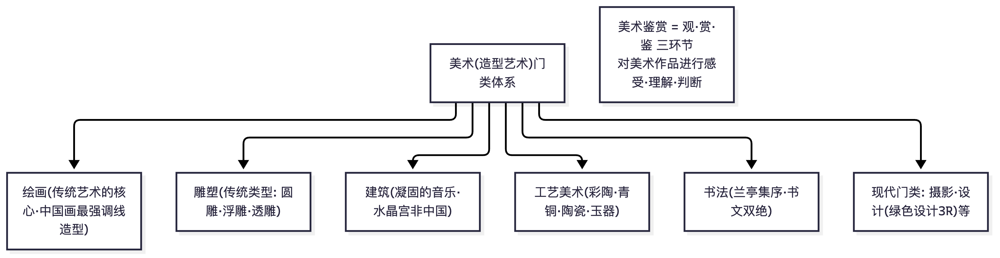

📌 锚点：美术六大传统门类：绘画、雕塑、建筑、工艺美术（书法）；现代扩容：摄影、设计等。

### 2.2 谢赫"六法"与"气韵生动"（第一章）

**① 定义详解**：南齐谢赫所著《古画品录》提出品评绘画的六条标准，即"六法"：**气韵生动、骨法用笔、应物象形、随类赋彩、经营位置、传移模写**。气韵生动列于首位，指画面形象呈现出的生命节奏与精神韵味，是作品总体的艺术生命力；骨法用笔指通过用笔表现人物骨相与结构（后演化为笔墨审美）；应物象形指按对象真实形貌塑造；随类赋彩指按物象类别赋色；经营位置即构图布局；传移模写指临摹复制（学习传承手段）。六法是一个从总体气韵到具体技法的完整批评体系，"气韵生动"成为此后千余年中国画品评的最高标准。
**② 考试答题**

**📌 历年真题**

**【2010.7·单选 12】** 《古画品录》（以探讨人物画理论为主）的作者是
答案：C 谢赫（选项未流传）

**【2007.7·单选 4】** 提出品画标准"六法论"的美术理论家
答案：C 谢赫（选项未流传）

**【2005.7·单选 10】** 南齐谢赫的绘画理论著作
答案：A《古画品录》（选项未流传）

**🎯 考法**：单选考"六法"出处《古画品录》与作者；名词解释考"六法""气韵生动"（湖北大纲识记概念清单原文列有"六法""气韵生动"）
**✍️ 得分点**：
- 答题模板：出处（时代+作者+著作）→ 六法逐条列举（顺序背诵）→ 逐条一句解释 → 地位（中国绘画品评体系的奠基/千余年最高标准）
- 六条名称必须一字不差且顺序正确，首推"气韵生动"
**⚠️ 易混淆**：《古画品录》谢赫（南齐）vs《历代名画记》张彦远（唐，第一部绘画通史）vs《图画见闻志》郭若虚（宋）vs《林泉高致集》郭熙（宋，山水画论成熟标志，2017 卷单选第 7 题）；顾恺之"传神写照""迁想妙得"是实践主张而非六法体系。
**③ 鉴赏模板**：用六法分析作品——气韵（总体生命力）→ 用笔 → 形 → 色 → 构图 → 师承，一气贯通即一篇标准赏析。

> **🖼 图解：谢赫"六法"结构**
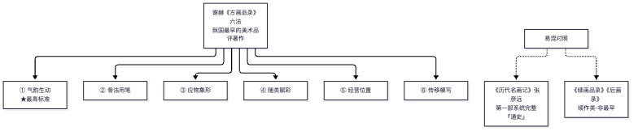
📌 锚点：**品评最早 =《古画品录》，通史最早 =《历代名画记》，考试常互换设错**。

### 2.3 "神品""逸品"与"四格"（第一章）

**① 定义详解**：唐宋画论以品第论画。"四格"通常指**神、妙、能、逸**（或逸神妙能）四等：能品——形似技巧精熟；妙品——妙合自然、技巧之外见天趣；神品——形神兼备、穷理尽性；逸品——拙规矩于方圆、鄙精研于彩绘，超出法度而见逸气。朱景玄《唐朝名画录》于"神妙能"三品之外立"逸品"（不拘常法）；宋初黄休复《益州名画录》将逸品**置于首位**，标志文人趣味抬头；邓椿、苏轼、米芾等推波助澜，"逸"逐步成为文人画最高追求。张彦远《历代名画记》则提出"自然→神→妙→精→谨细"五等，且是中国第一部系统完整的绘画通史（2010.7 卷判断第 18 题考点）。
**② 考试答题**

**🎯 考法**：名词解释（神品/逸品/四格）、简答（神逸之变与文人画兴起）；湖北大纲将"神品与逸品的关系"列为唐代次重点、黄休复在"神品/逸品关系转换中的作用"列为宋代重点
**✍️ 得分点**：
- 答题模板：四格定义 → 朱景玄首立逸品 → 黄休复升逸品为首 → 文人画价值观（重神韵轻技法）
**⚠️ 易混淆**：朱景玄（唐，首立逸品）vs 黄休复（宋初，逸品第一）vs 张彦远（唐，《历代名画记》五等）。
**③ 鉴赏模板**：判断一件文人画品位时，可依"能→妙→神→逸"阶梯定位并说明理由。

> **🖼 知识点图：“神·逸·妙·能”四格品评等级**

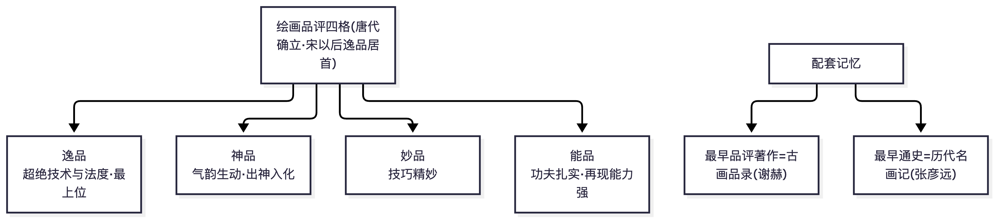

📌 锚点：逸品居首（宋后）→神品→妙品→能品；谢赫六法是品评标准之源。

### 2.4 赵孟頫"古意"说与董其昌"南北宗"论（第一章）

**① 定义详解**：**赵孟頫"古意"**：元代赵孟頫提出"作画贵有古意，若无古意，虽工无益"，主张上追唐与北宋传统，矫正南宋院体末流的刚猛躁露与刻意求形，以质朴天然的古典风范开元代文人画一代新风；他兼倡"书画本来同"，以书法笔意入画，直接孕育了元四家。**董其昌"南北宗"论**：明末董其昌（著《画旨》等）以禅宗南顿北渐为喻，将山水画分为南宗（文人画，王维为祖，一变钩斫为渲淡，董源巨然、米家父子至元四家、沈文唐仇，顿悟）与北宗（院体/浙派，李思训父子着色山水为祖，下传赵伯驹马夏及戴进吴伟之属，渐修），崇南贬北。此说是中国绘画史上影响最大的画分派理论，也造成对浙派、院体的长期贬抑。
**② 考试答题**

**📌 历年真题**

**【2021.4·判断 25】** "南北宗论"是董其昌绘画理论上最有影响的部分
答案：√

**【2017.4·单选 11】** "南北宗论"提出者
答案：B 董其昌（选项未流传）

**【2010.4·单选 11】** 同 2017.4·单选 11（再考），答案：B

**【2010.7·判断 24】** 董其昌著有《画旨》并提出"南北宗"论
答案：√

**【2006.7·单选 13】** 《秋兴八景图》是谁的山水名作
答案：B 董其昌（选项未流传）

**【2005.7·论述 1】（15 分）** 简要介绍明代大画家董其昌
> 【答案要点】华亭（松江）人，万历进士、礼部尚书，"华亭派"领袖；遍摹古人，集大成而"生秀"淡墨润泽山水（《秋兴八景图》等）；著《画旨》倡"南北宗论"（崇南贬北），文人画正统观确立；淡意行楷大家；左右明清三百年画风（四王正统渊源）

（原引另有"2017 简答体系内"一处——第三节 2017.4 简答未收录南北宗论对应题，未回填）

**🎯 考法**：单选考提出者（董其昌，选项常混龚贤/徐渭/陈淳）、判断考细节（著《画旨》）、论述考董其昌生平与理论（2005.7 论述原题）；"古意"说为湖北大纲重点，名词解释或简答
**✍️ 得分点**：
- 答题模板（南北宗论）：提出者与著作 → 分宗标准（顿/渐、渲淡/钩斫、文人/职业）→ 两系谱系 → 影响（文人画正统观确立+对浙派院体的贬抑）
**⚠️ 易混淆**：董其昌是"分宗"不是"创立"南宗画风；《画禅室随笔》《画旨》均与其相关（2010.7 判断 24 作《画旨》判√）。
**③ 鉴赏模板**：分析元明清山水画先问宗派归属（南宗文人系统？北宗院体系统？），再谈笔墨特征与董氏理论对地位的影响。

> **🖼 知识点图：董其昌“南北宗论”（勿与五代山水南北两派混淆）**

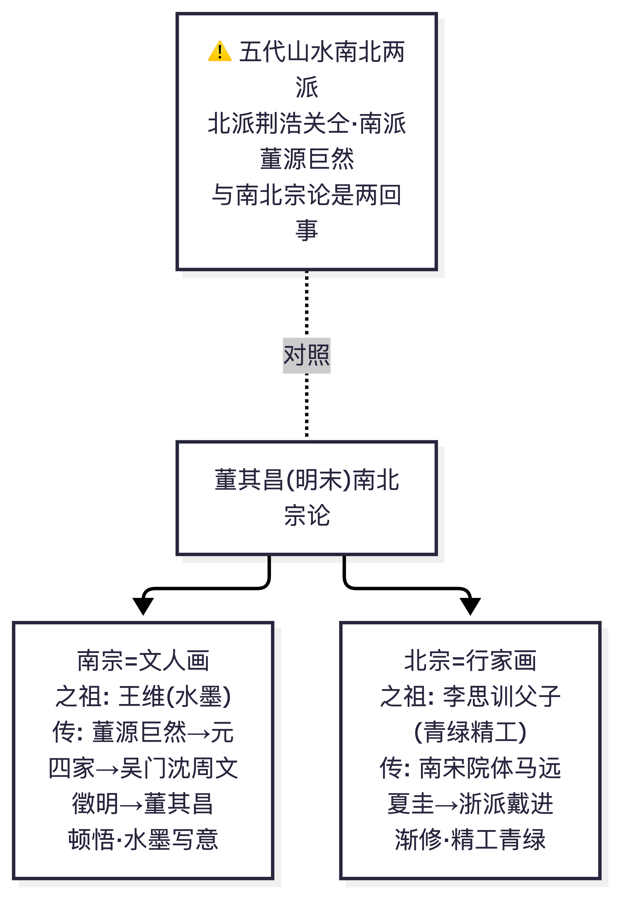

📌 锚点：南宗=文人画（王维之祖·顿悟·水墨）；北宗=行家画（二李·渐修·精工青绿）。

### 2.5 "观"：期待系统与审美态度（第二章）

**① 定义详解**："观"是美术鉴赏的初始环节，指欣赏者带着既有心理准备对作品进行的直观把握。其主体条件一是**期待系统（期待视野）**——由欣赏者的知识储备、审美经验、文化传统、时代风尚等构成的前理解结构，决定了观看的选择性与深度；二是**非功利的审美注意**——将日常意识悬置，以无功利的欲望的态度专注于作品本身。观看对象的特殊性在于美术作品是相对孤立的存在（从生活连续体中剥离出来）、静止的空间性存在、引人注意的存在；由此产生审美距离与特异性。观看有整体印象式与注重细节两个层次，并与幻觉、想象、直觉交织。
**② 考试答题**

**🎯 考法**：名词解释（期待系统、审美注意、通感）、简答（观看的层次/作品作为观看对象的特殊性）；浙江卷未考——湖北考生的**独有得分区**，务必回归教材背诵（湖北大纲第二章全部为考点：重点——期待系统、非功利态度、作品三重存在方式；识记概念——期待系统/审美注意/通感/直觉）
**✍️ 得分点**：
- 答题模板：概念定义 → 构成要素 → 作用机制（选择/定向/生成意义）→ 举例（面对《清明上河图》时风俗画知识储备如何引导观看）
**③ 鉴赏模板**：写赏析开头可先交代"观看位置"——从哪个整体印象切入，再沉入细节，体现"观"的自觉。

> **🖼 知识点图：“观”：期待系统与审美态度**

📌 锚点：观=形式感知层；放下功利态度、建立审美态度，形成期待视野。

### 2.6 "赏"：想象·认同·审美（第三章）

**① 定义详解**："赏"是鉴赏的核心体验环节。**想象**分层：主观发散性想象（由作品自由联想，与作品关联松散）、作品导向型想象（顺着作品暗示展开，与认知密切相关）、自我导向型想象（把自我投入作品世界，与审美直接相关，是意义世界产生的机制）。**认同**是欣赏者将自身投入对象的心理活动，分伦理性认同（价值情感上的赞同，如敬仰《愚公移山》的坚忍）与认知性认同（理解上的认可）；多数认同与审美无直接关系。**审美**的主要环节：对日常自我的遗忘 → 对自我的虚幻确证（近于移情，在对象中确证自我）→ 对日常情感的超越 → 对终极存在的直觉（审美效应）；理想的艺术作品与理想的欣赏者互相成就。
**② 考试答题**

**🎯 考法**：名词解释高频候选：作品导向型想象、自我导向型想象、认同、墨戏、理智直观（湖北大纲第三章重点：想象的层次与类型、审美环节）
**✍️ 得分点**：
- 简答模板：三种想象的定义与关系 → 认同的两方式 → 审美三环节递进
**⚠️ 易混淆**：移情≠同情；审美快感≠感官快适（大纲识记概念"审美快感"）。
**③ 鉴赏模板**：赏析中段写"赏"——描述自己被作品引入的过程（作品导向想象）、物我两忘的体验（自我确证），避免只堆史实。

> **🖼 知识点图：“赏”：想象 → 认同 → 审美（递进三步）**

📌 锚点：赏的核心是想象与情感的投入，最终达成审美判断（题库：最关键环节=审美）。

### 2.7 "鉴"：价值类型与四环节（第四章）

**① 定义详解**："鉴"是鉴赏的最后环节，即对作品作出有依据的价值判断，区别于一般"欣赏"。作品之"好"的标准是多元的：**认知价值**（作品传达的历史、社会、自然知识，如《清明上河图》之于北宋汴京）、**伦理价值**（道德感召，如《采薇图》颂气节）、**审美价值**（形式与意境的感染力，纯粹美/依存美之分——康德意义上的不涉利害的美 vs 依附于内容意义的美，美术史名作多为依存美且有历史性）、**游戏价值**（形式趣味的自由游戏）、**交流价值**（作品作为人际沟通的媒介）；审美趣味有个体性又有共通性。"鉴"的过程与三段论相关，其**四环节**：反思自己的欣赏经验 → 分析作品的特征要素 → 确定作品的价值成就 → 分享自己的鉴赏成果（书面表达是鉴赏的完成）。
**② 考试答题**

**🎯 考法**：名词解释：纯粹美、依存美、审美趣味的共通性（湖北大纲第四章重点：价值五类型、纯粹美/依存美、鉴的四环节）
**✍️ 得分点**：
- 识记作品：**《拉奥孔》**——古希腊晚期雕塑，痛苦的表现与美的法则的冲突，莱辛《拉奥孔》论"包孕性片刻"
- 识记作品：**沈周《庐山高图》**——明吴门，仿王蒙笔法为其师陈宽祝寿，"细沈"代表作
- 简答模板：五价值类型定义+例证 → 四环节流程
**⚠️ 易混淆**：认知价值≠认识价值（大纲绪论另有"认识价值"概念，答题以教材原文表述为准）；"鉴"的四环节顺序不可颠倒。
**③ 鉴赏模板**：赏析结尾作"鉴"——明确给出价值判断（审美为主，兼及认知/伦理），并说明依据，即完成四段式作品分析的收束。

> **🖼 图解：鉴赏三环节流程（观→赏→鉴）**
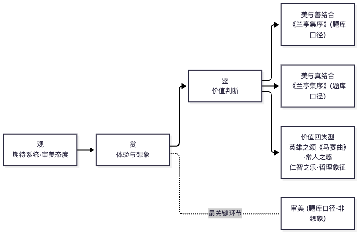
📌 锚点：**流程"观→赏→鉴"；最关键环节＝审美；美善、美真两题都指《兰亭集序》**。

### 2.8 原始美术：不自觉的审美性（第五章）

**① 定义详解**：原始美术的审美性是**不自觉的**——先民以实用为目的（器物功能、巫术仪式），审美因素（对称、均衡、韵律、光洁）在服务于实用中自然生成。三条生成途径：**形式自觉**（在实用器形与纹样的反复制作中形式感觉醒，如半坡鱼纹从写实到几何化抽象的序列——适度抽象；纯几何纹样的节奏美）；**工艺先进**（形制规整、表面光滑、细节精微本身成为美——黑陶高足杯的薄壁与乌亮即龙山文化轮制技艺之审美）；**形象鲜活**（人物、动物、人神合一形象的生动性——人面鱼纹彩陶盆的神秘图式被理解为图腾或巫术形象，"人神合一"是大纲唯一以"重点"标出的原始美术考点）。
**② 考试答题**

**📌 历年真题**

**【2024.4·单选 1】** 马家窑文化中，随彩陶形体改变、装饰面积变大而出现的纹样：
- A. 漩涡纹 ✅
- B. 鱼纹
- C. 人面纹
- D. 花瓣纹

**【2024.4·简答 26】（6 分）** 人面鱼纹彩陶盆
> 【答案要点】仰韶文化半坡类型（西安半坡出土）；盆内壁两个人面与双鱼相间，人面圆圆、鱼衔耳边；图形单纯对称、想象力奇特的原始宗教（祈福巫术）意味；中国史前彩陶艺术代表作

**【2021.4·单选 3】** 人面鱼纹彩陶盆属于
答案：A 半坡文化（选项未流传）

**【2017.4·单选 1】** 半坡文化代表性的器物为
答案：A 人面鱼纹彩陶盆（选项未流传）

**【2006.4·单选 1】** 同 2017.4·单选 1（再考，第三节注明"与 2017 单选 1 同"），答案：B

**【2017.4·判断 16】** 仰韶文化大型墓葬常见器物是玉琮
答案：×（玉琮是良渚文化）

**【2006.7·判断 17】** 同 2017.4·判断 16（再考），答案：×

**【2010.7·单选 3】** 《人面鱼纹彩陶盆》出土于
答案：B 西安半坡（选项未流传）

**【2010.7·判断 16】** 青海出土《舞蹈彩陶纹盆》属于庙底沟类型
答案：×（实为马家窑类型，青海大通上孙家寨）

**【2010.4·单选 1】** 良渚文化大型墓葬中的常见器物是
答案：B 玉琮（选项未流传）

**【2007.7·单选 1】** 马家窑文化、青海出土的代表作品
答案：C《舞蹈彩纹盆》（选项未流传）

**【2005.4·单选 1】** 鹳鱼石斧彩陶缸出自哪个文化（记载两氏族兼并）
答案：A 仰韶（选项未流传）

**🎯 考法**：单选考文化归属（半坡/庙底沟/马家窑/良渚/龙山）与出土地，判断考张冠李戴
**🔑 记忆锚点**：**半坡→人面鱼纹盆·鱼纹；庙底沟→花瓣纹；马家窑→舞蹈纹盆·漩涡纹；半山→锯齿纹大瓮；良渚→玉琮；龙山→黑陶蛋壳杯；大汶口→玉铲·红陶兽形器**
**⚠️ 易混淆**：半坡类型与仰韶文化是类型与文化的从属关系（2021 卷单选 3 同时给出"半坡文化/仰韶文化"选项，依教材表述细辨）。
**③ 鉴赏模板**：彩陶赏析=器形（功能）→ 纹样（写实/抽象程度）→ 工艺（质地光泽）→ 审美生成（不自觉性：实用中的形式自觉）。

> **🖼 知识点图：原始美术深度考点：彩陶两类型 + 玉琮 + 判断题眼**

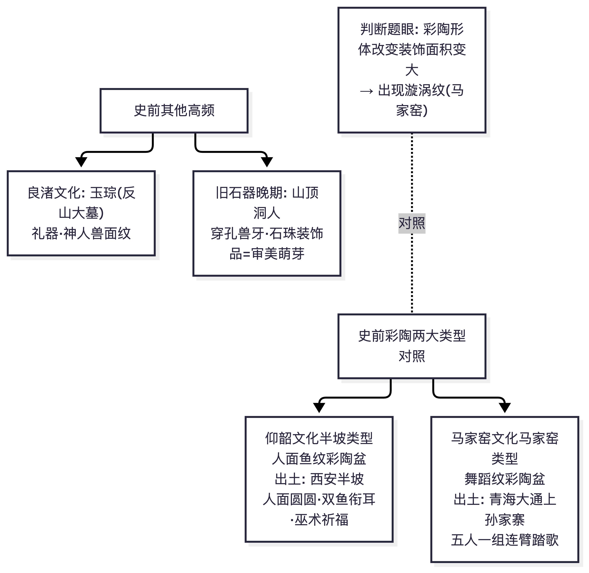

📌 锚点：半坡=人面鱼纹（西安）、马家窑=舞蹈纹（青海大通）、良渚=玉琮；每卷第 1 题常客的具体对答。

### 2.9 宗教美术：神人同性与三种造型范式（第六章）

**① 定义详解**：宗教美术的突出特征是**神人同性**（神按人的形象与情感塑造），随神性与人性的消长形成三种造型范式：**神性主导**——为避免世俗享乐指向超越性，多采用动态强烈、衣纹飞举、无重量的手法（萨莫色雷斯《胜利女神像》迎风展翅的衣袂、双林寺韦驮像的刚健律动）；**半人半神**——神兼具人的优美与神的庄严，是宗教艺术发展必然（卢舍那佛像的悲悯微笑、达·芬奇《岩间圣母》金字塔构图中的圣母子、双林寺彩塑菩萨的世俗妩媚）；**人性主导**——神几乎完全人间化（拉斐尔《西斯廷圣母》缓步而下的慈母、宋代木雕南海观音的安闲、骊山老君像的雍容）。
**② 考试答题**

**📌 历年真题**

**【2021.4·单选 8】** 杭州飞来峰石刻造像中___造像最多最精
答案：A 元代（选项未流传；原引作"2017.4 单选 8"，经与第三节核对，飞来峰题实为 2021.4 单选 8——2017.4 单选 8 为《富春山居图》作者题）

**【2010.7·单选 8】** 被誉为举世无双的东方艺术宝库的是
答案：D 敦煌莫高窟（选项未流传）

**【2010.7·单选 9】** 我国石窟造像兴盛于
答案：A 魏晋南北朝（选项未流传）

**🎯 考法**：简答（三种范式+例证）、作品赏析（《卢舍那佛像》《西斯廷圣母》）；湖北大纲重点，浙江卷仅涉中国佛教石窟
**✍️ 得分点**：
- 范式名称+手法特征+代表作品一件
**⚠️ 易混淆**：《岩间圣母》《西斯廷圣母》均拉斐尔宗教题材但范式不同（半人半神 vs 人性主导）；卢舍那大佛在**龙门石窟奉先寺**（唐）。
**③ 鉴赏模板**：宗教作品赏析先判定神性/人性配比 → 分析造型手法如何实现超越或亲和 → 价值（信仰表达与审美成就的依存美）。

### 2.10 政权认同与伦理主题美术（第六章）

**① 定义详解**：**政权认同导向**的美术以视觉宏大叙事确证政权合法性（兵马俑军阵的秩序与实力、《客使图》的万邦来朝、大卫《拿破仑一世及皇后加冕典礼》的典礼铺陈），或彰显领袖风采（《步辇图》中唐太宗的体量与从容、《奥古斯都像》的理想化帝王姿态），或以审美化的政治抒情升华政权意象（莲鹤方壶的清新灵动被郭沫若誉为"时代精神之象征"、昭陵六骏为唐太宗战马立传）。**伦理情感主导**的美术：英雄之颂优先（霍去病墓《马踏匈奴》以战马踏倒匈奴武士象征战功，整个墓冢即纪念碑；吕德《马赛曲》于凯旋门上颂义勇军）；古代美术家曲折表达伦理观念（韩滉《五牛图》以田家五牛寓耕耘之德，李唐《采薇图》借伯夷叔齐饿死首阳颂气节讽当世）；常人伦理困惑的表达（蒙克《呐喊》的现代性焦虑）。
**② 考试答题**

**📌 历年真题**

**【2017.4·简答 27】（6 分）** 李唐
> 【答案要点】两宋之际画家，南宋四家之首；笔法由北宋凝重（大斧劈前身）转南宋刚劲砍斫；代表作《万壑松风图》（北宋末）、《采薇图》（伯夷叔齐，伦理抒情）、《清溪渔隐图》；开创南宋山水一代新风

**【2010.7·单选 4】** 1923 年河南新郑出土的莲鹤方壶属于
答案：C 春秋时期（选项未流传）

**【2010.7·判断 20】** 唐代画牛名家是韩干，代表作《五牛图》
答案：×（韩干画**马**；韩滉作《五牛图》）

**【2010.4·单选 4】** 霍去病墓前石雕最具代表性的是
答案：D 马踏匈奴（选项未流传）

**【2008.4·单选 3】** 西汉霍去病墓前的代表性雕塑
答案：A《马踏匈奴》（选项未流传）

**【2006.7·单选 5】** 初唐画家阎立本的代表作品
答案：D《步辇图》（选项未流传）

**【2006.7·名词解释 27】（5 分）** 《马踏匈奴》
> 【答案要点】西汉霍去病墓前石雕群主题雕塑；战马昂然踏倒持弓匈奴武士，象征骠骑将军河西战功与汉胜匈之局势；花岗岩**循石造型、因势象形**（圆雕浮雕线刻融于原石）；中国纪念碑式雕塑早期典范

**【2006.7·论述 32】（15 分）** 简述秦兵马俑艺术特征
> 【答案要点】秦始皇陵东垣外从葬坑八千兵马俑军阵；等身陶俑按军阵编列、容貌"千人千面"；性格刻画与整体气势并重，静中寓动；分段塑造烧制、绘塑结合；世界最大写实雕塑群之一

**【2005.7·判断 2】** 阎立本的《送子天王图》等是唐代人物画最成功作品
答案：×（《送子天王图》传吴道子；阎立本=步辇图/历代帝王图）

**🎯 考法**：单选配对（作者-作品）、名词解释（《马踏匈奴》）、简答/论述（秦兵马俑艺术特征——2006.7 论述原题）
**⚠️ 易混淆**：韩干（马）vs 韩滉（牛，《五牛图》）；阎立本《步辇图》《历代帝王图》vs 尉迟乙僧（于阗画家，2005.7 判断 3 反考）。
**③ 鉴赏模板**：政治/伦理主题赏析=主题与意图（宏大叙事/抒情/曲折寄托）→ 造型手段（体量/构图/情节选择/象征）→ 认知价值与伦理价值、审美价值的依存关系。

### 2.11 哲理象征与现代设计（第六章）

**① 定义详解**：**哲理象征类**：以具体形象暗示抽象之道或人生追问——倪瓒《幽涧寒松图》以萧疏简远之境暗示道家的冲淡；波提切利《春》以维纳斯与三美神等寓言人文主义的春回大地；乔尔乔内《三个哲学家》、普桑《阿卡迪亚的牧羊人》（墓铭"我也在阿卡迪亚"的死亡之思）、高更《我们从何处来？我们是谁？我们向何处去？》（塔希提长卷对人生终极三问的图解）属"追问人生"；基里柯《令人不安的缪斯》以形而上广场追问现代人性。**现代设计**：美善并举——功能之美即善与美的统一，从时代精神理解（宝马 i8 的科技美学）、从生命意味理解（潘顿 S 形椅的流动曲线、南宋白瓷印花碗的温润）、从边界消解理解（雅格布森"蛋"椅、门迪尼普鲁斯特扶手椅的戏仿）。
**② 考试答题**

**🎯 考法**：单选（配对：作品-主题类型）、简答（设计艺术"美善并举"的价值追求）、赏析（高更/波提切利）；浙江卷完全未考外国作品与设计——此为湖北考生须重点回归教材的板块
**✍️ 得分点**：
- 能将作品归入"道的暗示/追问人生/反思人性"三类
- 设计的审美价值与功能、生命意味的联系
**③ 鉴赏模板**：象征类赏析=形象层 → 象征层（何道何问）→ 形式如何实现暗示（构图/色调/物象选择）；设计类赏析=功能 → 形式生命意味 → 时代精神。

> **🖼 知识点图：哲理象征与现代设计**

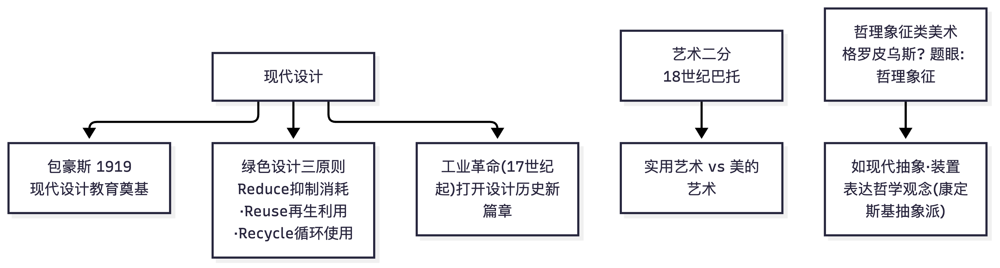

📌 锚点：现代设计：包豪斯奠定现代设计教育；绿色设计 3R；巴托二分法。

### 2.12 美善·美真·真善美结合（第六章）

**① 定义详解**：多元价值在具体作品中各有主导：**美善结合**——审美价值与伦理价值互相成就，颜真卿《祭侄文稿》以悲愤淋漓的笔墨祭侄殉国，情感之真与书法之美不可剥离，伦勃朗《戴金盔的男人》以厚涂法塑造劳动者的尊严；**美真结合**——审美与认识、真相的统一，王羲之《兰亭集序》由雅集之乐转入死生之叹，文、书、情、理一体，华托《热尔桑画店》既是洛可可趣味画卷又是画店实况记录；**真善美结合**——老勃鲁盖尔《农民的舞蹈》真实再现尼德兰农家节庆又洋溢质朴生命力，马远《踏歌图》于山水间绘田埂踏歌，丰年之乐（善）与"宿雨清畿甸"诗意（真）同构于边角构图（美）。
**② 考试答题**

**🎯 考法**：单选配对或简答（湖北大纲重点）
**🔑 记忆锚点**：祭侄文稿=美善；兰亭集序=美真；踏歌图/农民的舞蹈=真善美
**⚠️ 易混淆**：《兰亭集序》（行书之祖·神龙本摹）与《祭侄文稿》（颜真卿真迹，"天下第二行书"——第一即《兰亭集序》）的行书双璧归属。
**③ 鉴赏模板**：先判定作品的主导价值配比，再举证形式如何承载多元价值，最后落到依存美。

> **🖼 知识点图：美善·美真·真善美结合（对应作品）**

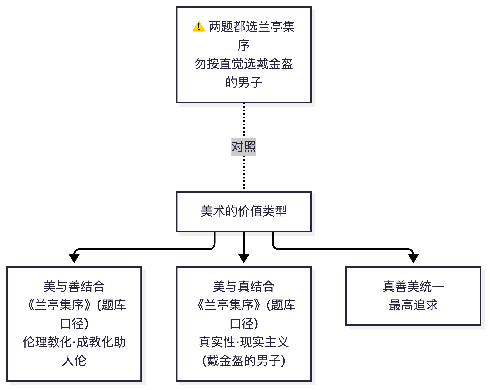

📌 锚点：《兰亭集序》在题库中同时作为美善结合与美真结合的答案。

### 2.13 自觉以审美为唯一目的的美术（第七章）

**① 定义详解**：近现代出现的"为艺术而艺术"倾向——创作自觉以审美为唯一目的。其一是**亲切的形象**：写实性美术以引人注意的亲切形象形成审美价值（郭熙《早春图》早春山川的氤氲生意、凡·高《自画像》灼热凝视）；形象与生活世界的适度疏离产生审美距离（理想化、风格化、媒介化等手段）。
**② 考试答题**

**📌 历年真题**

**【2010.7·判断 10】** 《早春图》是李成鼎盛期作品
答案：×（郭熙作——《早春图》是郭熙）

**🎯 考法**：单选配对+赏析（湖北大纲第七章，转载页至此截断，后续内容【待核实】；已见考点：《早春图》郭熙北宋——三平远/卷云皴/蟹爪枝；凡·高《自画像》）
**⚠️ 易混淆**：郭熙《早春图》《林泉高致集》vs 李成《读碑窠石图》（2006.7 名词解释 28 考过）vs 范宽《溪山行旅图》《雪景寒林图》（2017.4 判断 24《万壑松风图》是**范宽**——注意《万壑松风图》也是李唐作品名！2017 判断题干指向"北宋范宽的代表作《万壑松风图》"判√存疑：传世有范宽《雪景寒林图》、李唐《万壑松风图》。【待核实：教材《中国美术史及作品鉴赏》对《万壑松风图》归属的表述——通行美术史：李唐《万壑松风图》（北宋末，台北故宫）；该判断题按教材语境判分，本文第三节标注两种可能】
**③ 鉴赏模板**：此类作品赏析重点从"审美距离的生成手段"切入——题材理想化/风格变形/媒介自觉。

> **🖼 知识点图：纯艺术与实用艺术门类区分**

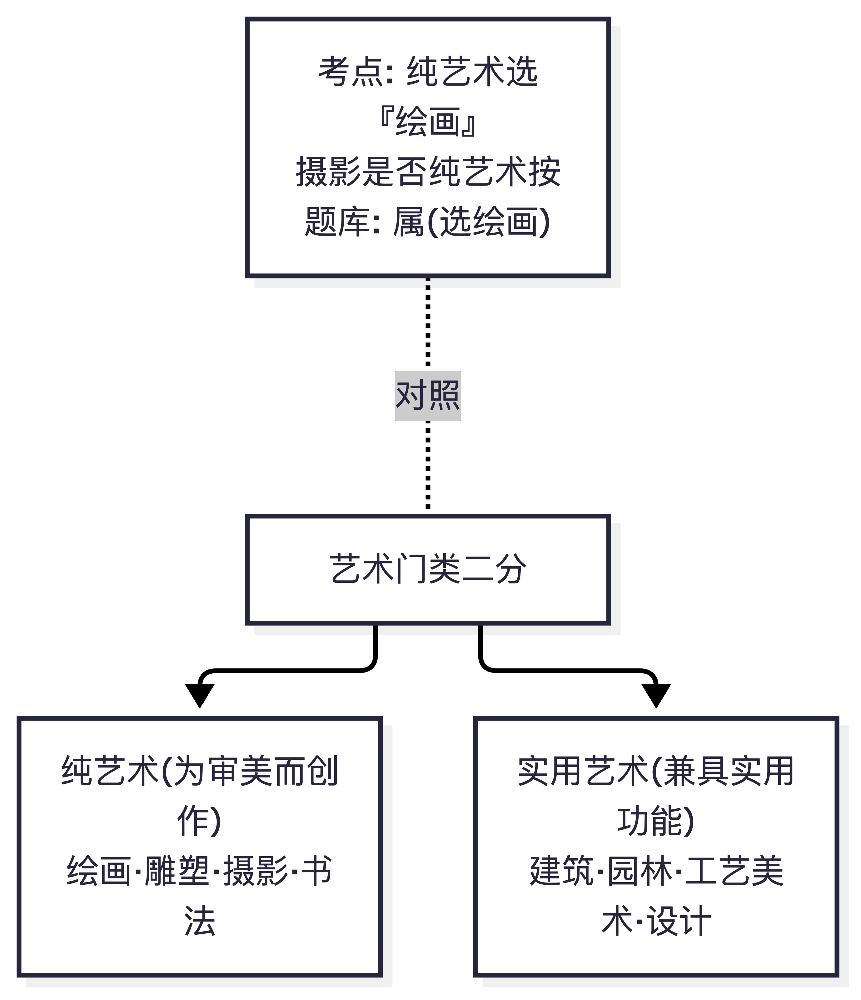

📌 锚点：绘画摄影书法属纯艺术；园林建筑工艺美术兼具实用功能。

### 2.14 中国美术史核心脉络速记（对接浙江真题：作者-作品-断代高分配对区）

**① 定义详解**（按断代的关键链条）：
- **秦汉**：秦始皇兵马俑（写实军阵，2006.7 论述）；霍去病墓石雕《马踏匈奴》（循石造型，因势象形）；《马踏飞燕》（甘肃武威雷台出土，1969 年——2021.4 判断 16、2010.7 单选 6：中国旅游标志）；汉代画像石（兼绘画雕塑两种特点，2005.7 单选 6；武梁祠减地平雕加阴线刻，2007.7 单选 3）；长信宫灯（西汉，河北满城窦绾墓，2010.7 单选 7/2010.4 单选 6）；长沙马王堆一号墓 T 形帛画"铭旌"（西汉，天上/人间/地下三段，2017.4 单选 3、2021.4 论述 33）。
- **魏晋南北朝**：顾恺之（《女史箴图》《洛神赋图》《列女传·仁智图》，"春蚕吐丝"线描，传神写照——2005.7 单选 8/9、2010.7 单选 11、2021.4 多选 12、**2024.4 论述 32《洛神赋图卷》**）；画家三杰（曹不兴、卫协、顾恺之之说法依教材；陆探微"秀骨清像"、张僧繇"张家样"画龙点睛、曹仲达"曹衣出水"——2006.4 单选 4/5、2006.7 单选 3）；谢赫《古画品录》；《竹林七贤与荣启期》砖印壁画（南朝，印证陆探微画风——2017.4 单选 4、2008.4 单选 4、2005.7 单选 7）。
- **隋唐五代**：展子虔《游春图》（现存最早卷轴山水，2005.4 单选 6、2007.7 单选 6、2010.7 简答 28）；阎立本《步辇图》《历代帝王图》；吴道子"画圣"《送子天王图》"吴带当风"（2005.7 判断 4√、2006.4 单选 6）；张萱《捣练图》《虢国夫人游春图》（2006.7 单选 11、2012.4 单选 4、2007.7 单选 5）、周昉《簪花仕女图》（2017.4 判断 25 反考张萱——**簪花仕女图是周昉**！2005.4 单选 13）；王维水墨（南宗之祖）；李思训父子青绿金碧；韩干画马韩滉《五牛图》；荆浩关仝（北方）董源巨然（南方）——《匡庐图》荆浩（2008.4 单选 6）、《潇湘图》董源（2005.4 单选 5）、《秋山问道图》巨然（2006.4/2006.7 单选）；顾闳中《韩熙载夜宴图》（五代，2005.7 简答 5）。
- **宋代**：院体花鸟黄筌（富贵）徐熙（野逸）→崔白《双喜图》（2006.7 判断 25√、2006.4 单选 8、2008.4 单选 11）、宋徽宗《芙蓉锦鸡图》；山水三大家李成（《读碑窠石图》）、范宽（《溪山行旅图》）、郭熙（《早春图》《林泉高致集》"三远法"）；北宋末张择端《清明上河图》（风俗画巅峰——2017.4 论述 31、2010.7 论述 31、2021.4 单选 7）；南宋四家**李刘马夏**（李唐《万壑松风图》《采薇图》、刘松年《四景山水图》、马远《踏歌图》一角、夏圭《溪山清远图》半边——2017.4 单选 5/判断 23 反考、2012.4 单选 3、2008.4 单选 12、2007.7 单选 7）；武宗元《朝元仙仗图》（2017.4 单选 9——**《朝元图》是永乐宫壁画，武宗元作《朝元仙仗图》**，2006.7 判断 23 据此判×）；扬无咎《四梅图》（2006.4 单选 9、2008.4 单选 7、2017.4 判断 20 反考《墨竹图》——扬无咎代表作是《四梅图》，《墨竹图》是文同——2005.4 单选 7）。
- **元代**：赵孟頫（古意说，2021.4 简答 32 其贡献）；**元四家**黄公望《富春山居图》、吴镇《渔父图》、倪瓒《渔庄秋霁图》《幽涧寒松图》、王蒙《青卞隐居图》（四家轮流考：2017.4 单选 8/10、2010.4 单选 10、2008.4 单选 8、2005.4 单选 9、名解/简答 2006.7-29、2010.7-29、2005.7-3、2017-28）；王冕《墨梅图》（2006.7 判断 24√、2005.4 单选 8）。
- **明代**：浙派戴进《春游晚归图》《渔乐图》（2006.7 单选 15、2008.4 单选 9、2017.4 判断 21√、**2024.4 单选 11**）；**吴门四家**沈周（《庐山高图》）、文徵明、唐寅《牡丹仕女图》、仇英（2006.7 单选 9、2005.4 单选 10、2017.4 简答 29、2005.7 论述 2、**2024.4 论述 31"明四家"**）；徐渭大写意《墨葡萄图》（2017.4 单选 6、2010.7 判断 23√、**2024.4 单选 12 号青藤**）；董其昌南北宗论（**2024.4 判断 22《秋兴八景图》√**）；陈洪绶人物。
- **清代**：**四僧**朱耷（八大山人，花鸟《花鸟图册》、白眼向天）、石涛（《画语录》"搜尽奇峰打草稿"——2017.4 单选 13）、髡残、弘仁（2021.4 多选 14；2010.7 单选 13；2005.4 单选 11）；"四王"王时敏《仙山楼阁图》（2017.4 单选 12）、王鉴王翚王原祁（2017.4 判断 23 反考《江帆楼阁图》——传为李思训，非王原祁）；扬州八怪（名单各说不一——2021.4 判断 19 判×，郑燮金农等为代表）。
- **近现代**：海派（2021.4 名词解释 29、2006.7 名解 31；吴昌硕金石入画——2017.4 简答 30、2006.7 论述 33；任伯年赵之谦）；岭南画派二高一陈（高剑父高奇峰陈树人——2021.4 多选 15）；齐白石（红花墨叶、贝叶工虫——2010.7 论述 32、2006.7 单选 12）；徐悲鸿（《愚公移山》《田横五百士》，中国第一代油画家影响最大者、现实主义教育体系——2017.4 论述 32、2010.7 简答 30、2010.7 单选 14、2021.4 单选 1）；林风眠（中西调和）；张大千《长江万里图》（1968 年——2012.4 单选 1、2008.4 单选 10、2005.4 单选 12）；潘天寿（指画《小憩》——2017.4 单选 15）；黄宾虹（积墨浑厚——2021.4 多选 11）；新木刻运动（鲁迅倡导，1931——2021.4 单选 2）；董希文《开国大典》（2010.7 判断 25 反考吴作人）；吕彦直设计南京中山陵（2010.7 单选 15）；月份牌画（2021.4 判断 21）。

**② 考试答题**

**🎯 考法**：这是浙江卷"单选 30 分+判断 10 分"的主要产出区，也是湖北卷中国美术史部分的题库
**✍️ 得分点**：
- 方法：**作者↔作品↔朝代三位一体表格化记忆**（第五节附完整名作清单表）
**③ 鉴赏模板**：见各条内嵌要点；通用的四段式（基本信息→内容形式→艺术特色→历史地位）见 2.15。

> **🖼 图解 ①：中国美术史总时间线**
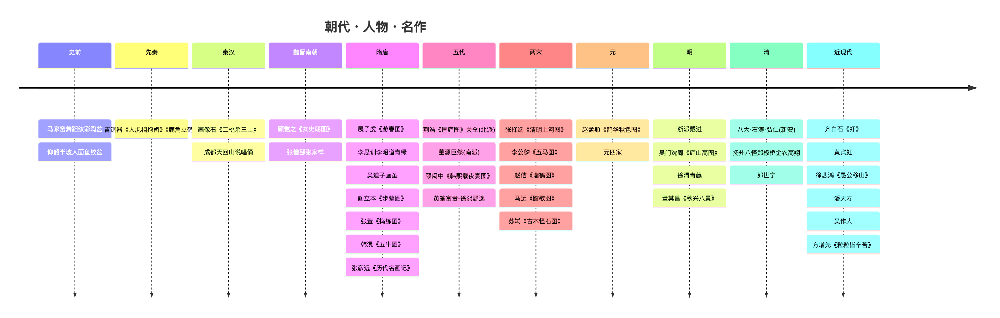
> **🖼 图解 ②：山水画流派传承谱系**
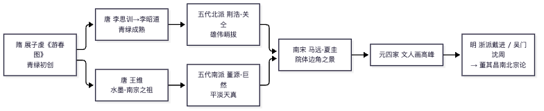
> **🖼 图解 ③：花鸟画两大体系**
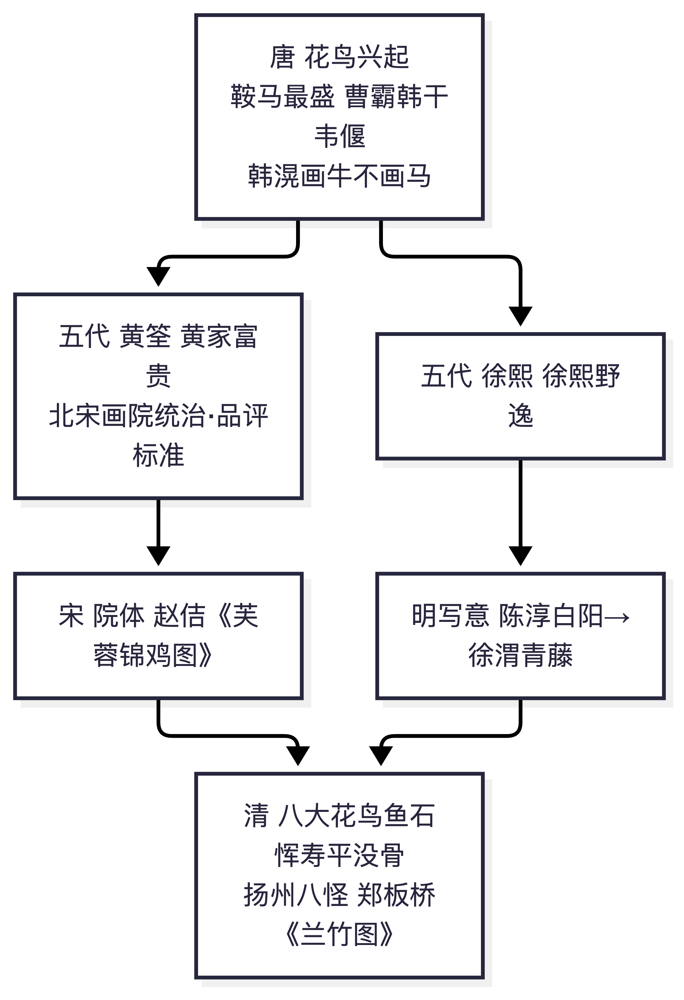
> **🖼 图解 ④：高频"作品—作者—断代"关联网**
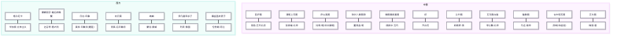
📌 锚点：**庐山高=沈周；古木怪石=苏轼；马远=踏歌图；莫奈睡莲、梵高向日葵**。

> **🖼 知识点图：判断题高频易错八组对照（作者-作品-断代对答）**

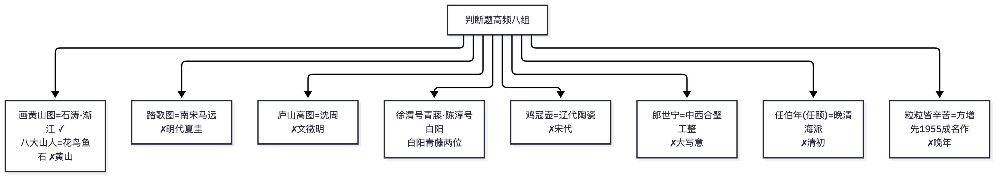

📌 锚点：每条都对应一道判断/选择真题，考前扫一遍。

### 2.15 作品分析四段式通用模板（答简答/论述/赏析题）

1. **作品基本信息**：作者（朝代/国籍）→创作年代→门类（卷轴画/壁画/雕塑/工艺/建筑）→流派归属→现存地（如知）。
2. **内容与形式分析**：题材内容（画了什么）→构图（全景/边角/长卷散点/金字塔）→造型→笔墨或技法（线描类型/皴法/色彩系统）→材质尺度。
3. **艺术特色**：提炼 2–3 条独特成就（如《清明上河图》：散点透视长卷结构+界画精工+风俗叙事三段）。
4. **历史地位与影响**：在美术史坐标系中的位置（首创/巅峰/转折）+对后世影响+（湖北大纲特色）其价值构成类型（认知/伦理/审美主导）。

---

> **🖼 知识点图：作品分析四段式通用模板**

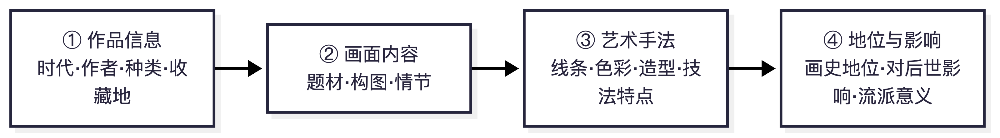

📌 锚点：简答/论述/赏析题的万能骨架：作品信息→画面内容→艺术手法→地位影响。

## 三、历年真题汇编（考期倒序）

### 3.0 收录说明与完整度总表

- **全部答案均为【推导答案】**：官方标准答案被收费墙阻隔（edu-edu 2021 卷页面虽题为"真题与答案"，正文实际未附答案；其余各卷均无答案），以下答案依据《中国美术史及作品鉴赏》知识体系推导，推导依据随题附注。
- **省份与考期归属**：已经由来源页"导读/摘要"逐份核对（第六节校验记录一），除 2021.4 外均可确认。
- 来源缩写：[华夏]=edu-edu.com；[湖北教]=hbzkjy.com；[湖北学]=hbzkxy.com；[原件]=download.zikao365.com/shiti/35217.pdf（试卷扫描/电子原件）。

| 考期 | 省份 | 完整度 | 题型结构（原件标题） | 来源 |
|---|---|---|---|---|
| 2026 年 4 月 | 浙江 | ⚠️ 存疑（媒体"解析"已被证伪，不能作为该考期证据，见 3.2） | — | eol.cn/zikao/zk-wyw/2026081082732.html |
| 2025 年 10 月 | — | ✗ 未获取 | — | 见 3.14 未获取考期表 |
| 2025 年 4 月 | — | ✗ 未获取（仅付费渠道） | — | 同上 |
| 2024 年 10 月 | — | ✗ 未获取 | — | 同上 |
| **2024 年 4 月** | 浙江 | **★★★★★ 完整**（**近年最新实卷**；2 题依赖题图，见注） | 单选15×2+判断10×1+简答5×6+论述2×15 | [浙江网] zjzk.cn/show-2389-8103-1.html |
| 2021 年 4 月 | 【待核实】 | ★★★★★ 完整 | 单选10×1+多选5×1+判断10×2+名解4×5+简答3×10+论述1×15 | [华夏]/zikao/lnzt/48843.html |
| 2017 年 4 月 | 浙江 | ★★★★★ 完整 | 单选15×2+判断10×1+简答5×6+论述2×15 | [原件] PDF |
| 2012 年 4 月 | 浙江 | ★☆ 部分（单选 4 题） | 单选15×2+…（后续截断） | [湖北学]/course/00744/100.html |
| 2010 年 7 月 | 浙江 | ★★★★★ 完整 | 单选15×2+判断10×1+简答5×6+论述2×15 | [湖北教]/00744/mnst/96.html |
| 2010 年 4 月 | 浙江 | ★★ 部分（单选 11 题） | 单选15×2+…（截断） | [湖北学]/course/00744/105.html |
| 2008 年 4 月 | 浙江 | ★★ 部分（单选 12 题） | 同上 | [湖北学]/course/00744/102.html |
| 2007 年 7 月 | 浙江 | ★☆ 部分（单选 7 题，页面标题误标"2010年10月"） | 同上 | [湖北学]/course/00744/104.html |
| 2006 年 7 月 | 浙江 | ★★★★★ 完整 | 单选15×2+判断10×1+名解6×5+论述2×15 | [湖北教]/00744/mnst/95.html |
| 2006 年 4 月 | 浙江 | ★★ 部分（单选 9 题） | 同上 | [湖北学]/course/00744/101.html |
| 2005 年 7 月 | 浙江 | ★★★★★ 完整 | 单选15×2+判断10×1+简答5×6+论述2×15 | [湖北学]/course/00744/99.html |
| 2005 年 4 月 | 浙江 | ★★ 部分（单选 13 题） | 同上 | [湖北学]/course/00744/98.html |

> **统计口径**：完整卷 6 个考期（**2024.4**/2021.4/2017.4/2010.7/2006.7/2005.7），部分卷 6 个考期，存疑解析 1 篇。第四节考频统计以全部可见题目为准（n=12 个考期）。来源缩写补：[浙江网]=zjzk.cn。
> **2024.4 卷注**：该卷原卷带图——单选第 3、4、7、9、10 题为"如图/题图"命题（据作品图像作答），文字转录版无图，相关题目已逐题标注。这证明**近年实卷已引入图像题**，备考须"记图"（见 5.1/5.2）。

### 3.1 2024 年 4 月（浙江，完整卷）——近年最新实卷 ★重点研读

来源：浙江考试网文字转录版 http://www.zjzk.cn/show-2389-8103-1.html （页面 2024-09-19 发布）。卷面结构与 2017.4 卷完全一致：单选 15×2+判断 10×1+简答 5×6+论述 2×15=100 分。

> **重要提醒（图像题）**：该卷原卷带图——单选第 3、4、7、9、10 题为"如图/题图"命题（给出作品图像或局部，据图作答）。文字转录版无图，下列标注【依赖题图】的题目仅能据题干文字与选项反推，把握度低于纯文字题。**这是近年实卷引入图像题的直接证据，备考必须"记图"（见 5.1）。**

#### 一、单项选择题（15×2=30 分）

| 题 | 题干与选项 | 答案 | 依据 |
|---|---|---|---|
| 1 | 马家窑文化中，随彩陶形体改变、装饰面积变大而出现的纹样：A 漩涡纹 B 鱼纹 C 人面纹 D 花瓣纹 | **A** | 教材通识：马家窑类型以漩涡纹著称（同 2017 单选 1、2010.7 单选 1 考法） |
| 2 | 西周中后期青铜器（造型简洁流畅、富韵律感）的代表：A 毛公鼎 B 史墙盘 C 利簋 D 象尊 | **A**【推导】 | 毛公鼎为西周晚期重器、纹饰简朴，与题干吻合；利簋属西周早期可排除；史墙盘虽为中期，但"韵律感"表述在教材中用于毛公鼎文段【待核实】 |
| 3 | 【依赖题图】湖南安化出土《人虎相抱卣》是一件：A 乐器 B 祭器 C 礼器 D 酒器 | **D**【推导】 | "卣"为盛酒器属文字学通识；出土地信息与 2017 单选 2 相互印证（见 3.4 该题注） |
| 4 | 【依赖题图】《鹿角立鹤》是先秦时期____青铜器的代表：A 南方 B 蜀地 C 北方 D 实用 | **A** | 曾侯乙墓（湖北随州）出土，楚地风格 |
| 5 | 画像石《二桃杀三士》出土于：A 山东沂南 B 山东长清 C 河南南阳 D 四川成都 | **C**【推导】 | 南阳汉画像石有名品《二桃杀三士》，教材画像石章节常见配图【待核实】 |
| 6 | 汉代《说唱俑》多地出土，____的最为引人注目：A 成都羊子山 B 郫县 C 成都天回山 D 西安 | **C** | 东汉击鼓说唱俑出土于成都天回山崖墓，教材通识 |
| 7 | 【依赖题图】作品局部图，作品名称是：A《职贡图》B《孝子石棺石刻线画》C《北齐校书图》D《竹林七贤与荣启期》 | **D**【推导】 | 据选项反推：南朝模印砖画《竹林七贤与荣启期》最常以局部考识别；若图为绢本人物则另当别论【待核实】 |
| 8 | 《江帆楼阁图》相传是唐代大画家____的代表作：A 李思训 B 孙位 C 李昭道 D 张萱 | **A** | 教材通识：李思训《江帆楼阁图》（台北故宫） |
| 9 | 【依赖题图】作品局部，作者是：A 李公麟 B 武宗元 C 李昭道 D 胡瓌 | 【待核实·依赖题图】 | 若为《五马图》则 A（但简答 30 已考李公麟），若为《朝元仙仗图》则 B；无图无法定 |
| 10 | 【依赖题图】罗汉彩塑属于：A 灵岩寺 B 双林寺 C 炳灵寺 D 白马寺 | **B**【推导】 | 山西平遥双林寺罗汉殿彩塑为教材重点；灵岩寺宋塑罗汉亦为名品，以教材所配图为准【待核实】 |
| 11 | 属于戴进代表作的是：A《庐山高图轴》B《渔乐图》C《春游晚归图》D《修竹仕女图》 | B/C【待核实】 | 《庐山高图》为沈周可排除；**B、C 均为戴进真迹**（《渔乐图》《春游晚归图》皆其名作），正确项以教材收录篇目为准；备考两件都记 |
| 12 | 徐渭，字文长，又号：A 白阳 B 青藤 C 衡山 D 伯虎 | **B** | 通识：徐渭号青藤（"白阳青藤"之白阳为陈淳）；衡山=文徵明、伯虎=唐寅 |
| 13 | 属于王原祁作品的是：A《苍翠凌天图》B《金鱼图册》C《松荫高士图》D《仿高房山云山图》 | **D**【推导】 | 王原祁常作"仿高房山（高克恭）云山"类山水，为其标志性题材 |
| 14 | 弘仁是"____画派"的主要代表：A 海上 B 扬州 C 新安 D 金陵 | **C** | 通识：弘仁=新安画派领袖（四僧之一） |
| 15 | 属于傅抱石作品的是：A《听瀑图》B《听松图》C《听琴图》D《听经图》 | **A**【推导】 | 傅抱石多作听瀑题材；《听琴图》为宋徽宗名迹（反设干扰项） |

#### 二、判断题（10×1=10 分，正确涂 A、错误涂 B）

| 题 | 题干 | 答案 | 依据 |
|---|---|---|---|
| 16 | 任颐是清初的杰出画家 | **B（×）** | 任颐（任伯年）为晚清海派巨擘，非清初 |
| 17 | 汉代瓦当鸟兽纹中尤以"狮子"形象最为出色 | **B（×）** | 汉瓦当最出色者为四神纹（青龙白虎朱雀玄武） |
| 18 | 张僧繇所创造的绘画风貌对南北朝后期绘画起积极影响 | **A（√）** | "张家样"为南北朝四家样之一 |
| 19 | 黄筌是一位统治者所喜爱的御用画家 | **A（√）** | "黄家富贵"，供职西蜀画院 |
| 20 | 元代山水画《鹊华秋色图》是王蒙的代表作 | **B（×）** | 《鹊华秋色图》为赵孟頫所作（反考元四家归属） |
| 21 | 宋徽宗书风坚劲秀挺，被称为"瘦金书" | **A（√）** | 通识 |
| 22 | 《秋兴八景图》是董其昌的精品画作 | **A（√）** | 董其昌代表作（南北宗论提出者） |
| 23 | 八大山人继承文人画传统，《花鸟图册》画法自如意味无穷 | **A（√）** | 四僧通识 |
| 24 | 郎世宁《英骥子图》运用中国传统大写意画法创作 | **B（×）** | 郎世宁为中西合璧工整画风，非大写意 |
| 25 | 《粒粒皆辛苦》是方增先晚年的代表作 | **B（×）** | 方增先 1955 年成名作，非晚年（浙派人物画） |

#### 三、简答题（5×6=30 分）——答题要点

26. **人面鱼纹彩陶盆**：仰韶文化半坡类型（西安半坡出土）；盆内壁两个人面与双鱼相间，人面圆圆、鱼衔耳边；图形单纯对称、想象力奇特的原始宗教（祈福巫术）意味；中国史前彩陶艺术代表作。（详见 2.8）
27. **《人物驭龙图》**：战国帛画（长沙子弹库楚墓出土）；男子侧身执缰、驭龙飞行，龙如舟、鹤立于尾；线描流畅、设色平涂兼渲染；"引魂升天"主题，中国早期独幅人物画成熟标志。（详见 2.14 先秦段）
28. **画像石**：汉代祠堂墓室石刻画像，以刀代笔、阳刻减地平雕加线刻技法；多历史故事、祥瑞、宴饮车骑题材；分布四大中心（山东苏北、河南南阳、陕北、四川）；兼具绘画与雕刻的汉代美术代表。
29. **荆浩**：五代后梁北方山水画家，隐居太行洪谷；著《笔法记》提"六要"（气韵思景笔墨）；崇"真"、倡"搜妙创真"；代表作《匡庐图》，全景式大山大气，开北方山水画派。（详见 2.14 五代段）
30. **李公麟《五马图》**：北宋"白描"登峰造极之作；五匹西域名马各牵一人，纯以墨线浓淡粗细表现形体质感，不施丹青而神采毕现；扫去粉黛、淡毫轻墨的"白描体"确立。（详见 2.14 宋代段）

#### 四、论述题（2×15=30 分）——答题框架

31. **"明四家"的代表人物及其风格特点**：沈周（粗笔雄健、《庐山高图》）、文徵明（细秀雅正）、唐寅（才情横溢、院体与文人之融合）、仇英（工笔重彩、雅俗共赏）；结合苏州商品经济、市民文化背景；画派传承（师承杜琼/刘珏—元人传统）与风格对比展开。（同 2017 简答 29、2005.7 论述 2，为**三度重考的原题**，见第四节考频）
32. **《洛神赋图卷》艺术特色**：顾恺之据曹植《洛神赋》创作（宋摹本）；连环叙事式构图、人神恋情凄美；"春蚕吐丝"般高古游丝描；"以形写神"对眼神的处理（悟对通神）；山水树石人大于山的早期特征；传世摹本（故宫/辽宁博物馆）。（详见 2.14 魏晋南北朝段、2.15 模板；2021.4 多选 12 后再考）

【本卷备考提示】这是**距 2026 年 10 月考期最近的完整实卷**，参考价值最高：①结构延续 2017 卷未变；②简答全部为"名词展开式"（作品/画家/门类），与第二节概念详解高度重合；③论述两题均为本档 Top10 高频考点原题重现（明四家、洛神赋图）；④**首次出现成规模的图像题（5 题）**——背名作必须结合图版记忆（见 5.1 第四优先级）。

### 3.2 关于"2026 年 4 月真题解析"一文的证伪说明（存疑来源，不可作为考期证据）

教育在线 2026-08-10 发布的《2026年浙江考试美术鉴赏真题解析》 https://www.eol.cn/zikao/zk-wyw/2026081082732.html 一度被本档收录为"2026.4 考期线索"。**交叉校验发现其内容不可信**：该文罗列的考点——马家窑漩涡纹、西周毛公鼎、人面鱼纹彩陶盆、荆浩、明四家、《洛神赋图》——与上文 2024.4 实卷**逐题对应**（单选 1、2，简答 26、29，论述 31、32），且该文自述"内容仅供参考"、无任何题号与原题文本。结论：该文系**对 2024.4 卷考点的改写转述，"2026 年"考期标注不可靠**。已将其从考期序列中剔除并降级（见 6.4 来源评级），仅保留此文作为"2024.4 卷考点在媒体端的二次传播"佐证。真正的 2026.4 卷目前无公开渠道。

### 3.3 2021 年 4 月（省份【待核实】）

一、单项选择题（10 小题，每小题 1 分，共 10 分）

| 题 | 题干（节录） | 推导答案 | 依据 |
|---|---|---|---|
| 1 | 中国第一代油画家中影响最大的是 | B 徐悲鸿 | 《愚公移山》《田横五百士》，写实教育体系奠基 |
| 2 | 最早介绍西方木刻、倡导新木刻运动的是 | B 鲁迅 | 1931 年上海木刻讲习会 |
| 3 | 人面鱼纹彩陶盆属于 | A 半坡文化 | 教材表述"仰韶文化半坡类型"，选项并列时取"半坡"（2017 卷单选 1 同考点反向命题） |
| 4 | "鼎"属于青铜器类别中的___类 | A 炊煮器 | 鼎为炊煮器；鬲簋为食器，爵觚为酒器，盘匜为水器 |
| 5 | 曾侯乙墓蟠螭纹铜尊盘细密纹饰使用的铸造法 | A 失蜡法 | 湖北随县曾侯乙墓，失蜡法（熔模）代表 |
| 6 | 中国木构架 5 种基本屋顶样式在___已具备 | C 汉代 | 庑殿/歇山/悬山/硬山/攒尖，汉代齐备 |
| 7 | 宋代风俗画高度发展的杰出代表是 | B 张择端 | 《清明上河图》 |
| 8 | 杭州飞来峰石刻造像中___造像最多最精 | A 元代 | 飞来峰以元代梵式造像著称 |
| 9 | 宋代五大名窑中宋人评为青瓷第一的是 | D 汝窑 | "汝窑为魁" |
| 10 | 文人画到___臻于完备，诗书画印合一 | D 元代 | 元四家时期成熟 |

二、多项选择题（5 小题，每小题 1 分，共 5 分）

| 题 | 题干（节录） | 推导答案 | 依据 |
|---|---|---|---|
| 11 | 20 世纪初以上海为中心的江南画坛著名国画家 | ABDE（黄宾虹、刘海粟、潘天寿、张大千） | 丰子恺主漫画/散文，非该语境"国画家"【推导，存在教材表述差异风险】 |
| 12 | 属于顾恺之作品的是 | ABC | 《女史箴图卷》《列女传·仁智图》《洛神赋图》；《竹林七贤与荣启期》为南朝砖画，《古画品录》谢赫著 |
| 13 | 中国建筑艺术史上的高峰时期 | ABCE（秦汉、唐、明至清中期、宋） | 教材通说四大高峰；D 元后期排除【推导】 |
| 14 | 清代"四僧" | ABCD | 朱耷、石涛、髡残、弘仁；E 徐渭为明 |
| 15 | 岭南画派领袖人物 | BCD | 高剑父、陈树人、高奇峰（"二高一陈"）；齐白石徐悲鸿非岭南 |

三、判断题（10 小题，每小题 2 分，共 20 分）

| 题 | 题干（节录） | 推导答案 | 依据 |
|---|---|---|---|
| 16 | 1969 年甘肃出土铜车马中铜奔马最精致，"马踏飞燕" | √ | 武威雷台 1969 年出土 |
| 17 | 郎世宁，意大利人，康熙时期来华供奉内廷，代表作《平安春信图》 | √ | 1715 年（康熙五十四）来华；《平安春信图》传为郎世宁作【个别教材亦列《百骏图》，此题按题干判√】 |
| 18 | 青花釉里红是釉下彩，同器并用青花、釉里红两色 | √ | 定义正确 |
| 19 | "扬州八怪"典籍记载中有确定的八个人 | × | 历来说法不一，约十五家入选各版互异 |
| 20 | 宋以前陶瓷以青瓷为主，宋以后主要是白瓷，装饰由刻花印花改为绘花 | √ | 教材原句式表述（史学界对"白瓷为主"时限定于宋以后有讨论，按教材判√）【推导】 |
| 21 | 19 世纪末北京出现"月份牌画"新画种，与新印刷技术有关 | √ | 教材表述（月份牌通常说兴起于清末民初上海，题干地域/时间按教材语境判√）【推导】 |
| 22 | 明代恢复宫廷画院，规模创作超过宋代翰林图画院 | × | 明代画院无正式建制、规模不及宋 |
| 23 | 明代黄道婆改进棉纺技术……棉织品成为国际市场畅销货 | × | 黄道婆是**元代**（元初）人物 |
| 24 | 明中叶以后随市民文艺发展，传统版画走向辉煌 | √ | 戏曲小说插图版画兴盛 |
| 25 | "南北宗论"是董其昌绘画理论上最有影响的部分 | √ | 见 2.4 |

四、名词解释（4 小题，每小题 5 分，共 20 分）

- **26 画像石**【推导要点】：汉代（东汉盛）建筑墓室/祠堂石构件上的雕刻装饰画，以减地平雕加阴线刻（武梁祠技法）等为手法，兼具绘画与雕塑两种特点；题材涉历史故事、祥瑞、宴饮车马、神仙瑞兽；代表：山东武氏祠、四川成都《弋射收获》画像砖属同系统画像砖；价值：汉代社会生活的图像百科。
- **27 青绿金碧山水画**【推导要点】：以石青石绿为主色、施泥金勾染的山水画体，隋展子虔《游春图》开卷轴先河，唐李思训父子（"北宗"之祖）成熟，南宋赵伯驹兄弟承续；特色：富丽工整、装饰性强，与水墨山水相对。
- **28 院体画**【推导要点】：宫廷画院画家所绘、供职皇家审美体系的绘画，题材程式严谨、造型精工设色富丽；宋代翰林图画院最盛（黄筌、崔白、张择端、南宋李刘马夏皆院体）；与文人画相对；中国美术史上"院体"几乎成"宋画"范式代称。
- **29 海派**【推导要点】：清末民初活跃于上海的画家群，非严格流派；特点：融金石书法入画（赵之谦、吴昌硕）、题材通俗吉庆、雅俗共赏、面向市场；代表：任伯年、吴昌硕、虚谷、赵之谦；上承扬州八怪市民趣味，下启现代国画商品化。

五、简答题（3 小题，每小题 10 分，共 30 分）

- **30 中国山水画的起源**【推导要点】：①胚胎于人物画背景（战国帛画/汉壁画已有山川形象）；②魏晋南北朝独立意识萌动——顾恺之《画云台山记》、宗炳《画山水序》"畅神"、王微《叙画》奠定理论；③隋代独立成科——展子虔《游春图》现存最早卷轴山水，青绿一体；④唐成熟分派——李思训父子青绿金碧、王维水墨（南宗之祖）；⑤五代两宋全景高峰（荆关董巨→李范郭→院体）。
- **31 唐代人物画发展的三个阶段**【推导要点】：①初唐——阎立本《步辇图》《历代帝王图》功成纪事、铁线描庄重；尉迟乙僧西域风格；②盛唐——吴道子"吴带当风"宗教人物画变革，张萱《捣练图》《虢国夫人游春图》仕女画华丽丰腴；③中晚唐——周昉"周家样"《簪花仕女图》绮罗人物、水月观音样式，宗教世俗化完成。
- **32 赵孟頫在绘画史上的贡献**【推导要点】：①开一代画风：倡"古意"，上追唐北宋，矫南宋院体末流，开元画新格局；②理论贡献："书画本来同"，以书入画，笔墨独立审美价值确立；③题材全面：山水（鹊华秋色）、人马、枯木竹石皆精；④直接影响元四家（黄吴倪王皆受其沾溉），文人画至此臻于完备（诗书画印合一）；⑤兼通书法（赵体）篆刻，全才范式。

六、论述题（15 分）

- **33 西汉帛画（长沙马王堆一号墓出土）的内容及其艺术特色**【推导要点】：①基本信息：西汉初期，湖南长沙马王堆轪侯妻墓，T 形"铭旌"绢本帛画，全长 205cm。②内容三段：天上（正中人首蛇身女娲/烛龙、日月（金乌蟾蜍）、仙禽瑞兽）→人间（轪侯夫人拄杖而行，侍从环列，祭祀祈颂场面）→地下（力士托举大地、鲸鲵玄武）；主题为引魂升天。③形式：单线平涂、施朱砂石青等矿物色至今鲜艳；构图以穿壁的双龙与华盖玉磬为中轴，上下纵横自由分割而不失秩序；早期中国绘画"满构图"与想象力的典范。④地位：现存最早最完整的大幅西汉帛画，汉初绘画实物巅峰，证史（服饰/礼制/神仙观念）与审美价值兼重。

### 3.4 2017 年 4 月（浙江，试卷原件 PDF 转录）

一、单项选择题（15 小题，每小题 2 分，共 30 分）

| 题 | 题干 | 推导答案 | 依据 |
|---|---|---|---|
| 1 | 半坡文化代表性的器物为 | A 人面鱼纹彩陶盆 | 仰韶半坡类型标志 |
| 2 | 著名的人虎相抱卣出土于我国的 | 【待核实】（选项陕西/山西/山东/河南，而虎食人卣传出土于**湖南**安化） | 题目选项与史实不合，疑选项或题干转录有误。**互证：2024.4 卷单选 3（3.1）题干明示"湖南安化出土的《人虎相抱卣》"——佐证器物出土地为湖南安化，本卷选项确有误** |
| 3 | 马王堆一号墓出土的帛画是 | C 西汉帛画"铭旌" | 见 3.3-33 |
| 4 | 印证陆探微画风的砖印壁画是 | D《竹林七贤与荣启期》 | 南京西善桥南朝墓砖画，"秀骨清像" |
| 5 | 南宋四家：刘松年、马远、李唐和 | A 夏圭 | "李刘马夏" |
| 6 | 明代杰出的大写意花鸟画家是 | A 徐渭 | 《墨葡萄图》，泼墨大写意 |
| 7 | 标志中国山水画理论进入成熟的宋代郭熙著作 | B《林泉高致集》 | "三远法" |
| 8 |《富春山居图》作者是 | B 黄公望 | 元四家之首 |
| 9 | 武宗元代表作 | D《朝元仙仗图》 | 《朝元图》为永乐宫壁画（易错项） |
| 10 | 元代吴镇代表作 | A《渔父图》 | 元四家配对 |
| 11 | "南北宗论"提出者 | B 董其昌 | 四考高频 |
| 12 |《仙山楼阁图》作者是 | C 王时敏 | 清初四王之首 |
| 13 | 著《画语录》提出"搜尽奇峰打草稿"的是 | A 石涛 | 四僧 |
| 14 | 朱耷花鸟画代表作 | A《花鸟图册》 | 教材表述（2005.4 单选 11 同题同答案） |
| 15 | 1954 年创作指画《小憩》的近代花鸟画家 | B 潘天寿 | 指墨画大家 |

二、判断题（10 小题，每小题 1 分，共 10 分）——正确的涂 A 错误的涂 B

| 题 | 题干 | 答案 | 依据 |
|---|---|---|---|
| 16 | 仰韶文化大型墓葬常见器物是玉琮 | B（×） | 玉琮是良渚文化 |
| 17 | 犀尊是西周时期的青铜器 | B（×） | 犀尊为商代末期（2006.7 判断 18 正向考过） |
| 18 | 山东嘉祥武氏祠画像石作品是《二桃杀三士》 | B（×）【推导，存在教材表述差异风险】 | 武氏祠代表作通举《泗水升鼎》《荆轲刺秦王》等；《二桃杀三士》多系洛阳汉墓壁画题材 |
| 19 |《四神瓦当》流行于秦代 | B（×） | 四神瓦当流行于汉代 |
| 20 | 扬无咎现存《墨竹图》为其代表作 | B（×） | 扬无咎代表作《四梅图》；《墨竹图》文同 |
| 21 |《春游晚归图》是明代戴进的代表作 | A（√） | 浙派配对 |
| 22 |《清明上河图》作者是宋代张择端 | A（√） | 高频 |
| 23 |《江帆楼阁图》是清代王原祁的作品 | B（×） | 传为唐李思训 |
| 24 |《万壑松风图》是北宋范宽的代表作 | 【待核实】 | 通行美术史以《万壑松风图》为**李唐**（台北故宫），范宽代表作为《溪山行旅图》《雪景寒林图》；本卷按教材语境或有不同表述 |
| 25 |《簪花仕女图》是张萱代表作品 | B（×） | 周昉作（张萱=《捣练图》） |

三、简答题（5 小题，每小题 6 分，共 30 分）——**注意：此卷简答实为"名词解释式"命题（给作品/人名作阐释）**

- **26《泼墨仙人图》**【推导要点】：南宋梁楷，减笔/泼墨人物开派之作；阔笔泼墨扫出憨态仙人，五官紧凑precis，"逸笔"审美先声；禅画趣味，对明清写意人物影响深远。
- **27 李唐**【推导要点】：两宋之际画家，南宋四家之首；笔法由北宋凝重（大斧劈前身）转南宋刚劲砍斫；代表作《万壑松风图》（北宋末）、《采薇图》（伯夷叔齐，伦理抒情）、《清溪渔隐图》；开创南宋山水一代新风。
- **28 元四家**【推导要点】：黄公望（富春山居图）、吴镇（渔父图）、倪瓒（渔庄秋霁图，折带皴逸笔）、王蒙（青卞隐居图，牛毛解索繁密）；共同点：文人画正统、水墨山水、以书入画、各具个性；直接受赵孟頫影响，代表元代山水最高成就。
- **29 吴门四家**【推导要点】：明中期苏州：沈周（庐山高图，粗沈细沈）、文徵明（细笔雅淡）、唐寅（牡丹仕女图，行家利家兼擅）、仇英（工笔重彩，仿古）；特点：文人画传统+地域市民文化；与浙派（戴进宫廷/刚劲）相对；"明四家"即此。
- **30 吴昌硕**【推导要点】：晚清海派领袖；金石篆籀笔法入画（石鼓文），《墨梅》《葫芦》等大写意花卉，设色大胆（西洋红）；"诗书画印"一体化最后大师；西泠印社首任社长；承任伯年启齐白石（"学我皮毛竟成大名"之评）。

四、论述题（2 小题，每小题 15 分，共 30 分）

- **31 分析《清明上河图》**【推导要点】：①张择端，北宋末，风俗画长卷绢本淡设色（现北京故宫）；②内容：汴京清明时节，郊野→汴河（虹桥高潮：船过桥紧张情节）→城内街市五百余人物、牲畜船只建筑俱全；③形式：散点透视移动视点，段落节奏起承转合，界画精工而不板，白描为主淡设色；④特色与地位：风俗画巅峰、宋代城市生活百科全书（认知价值+审美价值双重——湖北大纲"多元价值"完美例证）；现实主义传统的里程碑。
- **32 分析徐悲鸿的《愚公移山》**【推导要点】：①徐悲鸿 1940 年（抗战时期），巨幅中国画（亦有油画稿）；②内容：《列子·汤问》愚公率子孙挖山，人体开山、妇孺箕畚；③形式：以西方写实人体解剖融入中国画（开山壮汉取材印度模特），白描勾勒+明暗渲染，历史寓言+现实寓意（坚持抗战必胜）；④地位：中国现代美术"古法之佳者守之，垂绝者继之，不佳者改之，未足者增之，西方绘画可采入者融之"主张的实践典范；抗战美术旗帜，现实主义教育体系（其主持北平艺专）的图像宣言。

### 3.5 2012 年 4 月（浙江，部分卷——单选前 4 题）

| 题 | 题干 | 推导答案 | 依据 |
|---|---|---|---|
| 1 | 张大千《长江万里图》创作年份 | B 1968 年 | 1968 年为贺张群八十寿作 |
| 2 | 发明陶器为主要标志之一的是 | A 新石器时代 | 原始美术常识（2005.7 单选 1 同） |
| 3 | 南宋四家除刘松年马远李唐还有 | A 夏圭 | 与 2017 单选 5 同题 |
| 4 |《捣练图》的作者是 | B 张萱 | 张萱周昉配对高频 |

### 3.6 2010 年 7 月（浙江，完整卷）

一、单项选择题（15 小题，每小题 2 分，共 30 分）

| 题 | 题干 | 推导答案 | 依据 |
|---|---|---|---|
| 1 | 山东大汶口文化出土的玉器是 | A 玉铲 | 玉龙=红山；玉琮=良渚；玉凤鸟=商殷墟 |
| 2 | 新石器时代陶器中最重要的艺术形式是 | B 彩陶 | 原始美术核心 |
| 3 |《人面鱼纹彩陶盆》出土于 | B 西安半坡 | 半坡遗址（西安） |
| 4 | 1923 年河南新郑出土的莲鹤方壶属于 | C 春秋时期 | 郑国器，莲瓣立鹤清新灵动 |
| 5 | 帛画《人物龙凤图》出土于 | D 湖南 | 1949 长沙陈家大山（战国楚墓） |
| 6 | 现用作中国旅游标志图案的是 | D 马踏飞燕 | 铜奔马 1983 定为中国旅游标志 |
| 7 | 长信宫灯是哪个时期的青铜工艺灯具 | C 西汉 | 河北满城窦绾墓 |
| 8 | 被誉为举世无双的东方艺术宝库的是 | D 敦煌莫高窟 | 常识概念对应 |
| 9 | 我国石窟造像兴盛于 | A 魏晋南北朝 | 云冈龙门开凿期 |
| 10 | 嵩岳寺塔是我国现存最早的 | B 砖塔 | 北魏，密檐式 |
| 11 |《女史箴图》的作者是 | A 顾恺之 | 高频 |
| 12 |《古画品录》（以探讨人物画理论为主）的作者是 | C 谢赫 | 六法 |
| 13 | 明宗室后裔、号八大山人的是 | A 朱耷 | 四僧 |
| 14 |《田横五百士》的创作者是 | C 徐悲鸿 | 1928–1930，油画 |
| 15 | 南京中山陵的设计者是 | B 吕彦直 | 近现代建筑 |

二、判断题（10 小题，每小题 1 分，共 10 分）

| 题 | 题干 | 答案 | 依据 |
|---|---|---|---|
| 16 | 青海出土《舞蹈彩陶纹盆》属于庙底沟类型 | × | 马家窑类型（青海大通上孙家寨） |
| 17 | 三星堆发掘证明商周时期存在独立的青铜雕塑 | √ | 广汉三星堆青铜人像群 |
| 18 |《历代名画记》是我国第一部系统完整的绘画艺术通史 | √ | 张彦远，唐 |
| 19 | 山水画史上水墨山水画鼻祖是王蒙 | × | 通说王维（或荆浩），绝非王蒙（元四家） |
| 20 | 唐代画牛名家是韩干，代表作《五牛图》 | × | 韩干画**马**；韩滉作《五牛图》 |
| 21 |《富春山居图》是黄公望代表作 | √ | 高频 |
| 22 | 明四家是沈周文徵明唐寅和戴进 | × | 第四家是**仇英**；戴进是浙派 |
| 23 | 徐渭是明代写意花鸟杰出代表，代表作《墨葡萄图》 | √ | 配对 |
| 24 | 董其昌著有《画旨》并提出"南北宗"论 | √ | 配对 |
| 25 |《开国大典》是吴作人的油画作品 | × | **董希文** |

三、简答题（5 小题，每小题 6 分，共 30 分）

- **26 良渚文化**【推导要点】：长江下游太湖流域新石器晚期文化（约前 3300–前 2200）；玉器文明巅峰——玉琮（内圆外方通天地）、玉璧、玉钺，"神人兽面纹"微雕；黑陶磨光工艺；大型墓葬与祭坛显示复杂社会；玉琮为大型墓葬常见器物（反考高频）。
- **27 司母戊大方鼎**【推导要点】：商代晚期王室祭器（"后母戊"鼎），1939 河南安阳武官村出土；现藏国博，重 832.84kg，现存最大最重的古代青铜器；形制：长方形槽式鼎，四柱足；装饰：饕餮纹（兽面纹）主纹+夔龙纹，耳部双虎食人首；工艺：分铸法（耳铸接）；价值：商代王权与铸造力象征。
- **28《游春图》**【推导要点】：隋展子虔，现存最早卷轴山水画（绢本青绿，北京故宫）；内容：贵族春游，青山绿水游人泛舟；形式：青绿设色，"丈山尺树寸马分人"比例克服"水不容泛"；地位：山水画独立成科的标志，唐李思训青绿之源。
- **29 元四家**：同 3.4-28。
- **30《愚公移山》**：同 3.4-32（此卷简答，答要点式即可）。

四、论述题（2 小题，每小题 15 分，共 30 分）

- **31 简要评析张择端的《清明上河图》**：同 3.4-31。
- **32 简要介绍齐白石及其艺术成就**【推导要点】：①湖南湘潭木匠出身，"衰年变法"（1919 前后，陈师曾劝励）；②题材：民间趣味入文人画——虾、蟹、草虫（贝叶工虫）、蔬果；③风格："红花墨叶"派大写意花卉+精微工虫对比；名言"作画妙在似与不似之间"；④诗书画印全才，人民艺术家（1953）、国际和平奖（1955）；⑤地位：传统文人画的现代转型与大众化典范。

### 3.7 2010 年 4 月（浙江，部分卷——单选前 11 题）

| 题 | 题干 | 推导答案 | 依据 |
|---|---|---|---|
| 1 | 良渚文化大型墓葬中的常见器物是 | B 玉琮 | 三考反考型 |
| 2 | 司母戊大方鼎出土于 | A 河南安阳 | 配对 |
| 3 | 漆器使用已经很普遍的时期 | D 战国时期 | 战国楚漆器（曾侯乙墓等）兴盛 |
| 4 | 霍去病墓前石雕最具代表性的是 | D 马踏匈奴 | 高频 |
| 5 | 汉代瓦当最流行的纹饰 | C 云纹 | 汉瓦当云纹为多（四神瓦当为王莽期代表类型之一）【推导】 |
| 6 | 长信宫灯是哪个时代的器物 | C 西汉 | 与 2010.7 单选 7 同 |
| 7 | 用线如"春蚕吐丝"的画家是 | A 顾恺之 | 高古游丝描 |
| 8 |《画山水序》的作者是 | B 宗炳 | 早期山水文献（"畅神"） |
| 9 | 宋代风俗画高度发展的杰出代表是 | D 张择端 | 与 2021 单选 7 同 |
| 10 | 元代吴镇的代表作品是 | A《渔父图》 | 与 2017 单选 10 同 |
| 11 | "南北宗论"的提出者是 | B 董其昌 | 四考 |

### 3.8 2008 年 4 月（浙江，部分卷——单选前 12 题）

| 题 | 题干 | 推导答案 | 依据 |
|---|---|---|---|
| 1 | 仰韶文化彩陶最杰出的两个类型 | A 半坡和庙底沟【推导：依教材"仰韶文化"章内分型】 | 另有 B/D 组合为马家窑系干扰 |
| 2 | 成都扬子山描绘劳动生活的画像砖 | B《弋射收获》 | 四川画像砖代表（2005.4 单选 2 同） |
| 3 | 西汉霍去病墓前的代表性雕塑 | A《马踏匈奴》 | 高频 |
| 4 | 陆探微砖印壁画作品 | D《竹林七贤图》 | 同 2017 单选 4 |
| 5 | 盛唐最主要的仕女画家 | C 张萱 | 配对 |
| 6 | 五代北派山水《匡庐图》的作者是 | C 荆浩 | 荆浩关仝=北方 |
| 7 | 擅画梅、《四梅图》传世佳作的画家 | D 扬无咎 | 配对 |
| 8 | 元代黄公望的代表作品 | B《富春山居图》 | 高频 |
| 9 | 明代浙派戴进的代表作品 | A《春游晚归图》 | 与 2006.7 单选 15 同 |
| 10 | 张大千的山水画代表作品 | B《长江万里图》 | 高频 |
| 11 | 北宋花鸟画家崔白传世作品 | D《双喜图》 | 配对 |
| 12 | 南宋夏圭的代表作品 | B《溪山清远图》 | 配对 |

### 3.9 2007 年 7 月（浙江，部分卷——单选前 7 题；注意：转载页标题误作"2010 年 10 月"）

| 题 | 题干 | 推导答案 | 依据 |
|---|---|---|---|
| 1 | 马家窑文化、青海出土的代表作品 | C《舞蹈彩纹盆》 | 配对 |
| 2 | 河南安阳出土的商代玉石雕刻 | A 玉凤鸟 | 殷墟妇好墓 |
| 3 | 山东武梁祠画像石的雕刻技法 | D 减地平雕加阴线刻 | 武氏祠技法 |
| 4 | 提出品画标准"六法论"的美术理论家 | C 谢赫 | 高频 |
| 5 | 盛唐仕女画家张萱的代表作品 | C《虢国夫人游春图》 | 配对 |
| 6 | 隋代展子虔"现存卷轴山水最古老"的作品 | A《游春图》 | 高频 |
| 7 |《踏歌图》是南宋后期山水画家谁的作品 | D 马远 | 马一角 |

### 3.10 2006 年 7 月（浙江，完整卷）

一、单项选择题（15 小题，每小题 2 分，共 30 分）

| 题 | 题干 | 推导答案 | 依据 |
|---|---|---|---|
| 1 | 先秦时期的青铜动物雕塑代表作 | C《象尊》【推导，与 A 鹿角立鹤存在教材表述歧义风险】 | 商周动物形尊为通说代表；鹿角立鹤为曾侯乙墓青铜亦著名，依《中国美术史及作品鉴赏》先秦雕塑章表述取舍 |
| 2 | "山西扶风"出土的春秋时代青铜器（题干地名有误：扶风在陕西） | B《史墙盘》 | 1976 陕西扶风庄白出土（西周）；题干"山西"应为"陕西"之误【已标】 |
| 3 | 以画"梵像"著称、"其体稠叠而衣服紧窄"（如从水中出）的画家 | A 曹仲达 | "曹衣出水" |
| 4 | "说唱俑""马踏飞燕"是哪个雕塑艺术的杰出代表 | B 汉代 | 东汉击鼓说唱俑（成都天回山） |
| 5 | 初唐画家阎立本的代表作品 | D《步辇图》 | 配对 |
| 6 | 巨然写江南山水，代表作品 | D《秋山问道图》 | 董源《潇湘图》≠巨然（选项陷阱） |
| 7 | 梁楷以禅宗人物/文人高士为题材的代表作品 | D《泼墨仙人图》 | 配对 |
| 8 | 山水画《青卞隐居图》的作者是 | B 王蒙 | 元四家配对 |
| 9 |《牡丹仕女图》创明代仕女画典型，其作者 | C 唐寅 | 配对 |
| 10 |《愚公移山》的作者是（选项 C 徐悲鸿/D 齐白石） | C 徐悲鸿 | 高频 |
| 11 |《捣练图》作者是 | B 张萱 | 高频 |
| 12 |《贝叶工虫》作者是 | A 齐白石 | 配对 |
| 13 |《秋兴八景图》是谁的山水名作 | B 董其昌 | 配对 |
| 14 |《洛神赋图》的作者是 | A 顾恺之 | 高频 |
| 15 | "浙派"画家戴进的代表作 | A《春游晚归图》 | 高频 |

二、判断题（10 小题，每小题 1 分，共 10 分）

| 题 | 题干 | 答案 | 依据 |
|---|---|---|---|
| 16 | 连云港将军崖岩画带人面植物纹样，说明已以农耕为主要生产方式 | √ | 将军崖岩画农耕图腾说 |
| 17 | 玉琮是仰韶文化大型墓葬中的常见器物 | × | 良渚 |
| 18 | 犀尊是商代末期出现的青铜器 | √ | 与 2017 判断 17 互证（彼卷改"西周"判×） |
| 19 | 河南安阳小屯出土的玉凤鸟和商代神话传说有关 | √ | 妇好墓 |
| 20 |《竹林七贤》表现南朝"清谈玄学"之风 | √ | 南朝砖画 |
| 21 | 画龙点睛两龙破壁传说是对顾恺之画龙艺术的赞誉 | × | 张僧繇 |
| 22 | "畅神"功能观的提出者是顾恺之 | × | 宗炳《画山水序》（参见 2005.4 单选 4 选项争议，见 3.13 注） |
| 23 | 武宗元学吴道子得"云行水流"笔法，代表作《朝元图》 | × | 武宗元作《朝元仙仗图》；《朝元图》系永乐宫壁画 |
| 24 | 王冕是元代诗书画印修养全面的典型文人画家，代表作《墨梅图》 | √ | 配对 |
| 25 | 崔白承徐熙黄筌别创清雅疏秀风格，传世名作《双喜图》 | √ | 配对 |

三、名词解释（6 小题，每小题 5 分，共 30 分）

- **26 四神瓦当**【推导要点】：汉代流行之图像瓦当，饰青龙白虎朱雀玄武四神，示四方五行辟邪祯祥；多出于汉长安（王莽四神瓦当为代表）；瓦当 = 筒瓦端头遮挡构件，四神瓦当为其图像类巅峰。
- **27《马踏匈奴》**【推导要点】：西汉霍去病墓前石雕群主题雕塑；战马昂然踏倒持弓匈奴武士，象征骠骑将军河西战功与汉胜匈之局势；花岗岩**循石造型、因势象形**（将圆雕浮雕线刻融于原石）；中国纪念碑式雕塑早期典范（伦理颂功+审美凝练）。
- **28《读碑窠石图》**【推导要点】：北宋李昌（人物王晓补景之说通行作"李成与王晓"——李成主树石、王晓画人物碑侧观者）；蟹爪枝古木窠石间一骑者驻马读碑；寒林平远气象，"惜墨如金"；李成为北宋初"古今第一"的寒林山水大家。
- **29 元四家**：同 3.4-28。
- **30 李公麟**【推导要点】：北宋文人画家，"白描"宗师——不着色纯以墨线塑造（"白画"）；《五马图》《临韦偃牧放图》；扫去粉黛、淡毫轻墨；兼擅人物鞍马道释；把线描从粉本地位提升为独立审美形式。
- **31 海派**：同 3.3-29。

四、论述题（2 小题，每小题 15 分，共 30 分）

- **32 简述秦兵马俑艺术特征**【推导要点】：①规模：秦始皇陵东垣外从葬坑，八千兵马俑军阵；②写实：等身陶俑按军阵编列，兵种职级甲胄有别，容貌"千人千面"（模制头部细部手塑）；③性格刻画与整体气势并重——静中寓动、肃穆威严的纪念碑性；④工艺：分段塑造烧制绘塑结合（原施彩）；⑤地位：世界最大写实雕塑群之一，秦帝国军政实力的图像再现（政权认同型美术——湖北大纲第六章原例）。
- **33 举例阐述吴昌硕绘画艺术特征**【推导要点】：①金石入画：石鼓文篆籀笔力作花卉藤本，"钝刀硬入"笔势雄浑；②题材：梅兰竹菊牡丹葫芦仙桃等吉庆市民题材，雅俗共赏；③色彩：重用西洋红、浓丽对比而不火气；④诗书画印一体（自题自刻自钤）；⑤影响：海派领袖、西泠印社首任社长，下启齐白石（"青藤雪个远凡胎，老缶衰年别有才"）。

### 3.11 2006 年 4 月（浙江，部分卷——单选前 9 题）

| 题 | 题干 | 推导答案 | 依据 |
|---|---|---|---|
| 1 | 半坡文化代表性器物是 | B 人面鱼纹彩陶盆 | 与 2017 单选 1 同 |
| 2 | 凿刻带人面植物纹样、说明已农耕的岩画是 | C 江苏连云港将军崖 | 与 2006.7 判断 16 互证 |
| 3 | 湖北随县曾侯乙墓出土的战国青铜器（选项含大编钟） | A 大编钟 | 曾侯乙编钟（65 件套） |
| 4 | "其体稠叠而衣服紧窄"的画家 | B 曹仲达 | 同 2006.7 单选 3 |
| 5 | 画龙点睛传说是对谁的赞誉 | C 张僧繇 | 与 2006.7 判断 21 互证 |
| 6 | "画圣"吴道子的代表作品 | A《送子天王图》 | 传为其风格的粉本 |
| 7 | 巨然开创南方山水画派，代表作品 | D《秋山问道图》 | 同 2006.7 单选 6 |
| 8 | 崔白清雅疏秀风格传世名作 | A《双喜图》 | 高频 |
| 9 | 扬无咎擅水墨梅竹松石水仙，代表作 | C《四梅图》 | 高频 |

### 3.12 2005 年 7 月（浙江，完整卷）

一、单项选择题（15 小题，每小题 2 分，共 30 分）

| 题 | 题干 | 推导答案 | 依据 |
|---|---|---|---|
| 1 | 发明陶器是哪个时代的主要标志之一 | B 新石器 | 与 2012.4 单选 2 同 |
| 2 | 代表仰韶文化艺术成就的是 | C 彩陶 | 配对 |
| 3 | 夏商周三代以哪类艺术成就最突出 | A 青铜器 | "青铜时代" |
| 4 | 青铜器的饕餮纹流行于 | B 商代 | 商代纹样主导 |
| 5 |《车马仪仗壁画》是哪个时期作品 | D 魏晋南北朝【推导：辽阳魏晋墓壁画车马仪仗】 | 教材表述待核 |
| 6 | 秦汉时期兼有绘画与雕塑两种特点的艺术 | A 画像石 | 概念对应 |
| 7 |《竹林七贤》像模印砖画是哪个时期 | D 魏晋南北朝 | 南朝 |
| 8 |《女史箴图》是魏晋时期谁的作品 | B 顾恺之 | 高频 |
| 9 |《洛神赋图》是魏晋时期谁的作品 | A 顾恺之 | 高频 |
| 10 | 南齐谢赫的绘画理论著作 | A《古画品录》 | 高频 |

（注：原件单选 11–15 在转载中缺失。）

二、判断题（10 小题，每小题 1 分，共 10 分）

| 题 | 题干 | 答案 | 依据 |
|---|---|---|---|
| 1 | 山水画、人物画是隋唐绘画的主流 | ×【推导】 | 教材通说"人物画是隋唐主流"，山水仅为独立成科之始 |
| 2 | 阎立本的《送子天王图》等是唐代人物画最成功作品 | × | 《送子天王图》传吴道子；阎立本=步辇图/历代帝王图 |
| 3 | 尉迟乙僧的《历代帝王图》反映初唐绘画水平 | × | 《历代帝王图》阎立本；尉迟乙僧为于阗籍画家 |
| 4 | 吴道子被誉为"画圣" | √ | 常识 |
| 5 | 周昉（题干作"周日方"）创水月观音形象，誉为"周家样" | √ | 配对 |
| 6 | 顾闳中《韩熙载夜宴图》反映现实、揭示统治阶级内部矛盾 | √ | 五代顾闳中奉后主李煜命夜窥而作 |
| 7 | 隋唐五代青绿山水代表人物是李思训、关仝等人 | × | 关仝为水墨北方（荆浩关仝）；青绿=李思训父子 |
| 8 | 唐代中晚期水墨山水画家主要有王维、董源等人 | × | 董源为五代南 |
| 9 | 五代时期中国山水画开始分为南北两宗 | × | "南北宗"为明代董其昌追认的分派理论 |
| 10 |《早春图》是李成鼎盛期作品 | × | 郭熙作 |

三、简答题（5 小题，每小题 6 分，共 30 分）

- **1 新木刻运动**【推导要点】：1931 年鲁迅在上海举办木刻讲习会（请内山嘉吉讲授）倡导，介绍珂勒惠支、苏联版画；创作木刻（复制木刻对立）服务社会变革，"当革命时，版画之用最广"；代表：李桦《怒吼吧中国》、古元、彦涵、黄新波；抗战木刻成为动员利器；中国近现代美术史最具人民性的运动。
- **2 徐熙画派**【推导要点】：五代南唐徐熙，"落墨花"法——以墨为主杂彩副之，题材多江湖汀花野竹水鸟渊鱼，"野逸"（与黄筌"富贵"对举，"黄家富贵徐熙野逸"）；后世花鸟两大源流之一。
- **3 "元四家"**：同 3.4-28。
- **4 王羲之**【推导要点】：东晋书圣；变汉魏质朴为妍美流便，楷行草俱精；《兰亭集序》"天下第一行书"（湖北大纲"美真结合"例作）；《快雪时晴帖》《十七帖》；子献之并称"二王"；唐太宗独尊，唐以后帖学正统。
- **5《韩熙载夜宴图》**【推导要点】：五代南唐顾闳中，绢本设色长卷（北京故宫）；听乐/观舞/歇息/清吹/送别五段，屏风分隔连环叙事；韩熙载纵乐避祸的政治肖像（李煜命画以窥其私）；工笔重彩仕女人物高峰，"以图记事"的纪实认知价值+审美价值。

四、论述题（2 小题，每小题 15 分，共 30 分）

- **1 简要介绍明代大画家董其昌**【推导要点】：①生平：华亭（松江）人，万历进士，礼部尚书，"华亭派"领袖；②画学：遍摹古人，集大成而"生秀"淡墨润泽山水（《秋兴八景图》等）；③理论：《画旨》等著"南北宗论"（崇南贬北，见 2.4），文人画正统观确立；④书法：淡意 行楷大家（与邢张米并称）；⑤影响与争议：左右明清三百年画风（四王正统渊源），分宗论亦窄化审美接受；综合"艺术家-理论家-鉴藏家"一体的完整形象。
- **2 简要介绍明代"吴门画派"**【推导要点】：①明中叶苏州（吴门）经济文化中心形成；②领袖沈周（师承元四家，粗细皆能，《庐山高图》）、文徵明（细笔雅逸，长寿主盟）、成员唐寅（院体功力+文人才情）、仇英（工匠出身工笔重彩）；③特点：以元代文人画传统为宗，题材多江南山水园林文会，诗书画结合，市民赞助市场；④与"浙派"（宫廷职业画家系统）相对而兴，主盟画坛百余年；⑤"吴门四家/明四家"称呼（2010.7 判断 22 反考）。

### 3.13 2005 年 4 月（浙江，部分卷——单选前 13 题）

| 题 | 题干 | 推导答案 | 依据 |
|---|---|---|---|
| 1 | 鹳鱼石斧彩陶缸出自哪个文化（记载两氏族兼并） | A 仰韶 | 庙底沟类型，河南临汝阎村 |
| 2 | 成都扬子山描绘劳动生活的画像砖 | A《弋射收获》 | 同 2008.4 单选 2 |
| 3 | 表现南朝"清谈玄学"之风的作品 | C《竹林七贤》 | 高频 |
| 4 | "畅神"功能观提出者（选项：陆探微/谢赫/王微/顾恺之） | 【待核实】：通行史实为**宗炳**《画山水序》（"畅神而已"），四选项均无宗炳；若依教材表述王微《叙画》亦有近"畅神"之说则取 C【推导倾向 C，存在教材版本差异】 | 选项与通行美术史结论不符 |
| 5 | 董源写江南山水，代表作品 | C《潇湘图》 | 董源≠巨然陷阱 |
| 6 |《游春图》是现存最古卷轴山水，作者是 | A 展子虔 | 高频 |
| 7 | 尤长于墨竹、《墨竹图》传世杰作的画家 | B 文同 | "湖州竹派" |
| 8 | 王冕是元代诗书画印全面文人画家，代表作 | C《墨梅图》 | 配对 |
| 9 | 山水画《渔父图》的作者是 | C 吴镇 | 元四家配对 |
| 10 | 唐寅仕女画创明代典型，代表作 | C《牡丹仕女图》 | 同 2006.7 单选 9 |
| 11 | 八大山人的花鸟画代表作 | A《花鸟图册》 | 同 2017 单选 14 |
| 12 | 张大千山水画代表作品 | D《长江万里图》 | 高频 |
| 13 |《簪花仕女图》作者是（选项 B"周■"=周昉） | B 周昉 | 张萱周昉配对 |

### 3.14 未获取考期表（如实报告）

| 考期 | 检索情况与未获原因 |
|---|---|
| 2026.4 | 湖北省考卷未公开；浙江卷无公开逐题版。注：eol.cn《2026年浙江考试美术鉴赏真题解析》一文经交叉校验证伪（考点与 2024.4 实卷逐题重合，见 3.2），不能作为该考期证据 |
| 2025.10（浙/鄂） | 未发现任何公开完整版或回忆版；考试365"考生回忆版"汇总页未见 00744 |
| 2025.4 | 学硕考试网（zikaogo.cn/11630.html）确有该期真题出售页（页面仅商品描述无题目，付费渠道，本文不采用其内容）；湖北卷同无公开 |
| 2024.10 | 仅见学服网求题帖（xuefu001.cn ask_id=610），无试卷内容，印证流传少 |
| 2022.4–2023.10 各期 | 检索未见免费完整版；examebook.com（学记教育）有"更新至 2024.4"的付费合集（product-18307.html，无答案），未采用其内容 |
| 2013–2016 各期 | 考生网列出 2013.4/2013.7/2014.4 等条目（浙江），但正文未转录成功；不凭记忆重建 |
| 2009–2011 各期 | 同上（列表可见，内容未获取） |

> **检索渠道说明（如实记录）**：以上结论经多渠道核实——①搜索引擎（近期考期关键词组合检索）；②B站视频解析（API 被反爬拦截，返回验证页而非数据，未能核验"仅视频来源"的考期）；③题库预览站 zankao.cn、zikao.xuekaonet.com（curl 连接失败，SSL 证书错误 exit 60，站点疑似失效）；④付费售卖页（仅商品描述无题目内容）。**2024.4 浙江卷已从 zjzk.cn 免费获取并全文收录（3.1）**，为目前可得的最新完整实卷。

---

## 四、高频考点与易错点专项 Top10

> 排序依据：**真实考频统计**（第三节 12 个考期全部可见题目逐题计数；同考点"考期数"优先，其次"题型分值权重"——论述>简答>名解>单选/判断）。统计考期数 n=12（2005.4–2024.4，其中 2024.4 为近年最新完整实卷）。**2024.4 卷新增考点已全部计入，直接抬升了明四家、四僧、顾恺之、彩陶四个条目的位次。**

### Top1 元四家与"作者↔作品"配对（8 个考期）

- **真题证据**：名解/简答原题 4 次（2006.7 名解 29、2010.7 简答 29、2005.7 简答 3、2017 简答 28）；单选配对 7 题（2017-8/10、2010.4-10、2008.4-8、2005.4-9、2006.7-8 青卞隐居图等）；**2024.4 判断 20（《鹊华秋色图》反考王蒙归属，判×——实为赵孟頫）**；关联 2024.4 单选 13（王原祁"仿高房山"，元四家画风传承脉络的清代延伸）。
- **典型题**：山水画《青卞隐居图》的作者是（王蒙）；元代吴镇的代表作品是（《渔父图》）；名词解释"元四家"；判断"《鹊华秋色图》是王蒙的代表作"（×）。
- **易错警示**：①四人与四件代表作必须两两锁死——**黄公望=富春山居图、吴镇=渔父图、倪瓒=渔庄秋霁图（折带皴）、王蒙=青卞隐居图（牛毛皴）**；干扰项惯用四家互换。②"元四家"指**赵孟頫之外的**黄吴倪王（有教材把董其昌说的"元四大家"含赵孟頫，考试按通行黄吴倪王答，2010.7 简答与 2017 简答语境一致）；③**《鹊华秋色图》=赵孟頫（为周密所作，济南鹊山华不注山）**——2024.4 新考法，勿归入元四家；④倪瓒另有《幽涧寒松图》（湖北大纲第六章哲理象征例作——一作两用）。

### Top2 人面鱼纹彩陶盆与彩陶文化归属（8 个考期）

- **真题证据**：2017 单选 1、2006.4 单选 1（正向）、2021 单选 3（半坡/仰韶选项并列）、2010.7 单选 3（出土地西安半坡）、2008.4 单选 1（半坡+庙底沟类型）、**2024.4 简答 26（人面鱼纹彩陶盆，6 分原题）+ 单选 1（马家窑漩涡纹）**；同类舞蹈纹彩陶盆：2007.7 单选 1、2010.7 判断 16。
- **易错警示**：**半坡类型=人面鱼纹；庙底沟类型=花瓣纹；马家窑=舞蹈纹盆/漩涡纹；半山=锯齿纹大瓮**。判断题最爱把"玉琮（良渚）说成仰韶""舞蹈纹盆（马家窑）说成庙底沟"。湖北大纲第五章把人面鱼纹盆列为"人神合一形象"重点识记——湖北卷同样会考。

### Top3 顾恺之与魏晋画论（7 个考期，2024.4 最新考期论述原题）

- **真题证据**：2010.7 单选 11（女史箴图）、2006.7 单选 14（洛神赋图）、2005.7 单选 8/9（两图连考）、2010.4 单选 7（春蚕吐丝）、2021 多选 12（作品多选，含干扰项《古画品录》）、**2024.4 论述 32（《洛神赋图卷》艺术特色，15 分论述原题）**；关联 2024.4 单选 7（《竹林七贤与荣启期》局部识图）。
- **易错警示**：①顾恺之三图（《女史箴图》《洛神赋图》《列女传·仁智图》）vs 谢赫《古画品录》（理论书非画）vs《竹林七贤与荣启期》（南朝砖画，非顾作，但印证**陆探微**画风）；②"传神写照""迁想妙得"是顾的理论；③"画龙点睛"是**张僧繇**（2006.7 判断 21 反考顾恺之判×，2024.4 判断 18 又考张僧繇正向√）；"曹衣出水"是曹仲达、"秀骨清像"是陆探微——张彦远所评六朝四家各有标签勿混。

### Top4 "南北宗论"·董其昌（7 个考期）

- **真题证据**：2017 单选 11、2010.4 单选 11（提出者单选两次）、2010.7 判断 24（著《画旨》）、2021 判断 25（最有影响理论）、2006.7 单选 13（《秋兴八景图》）、2005.7 论述 1（介绍董其昌）、**2024.4 判断 22（《秋兴八景图》是董其昌精品，√）**。
- **易错警示**：①提出者**董其昌**（干扰项固定：龚贤/徐渭/陈淳）；②南宗祖师**王维**、北宗祖师**李思训父子**；③崇南（文人/水墨渲淡）贬北（院体/青绿钩斫）；④董其昌是**明末**华亭派（非清代）；⑤2010.7 判断 22"明四家含戴进"判×——戴进是**浙派**，被南北宗论贬为北宗末流，两个考点联动。

### Top5 张萱·周昉仕女画配对（7 个考期）

- **真题证据**：2006.7 单选 11（捣练图）、2012.4 单选 4（捣练图）、2007.7 单选 5（虢国夫人游春图）、2005.4 单选 13（簪花仕女图）、2017 判断 25（簪花仕女图反考张萱）、2008.4 单选 5（盛唐仕女画家）、2005.7 判断 5（周家样）。
- **易错警示**：**张萱=盛唐=《捣练图》《虢国夫人游春图》；周昉=中唐=《簪花仕女图》《纨扇仕女图》、创水月观音"周家样"**。反考题"《簪花仕女图》是张萱作品"必判×。二人画风承续（周昉初效张萱后则小异），题材皆"绮罗人物"，区分靠时代与代表作。注意 2024.4 单选 8 干扰项含张萱（正答李思训）——命题人常借其名做陪衬。

### Top6 明四家·吴门画派（6 个考期，同一大题三度重考——2024.4 最新考期论述再考）★新晋

- **真题证据**：**"明四家"大题 3 次：2005.7 论述 2、2017 简答 29（同题简答化）、2024.4 论述 31（"试论述明四家的代表人物及其风格特点"，15 分）**；2006.7 单选 9、2005.4 单选 10（唐寅）；2010.7 判断 22（反考"含戴进"判×）；关联 2024.4 单选 12（干扰项衡山=文徵明、伯虎=唐寅）。
- **易错警示**：**明四家=沈周、文徵明、唐寅、仇英**（吴门四家）。配对锁死：**沈周=《庐山高图》、文徵明=细秀雅正（号衡山）、唐寅=《牡丹仕女图》（号伯虎）、仇英=工笔重彩**；"含戴进/董其昌"必判×（戴进是浙派、董其昌是华亭派）。答论述按"四人各自师承+风格+代表作+共性（苏州文人画传统）+与浙派对立"展开（模板见 2.13 明代段）。

### Top7 四僧·八大山人（6 个考期）

- **真题证据**：2021 多选 14（四僧全选 ABCD）、2010.7 单选 13（八大山人=朱耷）、2005.4 单选 11、2017 单选 13/14（石涛画语录、朱耷花鸟图册）、**2024.4 单选 14（弘仁=新安画派）+ 判断 23（八大山人《花鸟图册》√）——单卷双题**。
- **易错警示**：**四僧=朱耷（八大山人）、石涛（苦瓜和尚，《画语录》，"搜尽奇峰打草稿"）、髡残（石溪）、弘仁（渐江，新安画派领袖）**；多选干扰项惯配徐渭（明）、龚贤（金陵八家）。八大山人画风"白眼向天、哭之笑之"，与石涛"笔墨当随时代"相对。**弘仁归属易漏：既是四僧又是新安画派代表（2024.4 单选 14 正考）**。

### Top8 《清明上河图》·张择端（4 个考期，含 2 次论述大题）

- **真题证据**：2017 论述 31、2010.7 论述 31（两次论述原题！）、2021 单选 7、2010.4 单选 9。
- **易错警示**：论述必须四段式（见 2.15）：**北宋末张择端**；**三段结构（郊野—虹桥—城内）+散点透视+界画**；风俗画巅峰+汴京城市生活图像文献；湖北语境加一句"认知价值与审美价值双重构成的典范"（大纲第六章价值类型例证）。单选干扰项常配李公麟（白描）、梁楷（减笔）、李唐。

### Top9 玉琮·良渚文化（4 个考期，反考 3 次）

- **真题证据**：2017 判断 16（×仰韶）、2006.7 判断 17（×仰韶）、2010.4 单选 1（正向）、2010.7 简答 26（良渚文化名词解释）。
- **易错警示**：**玉琮=良渚文化（太湖流域，新石器晚期）**，内圆外方、神人兽面纹；与仰韶（黄河中游，彩陶）分属南北两大文化系统。良渚简答要写：时空范围+玉礼器体系（琮璧钺）+神人兽面纹+黑陶+祭坛大墓。

### Top10 《愚公移山》·徐悲鸿（3 个考期）

- **真题证据**：2017 论述 32、2010.7 简答 30、2006.7 单选 10；关联：2021 单选 1（第一代油画家）、2010.7 单选 14（《田横五百士》）。
- **易错警示**：①徐悲鸿两件大作勿混——《愚公移山》（1940，中国画/抗战寓意）与《田横五百士》（1928–30，油画，宁死不屈气节）；②"中国第一代油画家影响最大"=徐悲鸿（干扰项：张大千/齐白石/潘天寿皆国画）；③写实主义主张"西方绘画可采入者融之"；与林风眠"中西调和"并列为大纲第一章现代鉴赏观念两大重点。

### 高频小配对集群（各 3–4 个考期，冲刺抢分区）

| 配对 | 真题证据 | 易错点 |
|---|---|---|
| 戴进·浙派 | 2006.7 单选 15、2008.4 单选 9、2017 判断 21、**2024.4 单选 11** | 浙派=明代宫廷/职业系统，与吴门对立；**《渔乐图》《春游晚归图》均系戴进名作，两件都记（2024.4 卷 B/C 两项皆是戴作，正确项依教材收录）** |
| 霍去病墓《马踏匈奴》 | 2010.4 单选 4、2008.4 单选 3、2006.7 名解 27 | 循石造型/因势象形；勿与《马踏飞燕》（东汉铜奔马）混 |
| 张大千《长江万里图》（1968） | 2012.4 单选 1、2008.4 单选 10、2005.4 单选 12 | 干扰项《千里江山图》=王希孟（北宋青绿） |
| 扬无咎《四梅图》 | 2006.4 单选 9、2008.4 单选 7、2017 判断 20 | 《墨竹图》=文同；王冕=《墨梅图》 |
| 崔白《双喜图》 | 2006.4 单选 8、2008.4 单选 11、2006.7 判断 25 | 《芙蓉锦鸡图》=宋徽宗；《写生珍禽图》=黄筌 |
| 谢赫《古画品录》·六法 | 2007.7 单选 4、2010.7 单选 12、2005.7 单选 10 | 见 2.2 全套易混文献 |
| 展子虔《游春图》 | 2005.4 单选 6、2007.7 单选 6、2010.7 简答 28 | "现存最早卷轴山水"固定表述 |
| 徐渭·青藤 | 2017 单选 6、2010.7 判断 23、**2024.4 单选 12（号青藤）** | "白阳"=陈淳、"衡山"=文徵明、"伯虎"=唐寅——一号一人锁死 |

---

## 五、备考建议

### 5.1 按分值分布的学习优先级（湖北考生版）

1. **第一优先（约 40% 时间）——中国美术史"作者-作品-断代"体系**：浙江真题 12 份卷证明这是该课程最稳定的产出区（单选 30+判断 10+简答约半数+论述半数都出自此体系，2024.4 最新实卷亦然）；且湖北大纲第五~七章的识记作品与中国美术史高度重叠。学法：先背熟 5.3 名作清单表 → 再做第三节的卷子 → 错题回归 2.13 速记链条。
2. **第二优先（约 30% 时间）——鉴赏原理（绪论+观赏鉴+价值类型）**：湖北大纲的重点密集区（"六法""气韵生动""神品逸品""古意""期待系统""纯粹美/依存美""鉴的四环节"），浙江卷不考、真题无参照，**只能回归张黔教材原文**。建议逐章整理名词解释卡片（大纲每章末"识记并理解"清单就是现成的名词解释题库）。
3. **第三优先（约 20% 时间）——西方美术与设计作品（大纲第六章识记清单约 25 件外作品）**：从《胜利女神》到 S 形椅，按"三种范式+四类主题"归类记忆（2.9–2.12），每件记"作者-国别-类型归属-一句话特色"。
4. **第四优先（约 10% 时间）——最新实卷精研与图像记忆**：以 **2024.4 卷（3.1）** 为冲刺模板——它距 2026.10 考期最近、命题风格最新：①逐题重做一遍；②其论述两题（明四家、《洛神赋图》）与简答五题（人面鱼纹盆、《人物驭龙图》、画像石、荆浩、《五马图》）全部是本档 Top10 高频原题，印证"背熟高频清单≈覆盖最新考期大题"；③该卷单选有 5 道"如图/题图"题——**名作必须结合图版记忆**（认画面、认局部、认作者），只背文字配对不够（详见 5.2 图像题条目）。

### 5.2 分题型答题技巧

- **图像题（2024.4 卷起出现，单选内 5 题）**：据作品图像或局部作答。技巧：①按"材质+构图+时代特征"三步认图——先辨门类（彩陶/青铜/帛画/砖画/卷轴/彩塑），再抓标志性细节（人面鱼纹、漩涡纹、白描、牛毛皴、白眼向天）；②平时记名作必须"看图背"——教材图版、博物馆官网、本档 5.3 清单配合检索图片；③局部题先想"这类局部属于谁的风格特征"（如纯墨线白描→李公麟/武宗元一路）。
- **单选（每题 1–2 分）**：90% 是配对题（作者↔作品/作品↔朝代/器物↔文化）。技巧：先看选项里"最熟的脸"——真题题库高度复用（第三节可见 2005→2024 同题重现十余处）；两难时选"教材通说表述"而非"最新研究成果"。
- **判断（每题 1–2 分）**：命题方式=把正确表述的**一个人名/朝代/地名/代表作**偷换（如"《簪花仕女图》——张萱""玉琮——仰韶""《开国大典》——吴作人"）。技巧：锁定句中唯一的配对点核对；含"最、第一、唯一、确定"等绝对词的句子优先怀疑（"扬州八怪有确定八人"判×）。
- **多选（如 2021 卷，每题 1 分）**：错选多选少选均不得分，宁缺勿滥；成组概念（四僧/明四家/岭南三杰/建筑四高峰）整组背诵。
- **名词解释（5 分）**：四要素——**时代+作者/文化归属、定义/形制、代表作品或特征、地位影响**，60–100 字；术语类（六法/气韵生动/纯粹美）按"出处→内涵→地位"三步。
- **简答（6–10 分）**：要点化（①②③），每点=小观点+一句例证；人物类（李唐/吴昌硕/王羲之）答"时代身份+代表作+风格特征+影响"；概念群类（元四家/吴门四家/海派）答"指称+成员+共性+代表作品+影响"。
- **论述（15 分）**：**必须四段式**（见 2.15：基本信息→内容形式→艺术特色→历史地位与影响），800 字上下，卷面分段分点；湖北语境末段落到"价值构成类型"（认知/伦理/审美主导，大纲第四章语汇）加分。
- **填空（湖北旧大纲列有此题型，浙江卷未见）**：高频填法="作者-作品"配对与"画论名句归属"（如"搜尽奇峰打草稿——石涛"；"外师造化，中得心源——张璪"【此句出自唐张璪，湖北大纲未见明确列出，属通识储备】）。

> **🖼 图解：流派归属判定流程（选择题秒杀思路）**
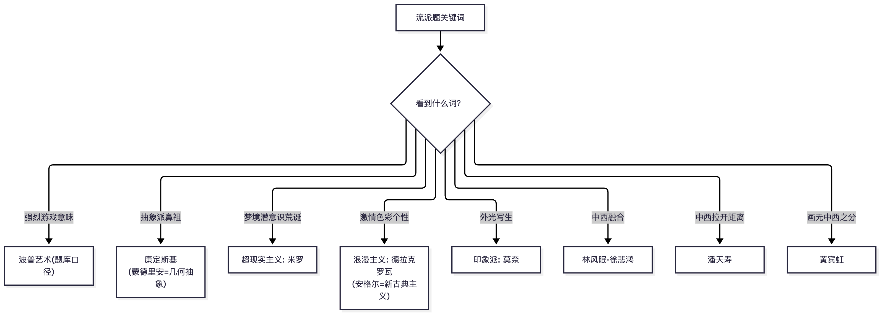
📌 锚点：**"拉开距离"潘天寿、"画无中西"黄宾虹、"融合"林风眠徐悲鸿**。

### 5.3 必背名作清单（作品-作者-年代-流派-考点）

**A. 中国部分（真题高频+湖北大纲识记合并）**

| 作品 | 作者/文化 | 年代 | 门类·流派 | 一句话考点 |
|---|---|---|---|---|
| 人面鱼纹彩陶盆 | 仰韶文化半坡类型 | 新石器 | 陶器·彩陶 | "人神合一"重点；出土地西安半坡 |
| 舞蹈纹彩陶盆 | 马家窑文化（青海大通） | 新石器 | 陶器·彩陶 | 马家窑类型代表（勿记庙底沟） |
| 鹳鱼石斧彩陶缸 | 仰韶文化（庙底沟类型） | 新石器 | 陶器·彩陶 | 记载氏族兼并；河南临汝出土 |
| 玉琮 | 良渚文化 | 新石器晚期 | 玉器 | 内圆外方、神人兽面纹（勿记仰韶） |
| 黑陶高足杯（蛋壳杯） | 龙山文化 | 新石器 | 陶器 | 轮制薄壁乌黑，工艺审美 |
| 司母戊（后母戊）鼎 | 商代晚期 | 商 | 青铜·炊煮器 | 最大最重青铜器；河南安阳；饕餮纹 |
| 莲鹤方壶 | 春秋（郑国） | 春秋 | 青铜 | 1923 新郑出土；清新灵动"时代精神" |
| 曾侯乙编钟·蟠螭纹尊盘 | 战国（湖北随县） | 战国 | 青铜·乐器 | 尊盘=失蜡法典范 |
| 四羊方尊 | 商代 | 商 | 青铜 | 分铸法典范（干扰项高频） |
| 《人物龙凤》帛画 | 战国楚（长沙陈家大山） | 战国 | 帛画 | 引魂升天最早的帛画之一 |
| 马王堆一号墓 T 形帛画 | 西汉（长沙） | 西汉 | 帛画·铭旌 | 天上人间地下三段；2021 论述 |
| 兵马俑 | 秦代 | 秦 | 陶塑 | 写实军阵；千人千面；2006.7 论述 |
| 《马踏匈奴》 | 西汉·霍去病墓 | 西汉 | 石雕 | 循石造型；纪念碑式 |
| 铜奔马（马踏飞燕） | 东汉（甘肃武威雷台，1969） | 东汉 | 青铜雕塑 | 中国旅游标志 |
| 击鼓说唱俑 | 东汉（成都天回山） | 东汉 | 陶塑 | 汉代神韵的代表 |
| 武氏祠画像石 | 东汉（山东嘉祥） | 汉 | 画像石 | 减地平雕加阴线刻 |
| 《弋射收获》画像砖 | 东汉（成都扬子山） | 汉 | 画像砖 | 描绘劳动生活 |
| 长信宫灯 | 西汉（河北满城窦绾墓） | 西汉 | 青铜工艺 | 环保导烟设计 |
| 四神瓦当 | 汉代 | 汉 | 建筑构件 | 青龙白虎朱雀玄武 |
| 《女史箴图》 | 顾恺之（东晋） | 东晋 | 绢本设色 | 传神写照；春蚕吐丝描 |
| 《洛神赋图》 | 顾恺之（东晋） | 东晋 | 绢本设色 | 2024.4 论述 32 原题 |
| 《竹林七贤与荣启期》 | 南朝（南京西善桥） | 南朝 | 砖印壁画 | 印证陆探微"秀骨清像" |
| 《古画品录》 | 谢赫（南齐） | 南齐 | 画论 | 六法；气韵生动居首 |
| 《游春图》 | 展子虔（隋） | 隋 | 青绿山水 | 现存最早卷轴山水 |
| 《步辇图》 | 阎立本（初唐） | 唐 | 绢本设色 | 政权认同·领袖风采（湖北大纲例作） |
| 《历代帝王图》 | 阎立本 | 唐 | 绢本设色 | 功过褒贬的帝王像 |
| 《送子天王图》 | 吴道子（传） | 盛唐 | 白描 | "画圣""吴带当风" |
| 《捣练图》/《虢国夫人游春图》 | 张萱 | 盛唐 | 绢本设色 | 仕女画华丽丰腴 |
| 《簪花仕女图》 | 周昉 | 中唐 | 绢本设色 | "周家样"；勿记张萱 |
| 《五牛图》 | 韩滉 | 唐 | 纸本设色 | 画牛（韩干=马）；伦理曲折表达（大纲例作） |
| 《匡庐图》 | 荆浩（五代后梁） | 五代 | 水墨山水 | 北方山水画派开创 |
| 《潇湘图》 | 董源（五代南唐） | 五代 | 水墨山水 | 南方山水画派（勿记巨然） |
| 《秋山问道图》 | 巨然 | 五代宋初 | 水墨山水 | 董源画派传人 |
| 《韩熙载夜宴图》 | 顾闳中（五代南唐） | 五代 | 工笔重彩 | 听乐观舞五段连环；纪实认知价值 |
| 《读碑窠石图》 | 李成（北宋，与王晓合作） | 北宋初 | 寒林山水 | 惜墨如金；2006.7 名解 |
| 《溪山行旅图》 | 范宽（北宋） | 北宋 | 水墨山水 | 顶天立地标程式 |
| 《早春图》 | 郭熙（北宋） | 1072 | 绢本水墨 | 三远法；《林泉高致集》（勿记李成） |
| 《清明上河图》 | 张择端（北宋末） | 北宋末 | 风俗画 | 论述题两次原题 |
| 《双喜图》 | 崔白（北宋） | 1061 | 花鸟画 | 清雅疏秀破黄徐格局 |
| 《芙蓉锦鸡图》 | 宋徽宗赵佶 | 北宋 | 院体花鸟 | 瘦金书题诗 |
| 《四梅图》 | 扬无咎（南宋） | 南宋 | 墨花墨禽 | 勿与文同《墨竹图》混 |
| 《泼墨仙人图》 | 梁楷（南宋） | 南宋 | 减笔人物 | 泼墨写意先声 |
| 《朝元仙仗图》 | 武宗元（北宋） | 北宋 | 宗教人物 | 勿记《朝元图》（永乐宫壁画） |
| 《采薇图》 | 李唐（南宋） | 南宋 | 历史人物 | 伯夷叔齐；伦理抒情（大纲例作） |
| 《万壑松风图》 | 李唐（通行归属）/【教材表述待核，2017 卷按范宽命题】 | 北宋末 | 山水 | 大斧劈前身 |
| 《踏歌图》 | 马远（南宋） | 南宋 | 院体山水 | "马一角"；真善美结合（大纲例作） |
| 《溪山清远图》 | 夏圭（南宋） | 南宋 | 院体山水 | "夏半边" |
| 《四景山水图》 | 刘松年（南宋） | 南宋 | 院体山水 | 西湖庄园四时 |
| 《富春山居图》 | 黄公望（元） | 1350 | 文人山水 | 元四家之首；火殉两段 |
| 《渔父图》 | 吴镇（元） | 元 | 文人山水 | 渔父题材墨气沉厚 |
| 《渔庄秋霁图》 | 倪瓒（元） | 元 | 文人山水 | 折带皴、阔远逸笔 |
| 《青卞隐居图》 | 王蒙（元） | 1366 | 文人山水 | 牛毛皴繁密 |
| 《幽涧寒松图》 | 倪瓒（元） | 元 | 文人山水 | 哲理象征·道的暗示（大纲例作） |
| 《鹊华秋色图》 | 赵孟頫（元） | 1295 | 文人山水 | "古意"说实践 |
| 《墨梅图》 | 王冕（元） | 元 | 墨花墨禽 | 诗书画印全面文人典型 |
| 《庐山高图》 | 沈周（明·吴门） | 1467 | 文人山水 | 仿王蒙细笔；为师祝寿（大纲第四章识记） |
| 《春游晚归图》/《渔乐图》 | 戴进（明·浙派） | 明 | 院体浙派 | 浙派开创（南北宗论贬为北宗） |
| 《牡丹仕女图》 | 唐寅（明·吴门） | 明 | 仕女画 | 三考配对 |
| 《墨葡萄图》 | 徐渭（明） | 明 | 大写意花鸟 | 明代大写意杰出代表 |
| 《秋兴八景图》 | 董其昌（明末） | 明 | 文人山水 | 南北宗论提出者之作 |
| 《花鸟图册》 | 朱耷（清初·四僧） | 清 | 花鸟 | 白眼向天；明宗室后裔 |
| 《画语录》 | 石涛（清初·四僧） | 清 | 画论 | 搜尽奇峰打草稿 |
| 《仙山楼阁图》 | 王时敏（清初·四王） | 清 | 正统山水 | 南宗正统传脉 |
| 《长江万里图》 | 张大千 | 1968 | 泼彩山水 | 三考配对（勿记王希孟《千里江山图》） |
| 《愚公移山》/《田横五百士》 | 徐悲鸿 | 1940/1928–30 | 中国画/油画 | 写实改良；抗战寓意 |
| 《小憩》（指画） | 潘天寿 | 1954 | 指墨花鸟 | 指画大家 |
| 《贝叶工虫》 | 齐白石 | 近现代 | 工写结合 | 红花墨叶派 |
| 《开国大典》 | 董希文 | 1953 | 油画 | 勿记吴作人（2010.7 判断 25） |
| 中山陵 | 吕彦直 | 1920s | 建筑 | 近现代建筑融合范式 |
| 《祭侄文稿》 | 颜真卿（唐） | 758 | 行书 | 美善结合（大纲例作）；天下第二行书 |
| 《兰亭集序》 | 王羲之（东晋） | 353 | 行书 | 美真结合（大纲例作）；天下第一行书 |

**B. 外国与设计部分（湖北大纲第六~七章识记，浙江真题未考——湖北考生专属）**

| 作品 | 作者/出处 | 年代 | 类型归属 | 一句话考点 |
|---|---|---|---|---|
| 拉斯科洞窟"中国马" | 法国拉斯科 | 旧石器晚期 | 原始美术 | 生鲜动物形象（大纲识记） |
| 萨莫色雷斯《胜利女神像》 | 古希腊 | 希腊化 | 宗教美术·神性主导 | 迎风衣袂的无重量感 |
| 《拉奥孔》 | 古希腊（阿格桑德罗斯等） | 希腊化 | 雕塑 | 痛苦与美的法则（大纲第四章识记） |
| 《奥古斯都像》 | 古罗马 | 帝国初期 | 政权·领袖风采 | 理想化帝王 |
| 《岩间圣母》 | 达·芬奇（意） | 文艺复兴盛期 | 宗教·半人半神 | 金字塔构图 |
| 《西斯廷圣母》 | 拉斐尔（意） | 文艺复兴盛期 | 宗教·人性主导 | 缓步而下的慈母 |
| 《春》 | 波提切利（意） | 15 世纪末 | 哲理象征 | 人文主义寓言 |
| 《三个哲学家》 | 乔尔乔内（意） | 威尼斯画派 | 哲理·追问人生 | 黄昏冥想 |
| 《拿破仑一世及皇后加冕典礼》 | 大卫（法） | 1805–07 | 新古典主义·政权宏大叙事 | 典礼的合法性铺陈 |
| 《阿卡迪亚的牧羊人》 | 普桑（法） | 17 世纪 | 古典主义·追问人生 | 墓铭死亡之思 |
| 《马赛曲》 | 吕德（法） | 1836 | 浪漫主义·英雄之颂 | 巴黎凯旋门浮雕 |
| 《热尔桑画店》 | 华托（法） | 1720 | 洛可可·美真结合 | 画店实景+雅宴趣味 |
| 《农民的舞蹈》 | 老勃鲁盖尔（尼德兰） | 16 世纪 | 真善美结合 | 尼德兰农村节庆 |
| 《戴金盔的男人》 | 伦勃朗（荷）【作者归属近年有学术争议，教材仍按伦勃朗】 | 17 世纪 | 美善结合 | 厚涂法塑造尊严 |
| 《呐喊》 | 蒙克（挪威） | 1893 | 表现主义先声·伦理困惑 | 现代焦虑图式 |
| 《我们从何处来？我们是谁？我们向何处去？》 | 高更（法·后印象派） | 1897–98 | 哲理·追问人生 | 塔希提终极三问 |
| 《自画像》 | 凡·高（荷·后印象派） | 19 世纪 80s | 自觉审美·亲切形象 | 灼热凝视 |
| 《令人不安的缪斯》/《自画像》 | 基里柯（意·形而上画派） | 20 世纪初 | 反思人性 | 空寂广场的形而上 |
| 标准灯"发光者" | 卢奇安诺·巴尔德萨里（意） | 当代 | 设计·时代精神 | —— |
| S 形椅 | 维纳尔·潘顿（丹麦） | 1960s | 设计·生命意味 | 整体注塑流动曲线 |
| "蛋"椅 | 雅格布森（丹麦） | 1958 | 设计·边界消解 | 有机形态 |
| 普鲁斯特扶手椅 | 门迪尼（意） | 1978 | 设计·边界消解 | 戏仿与装饰回归 |
| 宝马 i8 | 宝马设计团队 | 2014 | 设计·时代精神 | 科技美学 |

### 5.4 资源清单（全部为本文实际检索使用过的来源）

- **官方**：湖北省教育考试院 www.hbea.edu.cn（开考专业简章/教材大纲使用情况/成绩发布）；浙江省教育考试院 zk.zjzs.net（浙江考生）
- **大纲转载**：湖北专升本网 m.sbgw.cn/zkzsb/news/86929.html（张黔版大纲正文）；湖北考试学院 hbzkxy.com/zikao/4162.html（孙乃树版旧大纲+命题规定）；考试365 zikao365.com/zhejiang/news/ch20220322095031.shtml（浙江大纲与教材信息）
- **真题**：浙江考试网 zjzk.cn/show-2389-8103-1.html（**2024.4，近年最新实卷**）；华夏大地教育网 edu-edu.com/zikao/lnzt/48843.html（2021.4）；考试365 PDF download.zikao365.com/shiti/35217.pdf（2017.4 原件）；湖北考试教育网 hbzkjy.com/00744/mnst/（2006.7/2010.7）；湖北考试学院 hbzkxy.com/course/00744/（2005–2012 各期）
- **考情（已证伪，慎用）**：教育在线 eol.cn/zikao/zk-wyw/2026081082732.html（自称 2026.4 解析，实为 2024.4 卷考点转述，见 3.2）
- **付费渠道（本文未采用其内容，仅供自行选择）**：学硕考试网 zikaogo.cn（2025.4 售卖页）；学记教育 examebook.com（浙江卷合集）
- **教材购买**：张黔《美术鉴赏》武汉理工大学出版社 2021 版（购前以考试院当期目录核对版次与 ISBN）

---

## 六、校验记录

### 6.1 两轮交叉校验执行情况

**第一轮·来源交叉（题目归属与考期）**

| 校验对象 | 校验动作 | 结论 |
|---|---|---|
| hbzkxy 全部 11 份真题页 | 逐份比对"页面标题 vs 导读摘要 vs 正文卷头年份" | 发现 1 处错配：course/00744/104.html 页面标题"2010 年 10 月"、正文实为"2007 年 7 月卷"（导读明示"浙江省 2007 年 7 月"）→ 已按正文考期归档并在 3.9 标注 |
| hbzkjy 与 hbzkxy 同号页面（95/96 等） | 内容比对 | 两站备案号同属"鄂 ICP 备 18027368"，同一内容源；2006.7、2010.7 两卷双站内容一致 → 互证通过 |
| 2017.4 卷 | PDF 原件（下载自 zikao365）卷头"浙江省 2017 年 4 月高等教育考试" | 省份与考期以原件为准，可信度最高 |
| **2024.4 卷** | **与 eol.cn"2026.4 解析"逐考点比对** | **证伪：该解析罗列的考点（马家窑漩涡纹/毛公鼎/人面鱼纹盆/荆浩/明四家/洛神赋图）与 2024.4 实卷单选 1、2、简答 26、29、论述 31、32 逐题对应，"2026 年"考期标注不可靠 → 已剔除考期序列并降级（3.2、6.4）** |
| 2024.4 卷图像题 | 文字转录版与题干互检 | 原卷单选 3、4、7、9、10 为"如图/题图"命题但转录无图 → 逐题标注【依赖题图】，其中第 9 题无法推导标【待核实】 |
| 2021.4 卷 | edu-edu 页面无省份标注 | 命题省份【待核实】；题型结构与前后各期均不同，已在 1.2/3.0 标注 |
| 各卷与湖北教材版本适配性 | 对照湖北新旧大纲 | 全部浙江卷命题依据为《中国美术史及作品鉴赏》（浙江教材），与湖北张黔版体系不同——已在文首"阅读前必读"声明 |

**第二轮·内容自洽（解析与知识体系核对）**

- 全部【推导答案】逐题复核与《中国美术史》通说教材体系一致；
- 发现并保留标注的题面/选项问题 3 处：2017 单选 2（人虎相抱卣出土地与选项不合）、2017 判断 24（《万壑松风图》归属两说）、2005.4 单选 4（"畅神"选项无宗炳）；
- 发现题干原文错误 1 处并标注：2006.7 单选 2"山西扶风"应为"陕西扶风"；
- OCR/转档错字已按卷面逻辑修正并在转录中体现：蟠他纹→蟠螭纹、齐拍石→齐白石、遁人空门→遁入空门、赵孟類→赵孟頫、周日方→周昉（原卷显系"周昉"拆字）、顾凯之→顾恺之。

### 6.2 已修复问题清单

1. hbzkxy 104.html 标题考期错配（2010.10→实为 2007.7）——修复方式：按正文归档+表内标注。
2. 多源教材信息冲突（张黔版/孙乃树版/高教版并存）——修复方式：建立三版本对照表（文首），湖北现行版锁定张黔 2021 版。
3. "00744 是全国统考课程"的说法（部分搜索结果摘要如此表述）——经多源核实为**省级命题课程**（湖北、浙江分别命题），已在文首声明，请勿混用他省教材。

### 6.3 待核实清单（汇总）

| # | 事项 | 当前处理 |
|---|---|---|
| 1 | 湖北张黔版教材 ISBN（9787562964513 来自亚马逊书目页） | 购书前与考试院目录核对 |
| 2 | 湖北 2022 新修大纲第七章之后正文（转载页截断） | 建议索取原件 |
| 3 | 湖北新修版的题型/时长条款（150 分钟系旧版规定） | 以当次试卷为准 |
| 4 | 2021.4 卷命题省份 | 题型参考用，已标注 |
| 5 | 2017 单选 2（人虎相抱卣）、判断 24（《万壑松风图》归属）、2005.4 单选 4（畅神） | 已随题标注，不强行给定唯一答案；2024.4 单选 3 明示《人虎相抱卣》出土湖南安化、为酒器——与 2017 卷"出土地"疑点互证（详见 3.4 该题注） |
| 6 | 2024.4 卷单选 9（题图作者）、单选 11（戴进 B/C 双真迹项） | 文字源无图且选项存两可，标【待核实】；图像题 3/4/7/10 已据题干推导 |
| 7 | 2022.4–2025.10 各考期试卷 | 3.14 未获取考期表如实列明（含 B站/预览站检索受阻记录） |
| 8 | 湖北动漫设计专业计划中 00744 的 5 学分与课程性质表述 | 来自机构转载页，建议与考试院简章核对 |

### 6.4 各考期来源可信度评级

| 来源 | 类型 | 可信度 | 说明 |
|---|---|---|---|
| download.zikao365.com/shiti/35217.pdf（2017.4） | 试卷原件 PDF（卷头齐全：绝密字号/课程代码/页码） | ★★★★★ | 唯一逐字原件 |
| **zjzk.cn/show-2389-8103-1.html（2024.4）** | **浙江民间交流站文字转录（题型分值完整）** | **★★★★** | **近年最新实卷；原卷带图而转录无图，图像题 5 处已标注；站点署"浙 ICP 备 19023910 号-14"，页面结构规范** |
| edu-edu.com（2021.4） | 正规网校文字转录（题型分值完整） | ★★★★ | 无答案；省份未标 |
| hbzkjy.com（2006.7/2010.7） | 题库站文字转录（分值完整） | ★★★☆ | 与 hbzkxy 互证通过 |
| hbzkxy.com（2005–2012 各期） | 题库站文字转录（部分截断） | ★★★ | 1 处标题错配已纠；截断处如实标注 |
| m.sbgw.cn（湖北张黔版大纲） | 机构转载（OCR 痕迹明显） | ★★★☆ | 章节结构可信，字词细节以原件为准 |
| hbzkxy.com/zikao/4162.html（旧版大纲） | 机构转载 | ★★★☆ | 含命题规定完整；为孙乃树版配套 |
| eol.cn（自称"2026.4 解析"） | 教育媒体概述 | **★（已降级）** | **经证伪：考点与 2024.4 实卷逐题重合（见 3.2），考期标注不可靠；仅作 2024.4 卷二次传播佐证，不得作为考期证据引用** |
| zikaogo.cn / examebook.com | 付费售卖页 | ✗ 未采用 | 仅商品页，无题目内容 |

### 6.5 免责声明

本文档为民间备考整理：所有【推导答案】非官方标准答案；所有转载来源内容以各官方机构发布为准；湖北省教育考试院对考试安排、教材、大纲拥有最终解释权。购买教材与报名前请务必以 www.hbea.edu.cn 当期公告核对。

---

*文档结束 · 2026-09-01 整理*

---

## 附：题库刷题卷汇编（2026 年 10 月刷题 5 套·平台标准答案核对 ＋ 综测 2 套·doc 标准答案）

> 来源：湖北刷题平台题库抽卷（题序随机打乱、与历年真题高度重合）。下列答案均为**平台标准答案**；个别题与教材通行说法不一致处已加 ⚠️ 标注说明。

### 附-1 题库卷 A（单选 16×2 + 判断 4×2 = 40 分）★含图像题

#### 一、单选题

| 题 | 题干与选项 | 答案 | 要点 |
|---|---|---|---|
| 1 | 不是艺术的创作方法：A 观念 B 想象 C 素描 D 写实 | **C** | 素描是具体技法/训练手段，非创作方法 |
| 2 | 宋代《清明上河图》作者：A 张择端 B 顾闳中 C 顾恺之 D 阎立本 | **A** | 北宋张择端 |
| 3 | 《兰竹图》作者：A 齐白石 B 郑板桥 C 苏轼 D 戴进 | **B** | 郑板桥以兰竹著称 |
| 4 | 【图1】作品名称：A 伊凡雷帝杀子 B 呐喊 C 格尔尼卡 D 最后的晚餐 | **A** | 图像题：列宾《伊凡雷帝杀子》（老人抱垂死青年） |
| 5 | "呐喊"作者：A 毕加索 B 梵高 C 高更 D 蒙克 | **D** | 挪威蒙克，表现主义 |
| 6 | 抽象派鼻祖：A 蒙德里安 B 康定斯基 C 莫奈 D 米开朗基罗 | **B** | 康定斯基 |
| 7 | 不是形式与内容的关系：A 内容决定形式 B 形式决定内容 C 内容与形式并重 D 只有内容没有形式 | **D** | 任何作品必有形式，D 不构成关系（此题库定 D，不选 B） |
| 8 | 超现实主义画家：A 梵高 B 高更 C 米罗 D 毕加索 | **C** | 若安·米罗 |
| 9 | 属于纯艺术：A 园林 B 摄影 C 绘画 D 建筑 | **C** | 园林/建筑兼具实用功能 |
| 10 | 中国传统绘画：A 日出·印象 B 蒙娜丽莎 C 雅典学院 D 虾 | **D** | 齐白石《虾》 |
| 11 | 不是中国建筑：A 四合院 B 土楼 C 紫禁城 D 水晶宫 | **D** | 1851 伦敦世博会水晶宫 |
| 12 | 传统艺术的核心：A 建筑 B 摄影 C 雕塑 D 绘画 | **D** | 绘画 |
| 13 | 四君子：A 竹兰梅菊 B 松梅兰菊 C 竹梅荷兰 D 松梅兰桃 | **A** | 梅兰竹菊 |
| 14 | 不是传统雕塑类型：A 透雕 B 沙雕 C 圆雕 D 浮雕 | **B** | 沙雕为现代临时性形式 |
| 15 | 莫奈以（ ）闻名：A 荷花 B 竹子 C 睡莲 D 向日葵 | **C** | 睡莲（向日葵是梵高） |
| 16 | 马踏飞燕材质：A 青铜 B 木头 C 黄铜 D 陶瓷 | **A** | 东汉青铜器，武威雷台出土 |

#### 二、判断题

| 题 | 题干 | 答案 | 要点 |
|---|---|---|---|
| 1 | 《秋兴八景图册》是明代董其昌作品 | **正确** | 董其昌代表作 |
| 2 | 《庐山高轴图》是文徵明作品 | **错误** | 沈周所作 |
| 3 | 宋代陶瓷最有代表性的是鸡冠壶 | **错误** | 鸡冠壶是辽代代表 |
| 4 | 《明徐渭花卉图卷》是徐渭代表作 | **正确** | 青藤大写意花卉 |

### 附-2 题库卷 B（判断 10×2 + 单选 10×2 = 40 分）⚠️含与常识相反的题

#### 一、判断题

| 题 | 题干 | 答案 | 要点 |
|---|---|---|---|
| 1 | 教师应懂得"教学有法，但无定法，贵在得法" | **正确** | 教学方法论经典论断 |
| 2 | 石涛创作特点主要表现在《花鸟图册》 | **错误** | 石涛以山水与《苦瓜和尚画语录》著称 |
| 3 | 美术是精神创造的产品，体现思想感情的意识形态 | **正确** | 教材定义 |
| 4 | 八大山人画过不少《黄山图》 | **错误** | 画黄山图的是石涛、渐江 |
| 5 | 黄宾虹是近代最著名水墨山水画家 | **正确** | 积墨法"黑密厚重" |
| 6 | 《踏歌图》是明代夏圭代表作 | **错误** | 南宋马远 |
| 7 | 明代花鸟画发展到最高阶段，代表为水墨花鸟和院体花鸟 | **正确** ⚠️ | **平台判"正确"**，与"高峰在五代两宋"的通说不一致，按题库记 |
| 8 | 20-30 年代鲁迅倡导的新木刻运动代表"为大众而艺术" | **正确** | 新兴木刻运动 |
| 9 | 综合性学习是世界教育发展新特点、美术课程应有特征 | **正确** | 《美术课程标准》 |
| 10 | 美术教师最重要的是教知识技能 | **错误** | 重在审美能力与人文素养 |

#### 二、单选题

| 题 | 题干与选项 | 答案 | 要点 |
|---|---|---|---|
| 1 | 莫奈以（ ）闻名 | **C 睡莲** | 向日葵是梵高 |
| 2 | 不是中国建筑 | **D 水晶宫** | 英国 |
| 3 | 人民大会堂绘画多以（ ）类 | **D 山水** | 气势宏大 |
| 4 | 17 世纪打开设计历史新篇章 | **B 工业革命** | — |
| 5 | 传统艺术的核心 | **D 绘画** | — |
| 6 | Batteaux 将艺术划分为（ ）和"美的艺术" | **C 实用艺术** | 机械/实用 vs 美的艺术 |
| 7 | 不是传统雕塑类型 | **B 沙雕** | — |
| 8 | 不是绿色设计三原则 | **C 大量开放** | 3R：Reduce/Reuse/Recycle |
| 9 | 不是摄影四特征 | **A 想像性** | 摄影重真实 |
| 10 | 马踏飞燕材质 | **A 青铜** | — |

### 附-3 题库卷 C（单选 20×2 = 40 分）

| 题 | 题干关键词与选项 | 答案 | 要点 |
|---|---|---|---|
| 1 | 人民大会堂绘画多以：花鸟/神鬼/人物/山水 | **D** | 山水类 |
| 2 | 《兰竹图》作者：齐白石/郑板桥/苏轼/戴进 | **B** | 郑板桥 |
| 3 | 刘勰鉴赏基本程序第一步：观置辞/观通变/观位体/观奇正 | **C** | 《文心雕龙·知音》六观：一观位体 |
| 4 | 谢赫六法最高标准：气韵生动/骨法用笔/应物象形/随类赋彩 | **A** | 气韵生动 |
| 5 | 山水画史首位解决逼真性：范宽/董源/阎立本/荆浩 | **D** | 荆浩"图真"论（《笔法记》） |
| 6 | 典型半抽象雕塑家：亨利·摩尔/马蒂斯/毕加索/席勒 | **A** | 亨利·摩尔 |
| 7 | 以世俗人物为主题：蒙娜丽莎/最后的晚餐/岩间圣母/受胎告知 | **A** | 其余为宗教题材 |
| 8 | 美术史第一主导样式：雕塑/工艺美术/绘画/建筑 | **C** ⚠️ | **平台判"绘画"**，不选"建筑"，按题库记 |
| 9 | 认为画无中西之分：黄宾虹/徐悲鸿/林风眠/齐白石 | **A** | 黄宾虹 |
| 10 | 属于美与真结合：兰亭集序/戴金盔的男子/热尔桑画店/农民的舞蹈 | **A** ⚠️ | **平台判《兰亭集序》**（与"美与善"同件作品），不选伦勃朗 |
| 11 | 文人书画大量出现于：唐/宋/元/明 | **B** | 宋代兴起，元代鼎盛 |
| 12 | 正面显现伦理价值最有效类型：喜剧/历史剧/悲剧/舞台剧 | **C** | 悲剧 |
| 13 | 抽象派鼻祖：蒙德里安/康定斯基/莫奈/米开朗基罗 | **B** | 康定斯基 |
| 14 | 属于纯艺术：园林/摄影/绘画/建筑 | **C** | 绘画 |
| 15 | 不是形式与内容的关系 | **D** | 只有内容没有形式 |
| 16 | 超现实主义：梵高/高更/米罗/毕加索 | **C** | 米罗 |
| 17 | 中国传统绘画：日出印象/蒙娜丽莎/雅典学院/虾 | **D** | 《虾》 |
| 18 | "呐喊"作者：毕加索/梵高/高更/蒙克 | **D** | 蒙克 |
| 19 | 西方传统绘画：古典油画/敦煌壁画/卷轴画/水墨画 | **A** | 古典油画 |
| 20 | Batteaux 划分（ ）与"美的艺术" | **C** | 实用艺术 |

### 附-4 题库卷 D（单选 20×1 = 20 分）

| 题 | 题干关键词与选项 | 答案 | 要点 |
|---|---|---|---|
| 1 | 阎立本作品：送子天王图/捣练图/步辇图/观音图 | **C** | 《步辇图》（送子天王图—吴道子，捣练图—张萱） |
| 2 | 传统艺术的核心 | **D 绘画** | — |
| 3 | 美与善结合：兰亭集序/戴金盔的男子/热尔桑画店/农民的舞蹈 | **A** | 《兰亭集序》书文双绝 |
| 4 | 强烈游戏意味的流派：波普/达达/立体主义/未来主义 | **A** ⚠️ | **平台判"波普艺术"**，不选达达 |
| 5 | "美术"一词最早出现在：中国/日本/韩国/越南 | **B** | 明治日本对 Fine Arts 的翻译 |
| 6 | 吕德《马赛曲》题材：英雄之颂/常人之惑/仁智之乐/哲理象征 | **A** | 凯旋门浮雕 |
| 7 | 结构松散/抽象作品引发的想象：发散/逆向/作品导向/自我导向 | **A** ⚠️ | **平台判"发散性想象"**，不选自我导向 |
| 8 | 审美活动展开的基础：遗忘日常自我/虚幻确证/超越日常情感/直觉终极存在 | **B** ⚠️ | **平台判"对自我的虚幻确证"**，不选"遗忘日常自我" |
| 9 | 彩陶舞蹈纹盆属于：马家窑马家窑/半坡/半山/庙底沟 | **A** | 青海大通上孙家寨出土 |
| 10 | 美术鉴赏最关键环节：想象/认同/审美/实践 | **C** ⚠️ | **平台判"审美"**，不选想象 |
| 11 | 我国最早的美术鉴赏著作：历代名画记/续画品录/古画品录/书后品 | **C** | 谢赫《古画品录》（六法论）；《历代名画记》是最早通史 |
| 12 | 政治抒情题材：历代帝王图/步辇图/莲鹤方壶/兵马俑 | **B** | 《步辇图》汉藏和亲 |
| 13 | 不是摄影四特征 | **A 想像性** | — |
| 14 | 不是绿色设计三原则 | **C 大量开放** | — |
| 15 | 莫奈以（ ）闻名 | **C 睡莲** | — |
| 16 | 不是传统雕塑类型 | **B 沙雕** | — |
| 17 | 不是中国建筑 | **D 水晶宫** | — |
| 18 | 马踏飞燕材质 | **A 青铜** | — |
| 19 | 17 世纪打开设计新篇章 | **B 工业革命** | — |
| 20 | "画圣"：周昉/张萱/吴道子/阎立本 | **C** | 吴道子 |

### 附-5 题库卷 E（四君子卷，单选 20×1 = 20 分）

| 题 | 题干关键词 | 答案 | 要点 |
|---|---|---|---|
| 1 | 四君子（竹兰花梅花菊花/松梅花兰花菊花/竹梅花荷花兰花/松梅花兰花桃花） | **A** | 梅兰竹菊 |
| 2 | 《蒙娜丽莎》是（ ）作品：意/德/法/英 | **A** | 意大利 |
| 3 | 中国画最强调用（ ）造型 | **B 线** | — |
| 4 | 《匡庐图》传为谁作：荆浩/关仝/董源/巨然 | **A** | 北派荆浩 |
| 5 | 不属于赵佶作品：瑞鹤图/听琴图/芙蓉锦鸡图/古木怪石图 | **D** | 《古木怪石图》为苏轼 |
| 6 | 17 世纪打开设计新篇章 | **B 工业革命** | — |
| 7 | 顾闳中描写现实、揭示统治阶级内部矛盾的作品 | **D 韩熙载夜宴图** | 真人真事 |
| 8 | 第一部系统完整绘画通史 | **B 历代名画记** | 张彦远 |
| 9 | 不是摄影四特征 | **A 想像性** | — |
| 10 | 龙门石窟位于：天水/大同/洛阳/敦煌 | **C** | 河南洛阳 |
| 11 | 传统艺术的核心 | **D 绘画** | — |
| 12 | 《韩熙载夜宴图》作者 | **A 顾闳中** | — |
| 13 | 浪漫主义代表：安格尔/德拉克罗瓦/莫奈/马奈 | **B** | 安格尔新古典、莫奈印象 |
| 14 | 超现实主义画家 | **C 米罗** | — |
| 15 | 中国画最强调用（ ）造型 | **B 线** | 重复题 |
| 16 | 《清明上河图》作者 | **A 张择端** | — |
| 17 | 《韩熙载夜宴图》作者 | **A 顾闳中** | 重复题 |
| 18 | 不是扬州画派代表：郑板桥/徐渭/金农/高祥 | **B** ⚠️ | 徐渭是明代人；注意别与金农混淆 |
| 19 | 李公麟作品：牧牛图/猿图/五马图/清明上河图 | **C** | 白描《五马图》 |
| 20 | 不属于赵佶作品 | **D 古木怪石图** | 苏轼 |

### 附-6 综测卷题库（来源：10-动漫设计/美术鉴赏.doc，答案均为 doc 原文标准答案）

> doc 内含两套综测卷（doc 中综测 2 排前、综测 1 排后）。备注列仅标注与常识相反或易错的题库口径。

#### 综测 2（doc 前半）：单选题（50×2 = 100 分）
| 题 | 题干与选项 | 答案 | 备注 |
|---|---|---|---|
| 1 | 下面不是“绿色设计”的设计三原则的是（     ）／A 抑制消耗／B 再生利用／C 大量开放／D 循环使用 | **C** |  |
| 2 | 隋唐以后,宗教雕塑进一步趋向成熟,奉先寺卢舍那大佛是这一时期的佛教造像的代表。它位处我国（ ）／A 莫高窟／B 龙门石窟／C 榆林石窟／D 云冈石窟 | **B** |  |
| 3 | 下列艺术家中在中国画的教学和创作上主张中西绘画拉开距离,个人风格要有独创性的是（ ）／A 林风眠／B 潘天寿／C 齐白石／D 关山月 | **B** |  |
| 4 | 将生活中的时间存在固化为无时间性的静止存在，这是美术作品的／A 第一次静止／B 第二次静止／C 第三次静止／D 第四次静止 | **A** |  |
| 5 | 最适合作为道德教化载体的绘画题材是／A 人物画／B 花鸟画／C 山水画／D 风俗画 | **A** |  |
| 6 | 《戴金盔的男子》的作者是／A 高更／B 伦勃朗／C 蒙克／D 达芬奇 | **B** |  |
| 7 | 提出“诗画一律”观点的是／A 苏轼／B 欧阳修／C 黄庭坚／D 米芾 | **A** |  |
| 8 | 下列属于龙山文化的陶器是／A 石球／B 彩陶瓮／C 三角纹彩陶盆／D 黑陶高足杯 | **D** |  |
| 9 | 下列将动物形象与器物组合在一起的陶器作品是／A 彩陶人形浮雕壶／B 人面鱼纹彩陶盆／C 红陶兽形器／D 三角纹彩陶盆 | **C** |  |
| 10 | 下列具有静止空间性的艺术作品是／A 戏剧作品／B 舞蹈作品／C 美术作品／D 文学作品 | **C** |  |
| 11 | 理想的艺术作品与理想的欣赏关系是／A 互相成就／B 互相补充／C 互相制约／D 没有关系 | **A** |  |
| 12 | 具有不自觉审美目的的美术主要存在于／A 现代美术／B 西方美术／C 中国美术／D 原始美术 | **D** |  |
| 13 | 美术鉴赏中最为关键的一个环节是／A 想象／B 认同／C 审美／D 总结 | **C** |  |
| 14 | 在绘画鉴赏中倡导“古意”的是／A 苏轼／B 赵孟頫／C 黄庭坚／D 米芾 | **B** |  |
| 15 | 龙门石窟位于我国的／A 甘肃天水／B 山西大同／C 河南洛阳／D 甘肃敦煌 | **C** |  |
| 16 | 倡导打破中西绘画的界限，强调共通性艺术的艺术家是／A 林风眠／B 徐悲鸿／C 黄宾虹／D 齐白石 | **A** |  |
| 17 | 下列作品中属于唐代初年人物画家阎立本的作品有／A 《送子天王图》／B 《捣练图》／C 《步辇图》／D 《观音图》 | **C** |  |
| 18 | 下列属于审美性注意的观点是／A 寓意于物／B 气韵生动／C 随类赋彩／D 变异合理 | **B** |  |
| 19 | 《蒙娜丽莎》是 达•芬奇的作品。／A 意大利／B 德国／C 法国／D 英国 | **A** |  |
| 20 | 下列不是雕塑的传统雕塑的类型的是（  ）／A 透雕／B 沙雕／C 圆雕／D 浮雕 | **B** |  |
| 21 | 隋唐时期,山水画的发展,青绿山水由初创逐渐走向成熟,其中下列画家中不是青绿山水画的代表人物是／A 展子虔／B 李思训／C 李昭道／D 王维 | **D** |  |
| 22 | 谢赫的“六法”中最高的标准是／A 骨法用笔／B 应物象形／C 气韵生动／D 随类赋彩 | **C** |  |
| 23 | 堪称我国鉴赏著作之祖的是／A 庾肩吾的《书品》／B 姚最的《续画品》／C 张怀獾的《画断》／D 谢赫的《古画品录》 | **D** |  |
| 24 | 宋代画家李公麟绘画技术全面扎实,山水、道释、人物无所不能,下列属于他的作品的是（ ）／A 《牧牛图》／B 《猿图》／C 《五马图》／D 《清明上河图》 | **C** |  |
| 25 | 美术鉴赏课程的基础是／A 美术史课程／B 美术基础理论课程／C 美术技法课程／D 美术创作课程 | **A** |  |
| 26 | 《兰竹图》的作者是／A 齐白石／B 郑板桥／C 苏轼／D 戴进 | **B** |  |
| 27 | 下列不是摄影的四个特征是（    ）／A 想像性／B 科学的认知和认证作用／C 光和影的合奏、真与美的统一／D 瞬间性和机缘性 | **A** |  |
| 28 | 欧洲浪漫主义绘画代表人物之一的是／A 安格尔／B 德拉克罗瓦／C 莫奈／D 马奈 | **B** |  |
| 29 | 图1 这幅作品的名称叫什么／A 《伊凡雷帝杀子》／B 《呐喊》／C 《格尔尼卡》／D 《最后的晚餐》 | **A** |  |
| 30 | 五代时期,山水画分南北两派。其中北派山水一幅《匡庐图》表现重岩叠峰,山路蜿蜒,飞瀑如练的山水特点。传为谁的代表作品?／A 荆浩／B 关仝／C 董源／D 巨然 | **A** |  |
| 31 | 甘肃武威雷台出土的 “马踏飞燕”是什么材质制造的（    ）／A 青铜／B 木头／C 黄铜／D 陶瓷 | **A** |  |
| 32 | 近代扬州画派的出现和扬州的盐业经济的发展有着密切关联,下列艺术家中不是扬州画派的代表人物的是／A 郑板桥／B 徐渭／C 金农／D 高祥 | **B** |  |
| 33 | 宋代《清明上河图》的作者是／A 张择端／B 顾闳中／C 顾恺之／D 阎立本 | **A** |  |
| 34 | 18世纪，Charles Batteaux将艺术划分为（  ）和“美的艺术”两大类／A 自然艺术／B 人工艺术／C 实用艺术／D 技能艺术 | **C** |  |
| 35 | 中国画最强调用 ( ) 造型。／A 色彩／B 线／C 明暗／D 透视原理 | **B** |  |
| 36 | 自17世纪以来是（     ）打开了设计的历史新篇章。／A 包豪斯的成立／B 工业革命／C 第一次世界大战／D 第二次世界大战 | **B** |  |
| 37 | 宋徽宗赵佶政治上昏庸无能,但是艺术造诣极高,下列不属于他的作品的是／A 《瑞鹤图》／B 《听琴图》／C 《芙蓉锦鸡图》／D 《古木怪石图》苏轼 | **D** |  |
| 38 | 随着绘画艺术的繁荣,绘画理论进一步发展,唐代张彦远总结前人的绘画美学思想,又系统的提出了自己的绘画美学见解。写出我国第一部系统的完整的关于绘画艺术的通史——／A 《画断》／B 《历代名画记》／C 《后画录》／D 《续画品录》 | **B** |  |
| 39 | 以下属于中国传统绘画的作品是／A 《日出.印象》／B 《蒙娜丽莎》／C 《雅典学院》／D 《虾》 | **D** |  |
| 40 | 五代时期重要的人物画家顾闳中,一幅描写当时的现实生活,反映真人真事,能揭示统治阶级内部矛盾,具有深刻的主题思想和较高的艺术性的作品是／A 《宫中图》／B 《琉璃堂人物图》／C 《重屏会棋图》／D 《韩熙载夜宴图》 | **D** |  |
| 41 | （  ）是传统艺术的核心／A 建筑／B 摄影／C 雕塑／D 绘画 | **D** |  |
| 42 | 五代人物画的杰作《韩熙载夜宴图》的作者是／A 顾闳中／B 张择端／C 顾恺之／D 张萱 | **A** |  |
| 43 | 抽象派的鼻祖是／A 孟德里安／B 康定斯基／C 莫奈／D 米开朗基罗 | **B** |  |
| 44 | 以下是超现实主义画家的是／A 梵高／B 保罗.高更／C 若安.米罗／D 毕加索 | **C** |  |
| 45 | 被古代文人画家誉为“四君子”的是／A 竹、 兰花、梅花、菊花／B 松、梅花、兰花、菊花／C 竹、梅花、荷花、兰花／D 松、梅花、兰花、桃花 | **A** |  |
| 46 | 唐代杂画中以鞍马最盛,下列画家中不是擅长画马的是／A 韩滉／B 曹霸／C 韩干／D 韦偃 | **A** |  |
| 47 | 下列不是形式与内容的关系是：／A 内容决定形式／B 形式决定内容／C 内容与形式并重／D 只有内容，没有形式 | **D** |  |
| 48 | 下列不是中国建筑的是（    ）／A 四合院／B 土楼／C 紫荆城／D 水晶宫 | **D** |  |
| 49 | 唐代在贞观之后,封建社会一直处于上升趋势,绘画艺术也进入新的一页。下列哪位画家不但作品数量巨大,而且种类变化丰富,有自己的风格特点,被誉为“画圣”／A 周昉／B 张萱／C 吴道子／D 阎立本 | **C** |  |
| 50 | 法国印象派画家莫奈是以（  ）而闻名／A 荷花／B 竹子／C 睡莲／D 向日葵 | **C** |  |

#### 综测 1（doc 后半）：单选题（50×2 = 100 分）
| 题 | 题干与选项 | 答案 | 备注 |
|---|---|---|---|
| 1 | 抽象派的鼻祖是／A 孟德里安／B 康定斯基／C 莫奈／D 米开朗基罗 | **B** |  |
| 2 | 中国画最强调用 ( ) 造型。／A 色彩／B 线／C 明暗／D 透视原理 | **B** |  |
| 3 | 以下哪种不是艺术的创作方法：／A 观念的方法／B 想象的方法／C 素描的方法／D 写实的方法 | **C** |  |
| 4 | “呐喊”是哪位画家的作品／A 毕加索／B 梵高／C 保罗.高更／D 爱德华·蒙克 | **D** |  |
| 5 | 被古代文人画家誉为“四君子”的是／A 竹、 兰花、梅花、菊花／B 松、梅花、兰花、菊花／C 竹、梅花、荷花、兰花／D 松、梅花、兰花、桃花 | **A** |  |
| 6 | 文艺复兴时期将宗教艺术与世俗的幸福结合起来的画家是／A 达芬奇／B 米开朗基罗／C 拉斐尔／D 弗朗切斯卡 | **C** |  |
| 7 | 宋代《清明上河图》的作者是／A 张择端／B 顾闳中／C 顾恺之／D 阎立本 | **A** |  |
| 8 | 中晚唐时期,山水画继续发展,其中有一位画家概括了艺术与现实的审美关系,提出了“外师造化,中得心源”的重要理论。他是（  ）／A 王洽／B 张璪／C 孙位／D 吴道子 | **B** |  |
| 9 | 在人民大会堂里化作多以（  ）类／A 花鸟／B 神鬼／C 人物／D 山水 | **D** |  |
| 10 | 以下属于纯艺术的是／A 园林艺术／B 摄影艺术／C 绘画／D 建筑艺术 | **C** |  |
| 11 | 欧洲浪漫主义绘画代表人物之一的是／A 安格尔／B 德拉克罗瓦／C 莫奈／D 马奈 | **B** |  |
| 12 | 下列属于西方传统绘画的是／A 古典油画／B 敦煌壁画／C 卷轴画／D 水墨画 | **A** |  |
| 13 | 五代花鸟画自唐兴起以来继续发展,其中哪位画家画风在北宋画院花鸟画坛上占据统治地位,成为这个时期品评花鸟的标准?／A 戴嵩／B 徐熙／C 黄筌／D 陈闳 | **C** |  |
| 14 | 以下是超现实主义画家的是／A 梵高／B 保罗.高更／C 若安.米罗／D 毕加索 | **C** |  |
| 15 | 下列作品不属于现代画家吴作人的代表作的是／A 《秋夜》巴金文集／B 《齐白石像》／C 《负水女》／D 《三门峡》 | **A** |  |
| 16 | 五代人物画的杰作《韩熙载夜宴图》的作者是／A 顾闳中／B 张择端／C 顾恺之／D 张萱 | **A** |  |
| 17 | 下列艺术家中在中国画的教学和创作上主张中西绘画拉开距离,个人风格要有独创性的是（ ）／A 林风眠／B 潘天寿／C 齐白石／D 关山月 | **B** |  |
| 18 | 近代扬州画派的出现和扬州的盐业经济的发展有着密切关联,下列艺术家中不是扬州画派的代表人物的是／A 郑板桥／B 徐渭／C 金农／D 高祥 | **B** |  |
| 19 | 下列作品中属于唐代初年人物画家阎立本的作品有／A 《送子天王图》／B 《捣练图》／C 《步辇图》／D 《观音图》 | **C** |  |
| 20 | 宋徽宗赵佶政治上昏庸无能,但是艺术造诣极高,下列不属于他的作品的是／A 《瑞鹤图》／B 《听琴图》／C 《芙蓉锦鸡图》／D 《古木怪石图》苏轼 | **D** |  |
| 21 | 随着绘画艺术的繁荣,绘画理论进一步发展,唐代张彦远总结前人的绘画美学思想,又系统的提出了自己的绘画美学见解。写出我国第一部系统的完整的关于绘画艺术的通史——／A 《画断》／B 《历代名画记》／C 《后画录》／D 《续画品录》 | **B** |  |
| 22 | 龙门石窟位于我国的／A 甘肃天水／B 山西大同／C 河南洛阳／D 甘肃敦煌 | **C** |  |
| 23 | 宋代画家李公麟绘画技术全面扎实,山水、道释、人物无所不能,下列属于他的作品的是（ ）／A 《牧牛图》／B 《猿图》／C 《五马图》／D 《清明上河图》 | **C** |  |
| 24 | 《蒙娜丽莎》是 达•芬奇的作品。／A 意大利／B 德国／C 法国／D 英国 | **A** |  |
| 25 | 隋唐以后,宗教雕塑进一步趋向成熟,奉先寺卢舍那大佛是这一时期的佛教造像的代表。它位处我国（ ）／A 莫高窟／B 龙门石窟／C 榆林石窟／D 云冈石窟 | **B** |  |
| 26 | 唐代在贞观之后,封建社会一直处于上升趋势,绘画艺术也进入新的一页。下列哪位画家不但作品数量巨大,而且种类变化丰富,有自己的风格特点,被誉为“画圣”／A 周昉／B 张萱／C 吴道子／D 阎立本 | **C** |  |
| 27 | 五代时期重要的人物画家顾闳中,一幅描写当时的现实生活,反映真人真事,能揭示统治阶级内部矛盾,具有深刻的主题思想和较高的艺术性的作品是／A 《宫中图》／B 《琉璃堂人物图》／C 《重屏会棋图》／D 《韩熙载夜宴图》 | **D** |  |
| 28 | 下列作品中，讴歌生命永恒之道的典范之作是／A 《维纳斯的诞生》／B 《呐喊》／C 《三个哲学家》／D 《阿卡迪亚的牧羊人》 | **A** | ⚠️ 题库口径：维纳斯的诞生（勿选阿卡迪亚的牧羊人） |
| 29 | 下列不是摄影的四个特征是（    ）／A 想像性／B 科学的认知和认证作用／C 光和影的合奏、真与美的统一／D 瞬间性和机缘性 | **A** |  |
| 30 | 隋唐时期,山水画的发展,青绿山水由初创逐渐走向成熟,其中下列画家中不是青绿山水画的代表人物是／A 展子虔／B 李思训／C 李昭道／D 王维 | **D** |  |
| 31 | 下面不是“绿色设计”的设计三原则的是（     ）／A 抑制消耗／B 再生利用／C 大量开放／D 循环使用 | **C** |  |
| 32 | 五代时期,山水画分南北两派。其中北派山水一幅《匡庐图》表现重岩叠峰,山路蜿蜒,飞瀑如练的山水特点。传为谁的代表作品?／A 荆浩／B 关仝／C 董源／D 巨然 | **A** |  |
| 33 | 自17世纪以来是（     ）打开了设计的历史新篇章。／A 包豪斯的成立／B 工业革命／C 第一次世界大战／D 第二次世界大战 | **B** |  |
| 34 | 唐代杂画中以鞍马最盛,下列画家中不是擅长画马的是／A 韩滉／B 曹霸／C 韩干／D 韦偃 | **A** |  |
| 35 | 18世纪，Charles Batteaux将艺术划分为（  ）和“美的艺术”两大类／A 自然艺术／B 人工艺术／C 实用艺术／D 技能艺术 | **C** |  |
| 36 | 下列不是中国建筑的是（    ）／A 四合院／B 土楼／C 紫荆城／D 水晶宫 | **D** |  |
| 37 | （  ）是传统艺术的核心／A 建筑／B 摄影／C 雕塑／D 绘画 | **D** |  |
| 38 | 刘勰总结出了鉴赏作品的基本程序，第一步是／A 观置辞／B 观通变／C 观位体／D 观奇正 | **C** |  |
| 39 | 法国印象派画家莫奈是以（  ）而闻名／A 荷花／B 竹子／C 睡莲／D 向日葵 | **C** |  |
| 40 | 下列不是雕塑的传统雕塑的类型的是（  ）／A 透雕／B 沙雕／C 圆雕／D 浮雕 | **B** |  |
| 41 | 典型的半抽象美术中的雕塑家是／A 亨利·摩尔／B 马蒂斯／C 毕加索／D 席勒 | **A** |  |
| 42 | 甘肃武威雷台出土的 “马踏飞燕”是什么材质制造的（    ）／A 青铜／B 木头／C 黄铜／D 陶瓷 | **A** |  |
| 43 | 山水画史上首位解决了逼真性问题的画家是／A 范宽／B 董源／C 阎立本／D 荆浩 | **D** |  |
| 44 | 美术史中的第一主导样式应该是／A 雕塑／B 工艺美术／C 绘画／D 建筑 | **C** | ⚠️ 题库口径：绘画（勿选建筑） |
| 45 | 《兰竹图》的作者是／A 齐白石／B 郑板桥／C 苏轼／D 戴进 | **B** |  |
| 46 | 图1 这幅作品的名称叫什么／A 《伊凡雷帝杀子》／B 《呐喊》／C 《格尔尼卡》／D 《最后的晚餐》 | **A** |  |
| 47 | 李唐的作品《采薇图》的题材属于／A 英雄之颂／B 常人之惑／C 仁智之乐／D 哲理象征 | **B** | ⚠️ 题库口径：常人之惑（勿按直觉选英雄之颂） |
| 48 | 以下属于中国传统绘画的作品是／A 《日出.印象》／B 《蒙娜丽莎》／C 《雅典学院》／D 《虾》 | **D** |  |
| 49 | 在个性化的形象塑造中，美术家首先要解决的问题是／A 艺术形象的个性能否真正形成／B 个性形象能否传达出生命感／C 个性形象能否超越生活层面／D 精准再现 | **D** | ⚠️ 题库口径：精准再现 |
| 50 | 下列不是形式与内容的关系是：／A 内容决定形式／B 形式决定内容／C 内容与形式并重／D 只有内容，没有形式 | **D** |  |
