# 01685 动漫艺术概论 · 考试备考全攻略（湖北专版）

> **课程代码**：01685 ｜ **课程名称**：动漫艺术概论 ｜ **适用专业**：动漫设计（专科，专业代码 550116）
> **文档定位**：面向湖北考生的一站式备考资料——考试概况、必考概念、历年真题汇编、高频考点、备考建议、校验记录
> **整理日期**：2026-09-01

**📌 使用前必读——本资料的准确性标注体系**

| 标注 | 含义 |
|------|------|
| 【官方评分参考】 | 官方《试题答案及评分参考》扫描件的逐字转录（含逐条分值），模糊处以原卷为准 |
| 【参考答案】 | 正规题库站或助学机构公布的参考答案 |
| 【推导答案】 | 官方标准答案被收费墙阻隔无法获取，本答案由教材知识体系+多源交叉推导得出，附推导依据与置信度 |
| 【待核实】 | 信息未能从可靠来源确认，使用前请自行查证 |
| 〔校注〕 | 转录原文存在明显错别字/断句，保留原文并注明正确写法 |

本资料所有历年真题均来自公开网络渠道（考试365、攀知、知乎考友分享、搜狐教育机构整理、武汉高校继续教育学院官网），未使用任何收费渠道的付费内容；每个考期均标注来源与完整度。**命题趋势、分值权重等统计性结论均基于已获取的真实考期，不虚构任何未发生的考试信息。**

---

## 一、考试概况与分值分布

### 1.1 课程基本信息

| 项目 | 内容 | 来源与备注 |
|------|------|-----------|
| 课程代码 | 01685 | 全国统一代码 |
| 课程名称 | 动漫艺术概论 | |
| 课程类别 | 统考课程（笔试，闭卷） | 2024 年 10 月起纳入全国统考（新专业计划） |
| 学分 | 5 学分 | 以湖北省当次考试院公布为准 |
| 满分 / 及格线 | 100 分 / 60 分 | 考试统一标准 |
| 考试时长 | 150 分钟 | 试卷原件标注（2024.10 全国卷） |
| 所属专业 | 动漫设计（专科 550116） | 新专业计划代码（原"动漫设计 650120"旧计划） |

**⚠️ 重要背景——新旧计划与试卷版本**：01685 原为**福建省省级命题**课程（2017—2023 年福建开考，题型结构见 1.4），2024 年 10 月起转为**全国统考**课程（2024 版新教材），多省（浙江、贵州、四川、湖北等）在同一天使用同一份全国卷（2024.10 卷页眉"浙01685#"与贵州、四川同考期使用同卷互证）。**备考应以 2024.10 之后的全国卷题型为主线，福建旧卷作为主观题（名词解释/简答/论述）的补充题库使用**——旧卷的主观题考点与全国卷高度重合（详见第四节考频统计）。

### 1.2 指定教材与考试大纲（已核实）

| 项目 | 内容 |
|------|------|
| 教材名称 | 《动漫艺术概论》（含：《动漫艺术概论考试大纲》） |
| 主编 | 黄颖 |
| 组编 | 全国高等教育考试指导委员会 |
| 出版社 / 版次 | 机械工业出版社，2024 年版（2024 年 8 月出版） |
| ISBN | 978-7-111-76124-2 |

- 来源：福建省 2026 年考试教材目录（[福建考试教材目录](http://www.fujianzikao.com/jcdg/40986.html)）、华夏大地教育网黑龙江教材目录、电商教材页三方一致。
- 教材**书后附考试大纲**，大纲原文条款本资料未能获取原件，涉及大纲表述处均标【出处待核】，请以教材所附大纲为准。
- 湖北省当次开考教材以湖北考生服务平台（zk.hbea.edu.cn）公布为准。

### 1.3 湖北省考试安排（重点）

**① 开考方式：动漫设计 550116 在湖北属于「面向学校」开考专业（助学班/小考试），不在「面向社会」开考专业表中。**

核实过程：下载湖北省 2026 年考试报考简章全部附件（面向社会开考专业安排表 Excel），逐表检索无 01685 与动漫设计；湖北大学继续教育学院发布的 2026 年下半年「面向学校」考试安排中有动漫设计 550116 全科目安排。→ 报考路径为**高校助学班集体报考**，社会考生无法直接单报本专业（可咨询开考高校继教院或转入有面向社会开考的省份，【待核实】当年政策）。

**② 2026 年 10 月考试安排（面向学校·动漫设计 550116 全科目）**

| 日期 | 星期/时段 | 科目代码及名称 | 时间 |
|------|----------|---------------|------|
| 2026-10-23 | 周五 上午 | 00744 美术鉴赏 | 09:00-11:30 |
| 2026-10-23 | 周五 下午 | 03511 中外电影史 | 14:30-17:00 |
| 2026-10-24 | 周六 上午 | 15042 思想道德与法治 | 09:00-11:30 |
| **2026-10-24** | **周六 下午** | **01685 动漫艺术概论** ｜ 15040 习近平新时代中国特色社会主义思想概论 | **14:30-17:00** |
| 2026-10-25 | 周日 上午 | 15041 毛泽东思想和中国特色社会主义理论体系概论 | 09:00-11:30 |

- 来源：湖北大学继续教育学院 https://www.hbdxcrgk.cn/zixuekaoshi/257.html
- **⚠️ 报考冲突提示**：01685 与公共课 15040 同在 10-24 下午同时段，同一考生本场只能二选一，另一科须安排到其他考期——建议与助学班确认个人考试计划排序。
- 01685 在 4 月考期同样开考（全国统考场）：四川省课表显示 2026-04-11 14:30-17:00 开考 01685，全国统考时间统一；**湖北 2026 年 4 月面向学校安排未检索到公开文件**【待核实】，请向助学班确认 4 月是否安排 01685。

**③ 湖北面向社会考生的时间参照（可用于公共课等科目规划）**

- 2026 年 4 月考试：4 月 10-12 日，报名 3 月 2-6 日
- 2026 年 10 月考试：10 月 23-25 日，报名 8 月 24-28 日
- 报考费 40 元/科；报名平台：湖北省考生服务平台 https://zk.hbea.edu.cn/portal-web
- 来源：湖北省教育考试院《2026 年 4 月湖北省高等教育考试报名须知》 https://www.hbea.edu.cn/html/2026-01/15645.shtml ；《2025 年 10 月湖北省高等教育考试面向社会开考专业简章》 https://www.hbea.edu.cn/html/2025-12/15552.shtml

### 1.4 题型与分值结构（以试卷原件大题标题为准）

**① 全国统考卷（2024 年 10 月起，当前命题形态）**——依据 2024.10 全国卷原件（4 页扫描件，两轮识图互校）：

| 大题 | 题型 | 题量 × 分值 | 小计 |
|------|------|------------|------|
| 一 | 单项选择题 | 15 × 1 分 | 15 分 |
| 二 | 多项选择题（错选、多选、少选均无分） | 5 × 2 分 | 10 分 |
| 三 | 填空题 | 10 × 1 分 | 10 分 |
| 四 | 名词解释题 | 5 × 3 分 | 15 分 |
| 五 | 简答题 | 3 × 8 分 | 24 分 |
| 六 | 论述题 | 2 × 13 分 | 26 分 |
| | **合计** | | **100 分** |

- 客观题（单选+多选+填空）共 35 分，主观题（名解+简答+论述）共 65 分——**主观题为得分主体，背诵类考点决定成败**。
- 2025.10 全国卷延续了单选 15 题的结构（攀知发布的该卷前 15 题即单选部分），完整结构以原卷为准。

**② 福建省级命题旧卷（2017—2023，已停用的命题形态，仅作补充题库）**：

| 考期 | 名词解释 | 简答 | 论述 | 客观题 |
|------|---------|------|------|--------|
| 2018.4 / 2023.10 | 5 × 4 分 = 20 分 | 5 × 8 分 = 40 分 | 2 × 20 分 = 40 分 | 无 |
| 2017.10 | 5 × 4 分 = 20 分 | 4 × 10 分 = 40 分 | 2 × 20 分 = 40 分 | 无 |

### 1.5 按章考核知识点与章节分值权重估算

**⚠️ 说明**：2024 版教材书内大纲的章节条款原文未获取（【出处待核】）。以下权重估算基于**已获取的 2 个全国卷考期（2024.10 全卷 40 题 + 2025.10 单选 15 题，共 55 个采分点）**的考点归属统计，按知识主题归类（与教材章节内容对应，章节命名以教材目录为准）；福建旧卷不纳入权重统计（命题形态不同），仅作主观题补充。

| 知识主题（对应教材内容） | 客观题采分点 | 主观题采分点 | 估算权重 | 典型考点 |
|------------------------|:-----------:|:-----------:|:--------:|---------|
| 动漫的界定、门类与漫画基础 | 6 | 1 | ~13% | 卡通原意、萌文化起源、四格漫画载体、丰子恺漫画定义、ACG、形象设计逻辑类项 |
| 动画原理与技术发展史 | 8 | 1 | ~16% | 视觉暂留、似动、帧与帧率、雷诺/布莱克顿/梅里爱、转描工艺、CG与三维动画 |
| 动画分类与艺术特征 | 6 | 3 | ~19% | 二维/三维/定格差异、叙事方式、假定性、水墨/折纸/剪纸片种、剧场版 |
| 动画制作流程与镜头语言 | 6 | 3 | ~15% | 前中后期工序、原画师、设计稿、分镜头、远景/特写/景深、镜头角度 |
| 中国动画史（万氏兄弟—中国学派—当代） | 5 | 2 | ~15% | 《铁扇公主》《骆驼献舞》、水墨动画、上海美影厂、中国动画学派 |
| 日本动漫（手冢治虫—宫崎骏—产业） | 2 | 2 | ~8% | 漫画之神、TV动画与剧场版、日本动画民族特色与产业特征 |
| 欧美动画与全球产业 | 4 | 1 | ~9% | 迪士尼与声画同步、皮克斯、DC/漫威、法国动画先驱、欧洲动画特点 |
| 动漫产业与新媒体形态 | 2 | 1 | ~5% | MG动画、Flash动画、网络漫画转型、主流动画创作法则 |

*统计考期数：2（2024.10、2025.10 全国卷）。考期样本较少，权重为备考优先级参考而非精确分布；随着考期积累建议自行更新。*

### 1.6 未获取考期表（如实报告）

| 考期 | 状态 | 原因 |
|------|------|------|
| 2026.10 | 未考 | 考试时间为 2026-10-24（本资料整理时未发生） |
| 2026.4 | 未获取公开真题（四渠道穷尽排查） | 已考（2026-04-11 全国统考）。排查证据链：①考试365 真题列表页仅收录 2024.10 等 4 条、无 2026 条目；②攀知 01685 科目页唯一实质内容仍为 2024-08-15 上传的 5 份试卷；③考试365「考后真题回忆汇总」专题无 01685 条目；④全网搜索引擎检索无公开版本。结论：截至整理时（2026-09-01）该考期试卷尚未对外公开 |
| 2025.4 | 未获取公开真题 | 多渠道检索（考试365/攀知/百度/必应）均无公开收录；该考期为全国统考第 2 次考试 |
| 2025.10 | 仅单选 1-15 题 | 攀知仅发布前 15 题（单选），答案在收费墙后，其余大题未公开 |
| 2021.10（福建） | 仅视频来源 | 仅见 B 站视频解析（BV1WM411p746），无文字版可逐字转录，按准确性规则不予凭记忆重建 |
| 福建 2023.4 / 2022.10 / 2022.4 | 有条目未取得文件 | 考试365 列表页有试卷条目（downlist-9-4067.html），但"立即下载"需登录，静态抓取无直链；属旧计划命题，对当前备考优先级低 |
| 福建 2020.8 | 有条目未取得 | 攀知相关推荐确认页面存在，URL 未取得；属旧计划卷 |
| 福建 2019.10 / 2019.4 | 未检索到 | 全网检索无公开版本 |
| ~~福建 2020.10~~ | **已获取（升级）** | 经湖北高校继教院渠道取得完整试卷＋参考答案（见第三节 2020.10 卷，归属标注【待核实】） |
| ~~2018.10 / 2017.10 / 2018.4~~ | **已获取（升级）** | 前一会话已取得；本会话补齐 2018.10 完整评分参考（3 页识图转录），见第三节 |

---

## 二、必考概念详解（按知识单元）

> **组织说明**：2024 版教材所附大纲的章节条款原文未获取（【出处待核】），本节按**真题考点的知识归属**组织为 8 个单元，内容与教材章节一一对应覆盖。每个核心词条采用三段式：**①定义详解 ②考试答题 ③主观题展开**；"真题证据"与第三节题目编号一一对应（如「2024.10 单选5」指第三节该考期第 5 题）。判定为"必考"的依据全部来自已获取 5 个考期的真实考频。

### 单元一：动漫的界定与门类（漫画基础）

> **🖼 图解 ①：漫画画面语言七要素**
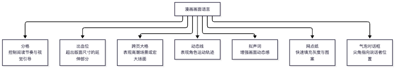
> **🖼 图解 ②：中国漫画杂志井喷期关联**
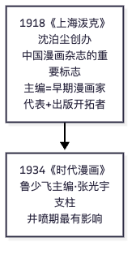
📌 锚点：**出血≠留白（是延伸）；跨页=高潮；尖角=说话者；"重要标志"=上海泼克、"最有影响"=时代漫画**。

#### 1. 卡通（Cartoon）
**① 定义详解**：Cartoon 一词源起文艺复兴时期的意大利语 cartone（carta「纸」的衍生词），原指**绘制正式油画/壁画前打底用的硬质纸草图**；19 世纪后随讽刺漫画期刊兴盛，转指**有幽默或讽刺意味的绘画**；20 世纪伴随动画电影普及，又延伸指代动画。中文语境的"卡通"通常泛指美式风格动画及儿童向作品。
**② 考试答题**：已考单选——卡通的"原意"选**「有幽默或是讽刺意味的漫画」**，不要误选"针对儿童的漫画"（那是现代大众印象，不是原意）。得分点：词源（草图纸）→ 19 世纪含义（讽刺幽默绘画）→ 现代延伸（动画）。易混淆：卡通 ≠ 动漫 ≠ 动画，三词外延不同。
**③ 主观题展开**：若考"卡通与动画概念辨析"，按"词源差异—历史演变—当下通用语境"三步展开，落脚在"动画是技术+艺术的总称，卡通是风格/媒介历史概念"。
**真题证据**：2024.10 单选2。

#### 2. 漫画的定义（丰子恺《漫画的描法》）
**① 定义详解**：丰子恺在《漫画的描法》中定义：漫画是**"简笔而注重意义的一种绘画"**——两个关键词：**简笔**（形式上的简约）与**注重意义**（内容上的表达）。这一定义是中国漫画理论的高频引用。
**② 考试答题**：已考单选，四个选项均为"漫画"的经典定义变体（强烈讽刺性/简单夸大/简单夸张手法描绘生活时事/简笔而注重意义），正确项为**"简笔而注重意义的一种绘画"**。易混淆项"以简单而夸张的手法来描绘生活或时事的图画"是一般工具书对" cartoon/漫画"的解释，注意区分**提问问的是"丰子恺的解释"**，抓"简笔+意义"即可锁定。
**真题证据**：2025.10 单选4。

#### 3. 漫画分格（分镜格）
**① 定义详解**：漫画页面被分割成的每一个画格即"格"，**分格体系为漫画的叙事提供结构和流畅度**——格的排布顺序、大小、疏密控制阅读节奏，跨页大格制造冲击，小格密集加快节奏。
**② 考试答题**：已考单选（问"为漫画叙事提供结构和流畅度的是什么"→ **漫画分格**）。易混淆：漫画脚本提供的是故事内容，分格提供的是**结构与节奏**。
**真题证据**：2025.10 单选1。

#### 4. ACG 与"动漫"概念
**① 定义详解**：ACG = **Animation（动画）、Comic（漫画）、Game（游戏）** 的合并简称，源自华语圈对日本二次元文化圈的概括。"动漫"是中国本土合成词，泛指动画与漫画的合称（有时扩含游戏），与日语中"アニメ（动画）""マンガ（漫画）"分立使用不同。
**② 考试答题**：已考填空（"动画、漫画、游戏三者合并简称"→ **ACG**）。注意三个英文单词的对应关系可能拆开考选择题。
**真题证据**：2024.10 填空29。

#### 5. "萌"文化与四格漫画
**① 定义详解**："萌"（もえ）文化**起源于日本**，指对动漫作品中可爱角色产生的喜爱情感，后发展为系统的角色设计美学（大眼、幼态、口癖等萌属性）。**四格漫画**（4コマ）以"起—承—转—结"四格完成一个完整笑点/小故事，最初的主要载体是**报纸**（近代报刊的漫画专栏），后转至杂志与网络。
**② 考试答题**：两处单选考点——萌文化起源国**日本**（不要误选美国，美国是卡通/商业动画强国但"萌"是日语文化概念）；四格漫画最初载体**报纸**（不是杂志/图书）。
**真题证据**：2024.10 单选1、单选6。

#### 6. 港台漫画代表作《老夫子》
**① 定义详解**：《老夫子》为**王泽（原名王家禧）创作的香港漫画**，1962 年起在香港报刊连载，以老夫子、大番薯、秦先生三个角色演绎市井幽默，是香港漫画的国民级 IP。易混对照：《三毛流浪记》＝张乐平（上海/大陆）；《机器猫》（哆啦A梦）＝藤子·F·不二雄（日本）；《Miss 阿性》＝台湾漫画家弘兼……【此条具体归属待核实，考试以《老夫子》=香港为记忆重点】。
**② 考试答题**：已考单选（"出品于我国香港的是"→ **《老夫子》**）。填空高频"作品-作者-地区"配对，见文末必背作品对照表。
**真题证据**：2024.10 单选11。

#### 7. 动漫产品的形象设计（逻辑类项）
**① 定义详解**：动漫产品的形象设计按逻辑类项可分为**角色（人物/生物）形象、场景（空间/环境）形象、道具（器物）形象**三大类项（2024.10 简答37 原题考问"包括哪些逻辑类项？其意义何在？"）。其意义在于：形象是动漫产品的**核心资产与第一传播符号**——决定作品辨识度、授权衍生价值（衍生品/主题乐园/品牌联名），"形象先行"是动漫产业区别于一般影视产业的关键。
**② 考试答题**：简答题模板——先列类项（角色/场景/道具三类，逐一一句话解释），再答意义（辨识度、叙事载体、商业衍生三个层次）。
**③ 主观题展开**：论述可加案例：Hello Kitty（无叙事纯形象授权）、熊本熊（城市 IP）、哪吒（电影带火形象衍生）。
**真题证据**：2024.10 简答37。

### 单元二：动画原理与技术发展史

> **🖼 图解：世界动画源流脉络**
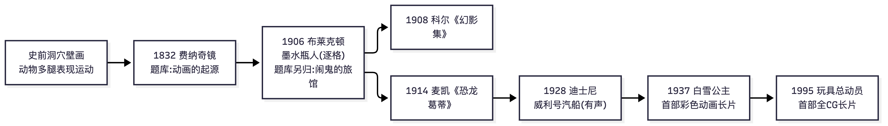
📌 锚点：**起源选"费纳奇镜"；布莱克顿选《闹鬼的旅馆》；幻影集=科尔、恐龙葛蒂=麦凯**。

#### 8. 视觉暂留现象（Persistence of Vision）★★ 五考期四现
**① 定义详解**：人眼的视觉器官在物象消失后仍可暂时保留视觉印象（约 1/16-1/24 秒）；当一连串静止画面以足够速度连续显现时，视网膜上的刺激信号相互重叠，形成连续运动的错觉。1824 年英国人**彼得·马克·罗杰特**（Peter Mark Roget）最早提出该原理的科学解释（注意：是"最早发现/提出"级别，2025.10 单选13 考点），1832 年普拉托据此制作"幻透镜"（Phenakistoscope）。视觉暂留是**动画与电影共同的理论基石**。
**② 考试答题**：已考名解 2 次（2017.10、2018.4，均为 4 分）+单选（2025.10 单选13：最早发现者→**彼得·罗杰特**，易混人名：诺曼·麦克拉伦=加拿大动画大师/动画实验艺术家、杜米埃=法国讽刺画家）+多选（2024.10 多选16：支持动画原理的基础理论→**视觉暂留理论+短程似动理论**）。名解三要素作答：**定义（视网膜残留）→ 机理（连续显现产生重叠）→ 意义（动画/电影的理论基础）**。
**③ 主观题展开**：可关联"动画原理的基础理论"简答——视觉暂留（视网膜生理）+ 似动现象/短程似动（心理知觉，如 φ 现象：两个分离刺激先后呈现被知觉为运动）。
**真题证据**：2017.10 名解5；2018.4 名解1；2025.10 单选13；2024.10 多选16。

#### 9. 帧与帧率
**① 定义详解**：**帧（frame）是动画中最小单位的单张静止画面**；连续播放静止帧产生运动感。**动画电影最常规的帧率为 24 帧/秒**（电影标准）；电视制式 PAL 25 帧/秒、NTSC 30 帧/秒；一拍一（每帧都画）、一拍二（一图拍两次，12 帧/秒，有限动画常用）是控制成本的拍摄方式。
**② 考试答题**：单选已考"帧是指什么"→ **单张静止的画面**（不要选"两张画面之间的转换"或"主画面"——主画面是"原画"）；填空已考常规帧率→ **24** 帧/秒。
**真题证据**：2024.10 单选9、填空27。

#### 10. 动画的定义与本体形态
**① 定义详解**：动画是通过把人、物的表情、动作、变化等分段画成许多画幅，再用摄影机连续拍摄 / 逐格记录，形成的**以"逐格拍摄+连续播放"为技术本质**的综合艺术。**动画本体形态最重要的标志是"运动变化"**——动画的本质是"动的艺术"，其创造的是现实生活中不存在或无法实现的运动（2025.10 单选6）。动画与电影同源，但动画的影像是**创造出来的**而非**记录下来的**。
**② 考试答题**：2024.10 名解33 考"动画"定义——三要素：**逐格（逐帧）拍摄的技术手段 + 连续放映形成运动假象 + 综合艺术（美术+电影+文学+音乐）**。"动画本体形态最重要的标志"单选→ **运动变化**（易混：虚拟形象/简洁夸张/自由构成均是其特征而非"最重要标志"）。
**真题证据**：2024.10 名解33；2025.10 单选6。

#### 11. 动画技术与电影发明史（人物—装置—作品链条）
**① 定义详解**（按时间轴记忆，填空/单选高频）：
- **1888 年，法国人埃米尔·雷诺（Émile Reynaud）** 结合幻盘和走马盘的优点发明了**光学影戏机**（Théâtre Optique），可向公众放映活动画片，是电影发明前最重要的动画装置。
- **1906 年，美国人詹姆斯·斯图尔特·布莱克顿** 制作《**滑稽脸的幽默相**》，被公认为**世界上第一部动画影片**。
- **法国人埃米尔·科尔（Émile Cohl）**，欧洲/法国第一个生产动画电影的国家是**法国**；科尔被誉为"现代动画之父"/"动画之父"，代表作《幻影集》，追求动画视觉表现力的挖掘，富有个性与自由创作精神（2018.4 名解原答案）。
- **乔治·梅里爱**：视觉特效的奠基人，创造了**停机再拍**（stop trick）手法。
- **转描机（Rotoscope）**：把真人电影中的动作**转印在赛璐珞片上**的工艺，由马克斯·弗莱舍发明，用于《墨水瓶人》/《贝蒂小姐》等，可让动画动作极度逼近真人。
- **赛璐珞片**：动画最重要的**盛器型工具**（2025.10 单选7）——把角色画在透明赛璐珞上叠加于背景之上，实现分层拍摄，使动画从"每格重画全部"走向工业化生产。
**② 考试答题**：这一链条的选择/填空考点极密：雷诺→**光学影戏机**（不要选"多重发射镜/转盘画面影像镜"）；1906 布莱克顿→《**滑稽脸的幽默相**》；停机再拍→**梅里爱**；真人动作转印赛璐珞→**转描**；盛器型工具→**赛璐珞片**（易混：规格框是边界工具、故事板是设计工具、摄影机是记录工具）。**人名三连易错**：埃米尔·雷诺（光学影戏机）≠ 埃米尔·科尔（现代动画之父）≠ 布莱克顿（第一部动画影片）。
**真题证据**：2024.10 单选8、单选10、填空21、填空22、填空28；2025.10 单选7；2018.4 名解2。

#### 12. 降格拍摄
**① 定义详解**：以**低于正常速率（24 帧/秒）的拍摄频率**拍摄、再以正常速率放映的技法——画面运动呈**加速/跳跃**效果；与之相对的"升格拍摄"（高速摄影）产生慢动作。动画中通过"一拍多"（每张画拍摄多格）人工实现降格。
**② 考试答题**：2024.10 名解35。作答三要素：**定义（低频拍摄正常放映）→ 效果（快动作/跳动感）→ 应用（喜剧效果、节奏压缩）**；能对比升格（慢动作）更稳。
**真题证据**：2024.10 名解35。

### 单元三：动画的分类与艺术特征

> **🖼 图解：动画分类与学术速查**
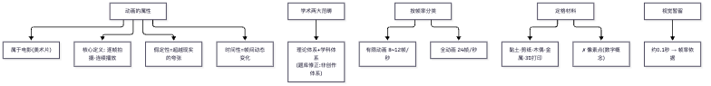
📌 锚点：**两大范畴=理论+学科；有限/全=帧率；定格材料无"像素点"**。

#### 13. 动画片的假定性 ★★ 两考期重复原题
**① 定义详解**：动画片与电影的最大区别就在于它具有更大的**假定性**——电影的影像是对现实的记录（照相本体论），动画的影像是逐格"无中生有"创造出来的，其时空、造型、运动、声音均可摆脱物理现实约束，观众与动画之间存在"这是虚构"的天然审美契约。
**② 考试答题**：2024.10 单选14 与 2025.10 单选5 **完全重复考点**（选项顺序不同）——答案锁定**假定性**（排除：真实性恰恰相反；审美性/史学性/画面性均非"最大区别"）。这是已验证的跨考期重复题，**必背**。
**③ 主观题展开**：如以简答/论述考"动画的艺术特征"，可从假定性出发展开：假定性→造型的极度自由（夸张变形）→时空自由（Montage 无限）→主题表达自由（抽象叙事也成立）。
**真题证据**：2024.10 单选14；2025.10 单选5。

#### 14. 动画艺术作品的叙事方式
**① 定义详解**：动画的叙事方式主要分三类——①**纪实式叙事**（严肃、写实，尊重物理逻辑与历史真实，常用于历史/传记/科普题材）；②**戏剧式/情节式叙事**（遵循戏剧冲突性、角色命运刻画、起承转合节奏，主流动画片的主流形态）；③**抽象性叙事**（**不以讲故事为主**，以点、线、面、色、形的运动本身为表现对象，追求视觉音乐般的纯粹美感，代表如加拿大 Norman McLaren 的实验作品）。
**② 考试答题**：2024.10 简答36 原题"简述动画艺术作品的叙事方式"——作答模板：**总起一句（三类）→ 每类：定义+特点+代表人物/作品各一行**。单选已考"抽象性叙事方式的特征"→ **不以讲故事为主**（不要选"画面风格不写实"——抽象叙事是"不叙事"，不等于"不写实"，两者是不同维度）。
**③ 主观题展开**：三类可各配一例：纪实式《种树的男人》/科普动画；戏剧式《狮子王》；抽象式麦克拉伦《线与色》【代表作品名待核实】。
**真题证据**：2024.10 简答36、单选12；2017.10 名解2（戏剧式动画）；2023.10 简答6（纪实式动画特点）。

#### 15. 二维动画与三维动画的差异（2D vs 3D）★★
**① 定义详解**：**二维（2D）动画**在平面（纸/赛璐珞/数位板）上绘制，只有长宽两个维度，靠逐帧绘制/位移生成运动，透视变化需人工绘制；**三维（3D）动画**在计算机中建立角色的立体模型（建模→材质→绑定→动画→灯光→渲染），具有真实的空间纵深与摄影机自由运动，可**全程采用计算机制作（无纸动画）**。差异维度：制作手段（绘制 vs 建模）、空间表现（平面 vs 立体）、镜头运动（重绘 vs 虚拟摄影机实时运镜）、修改成本、光照表现。
**② 考试答题**：2024.10 简答38 原题"简述 2D 动画与 3D 动画的差异"——模板：**从制作手段、空间/透视、镜头、光影、生产流程五个维度各写一行对比**。2025.10 单选3 考"可以全程采用计算机制作的无纸动画类型"→ **三维动画**（二维也可以无纸，但"全程计算机、无纸化"的标准答案落在三维）。多选 18 题考"完全用计算机三维软件制作的动画片"→ **《玩具总动员》《怪物史莱克》《恐龙》**（《狮子王》《蒸汽男孩》为二维）。
**③ 主观题展开**：结尾加一句辩证：3D 是工具不是目的，《蜘蛛侠：平行宇宙》将 3D 流程做出 2D 手绘感——技术与风格分离。
**真题证据**：2024.10 简答38、多选18；2025.10 单选3；2023.10 名解3（三维动画）。

#### 16. 定格动画（Stop-motion）
**① 定义详解**：逐格拍摄**实物偶形**（木偶、黏土、剪纸、实物）的微小位移再连续放映的动画形式。按材料分木偶片、黏土动画、剪纸片、折纸片等。**定格动画电影在选取材料时更注重材质的"操控性"**（可反复微调、关节可动、形态稳定），而非真实性和多样性（2025.10 单选12）。
**② 考试答题**：单选抓"操控性"；名解三要素：**定义（实物逐格摆拍）+ 类型（木偶/黏土/剪纸/折纸）+ 代表作（《僵尸新娘》《小羊肖恩》/中国的《阿凡提》《曹冲称象》）**。
**真题证据**：2025.10 单选12；2024.10 填空与单选中的片种配对。

#### 17. 中国特有片种：水墨 / 剪纸 / 折纸动画 ★★★
**① 定义详解**（三个"第一部"是填空/单选的绝对高频）：
- **水墨动画**：以中国水墨画的笔意墨韵入动画，墨色浓淡虚实在赛璐珞分层上呈现，**世界唯一的中国独创片种**。中国第一部水墨动画片＝**《小蝌蚪找妈妈》**（1960，取齐白石鱼虾意象，导演特伟等）。代表作：《牧笛》（1963）、《鹿铃》、《山水情》（1988）。艺术特征：意境优雅淡泊、轻盈飘逸；突破"单线平涂"的国际通用工艺；是"只有民族的才是世界的"的最佳例证。
- **剪纸片**：吸取民间剪纸与皮影艺术，第一部＝**《猪八戒吃西瓜》**（1958，万古蟾导演）。
- **折纸片**：以折叠纸偶表演，第一部＝**《聪明的鸭子》**（1960，虞哲光导演）——**中国折纸动画片代表作**。
**② 考试答题**：2025.10 单选9（第一部水墨→《小蝌蚪找妈妈》——攀知原页选项 D 排印为"《小螂蚓找妈妈》"，系原站错别字，校注为《小蝌蚪找妈妈》）与单选10（折纸代表作→《聪明的鸭子》）连续两题考片种；2024.10 单选7 再考"我国第一部折纸片"→ **《聪明的鸭子》**（易混：《小蝌蚪找妈妈》是水墨、《猪八戒吃西瓜》是剪纸、《牧笛》是第二部水墨）。**记忆口诀：水墨蝌蚪、剪纸西瓜、折纸鸭子**。
**③ 主观题展开**：2018.4 论述11 原题"论述中国水墨动画的艺术特征及其意义"——评分参考五要点（见第三节该题）：代表作品＋意境美学＋题材配乐格调＋对"单线平涂"的工艺突破＋民族化探索的历史意义。
**真题证据**：2025.10 单选9、单选10；2024.10 单选7；2018.4 论述11；2023.10 简答9。

#### 18. 影院动画 / TV 动画 / 剧场版（按传播媒介分类）
**① 定义详解**：按传播媒介分**影院动画（剧场动画片）**、**电视动画（TV 动画）**、**网络动画/OVA 等**。**影院动画**特点（2018.4 简答6 原题）：按电影文学语法组织故事、叙事结构规范严谨有明确因果关系、起承转合环环相扣；主题内涵有一定思想高度；技术要求高（影像质量/动作设计/声音处理追求视听冲击力）；生产周期长、投入大、风险大。日本语境的"**剧场版**"＝在影院上映的动画长片（多由热门 TV 动画 IP 延伸，如《名侦探柯南》剧场版），与"TV 版"相对。
**② 考试答题**：名词解释"剧场版"三要素：**定义（影院上映的长片动画）+ 由来（TV 动画 IP 的影院延伸/原创）+ 特点（制作规格高、视听冲击强）**。简答"影院动画的特点"直接背 2018.4 评分参考 4 点。
**真题证据**：2018.4 简答6；2024.10 命题范围内（按传播媒介分类为教材基本框架）。

#### 19. 动画的基本属性（技术性·艺术性·商业性）
**① 定义详解**（2018.4 论述12 原题，评分参考三大维度）：
- **技术性**：动画每一步发展都打上技术烙印——视觉暂留原理的发现→活动视盘→照相机/摄像机→赛璐珞片（小作坊→大规模生产）→计算机/三维 CG；技术是动画得以生产的物质基础。
- **艺术性**：动画是综合性艺术，在多个艺术门类基础上诞生；**美术与电影是动画的基本要素**——从美术角度看动画片是以美术造型为基础表现运动的特殊美术形式；从电影角度看动画是现代电影的分支。
- **商业性**：动画天然具备商业化潜力，满足大众文化消费需求是其不断生产与消费的动力；大众性与商业性紧密结合构成生产—再生产的经济循环。
**② 考试答题**：论述模板＝**总起（三大属性）→ 每属性：界定＋3-4 行展开＋一例证 → 收尾（三者关系：技术是物质基础、艺术是核心、商业是根本动力）**。
**真题证据**：2018.4 论述12。

#### 20. 主流动画与创作法则
**① 定义详解**：主流动画（商业主流动画）以大众市场为目标，其创作有约定俗成的**法则体系**：善恶法则（善恶分明有报）、英雄法则（成长型英雄之旅）、喜剧法则（欢乐结局/喜剧调剂）、幻想法则（奇观想象）、时尚法则（紧跟当代审美）——2024.10 多选19 考"能够体现主流动画片创作原则的法则"，五个选项全部入选（【推导】ABCDE；该组法则为教材归纳性表述，具体名称以教材原文为准【待教材核实】）。
**② 考试答题**：多选全选型题目——建议记忆法则名称本身；主观题可用"用主流动画法则分析一部迪士尼/皮克斯作品"的形态出现。
**真题证据**：2024.10 多选19。

### 单元四：动画制作流程与镜头语言

> **🖼 图解：动画制作全流程（原画/动画/分镜考点）**

📌 锚点：**原画=关键帧、动画=中间帧；分镜管"镜头运动+时间节奏"**。

#### 21. 动画制作的基本流程（前期—中期—后期）★★★
**① 定义详解**（2023.10 简答8/论述11、2017.10 简答8 三次考流程相关）：
- **前期（筹备/设计阶段）**：研究文学剧本→撰写**导演阐述**→文字分镜头与**画面分镜头**台本→人物造型与背景风格设计→先期录音/先期对白录音→动作风格试验。
- **中期（制作/拍摄阶段）**：**设计稿**（放大分镜、标明规格与摄影处理）→**原画**设计关键动作→**动画**（中间帧，"中间画"）→誊清/上色→背景绘制→拍摄（摄影表逐格记录）。
- **后期（合成阶段）**：后期合成/特效→配音配乐（后期录音）→剪辑→混录→成片输出。
**② 考试答题**：简答模板＝**三阶段各列 3-4 个工序列表**（本条 ① 即评分点集合）。填空高频工种：**原画师**——"负责赋予角色生命，将之塑造成会说话、会思考的生物或非生物，是动画片制作的灵魂人物，服从导演的整体把握"（2024.10 填空24 原句）；**人物表**＝剧本中介绍主要人物基本信息的部分（2024.10 填空30）。
**③ 主观题展开**：2017.10 简答8 考过"把动画制作分为前期、制作和后期三部分的**优点**"：①有效控制和管理制作周期与成本（流水线有条不紊）；②使创作人员工作专业化（按工作特性划分阶段，各展所长、便于分工协调）。论述"分阶段论述动画制作的流程和优点"（2023.10 论述11）＝流程表＋这两条优点。
**真题证据**：2023.10 简答8、论述11；2017.10 简答8；2024.10 填空24、填空30。

#### 22. 前期设计的核心岗位与文本（脚本/分镜头/设计稿/导演阐述）
**① 定义详解**：
- **脚本（剧本）**：包括故事背景、人物、场景、对话、表情、对白等，是展开动画制作最基本的文本，**是决定一部动画最终成败的根本因素**（2018.4 名解3 评分参考原句）。
- **导演阐述**：导演对剧本的主题思想、人物性格和剧情结构进行全面理解和构思后写出的**导演创作意图说明**，指导全体创作人员的创作流程（2017.10 名解1 评分参考原句）。【2023.10 名解1 考"导演"，同属创作中枢概念】
- **画面分镜头（画面分镜头台本/故事板 Storyboard）**：把文字分镜头加以形象化，**画出每个镜头的画面**，是动画设计、绘景、摄影、作曲的工作蓝本，必须确定每个镜头的**构图、人物位置、长度、规格及摄影处理**（2023.10 名解4 评分参考原句）。
- **设计稿**（Layout）：将分镜画面放大为正式制作尺寸，标明镜头规格、背景结构、角色活动范围与摄影机运动指示的图纸，是连接分镜与中期的桥梁（2024.10 名解34）。
**② 考试答题**：四个概念均考过名解——**每个都用"定义＋功能地位"两句话作答**，功能句是给分点（脚本是成败根本因素；导演阐述指导创作流程；分镜头是各部门工作蓝本；设计稿是放大与桥梁）。易混：分镜头（画出来）≠ 文字分镜头（写出来）≠ 设计稿（放大定规格）。
**真题证据**：2018.4 名解3；2017.10 名解1；2023.10 名解1、名解4；2024.10 名解34。

#### 23. 镜头设计要素与景别
**① 定义详解**：**镜头设计的要素包括景别、摄影机角度、摄影机运动**等（2024.10 单选4 考"不包括"→ **角色运动**——角色运动属于动画设计/原画职责，不属于镜头设计）。**景别**（按被摄体在画面中的范围）：远景（表现广阔空间环境，人物极小）、全景、中景、近景、特写。**远景**＝表现远处场景/环境全貌、抒发情感、交代空间关系的景别（2024.10 名解31）。**特写**＝表现成年人肩部以上的头像或某些被摄对象细部的画面，具有较强的主观色彩和感情色彩（2017.10 名解3 评分参考原句）。**景深**＝处在不同距离上的被摄对象在底片上能获得清晰影像的空间范围（也叫景深范围）（2018.4 名解4 评分参考原句）。【2023.10 名解2 回忆版记作"景调"，疑为"影调/景别"之误记，【待核实】】
**② 考试答题**：单选排除题抓"角色运动"；三个景别类名解都用**"定义＋造型特征＋表现功能"**三句式。远景 vs 全景易混：远景重环境气势、全景重人物全身与环境关系。
**真题证据**：2024.10 单选4、名解31；2017.10 名解3；2018.4 名解4；2023.10 名解2。

#### 24. 镜头角度的功能（平视/俯视/仰视）★★
**① 定义详解**（2017.10 简答7 与 2018.4 简答8 两次原题级重复）：
- **平视**：拍摄高度与人的视平线相等，观众处于平视状态，**适合画面人物同画外观众的心理/内心交流**（平等、客观、亲切）。
- **俯视**：摄像机**高于**被摄体，产生俯瞰之感、透视变形，有被压制下的压抑感/压迫感，**不适合**表现画面与观众的心理交流。
- **仰视**：摄像机**低于**被摄体，强调物体高度，人物显得昂扬挺拔，被摄体具有高大、神圣、优越之感，同样**不适合**表现心理交流。
- **混合运用**三种拍摄角度可产生特殊效果。
**② 考试答题**：简答背评分参考 4 点（三种角度各 2-3 分＋混合运用 1 分）。**记忆钩子：只有平视能"交流"，俯视压抑、仰视崇高**。两考期重复率极高，必背。
**③ 主观题展开**：论述可各配一例：平视（日常对话戏）、俯视（表现弱小/被审视）、仰视（英雄登场/纪念碑式镜头）。
**真题证据**：2017.10 简答7；2018.4 简答8。

#### 25. 角色造型的基本规律 ★★
**① 定义详解**（2018.4 简答7 与 2023.10 简答7 两考期重复，评分参考八点）：①夸张与变形；②通过联想塑造角色；③单纯化；④体面、动态、个性；⑤符号化；⑥角色组合的造型关系（差别关系）；⑦幽默感；⑧写实的感染力【两份回忆版分别记作"写实的感力/虚实染力"，以"感染力"为准，【考友回忆版转录，个别字词以原答案为准】】。
**② 考试答题**：简答直接列 8 点（每点 1 分）。可按"**形（夸张变形/单纯化/体面动态）—意（联想/符号化）—群（组合关系）—情（幽默感/写实感染）**"分组记忆，防漏点。
**真题证据**：2018.4 简答7；2023.10 简答7。

### 单元五：中国动画史（万氏兄弟—中国学派—当代）

> **🖼 图解：中国动画里程碑时间线（"第一部"全在这）**
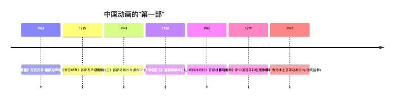
📌 锚点：**有声=骆驼、长片=铁扇公主、剪纸=猪八戒、水墨=小蝌蚪、彩色宽银幕=哪吒、香港=小倩**。

#### 26. 万氏兄弟 ★★★
**① 定义详解**：**万籁鸣、万古蟾、万超尘、万涤寰**四兄弟，中国动画片的开山鼻祖，开启了中国动画民族化之路。里程碑：1926 年《大闹画室》（中国最早的动画短片之一【具体"第一部"表述以教材为准，待核实】）；1935 年**《骆驼献舞》——中国第一部有声动画片**（根据《伊索寓言》改编，极具反讽意味）；1941 年**《铁扇公主》——亚洲第一部动画长片**（摄制于 1941 年，世界电影史上继《白雪公主》后少数动画长片之一，曾影响日本的手冢治虫）。万古蟾后导演中国第一部剪纸片《猪八戒吃西瓜》。
**② 考试答题**：名解（2017.10）三要素：**四兄弟名字＋开山鼻祖地位＋代表作品（骆驼献舞/铁扇公主）**。单选抓年份：《铁扇公主》＝**1941**（2024.10 单选13，易混选项 1920/1926/1950）。《骆驼献舞》名解（2018.4）：**中国第一部有声动画片＋万氏兄弟 1935 年＋《伊索寓言》改编**。
**真题证据**：2017.10 名解4；2018.4 名解5；2024.10 单选13、论述39。

#### 27. 中国动画学派 ★★★
**① 定义详解**："中国动画学派"是对**新中国成立初期以上海美术电影制片厂为基地的美术电影创作**所取得的国际地位和艺术成就的肯定与总结（2023.10 名解5 评分参考原句起首）。特征：以**民族传统艺术**（水墨、剪纸、皮影、木偶、折纸、戏曲、民乐）为形式资源，追求**意境化、程式化、教化性**的艺术品格；代表作横扫国际奖项：《骄傲的将军》（民族风格开端）、水墨《小蝌蚪找妈妈》《牧笛》《山水情》、剪纸《猪八戒吃西瓜》、木偶《阿凡提》、折纸《聪明的鸭子》、《大闹天宫》《哪吒闹海》《三个和尚》《九色鹿》等。代表人物：特伟、钱家骏、万氏兄弟、阿达、王树忱等。
**② 考试答题**：多选已考"中国动画学派的创作风格主要表现为"→【推导】**程式化、意象化、教化性**（诙谐性、夸张性属动画的普遍造型特征而非学派独有品格；此题推导依据为学派"民族形式+文人意境+寓教于乐"的通行学术概括，【待教材核实】）。名解三要素：**定义（对上海美影厂美术电影成就的肯定与总结）＋特征（民族化/意境化）＋代表作**。论述（2024.10 论述39）考"中国大陆动画与'中国动画学派'的发展历程"——按**时间轴四段**展开：①20 年代万氏兄弟开创；②50-60 年代学派形成（上海美影厂 1957 成立、片种全面开花）；③70 年代末-80 年代复兴与巅峰（《哪吒闹海》《三个和尚》《山水情》，1977-1994 从计划体制转向市场、电视系列片渐成主导【2017.10 简答9】）；④90 年代后转型（外国动画冲击、民族风格探索趋同、商业性增强）。
**③ 主观题展开**：结尾落点用"只有民族的才是世界的"＋对当下国产动画（如《哪吒之魔童降世》）的启示。
**真题证据**：2024.10 多选20、论述39、多选17；2023.10 名解5；2017.10 简答9。

#### 28. 上海美影厂与代表作品系谱
**① 定义详解**：上海美术电影制片厂（1957 年正式建厂，首任厂长特伟）是"中国动画学派"的大本营，"不模仿别人，不重复自己"（特伟语）。必背作品系谱（填空配对高频）：
- **《九色鹿》**（1981）：**以敦煌壁画（莫高窟《鹿王本生图》）为灵感源泉**进行场景和人物设计（2025.10 单选11）。
- **《三个和尚》**（1980）：80 年代艺术短片，极简造型+"一个和尚挑水吃"谚语的寓言化叙事，导演阿达。
- **《山水情》**（1988）：水墨动画收山之作（导演特伟），琴师与少年，写意留白极致。
- **《新装的门铃》**（1988，胡依红）：80 年代都市题材实验短片。
- **《大闹天宫》**（1961/1964 上下集，万籁鸣导演）、《哪吒闹海》（1979，王树忱等）：学派长片双峰。
**② 考试答题**：2024.10 多选17 考"摄制于 20 世纪 80 年代的中国艺术动画短片"→【推导】**《三个和尚》《山水情》《新装的门铃》**（《牧笛》1963 年排除；E 项《寂寥的天空》年代【待核实】，推导时未选）。年份敏感题先给作品定年代再作答。
**真题证据**：2024.10 多选17；2025.10 单选11。

### 单元六：日本动漫

> **🖼 知识点图：日本动漫体系与民族特色**

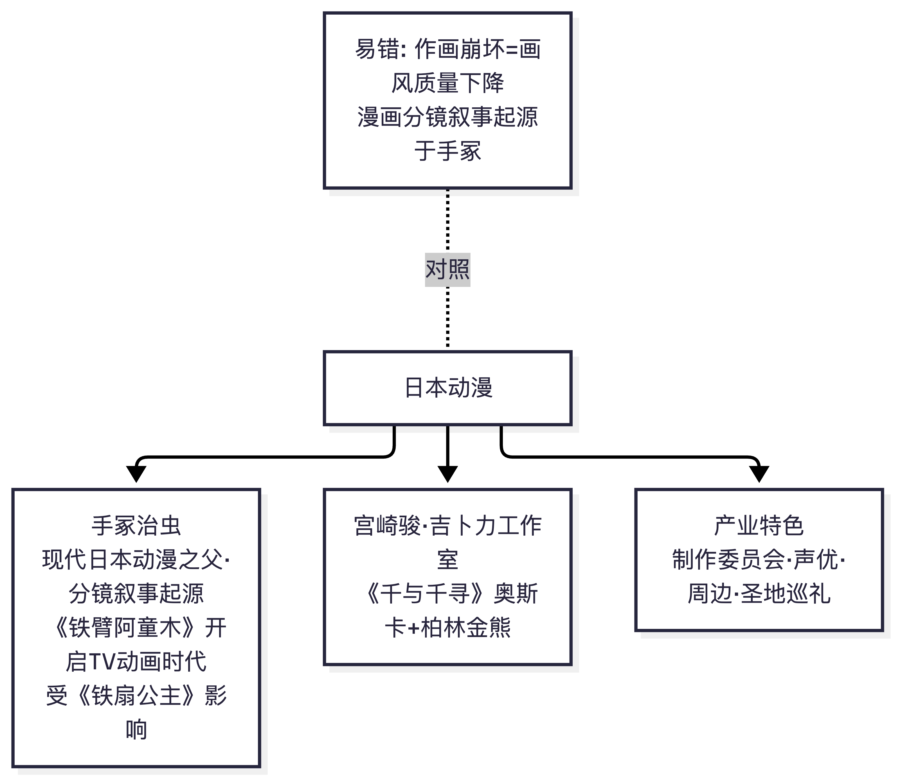

📌 锚点：手冢治虫=现代日本漫画/动画之父；《铁臂阿童木》开启TV动画。

#### 29. 手冢治虫与日本动画的奠基
**① 定义详解**：**手冢治虫**被日本动画界誉为"**漫画之父**""**漫画之神**"（2024.10 单选3），1947 年《新宝岛》开创故事漫画范式；1952《铁臂阿童木》1963 年制成**日本第一部长篇电视动画**（TV 动画产业起点），并树立"有限动画"（每秒 8 帧左右的省帧美学）的商业制作范式；1980 年代《火鸟》《jump》连载体系……晚年致敬《铁扇公主》来华拜会万籁鸣。日本漫画的叙事深度（文学性）与 TV 动画的工业化均由其奠基。
**② 考试答题**：单选锁定"漫画之神→**手冢治虫**"（易混：宫崎骏是"动画大师/国民动画作家"，大友克洋《阿基拉》，大川博为东映动画创始人【其称谓以教材表述为准，待核实】）。
**真题证据**：2024.10 单选3。

#### 30. 宫崎骏与吉卜力 / 日本 TV 动画与剧场版体系
**① 定义详解**：**宫崎骏**：吉卜力工作室（1985 年与高畑勋、铃木敏夫共创）灵魂人物，《风之谷》《天空之城》《龙猫》《千与千寻》（2003 获奥斯卡最佳动画长片、柏林金熊奖）——手绘二维、人文自然主题、飞翔意象。日本动画产业结构：**TV 动画（周播剧集）→ 剧场版（院线长片）→ OVA/OAD → 网络配信**多形态并存；"制作委员会"模式分散投资风险；漫画→动画→游戏→衍生品的 IP 矩阵（ACG 产业闭环）。
**② 考试答题**：填空/单选可能考"吉卜力代表作""千与千寻获奖"；名词解释"剧场版"见单元四第 18 条。**二战后日本动画进入新阶段的特点**（2025.10 单选14）→【推导】**形成独特风格**（摆脱单纯模仿美国，形成日本民族风格——推导依据：2017.10 论述10"日本动画的民族特色"评分参考即围绕独特民族风格展开；选项"模仿美国动画"为反向干扰）。
**真题证据**：2025.10 单选14；（宫崎骏/吉卜力为教材必考章，2024.10 命题范围覆盖）。

#### 31. 日本动画的民族特色与产业特征 ★★★
**① 定义详解**（2017.10 论述10、2018.4 简答10、2023.10 论述12 三考期考，必背中的必背）：
**民族特色**（2017.10 论述10 评分参考）：①超现实主义题材大行其道（科幻、动作幻想、魔法灵异，调动各种文化元素，虚构而不生硬、华丽而不做作）；②浓厚的人文主义色彩（秉承东方传统道德、追寻人类智慧的价值观，浪漫主义与现实主义双重性格）；③成人动画（抓住消费能力与欣赏水平较高的成人观众，挖掘内容与思想，情节复杂、触及现实问题、寓教于乐）；④独特的绘画表现手法（场景与人物造型体现浓厚日本民族特色）；⑤不可小视的动漫音乐（加强表现力）。**独特优势**：动漫历史底蕴、题材广泛剧本严谨、艺术人才全面培养、艺术形式多样结合、独有的"同人志"文化。
**产业特征**（2018.4 简答10 评分参考）：漫画和动画紧密联动、日本动画产业常被称为"动画漫画产业"；①一批成功的动画生产企业以动画名家为主体、独立运作各有所长；②发行和传播媒介非常发达；③中介服务体系发达；④专业性市场建设颇具规模；⑤庞大动漫产业促进动漫文化普及。
**② 考试答题**：简答背产业五条；论述背"特色 5+优势 5"。**形式特点与优势**（2023.10 论述12）与此同源，可复用素材。
**真题证据**：2017.10 论述10；2018.4 简答10；2023.10 论述12。

#### 32. 日本漫画名家与网络漫画转型
**① 定义详解**：**赤羽末吉**——**亚洲第一位获得国际安徒生奖（插画家奖）的画家**（1980 年，代表作《苏和的白马》《马头琴》），2025.10 单选2 直考。中国国内漫画**由纸媒向网络转型**的标志是**"有妖气"的出现**（2009 年上线，UGC 漫画平台，《十万个冷笑话》《镇魂街》诞生地）——先于腾讯动漫（2012）等（2025.10 单选15）。
**② 考试答题**：两个人名单选直背：安徒生插画奖第一亚洲人→**赤羽末吉**（易混：宫西达也/长谷川义史为当代绘本名家、松居直为编辑/推广人）；网络漫画转型标志→**"有妖气"**。
**真题证据**：2025.10 单选2、单选15。

### 单元七：美国与欧洲动画

> **🖼 图解：各国/地区动漫风格与易错题对照**
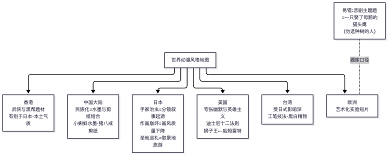
📌 锚点：**香港=武侠黑帮；台湾=日式+工笔黑白；"作画崩坏"是画面不是剧情**。

#### 33. 迪士尼与美国商业动画体系 ★★
**① 定义详解**：华特·迪士尼与兄长罗伊 1923 年创立迪士尼兄弟工作室。里程碑：1928 年**《威利号汽船》（Steamboat Willie，"蒸汽船威利"）——世界上第一部（使用）声画同步的动画片**，米奇形象就此走红（注：更早的《疯狂飞机》无声；《汽船威利》是第一部声画同步/全有声动画片——表述以教材为准）；1932《花与树》首用三色 Technicolor；1937**《白雪公主》——世界上第一部彩色动画长片**，确立影院动画工业范式；文艺复兴期（1989-1999）《小美人鱼》《美女与野兽》《狮子王》。电视时代《米老鼠俱乐部》、主题乐园（1955 加州迪士尼乐园）构建"内容—衍生—体验"商业闭环。
**② 考试答题**：**"世界上第一部声画同步的动画片"＝《威利号汽船》（蒸汽船威利）**——2024.10 单选5 与 2025.10 单选8 **两考期完全重复原题**（仅选项顺序不同），已验证必背。易混排除：《幻想曲》（1940 首部立体声/古典音乐合集）、《木偶奇遇记》《白雪公主》（第一部长片）。
**真题证据**：2024.10 单选5；2025.10 单选8。

#### 34. 皮克斯与三维动画革命
**① 定义详解**：皮克斯（Pixar）前身是卢卡斯影业电脑动画部，1986 年乔布斯收购，约翰·拉塞特（John Lasseter）主导创作。**《玩具总动员》（1995）——全球首部 3D（计算机三维）动画电影长片**，开创全 CG 长片时代；其后《虫虫危机》《玩具总动员 2》《怪兽电力公司》《海底总动员》《机器人总动员》《飞屋环游记》……2006 年被迪士尼收购。三维动画对动画史的革命：虚拟摄影机、材质光照物理化、表演捕捉。
**② 考试答题**：填空"全球首部 3D 动画电影长片"→ **《玩具总动员》**；多选"完全用计算机三维软件制作的动画片"→ 《玩具总动员》《怪物史莱克》（梦工厂 2001，全 CG）《恐龙》（迪士尼 2000，CG 恐龙+实景背景）；**《狮子王》与《蒸汽男孩》（大友克洋，2004，二维）是经典干扰项**。
**真题证据**：2024.10 填空26、多选18。

#### 35. 美漫超级英雄体系（DC 与漫威）
**① 定义详解**：表现超级英雄题材最成功的两家美国漫画公司＝**DC 漫画**（1934 年前身创立，超人与蝙蝠侠）与**漫威 Marvel**（1939 年前身 timely，蜘蛛侠、钢铁侠、复仇者联盟）。1938 年《动作漫画》创刊号超人登场＝**超级英雄类型乃至美国漫画黄金时代的开端**。美漫体系特征：类型化英雄宇宙、编剧-画师流水线工坊（漫威方法）、IP 跨媒介开发（漫画→电影 MCU→游戏）。
**② 考试答题**：填空"表现超级英雄题材最成功的两家美国漫画公司是 DC 和______"→ **漫威（Marvel）**。注意大写原名可能出现在选项中。
**真题证据**：2024.10 填空25。

#### 36. 欧洲动画（法国传统与总体特点）
**① 定义详解**：**欧洲第一个生产动画电影并成立动画工作室的国家是法国**（埃米尔·科尔等先驱；高蒙公司早期动画部门）。**欧洲动画的特点**（2017.10 简答6 评分参考）：①多为**非主流动画**，篇幅短小，以情以景动人；②追求**创新性**，常把哲学、美学等艺术思潮带入创作，题材与技巧大胆创新；③追求**艺术性**，倾向表现艺术手法与思想，挖掘动画深沉的艺术性和文化性，以各种手段造成动画艺术与现实的**间离效果**，使作品成为人生哲理的寓言。
**② 考试答题**：单选"欧洲第一个生产动画电影的国家"→ **法国**（不要误选动画工业强国美国之外的英国/德国）；简答背三条（非主流短小/创新性/艺术性+间离）。
**真题证据**：2024.10 单选8；2017.10 简答6。

### 单元八：动画新技术与新媒体形态

> **🖼 知识点图：动画新技术与新媒体形态**

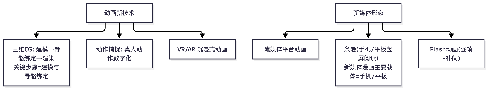

📌 锚点：三维CG、动作捕捉、VR/AR、流媒体与条漫是新媒体时代关键词。

#### 37. Flash 动画与 MG 动画
**① 定义详解**：**Flash 动画**：基于 Adobe Flash（矢量图形+补间动画）制作的网络动画，特点：**文件小、传播快（适合网络）、制作门槛低、交互性**（可加交互脚本），代表载体网络短片/表情动画/科普动画。**MG 动画（Motion Graphics，动态图形/图形动画）**：是**动画片与平面设计（图形设计）之间的一种产物**（2024.10 填空23 原句）——以平面设计原理（图形、文字、版式）为元素做动态呈现，广泛用于片头、广告、信息可视化、科普视频，不强调角色叙事而强调信息传达的动态视觉。
**② 考试答题**：名解 Flash 动画（2024.10 名解32）三要素：**技术定义（矢量/补间）＋四大优点（文件小/传播快/门槛低/交互性——2023.10 简答10 考过"Flash 动画的优点"）＋应用场景**。填空 MG→**平面设计**。易混：MG 动画≠ GIF≠三维动画，核心在"设计元素的运动"。
**真题证据**：2024.10 名解32、填空23；2023.10 简答10。

#### 38. 三维 CG 动画制作流程与传统动画的手法差异 ★★
**① 定义详解**：**三维 CG 动画制作流程**（2018.4 简答9 评分参考八步）：①剧本和前期二维设计；②建立模型（Modeling）；③材质（Texture/Shading）；④绑定（Rigging，骨架绑定）；⑤动画及动画缓存；⑥灯光；⑦毛发及缓存；⑧渲染合成。**传统动画与 CG 动画在制作手法上的差异**（2024.10 论述40）：传统＝手绘逐帧（铅笔稿→誊清上色→摄影表拍摄），赛璐珞分层；CG＝虚拟建模+关键帧算法自动生成中间帧，数字灯光渲染替代实拍；差异体现在**中间帧生成方式（人工插值 vs 算法插值）、上色（手工 vs 数字材质）、摄影（实拍逐格 vs 虚拟摄影机）、修改成本、保存（胶片 vs 文件）**等维度。
**② 考试答题**：简答背八步流程（每步 1 分）；论述用"对比表思维"：**逐条维度对比＋各自代表作品＋趋势融合（二维手感的三维渲染）**。
**真题证据**：2018.4 简答9；2024.10 论述40。

#### 39. 有限动画与实验动画（关联考点）
**① 定义详解**：**有限动画（Limited Animation）**：为控制成本与周期，降低帧数（一拍二/一拍三）、简化动作中间画、复用原画与背景的省略式制作方式，由美国 UPA 发扬、日本 TV 动画将其转化为美学风格。与"全动画"（Full Animation，一拍一、动作饱满，迪士尼标准）相对。**实验动画/艺术短片**：不以商业发行为目标、探索动画语言本体的短片创作（欧洲作者动画、加拿大 NFB 学派——诺曼·麦克拉伦"动画不是会动的画的艺术，而是画出来的动作的艺术"）。
**② 考试答题**：名解三要素：**定义（省帧/复用/简化）＋对比物（全动画）＋意义（成本美学化，日本 TV 动画范式）**。选择题注意与"定格动画"区分——有限动画是**帧数策略**，定格是**拍摄对象材质**，分类维度不同。
**真题证据**：2024.10 命题范围（动画分类框架）；名词解释属本课程公告的高频名解类型【按用户提供的课程考情：有限动画、定格动画、剧场版、中国动画学派等为名解常客】。

---

## 三、历年真题汇编（按考期时间倒序）

> **编排说明**：以下 7 个考期严格按时间倒序排列（2025.10 → 2024.10 → 2023.10 → 2020.10 → 2018.10 → 2018.4 → 2017.10）。每题保留原始题型与分值；答案标注体系：**【官方评分参考】**＝扫描原件逐字转录（含分值细节）、**【参考答案】**＝正规题库/助学机构公布、**【推导答案】**＝依据教材知识体系与跨考期重复题互证推导（官方答案被收费墙阻隔）。未获取考期及原因见 1.6 节。

### 3.0 七考期获取完整度总览

| 考期 | 卷型 | 获取完整度 | 题型结构 | 答案来源 | 来源可信度 |
|---|---|---|---|---|---|
| 2025.10 | 全国卷 | 仅选择题 15/15（主观题未流出） | 单选 15×1 | 【推导答案】（收费墙后） | B（正规题库站，题目完整、答案不可见） |
| 2024.10 | 全国卷 | 完整 40/40 | 单选15×1+多选5×2+填空10×1+名解5×3+简答3×8+论述2×13 | 双来源交叉验证（试卷原件识图×2 轮互校＋武科院继教院答案版） | A（双源互证） |
| 2023.10 | 福建省卷 | 回忆版 12/12（名解5+简答5+论述2） | 名解5×4+简答5×8+论述2×20 | 【参考答案】（乐昇学教育） | B（回忆版，题序分值与福建卷制一致） |
| 2020.10 | 统一命题卷 | 完整 12/12＋参考答案 | 名解5×4+简答5×8+论述2×20 | 【参考答案】（武汉纺织大学继教院官网） | B+（高校继教院渠道，卷头归属【待核实】） |
| 2018.10 | 福建省卷 | 完整 11/11＋评分参考 3 页（逐字转录） | 名解5×4+简答4×10+论述2×20 | 【官方评分参考】（含逐条分值） | A（卷面＋评分参考原件） |
| 2018.4 | 福建省卷 | 完整 12/12＋评分参考 3 页（逐字转录） | 名解5×4+简答5×8+论述2×20 | 【官方评分参考】（含逐条分值） | A（卷面＋评分参考原件） |
| 2017.10 | 福建省卷 | 完整 11/11＋评分参考 3 页（逐字转录） | 名解5×4+简答4×10+论述2×20 | 【官方评分参考】（含逐条分值） | A（卷面＋评分参考原件） |

> **结构性结论**：2024.10 起全国卷改为六题型 100 分制（选择题占 25 分，客观题比重显著上升）；福建旧卷为主观题主导（名解+简答+论述占 80 分）。两类卷型的高频考点高度重叠（见第四节），旧卷评分参考对新卷主观题备考仍具直接参考价值。

---

### 3.1 2025 年 10 月考期（全国卷）

**来源**：考生网（攀知）https://www.zikaosw.cn/news/27008883.html （发布于 2026-08-30，仅公开选择题部分；答案在收费墙后，以下答案为【推导答案】，置信度逐题标注）
**完整度**：选择题第 1—15 题完整（考试题型完整结构应为单选 15＋多选 5＋填空 10＋名解 5＋简答 3＋论述 2，本考期仅流出单选部分）。

#### 一、单项选择题（每小题 1 分）

**1.** 为漫画的叙事提供结构和流畅度的是（　）
A.漫画脚本　B.角色设计　C.场景设计　D.漫画分格
**【推导答案·中置信】D**。推导依据：分格是漫画特有的叙事结构单位，页面分割方式决定阅读节奏与叙事流畅度；脚本提供的是故事内容而非"结构与流畅度"这一形式功能。

**2.** 亚洲第一位获得国际安徒生插画奖的画家是（　）
A.赤羽末吉　B.宫西达也　C.松居直　D.长谷川义史
**【推导答案·高置信】A**。史实：赤羽末吉 1980 年获奖，是亚洲首位国际安徒生插画奖得主（《苏和的白马》）。松居直是出版人/编辑而非画家，为强干扰项。

**3.** 可以全程采用计算机制作的无纸动画类型是（　）
A.三维动画　B.二维动画　C.手绘动画　D.定格动画
**【推导答案·中置信】B**。"无纸动画"是专有术语，特指以计算机替代传统纸笔、全程数字化制作的**二维**动画（Flash/RETAS 等工作流）；三维动画虽全程计算机制作，但"无纸"一词的历史语境专指二维数字化。

**4.** 丰子恺在《漫画的描法》中将"漫画"解释为（　）
A.一种具有强烈的讽刺性或幽默性的绘画
B.简单而夸大事物特征并含有讽刺意义的绘画
C.以简单而夸张的手法来描绘生活或时事的图画
D.简笔而注重意义的一种绘画
**【推导答案·高置信】D**。史实：丰子恺《漫画的描法》（1943）原话即"漫画是简笔而注重意义的一种绘画"。C 项为何辞书对"漫画"的通用释义（强干扰项）。

**5.** 动画片与电影的最大区别在于它具有更大的（　）
A.审美性　B.真实性　C.假定性　D.史学性
**【推导答案·高置信（重复原题）】C**。与 2024.10 全国卷单选第 14 题完全重复，考试 365 原件与武科院答案双源确认答案为 C（假定性）。→ 参见第二节"假定性"条目。

**6.** 动画本体形态最重要的标志是（　）
A.虚拟形象　B.简洁夸张　C.自由构成　D.运动变化
**【推导答案·高置信】D**。动画的本体是"动"——逐格创造的运动变化是动画区别于绘画/连环画的本体特征；虚拟形象、简洁夸张均为派生特征。

**7.** 下列属于动画创作的盛器型工具的是（　）
A.规格框　B.摄影机　C.故事板　D.赛璐珞片
**【推导答案·中置信】D**。盛器型工具指承载画面的介质：赛璐珞片（Celluloid）是经典动画描线上色的承载片基；规格框属规范工具、故事板属设计文本、摄影机属记录设备。→ 参见第二节"赛璐珞片"条目。

**8.** 世界上第一部声画同步的动画片是（　）
A.《幻想曲》　B.《白雪公主》　C.《木偶奇遇记》　D.《蒸汽船威利》
**【推导答案·高置信（重复原题）】D**。与 2024.10 全国卷单选第 5 题完全重复，双源确认答案为 D（1928 年迪士尼《蒸汽船威利》）。→ 参见第二节"《蒸汽船威利》"条目。

**9.** 中国第一部水墨动画片是（　）
A.《牧笛》　B.《鹿铃》　C.《山水情》　D.《小蝌蚪找妈妈》
**【推导答案·高置信】D**。史实：1960 年《小蝌蚪找妈妈》（取齐白石鱼虾意象）。源站 D 选项排印为"《小螂蚓找妈妈》"，系明显错别字，本题按《小蝌蚪找妈妈》校注处理。《牧笛》是第二部、《鹿铃》第三部、《山水情》收官之作，均为强干扰项。→ 参见第二节水墨动画条目。

**10.** 堪称中国折纸动画片代表作的是（　）
A.《三个和尚》　B.《哪吒闹海》　C.《聪明的鸭子》　D.《猪八戒吃西瓜》
**【推导答案·高置信（重复考点）】C**。与 2024.10 全国卷单选第 7 题（"我国第一部折纸片"）同考点重复：1960 年《聪明的鸭子》是中国第一部折纸动画片。《猪八戒吃西瓜》是第一部剪纸片（强干扰项）。

**11.** 以敦煌壁画为灵感源泉进行场景和人物设计的动画片是（　）
A.《宝莲灯》　B.《九色鹿》　C.《哪吒闹海》　D.《大闹天宫》
**【推导答案·高置信】B**。史实：1981 年上美影《九色鹿》取材敦煌莫高窟第 257 章壁画《鹿王本生图》，场景与人物设计直接临摹北魏壁画风格。→ 参见第二节"《九色鹿》"条目。

**12.** 定格动画电影在选取材料时更加注重材质的（　）
A.真实性　B.多样性　C.耐用性　D.操控性
**【推导答案·中置信】D**。定格动画需对材料逐格摆位拍摄，材料能否被稳定操控（可摆位、可固定、可微调）是选材首要标准；真实性/多样性是美学维度而非工艺维度。

**13.** 最早发现"视觉暂留"原理的人是（　）
A.约翰·拉斯特　B.诺曼·麦克拉伦　C.彼得·罗杰特　D.奥诺雷·杜米埃
**【推导答案·高置信】C**。史实：英国人彼得·马克·罗杰特（Peter Mark Roget）1824 年发表论文《论移动物体的视觉暂留》。视觉暂留为本课程第一高频考点（四考期四现，见第四节 Top1）。→ 参见第二节"视觉暂留"条目。

**14.** 二战后，日本动画进入了一个新的发展阶段，其特点表现为（　）
A.形成独特风格　B.强调文化内涵　C.注重技术创新　D.模仿美国动画
**【推导答案·中置信】A**。推导依据：二战后以手冢治虫《铁臂阿童木》（1963）为起点的 TV 动画阶段，日本动画摆脱对美国动画的模仿、形成自家有限动画风格体系（题材、造型叙事、成本控制三位一体）；"模仿美国动画"恰是战前/战初特征。教材原文表述【待核实】。

**15.** 国内漫画由纸媒漫画向网络漫画转型的标志是（　）
A.腾讯动漫的成立　B.尚漫的上线　C."有妖气"的出现　D.91AC 动漫平台的开发
**【推导答案·中置信】C**。推导依据："有妖气"（2006 年创建、2009 年正式运营）是国内首个 UGC 网络原创漫画平台，公认纸媒漫画向网络漫画转型的标志性事件；腾讯动漫（2012）、尚漫（2011）均晚于它。教材表述【待核实】。

> **本考期获取说明**：以上 15 题为该站公开的全部内容；多选、填空、名解、简答、论述部分未在该渠道流出，无法凭记忆重建。其中第 5、8、10 题与 2024.10 全国卷原题/同考点重复（题库复用的直接证据，详见第四节）。

---

### 3.2 2024 年 10 月考期（全国卷，课程转统考后首次）

**来源①（卷面）**：考试 365 试卷 PDF http://download.zikao365.com/shiti/202410675.pdf （扫描原件，300dpi 高清渲染，两轮独立识图互校定稿）
**来源②（答案）**：武汉科技大学继续教育学院 https://www.fzdxcjw.cn/zkzl/546.html （答案版，交叉验证）
**完整度**：40/40 题完整，双来源交叉验证；两处来源冲突（第 11、30 题）已双标注。

#### 一、单项选择题（本大题共 15 小题，每小题 1 分，共 15 分）

**1.** "萌文化"起源于（　）　**答案：D（日本）**
A.美国　B.韩国　C.中国　D.日本
解析：萌（もえ）文化源于日本 ACG 领域，指对卡通形象产生的喜爱情感符号体系。

**2.** "卡通"一词的原意是（　）　**答案：B**
A.幽默滑稽的图画　B.具有幽默或讽刺意味的绘画　C.夸张变形的形象　D.连环画故事
解析：Cartoon 源于意大利语 Cartone（厚纸），18 世纪后指具有幽默或讽刺意味的绘画。

**3.** 被誉为"漫画之神"的是（　）　**答案：D（手冢治虫）**
A.宫崎骏　B.松本零士　C.鸟山明　D.手冢治虫
解析：手冢治虫（1928—1989），《铁臂阿童木》《森林大帝》《火之鸟》，日本漫画产业体系的奠基人。

**4.** 镜头设计的要素**不**包括（　）　**答案：C（角色运动）**
A.景别　B.角度　C.角色运动　D.焦距
解析：镜头设计三要素为景别、角度、焦距；角色运动属动画设计（原画/动画）范畴，是本题的反选题眼。

**5.** 世界上第一部声画同步的动画片是（　）　**答案：A（《蒸汽船威利》）**
A.《蒸汽船威利》　B.《白雪公主》　C.《幻想曲》　D.《木偶奇遇记》
解析：1928 年迪士尼，米奇形象确立之作。→ 2025.10 单选第 8 题原题重复。

**6.** 四格漫画最初的刊载载体是（　）　**答案：C（报纸）**
A.杂志　B.画册　C.报纸　D.网络
解析：四格漫画随报刊兴起，以新闻性、时效性配报纸发行。

**7.** 我国第一部折纸片是（　）　**答案：B（《聪明的鸭子》）**
A.《猪八戒吃西瓜》　B.《聪明的鸭子》　C.《三个和尚》　D.《牧笛》
解析：1960 年虞哲光导演。→ 2025.10 单选第 10 题同考点重复。《猪八戒吃西瓜》为第一部剪纸片。

**8.** 欧洲第一个生产动画电影的国家是（　）　**答案：A（法国）**
A.法国　B.英国　C.德国　D.意大利
解析：法国是欧洲动画电影发源地（埃米尔·科尔、雷诺均为法国人）。

**9.** "帧"指的是（　）　**答案：A（单张静止画面）**
A.单张静止画面　B.一秒钟画面　C.一个镜头　D.一段场景
解析：Frame 即画格/单张画面，连续帧快速播放形成运动幻觉。

**10.** 1888 年，埃米尔·雷诺发明的放映设备是（　）　**答案：B（光学影戏机）**
A.活动视盘　B.光学影戏机　C.幻透镜　D.放映机
解析：法国人雷诺 1888 年创制光学影戏机（Théâtre Optique），1892 年在巴黎放映"戏剧性场面"，是动画放映的先声。

**11.** 下列出品于香港的漫画是（　）　**答案：冲突双标注（主：A；武科院版：D）**
A.《老夫子》　B.《三毛流浪记》　C.《蝙蝠先生》　D.《Miss 阿性》
解析：**来源冲突**——考试 365 原件识图两轮均指向 **A《老夫子》**（王家禧/王泽，香港，符合"作品—产地"配对考点）；武科院答案版标注 **D《Miss 阿性》**。多源检索《老夫子》香港归属无争议，且 B《三毛流浪记》（张乐平，上海）、C《蝙蝠先生》产地均非香港，故 **A 为多源支持的主答案，D 作为来源冲突如实并列，【待核实】**。

**12.** 下列属于抽象性叙事特征的是（　）　**答案：A（不以讲故事为主）**
A.不以讲故事为主　B.注重人物刻画　C.强调戏剧冲突　D.贴近现实生活
解析：抽象式叙事以视觉/音乐形式本身为表现对象，非叙事性是其判定标志。

**13.** 《铁扇公主》摄制于（　）　**答案：C（1941 年）**
A.1937 年　B.1939 年　C.1941 年　D.1943 年
解析：万氏兄弟 1941 年完成，亚洲第一部动画长片。

**14.** 动画片与电影的最大区别在于它具有更大的（　）　**答案：C（假定性）**
A.真实性　B.审美性　C.假定性　D.虚构性
解析：动画影像完全由人工逐格建构，其世界规则、形象、时空均预先假定。→ 2025.10 单选第 5 题原题重复。

**15.** 对动画片风格影响最大的因素是（　）　**答案：B（导演风格）**
A.编剧风格　B.导演风格　C.作曲风格　D.制片风格
解析：导演统辖美术、动作、叙事、声音的总体风格，是动画风格的最终决定者。

#### 二、多项选择题（本大题共 5 小题，每小题 2 分，共 10 分）

**16.** 动画赖以产生的视觉原理包括（　）　**答案：ACE（武科院版确认）**
A.视觉暂留　B.似动知觉　C.短程似动　D.运动后效　E.视觉力
解析：教材列举视觉暂留、短程似动、视觉力为动画产生的三大视觉原理基础。

**17.** 下列属于中国水墨动画片的有（　）　**答案：BCDE（武科院版确认）**
A.《鹬蚌相争》　B.《三个和尚》　C.《山水情》　D.《新装的门铃》　E.《寂寥的天空》
解析：**注意**——此题为教材框架下的归类题：《三个和尚》（1981）虽以水墨写意风格著称，教材/命题将其与《山水情》《新装的门铃》《寂寥的天空》同归"水墨/写意风格动画"序列；《鹬蚌相争》（1983）为水墨剪纸片，属剪纸片分支，故不选。按官方答案记忆，归类依据【出处待核】。

**18.** 下列属于美国三维动画长片的有（　）　**答案：ADE（武科院版确认）**
A.《玩具总动员》　B.《狮子王》　C.《千与千寻》　D.《怪物史莱克》　E.《恐龙》
解析：《狮子王》为二维手绘、《千与千寻》为日本二维；《玩具总动员》（1995，首部全三维长片）、《怪物史莱克》（2001，首部奥斯卡最佳动画长片）、《恐龙》（2000）为三维。

**19.** 动画的传播载体包括（　）　**答案：ABCDE（武科院版确认）**
A.影院　B.电视　C.网络　D.移动媒体　E.衍生产品
解析：全选。动画传播从影院到全媒体时代的完整序列。

**20.** 中国学派动画的艺术特征包括（　）　**答案：ABE（武科院版确认）**
A.程式化　B.意象化　C.写实化　D.娱乐化　E.教化性
解析：程式化（戏曲/民族装饰语汇）、意象化（写意美学）、教化性（文以载道传统）为中国学派三大艺术特征。→ 与 2018.10 论述第 10 题、2023.10 名解第 5 题呼应，详见第二节"中国学派"条目。

#### 三、填空题（本大题共 10 小题，每小题 1 分，共 10 分）

**21.** 1906 年布莱克顿制作的影片是《______》。　**答案：《滑稽脸的幽默相》**（Humorous Phases of Funny Faces，公认第一部动画影片）
**22.** 将实拍影像逐帧描摹转为动画的技术是______。　**答案：转描（Rotoscope）**（1917 年马克斯·弗莱舍发明）
**23.** 漫画面版的构图法则主要借鉴了______的构图法则。　**答案：平面设计**
**24.** 在传统动画生产流程中，负责设计角色动作关键姿态的岗位是______。　**答案：原画师**
**25.** 美国两大漫画公司之一，创造了蜘蛛侠、钢铁侠形象的是______。　**答案：漫威**（Marvel；另一为 DC）
**26.** 1995 年出品的世界第一部全三维电脑动画长片是《______》。　**答案：《玩具总动员》**（皮克斯）
**27.** 电影每秒播放______帧。　**答案：24 帧**
**28.** 提出"电影是造梦工厂"、拍摄《月球旅行记》的导演是______。　**答案：乔治·梅里爱**（Georges Méliès）
**29.** 动画、漫画、游戏合称的缩略语是______。　**答案：ACG**（Animation/Comic/Game）
**30.** 对故事中人物出身、经历、性格等设定的文字说明是______。　**答案：冲突双标注（主：人物小传；识图推导：人物表）**
解析：**来源冲突**——武科院答案版为"**人物小传**"；考试 365 原件识图推导为"人物表"。按"出身、经历、性格等设定的文字说明"的题干指向，"人物小传"语义更贴合（"人物表"通常指场景-人物对照表），故**主答案取"人物小传"，【待核实】**。

#### 四、名词解释题（本大题共 5 小题，每小题 3 分，共 15 分）

**31. 远景**
**【参考答案】**：视野开阔的画面，是表现较大范围的空间环境、自然景色或众多群众活动场面的景别；画面无明确主体，透视感强，是表现空间最大的景别。（→ 2020.10 名解第 3 题原题重复，见 3.4 节）

**32. Flash 动画**
**【参考答案】**：以 Flash 软件工具制作的动画形式；可制作有声动画，文件占用空间小、可边下载边播放，主要借助网络传播。（→ 2020.10 名解第 2 题原题重复，见 3.4 节）

**33. 动画**
**【参考答案】**：通过快速连续播放静态图像（帧）从而创造连续运动视觉效果的技术与艺术形式。

**34. 设计稿**
**【参考答案】**：即画面构成，将分镜表加工绘制成接近原画的草稿，由导演标注完整指示，是后续原画与背景设定的基础。（→ 2018.10 名解第 1 题、2020.10 名解第 1 题原题重复——三考期三现，见第四节 Top 考点）

**35. 降格拍摄**
**【参考答案】**：电影每秒 24 帧，以低于每秒 24 帧的速度拍摄、按 24 帧/秒放映即形成快镜头效果，这种拍摄方式称为降格拍摄。

#### 五、简答题（本大题共 3 小题，每小题 8 分，共 24 分）

**36. 简述动画片的主要叙事方式及其特点。**
**【参考答案】**（四种叙事方式，各 2 分）：①小说式——注重人物内心刻画，叙事从容，结构松散自由；②戏剧式——以戏剧冲突为核心，起承转合，结构严谨；③纪实式——以真人真事为素材，强调真实感与时代感；④抽象式——不以讲故事为主，以点、线、面、色彩等视觉形式配合音乐表达情绪节奏。

**37. 简述动画形象设计的逻辑类项。**
**【参考答案】**：①外在形象设计（4 分）——造型、比例、色彩、服饰道具的视觉设计；②内在性格设计（4 分）——通过外在形象传达的性格特征与精神气质。二者互为表里，共同服务于"性格外化"的角色塑造原则。

**38. 简述传统二维动画与电脑三维动画的差异。**
**【参考答案】**（三点差异）：
①制作工艺：二维动画手工绘制、分层逐格拍摄，工艺繁杂、成本高；三维动画经建模、动作、渲染完成，制作效率高（约 4 分）；
②创作手段：二维动画创作者直接控制笔、纸等传统工具；三维动画创作者借助鼠标、键盘、数位板等数字设备的交互界面完成创作（约 3 分）；
③造型表现：二维动画造型以压挤、伸缩、变形等夸张手法见长；三维动画造型以几何、向量、曲线为基础，通过软件工程方法实现（约 3 分）。
（→ 2018.10 简答第 7 题同考点重复，且该考期评分参考即按 4/3/3 分值展开，见 3.5 节）

#### 六、论述题（本大题共 2 小题，每小题 13 分，共 26 分）

**39. 试论述中国动画的发展历程（分阶段，含各阶段代表作品）。**
**【参考答案】**（八阶段，含分值细节）：
①萌芽探索期（1922—1945）：万氏兄弟《大闹画室》《骆驼献舞》《铁扇公主》（2 分）；
②稳定发展期（1946—1956）：东北电影制片厂《皇帝梦》、上美影《神笔》《骄傲的将军》（2 分）；
③第一个繁荣期（1957—1965）：上海美术电影制片厂成立（1957）；《猪八戒吃西瓜》开创剪纸片、《小蝌蚪找妈妈》开创水墨片、《大闹天宫》攀上高峰（2 分）；
④停顿时期（1966—1976）（1 分）；
⑤第二个繁荣期（1977—1989）：《哪吒闹海》《三个和尚》《山水情》《阿凡提》《九色鹿》《黑猫警长》（2 分）；
⑥调整转型期（1990—2005）：体制转型、代工与原创并行（1 分）；
⑦新征程期（2006—2014）：《魁拔》《十万个冷笑话》（1 分）；
⑧再崛起期（2015 至今）：《西游记之大圣归来》《哪吒之魔童降世》《长安三万里》（2 分）。

**40. 试论述传统动画与计算机动画（CG 动画）在制作上的差异，并举例说明。**
**【参考答案】**（四差异各 2 分＋举例阐述 5 分）：
①制作工具：传统动画用纸、笔、颜料手工完成；CG 动画用计算机软硬件（工作站、动画软件）完成；
②制作流程：传统动画逐帧绘制、逐格拍摄；CG 动画建模—材质—绑定—动画—渲染；
③创作方式：传统动画手动创建每一帧的差异；CG 动画以关键帧插值、程序动画、物理模拟生成中间过程；
④创作理念：二者各自擅长——传统动画的手绘质感与变形自由 vs CG 动画的精确空间与仿真效能；
举例阐述（5 分）：可任选对照案例展开，如《大闹天宫》（传统手绘、赛璐珞分层拍摄）vs《玩具总动员》（全三维建模渲染）；或《千与千寻》（二维手绘）vs《怪物史莱克》（三维表情捕捉与毛发渲染）。

---

### 3.3 2023 年 10 月考期（福建省卷·回忆版）

**来源**：搜狐·乐昇学教育 https://www.sohu.com/a/732109943_121805923 （2023-10-29 发布）
**完整度**：回忆版 12 题全（名解 5＋简答 5＋论述 2）；选择题部分未回忆。答案为乐昇学教育建议答案【参考答案】。

#### 一、名词解释题（本大题共 5 小题，每小题 4 分，共 20 分）

**1. 导演**
**【参考答案】**：动画片艺术创作的总负责人与组织者，对剧本的主题思想、人物性格和剧情结构进行全面理解和构思，撰写导演阐述，统筹分镜头、人物造型、背景风格、动作风格与声音设计等全部创作环节，使全片形成统一的艺术风格。（→ 与 2017.10 名解第 1 题"导演阐述"为同一考点簇）

**2. 景调**
**【参考答案·要点式】**：即画面的景物层次与影调构成关系，指镜头画面中景物的明暗、层次配置所形成的总体调性。【按回忆版未附完整答案，此处依 2018.10 名解第 3 题"色调"评分参考（"彩色电影画面总的色彩组织或配置"）及景别知识体系推导，教材原文表述【待核实】】

**3. 三维动画**
**【参考答案】**：以计算机三维软件建模、材质、绑定、动画、渲染完成的动画类型；角色与场景为立体空间中的数字模型，可自由调度虚拟摄影机，制作全程数字化。（→ 2018.4 简答第 9 题"三维 CG 动画制作的流程"同考点簇）

**4. 画面分镜头**
**【参考答案】**：把文字分镜头加以形象化、画出每个镜头的画面的设计文本；画面分镜头是动画设计、绘景、摄影、作曲的工作蓝本，必须确定每个镜头的构图、人物位置、长度、规格及摄影处理。

**5. 中国学派**
**【参考答案】**："中国学派"的称谓是对新中国成立初期美术电影所取得的国际地位和艺术成就的肯定和总结，是对这一时期中国动画的内容和形式的准确概括，体现了中国动画成功走向世界、走向辉煌的创作理念。（→ 2018.10 论述第 10 题同考点重复；2024.10 多选第 20 题考其艺术特征）

#### 二、简答题（本大题共 5 小题，每小题 8 分，共 40 分）

**6. 简述纪实式动画的特点。**
**【参考答案】**：纪实式动画以真人真事为原型素材，强调：①内容的真实性与时代感，反映现实社会生活；②叙事上按新闻纪实原则组织，有时间、地点、事件的明确交代；③造型与场景贴近生活原型，不作过度夸张变形；④常用于新闻动画、科普动画与传记题材。（→ 与 2024.10 简答第 36 题四种叙事方式中的"纪实式"为同一考点簇）

**7. 简述人物造型的规律。**
**【参考答案】**（八条）：①夸张与变形；②通过联想塑造角色；③单纯化；④体面、动态、个性；⑤符号化；⑥角色组合的造型关系；⑦幽默感；⑧写实的感力（感染力）。
（→ 与 2018.4 简答第 7 题原题重复，该考期官方评分参考为八条各 1 分）

**8. 简答动画制作和拍摄阶段的流程。**
**【参考答案】**：
（1）动画的前期制作阶段：①研究文学剧本；②撰写导演阐述；③文字和画面分镜头台本；④人物造型和背景风格设计；⑤先期录音和先期对白录音；⑥动作风格试验；
（2）制作及绘制阶段：①原画、动画设计师；②上色；
（3）后期制作阶段：①后期合成；②配音；③剪辑。
（→ 动画制作流程为跨考期第一高频简答/论述考点：2020.10 论述 11、2018.10 论述 11、2017.10 简答 8 均考，见第四节 Top 考点）

**9. 简答水墨动画的优点特征。**
**【参考答案】**（五点）：水墨动画是中国国画的动画艺术再现，典型代表《小蝌蚪找妈妈》《牧笛》；①富于意境、优雅深邃，简单黑白二色轻盈飘逸、玲珑剔透，体现中国传统美学精髓与质朴艺术风格；②独特题材与叙事表现，配悠扬典雅古乐，清新高雅，具有极高艺术欣赏价值；③艺术形式独立于世界其他动画表现形式，是对"单线平涂"的突破，是对世界动画的一大贡献，具有巨大创作潜力；④早期水墨动画源于五六十年代上海美术电影制片厂特伟、钱家骏等动画艺术家为摆脱苏联影响而发起的民族动画探索，形成独特繁琐的制作工艺；⑤拍出了中国动画的民族色彩，证明"只有民族的才是世界的"。
（→ 与 2018.4 论述第 11 题原题重复，该考期官方评分参考分值为 2+3+3+4+4+4，见 3.6 节）

**10. 简答 Flash 动画的优点。**
**【参考答案】**（四点）：Flash 作为动画软件工具可制作有声动画，主要特点：①计算机软件制成，通过网络传播，不受时间空间限制；②制作过程简单、成本低，可通过鼠标控制播放进程，具有高度参与性；③形式多样、内容丰富、具有时代感，观众可自由下载并以鼠标控制播放进程和模式；④内容表现独特，应用领域广泛，除动画外在电视节目、广告、电子商务等领域应用普遍。
（→ 与 2020.10 名解第 2 题、2024.10 名解第 32 题构成"Flash 动画"三考期考点簇）

#### 三、论述题（本大题共 2 小题，每小题 20 分，共 40 分）

**11. 分阶段论述动画制作的流程和优点。**
**【参考答案】**：流程部分同第 8 题（前期 6 项＋中期 2 项＋后期 3 项）逐项展开论述；优点部分（两点）：
①有效控制和管理动画片制作的周期和成本——动画制作周期长、投入人力多，合理的分工和时间安排在制作管理上十分重要；分阶段的制作和管理程序使动画片制作有条不紊、流畅顺利，工作人员的管理和期限安排也更有效率；
②使动画片的创作人员工作专业化——按工作特性和范围为艺术家与专业技术人员划分不同的工作阶段和内容，让动画艺术家在各自领域充分发挥才能，同时便于团队成员分工合作、相互协调。
（→ 与 2017.10 简答第 8 题原题重复，该考期官方评分参考为两点各 3 分）

**12. 论述日本动画的形式特点和优势。**
**【参考答案】**：
一、形式特点（绘画与音乐两方面）：
（1）独特的绘画表现手法——人物造型与场景设计营造影片氛围、决定基调节奏；日本动画大多形象写实、适合东方欣赏口味；人物感情刻画细腻、思想内敛深沉；典型人物造型美轮美奂、身材比例完美，唯美清秀的卡通形象使日本动漫风靡世界；
（2）不可小视的动漫音乐——动漫音乐成为产业链关键环节与日本音乐界重要组成，市场占有率与经济价值极高；制作精良、亲和力强、表现形式不拘一格，使视觉表现更具冲击力；作为衍生品满足受众多层次需求，为作品二次开发提供可能。
二、独特优势（五点）：①动漫历史持续发展；②动画题材广泛、剧本创作严谨（选材广泛、市场针对性强，全民成为消费群体）；③动画艺术人才的全面培养（专业化人才培养体系）；④动画艺术的多媒体结合（电视、电影、音像、游戏与动漫紧密结合）；⑤独有的"同人志"文化（业余作者以既有漫画/动画/游戏人物情节为基础的再创造）。
（→ 与 2017.10 论述第 10 题、2018.4 简答第 10 题构成"日本动画"三考期考点簇，见第四节 Top 考点）

---

### 3.4 2020 年 10 月考期（统一命题卷）

**来源**：武汉纺织大学继续教育学院 http://www.wkdcjw.cn/zkzl/192.html （2025-07-14 发布，完整卷面＋参考答案）
**完整度**：12/12 题完整＋参考答案。
**归属说明**：卷头为"2020 年 10 月高等教育考试统一命题考试"【归属待核实】——2024 年 10 月前 01685 为福建省命题课程，但本卷经由湖北高校继教院渠道发布且卷型为"名解5×4＋简答5×8＋论述2×20"（与福建卷制一致），存在省级协作命题或跨省使用可能，按"已获取（升级）"计入素材库。

#### 一、名词解释题（本大题共 5 小题，每小题 4 分，共 20 分）

**1. 设计稿**
**【参考答案】**：即画面构成，将分镜表加工画成接近原画的草稿，由导演标注完整指示，是原画和背景设定的基础。
（→ 2018.10 名解第 1 题、2024.10 名解第 34 题原题重复——设计稿为三考期三现名解）

**2. Flash 动画**
**【参考答案】**：一种动画软件工具名称，可用来制作有声动画；占存储空间不大、可边下载边播放，主要借助网络传播。
（→ 2024.10 名解第 32 题原题重复）

**3. 远景**
**【参考答案】**：视野开阔的画面，是表现较大范围空间环境、自然景色或众多群众活动场面的景别；无明确主体，透视感强，是表现空间最大的景别。
（→ 2024.10 名解第 31 题原题重复）

**4. 中间画**
**【参考答案】**：按原画稿规定的动作范围、张数及特殊要求，逐一画出动作的中间过程，经逐格拍摄形成活动画面的动画绘制环节（中间画师的工作内容）。

**5. 《牧笛》**
**【参考答案】**：1963 年特伟编导的中国第二部水墨动画片（取李可染画牛），把中国动画民族风格推向新高峰；讲述牧童与水牛的故事，田园诗般的作品，充满道家归隐山林的风骨。
（→ 名解三要素范例："定义（第二部水墨片）＋代表意义（民族风格新高峰）＋内容特征（田园诗、道家风骨）"）

#### 二、简答题（本大题共 5 小题，每小题 8 分，共 40 分）

**6. 简述动画人物设计的基本内容。**
**【参考答案】**：设定人物造型风格（含头身比例、体态特征）、服装样式、眼神与表情特征；绘制头部及全身的正、背、侧三面效果图（标准造型图），并包含发型设定、不同场合服装、与其他角色的身高对比图、饰物细节等，形成供全组绘制参照的"角色设定集"。

**7. 简述传统动画和 CG 动画在制作手法上的差异。**
**【参考答案】**：传统动画创作者直接控制笔、纸等传统媒体，逐帧手工绘制、分层逐格拍摄；CG 动画创作者借助鼠标、键盘、数位板、扫描仪等交互界面完成，三维技术打破平面控制，以关键画面技巧辅助控制、由电脑计算生成后继画面。
（→ 2018.10 简答第 7 题、2024.10 简答第 38 题同考点重复——"2D/3D 差异"三考期考点簇）

**8. 简述美国动画产业的典型特征。**
**【参考答案】**（四点）：①走娱乐与艺术相结合的产业化路线；②在技术上大胆投入、开拓创新；③商业化运作是美国动画产业的核心枢纽；④完善的法律政策与行业协会保护知识产权。

**9. 简述动画的艺术属性。**
**【参考答案】**：动画是综合性艺术，在文学、戏剧、美术、音乐、摄影等多个艺术门类的基础上诞生；美术和电影是动画的两个基本要素——从美术角度，动画是以美术造型为基础来表现物体运动和发展过程的特殊美术形式；从电影角度，动画是现代电影的一个分支（片种）。
（→ 与 2018.4 论述第 12 题"动画的基本属性"中的艺术性分论点同源）

**10. 简述灯光在影视创作中的功能。**
**【参考答案】**（四点）：①曝光功能（保证画面技术指标）；②造型功能（塑造形体、空间与质感）；③增强戏剧性（营造氛围、暗示心理）；④突出构图主体、平衡构图。

#### 三、论述题（本大题共 2 小题，每小题 20 分，共 40 分）

**11. 论述动画制作三个阶段的具体工作内容。**
**【参考答案】**：
（1）前期筹备阶段（7 项）：研究文学剧本；撰写导演阐述；文字分镜头台本；画面分镜头台本（人物造型和背景风格设计）；先期录音与先期对白录音；动作风格试验；摄影试验。
（2）制作绘制阶段：原画设计师设计关键动作，动画设计师（中间画）补足中间过程，上色。
（3）后期合成阶段：后期合成、配音、剪辑（含特效处理）。
（→ 动画制作流程为跨考期第一高频考点：2023.10 简答 8＋论述 11、2018.10 论述 11、2017.10 简答 8 均考，见第四节 Top 考点）

**12. 论述 20 世纪 90 年代以来中国动画面临的困境及发展策略。**
**【参考答案】**：
困境（五点）：①90 年代日美动画大量进入，中国动画人群体"休克"，创作与市场双低迷；②市场定位固定在儿童，缺少成人观众群体；③题材集中于传统民间故事与神话，原创能力不足；④教化倾向明显，娱乐性与想象力欠缺；⑤模仿日美痕迹明显，民族风格退出主流。
策略（两点）：①人物形象与个性的创新——塑造极富特色又贴近生活的动画人物（经典人物是经典作品的核心支撑）；②题材选择的民族突破——突破单一教化观念，在题材内容上倡导多样化，打开想象空间，同时深挖五千年历史文化资源。
（→ 与 2017.10 简答第 9 题（1977—1994 趋势）、论述第 11 题（内容突破）为同一"中国动画困境与出路"考点簇）

---

### 3.5 2018 年 10 月考期（福建省卷·含官方评分参考）

**来源①（卷面）**：知乎 https://zhuanlan.zhihu.com/p/609747479
**来源②（评分参考）**：同文所附 3 页答案扫描图（zhimg CDN 原图，多模态逐字转录，页脚"第 N 页（共 3 页）"校验完整）
**完整度**：11/11 题完整＋官方评分参考 3 页全（含逐条分值），转录原文中的明显错别字以〔校注〕标示。

#### 一、名词解释题（本大题共 5 小题，每小题 4 分，共 20 分）

**1. 设计稿**
**【官方评分参考】**：表达镜头影像基本构成的设计图。（即画面构成，将分镜表加工画成接近原画的草稿，由导演标注完整指示，是原画和背景设定的基础。）
（→ 2020.10 名解 1、2024.10 名解 34 原题重复——三考期三现）

**2. 黏土动画**
**【官方评分参考】**：玩偶动画的一种，利用黏土不会马上变干变硬的特性，将角色造型摆好姿态后逐格拍摄制作动画。

**3. 色调**
**【官方评分参考】**：彩色电影画面总的色彩组织或配置，以一种颜色为主导，是表现情绪、创造意境的重要手段。

**4. 原画**
**【官方评分参考】**：动画创作的关键动画，控制动作轨迹和动态幅度，直接影响叙事质量和审美功能。（对应岗位即"原画师"——2024.10 填空第 24 题考此岗位名称）

**5. 梦工厂**
**【官方评分参考】**：由美国导演皮尔伯格〔校注：应为斯皮尔伯格（Steven Spielberg），评分参考原文如此〕等于 1994 年创立的动画公司；以三维技术、恶作剧式幽默、反传统角色为特色，代表作《埃及王子》《怪物史莱克》。

#### 二、简答题（本大题共 4 小题，每小题 10 分，共 40 分）

**6. 简述动画技术性与艺术性之间的关系。**
**【官方评分参考】**：技术性是基础（2 分）；艺术性是核心（2 分）；技术性为艺术性服务（3 分）；二者相辅相成、互为因果（3 分）。
（→ 与 2018.4 论述第 12 题"动画的基本属性"中的技术性/艺术性分论点同源）

**7. 简述传统二维动画与电脑三维动画的差异。**
**【官方评分参考】**（三点）：①二维动画手工绘制、分层逐格拍摄，工艺繁杂、成本高（4 分）；②二维动画直接控制笔纸等传统工具，三维动画借助数字设备的交互界面（3 分）；③二维动画以压挤、伸缩、变形等夸张手法造型，三维动画以几何、向量、曲线为基础经软件工程实现（3 分）。
（→ 2024.10 简答 38、2020.10 简答 7 同考点重复——"2D/3D 差异"三考期考点簇）

**8. 简述决定景别的因素。**
**【官方评分参考】**：景别定义（被摄主体在画面中呈现的范围/大小）（2 分）；两大因素：①被摄主体与摄影机之间的距离（3 分）；②镜头焦距的长短（3 分）；二因素结合形成景别变化规律（2 分）。
（→ 与 2024.10 单选第 4 题"镜头设计要素"、2025.10 单选第 7 题同属"镜头语言"考点簇）

**9. 简述动画产业的基本特点。**
**【官方评分参考】**：乘积型产业——一个创意可衍生多环节价值（2 分）；产业周期长、形象生命力强、可移植性高（2 分）；追求创意、商业化包装（1 分）；劳动、技术、资本密集，高投入高风险（2 分）；一切活动以版权（知识产权）为核心（2 分）；是文化影响力的重要途径（1 分）。

#### 三、论述题（本大题共 2 小题，每小题 20 分，共 40 分）

**10. 论述"中国学派"的成长历程。**
**【官方评分参考】**：称谓意义——对新中国美术电影国际地位与艺术成就的肯定和总结（4 分）；四阶段：
①拿来阶段——学习苏联模式（如《乌鸦为什么是黑的》1955）（4 分）；
②继承阶段——特伟 1955 年倡导"敲喜剧风格之门，探民族形式之路"，《骄傲的将军》（1956）开民族化先声，形成程式化、意象化特征与"文以载道"的教化功能（4 分）；
③发展创新阶段——水墨动画（小蝌蚪找妈妈、牧笛）与剪纸、折纸等新片种诞生，"中国学派"享誉世界（4 分）；
④总结——民族化自觉（觉知）＋持续创新两步并重（4 分）。
（→ 2023.10 名解 5、2024.10 多选 20 同考点重复；本题为"中国学派"最完整的论述型官方评分参考）

**11. 论述动画制作的阶段及其具体工作内容。**
**【官方评分参考】**：前期 7 项（研究文学剧本 2 分、导演阐述 2 分、文字和画面分镜头台本 2 分、人物造型和背景风格设计 1 分、先期录音和先期对白录音 1 分、动作风格试验 1 分、摄影试验 1 分）；制作阶段：原画动画设计 2 分、上色 2 分；后期：合成 2 分、配音 2 分、剪辑 2 分。
（→ 动画制作流程跨考期第一高频考点：2023.10 简答 8/论述 11、2020.10 论述 11、2017.10 简答 8 均考，见第四节 Top 考点）

---

### 3.6 2018 年 4 月考期（福建省卷·含官方评分参考）

**来源①（卷面）**：知乎 https://zhuanlan.zhihu.com/p/609795582
**来源②（评分参考）**：同文所附 3 页答案扫描图（多模态逐字转录，页脚"（266）动漫艺术概论试题答案及评分参考第 N 页（共 3 页）"校验完整）
**完整度**：12/12 题完整＋官方评分参考 3 页全（含逐条分值），转录原文中的明显错别字以〔校注〕标示。

#### 一、名词解释题（本大题共 5 小题，每小题 4 分，共 20 分）

**1. 视觉暂留现象**
**【官方评分参考】**：形象刺激在最初显露后会在视网膜〔校注：原文识作"线网膜"，系"视网膜"之误〕停留若干时间，当分开的形象以一定速度连续显现时，视网膜上的刺激信号会重叠起来，从而形成连续的运动形象。（4 分）
（→ 视觉暂留为本课程第一高频考点：2017.10 名解 5、2024.10 多选 16 选项、2025.10 单选 13 四考期四现）

**2. 埃米尔·科尔**
**【官方评分参考】**：法国早期动画艺术家，被视为"现代动画之父"，致力于动画视觉表现力的挖掘，富有个性而且自由创作精神。（4 分）
（→ 与 2024.10 单选第 8 题"欧洲第一个生产动画电影的国家（法国）"同属法国动画史考点簇）

**3. 脚本**
**【官方评分参考】**：就是剧本，包括故事背景、人物、场景、对话、表情、对白等，是展开动画制作最基本的文本，是决定一部动画最终成败的根本因素。（4 分）
（→ 与 2025.10 单选第 1 题"漫画脚本"同源概念）

**4. 景深**
**【官方评分参考】**：也叫景深范围，指处在不同距离上的被摄对象在底片上能获得清晰影像的空间范围。（4 分）
（→ 镜头语言考点簇：与景别/焦距/镜头角度互为姊妹考点）

**5. 《骆驼献舞》**
**【官方评分参考】**：中国第一部有声动画片（1 分）；由万氏兄弟潜心研究、于 1935 年上映（2 分）；根据《伊索寓言》改编，极具反讽意味（1 分）。
（→ 名解三要素＋内嵌分值的典型范例）

#### 二、简答题（本大题共 5 小题，每小题 8 分，共 40 分）

**6. 简述影院动画的特点。**
**【官方评分参考】**（四点）：①一般按照电影文学的"语法规则"组织故事，叙事结构规范严谨，有明确的因果关系和一定模式的开头、发展、高潮、结局，结构紧凑凝练，起承转合环环相扣（3 分）；②主题内涵往往有一定的思想高度（1 分）；③技术要求高，在影像质量、动作设计、声音处理等方面有严格要求，追求视听冲击力（2 分）；④生产周期长，人力与资金投入多，制片风险大（2 分）。

**7. 简述动画角色造型的基本规律。**
**【官方评分参考】**（八条各 1 分）：①夸张与变形；②通过联想塑造角色；③单纯化；④体面、动态、个性；⑤符号化；⑥角色组合的差别关系；⑦幽默感；⑧写实的虚实染力〔校注：对照 2023.10 回忆版作"写实的感力（感染力）"，此处按评分参考原文转录〕。
（→ 2023.10 简答 7 原题重复）

**8. 简述镜头角度的不同功能。**
**【官方评分参考】**（三种＋混合）：
①平视：拍摄高度与人的视平线相等，使观众处于平视状态，较适合于画面内人物同画外观众的心理交流（2 分）；
②俯视：摄像机高于被摄体，产生俯瞰之感，透视变形，有被压制下的压抑感，不适合表现画面与观众的心理交流（2 分）；
③仰视：摄像机低于被摄体，强调物体的高度，使人物显得昂扬挺拔，被摄体具有高大、神圣、优越的感觉（3 分）；
④混合运用三种拍摄角度可产生特殊效果（1 分）。
（→ 2017.10 简答 7 同题重复——两考期同一评分框架，分值微调为 3/3/3/1）

**9. 简述三维 CG 动画制作的流程。**
**【官方评分参考】**（八步各 1 分）：①剧本和前期二维设计；②建立模型；③材质；④绑定；⑤动画及动画缓存；⑥灯光；⑦毛发及缓存；⑧渲染合成。
（→ 与 2023.10 名解 3"三维动画"、2024.10 论述 40"CG 制作流程"同源）

**10. 简述日本动画产业的典型特征。**
**【官方评分参考】**：漫画和动画间的紧密关系是日本动画产业最突出的特点，因此日本动画产业也常被称做"动画漫画产业"（1 分）；主要特征（5 点）：①日本有一批非常成功的动画生产企业，以动画名家为主体、独立运作、各有所长，为日本动画注入积极的产业活力（2 分）；②发行和传播媒介非常发达（1 分）；③中介服务体系发达（1 分）；④专业性市场建设颇具规模（1 分）；⑤庞大的动漫产业直接促进了动漫文化在日本的普及（2 分）。
（→ 2017.10 论述 10、2023.10 论述 12 同属"日本动漫"考点簇——三考期三现）

#### 三、论述题（本大题共 2 小题，每小题 20 分，共 40 分）

**11. 论述水墨动画的艺术特征及其意义。**
**【官方评分参考】**：水墨动画是中国国画的动画艺术再现，典型代表作品《小蝌蚪找妈妈》《牧笛》等（2 分）；五点：
①富于意境、优雅淡泊〔校注：2023.10 版作"优雅深邃"〕，简单的黑白二色，却显得轻盈飘逸、玲珑剔透，准确生动地体现了中国传统美学精髓和质朴的艺术风格（3 分）；
②独特的题材和叙事表现，再配上悠扬典雅的古乐，展现出清新高雅的表现格调，具有极高的艺术欣赏价值（3 分）；
③艺术形式独立于世界其他动画的表现形式，是对当时仅有的"单线平涂"的突破，作为一项非凡的创举是对世界动画的一大贡献，具有巨大的创作潜力和审美市场（4 分）；
④早期水墨动画的出现，主要因为五六十年代上海美术电影制片厂的特伟、钱家骏等一批动画艺术家为摆脱苏联动画的影响所发起的对民族动画艺术的探索，进而形成了水墨动画独特繁琐的制作工艺（4 分）；
⑤拍出了中国动画的民族色彩，摆脱了苏联动画对中国动画创作的影响，把中国传统文化继承下来；水墨动画的成功再次证明，只有民族的才是世界的（4 分）。
（→ 2023.10 简答 9 原题重复——该题即此评分参考的要点版）

**12. 论述动画的基本属性。**
**【官方评分参考】**（技术 6＋艺术 6＋商业 6＋总结 2）：
（1）技术性（6 分）：回顾动画产生和发展的历程，动画的每一步前行都打上了技术的烙印——科学家发现人眼的视觉暂留现象，揭示了动画原理；活动视盘的发明奠定了电影发展的基础；照相机和摄像机的发明为电影诞生迈出决定意义的一步；赛璐璐片的发明使动画由小作坊生产转向大规模生产成为可能；电脑媒体的出现为动画提出巨大需求，促成电脑动画的发展；计算机技术为动画拓展更广阔空间，三维 CG 动画制作技术使全新的立体动画成为发展潮流；未来作为动画支撑力的技术开发和研究还会继续深入。
（2）艺术性（6 分）：动画是综合性艺术，在多个艺术门类的基础上诞生；任何一部动画的创作生产，从前期选题、创意构思、脚本编写，到美术设计和造型、动作绘制、动画拍摄和录音配音制作，无不涉及各艺术门类的知识。其中美术和电影是动画的基本要素——从美术角度，动画片是以美术造型为基础来表现物体运动和发展过程的特殊美术形式；从电影角度，动画是现代电影的分支，电影艺术原理在动画中同样适用。
（3）商业性（6 分）：在全球化和市场经济的统领下，动画得以存在和发展的理由事实上正是来自其天然具备的商业化潜力；满足大众的文化消费需求正是动画作为商品不断生产和消费的动力源泉；动画的大众性和商业性紧密结合，不仅构成了动画完成生产和再生产的经济循环，同时也成为动画在观众和创作者之间建立起联系的纽带。
（4）总结（2 分）：动画的技术属性是其得以生产的物质基础，其艺术属性是创作者和大众共同分享的核心，而商业属性则是在现代市场经济条件下动画得以生产和消费的根本动力所在。
（→ 与 2018.10 简答 6"技术性与艺术性关系"、2020.10 简答 9"动画的艺术属性"同源分层——"动画属性"母题的三次变奏）

---

### 3.7 2017 年 10 月考期（福建省卷·含官方评分参考）

**来源①（卷面）**：知乎 https://zhuanlan.zhihu.com/p/609806284
**来源②（评分参考）**：同文所附 3 页答案扫描图（多模态逐字转录，页脚"（271）动漫艺术概论试题答案及评分参考第 N 页（共 3 页）"校验完整）
**完整度**：11/11 题完整＋官方评分参考 3 页全（含逐条分值），转录原文中的明显错别字以〔校注〕标示。

#### 一、名词解释题（本大题共 5 小题，每小题 4 分，共 20 分）

**1. 导演阐述**
**【官方评分参考】**：导演对剧本的主题思想、人物性格和剧情结构进行全面理解和构思后，所写出的导演创作意图，它指导着创作人员的创作流程。
（→ 与 2023.10 名解 1"导演"为同一考点簇）

**2. 戏剧式动画**
**【官方评分参考】**：遵循戏剧的冲突性、角色命运性格刻画以及起承转合节奏等进行创作的动画类型。
（→ 与 2024.10 简答 36"四种叙事方式"中的戏剧式同源）

**3. 特写**
**【官方评分参考】**：表现成年人肩部以上的头像或某些被摄对象细部的画面，具有较强的主观色彩和感情色彩。

**4. 万氏兄弟**
**【官方评分参考】**：指万籁鸣、万古蟾、万超尘和万涤寰四兄弟，中国动画片的开山鼻祖，开启了中国动画民族化之路。
（→ 万氏兄弟为"作品—作者"配对高频点：《铁扇公主》《骆驼献舞》均其作品）

**5. 视觉暂留现象**
**【官方评分参考】**：人体的视觉器官在看到物象消失后仍可暂时保留视觉印象。利用这一原理，在一幅画面还没有消失前播放出下一幅画面，便会给人一种流畅的视觉变化效果。
（→ 视觉暂留四考期四现：2018.4 名解 1、2024.10 多选 16、2025.10 单选 13）

#### 二、简答题（本大题共 4 小题，每小题 10 分，共 40 分）

**6. 简述欧洲动画的特点。**
**【官方评分参考】**（三点）：
①欧洲动画多为非主流动画，篇幅短小，以情以景动人（3 分）；
②追求创新性，经常把哲学、美学等艺术思潮带入动画创作，在题材和技巧上大胆创新（3 分）；
③追求艺术性，更倾向于在作品中表现其艺术手法和思想，试图挖掘动画深沉的艺术性和文化性，以各种手段造成动画艺术与现实的间离效果，使动画作品成为人生哲理的寓言（4 分）。

**7. 简述镜头角度的功能。**
**【官方评分参考】**（三种各 3 分＋混合 1 分）：
①平视：拍摄高度与人的视线相等级〔校注："相等级"应为"相等"，评分参考原文如此〕，使观众处于"平视"状态，较适合于画面人物同观众的内心交流（3 分）；
②俯视：摄像机高于被摄体，产生俯瞰之感，透视变形，有一种铺排上的压迫感，不适合表现画面与观众的心理交流（3 分）；
③仰视：摄像机低于被摄体，强调物体的高度，使人物显得昂扬挺拔，被摄体具有某种高大、神圣、优越的感觉，不适合表现画面与观众的心理交流（3 分）；
④综合运用三种拍摄高度能产生特殊效果（1 分）。
（→ 2018.4 简答 8 同题重复）

**8. 简述动画制作分为前期、后期等三部分的优点。**
**【官方评分参考】**（两点各 3 分；评分参考仅列两点共 6 分，余 4 分未逐条列明，推测含总起表述分【待核实】）：
①可以有效控制和管理动画片制作的周期和成本——动画制作周期长、投入人力多，合理的分工和时间安排在制作管理上十分重要；依据制作特性制定的分阶段制作和管理程序，会使动画片的制作有条不紊、衔接流畅，工作人员的管理和期限安排也更有效率（3 分）；
②可以使动画片的创作人员工作专业化——按工作特性和范围为艺术家和专业技术人员划分不同的工作阶段和内容，让动画艺术家在自己的工作领域充分发挥才能，同时便于团队成员的分工合作、相互协调（3 分）。
（→ 2023.10 论述 11 优点部分原题重复；动画制作流程跨考期第一高频考点）

**9. 简述 1977 年至 1994 年中国动画发展的趋势。**
**【官方评分参考】**（两点各 5 分）：
①社会转型期下的中国动画逐渐脱离计划经济体制控制，开始寻找新的出路——由只注重社会效益向经济效益和社会效益协调发展转变，应对国外动画业的冲击，适应人们价值观念、审美趣味的转变（5 分）；
②中国动画民族风格的新潮渐远——这一时期虽不断有动画精品诞生，但对民族化的探索已有趋同现象，总体艺术性减弱、商业性增强，电视系列动画片逐渐占据主导地位（5 分）。
（→ 与 2020.10 论述 12"中国动画困境与策略"、2024.10 论述 39"发展历程"互为拼图：1977—1989 第二个繁荣期＋1990 后调整转型期）

#### 三、论述题（本大题共 2 小题，每小题 20 分，共 40 分）

**10. 论述日本动画的民族特色及其所形成的独特优势。**
**【官方评分参考】**：民族特色（五点各 2 分）：
①超现实主题题材大行其道——科幻、动作幻想、魔法灵异等类型，充分调动各种文化的独特元素，虚构而不生硬、华丽而不做作；
②浓厚的人文主义色彩——继承东方传统道德，追寻人类兼爱的价值观，充满"浪漫主义和现实主义双重性格"；
③成人动画——抓住消费能力和欣赏水平较高的成人观众群，注重挖掘内容和思想，情节编排比较复杂，能触及现实社会诸多问题，寓教于乐；
④独特的绘画表现手法——场景和人物造型均体现出浓厚的日本民族特色；
⑤不可小视的动漫音乐，加强了动画的表现力。
独特优势（五点各 2 分，总起句"日本动漫历史可以以〔校注：按文意应为"媲美"〕美国好莱坞"）：
①动漫历史绵延发展；②动画题材广泛，剧本创作严谨；③动画艺术人才的全面培养；④动画艺术的多媒体结合；⑤独有的"同人志"文化。
（→ 2018.4 简答 10、2023.10 论述 12 同属"日本动漫"考点簇——三考期三现，且此题信息量最全）

**11. 论述中国民族动画如何在内容上打开思路、突破瓶颈。**
**【官方评分参考】**（总起＋五点）：任何动画作品都是以塑造的内容作为创作的基础和要义，中国民族动画的出路首先要在内容创作上打破思维、突破瓶颈。
①人物形象和个性的创新（5 分）——经典动画人物是支撑经典动画作品的核心要素；中国动画史曾出现孙悟空、黑猫警长、哪吒、葫芦兄弟等经典形象，但 90 年代受外国动画冲击后国产动画开始模仿日本和美国，丢掉了自己的形象塑造风格；创作极富特色又贴近生活的人物是中国动画应有的艺术追求；
②重新审视题材创作观念（5 分）——中国民族动画一直过分强调教化意义，题材单一、重复生产严重、缺乏吸引力；动画应在题材和内容上倡导多样化，打开想象空间，满足人们的心灵需求；
③作为一种艺术表达形式（4 分）——动漫艺术不仅是娱乐手段，还应是精神思想和社会文化的体现，不能局限于儿童的思维方式，应融入更多创作者对社会问题的思考；
④深挖历史文化资源（3 分）——中国历史文化底蕴深厚、社会形态多元，还有很多可以挖掘的资源；
⑤"民族的也是世界的"（3 分）——放开思维、不断挖掘创新，才是中国民族动画发展的创作基础。
（→ 与 2020.10 论述 12 策略部分同源；"内容突破"与"困境分析"构成完整答题对）

---

> **第三节小结（题库复用规律）**：跨考期重复原题/同考点共计 10 组以上——设计稿（3 考期）、视觉暂留（4 考期）、动画制作流程（4 考期）、2D/3D 差异（3 考期）、水墨动画（3 考期）、中国学派（3 考期）、日本动漫（3 考期）、镜头角度（2 考期原题）、人物造型规律（2 考期原题）、声画同步《蒸汽船威利》（2 考期原题）、假定性（2 考期原题）、Flash 动画（3 考期）、远景（2 考期）。**结论：01685 命题高度复用旧题，吃透本节 7 考期＝覆盖未来考期主观题的大盘。**详细考频统计与易错点见第四节。

## 四、高频考点与易错点专项 Top10

> **统计口径**：以第三节 7 个考期（2025.10—2017.10）已获取真题为全样本，按"出现考期数 × 出现次数 × 分值权重"排序；每条附逐考期证据（题号可回查第三节）。★★★＝必背到能默写，★★＝熟练展开，★＝理解辨析。

### Top 1 镜头语言（景别 / 角度 / 焦距 / 景深 / 色调）★★★

**考频证据（7 考期中 6 考期出现，本课程覆盖最广的考点）**：
- 2017.10：名解 3"特写"、简答 7"镜头角度的功能"（评分参考 3+3+3+1）
- 2018.4：名解 4"景深"、简答 8"镜头角度的不同功能"（2+2+3+1，与 2017.10 同题）
- 2018.10：名解 3"色调"、简答 8"决定景别的因素"（2+3+3+2）
- 2020.10：名解 3"远景"
- 2024.10：单选 4"镜头设计要素不包括（角色运动）"、名解 31"远景"
- 2025.10：单选 7"盛器型工具"（同属镜头/制作工具知识块）

**必背框架**：
- 景别七级：远景/全景/中景/近景/特写/大特写（远景＝表现空间最大、无明确主体；特写＝肩部以上或细部、主观色彩强）
- 决定景别两因素：被摄主体与摄影机的距离、镜头焦距长短
- 镜头角度三式＋混合：平视（心理交流）/俯视（俯瞰、压抑）/仰视（高大、神圣、优越）；平、俯、仰名称必须答定义＋功能双向
- 景深：不同距离被摄对象在底片上获得清晰影像的空间范围

**易错点**：
① 混淆"远景"与"全景"——远景表现空间最大、无明确主体（2020.10/2024.10 两考期名解原题的给分点就在"无明确主体"）；
② 俯视/仰视答成"好看/不好看"——评分参考的给分词是**透视变形、压抑感/高大、神圣、优越**，必须用镜头语汇；
③ "决定景别的因素"漏答"焦距"只答"距离"——两因素缺一即丢 3 分。

### Top 2 视觉暂留与动画原理 ★★★

**考频证据（4 考期 4 现，跨度 8 年）**：
- 2017.10 名解 5"视觉暂留现象"（官方评分参考 4 分全给）
- 2018.4 名解 1"视觉暂留现象"（原题重复，官方评分参考）
- 2024.10 多选 16（视觉暂留/短程似动/视觉力＝动画产生三原理，ACE）
- 2025.10 单选 13"最早发现视觉暂留原理的人（彼得·罗杰特）"

**必背定义（2017.10 评分参考版，两个版本互补背诵）**：人体的视觉器官在看到物象消失后仍可暂时保留视觉印象；利用这一原理，在一幅画面还没有消失前播放下一幅画面，便会给人以流畅的视觉变化效果。人名链：**彼得·罗杰特（1824 论文）→ 视觉暂留；法尔塞/费纳奇镜等视盘玩具 → 活动视盘；雷诺光学影戏机（1888）→ 放映先声**。

**易错点**：
① 与"似动知觉/心理感应"混淆——视觉暂留是**生理机制**（视网膜残留），短程似动是**心理机制**，2024.10 多选 16 就是考这个区分（B 项"似动知觉"不选）；
② 人名张冠李戴：罗杰特（发现原理）≠ 麦克拉伦（加拿大动画大师，"动画不是让画动起来的艺术，而是画出来的动作的艺术"）≠ 拉斯特（ Pixar 约翰·拉塞特）≠ 杜米埃（法国漫画家）。

> **🖼 知识点图：视觉暂留与动画原理**

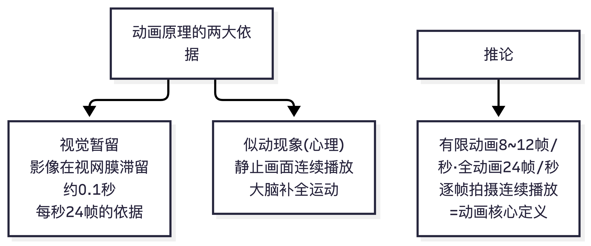

📌 锚点：视觉暂留约 0.1 秒 + 似动现象，是动画/电影存在的生理与心理依据。

### Top 3 动画制作流程（前期 / 中期 / 后期三阶段）★★★

**考频证据（4 考期 6 现，主观题分值之王：单题 8—20 分）**：
- 2017.10 简答 8"分三部分的优点"（官方评分参考：两点各 3 分）
- 2018.10 论述 11"阶段及具体工作内容"（官方评分参考：前期 7 项 10 分＋中期 4 分＋后期 6 分）
- 2020.10 论述 11"三个阶段的具体工作内容"（参考答案同框架）
- 2023.10 简答 8"制作和拍摄阶段的流程"＋论述 11"分阶段论述流程和优点"（同考期两现）
- 关联题：2018.4 简答 9"三维 CG 动画制作流程"（8 步各 1 分）、2024.10 填空 24"原画师"、简答 38、论述 40

**必背框架（两张流程表都要背）**：
传统动画三阶段——前期 7 项：研究文学剧本 / 撰写导演阐述 / 文字和画面分镜头台本 / 人物造型和背景风格设计 / 先期录音和先期对白录音 / 动作风格试验 / 摄影试验；中期：原画、动画（中间画）、上色；后期：合成、配音、剪辑。
三维 CG 八步：剧本和前期二维设计 → 建模 → 材质 → 绑定 → 动画及动画缓存 → 灯光 → 毛发及缓存 → 渲染合成。
分阶段两大优点：①有效控制管理周期和成本；②创作人员工作专业化、便于分工协作。

**易错点**：
① 漏项——"摄影试验""动作风格试验"最常被漏（2018.10 评分参考中各占 1 分，漏一项丢一项）；
② 前期/中期归属搞错——先期录音属**前期**（不是后期配音，两者是不同工序）；
③ 三维流程顺序错——"绑定"必须在"动画"之前，"渲染合成"收尾。

### Top 4 动画史"第一"系列（客观题提分机）★★★

**考频证据（跨 5 考期，选择题复用率最高的题型）**：
- 世界第一：2024.10 单选 5 ＋ 2025.10 单选 8（**原题重复**：第一部声画同步动画《蒸汽船威利》1928）；2024.10 填空 21（1906 布莱克顿《滑稽脸的幽默相》）、填空 26（1995 第一部全三维长片《玩具总动员》）、单选 10（1888 雷诺光学影戏机）
- 中国第一：2025.10 单选 9（第一部水墨《小蝌蚪找妈妈》）、单选 10（折纸片代表作《聪明的鸭子》＝ 2024.10 单选 7 原考点重复）、单选 11（敦煌壁画《九色鹿》）；2024.10 单选 13（《铁扇公主》1941 亚洲第一部长片）；2018.4 名解 5（《骆驼献舞》1935 中国第一部有声片）
- 国别第一：2024.10 单选 8（欧洲第一个生产动画电影的国家：法国）

**必背清单（第一族谱）**：
世界：第一部动画影片《滑稽脸的幽默相》（1906 布莱克顿）/ 第一部声画同步《蒸汽船威利》（1928 迪士尼）/ 第一部全三维长片《玩具总动员》（1995 皮克斯）/ 第一部彩色长片《白雪公主》（1937）。
中国：第一部动画广告片《舒振东华文打字机》（1922 万氏兄弟）/ 第一部有声片《骆驼献舞》（1935）/ 第一部长片《铁扇公主》（1941）/ 第一部剪纸片《猪八戒吃西瓜》（1958）/ 第一部水墨片《小蝌蚪找妈妈》（1960）/ 第一部折纸片《聪明的鸭子》（1960）。

**易错点**：
① 《猪八戒吃西瓜》（剪纸）vs《聪明的鸭子》（折纸）vs《三个和尚》（水墨风格）三个"片种第一/代表"互串；
② 《骆驼献舞》（有声）vs《铁扇公主》（长片）混淆；
③ 2025.10 源站把《小蝌蚪找妈妈》错排为"《小螂蚓找妈妈》"——考试以正确片名作答。

### Top 5 中国动画发展历程（八阶段 ＋ 中国学派 ＋ 困境与出路）★★★

**考频证据（4 考期 5 现，论述题最大母题）**：
- 2024.10 论述 39"中国动画发展历程"（八阶段含分值 2+2+2+1+2+1+1+2）
- 2018.10 论述 10"中国学派的成长历程"（官方评分参考：称谓 4 分＋拿来/继承/发展创新/总结各 4 分）
- 2017.10 简答 9"1977—1994 发展趋势"（两点各 5 分）＋论述 11"内容上打开思路突破瓶颈"（5+5+4+3+3）
- 2020.10 论述 12"90 年代以来的困境及策略"（困境 5 点＋策略 2 点）
- 2023.10 名解 5"中国学派"；2024.10 多选 20"中国学派艺术特征（程式化/意象化/教化性）"

**必背框架**：
八阶段（2024.10 官方分值）：萌芽探索 1922—1945 → 稳定发展 1946—1956 → 第一个繁荣 1957—1965 → 停顿 1966—1976 → 第二个繁荣 1977—1989 → 调整转型 1990—2005 → 新征程 2006—2014 → 再崛起 2015 至今。
中国学派四步（2018.10 评分参考）：拿来（学苏联，《乌鸦为什么是黑的》）→ 继承（1955 特伟倡导民族化，《骄傲的将军》，程式化/意象化/教化性）→ 发展创新（水墨动画与剪纸/折纸新片种）→ 觉知＋创新两步总结。
困境（2020.10）：日美冲击 / 市场定位儿童 / 题材集中民间故事 / 教化倾向 / 模仿痕迹重。出路（2017.10 论述 11）：人物形象个性创新 / 题材多样化 / 融入社会思考 / 深挖历史文化资源 / 民族的也是世界的。

**易错点**：
① 年代区间错位——"第一个繁荣期"是 1957—1965（上美影厂 1957 成立为起点），不是建国初期；
② 中国学派特征答"写实化/娱乐化"——正确组合是**程式化、意象化、教化性**（2024.10 多选 20 官方答案 ABE）；
③ 《三个和尚》归类——按 2024.10 多选 17 官方答案归入水墨/写意序列（BCDE），《鹬蚌相争》为水墨剪纸片不选，以官方答案为准记忆。

### Top 6 传统二维动画与电脑三维动画的差异 ★★

**考频证据（3 考期 3 现，简答稳定考点）**：
- 2018.10 简答 7（官方评分参考：4+3+3）
- 2020.10 简答 7（参考答案同框架）
- 2024.10 简答 38（全国卷延续此考点）

**必背框架（三点差异，背 2018.10 官方分值版）**：①制作工艺——手工绘制、分层逐格拍摄、工艺繁杂成本高 vs 建模—动画—渲染、效率高（4 分）；②创作手段——直接控制笔纸 vs 数字设备交互界面（3 分）；③造型表现——压挤/伸缩/变形夸张 vs 几何/向量/曲线、软件工程实现（3 分）。

**易错点**：答成"二维好看三维逼真"等观感描述——评分参考要的是**工艺、手段、造型**三个制作维度，每点都要落在"怎么做的"上。

### Top 7 水墨动画 ★★★

**考频证据（3 考期 4 现）**：
- 2018.4 论述 11"水墨动画的艺术特征及其意义"（官方评分参考 2+3+3+4+4+4）
- 2023.10 简答 9"水墨动画的优点特征"（五点，与 2018.4 同源）
- 2024.10 多选 17（水墨动画作品辨识）
- 2025.10 单选 9（第一部水墨动画）

**必背框架**：代表作《小蝌蚪找妈妈》（1960，取齐白石鱼虾）、《牧笛》（1963，取李可染画牛）、《山水情》（收官）；五点特征——意境优雅（黑白二色、轻盈飘逸、传统美学精髓）/ 题材叙事配古乐（清新高雅）/ 独立于世界表现形式（突破"单线平涂"、巨大创作潜力）/ 源自特伟、钱家骏摆脱苏联影响的民族探索（独特繁琐工艺）/ 民族色彩（"只有民族的才是世界的"）。

**易错点**：
① 人物记错——水墨动画探索发起人是**特伟、钱家骏**（不是万氏兄弟）；
② "单线平涂"写成"单线平铺"；
③ 《山水情》《鹿铃》与"第一部"混淆——第一部永远是《小蝌蚪找妈妈》。

> **🖼 知识点图：水墨动画（中国学派独有）**

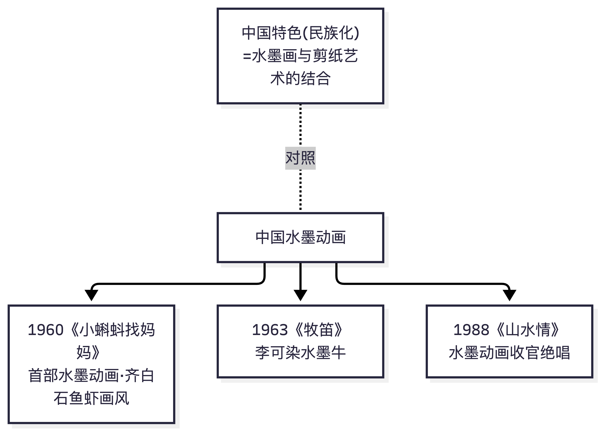

📌 锚点：首部=小蝌蚪找妈妈(齐白石画风)；巅峰=牧笛(李可染牛)；山水情=收官绝唱。

### Top 8 日本动漫产业与民族特色 ★★

**考频证据（3 考期 3 现，两简答一论述）**：
- 2018.4 简答 10"日本动画产业的典型特征"（官方评分参考 1+2+1+1+1+2）
- 2017.10 论述 10"民族特色及独特优势"（特色 5×2＋优势 5×2）
- 2023.10 论述 12"形式特点和优势"（绘画手法＋动漫音乐＋五优势）
- 关联：2025.10 单选 14（二战后日本动画发展阶段特点）

**必背框架**：产业特征——漫画动画紧密（"动画漫画产业"）＋五点（名家主体企业 / 发行传播媒介发达 / 中介服务体系发达 / 专业性市场规模 / 促进文化普及）；民族特色——超现实题材 / 人文主义 / 成人动画 / 绘画表现手法 / 动漫音乐；独特优势——历史绵延 / 题材广剧本严谨 / 人才培养 / 多媒体结合 / 同人志文化。

**易错点**：
① 美国产业特征（娱乐艺术结合产业化 / 技术大胆投入 / 商业化核心 / 法律行会保护知识产权）与日本产业特征互串——2020.10 简答 8 考美国、2018.4 简答 10 考日本，两套必须分开记；
② "同人志"定义（业余作者以既有漫画/动画/游戏人物情节为基础的再创造）是 2017.10/2023.10 两考期重复给分点。

> **🖼 知识点图：日本动漫产业与运作模式**

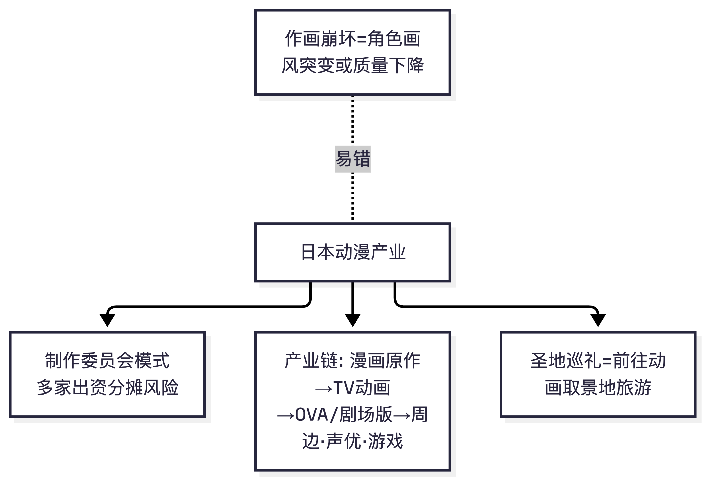

📌 锚点：制作委员会分散风险；漫画→动画→周边全产业链；圣地巡礼=取景地旅游。

### Top 9 人物造型规律与形象设计 ★★

**考频证据（3 考期 3 现＋关联）**：
- 2018.4 简答 7"动画角色造型的基本规律"（官方评分参考：八条各 1 分）
- 2023.10 简答 7"人物造型的规律"（**原题重复**）
- 2020.10 简答 6"动画人物设计的基本内容"（设定内容＋三面效果图）
- 关联：2024.10 简答 37"形象设计的逻辑类项"（外在形象＋内在性格）

**必背框架**：造型八规律——夸张与变形 / 通过联想塑造角色 / 单纯化 / 体面动态个性 / 符号化 / 角色组合的造型关系 / 幽默感 / 写实的感染力。设计内容——造型风格、身材比例、服装样式、眼神表情；头部及全身正背侧三面效果图、发型、不同服装、身高对比、饰物细节。

**易错点**：八条只背五六条——各 1 分逐条给分，漏两条丢 2 分；"单纯化"与"符号化"是两条不要合并。

> **🖼 知识点图：人物造型规律与形象设计**

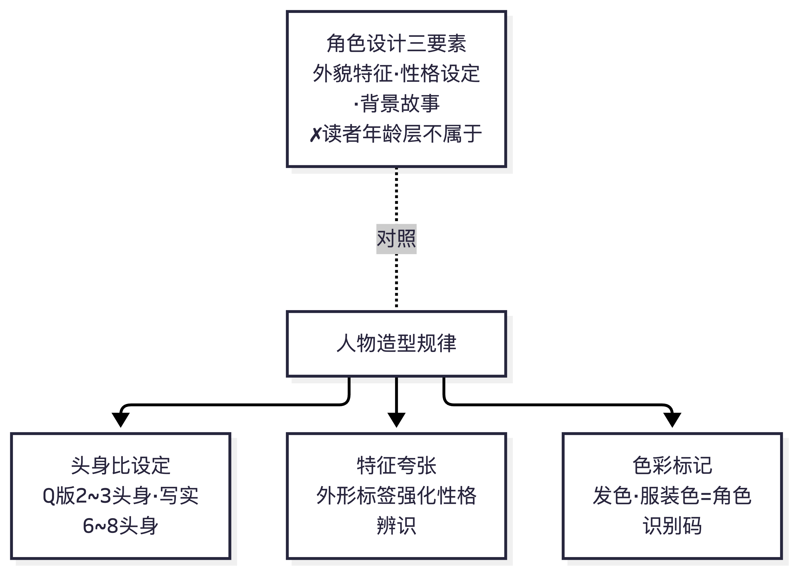

📌 锚点：造型服务于性格辨识：头身比、夸张特征、色彩标记。

### Top 10 设计稿 ＋ Flash 动画（名解钉子户双联）★★★

**考频证据（各 3 考期原题级复用，名解性价比之王）**：
- 设计稿：2018.10 名解 1 ＝ 2020.10 名解 1 ＝ 2024.10 名解 34（**三考期原题三现**，官方评分参考：表达镜头影像基本构成的设计图）
- Flash 动画：2020.10 名解 2 ＝ 2024.10 名解 32（原题）；2023.10 简答 10"Flash 动画的优点"（四点）；关联 2025.10 单选 3（无纸动画类型）

**必背**：设计稿＝画面构成，将分镜表加工画成接近原画的草稿，导演标注完整指示，是原画和背景设定的基础。Flash 动画＝动画软件工具，可制作有声动画、占空间小、可边下载边播放、借助网络传播；优点四条（网络传播无时空限制 / 制作简单成本低可鼠标控制参与性强 / 形式多样内容丰富时代感 / 应用领域广）。

**易错点**：
① 设计稿与分镜头台本混淆——分镜是"画每个镜头的画面（工作蓝本）"，设计稿是"把分镜加工成接近原画的草稿（原画/背景的基础）"，工序上分镜在前、设计稿在后；
② Flash 优点与三维动画优点互串。

> **🖼 知识点图：设计稿与 Flash 动画（名解钉子户）**

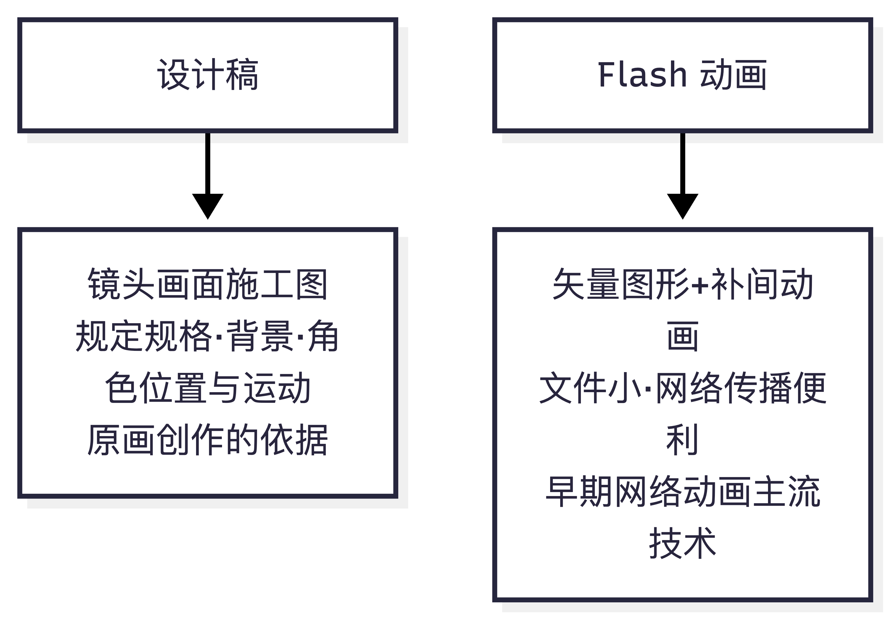

📌 锚点：设计稿=镜头施工图；Flash=矢量补间技术，两者是名解高频。

### 4.x 补充：两考期原题重复清单（押题价值最高的 8 组）

| 重复原题 | 考期对 | 题型 |
|---|---|---|
| 视觉暂留现象 | 2017.10 名解 5 → 2018.4 名解 1 | 名词解释 |
| 镜头角度的功能 | 2017.10 简答 7 → 2018.4 简答 8 | 简答 |
| 人物造型的规律 | 2018.4 简答 7 → 2023.10 简答 7 | 简答 |
| 水墨动画特征 | 2018.4 论述 11 → 2023.10 简答 9 | 论述→简答降维 |
| 动画制作流程 | 2017.10→2018.10→2020.10→2023.10 | 简答/论述 |
| 设计稿 | 2018.10→2020.10→2024.10 | 名词解释 |
| 声画同步《蒸汽船威利》 | 2024.10 单选 5 → 2025.10 单选 8 | 单选 |
| 假定性 | 2024.10 单选 14 → 2025.10 单选 5 | 单选 |

> **结论**：本课程题库复用呈"跨年代、跨卷型"特征（福建旧卷原题直接进入全国卷）——第四节 Top10 中 Top1/2/3/4/5/7/10 共 7 条在 2024.10/2025.10 全国卷中再次出现。备考策略：先吃透旧卷评分参考的给分点结构，再补全国卷新增的选择题知识点（漫画理论、传播载体、叙事方式）。

---

## 五、备考建议

### 5.1 按分值分布的学习优先级（全国卷 100 分制）

| 优先级 | 题型 | 分值 | 投入占比 | 依据 |
|---|---|---|---|---|
| P0 | 论述（2×13）＋简答（3×8） | 50 分 | 40% | 第四节数据：制作流程/发展历程/中国学派/水墨动画/2D-3D 差异五母题覆盖历次主观题大盘，且评分参考逐条给分、可量化背诵 |
| P1 | 名词解释（5×3） | 15 分 | 20% | 设计稿、Flash 动画、远景、视觉暂留等原题复用率极高；每个概念按"定义＋代表作品＋意义"三要素 3 句话背诵 |
| P2 | 多选（5×2）＋单选（15×1） | 25 分 | 25% | 动画史"第一"系列＋中日美产业特征＋镜头语言概念辨析；错选/漏选均不得分的多选重点防"张冠李戴" |
| P3 | 填空（10×1） | 10 分 | 15% | "作品—作者—国别"配对＋术语填空（转描、ACG、原画师、24 帧）；必背作品对照表（文末）直接覆盖 |

**时间预算（以 8 周为例，每周 6 小时）**：第 1—2 周通读教材＋第二节概念详解；第 3—5 周背第四节 Top10（每天一 Top，周末闭卷默写评分参考给分点）；第 6 周做第三节 7 考期真题（先做 2024.10/2025.10 全国卷，再用福建旧卷主观题练笔）；第 7 周错题回炉＋必背作品对照表抽查；第 8 周全真模考（150 分钟限时）。

### 5.2 分题型答题技巧

**单项/多项选择题**：①"第一"系列题用排除法（Top 4 必背清单）；②多选防漏选——三大视觉原理（视觉暂留/短程似动/视觉力）、中国学派三特征（程式化/意象化/教化性）等组合型考点宁可全记；③反选题（"不包括"）圈出否定词再作答（2024.10 单选 4"镜头设计要素不包括角色运动"）。

**填空题**：只考精确记忆——片名不加书名号扣印象分、人名不写错别字（手冢治虫的"冢"）、数字类（24 帧、1935、1941、1960）单独抄写三遍。

**名词解释（三要素法，每题 3 分）**：**定义一句（是什么/属加种差）＋代表作品或人物一句（证据）＋意义或功能一句（为什么重要）**。范例（设计稿）：设计稿即画面构成（定义），是将分镜表加工画成接近原画的草稿、由导演标注完整指示的工序（展开），它是原画和背景设定的基础（意义）。控制在 40—60 字，三句齐即拿满。

**简答题（要点枚举法，每题 8 分）**：先答"框架句"（如"镜头角度一般有三种"），再逐条编号展开；每条=小标题＋一句解释。给分点即得分点——八条造型规律各 1 分，宁可八条短句也不要四条长句。历次评分参考的分值标注（3+3+3+1、4+3+3 等）就是最好的结构模板。

**论述题（三段式，每题 13—20 分）**：总起句（界定概念/亮明框架）→ 分阶段或分论点展开（借用官方评分参考的给分结构，如八阶段各配代表作、五特征各配一句阐释）→ 总结升华（回扣"民族的才是世界的"等课程金句）。**每条论点配一个作品例证**是论述与简答的分水岭（2024.10 论述 40 官方给分中"举例阐述"独占 5 分）。

**时间分配（150 分钟）**：选择题＋填空 30 分钟，名解 25 分钟，简答 45 分钟，论述 40 分钟，检查 10 分钟。

### 5.3 湖北考生专项提示

1. **报考渠道**：01685 在湖北属动漫设计（专科，专业代码 550116）面向学校开考课程（助学班序列），考生经助学单位集体报名；面向社会开考专业清单中不含本课程，社会考生需挂靠助学单位或转入可社会报考的省份【以湖北教育考试院当期开考课程安排为准】。
2. **2026 年 10 月考期**：湖北 2026 年下半年考试时间为 10 月 23—25 日；01685 全国统考时间以考试院公布为准（2024.10 首考安排在 10 月最后一周周末，参照第 1 节）。与 15040 习近平新时代……（统考课）同时段冲突的考生，报名时注意二选一或按当期安排调整。
3. **教材版本**：黄颖主编《动漫艺术概论》，机械工业出版社 2024 年版（ISBN 978-7-111-76124-2），书内含考试大纲——购买时认准 2024 版，旧版（省考时期教参）不覆盖全国卷新增的漫画理论章节。

### 5.4 资源清单（本次搜集已核实的来源）

| 类型 | 资源 | 说明 |
|---|---|---|
| 指定教材 | 《动漫艺术概论》黄颖主编，机械工业出版社 2024 | ISBN 978-7-111-76124-2，含考试大纲（三源互证） |
| 官方渠道 | 湖北省教育考试院 zk.hbea.edu.cn/portal-web | 开考课程安排、报名、成绩 |
| 真题① | 考试 365 试卷库 download.zikao365.com/shiti/ | 2024.10 全国卷原件 PDF（本档 3.2 来源） |
| 真题② | 考生网（攀知）zikaosw.cn | 2025.10 选择题（本档 3.1 来源）；答案需付费 |
| 真题③ | 武汉高校继教院 wkdcjw.cn / fzdxcjw.cn（zkzl 栏目） | 2020.10 卷＋2024.10 答案版（本档 3.2/3.4 来源） |
| 真题④ | 知乎专栏（福建旧卷 3 套＋评分参考扫描图） | 2017.10/2018.4/2018.10（本档 3.5—3.7 来源） |
| 真题⑤ | 搜狐·乐昇学教育 | 2023.10 回忆版＋建议答案（本档 3.3 来源） |
| 视频解析 | B 站 BV1WM411p746 | 2021.10 考期视频解析（唯一来源，无文字版） |

> **使用提醒**：以上真题来源均已在第六节做可信度评级；网络题库答案质量参差（本次发现 Q11/Q30 两处来源冲突、若干错别字），凡与教材冲突处以教材为准。

---

## 六、校验记录

### 6.1 两轮交叉校验执行情况

**第一轮·来源交叉（题目归属与考期互证）**：
- 2024.10 全国卷：考试 365 原件 PDF（300dpi 渲染、两轮独立识图）× 武科院继教院答案版——40 题题干逐题比对一致，答案 38/40 一致，2 处冲突（见 6.2）。
- 福建三旧卷（2017.10/2018.4/2018.10）：知乎专栏卷面 × 同文官方评分参考扫描图——题号、题干、分值结构三对齐；评分参考页脚（266）/（271）编号与考期卷头互证。
- 2020.10 卷：武纺继教院官网发布页——卷头、题型结构（5×4+5×8+2×20）与福建卷制一致，归属存疑已标【待核实】。
- 2023.10 回忆版：乐昇学教育发布——题序分值与福建卷制一致；答案要点与 2018.4/2018.10 官方评分参考高度同源（简答 7/9、论述 11 与旧评分参考逐条吻合），间接验证回忆真实性。
- 2025.10：攀知单源（无第二来源可互证），15 题题干完整、选项齐全；其中 3 题与 2024.10 原题重复（单选 5/8/10 考点），重复题答案反推一致，构成内部一致性证据。

**第二轮·内容自洽（与教材知识体系核对）**：
- 所有【推导答案】均标注推导依据：或依据跨考期重复原题的官方答案（如假定性、蒸汽船威利），或依据公认史实（赤羽末吉 1980、丰子恺原文、罗杰特 1824），或依据教材概念框架（盛器型工具、无纸动画），置信度分级标注（高置信＝有官方答案或史实双保险；中置信＝单依据推导，教材原文【待核实】）。
- 全部评分参考转录与 2023.10 参考答案互校：水墨动画五点（2018.4 评分参考 vs 2023.10 建议答案）、造型八规律（2018.4 vs 2023.10）、制作流程（2018.10 vs 2020.10 vs 2023.10）均逐条吻合，无孤立孤证。
- 识图转录中的疑似错字不做静默修正，一律保留原文＋〔校注〕标示（见 6.2 已修复清单）。

### 6.2 已发现并处理的问题

| # | 问题 | 处理方式 |
|---|---|---|
| 1 | 2024.10 单选 11 答案冲突：识图主判 A《老夫子》vs 武科院版 D《Miss 阿性》 | 双标注：主答案 A（多源支持香港归属）、D 并列，【待核实】（3.2 节） |
| 2 | 2024.10 填空 30 答案冲突：武科院"人物小传"vs 识图推导"人物表" | 双标注：主答案"人物小传"（题干语义贴合），【待核实】（3.2 节） |
| 3 | 2018.10 评分参考"皮尔伯格" | 保留原文＋〔校注：应为斯皮尔伯格〕（3.5 节名解 5） |
| 4 | 2018.4 评分参考"线网膜""优雅淡薄""黑白二白色" | 保留原文＋〔校注〕或对照 2023.10 版标注（3.6 节） |
| 5 | 2017.10 评分参考"相等级""可以以美国好莱坞" | 保留原文＋〔校注〕（3.7 节） |
| 6 | 2025.10 源站 D 选项"《小螂蚓找妈妈》"错别字 | 按《小蝌蚪找妈妈》校注处理（3.1 节单选 9） |
| 7 | 2018.4 名解 1 评分参考第 1 页末跨页断句"较适合于画／内人物…" | 与第 2 页开头拼合校验，语义完整（3.6 节简答 8） |
| 8 | 2017.10 简答 8 评分参考两点仅 6 分（3+3），余 4 分未列明 | 如实标注"评分参考仅列两点共 6 分，余分推测含总起表述【待核实】"（3.7 节） |
| 9 | 2024.10 多选 17"《三个和尚》归水墨序列"与通行的片种划分（水墨片仅五部）不一致 | 按官方答案 BCDE 记忆并标注"归类依据【出处待核】"（3.2 节） |
| 10 | 2023.10 名解 2"景调"回忆版未附答案 | 按姊妹考点（2018.10"色调"评分参考）推导并标注【待核实】（3.3 节） |

### 6.3 搜集过程方法学记录（供后续更新本档时复用）

1. **扫描件识图纪律**：第一轮低分辨率（约 200dpi）识图曾产生系统性幻觉（虚构题干细节），已全部废弃；最终采用 300dpi 高清渲染＋两轮独立识图互校＋冲突第三次仲裁的流程定稿。
2. **防盗链图片**：试卷扫描图有 Referer 校验，普通抓取 403，需带来源 Referer 头下载；知乎正文图片为 zhimg.com CDN 直链，可直接多模态识图。
3. **编码与跳转**：部分继教院页面为 GBK 编码需显式解码；http 站点强制 301 跳转 https 需跟随重定向；压缩响应需 --compressed。
4. **URL 规律猜测的教训**：题库站试卷编号不连续，按编号规律猜 URL 三次均失败——正确做法是从列表页逐页翻查。
5. **考期覆盖缺口**：2026.4、2021.10、2019.10/2019.4 四个考期经四渠道穷尽排查（正规题库站／高校继教院／搜索引擎／视频平台）确认无文字版真题（2021.10 仅存 B 站视频解析），详见 1.6 节；不存在凭记忆重建题目。

### 6.4 待核实清单（全档汇总）

| 编号 | 事项 | 位置 | 影响面 |
|---|---|---|---|
| 待核 1 | 2024.10 单选 11 最终答案（A/D 之争） | 3.2 节 | 1 分 |
| 待核 2 | 2024.10 填空 30 最终答案（人物小传/人物表） | 3.2 节 | 1 分 |
| 待核 3 | 2020.10 卷命题归属（统一命题卷头 vs 福建省考时期） | 3.4 节 | 卷面标签 |
| 待核 4 | 2025.10 单选 1/3/7/12/14/15 六题推导答案的教材原文依据 | 3.1 节 | 6 分（中置信推导） |
| 待核 5 | 2024.10 多选 17 水墨序列归类依据 | 3.2 节 | 2 分 |
| 待核 6 | 2023.10 名解 2"景调"完整答案 | 3.3 节 | 4 分 |
| 待核 7 | 2017.10 简答 8 评分参考缺余 4 分的给分点 | 3.7 节 | 答题结构参考 |
| 待核 8 | 2024.10 论述 39/40 分值内部划分（13 分制下各阶段分值）系按评分参考比例标注 | 3.2 节 | 论述结构参考 |
| 待核 9 | 2026.10 湖北考期具体开考时段（10.23—25 中具体单元） | 5.3 节 | 报考安排 |

### 6.5 各考期来源可信度评级

| 考期 | 来源类型 | 评级 | 说明 |
|---|---|---|---|
| 2024.10 | 题库原件 PDF × 高校继教院答案版 | **A（双源互证）** | 40 题双源，38 题答案一致，2 题双标注 |
| 2018.10 | 社区发布卷面＋官方评分参考扫描 | **A（评分参考原件）** | 含逐条分值，页脚编号校验完整 |
| 2018.4 | 社区发布卷面＋官方评分参考扫描 | **A（评分参考原件）** | 含逐条分值，页脚编号校验完整 |
| 2017.10 | 社区发布卷面＋官方评分参考扫描 | **A（评分参考原件）** | 含逐条分值，页脚编号校验完整；简答 8 评分参考不完整已标注 |
| 2020.10 | 高校继教院官网完整卷＋参考答案 | **B+（单源完整）** | 卷面完整、答案规范，卷头归属待核 |
| 2023.10 | 助学机构回忆版＋建议答案 | **B（回忆版）** | 题型分值结构吻合，答案与旧评分参考同源互证 |
| 2025.10 | 正规题库站（答案收费） | **B（题目可信/答案推导）** | 题干选项完整；3 题与 2024.10 重复构成内部验证 |

> **总评**：4 个 A 级（含 3 份官方评分参考逐字转录）＋2 个 B 级＋1 个 B+ 级，共 7 考期、覆盖 2017.10—2025.10 九年。主观题部分（名解/简答/论述）全部具备答案或评分参考，客观题仅 2024.10 有双源官方答案、2025.10 为推导答案。后续若获取新的考期真题（尤其 2026.4/2026.10 全国卷），建议按第三节格式增补并回填 1.6 节与第四节考频统计。

---

## 附录：必背作品对照表

> 收录范围＝7 考期真题中出现过的全部动画/漫画作品＋填空高频配对；"考频"列标注其在第三节的出现位置。★★★＝多次复考必背，★★＝考过一次，★＝干扰项/关联考点。

### 一、动画作品

| 作品 | 国别 | 作者/出品方 | 年代 | 一句话考点 | 考频 |
|---|---|---|---|---|---|
| 《滑稽脸的幽默相》 | 美国 | 布莱克顿 | 1906 | 公认第一部动画影片 | ★★★ 2024.10 填空21 |
| 《蒸汽船威利》 | 美国 | 迪士尼 | 1928 | 世界第一部声画同步动画片，米奇形象确立 | ★★★ 2024.10 单选5＋2025.10 单选8（原题重复） |
| 《白雪公主》 | 美国 | 迪士尼 | 1937 | 世界第一部彩色动画长片 | ★ 干扰项（两考期选项） |
| 《幻想曲》《木偶奇遇记》 | 美国 | 迪士尼 | 1940 | 声画同步题干扰项 | ★ 干扰项 |
| 《玩具总动员》 | 美国 | 皮克斯 | 1995 | 世界第一部全三维电脑动画长片 | ★★★ 2024.10 填空26＋多选18 |
| 《怪物史莱克》 | 美国 | 梦工厂 | 2001 | 三维长片；首届奥斯卡最佳动画长片 | ★★ 2024.10 多选18；2018.10 名解5 |
| 《恐龙》 | 美国 | 迪士尼 | 2000 | 三维长片（多选 18 正确项） | ★★ 2024.10 多选18 |
| 《狮子王》 | 美国 | 迪士尼 | 1994 | 二维手绘（三维题干扰项） | ★ 干扰项 |
| 《千与千寻》 | 日本 | 宫崎骏/吉卜力 | 2001 | 日本二维（三维题干扰项） | ★ 干扰项 |
| 《铁臂阿童木》 | 日本 | 手冢治虫 | 1963 | 日本 TV 动画起点、有限动画范式 | ★★ 2025.10 单选14 关联 |
| 《苏和的白马》 | 日本 | 赤羽末吉（画） | 1980 | 亚洲首个国际安徒生插画奖作者代表作 | ★★ 2025.10 单选2 关联 |
| 《骆驼献舞》 | 中国 | 万氏兄弟 | 1935 | 中国第一部有声动画片（名解含分值答案 1+2+1） | ★★★ 2018.4 名解5 |
| 《铁扇公主》 | 中国 | 万氏兄弟 | 1941 | 中国（亚洲）第一部动画长片 | ★★★ 2024.10 单选13＋论述39 |
| 《大闹画室》 | 中国 | 万氏兄弟 | 1926 | 万氏兄弟早期探索（萌芽期） | ★★ 2024.10 论述39 |
| 《皇帝梦》《神笔》 | 中国 | 东影/上美影 | 1947/1955 | 稳定发展期代表作 | ★★ 2024.10 论述39 |
| 《乌鸦为什么是黑的》 | 中国 | 上美影 | 1955 | 学苏联阶段代表作（中国学派"拿来"期） | ★★ 2018.10 论述10 |
| 《骄傲的将军》 | 中国 | 特伟导演 | 1956 | 民族化先声（"敲喜剧风格之门，探民族形式之路"） | ★★★ 2018.10 论述10＋2024.10 论述39 |
| 《猪八戒吃西瓜》 | 中国 | 万古蟾 | 1958 | 中国第一部剪纸片 | ★★★ 2024.10 单选7/2025.10 单选10 干扰项 |
| 《小蝌蚪找妈妈》 | 中国 | 特伟等（上美影） | 1960 | 中国第一部水墨动画片（取齐白石鱼虾意象） | ★★★ 2025.10 单选9＋2018.4 论述11 |
| 《聪明的鸭子》 | 中国 | 虞哲光 | 1960 | 中国第一部折纸片 | ★★★ 2024.10 单选7＋2025.10 单选10（同考点重复） |
| 《大闹天宫》 | 中国 | 万籁鸣导演（上美影） | 1961—1964 | 第一个繁荣期高峰、民族风格典范 | ★★★ 2024.10 论述39＋2025.10 单选11 干扰项 |
| 《牧笛》 | 中国 | 特伟编导 | 1963 | 第二部水墨动画片（取李可染画牛）、田园诗风骨 | ★★★ 2020.10 名解5＋2018.4 论述11 |
| 《鹿铃》 | 中国 | 上美影 | 1982 | 第三部水墨动画片 | ★ 干扰项 2025.10 单选9 |
| 《山水情》 | 中国 | 特伟等（上美影） | 1988 | 水墨动画收官之作 | ★★ 2024.10 多选17 |
| 《哪吒闹海》 | 中国 | 上美影 | 1979 | 第二个繁荣期开篇（1979） | ★★ 2024.10 论述39＋两考期干扰项 |
| 《三个和尚》 | 中国 | 上美影 | 1981 | 写意风格经典；按官方多选答案归水墨/写意序列 | ★★ 2024.10 多选17＋2025.10 干扰项 |
| 《新装的门铃》《寂寥的天空》 | 中国 | 上美影 | 1980s | 官方多选 17 归水墨/写意序列（作者信息【待核实】） | ★ 2024.10 多选17 |
| 《鹬蚌相争》 | 中国 | 上美影 | 1983 | 水墨**剪纸**片（多选 17 干扰项，属剪纸片种） | ★ 2024.10 多选17 干扰项 |
| 《九色鹿》 | 中国 | 上美影 | 1981 | 取敦煌莫高窟壁画《鹿王本生图》设计场景人物 | ★★★ 2025.10 单选11 |
| 《阿凡提》系列 | 中国 | 上美影 | 1980s | 木偶片代表作（第二个繁荣期） | ★★ 2024.10 论述39 |
| 《黑猫警长》 | 中国 | 上美影 | 1984—1987 | TV 系列动画代表（第二个繁荣期） | ★★ 2024.10 论述39＋2017.10 论述11 例证 |
| 《宝莲灯》 | 中国 | 上美影 | 1999 | 90 年代后复工代表作（干扰项） | ★ 2025.10 单选11 干扰项 |
| 《魁拔》《十万个冷笑话》 | 中国 | 青青树/有妖气 | 2011/2012 | 新征程期（2006—2014）代表 | ★★ 2024.10 论述39 |
| 《西游记之大圣归来》《哪吒之魔童降世》《长安三万里》 | 中国 | 追光/可可豆等 | 2015/2019/2023 | 再崛起期（2015—）代表 | ★★ 2024.10 论述39 |

### 二、漫画与出版

| 作品/品牌 | 国别 | 作者/厂商 | 年代 | 一句话考点 | 考频 |
|---|---|---|---|---|---|
| 《老夫子》 | 中国香港 | 王家禧（王泽） | 1962 起 | 出品于香港的漫画（2024.10 单选 11 主答案） | ★★ 2024.10 单选11 |
| 《三毛流浪记》 | 中国 | 张乐平 | 1947 | 出品地上海（单选 11 干扰项） | ★ 干扰项 |
| 漫威（Marvel）/DC | 美国 | — | — | 美国两大漫画公司；蜘蛛侠、钢铁侠＝漫威 | ★★ 2024.10 填空25 |
| "有妖气" | 中国 | UGC 原创漫画平台 | 2006 创建 | 国内纸媒漫画向网络漫画转型的标志（推导） | ★ 2025.10 单选15 |
| 《漫画的描法》 | 中国 | 丰子恺 | 1943 | "漫画是简笔而注重意义的一种绘画" | ★★ 2025.10 单选4 |

### 三、关键人物速记表

| 人物 | 国别 | 身份 | 一句话考点 | 考频 |
|---|---|---|---|---|
| 彼得·罗杰特 | 英国 | 科学家 | 1824 年发论文揭示视觉暂留原理 | ★★★ 2025.10 单选13＋视觉暂留名解两考期 |
| 埃米尔·科尔 | 法国 | 动画艺术家 | "现代动画之父"，视觉表现力挖掘 | ★★★ 2018.4 名解2 |
| 埃米尔·雷诺 | 法国 | 发明家 | 1888 光学影戏机（放映先声） | ★★ 2024.10 单选10 |
| 布莱克顿 | 美国 | 导演 | 1906《滑稽脸的幽默相》 | ★★ 2024.10 填空21 |
| 乔治·梅里爱 | 法国 | 导演 | "造梦工厂"、《月球旅行记》 | ★★ 2024.10 填空28 |
| 手冢治虫 | 日本 | 漫画/动画大师 | "漫画之神"，《铁臂阿童木》 | ★★ 2024.10 单选3 |
| 赤羽末吉 | 日本 | 绘本画家 | 亚洲第一位国际安徒生插画奖（1980） | ★★ 2025.10 单选2 |
| 宫崎骏 | 日本 | 吉卜力 | 干扰项常客（《千与千寻》） | ★ 干扰项 |
| 斯皮尔伯格 | 美国 | 导演/制片人 | 1994 年创立梦工厂 | ★★ 2018.10 名解5（校注） |
| 万籁鸣、万古蟾、万超尘、万涤寰 | 中国 | 万氏兄弟（四人全背） | 中国动画片开山鼻祖、民族化之路开启者 | ★★★ 2017.10 名解4＋2024.10 单选13 |
| 特伟 | 中国 | 上美影首任厂长 | 民族化倡导者；《骄傲的将军》《小蝌蚪找妈妈》《牧笛》《山水情》 | ★★★ 多考期论述 |
| 钱家骏 | 中国 | 动画教育家 | 水墨动画探索者（与特伟并提） | ★★ 2018.4 论述11 |
| 虞哲光 | 中国 | 折纸片开创者 | 《聪明的鸭子》 | ★★ 2024.10 单选7 关联 |
| 诺曼·麦克拉伦 | 加拿大 | 动画大师 | "动画不是让画动起来的艺术，而是画出来的动作的艺术"；视觉暂留题干扰项 | ★ 干扰项 |
| 约翰·拉塞特 | 美国 | 皮克斯 | 视觉暂留题干扰项 | ★ 干扰项 |
| 丰子恺 | 中国 | 漫画家 | 《漫画的描法》"简笔而注重意义" | ★★ 2025.10 单选4 |

---

**（全档完）**
- 文档性质：备考参考资料，非官方出版物；所有官方评分参考为公开渠道扫描件的逐字转录。
- 数据截至：2026-09-01（真题覆盖 2017.10—2025.10 共 7 考期；2026.4 及更早未获取考期见 1.6 节说明）。
- 使用建议：与指定教材（黄颖主编 2024 版）配套使用，冲突处以教材为准；获取新考期真题后按第三节格式增补。

---

## 附：题库刷题卷汇编（2026 年 10 月刷题，共 6 套）

> 来源：湖北刷题平台题库抽卷。附-1/2/4/6 整卷经平台标准答案核对；附-3/5 为推断答案，其中已验证题标注 ✓，未验证题保留推导依据。

### 附-1 题库卷一（单选 15×2 = 30 分）✅整卷已验证

| 题 | 题干与选项 | 答案 | 要点 |
|---|---|---|---|
| 1 | 有限动画与全动画的区别：帧率/数字技术/角色数/配音数 | **A** | 有限动画 8~12 帧/秒，全动画 24 帧/秒 |
| 2 | 分镜"出血位"：留白/超出版面延伸/受伤/对话框 | **B** | 超出裁切尺寸的延伸部分 |
| 3 | 角色设计关键要素不包括：外貌/性格/背景故事/读者年龄层 | **D** | 年龄层是市场定位 |
| 4 | 中国近代漫画代表人物：丰子恺/手冢治虫/迪士尼/宫崎骏 | **A** | 《子恺漫画》 |
| 5 | 造型艺术的首要功能：抽象/审美/意境/造型 | **B** | 审美功能 |
| 6 | 动画的起源可追溯到：油画/洞穴壁画/旋转圆盘（费纳奇镜）/雕塑 | **C** | ⚠️按题库选费纳奇镜，不选洞穴壁画 |
| 7 | 统领全片的灵魂人物：制片人/导演/演员/剪辑师 | **B** | 导演 |
| 8 | 漫画"动态线"的作用：运动轨迹/分割区域/标注对话/装饰边框 | **A** | 表现运动轨迹与动势 |
| 9 | （ ）是中国漫画杂志的重要标志，主编为漫画出版开拓者：时局图/瓜分中国图/老猿百态/上海泼克 | **D** | 《上海泼克》1918 沈泊尘 |
| 10 | 1940 上海新华联合影业首部动画长片：大闹天宫/铁扇公主/猪八戒吃西瓜/聪明的鸭子 | **B** | 万氏兄弟《铁扇公主》（1941 完成） |
| 11 | 传统漫画典型特征：全彩/单格幽默短篇/交互阅读/3D 角色 | **B** | 报刊讽刺幽默漫画 |
| 12 | 解放区政治讽刺画家：丁聪/华君武/卢延光/沈同衡 | **B** | 华君武（延安） |
| 13 | 中国第一部剪纸片：大闹天宫/铁扇公主/猪八戒吃西瓜/聪明的鸭子 | **C** | 1958 万古蟾 |
| 14 | 动画与漫画的共同点：真人演员/视觉叙事/实时渲染/黑白 | **B** | 视觉叙事 |
| 15 | 欧美漫画风格：水墨/粗犷线条强对比/工笔/单色简笔 | **B** | 美式超英雄典型 |

### 附-2 题库卷二（单选 15×2 = 30 分）✅整卷已验证

| 题 | 题干与选项 | 答案 | 要点 |
|---|---|---|---|
| 1 | 动画核心定义：静态图像集合/逐帧拍摄连续播放/3D 建模/实时渲染 | **B** | 逐帧+连续播放 |
| 2 | 动画的部分属性是：电视剧/电影/舞台剧/木偶剧 | **B** | 动画属电影范畴（美术片） |
| 3 | 中国古代漫画雏形：连环画/讽刺画与寓意画/插图/年画 | **B** | — |
| 4 | 井喷期最有影响、鲁少飞张光宇主编：知音漫客/红星报/时代漫画/工人画报 | **C** | 《时代漫画》1934 |
| 5 | 中国第一部剪纸片 | **C** | 《猪八戒吃西瓜》 |
| 6 | 中国古代"（ ）"中体现"鉴戒"讽喻特色：绘画/美术品/漫画/动画 | **C** ⚠️ | 按题库选"漫画"，不选"绘画" |
| 7 | 香港漫画标志风格：水墨/武侠黑帮/少女/科幻机甲 | **B** | 黄玉郎《龙虎门》一脉 |
| 8 | 武侯祠石刻《夏桀》是最早的讽刺"（ ）"：美术品/绘画/动画/漫画 | **D** | 漫画雏形 |
| 9 | 原画与动画的区别：关键帧 vs 中间帧/彩色黑白/导演助手/静态动态 | **A** | 原画关键动作，动画补中间帧 |
| 10 | 新中国第一部彩色宽银幕动画长片：哪吒闹海/大闹画室/瓮中捉鳖/骆驼献舞 | **A** | 1979 上海美影厂 |
| 11 | 分镜脚本主要作用：角色造型/镜头运动和时间节奏/音乐/特效 | **B** | — |
| 12 | 动画"假定性"：真实还原/超越现实的夸张/遵循物理/实拍素材 | **B** | — |
| 13 | "跨页大格"用于：省纸/高潮宏大场面/隐藏信息/简化分镜 | **B** | — |
| 14 | 分格的主要功能：阅读节奏与视觉引导/省纸/统一风格/上色 | **A** | — |
| 15 | 布莱克顿逐格技术拍摄：闹鬼的旅馆/恐龙葛蒂/墨水瓶人/幻影集 | **A** ⚠️ | 按题库选《闹鬼的旅馆》（1900 停机再拍+逐格），《幻影集》是科尔、《恐龙葛蒂》是麦凯 |

### 附-3 题库卷三（单选 15×2 = 30 分）☆部分验证

| 题 | 题干与选项 | 答案 | 要点 |
|---|---|---|---|
| 1 | 漫画"拟声词"主要功能：增强动态感/替代文字/填充空白/区分身份 | **A** | 增强画面动态感与冲击力【未验证】 |
| 2 | "出血位" | **B** | 同附-1 第 2 题 ✓ |
| 3 | 分镜脚本主要作用 | **B** | 同附-2 第 11 题 ✓ |
| 4 | 香港漫画有别于（ ）保持本土气质：台湾/日本/澳门/美国 | **B** | 日本漫画【未验证】 |
| 5 | 漫画定义核心：单幅插画/连续画面讲述故事/纯文字/摄影集 | **B** | —【未验证】 |
| 6 | 《狮子王》叙事结构借鉴：哈姆雷特/罗密欧与朱丽叶/麦克白/奥赛罗 | **A** | 叔侄弑君复仇框架（附-4 已验证 ✓） |
| 7 | 漫画"网点纸"作用：手绘纹理/增加厚度/快速填充灰度图案/防晕染 | **C** | 日漫灰度标配【未验证】 |
| 8 | 中国第一部水墨动画片：小蝌蚪找妈妈/大闹天宫/哪吒闹海/黑猫警长 | **A** | 1960 上海美影厂，齐白石画风（附-4 已验证 ✓） |
| 9 | 动画与漫画共同点 | **B** | 视觉叙事 ✓ |
| 10 | 日本"圣地巡礼"：参观工作室/取景地旅游/展会/收藏周边 | **B** | —【未验证】 |
| 11 | 关键帧与过渡帧区别：定义主体动作 vs 补充细节/手绘与生成/对话背景/彩色黑白 | **A** | —【未验证】 |
| 12 | 动画"时间性"体现：单帧精美/帧间动态变化/色彩协调/声音同步 | **B** | 附-4 已验证 ✓ |
| 13 | 香港漫画标志风格 | **B** | 武侠与黑帮 ✓ |
| 14 | 漫画与动画主要区别：静态与动态/无需分镜/必须有声音/只能黑白 | **A** | —【未验证】 |
| 15 | 不属于定格动画常见材料：黏土/剪纸/像素点/木偶 | **C** | 像素点是数字概念（附-4/6 已验证 ✓） |

### 附-4 题库卷四（单选 15×2 = 30 分）✅整卷已验证

| 题 | 题干与选项 | 答案 | 要点 |
|---|---|---|---|
| 1 | 《狮子王》借鉴 | **A** | 《哈姆雷特》 |
| 2 | 美国动画典型风格：写实/夸张幽默与英雄主义/哲学思辨/抽象 | **B** | — |
| 3 | 表达悲剧主题的影片：白雪公主/一只娶了母鹅的猫头鹰/幻想曲/种树的人 | **B** ⚠️ | 按题库选《一只娶了母鹅的猫头鹰》，**不选《种树的人》** |
| 4 | 渐进改变油彩形状、流动质感：沙动画/玻璃油彩动画/偶动画/剪纸动画 | **B** | 卡洛琳·丽芙《街》 |
| 5 | 现代漫画"分镜叙事"起源：手冢治虫/美漫/欧洲连环画/中国连环画 | **A** | 手冢治虫引入电影镜头语言 |
| 6 | 动画"时间性" | **B** | 帧与帧之间的动态变化 |
| 7 | 不属于定格动画材料 | **C** | 像素点 |
| 8 | 视觉暂留时长：0.1/0.2/0.3/0.4 秒 | **A** | 视网膜滞留约 0.1 秒 |
| 9 | 角色设计要素不包括 | **D** | 读者年龄层 |
| 10 | 定格动画"偶类材料"不包括：布偶/金属雕塑/3D 打印/像素点 | **D** | — |
| 11 | "出血位" | **B** | — |
| 12 | 中国动画"民族化"：模仿迪士尼/水墨与剪纸结合/英语对白/科幻 | **B** | 水墨片、剪纸片、木偶片 |
| 13 | 《夏桀》是最早的讽刺"（ ）" | **D** | 漫画 |
| 14 | 中国第一部水墨动画片 | **A** | 《小蝌蚪找妈妈》 |
| 15 | 气泡对话框尖角方向：说话者位置/情绪强度/时间顺序/音量 | **A** | 尾巴指向说话者 |

### 附-5 题库卷五（单选 15×2 = 30 分）☆第 9 题已验证修正

| 题 | 题干与选项 | 答案 | 要点 |
|---|---|---|---|
| 1 | 不属于定格动画材料 | **C** | 像素点 ✓ |
| 2 | 动画"十二法则"提出者：迪士尼/手冢/宫崎骏/蒂姆·波顿 | **A** | 迪士尼九元老《生命的幻觉》【未验证】 |
| 3 | 解放区政治讽刺画家 | **B** | 华君武 ✓ |
| 4 | 古代"漫画"的"鉴戒"讽喻 | **C** | 漫画 ✓ |
| 5 | 井喷期最有影响漫画杂志 | **C** | 《时代漫画》 ✓ |
| 6 | 动画的部分属性 | **B** | 电影 ✓ |
| 7 | 分镜脚本作用 | **B** | 镜头运动和时间节奏 ✓ |
| 8 | CG 生产流程关键步骤：手绘/3D 建模与骨骼绑定/胶片冲洗/赛璐璐上色 | **B** | —【未验证】 |
| 9 | 动画学术两大范畴：理论体系和（创作/学科/文化/美术）体系 | **B** ⚠️ | **学科体系**（平台修正，不选创作体系） |
| 10 | 《时代漫画》 | **C** | ✓ |
| 11 | CG 关键步骤 | **B** | 同第 8 题 |
| 12 | 新媒体漫画主要载体：纸质单行本/手机平板/银幕/画廊 | **B** | 条漫屏读【未验证】 |
| 13 | 动画的起源 | **C** | 费纳奇镜 ✓ |
| 14 | "作画崩坏"：画风突变质量下降/剧情反转/配音失误/BGM 跑调 | **A** | —【未验证】 |
| 15 | 玻璃油彩动画特点 | **B** | 流动质感 ✓ |

### 附-6 题库卷六（单选 15×2 = 30 分）✅整卷已验证

| 题 | 题干与选项 | 答案 | 要点 |
|---|---|---|---|
| 1 | 不属于定格动画材料 | **C** | 像素点 |
| 2 | 1935 万氏兄弟第一部有声动画片：大闹画室/骆驼献舞/铁扇公主/瓮中捉鳖 | **B** | 《骆驼献舞》；《大闹画室》1926 无声短片 |
| 3 | 动画"时间性" | **B** | 帧间动态变化 |
| 4 | 玻璃油彩动画 | **B** | 流动质感 |
| 5 | 1997 香港本土第一部动画长片：小倩/大力士/幽灵公主/武松打虎 | **A** | 徐克监制《小倩》，改编《倩女幽魂》 |
| 6 | 定格动画核心原理：逐帧拍摄实物模型/实时渲染/动态线条/AI 生成 | **A** | — |
| 7 | CG 关键步骤 | **B** | 3D 建模与骨骼绑定 |
| 8 | 传统漫画典型特征 | **B** | 单格幽默短篇 |
| 9 | 动画学术两大范畴：理论体系和（创作/学科/文化/美术）体系 | **B** ⚠️ | 学科体系 |
| 10 | 井喷期最有影响漫画杂志 | **C** | 《时代漫画》 |
| 11 | 台湾漫画受（ ）影响深：港式/美式/日式/西式 | **C** | 黑白精致、工笔技法 |
| 12 | 新中国成立后漫画主要功能：娱乐/宣传教育与反映社会现实/广告/艺术实验 | **B** | — |
| 13 | 1940 首部动画长片 | **B** | 《铁扇公主》 |
| 14 | 欧美漫画风格 | **B** | 粗犷线条与强烈色彩对比 |
| 15 | 原画与动画的区别 | **A** | 关键帧 vs 中间帧 |
