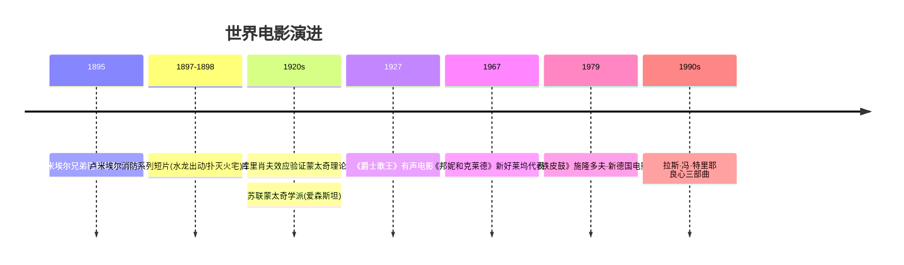
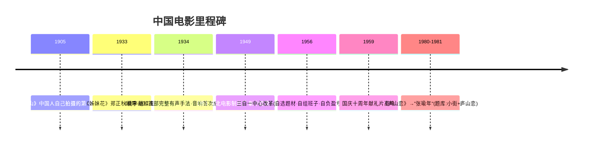
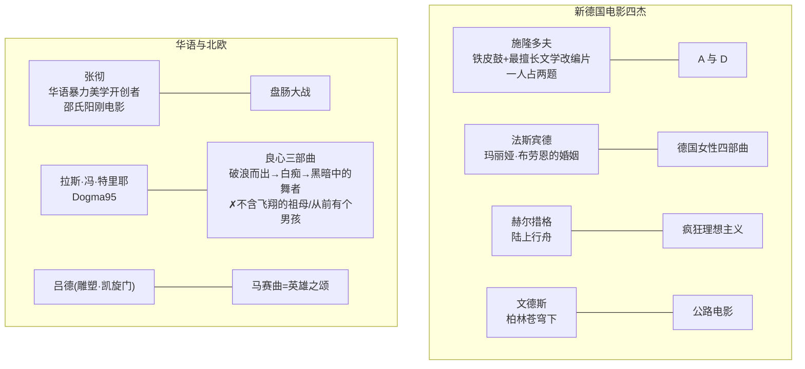
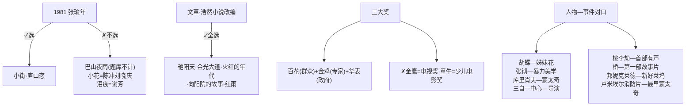

# (03511) 中外电影史 · 考试备考全攻略（湖北版）

> **文档定位**：面向湖北省高等教育考试「动画专业（专升本）」选考课程 **03511 中外电影史** 的完整备考手册。
> **编写日期**：2026-09-01　|　**信息核实时点**：2026年9月（联网核实）
> **准确性约定**：本文档所有事实性信息均经联网核实并附来源；无法核实的标注【待核实】；官方标准答案被收费墙阻隔，所有真题答案均为 **【推导答案】** 并附推导依据。

---

## 一、考试概况与分值分布

### 1.1 课程基本信息（已核实）

| 项目 | 内容 | 来源与证据 |
|---|---|---|
| 课程代码 | 03511 | 湖北省考试大纲首页原文 |
| 课程名称 | 中外电影史 | 同上 |
| 课程性质（湖北） | **湖北省高等教育考试动画专业（专升本）的专业选考课程** | 《湖北省高等教育考试课程考试大纲》第一部分原文："《中外电影史》课程是我省高等教育考试动画专业(专升本)的一门专业选考课程" |
| 学分 | **4 学分**（建议总课时 72 学时，每学分 18 学时） | 湖北大纲"对社会助学的要求"第 8 条原文："本课程共4学分，建议总课时72学时" |
| 考试方式 | 闭卷、笔试 | 湖北大纲"关于命题考试的若干规定"第 6 条 |
| 考试时长 | **150 分钟** | 湖北大纲原文；与湖北统考时段（上午 9:00–11:30 / 下午 14:30–17:00）一致 |
| 评分 | 百分制，**60 分合格** | 湖北大纲原文 |
| 指定教材 | **《中外电影艺术史纲要》，王永收 著，世界图书出版社，2016 年 11 月出版**（ISBN 9787519221799，定价约 36 元） | 湖北大纲"二、教材"原文；ISBN 经电商渠道（淘宝广东/福建/湖北考试教材链接）核实 |
| 参考教材 | 《中国电影史》钟大丰、舒晓鸣著，中国广播电视出版社 1995 年版；《外国电影史》郑亚玲、胡滨著，中国广播电视出版社 1995 年版 | 湖北大纲"参考教材"原文（两书同时是湖南版大纲的指定教材） |
| 前修课程 | 视听语言、影视编导 | 湖北大纲"与本专业其他课程的关系" |

**湖北考试安排**（湖北省教育考试院官网核实）：
- 湖北省该课程每年 **4 月、10 月** 两次统考。2025 年：4 月 11–13 日、10 月 24–26 日；2026 年：4 月 10–12 日、10 月 23–25 日（来源：[湖北省教育考试院 2025 年报考简章](https://www.hbea.edu.cn/html/2024-11/14635.html)、[2026 年报考简章](https://www.hbea.edu.cn/html/2025-12/15552.shtml)）。
- 每日时段：上午 9:00–11:30，下午 14:30–17:00（与大纲 150 分钟一致）。
- 03511 具体安排在哪一天哪个时段，以当次《开考课程考试时间安排表》附件及"考生服务平台"公布为准（简章原文声明）。

**多省开考情况**（供跨省考生参考）：北京、福建、宁夏、广东、湖南、江苏等省亦开考本课程，但**指定教材与大纲可能不同**：
- 湖南版大纲（湖南省教育考试院 2016 年 12 月组编）：指定教材为钟大丰《中国电影史》+ 郑亚玲《外国电影史》两本（见 [考试365 大纲 PDF](https://www.zikao365.com/zcms/contentcore/resource/download?ID=56893)）。
- 江苏版大纲（高纲号 0768，江南大学编）：指定教材同湖南版两本（见 [江苏考试大纲页](https://www.js-zk.com/jszxksjcdg/25479.html)）。
- **排雷提示**：网络流传的《03511（北京/福建/宁夏）中外电影史——考试大纲》一文（[知乎链接](https://zhuanlan.zhihu.com/p/593661738)），其正文实为**《中外动画电影史》（课程代码 04503，动漫设计专科，教材《百年世界动画电影史》）**的大纲，标题与内容不符，系博主误标——**切勿用该文备考 03511**（本轮已核实并排除，详见第六节校验记录）。

### 1.2 考试大纲章节体系（湖北省版，2016 年组编）

湖北大纲按「上编外国电影艺术史 + 下编中国电影艺术史」共十一章组织，其中**台湾电影整章不考**。各章知识层次（重点/次重点/一般）与能力层次（识记/理解/应用）如下表（**逐条摘自大纲原文**）：

#### 上编：外国电影艺术史

| 章 | 标题 | 考核节 | 知识层次 | 能力层次要求（大纲原文要点） |
|---|---|---|---|---|
| 第一章 | 法国电影 | （一）电影的诞生与法国电影先驱 | 次重点 | 识记：电影的发明；理解：乔治·梅里爱 |
| | | （二）艺术电影的探索与诗意现实的关注 | **重点** | 理解：法国印象派电影；先锋派电影；法国诗意现实主义 |
| | | （三）"新浪潮"与"左岸派" | **重点** | 理解：新浪潮电影；左岸派电影 |
| 第二章 | 美国电影 | （一）早期电影活动与电影制作公司的实践 | 一般 | 识记："电影视镜"与"镍币影院"；理解：电影制作公司与影人的实践 |
| | | （二）经典好莱坞电影的兴起与没落 | **重点** | 识记：大制片厂制度的形成；理解：有声时代的到来与类型片的兴盛；**应用：经典好莱坞电影叙事模式的特征** |
| | | （三）新好莱坞电影的调整与提升 | **重点** | 识记：产生原因；理解：时代划分与创作；**应用：新好莱坞电影的美学特征** |
| 第三章 | 苏联电影与东欧电影 | （一）早期苏联电影与蒙太奇学派 | **重点** | 识记：早期苏联电影发展概况及代表人物、代表作品；理解：蒙太奇学派 |
| | | （二）解冻与深入：五六十年代的苏联电影 | 一般 | 识记：苏联电影"新浪潮"代表人物、代表作品 |
| | | （三）在曲折中发展：70 年代后的苏联电影 | 次重点 | 识记：70 年代后的苏联电影四大题材；代表人物、代表作品 |
| | | （四）东欧电影"新浪潮" | 一般 | 识记：波兰、捷克斯洛伐克、南斯拉夫电影发展概况 |
| 第四章 | 德国电影 | （一）表现主义电影与室内剧电影 | **重点** | 理解：德国表现主义电影；室内剧电影 |
| | | （二）奥伯豪森宣言与青年德国电影 | 次重点 | 识记：青年德国电影；理解：奥伯豪森宣言 |
| | | （三）法斯宾德的电影 | 次重点 | 理解：法斯宾德的贡献及代表作 |
| | | （四）其他新德国电影大师 | 一般 | 识记："新德国电影四杰"的贡献及代表作品 |
| 第五章 | 意大利电影 | （一）意大利新现实主义电影 | **重点** | 识记：卢奇诺·维斯康蒂、德·桑蒂斯贡献及代表作；理解：新现实主义产生的背景，罗西里尼、德·西卡；**应用：意大利新现实主义的创作特色** |
| | | （二）意大利现代主义电影 | **重点** | 理解：现代主义电影产生的背景；**应用：安东尼奥尼的电影创作；费里尼的电影创作** |
| 第六章 | 英国电影 | （一）布莱顿学派 | **重点** | 理解：布莱顿学派 |
| | | （二）"格里尔逊学派"与"自由电影"运动 | **重点** | 理解："格里尔逊学派"与"自由电影"运动 |
| | | （三）20 世纪 80 年代以来的英国电影 | 次重点 | 识记：80 年代以来的英国电影 |
| 第七章 | 其他民族国家电影 | （一）欧洲其他国家电影 | 次重点 | 理解：瑞典电影发展脉络；**应用：伯格曼的电影创作** |
| | | （二）西班牙电影 | **不做考试要求** | —— |
| | | （三）亚洲其他国家电影 | 一般 | 识记：日本电影代表大师黑泽明、小津安二郎、沟口健儿、北野武、岩井俊二；韩国、印度电影的发展脉络 |

#### 下编：中国电影艺术史

| 章 | 标题 | 考核节 | 知识层次 | 能力层次要求（大纲原文要点） |
|---|---|---|---|---|
| 第八章 | 1949 年之前的中国大陆电影 | （一）发端与初创（1896–1931） | 一般 | 识记：该阶段主要事件，中国早期电影和企业代表 |
| | | （二）20 世纪 30 年代中国电影（1932–1937） | 次重点 | 识记：有声电影的探索；理解：新兴电影运动 |
| | | （三）20 世纪 40 年代中国电影（1937–1949） | 次重点 | 识记：抗战时期/内战时期电影概况；理解：电影抗战、孤岛电影、国统区电影、解放区电影 |
| 第九章 | 1949 年以后的中国大陆电影 | （一）"十七年"电影（1949–1966） | **重点** | 识记："十七年"培养的电影艺术家及代表性作品；**应用：主要艺术特征** |
| | | （二）"文革"时期的电影（1966–1976） | **不做考试要求** | —— |
| | | （三）新时期的电影创作（1976 至今） | **重点** | 识记：电影创作的新形势；理解：第四代电影导演的创作；**应用：第五代导演的电影创作；电影的多元化发展** |
| 第十章 | 香港电影 | （一）初创期：香江一隅（1896–1945） | 一般 | 识记：香港电影初创期的发展概况 |
| | | （二）发展期：一枝独秀（1945–1966） | 次重点 | 理解：香港电影发展期的主要特征 |
| | | （三）转型期：文化自觉（1966–1978） | 次重点 | 理解：转型期主要类型、特征及代表人物及作品 |
| | | （四）繁荣期：尽皆过火、尽是癫狂（1978–1997） | **重点** | 理解：繁荣期主要类型、特征及代表人物及作品 |
| | | （五）多元期：从"港产"到"港味"（1997 至今） | 次重点 | 理解：多元期主要特征及代表人物及作品 |
| 第十一章 | 台湾电影 | 整章 | **不做考试要求** | —— |

**大纲原文规定的命题比例**（湖北省版）：
1. 能力层次比例：**识记 20%、理解 30%、应用 50%**（应用占比极高——必须练大题，不能只背选择题）。
2. 难度比例：易 : 较易 : 较难 : 难 = **2 : 3 : 3 : 2**。
3. 知识层次比例：**重点 65%、次重点 25%、一般 10%**。
4. "试题覆盖到章，适当突出重点"。

**大纲助学学时分配**（可视为命题权重的一面镜子）：
法国 8 / 美国 8 / 苏联东欧 8 / 德国 4 / 意大利 8 / 英国 4 / 其他民族 8 / 中国 1949 前 8 / 中国 1949 后 8 / 香港 8（合计 72）→ 折算各章权重约 **11.1%×7 章 + 5.6%×2 章 + 11.1%**（德、英两章权重减半）。

### 1.3 题型结构

**⚠️ 重要说明（如实告知）**：截至目前（2026-09），03511 完整试卷原件的大题标题（题量 × 每题分值）**无法免费获取**——真题原件在付费渠道内（见 1.4 与第三节）。以下题型结构来自**两份官方大纲的规定**与**题库站真题元数据**，具体到"每大题多少小题、每小题几分"标注【待核实】：

| 来源 | 题型规定 | 备注 |
|---|---|---|
| **湖北省大纲**（"关于命题考试的若干规定"第 5 条原文） | "试题类型一般分为：**名词解释、判断题、单项选择题、简答题、论述题**" | 无填空题；大纲题型示例依次为判断（《定军山》）、单选（新现实主义）、名词解释（蒙太奇学派）、简答（经典好莱坞叙事模式特征）、论述（新现实主义创作特色） |
| 湖南省大纲（同条规定原文） | "试题类型一般分为：**单项选择题、填空题、名词解释题、简答题、论述题**" | 无判断题；样题含填空（视觉滞留、摄影术、放映术、____） |
| 考生网题库（真题实际元数据） | **2017 年 10 月卷（41 题）**：单选 + 多选 + 主观题；**2016 年 10 月卷（43 题）**：单选 + 判断 + 填空 + 名词解释 + 主观题；**2014 年 10 月卷（38 题）**：单选 + 判断 + 填空 + 名词解释 + 主观题 | 来源：[考生网 03511 题库页](https://www.zikaosw.cn/kaoshi/sub-507.html) 各试卷页（[2017 卷](https://www.zikaosw.cn/kaoshi/paper-107502.html)、[2016 卷](https://www.zikaosw.cn/kaoshi/paper-107503.html)、[2014 卷](https://www.zikaosw.cn/kaoshi/paper-107536.html)） |

**备考结论**：湖北考生按大纲五大题型（判断/单选/名词解释/简答/论述）准备为主；因真题（全国卷）曾出现**填空题与多选题**，且湖北卷 2019-04、2021-10 原题不可见，稳妥起见填空、多选两种题型也一并练习（本文档第三节与文末对照表已按填空高频样式覆盖）。**各题型题量与分值分布【待核实】——建议购买一次完整真题（见 1.4）后补齐。**

### 1.4 历年真题考期总账（合法联网核实结果，按时间倒序）

**最近考期（2022-04 至 2026-04，共 8 个考期）已按时间倒序逐一排查，结论：真题全网无任何免费公开版本**（排查过程与渠道见第三节 3.0 节）。完整考期总账如下：

| 考期 | 卷别 | 获取状态 | 渠道 |
|---|---|---|---|
| **2026 年 4 月** | 各开考省 | ❌ 已开考（湖北 2026-04-10~12，[湖北 2026 简章](https://www.hbea.edu.cn/html/2025-12/15552.shtml)）；**真题全网无公开**（2026-09 排查） | 见 3.0 排查记录 |
| **2025 年 10 月** | 各开考省 | ❌ 已开考（湖北 2025-10-24~26）；**真题全网无公开** | 见 3.0 |
| **2025 年 4 月** | 各开考省 | ❌ 已开考（湖北 2025-04-11~13）；**真题全网无公开** | 见 3.0 |
| **2024 年 10 月** | 福建/湖北等 | ❌ 已开考（福建有考前密训班与网络助学班佐证）；**真题全网无公开**，考后仅见悬赏求助帖（无人应答） | [乐升学](http://www.leshengxue.cn/zikao/7755.html)、[B 站乐升学视频](https://search.bilibili.com/all?keyword=03511%20%E4%B8%AD%E5%A4%96%E7%94%B5%E5%BD%B1%E5%8F%B2%20%E7%9C%9F%E9%A2%98)、学服网 |
| **2024 年 4 月** | 福建等 | ❌ 已开考（乐升学 2024-04 密训班佐证）；**真题全网无公开** | [乐升学/搜狐](https://www.sohu.com/a/766860385_121805923) |
| **2023 年 10 月 / 4 月、2022 年 10 月 / 4 月** | —— | ❓ 无真题公开记录；这两年该课程是否在各省排考**未获直接证据【待核实】**（需查各省当次开考课程表附件） | 见 3.0 |
| **2021 年 10 月** | **湖北卷** | ⛔ 付费墙内（¥14.90 合集）——**可获取的最近考期真题** | [考试书城 8 份合集](https://book.zikaosw.cn/goods/1731-2592.html)（目录明确列"2021年10月（湖北）"） |
| 2020 年 10 月 | 全国卷 | ⛔ 付费墙内（同上合集） | 同上 |
| 2019 年 4 月 | **湖北卷** | ⛔ 付费墙内（同上合集） | 同上 |
| 2018 年 10 月 | 全国卷 | ⛔ 付费墙内（同上合集 + 乐升学密训班目录含"2018年10月真题及答案解析"） | 同上 |
| **2017 年 10 月** | 全国卷【卷别未标注，待核实】 | ✅ 免费预览 14 题（单选）+ 题库题目索引 | [考生网试卷页](https://www.zikaosw.cn/kaoshi/paper-107502.html) |
| **2016 年 10 月** | 全国卷【卷别未标注，待核实】 | ✅ 免费预览 10 题（单选） | [考生网试卷页](https://www.zikaosw.cn/kaoshi/paper-107503.html) |
| 2014 年 10 月 | 全国卷 | ✅ 免费预览 12 题（单选 10 + 判断 2）+ 题库题目索引 | [考生网试卷页](https://www.zikaosw.cn/kaoshi/paper-107536.html) |
| 2012 年 10 月 | 全国卷（含答案） | ⛔ 付费墙内 | 考试书城合集目录 |
| 2012 年 4 月 | 全国卷（含答案） | ⛔ 付费墙内（扫描电子版） | [examebook 商品页](http://examebook.com/product-3634.html) |

> **为什么最近的真题反而拿不到（如实说明）**：03511 属省考/小众选考课程，命题不参加全国统考真题公开流转体系；考后试卷与答案不对外公布，仅在商业渠道流通——而商业合集的收录也止于 **2021 年 10 月**。2022 年以后的考期连付费渠道都未见收录，免费渠道（题库站、文库、贴吧、B 站、搜索引擎）全部排查无果。**"找不到"是客观事实，不是检索遗漏**——本档案拒绝凭记忆重建这些考期的题目。

> **合规说明**：本节及第三节所引真题均来自上述公开网页的免费可见部分，逐字转录自页面原文（题库站转载存在 OCR 痕迹，已作最小清理并保留疑问标注）；付费合集未购买，不转录其内容；**官方标准答案全部被收费墙阻隔，故本文档所有答案均为【推导答案】**（依据教材知识体系与电影史学界公认结论推导，逐题附依据）。

### 1.5 章节分值权重估算

**估算基础**：① 湖北大纲知识层次固定比重（重点 65% / 次重点 25% / 一般 10%）；② 助学学时分配（72 学时折算）；③ 三套免费预览真题（36 题）+ 题库题目索引（约 60 题）的实际考点分布。**统计考期数：3（2017-10 / 2016-10 / 2014-10 的免费可见部分，样本有限，估算值仅供学习优先级排序参考。**

| 章节（湖北大纲） | 大纲层次 | 学时权重 | 预览真题中考点出现情况 | 综合权重估算 |
|---|---|---|---|---|
| 第二章 美国电影（经典好莱坞+新好莱坞） | 重点×2 | 8/72 | 2017-10 单选 5 题（鲍特、格里菲斯、声音、雷电华《公民凯恩》、西部片）；2016-10 单选 2 题；题库论述《公民凯恩》、名词"制片人制度" | **★★★★★ 约 15%** |
| 第五章 意大利（新现实主义+现代主义） | 重点×2 | 8/72 | 2017-10 单选 2 题（新现实主义兴起、维斯康蒂《沉沦》）；湖北大纲论述示例即本章 | **★★★★★ 约 13%** |
| 第一章 法国（含电影诞生） | 重点×2 | 8/72 | 2017-10 单选 3 题（电影诞生标志、梅里爱、艺术电影运动；雷诺阿）；题库填空"法国诗意现实主义象征" | **★★★★★ 约 13%** |
| 第三章 苏联（蒙太奇学派） | 重点 | 8/72 | 2017-10 单选 1 题（20 年代理论家）；题库填空×2（电影眼睛派、苏联美学学派）、判断×2（维尔托夫、理性蒙太奇） | **★★★★ 约 12%** |
| 第九章 1949 后中国大陆（十七年+新时期） | 重点×2 | 8/72 | 2014-10 单选 3 题（样板戏、水华、东影《桥》）；2016-10 单选 1 题（《红高粱》）；题库名词"第五代导演"、填空（吴天明、郑张代际） | **★★★★ 约 12%** |
| 第八章 1949 前中国大陆 | 次重点为主 | 8/72 | 2016-10 单选 3 题（左翼、黄金时代、开拓者郑正秋）；题库论述"影戏"、判断《小城之春》、填空×3（丰泰、《神女》、拍片年份）、名词"王朔电影年" | **★★★★ 约 11%** |
| 第十章 香港电影 | 重点（繁荣期） | 8/72 | 免费预览题中未直接出现（样本局限）；大纲列为重点章 | **★★★ 约 8%** |
| 第七章 其他民族国家（日本为主） | 次重点+一般 | 8/72 | 题库填空（黑泽明 1951）、判断（日本新闻片）；2017-10 单选 1 题（剑戟片） | **★★★ 约 7%** |
| 第四章 德国 | 重点（表现主义）+次重点 | 4/72 | 2017-10 单选 2 题（刘别谦、《影子》新电影） | **★★★ 约 6%** |
| 第六章 英国 | 重点×2 | 4/72 | 免费预览题中未出现 | **★★ 约 3%** |

---

## 二、必考概念详解（按湖北大纲十章顺序）

> **"必考"判定标准**：概念同时满足 ① 处于湖北大纲"重点"或多次"次重点"考核点；② 有真题证据（考期 × 题型，与第三节题目编号一一对应）。每条按三段式展开：**①定义详解 ②考试答题 ③论述展开方法**。
> 真题证据缩写：〔17-10 单选〕= 2017 年 10 月卷单选题；〔16-10 单选〕〔14-10 单选/判断〕同理；〔题库〕= 考生网题库"最新试题答案"栏目（考期归属未标注，见第三节 3.5）。

### 【外国电影史部分】

> **🖼 图解：世界电影技术—流派演进时间线**

📌 锚点：**最早蒙太奇=卢米埃尔消防短片（不是爱森斯坦）；库里肖夫效应=蒙太奇**。

#### 2.1 电影的诞生与卢米埃尔兄弟（第一章·次重点）

**① 定义详解**：电影是 19 世纪末科学技术（视觉滞留原理、摄影术、放映术）发展的产物。**1895 年 12 月 28 日**，法国**卢米埃尔兄弟**（奥古斯特·卢米埃尔、路易·卢米埃尔）在巴黎一家咖啡馆的地下室用他们发明的"活动电影机"（Cinematographe，集摄影、放映、洗印于一体）首次公开售票放映《工厂大门》《火车进站》《水浇园丁》等短片——这一天被公认为**世界电影诞生日**。卢米埃尔的影片以"从实拍的现实中去捕捉生活景观"为特征（纪实性倾向）。〔17-10 单选第 1 题考"电影诞生的标志性事件"，正确项即 1895 年卢米埃尔兄弟〕

**② 考试答题**：
- 常见题型：单选（诞生日/发明者/首映地点）、判断、简答（卢米埃尔与梅里爱两种倾向的对比）。
- 得分点：1895.12.28 / 巴黎 / 卢米埃尔兄弟 / 活动电影机 / 《工厂大门》《火车进站》/ 纪实倾向。
- 易混淆：爱迪生的"电影视镜"（Kinetoscope，1894 年，单人窥视装置，湖北大纲第二章识记点）早于卢米埃尔但**不是**电影诞生的标志；德国斯克拉达诺夫斯基兄弟 1895 年 11 月的放映因影响有限不被公认为起点（〔17-10 单选第 1 题〕的干扰项即包含这两个）。

**③ 论述展开方法**：技术前提（视觉滞留→摄影术→放映术）→ 卢米埃尔（纪实）与梅里爱（戏剧化）的分野 → "电影从玩具变为艺术"的过渡（鲍特—格里菲斯）。此线索可贯穿第一章到第二章美国电影的全部简答论述。

#### 2.2 乔治·梅里爱与"银幕戏剧"（第一章·理解）

**① 定义详解**：梅里爱是法国电影先驱、**世界第一位电影艺术家（导演意义上的戏剧电影创始人）**。他提出**"银幕即舞台"**，把电影由街头记录变为人工编排的戏剧演出：使用舞台化的布景、机关布景、停机再拍、叠印、快慢动作等技巧，拍摄了《月球旅行记》（1902，世界第一部科幻片）等数百部影片，开创了电影的**戏剧主义（再现主义）传统**。〔17-10 单选第 2 题考梅里爱的科幻片《月球旅行记》；〔题库·判断〕"梅里爱认为'银幕即舞台'可以'改变生活'"（√）〕

**② 考试答题**：名词解释"银幕戏剧"三要素——定义（把银幕当舞台、戏剧化排演电影）+ 代表作品（《月球旅行记》《灰姑娘》）+ 影响（确立电影的再现/戏剧传统，与卢米埃尔纪实传统并列为电影两大源头）。易混淆：**"银幕戏剧" ≠ 布莱顿学派**；前者在法国，后者在英国。

**③ 论述展开**：与卢米埃尔对比（记录 vs 排演；户外 vs 摄影棚；纪实美学 vs 戏剧美学）→ 两传统如何分别导向纪录片（格里尔逊、维尔托夫）与故事片（好莱坞）。

#### 2.3 艺术电影运动与布赖顿学派（第一章重点 / 第六章重点）

**① 定义详解**：
- **艺术电影运动**：1908 年前后法国电影界为对抗梅里爱式幻术影片与美国镍币影院廉价片、争取中产观众而发起的运动，以"艺术影片公司"拍摄《吉斯公爵遇刺》（1908）为成功范例——邀请法兰西喜剧院著名演员出演文学名著，使电影首次获得知识分子与上流社会承认。〔17-10 单选第 3 题考"作为成功范例推动艺术电影运动的影片"〕
- **布赖顿学派**：**英国**早期电影流派（约 1900–1905），因主要成员（乔治·阿尔培特·斯密士、詹姆士·威廉逊等）活动于海滨城市布赖顿而得名。贡献：最早把**追逐、追逐—救援等戏剧性场面**引入电影，探索**蒙太奇手法的雏形**（如《中国教会被袭记》）、首次使用特写（《祖母的放大镜》）与视点剪辑，是**世界电影史上最早的电影流派**。〔14-10 单选第 5 题考"世界电影史上最早的电影流派产生于"（英国）；湖北大纲第六章"布莱顿学派"列为重点〕

**② 考试答题**：两个概念都常考名词解释与单选。布赖顿学派三要素：定义（英国早期流派+地点得名）+ 代表（斯密士、威廉逊、《中国教会被袭记》）+ 影响（蒙太奇雏形、移动摄影、特写，启迪格里菲斯）。易错点：**布赖顿学派在英国不在法国**；"最早的电影流派"答案是英国（布赖顿学派），不是法国。

**③ 论述展开**：欧洲早期两种倾向（法国艺术电影运动的"精品化"路线 vs 英国布赖顿学派的技术探索路线）→ 各自对后来电影叙事成熟的贡献。

#### 2.4 法国印象派电影、先锋派与超现实主义（第一章重点）

**① 定义详解**：20 世纪 20 年代法国的**印象主义（第一先锋派）**：以德吕克为中心（"上镜头性"理论），代表杜拉克《微笑的布德夫人》、阿贝尔·冈斯《车轮》、爱浦斯坦等，强调光影构图传达主观印象与人物心理。**超现实主义（第二先锋派之一）**：受达达主义与弗洛伊德梦的学说影响，表现潜意识、非理性世界，代表作**克莱尔《幕间休息》、布努艾尔《一条安达鲁狗》（1928，与画家达利合作）、谷克多《诗人之血》**。〔题库·判断〕"《一条安达鲁狗》是一部超现实主义影片"（√）〕

**② 考试答题**：名词解释"先锋派电影"三要素——定义（20 年代欧洲反对商业电影、探索电影本体美学的实验运动）+ 代表（法国印象派/超现实《一条安达鲁狗》/德国表现主义等）+ 影响（推动电影语言的自觉，蒙太奇理论、纪录电影理论均源于此）。易混淆：法国**印象派**（心理叙事、抒情）≠ **超现实主义**（潜意识、反理性）≠ 德国**表现主义**（恐怖幻想、扭曲布景）——三者同属"欧洲先锋派运动"但国别与主张不同。

**③ 论述展开**：一战后欧洲精神危机 → 先锋派对"纯电影"的追求 → 失败于观众接受 → 转向（法国走向诗意现实主义，苏联走向蒙太奇学派，德国走向现实主义室内剧）。

#### 2.5 法国诗意现实主义（第一章重点，填空/名词/论述高频）

**① 定义详解**：20 世纪 30 年代法国电影流派，**法国电影史上第一个艺术高峰**，被称为"法国电影的黄金时代"。特征：以法国现实生活（尤其底层小人物）为题材，在写实环境中注入诗意与抒情，结局常带宿命论悲剧色彩。代表人物：**让·雷诺阿**（让·雷诺阿即印象派画家奥古斯特·雷诺阿之子）——《托尼》（1934，实景拍摄先驱）、《大幻灭》（1937）、《游戏规则》（1939）；还有杜维威、卡尔内（《雾码头》《天色破晓》）、克莱尔、费代尔等。〔题库·填空〕"____被称之为法国诗意现实主义电影的象征"→ 推导答案：**让·雷诺阿**；〔17-10 单选第 10 题考"奥古斯特·雷诺阿之子、法国诗意现实主义象征的导演"〕

**② 考试答题**：名词解释（湖南大纲样题）三要素——定义（30 年代法国，写实+诗意）+ 代表（雷诺阿《大幻灭》《游戏规则》、卡尔内《雾码头》）+ 影响（直接影响意大利新现实主义与法国新浪潮；实景拍摄、长镜头、深焦技法为奥逊·威尔斯等继承）。易错："诗意现实主义"是 30 年代，别与 20 年代"印象派"、"新浪潮"（50 年代末）混为一谈。

**③ 论述展开**：背景（经济萧条、人民阵线）→ 风格（黑色诗意、宿命诗人、平民题材）→ 雷诺阿个案（场面调度、景深镜头）→ 影响链条（新现实主义—新浪潮均奉其为源头）。

#### 2.6 法国"新浪潮"与"左岸派"（第一章重点，必考）

**① 定义详解**：**新浪潮**是 1958–1962 年间法国青年导演掀起的电影运动，世界电影史上**第三次电影运动**（第一次：欧洲先锋派；第二次：意大利新现实主义）。核心人群是《电影手册》杂志的青年影评人——**特吕弗、戈达尔、夏布罗尔、罗麦尔（侯麦）、里维特**等（"手册派"），另有阿伦·雷乃、玛格丽特·杜拉斯、罗伯—格里叶等作家出身的"**左岸派**"（因聚居塞纳河左岸得名，更重文学性、记忆与心理，代表作《广岛之恋》《去年在马里昂巴德》）。口号"**作者论**"（导演是影片的作者）；特征：个人化叙事、实景拍摄、跳切、自然光效、非职业演员、题材個人化（"自我"的姿态反传统）。代表作：特吕弗《四百下》（1959）、戈达尔《精疲力尽》（1960）。〔题库·名词解释〕"《电影手册》"〕

**② 考试答题**：名词解释"新浪潮"三要素——定义（时间+国别+《电影手册》影评人主导）+ 代表（特吕弗《四百下》、戈达尔《精疲力尽》）+ 影响（作者论确立导演中心地位，席卷世界的现代电影革命，直接冲击催生新好莱坞与新德国电影）。名词解释"《电影手册》"：1951 年创刊的法国电影理论杂志（巴赞等创办），培养出手册派导演，作者论阵地。**新浪潮与左岸派的比较**（湖北大纲明确要求"理解"）：手册派——年轻影评人、拍片快、个人自传色彩、"摄影机—自来水笔"；左岸派——作家群体、重文学性剪辑与时空探索、周期长（雷乃《广岛之恋》《去年在马里昂巴德》）。

**③ 论述展开**：背景（法国电影工业危机+巴赞理论+影评人转型）→ 手册派/左岸派双线 → 作者论的世界影响（新好莱坞、新德国电影乃至中国第四五六代导演观念）。

#### 2.7 格里菲斯与美国电影叙事的成熟（第二章重点）

**① 定义详解**：**D.W.格里菲斯**，美国导演，"电影语言奠基人"，把蒙太奇手法系统化为叙事工具。代表作《**一个国家的诞生**》（1915，好莱坞第一部长片巨制，内容含种族主义争议）、《**党同伐异**》（1916，由四个相对独立的历史故事平行剪辑组成——"平行蒙太奇/最后一分钟救援"的典范，票房失败但艺术上被视为格里菲斯艺术高峰）。〔17-10 单选第 4 题考"由四个相对独立故事组成、体现格里菲斯艺术高峰的影片"→《党同伐异》〕湖北大纲把"格里菲斯的叙事观念"列为第二章重点（应用层次）。

**② 考试答题**：简答/论述"格里菲斯的电影叙事观念及贡献"（湖南大纲论述样题）得分点：①系统使用平行/交叉剪辑（最后一分钟救援）；②确立远景—中景—特写的多景别叙事；③同期伴奏音乐、大制作发行模式；④使电影成为独立艺术。易混淆：《一个国家的诞生》= 1915；**为电影"起名"（命名为 Movie/Cinema 类干扰项）的常见考点**：〔14-10 单选第 3 题〕"为电影这门新艺术起名的人物是"——此题选项为卢米埃尔兄弟/梅里爱/爱迪生/格里菲斯，推导答案：**格里菲斯**（教材通行说法"格里菲斯创造了'电影'这一艺术的语言"，且真题库答案倾向格里菲斯，【推导答案】依据：电影史通行叙述中与格里菲斯"电影艺术奠基人"定位匹配；若教材原文另有表述以教材为准【待核实】）。

**③ 论述展开**：从鲍特《火车大劫案》的初步叙事（1903，美国叙事性电影先驱，以抢劫—追逐—救援为线索的西部片雏形）→ 格里菲斯的集大成 → 影响苏联蒙太奇学派（爱森斯坦自称受《党同伐异》启发）。

#### 2.8 查尔斯·卓别林与"夏尔洛"（第二章重点）

**① 定义详解**：卓别林，英国出生的美国默片喜剧大师，**世界电影史上第一位喜剧明星**（也常被称为第一位世界级电影明星）。创造流浪汉形象"**夏尔洛**"（Charlot：圆顶礼帽、小胡子、手杖、大头鞋、鸭子步），代表作《淘金记》《城市之光》《摩登时代》（1936，工业社会批判）《大独裁者》（1940，第一部正面批判希特勒的有声片）。其喜剧"含泪的笑"，在滑稽中贯注小人物悲悯与社会批判。〔16-10 单选第 7 题考卓别林代表作（《摩登时代》在选项中）；〔题库·名词解释〕"人物形象夏尔洛"；〔题库·判断〕"查尔斯·卓别林是世界电影史上第一个喜剧明星"（√）〕

**② 考试答题**：名词解释"夏尔洛"三要素——定义（卓别林塑造的流浪汉喜剧形象+造型特征）+ 出场影片（《阵雨之间》首现、《摩登时代》等）+ 意义（小人物悲喜剧美学、"含泪的笑"）。单选易错：《摩登时代》讲工业流水线异化（不是《大将军》——那是基顿作品；不是《大学新生》）；卓别林是**英国人**赴美发展。

**③ 论述展开**：默片喜剧四大家对比——卓别林（人情悲喜剧）/ 巴斯特·基顿（"冷面笑匠"，肢体与机械）《将军号》/ 哈罗德·劳埃德（眼镜胆小鬼，摩天大楼挂钟）《最后安全》/ 麦克·赛纳特（启斯东警察闹剧创始人）——后三人是湖北/湖南大纲识记点。

#### 2.9 好莱坞"黄金时代"：大制片厂制度、类型电影（第二章重点，名词解释高频）

**① 定义详解**：20 世纪 30–40 年代好莱坞"黄金时代"建立在**大制片厂制度**上：大制片厂（米高梅、派拉蒙、华纳、20 世纪福克斯、雷电华等五大）实行**流水线生产、明星制、导演中心让位于制片人中心**（制片人制度：制片人对影片拥有最终决定权，统一管理编剧—导演—演员班子）。**类型电影**：按模式化故事、定型化人物、图解化视觉形象批量生产的影片品类，好莱坞三四十年代最突出的类型有**西部片、强盗片、音乐歌舞片、喜剧片**（〔16-10 单选第 10 题〕即考此四类）等。〔题库·名词解释〕"制片人制度"〕

**② 考试答题**：名词解释"制片人制度"三要素——定义（制片厂体系下制片人集权的管理制度）+ 内容（三方面：流水线/明星制/类型化）+ 影响（黄金时代的工业基础与艺术束缚并存，50 年代后在电视冲击与反垄断法令下瓦解）。名词解释"类型电影"三要素——定义 + 三大特征（模式化情节/定型化人物/图解化影像）+ 代表类型与代表作（西部片《关山飞渡》〔17-10 单选第 9 题考约翰·福特《关山飞渡》属西部片〕、强盗片《疤面人》、歌舞片《雨中曲》等）。简答"经典好莱坞电影叙事模式的特征"（湖北大纲应用层示例题）：①戏剧化的因果叙事结构（起承转合、善恶对立、大团圆结局）；②连贯性剪辑（隐形剪辑、180 度轴线）；③类型化人物与明星魅力；④娱乐性、观众至上。

**③ 论述展开**：黄金时代兴（有声技术 1927《爵士歌王》、大萧条中电影是廉价娱乐）→ 衰（1948 派拉蒙判决反垄断、电视普及、观众老龄化）→ 新好莱坞的调整（见 2.10）。

#### 2.10 《公民凯恩》与新好莱坞（第二章重点，论述高频）

**① 定义详解**：**《公民凯恩》（1941，奥逊·威尔斯导演，雷电华出品）**被称为"**美国第一部现代主义的杰出电影作品**""现代电影的开山之作"：以报业大亨凯恩之死为悬念，通过五位讲述人的回忆碎片拼合人物全貌（多视点叙事），深度摄影（大景深镜头）、长镜头、天花板布景、音响蒙太奇等手法突破好莱坞成规。〔17-10 单选第 8 题考"雷电华公司由奥逊·威尔斯拍摄的最重要影片"〕〔题库·论述〕"为什么说《公民凯恩》是美国第一部现代主义的杰出电影作品？"〕
**新好莱坞**：60 年代末–70 年代美国电影复兴运动（"美国新浪潮"）。背景：旧体制危机（制片厂解体、电视竞争、观众代际更替）+ 法国新浪潮冲击。旗手级人物：**科波拉《教父》（1972）及其续集连获奥斯卡**〔题库·填空〕"被称之为美国新浪潮的旗手的大导演____，他的《教父》及续集均获奥斯卡奖"→ 推导答案：**科波拉**（【推导答案】依据：教材对"新好莱坞旗手"的通行表述为弗朗西斯·科波拉，其《教父》第一、二部分别获第 45、47 届奥斯卡最佳影片；另一常提及人物为《邦妮和克莱德》《毕业生》主创，但"《教父》及续集获奥斯卡"唯一对应科波拉）〕；还有丹尼斯·霍珀《逍遥骑士》（1969，新好莱坞开山）、马丁·斯科塞斯《出租车司机》、斯皮尔伯格《大白鲨》等。美学特征：反类型、反英雄、写实与暴力开放性结局、导演个人化（作者论美国化）、新的镜头语言。〔17-10 单选第 14 题考"因粗犷颗粒状摄影等被称为'美国新电影'的影片"（选项含《影子》，卡萨维茨作品）〕

**② 考试答题**：论述《公民凯恩》（题库原题）答题骨架：①背景（黄金时代顶峰期中的异端，威尔斯 26 岁处女作）；②叙事革命——多视点闪回结构打破线性因果；③视听革命——大景深、长镜头、仰拍天花板、音响蒙太奇；④主题现代性——"玫瑰花蕾"的不可知论、资本与人性的异化，人物非英雄化；⑤影响——现代电影里程碑（巴赞长镜头理论的实证）。简答"新好莱坞电影的美学特征"（湖北大纲应用层）：青年导演作者化、暴力与性内容尺度突破、开放结局、实景与手持、类型重构（新强盗片《邦妮和克莱德》、新西部片《午夜牛郎》等）。

**③ 论述展开**：新好莱坞 = 好莱坞自我调整（吸收欧洲艺术电影）+ 越战/水门时代精神危机的银幕投射 → 70 年代《教父》《出租车司机》高峰 → 80 年代斯皮尔伯格/卢卡斯大片策略回归商业。

#### 2.11 苏联蒙太奇学派（第三章重点，名词解释/填空必考）

**① 定义详解**：20 世纪 20 年代苏联以**爱森斯坦、普多夫金、维尔托夫、库里肖夫**为代表的流派，**世界电影史上第一个完整、系统的电影美学学派**。核心主张：**蒙太奇（剪辑）是电影艺术的本体**——"两个镜头的对列产生第三种意义"。
- **爱森斯坦**：《战舰波将金号》（1925，"敖德萨阶梯"段落）、《十月》；提出"**理性蒙太奇**"（杂耍蒙太奇→理性电影），认为蒙太奇能产生抽象思想（≠ 感性电影；〔题库·判断〕"理性蒙太奇也称感性电影"为 **×**）。
- **普多夫金**：《母亲》（1926）；"叙事蒙太奇"（链条式），著有《电影脚本论》《电影技巧》——〔17-10 单选第 6 题考"20 年代发表多部电影理论著作、贡献电影美学"的人物群（库里肖夫/爱森斯坦/普多夫金等）〕。
- **库里肖夫**："**库里肖夫效应**"（同一面孔接不同镜头产生不同情绪的实验）。
- **维尔托夫**："**电影眼睛派**"——"电影应该像人眼一样去客观地记录生活实景"，反对搬演，推动了纪录片艺术的发展（〔题库·判断〕该句为 √；〔题库·填空〕"____的'电影眼睛派'的美学主张，推动了纪录片艺术的发展"→ 维尔托夫；〔题库·填空〕"世界电影史上第一个完整、系统的电影美学的学派是苏联的____"→ **蒙太奇学派**）。
- 另有"奇异演员养成所"（培养"类型化"演员的实验机构，湖南大纲识记点）。

**② 考试答题**：名词解释"蒙太奇学派"（湖北大纲样题）三要素——定义（20 年代苏联，蒙太奇为电影本体美学）+ 代表人物与作品（爱森斯坦《战舰波将金号》、普多夫金《母亲》、维尔托夫电影眼睛派）+ 影响（蒙太奇成为电影基本语法；爱森斯坦理论是世界电影理论第一个高峰）。填空高频：电影眼睛派=维尔托夫；库里肖夫效应；理性蒙太奇=爱森斯坦。易错：爱森斯坦"理性蒙太奇"**不叫**感性电影；蒙太奇学派在**苏联**不在法国。

**③ 论述展开**："简述爱森斯坦对电影艺术的贡献"（湖南大纲简答样题）：①理论（杂耍/理性蒙太奇，镜头对列冲突论）；②实践（《战舰波将金号》敖德萨阶梯的节奏剪辑经典）；③影响（蒙太奇学派领袖、启发行进间的世界观表达）。可延伸苏联电影与十月革命宣传语境的关系。

#### 2.12 德国表现主义、室内剧与新德国电影（第四章）

**① 定义详解**：
- **德国表现主义电影**（1919–1924）：一战后德国，以扭曲、夸张、倾斜的布景与光影外化人物恐惧疯狂的心理。开山作**《卡里加里博士的小屋》**（1919，罗伯特·维内导演，表现主义画家设计布景）；另有《诺斯费拉图》（茂瑙，吸血鬼片源头）、《大都会》（弗里茨·朗）。
- **室内剧电影**（Kammerspiel）：与表现主义并行的德国流派，小人物室内剧，克制写实，代表作《最卑贱的人》（茂瑙导演，"移动摄影"典范）。
- 1919 年**刘别谦**《杜巴莱夫人》打开德国电影国际市场（〔17-10 单选第 5 题〕）。
- **新德国电影**：1962 年 26 位青年导演发表《**奥伯豪森宣言**》("旧电影已死，我们信赖新的")发起；"新德国电影四杰"：**法斯宾德**（《玛丽亚·布劳恩的婚姻》，“德国好莱坞”式高产导演）、**赫尔佐格**（《阿基尔，上帝的愤怒》）、**施隆多夫**（《铁皮鼓》，戛纳金棕榈+奥斯卡）、**文德斯**（《柏林苍穹下》）。

**② 考试答题**：名词解释"奥伯豪森宣言"三要素——定义（1962 德国奥伯豪森短片节上青年导演宣言）+ 内容（打破旧惯例、创立新德国电影）+ 影响（新德国电影运动起点，四杰崛起）。名词解释"室内剧电影"：定义（表现主义时期德国小成本室内小人物剧）+ 代表（《最卑贱的人》）+ 影响（移动摄影、心理刻画的现实主义贡献）。易错：**表现主义 ≠ 先锋派**（前者德国叙事恐怖片传统，后者法国实验抽象）；《最卑贱的人》是**茂瑙**的室内剧，不是表现主义。

**③ 论述展开**：威玛德国社会心理（战败、通货膨胀、表现主义艺术的土壤）→ 表现主义兴衰（1924 经济稳定后衰落，人才赴好莱坞——恐怖片/黑色电影血统）→ 室内剧的现实主义修正 → 新德国电影（法斯宾德对美国类型的德国化改造、历史反思）。

#### 2.13 意大利新现实主义（第五章重点，论述必考）

**① 定义详解**：二战后（约 1945–1951）意大利电影运动，**世界电影史上第二次电影运动**。口号"**把摄影机扛到大街上**""还我普通人"。创作特色（巴赞总结为"真实美学"）：①题材真实——反法西斯战争创伤、战后失业贫困等现实问题；②实景拍摄、自然光；③非职业演员（或混用）；④长镜头、深焦，少剪辑；⑤开放式结局、日常生活化叙事；⑥方言口语。代表：**罗西里尼**"战争三部曲"《罗马，不设防的城市》（1945，奠基之作）、《游击队》；**德·西卡**《偷自行车的人》（1948，非职业演员经典）《温别尔托·D》；**维斯康蒂**《沉沦》（1943，新现实主义先声，揭穿墨索里尼时期官方"健康"电影谎言——〔17-10 单选第 12 题〕）、《大地在波动》；**德·桑蒂斯**《罗马十一时》（〔14-10 单选第 6 题〕干扰项，该片亦属新现实主义）。〔17-10 单选第 11 题考新现实主义兴起时间（二战之后）〕湖北大纲把"新现实主义的创作特色"直接作为论述题示例。

**② 考试答题**：论述"意大利新现实主义的创作特色"（湖北大纲论述样题）骨架：背景（战败废墟、器材匮乏、真理狂热）→ 六大特色（上述）→ 代表导演作品（罗西里尼/德·西卡/维斯康蒂各一例）→ 影响（写实美学影响世界：法国新浪潮、日本独立制片、中国纪实美学；巴赞长镜头理论的现实依据）。单选高频：奠基作《罗马，不设防的城市》；《偷自行车的人》非职业演员。

**③ 论述展开**：先声（《沉沦》1943）→ 全盛（1945–48）→ 分化衰落（50 年代初经济恢复、政治压力，德·西卡《温别尔托·D》后式微）→ 余脉（费里尼、安东尼奥尼从新现实主义出发走向现代主义——衔接第五章第二节）。

#### 2.14 意大利现代主义：安东尼奥尼与费里尼（第五章重点·应用）

**① 定义详解**：50 年代末–60 年代意大利电影转向内心与哲理的**现代主义**（"内心的现实主义"）。背景：战后经济奇迹后的精神空虚、"上帝之死"的存在主义氛围。**安东尼奥尼**：疏离美学——"人类情感三部曲"《奇遇》《夜》《蚀》，及《红色沙漠》（1964，"第一部真正的彩色电影"之说——用色彩外化心理；〔14-10 单选第 6 题〕干扰项涉及《红色沙漠》《八部半》《道路》《罗马十一时》考"电影史上第一部彩色影片"→ 推导答案【待核实】，见第三节该题解析）；《放大》戛纳金棕榈。**费里尼**：浪漫巴洛克式幻想，《道路》（1954，杰尔索米娜形象全球轰动）、《甜蜜的生活》（1960，戛纳金棕榈）、《**八部半**》（1963，导演自我分析的梦境套层结构巅峰）。

**② 考试答题**：大纲要求"应用：安东尼奥尼/费里尼的电影创作"——可能出简答。安东尼奥尼得分点：题材（中产情感疏离、不可交流）、形式（长镜头、空镜头"空白"、颜色即心理《红色沙漠》）、地位（现代主义电影代表）。费里尼得分点：从新现实主义编剧出身（《罗马，不设防的城市》编剧之一）→ "费里尼式"马戏团狂欢与自省（《八部半》）；幻想与现实的融合。易错：《八部半》是**费里尼**的，《红色沙漠》是**安东尼奥尼**的——《道路》是费里尼，《放大》是安东尼奥尼，两两别混。

**③ 论述展开**：从新现实主义"外部现实"到现代主义"内部现实"的转移 → 与法国左岸派（雷乃）构成欧洲现代电影双峰 → 对世界艺术电影（含中国第五代之前的影坛启蒙）的影响。

#### 2.15 英国电影：格里尔逊与自由电影（第六章重点）

**① 定义详解**：英国纪录片学派领袖**格里尔逊**（John Grierson）1929 年执导《漂网渔船》并首创 "Documentary（纪录片）" 一词，主张"对现实的创造性处理"，形成"格里尔逊学派"（解说+画面，社会责任感）。**自由电影运动**（1956–1959）：英国青年（林赛·安德森、卡莱尔·赖兹、托尼·理查森等）以短片反叛保守商业片与纪录教条，关注工人阶级日常生活（"我们需要的不是优质电影，而是自由"），直接孕育 60 年代"英国新浪潮"（厨房水槽现实主义：《星期六晚上和星期天早晨》等）。布莱顿学派见 2.3。

**② 考试答题**：简答/名词三要素："格里尔逊学派"——定义（30 年代英国纪录片运动，格里尔逊领导）+ 代表（《漂网渔船》、帝国商品营销局电影处/邮政总局电影机构）+ 影响（确立纪录片社会功能传统，"创造性处理现实"）。"自由电影"——定义（50 年代末英国短片运动）+ 主张（日常、工人阶级、反商业）+ 走向（英国新浪潮）。易错：格里尔逊是**纪录电影**学派；自由电影是**故事片观念**运动——两者别混。

**③ 论述展开**：英国电影三条线——早期布赖顿学派（技术叙事开创）→ 纪录片运动（格里尔逊，影响维尔托夫之外的西方纪实传统与央视纪实风格）→ 自由电影与新浪潮（社会写实）。

#### 2.16 伯格曼与日本电影大师（第七章）

**① 定义详解**：**英格玛·伯格曼**（瑞典）：《第七封印》《野草莓》（1957，意识流叙事先声）、《假面》《沉默》——用电影探讨生死、上帝缺席、人际隔膜，欧洲艺术电影"现代主义三圣"之一（与费里尼、安东尼奥尼/塔可夫斯基并称说法不一【待核实】）。**日本电影**（民族电影兴起）：**黑泽明**《罗生门》（1950 完成，**1951 年威尼斯金狮奖**——日本电影征服西方的开端〔题库·填空〕"1951 年，日本导演黑泽明的作品《____》问世，征服了西方，轰动了世界"→《罗生门》）《七武士》《影子武士》；**小津安二郎**《东京物语》（榻榻米机位、执扇构图、物哀美学）；**沟口健二**《雨月物语》（一场一镜、卷轴式移动，威尼斯银狮）；另有大岛渚、今村昌平及北野武、岩井俊二（湖北大纲识记名单）。〔17-10 单选第 13 题考剑戟片（武打片）特有职位——推导答案为"武术指导/击术指导"类【待核实】〕〔题库·判断〕"日本电影作为开路先锋的是新闻片"（√，日本电影初期新闻片先行的史实）。

**② 考试答题**：单选/填空得分点：黑泽明=《罗生门》=1951 威尼斯金狮；小津=《东京物语》=低机位物哀；沟口=《雨月物语》=长镜头。名词解释若考"《罗生门》"：三要素——定义（黑泽明 1950，多视点叙事）+ 内容（一桩案件中四人各执一词）+ 影响（主观主义叙事经典、"罗生门"成为公案式隐喻，西方认识日本电影的起点）。易错：《雨月物语》是**沟口健二**，《东京物语》是**小津**，《罗生门》是**黑泽明**——三位日本大师作品两两组合是经典干扰项。

**③ 论述展开**："日本电影的民族性"（湖南大纲应用样题）：传统美学（物哀、幽玄）+ 民族形式（能乐、剑戟、时代剧）+ 西方叙事的融合；以黑泽明（西式动感+武士道）与小津（纯日本静止美学）对比展开。

### 【中国电影史部分】

> **🖼 图解：中国电影"第一部"时间线**

📌 锚点：**有声=桃李劫(1934)；第一部故事片=桥(1949)；姊妹花=胡蝶**。

#### 2.17 中国电影的奠基："影戏"与第一代导演（第八章，填空/判断高频）

**① 定义详解**：1896 年 8 月电影传入上海（徐园"又一村"放映）；**1905 年秋**，北京**丰泰照相馆**创办人任景丰拍摄京剧表演艺术家谭鑫培主演的无声片《**定军山**》——**中国人自己摄制的第一部电影**〔题库·填空〕"中国最早的电影是北京'丰泰照相馆'拍摄的《____》"→《定军山》〔题库·填空〕"中国最早的拍片尝试是在____年秋开始的"→ 1905；湖北大纲判断样题即"《定军山》是中国自己摄制的第一部电影？（√）"〕1913 年郑正秋、张石川拍摄中国第一部短故事片《**难夫难妻**》（郑正秋编剧）；1923 年郑正秋《**孤儿救祖记**》奠定中国叙事电影范式。**郑正秋、张石川被称为"中国第一代导演"**〔题库·填空〕"郑正秋、张石川等被称为中国的第____代导演"→ 一〕。早期"**影戏**"观念：把电影视为戏剧（戏曲、文明戏、鸳鸯蝴蝶派文学）之一种——重教化、重情节因果、舞台化时空。〔题库·论述〕"中国初期'影戏'电影的主要特征有哪些？"〕早期电影企业：明星公司（郑张）、天一（邵氏前身）、长城、神州（"神州派"市民电影，湖南大纲识记点）等。

**② 考试答题**：简答"初期影戏电影的主要特征"（题库原题）得分点：①以戏剧化叙事为本（ Conflict—因果链—大团圆）；②教化社会功能观（"影戏载道"）；③题材市民生活/伦理（鸳鸯蝴蝶派）；④形式舞台化（场景少、场面记录、表演夸张）；⑤以明星公司与郑正秋为代表（《孤儿救祖记》范式）。填空高频：1905/《定军山》/《难夫难妻》/第一代。易错：《定军山》是**无声**京剧纪录片性质影片，不是有声；中国第一部**有声**故事片是 1931 年《歌女红牡丹》（明星公司，蜡盘配音）——有声探索属第八章第二节识记点。

**③ 论述展开**（题库论述原题"试论述中国电影发展的历史特点"骨架之一）：从影戏传统 → 30 年代新兴电影 → 战时战后 → 十七年主流电影样式，"影戏"作为贯穿中国电影史的结构性传统（教化+情节+大团圆），在谢晋等第三代导演中延续，在第五代中断裂。

#### 2.18 30 年代电影与新兴（左翼）电影运动（第八章次重点）

**① 定义详解**：1932–1937 年是中国电影**第一个黄金时代**〔16-10 单选第 4 题考"中国电影的第一个黄金时代"（二十世纪三十年代）〕。1930 年成立、1932 年后在中国共产党电影小组（夏衍、田汉、阳翰笙等）领导下兴起**新兴电影运动（左翼电影运动）**〔16-10 单选第 3 题考"左翼电影运动兴起于"→ 推导答案：1932 年（左翼电影以 1933 年《狂流》为发端、1932–33 运动成形；选项 1930/1932/1949/1978 中教材通行表述为 1932 年前后兴起，与 1933 "电影年"衔接【推导答案】）〕。代表作品：夏衍编剧《狂流》《春蚕》、郑正秋《姐妹花》、蔡楚生《渔光曲》（1935 莫斯科国际电影节荣誉奖——中国影片首次国际获奖）、吴永刚《**神女**》（1934，阮玲玉主演，被称为**中国无声电影的巅峰之作**〔题库·填空〕"吴永刚的《____》被称为中国无声电影的巅峰之作"→《神女》〕）、孙瑜《大路》、袁牧之《马路天使》（1937，30 年代电影集大成）等。沈西苓《十字街头》、周璇主《马路天使》等构成都市左翼景观。

**② 考试答题**：得分点链条：1932 左翼运动（党的电影小组）→ 1933"电影年" → 《渔光曲》首获国际奖 → 《神女》无声巅峰 → 1937《马路天使》现实主义高峰。名词解释"新兴电影运动"三要素——定义（1932–37 党领导进步电影运动）+ 代表（夏衍、田汉、《狂流》《渔光曲》）+ 影响（确立现实主义主流与传统、影评阵地）。易错：《神女》导演是**吴永刚**（不是蔡楚生/费穆）；《渔光曲》导演是**蔡楚生**；《马路天使》是**袁牧之**。

**③ 论述展开**：外因（九一八后民族危机改变观众心理）+ 内因（党的组织、苏联电影理论翻译、影评斗争）→ 左翼电影的现实主义范式 → 抗战爆发中断（转入战时电影）。

#### 2.19 战时与战后电影：《小城之春》与《一江春水向东流》（第八章次重点）

**① 定义详解**：抗战时期形成**国统区电影（武汉重庆"中制""中电"抗战宣传片）**、**孤岛电影（1937–41 上海租界，古装片 Commercial 倾向与进步内核并存）**、**根据地电影（延安电影团，袁牧之、吴印咸纪录片《延安与八路军》）**、伪满"满映"等多元格局（湖北大纲"理解"层明确列出四概念）。**战后 1946–49 迎来现实主义高峰**：蔡楚生、郑君里《**一江春水向东流**》（1947，家庭悲剧浓缩抗战史诗，观众人次纪录）；昆仑公司《八千里路云和月》（史东山）《万家灯火》（沈浮导演，反映社会现实〔题库·判断〕√〕《乌鸦与麻雀》（1949，40 年代后期**喜剧片**最高成就〔14-10 单选第 7 题〕→ 推导答案《乌鸦与麻雀》（四选项《三毛流浪记》《乌鸦与麻雀》《冬梅》《北大荒人》中以《乌鸦与麻雀》成就与教科书地位最高【推导答案】）〕；文华公司（费穆、佐临、张爱玲编剧《太太万岁》）"文华"公司及其创作是湖南大纲识记点。**费穆《小城之春》（1948）**：五人关系（玉纹、礼言、志忱、妹妹、老黄）的三角情感戏，长镜头、慢节奏、画外音独白、废园意象——中国诗化电影的最高成就，80 年代被重新发现为"中国现代电影的先驱"〔题库·判断〕"《小城之春》是由费穆导演的"（√）〕。

**② 考试答题**：名词解释"孤岛电影"三要素——定义（1937–41 上海租界特殊环境电影）+ 状况（古装片热潮《木兰从军》、 借古喻今）+ 评价（商业性与爱国性交织）。名词解释《小城之春》：定义（费穆 1948 文华）+ 内容与形式（长镜头、独白、诗化）+ 地位（中国诗电影巅峰、影史重评经典）。易错：《小城之春》导演**费穆**、《一江春水向东流》**蔡楚生（与郑君里联合）**、《万家灯火》**沈浮**。

**③ 论述展开**：战时"电影抗战"→ 战后两大公司路线对比（昆仑的社会悲剧史诗 vs 文华的都市人文喜剧）→ 1948–49 三大杰作（《一江春水》《小城之春》《乌鸦与麻雀》）预告新中国电影分流。

#### 2.20 "十七年"电影（1949–1966）（第九章重点）

**① 定义详解**：新中国前十七年电影。**1949 年东影（东北电影制片厂）完成新中国第一部故事片《桥》**〔14-10 单选第 8 题〕，此后长影、北影、上影、八一厂体系建立。发展阶段：1949–55 初创（获奖作《白毛女》《钢铁战士》《董存瑞》）；1956–59 高潮（"难忘的 1959"国庆十周年献礼：《林则徐》《聂耳》《青春之歌》《我们村里的年轻人》《五朵金花》）；1959–66（"十七年"尾声，《红旗谱》《红色娘子军》《甲午风云》《早春二月》（谢铁骊，柔石原著改编）《舞台姐妹》）。**"十七年"电影艺术家**（大纲识记点）：崔嵬、水华（**《伤逝》〔14-10 单选第 9 题〕水华导演，1981，鲁迅原著；其《白毛女》《林家铺子》亦为代表作**）、郑君里、谢晋（《女篮五号》《红色娘子军》《舞台姐妹》）、谢铁骊、凌子风、王苹（新中国第一位女导演《柳堡的故事》参与）、《英雄虎胆》严寄洲等。艺术特征（大纲"应用"层）：革命现实主义与革命浪漫主义结合（两结合）；题材革命历史与工农兵生活主导；叙事影戏传统延续+社会主义英雄典型塑造；样式以正剧为主兼喜剧（《今天我休息》）、戏曲片繁荣。**"文革"时期（1966–76）电影整章不考**（湖北大纲明示），但**样板戏电影数量题出现过真题**〔14-10 单选第 10 题〕"从 1969–1972 年间，中国共拍摄了几部样板戏电影？"（选项 5/9/8/6）→ 推导答案：**6 部**（依据：1969–1972 年间拍摄完成的样板戏电影为京剧《智取威虎山》（1970）、《红灯记》（1970）、《沙家浜》（1971）、《奇袭白虎团》（1972）与舞剧《红色娘子军》（1971）、《白毛女》（1972）共六部；《龙江颂》《杜鹃山》等拍摄于 1973 年后，不计入该区间【推导答案，若教材另有统计口径以教材为准】）〕

**② 考试答题**：简答"'十七年'电影的主要艺术特征"（大纲应用层）：①"两结合"创作方法；②工农兵形象与英雄典型中心；③革命历史题材主导、民族化探索（《林则徐》民族气节、《早春二月》知识分子改造）；④继承影戏传统的大团圆/光明的结尾；⑤不足：政治功利、题材狭窄、公式化倾向（结合 1961 电影故事片创作会议"离经叛道"论争等可加分）。单选高频：新中国第一部故事片=《桥》；水华=《伤逝》《林家铺子》《白毛女》；谢晋=《女篮五号》《红色娘子军》《芙蓉镇》〔16-10 单选第 6 题考《芙蓉镇》片种——推导答案：**正剧**（谢晋悲剧正剧史诗风格之辩，教科书多归"正剧/悲剧性正剧"【待核实】，四选项喜剧/悲剧/正剧/连续剧中最合理为正剧）〕。

**③ 论述展开**："十七年"轨迹（初创—高潮—调整—衰退）→ 三次会议（1956"舍饭寺"会议、1959 献礼高潮、1961 新侨会议"票房价值"之辩）→ 与新时期电影的断裂与延续（谢晋跨越两个时代）。

#### 2.21 新时期电影与代际导演：第四代、第五代（第九章重点，论述必考）

**① 定义详解**：**第四代导演**（50 年代入行、70 年代末登场的"迟到的中年人"）：吴贻弓（《城南旧事》"散文诗电影"）、谢飞（《本命年》《黑骏马》）、**吴天明**（《人生》1984；《**老井**》1987，东京国际电影节大奖——"将中国优秀影片推进到世界电影的先进行列"〔题库·填空〕"1987 年由中年导演吴天明拍摄的故事片《____》"→《老井》〕）、黄健中、张暖忻（《沙鸥》，"电影语言现代化"宣言作者之一）、吴永刚与吴贻弓联合《巴山夜雨》。**第五代导演**（1982 年后北京电影学院 78 级毕业生）：**张艺谋**（《红高粱》1987，**柏林金熊奖——中国影片首次在世界三大电影节获最高奖**〔16-10 单选第 5 题考《红高粱》导演〕〕、陈凯歌（《黄土地》1984，第五代开山之作；《霸王别姬》1993 戛纳金棕榈）、田壮壮（《猎场札撒》《盗马贼》）、黄建新（《黑炮事件》）、何群、李少红等。特征：文化反思（寻根、民族寓言）、影像本体自觉（造型、色块、大块面构图）、历史叙事的个人化重写。其后"第六代"（张元、王小帅、贾樟柯、路学长、管虎等，90 年代登场，都市个体经验、纪实风格）。**"王朔电影年"**〔题库·名词解释〕：**1988 年**，王朔四部小说同年被搬上银幕（《顽主》《轮回》《大喘气》《一半是火焰一半是海水》），被称为"王朔电影年"——大众文化、痞子文学对精英文化的冲击标志。**丁荫楠《孙中山》**（1986，史诗片〔题库·判断〕√〕。多元化发展（大纲"应用"层）：80 年代末娱乐片大潮、三大电影节获奖序列（《红高粱》1987 金熊→《霸王别姬》1993 金棕榈→《活着》1994 戛纳评委会大奖等）。

**② 考试答题**：名词解释"第五代导演"（题库原题）三要素——定义（80 年代中期以北电 78 级为主力的青年导演群体）+ 代表（张艺谋《红高粱》、陈凯歌《黄土地》、田壮壮）+ 特征与影响（文化反思+影像革命；把中国电影推向世界）。论述"代际导演比较"模板（**本课程论述题最高频模式**）："总体特征—代表导演及作品—承前启后关系"三段式：
- 第一代（郑正秋、张石川）：影戏奠基，教化+商业；
- 第二代（蔡楚生、费穆、沈浮、孙瑜等三四十年代）：现实主义高峰，《一江春水》《小城之春》；
- 第三代（十七年：谢晋、水华、崔嵬、郑君里）：社会主义经典，革命叙事；
- 第四代（吴天明、吴贻弓、谢飞）：纪实美学、诗电影，"电影语言现代化"；
- 第五代（张艺谋、陈凯歌、田壮壮）：文化寓言、影像造型革命；
- 第六代（贾樟柯、王小帅、张元）：都市边缘、个人记忆。
比较维度：与时代政治的关系、影像观念（戏剧性→纪实性→造型性→个人性）、受众与市场。填空高频：吴天明=《老井》=1987；郑张=第一代；《红高粱》=张艺谋=金熊。

**③ 论述展开**：新时期起点（1979"电影语言现代化"讨论）→ 四代五代接力（1984《黄土地》宣言、1987《红高粱》问鼎）→ 90 年代分流（主旋律/艺术/娱乐三分）→ 加入 WTO 后产业化的前身。可引《孙中山》史诗形态作为第三代向新时期过渡的个案。

#### 2.22 香港电影（第十章重点）

**① 定义详解**：湖北大纲按五期梳理：**初创期（1896–1945）**——1913 年《庄子试妻》（黎民伟，与布拉斯基华美公司合作）为香港出品首部故事短片；**发展期（1945–66）"一枝独秀"**——粤语片兴盛（朱石麟、李晨风等"中联"群体，粤语电影清洁运动）、50 年代国语片南来影人（邵氏父子、长城、凤凰、新联"长发公司"格局）；**转型期（1966–78）"文化自觉"**——邵氏兄弟（邹文怀后创嘉禾）新武侠世纪：**胡金铨《大醉侠》（1966）、张彻《独臂刀》（1967）**阳刚暴力美学，楚原古龙奇情武侠（70 年代）；李小龙（1971《唐山大兄》功夫片世界热潮）；**繁荣期（1978–97）"尽皆过火、尽是癫狂"**（美国影评人语）：**许氏兄弟喜剧**（《半斤八两》）、**成龙（《醉拳》1978 谐趣功夫→《警察故事》系列动作）**、**新浪潮（1979：徐克《蝶变》、许鞍华《疯劫》、章国明《点指兵兵》——留洋电视导演群体）**、吴宇森英雄片（《英雄本色》1986）、王家卫（《旺角卡门》1988起作者电影）、周星驰无厘头（90 年代）、徐克武侠（《黄飞鸿》）；**多元期（1997 至今）"从港产到港味"**——合拍片主导、杜琪峰银河映像、陈果独立电影、周星驰《功夫》。

**② 考试答题**：名词解释"香港电影新浪潮"三要素——定义（1979 前后留洋电视人转投影坛）+ 代表（徐克《蝶变》、许鞍华《疯劫》）+ 影响（现代电影语言本土化、奠定 80–90 年代港片繁荣主将）。名词解释"功夫片/武侠片"：定义（武打类型：刀剑武侠—拳脚功夫）+ 代表（胡金铨、张彻、李小龙、成龙）+ 影响（最具世界影响的中国类型）。易错：胡金铨《大醉侠》/《侠女》（1971 戛纳综合技术奖）别与张彻作品混；李小龙是**功夫片**（拳脚）不是刀剑武侠片。

**③ 论述展开**：港片类型体系（武侠—功夫—喜剧—英雄片—无厘头）→ "尽皆过火、尽是癫狂"的美学解读（能量过度、速度、杂烩）→ 97 后北进合拍与文化身份（"港味"存续之辩）。

---

## 三、历年真题汇编（按考期倒序）

> **编排说明**：① 仅收录**合法免费可见**的真题原文，逐字转录（题库站 OCR 痕迹如"●""- -"已作最小清理，存疑处标【待核实】）；② 每套标注获取完整度；③ 官方标准答案均被收费墙阻隔，所有答案为**【推导答案】**并附依据；④ 每题标注考点归属（对应第二节条目），供交叉检索。

### 3.0 最近考期专项排查记录（2022-04 → 2026-04，按时间倒序，2026-09 执行）

按用户规则"至少近 4 次考期、优先最近考期"，本节先报告**最近 8 个考期**的排查过程与结论，再汇编可获取的真题。

**排查结论总表**：

| 考期（倒序） | 排查结果 |
|---|---|
| 2026-04（最近一次） | 无真题公开。B 站仅"适用 2026 考期"网课营销视频（壹佰学堂、考得尚、云课学苑等）；考生网 2026-04 全站真题专题（7 页）抽查无 03511 条目；搜索引擎无命中 |
| 2025-10 | 无真题公开。考生网 2025-10 真题专题第 1 页无 03511（同页有 01685 动漫艺术概论、08720 艺术欣赏等相邻课程，可证专题真实收录 2025-10 真题，但无本课程）；搜索引擎无命中 |
| 2025-04 | 无真题公开。搜索引擎与题库站均无 |
| 2024-10 | 无真题公开。佐证链：福建乐升学考前密训班（B 站视频 2024-08-21）、网络助学班（0-17 分加分业务，侧面证明该考期开考）；学服网见考后真题**悬赏帖**（求购 2024-10 03511 真题答案）——**连悬赏都无人应答**，可证此考期真题从未流入网络 |
| 2024-04 | 无真题公开。乐升学 2024-04 密训班（[搜狐](https://www.sohu.com/a/766860385_121805923)）佐证开考 |
| 2023-10 / 2023-04 | 无真题公开；开考与否未获直接证据【待核实】 |
| 2022-10 / 2022-04 | 同上 |

**排查渠道清单（7 类，全部执行）**：
1. 搜索引擎多轮检索（含精确引号查询"2024年10月""2025年10月""2026年4月"+真题/答案/回忆）；
2. [考生网 03511 题库页](https://www.zikaosw.cn/kaoshi/sub-507.html) 年份筛选项（仅 2014/2016/2017，无新增）；
3. 考生网 [真题汇总页 subject-2209](https://www.zikaosw.cn/lnzt/subject-2209.html)（仅三套，与题库页互证）及全站真题专题页（2025-10、2026-04 专题，各抽查分页）；
4. [湖北考试教育网 hbzkjy.com/03511/lnzt](http://www.hbzkjy.com/03511/lnzt/)（域名恢复访问后实测：该课程真题列表为空）；
5. B 站两轮站内检索（关键词"03511 中外电影史 真题""中外电影史 考试"）：全部为网课/密训/题库营销视频，**无任何考期真题解析视频**——故亦不存在"仅视频来源"的考期；
6. Bing 网页搜索补查（2025-10、2026-04）：无命中；
7. 百度文库：仅见《"2026年10月"考试 03511 试题和答案.docx》——**2026 年 10 月考期尚未开考（考试在 2026-10-23~25），此文档必为押题资料冒充真题，已排除**（详见 6.2 校验记录第 7 条）。

**给考生的实操建议**：想拿最近考期真题只有两条路——① 付费购买商业合集，但注意其收录止于 **2021-10（湖北卷）**；② 考后第一时间在贴吧/小红书/考友群搜集回忆版（2024-10 悬赏帖无人应答的事实提示：回忆版也极难获得）。**备考主力只能是 2014/2016/2017 三套 + 大纲样题 + 题库混合题**——好在本课程考纲 2016 年后未变、考点重复率高（见第四节考频统计），旧真题的指示性依然很强。

### 3.1 2021 年 10 月 · 湖北卷 —— ⛔ 未获取（付费墙，最近可购考期）

存在于 [考试书城 8 份合集](https://book.zikaosw.cn/goods/1731-2592.html) 目录（标注"2021年10月（湖北）"），未标注含答案。**未能获取原因：付费商品（¥14.90），未购买**。此卷为目前可确认的**最近一次湖北卷**，建议考生购取后核对题型题量（补齐 1.3 节【待核实】项）。

### 3.2 2020 年 10 月 · 全国卷 —— ⛔ 未获取（付费墙）

同上合集目录在列。**未能获取原因：付费墙。**

### 3.3 2019 年 4 月 · 湖北卷 —— ⛔ 未获取（付费墙）

同上合集目录在列（标注"2019年4月（湖北）"）。**未能获取原因：付费墙。** 该卷直接对应湖北省版大纲（王永收教材）命题，参考价值最高。

### 3.4 2018 年 10 月 · 全国卷 —— ⛔ 未获取（付费墙）

[考试书城合集](https://book.zikaosw.cn/goods/1731-2592.html) 目录在列；[乐升学密训班](http://www.leshengxue.cn/zikao/7755.html) 商品页目录亦含"2018年10月真题及答案解析"（付费课程）。**未能获取原因：付费墙。**

### 3.5 2017 年 10 月 · 全国卷【卷别未标注，待核实】—— ✅ 部分获取（预览 14/41 题，单选题第 1–14 题）

**来源**：[考生网试卷页](https://www.zikaosw.cn/kaoshi/paper-107502.html)（免费预览区）。**完整度：14/41 题（34%）**。题型构成（题库元数据）：单选 + 多选 + 主观题。以下为预览题逐题整理（预览仅给题干要点与部分选项，选项不全处以"……"保留并注明）：

| # | 题目原文（转录） | 【推导答案】与依据 | 考点归属 |
|---|---|---|---|
| 1 | 电影诞生的标志性事件（选项涉及：1888 年雷诺、1894 年爱迪生、1895 年卢米埃尔兄弟、1895 年斯克拉达诺夫斯基） | **1895 年卢米埃尔兄弟**（1895.12.28 巴黎首映为公认世界电影诞生日；雷诺是 1892 首映"光学剧场"的活动影戏先驱但非电影；爱迪生电影视镜 1894 为窥视装置；斯克拉达诺夫斯基 1895.11 放映影响限于德国） | 2.1 |
| 2 | 乔治·梅里爱的作品中属于科幻片的是（选项含《月球旅行记》） | **《月球旅行记》**（1902，世界第一部科幻片，通行电影史结论） | 2.2 |
| 3 | 作为成功范例推动"艺术电影运动"的影片 | **《吉斯公爵遇刺》**（1908 艺术影片公司开山作，即该运动的标志成功范例；选项未全显示【选项待核实】） | 2.3 |
| 4 | 由四个相对独立故事组成、体现格里菲斯艺术高峰的影片（选项含《党同伐异》） | **《党同伐异》**（1916，四故事平行剪辑"母与法""基督受难""圣巴戴莱姆教堂屠杀""巴比伦的陷落"） | 2.7 |
| 5 | 1919 年刘别谦打开德国电影国际市场的作品（选项含《杜巴莱夫人》） | **《杜巴莱夫人》**（刘别谦 1919 历史豪华片，国际市场成功之作） | 2.12 |
| 6 | 20 世纪 20 年代发表多部电影理论著作、贡献电影美学的是（选项含库里肖夫、爱森斯坦、普多夫金等） | **普多夫金**（题干"发表多部电影理论著作"——《电影脚本论》《电影技巧》等理论著述最丰；选项未全显示，若指"学派整体"则为苏联蒙太奇学派群体【选项与指向待核实】） | 2.11 |
| 7 | 历史上最早把声音带入电影的是哪国人 | **美国人**（1927 华纳《爵士歌王》维他风蜡盘配音标志有声电影商业开端；若教材以"法国高蒙实验"表述则异【待核实】，通行教材表述为美国） | 2.9 |
| 8 | 雷电华公司由奥逊·威尔斯拍摄的最重要影片（选项含《公民凯恩》） | **《公民凯恩》**（1941，雷电华出品，威尔斯代表作） | 2.10 |
| 9 | 约翰·福特《关山飞渡》的典型类型（选项含西部片） | **西部片**（《关山飞渡》1939 为西部片经典范式） | 2.9 |
| 10 | 奥古斯特·雷诺阿之子、法国诗意现实主义象征的导演 | **让·雷诺阿**（印象派画家奥古斯特·雷诺阿之子；《大幻灭》《游戏规则》） | 2.5 |
| 11 | 意大利新现实主义电影兴起的时间（选项涉及二战之后等） | **第二次世界大战之后**（1945《罗马，不设防的城市》奠基） | 2.13 |
| 12 | 维斯康蒂揭穿墨索里尼谎言的影片（选项含《沉沦》） | **《沉沦》**（1943，维斯康蒂据詹姆斯·凯恩小说改编，暴露墨索里尼治下意大利真实贫困堕落，被视为新现实主义先声） | 2.13 |
| 13 | 剑戟片（武打片）创作中特有的职位（选项含武术指导） | **武术指导（击术指导）**（日本剑戟片工种；选项原文未全显示【待核实】） | 2.16 |
| 14 | 因粗犷颗粒状摄影等被称为"美国新电影"的影片（选项含《影子》） | **《影子》**（约翰·卡萨维茨 1959，16 毫米黑白即兴，纽约独立"美国新电影"代表作，与题干"粗犷颗粒状摄影"特征吻合） | 2.10 |

### 3.6 2016 年 10 月 · 全国卷【卷别未标注，待核实】—— ✅ 部分获取（预览 10/43 题，单选题第 1–10 题）

**来源**：[考生网试卷页](https://www.zikaosw.cn/kaoshi/paper-107503.html)。**完整度：10/43 题（23%）**。题型构成（题库元数据）：单选 + 判断 + 填空 + 名词解释 + 主观题。

| # | 题目原文（转录，含选项） | 【推导答案】与依据 | 考点归属 |
|---|---|---|---|
| 1 | "人们自己创造自己的历史，但是他们并不是随心所欲的创造，而是在直接碰到的、既定的、从过去继承下来的条件下创造。"——这句话出自（A 恩格斯 B 列宁 C 马克思 D 格里菲斯） | **C 马克思**（语出马克思《路易·波拿巴的雾月十八日》，马克思主义文艺观常引章句；电影史教材常引以论艺术创造的历史条件性） | 总论 |
| 2 | 以下的艺术门类，必须是集体创作活动的是（A 电影 B 文学 C 绘画 D 音乐） | **A 电影**（电影是工业与集体艺术，导演、编剧、摄影、演员等协作——电影艺术基本属性） | 总论 |
| 3 | 左翼电影运动兴起于（A.1930 年 B.1949 年 C.1932 年 D.1978 年） | **C.1932 年**（1932 年夏衍等党的电影小组进入明星公司，1933《狂流》发端；教材通行"1932 年兴起"表述【推导答案】） | 2.18 |
| 4 | 中国电影的第一个黄金时代是（选项为二十世纪二十至五十年代） | **20 世纪 30 年代**（1932–37 左翼运动带来第一个黄金时代；选项原文仅"二十年代/三十年代/四十年代/五十年代"式排布【选项全称待核实】） | 2.18 |
| 5 | 电影《红高粱》的导演是（A 陈凯歌 B 冯小刚 C 张艺谋 D 田壮壮） | **C 张艺谋**（1987，柏林金熊奖） | 2.21 |
| 6 | 谢晋导演的影片《芙蓉镇》是（A 喜剧 B 悲剧 C 正剧 D 连续剧） | **C 正剧**（谢晋政论体正剧史诗；《芙蓉镇》1986 为悲剧性正剧，教科书中谢晋作品多归正剧【推导答案】） | 2.21 |
| 7 | 戏剧大师卓别林的代表作是（选项含《大学新生》《摩登时代》《大将军》《红高粱》） | **《摩登时代》**（1936；其余为干扰：《大将军》系基顿，《红高粱》系张艺谋） | 2.8 |
| 8 | 被称作世界电影史上第一部影片的是（选项含《工厂大门》《火车进站》《出港的船》等） | **《工厂大门》**（1895.12.28 公开放映的卢米埃尔节目首部影片；通行表述"世界电影史上第一部影片"） | 2.1 |
| 9 | 中国电影事业的开拓者是（A 郑正秋 B 田汉 C 史东山 D 洪深） | **A 郑正秋**（《难夫难妻》编剧、明星公司创办人之一，"中国电影事业的开拓者"为教科书通行定位） | 2.17 |
| 10 | 好莱坞三、四十年代最突出的类型电影有西部片、强盗片、音乐歌舞片和（A 推理片 B 喜剧片 C 恐怖片 D 剧情片） | **B 喜剧片**（经典教材表述：西部片、喜剧片、强盗片、歌舞片（恐怖片）为黄金时代四大类型；选项中与西部/强盗/歌舞并列的通行第四类型即喜剧片【推导答案】） | 2.9 |

### 3.7 2014 年 10 月 · 全国卷 —— ✅ 部分获取（预览 12/38 题：单选 1–10 + 判断 11–12）

**来源**：[考生网试卷页](https://www.zikaosw.cn/kaoshi/paper-107536.html)。**完整度：12/38 题（32%）**。题型构成（题库元数据）：单选 + 判断 + 填空 + 名词解释 + 主观题。

| # | 题目原文（转录，含选项） | 【推导答案】与依据 | 考点归属 |
|---|---|---|---|
| 1 | 作为现代科学技术的产物，电影诞生于（A.19 世纪中叶 B.19 世纪末 C.20 世纪初 D.20 世纪中叶） | **B.19 世纪末**（1895 年卢米埃尔） | 2.1 |
| 2 | 下列不是电影发展所依据的科学技术、物理学原理的有（视觉滞留／摄影术／放映术／剪辑术） | **剪辑术**（电影发明依赖视觉滞留、摄影术、放映术三项；剪辑是电影诞生后的艺术手段，非发明前提——与湖南大纲填空样题"视觉滞留、摄影术、放映术、____"互证） | 2.1 |
| 3 | 为电影这门新艺术起名的人物是（卢米埃尔兄弟／梅里爱／爱迪生／格里菲斯） | **格里菲斯**（教材通行以格里菲斯为"电影艺术"的命名与奠基者；【推导答案，若教材原文另有所指待核实】） | 2.7 |
| 4 | 美国是叙事性电影的先驱，由埃德温·鲍特导演的电影是（《党同伐异》／《一个国家的诞生》／《火车大劫案》／《摩登时代》） | **《火车大劫案》**（1903，鲍特，美国叙事电影先驱；湖南大纲单选样题即此题） | 2.7 |
| 5 | 世界电影史上最早的电影流派产生于（美国／德国／法国／英国） | **英国**（布赖顿学派，约 1900） | 2.3 |
| 6 | 被称为电影史上第一部彩色影片的作品是（《八部半》／《红色沙漠》／《道路》／《罗马十一时》） | **《红色沙漠》**（安东尼奥尼 1964，公认首部"真正意义上的彩色电影"——色彩服务于心理表现而非还原自然；另说 1935《浮华世界》为第一部彩色故事片，但不在选项中，故本卷指向《红色沙漠》【推导答案】） | 2.14 |
| 7 | 中国 20 世纪 40 年代后期喜剧电影创作中，成就最突出的影片是（《三毛流浪》／《乌鸦与麻雀》／《冬梅》／《北大荒人》） | **《乌鸦与麻雀》**（1949 昆仑公司，郑君里导演，40 年代讽刺喜剧最高成就） | 2.19 |
| 8 | 1949 年，东影完成的新中国第一部故事片是（《桥》／《武训传》／《内蒙春光》／《万水千山》） | **《桥》**（1949 东北电影制片厂，新中国第一部故事片） | 2.20 |
| 9 | 下面是水华导演的作品的是（《南昌起义》／《西安事变》／《伤逝》／《骆驼祥子》） | **《伤逝》**（水华 1981，据鲁迅同名小说；水华代表作另有《白毛女》《林家铺子》《烈火中永生》） | 2.20 |
| 10 | 从 1969–1972 年间，中国共拍摄了几部样板戏电影？（5／9／8／6） | **6 部**（京剧《智取威虎山》1970、《红灯记》1970、《沙家浜》1971、《奇袭白虎团》1972 + 舞剧《红色娘子军》1971、《白毛女》1972；《龙江颂》1973 等不计入【推导答案】） | 2.20 |
| 11（判断） | 《一条安达鲁狗》是一部超现实主义影片。 | **√**（布努艾尔 1928，超现实主义代表作） | 2.4 |
| 12（判断） | 维尔托夫提出：电影应该像人眼一样去客观地记录生活实景。 | **√**（"电影眼睛派"主张原文） | 2.11 |

### 3.8 2012 年 10 月 / 2012 年 4 月 · 全国卷 —— ⛔ 未获取（付费墙）

- 2012 年 10 月（含答案）：[考试书城合集](https://book.zikaosw.cn/goods/1731-2592.html) 目录在列。
- 2012 年 4 月（含答案，扫描电子版）：[examebook 商品页](http://examebook.com/product-3634.html)（"全国卷"12 年 4 月真题及答案）。
- **未能获取原因：付费商品。**

### 3.9 补充题源：考生网题库"最新试题答案"栏目题目全集（考期归属未标注）

> **性质说明（重要）**：以下题目来自 [考生网 03511 题库页](https://www.zikaosw.cn/kaoshi/sub-507.html) "最新试题答案"栏目的免费可见题干索引（逐题答案页需登录付费）。该栏目为**跨考期混合题库**，站方未标注每题所属考期，**无法归入 3.5–3.8 各卷**，故单列。其中判断 1–12 与 3.7/3.6 卷尾索引重复出现，不排除部分题目即出自 2012/2018/2019/2021 等未获取考期。**它们是真实入库的 03511 题目，作为"高频考点证据"效力成立，作为"某考期原题"效力不成立**——第二节与第四节的考频统计按此口径执行。

#### A. 论述题（3 题）
1. **试论述中国电影发展的历史特点。**〔题库〕→ 答题骨架见 2.17③：影戏传统主线 + 各分期展开（1905 奠基—30 年代黄金—战时多元—十七年主流—新时期复兴—港台并行），按"政治文化制约电影""现实主义主流""代际传承"三条筋骨组织。
2. **为什么说《公民凯恩》是美国第一部现代主义的杰出电影作品？**〔题库〕→ 完整骨架见 2.10②。
3. **中国初期"影戏"电影的主要特征有哪些？**〔题库〕→ 完整答案见 2.17②。

#### B. 名词解释（5 题）
1. **《电影手册》**〔题库〕→ 见 2.6②。
2. **王朔电影年**〔题库〕→ 见 2.21②（1988 年）。
3. **人物形象夏尔洛**〔题库〕→ 见 2.8②。
4. **第五代导演**〔题库〕→ 见 2.21②。
5. **制片人制度**〔题库〕→ 见 2.9②。

#### C. 填空题（10 题）
| # | 题干 | 【推导答案】 | 依据 | 考点 |
|---|---|---|---|---|
| 1 | 吴永刚的《____》被称为中国无声电影的巅峰之作。 | **神女** | 1934，吴永刚导演、阮玲玉主演，教科书通行评价 | 2.18 |
| 2 | 中国最早的电影是北京"丰泰照相馆"拍摄的《____》 | **定军山** | 1905，谭鑫培主演 | 2.17 |
| 3 | 被称之为美国新浪潮的旗手的大导演____，他的《教父》及续集均获奥斯卡奖 | **科波拉（弗朗西斯·福特·科波拉）** | 《教父》1972 第 45 届、《教父 2》1974 第 47 届奥斯卡最佳影片 | 2.10 |
| 4 | 1987 年由中年导演吴天明拍摄的故事片《____》将中国优秀影片推进到世界电影的先进行列 | **老井** | 1987 东京国际电影节大奖（主竞赛大奖/男演员奖） | 2.21 |
| 5 | 郑正秋、张石川等被称为中国的第____代导演 | **一** | 代际划分通行说法 | 2.17 |
| 6 | 中国最早的拍片尝试是在____年秋开始的。 | **1905** | 丰泰照相馆《定军山》 | 2.17 |
| 7 | 1951 年，日本导演黑泽明的作品《____》问世，征服了西方，轰动了世界。 | **罗生门** | 1951 威尼斯金狮奖（1950 年完成、1951 年获奖并震动西方） | 2.16 |
| 8 | ____的"电影眼睛派"的美学主张，推动了纪录片艺术的发展。 | **维尔托夫** | 电影眼睛派（Kino-Eye） | 2.11 |
| 9 | 世界电影史上第一个完整、系统的电影美学的学派是苏联的____ | **蒙太奇学派** | 爱森斯坦、普多夫金等 | 2.11 |
| 10 | ____被称之为法国诗意现实主义电影的象征。 | **让·雷诺阿** | 《大幻灭》《游戏规则》 | 2.5 |

#### D. 判断题（10 题，含 3.7 卷第 11–12 题重复项，去重后）
| # | 题干 | 【推导答案】 | 依据 | 考点 |
|---|---|---|---|---|
| 1 | 《小城之春》是由费穆导演的 | **√** | 费穆 1948 | 2.19 |
| 2 | 《万家灯火》是一部反映社会现实的影片。 | **√** | 沈浮 1948，战后现实主义杰作 | 2.19 |
| 3 | 查尔斯·卓别林是世界电影史上第一个喜剧明星。 | **√** | 教材通行表述（首位世界级喜剧明星） | 2.8 |
| 4 | 《孙中山》是由丁荫楠导演的作品 | **√** | 丁荫楠 1986 | 2.21 |
| 5 | 梅里爱认为"银幕即舞台"可以"改变生活" | **√** | 梅里爱银幕戏剧观念 | 2.2 |
| 6 | 日本电影作为开路先锋的是新闻片。 | **√** | 日本电影初期（1897 后）新闻片先行引进拍摄的史实【推导答案，教材表述待核实】 | 2.16 |
| 7 | 理性蒙太奇也称感性电影。 | **×** | 爱森斯坦理性蒙太奇主张抽象思想（理性电影），非"感性电影" | 2.11 |
| 8 | 电影的发展不受到技术条件发展的限制和制约。 | **×** | 电影是科技产物，每次变革（有声、彩色、数字）均由技术驱动 | 2.1 |
| 9 | 维尔托夫提出：电影应该像人眼一样去客观地记录生活实景。 | **√** | 同 3.7 判断 12 | 2.11 |
| 10 | 《一条安达鲁狗》是一部超现实主义影片。 | **√** | 同 3.7 判断 11 | 2.4 |

#### E. 单选题（8 题，卷尾索引未含选项者）
| # | 题干 | 【推导答案】 | 依据 | 考点 |
|---|---|---|---|---|
| 1 | 从 1969–1972 年间，中国共拍摄了几部样板戏电影？ | **6** | 同 3.7 单选 10 | 2.20 |
| 2 | 下面是水华导演的作品的是 | **《伤逝》** | 同 3.7 单选 9 | 2.20 |
| 3 | 1949 年，东影完成的新中国第一部故事片是 | **《桥》** | 同 3.7 单选 8 | 2.20 |
| 4 | 中国 20 世纪 40 年代后期喜剧电影创作中，成就最突出的影片是 | **《乌鸦与麻雀》** | 同 3.7 单选 7 | 2.19 |
| 5 | 被称为电影史上第一部彩色影片的作品是 | **《红色沙漠》** | 同 3.7 单选 6 | 2.14 |
| 6 | 世界电影史上最早的电影流派产生于 | **英国** | 同 3.7 单选 5 | 2.3 |
| 7 | 美国是叙事性电影的先驱，由埃德温·鲍特导演的电影是 | **《火车大劫案》** | 同 3.7 单选 4 | 2.7 |
| 8 | 为电影这门新艺术起名的人物是 | **格里菲斯**【推导答案，待核实】 | 同 3.7 单选 3 | 2.7 |

**各考期获取完整度汇总表**：

| 考期 | 题量 | 免费获取 | 完整度 | 状态 |
|---|---|---|---|---|
| 2021-10 湖北卷 | 未知 | 0 | 0% | 付费墙 |
| 2020-10 全国卷 | 未知 | 0 | 0% | 付费墙 |
| 2019-04 湖北卷 | 未知 | 0 | 0% | 付费墙 |
| 2018-10 全国卷 | 未知 | 0 | 0% | 付费墙 |
| 2017-10 全国卷 | 41 | 14 | 34% | 部分免费 |
| 2016-10 全国卷 | 43 | 10 | 23% | 部分免费 |
| 2014-10 全国卷 | 38 | 12 | 32% | 部分免费 |
| 2012-10 全国卷 | 未知 | 0 | 0% | 付费墙 |
| 2012-04 全国卷 | 未知 | 0 | 0% | 付费墙 |
| 题库混合题目 | —— | 36（去重后） | —— | 考期不明 |

---

## 四、高频考点与易错点专项 Top10

> **排序依据（真实考频统计）**：免费可见真题 36 题（2017-10×14 + 2016-10×10 + 2014-10×12）+ 题库混合题目 36 题，合计 **72 题次**的考点归章归条统计（与第三节题目编号一一对应）。考频相同时按湖北大纲知识层次（重点优先）排序。

### Top1 意大利新现实主义（出现 6 题次）★★★★★

**现证据**：〔17-10 单选 11、12〕＋〔14-10 单选 6〕＋〔题库·论述〕＋湖北大纲论述题示例即"意大利新现实主义的创作特色"＋湖南大纲样题单选（新现实主义代表作品《罗马，不设防的城市》）。
**典型题**：论述"意大利新现实主义的创作特色"（大纲示例）；单选"新现实主义兴起于____"（二战之后）；"维斯康蒂揭穿墨索里尼谎言的影片"（《沉沦》）。
**易错警示**：①"奠基之作"是罗西里尼《罗马，不设防的城市》（1945），"先声"是《沉沦》（1943）——两题都考过，别互串；②《罗马十一时》（德·桑蒂斯）属于新现实主义，但《八部半》《红色沙漠》是**现代主义**（费里尼/安东尼奥尼），出在同一组选项里（14-10 单选 6 实战）；③它是"第二次电影运动"（第一次欧洲先锋派、第三次法国新浪潮）——次序填空高频。

### Top2 苏联蒙太奇学派（出现 7 题次）★★★★★

**现证据**：〔17-10 单选 6〕＋〔14-10 判断 12〕＋〔题库·填空 8、9〕＋〔题库·判断 7〕＋湖北大纲名词解释示例"蒙太奇学派"＋湖南大纲简答示例"爱森斯坦的贡献"。
**典型题**：填空"世界电影史上第一个完整、系统的电影美学学派是苏联的____"（蒙太奇学派）；判断"理性蒙太奇也称感性电影"（×）。
**易错警示**：①**电影眼睛派=维尔托夫**（纪录片方向），库里肖夫效应=表演实验，理性蒙太奇=爱森斯坦——四个人四件事两两配对最易混；②"理性蒙太奇"≠"感性电影"（判断题陷阱原题）；③学派国籍是**苏联**，别与法国先锋派混。

### Top3 中国电影开创期（1905/《定军山》/第一代导演）（出现 6 题次）★★★★★

**现证据**：〔题库·填空 2、5、6〕＋〔16-10 单选 9〕＋湖北大纲判断题示例《定军山》＋〔题库·论述〕"影戏"特征。
**典型题**：填空"中国最早的电影是北京'丰泰照相馆'拍摄的《____》"（《定军山》）；"郑正秋、张石川等被称为中国的第____代导演"（一）。
**易错警示**：①**1905 年"秋"**（题干原文有"秋"字）；②《定军山》是京剧题材**无声**片；③郑正秋与张石川的共同名片是《难夫难妻》（1913，第一部短故事片），郑正秋单独对应"中国电影事业的开拓者"（16-10 单选 9）。

### Top4 《公民凯恩》与好莱坞（出现 7 题次）★★★★★

**现证据**：〔17-10 单选 8、9〕＋〔16-10 单选 10〕＋〔题库·论述〕＋〔题库·名词〕"制片人制度"＋湖北大纲简答示例"经典好莱坞电影叙事模式的特征"。
**典型题**：论述"为什么说《公民凯恩》是美国第一部现代主义的杰出电影作品？"；单选"好莱坞三四十年代最突出的类型电影有西部片、强盗片、音乐歌舞片和____"（喜剧片）。
**易错警示**：①《公民凯恩》1941 年、**雷电华**公司（17-10 实考公司归属）、威尔斯导演；②答"现代主义第一作"必须落到**叙事（多视点）+ 视听（景深长镜头）**两个层面，只答"拍得好"不得分；③西部片代表《关山飞渡》的导演是**约翰·福特**。

### Top5 法国电影史线（诞生—诗意现实主义—新浪潮）（出现 8 题次）★★★★★

**现证据**：〔17-10 单选 1、2、3、10〕＋〔题库·填空 10〕＋〔题库·名词〕"《电影手册》"＋〔题库·判断 5〕＋〔14-10 判断 10〕。
**典型题**：单选"电影诞生的标志性事件"（1895 卢米埃尔）；填空"____被称之为法国诗意现实主义电影的象征"（让·雷诺阿）；名词解释《电影手册》。
**易错警示**：①法国三条线别串：20 年代**先锋/超现实**（含《一条安达鲁狗》）→ 30 年代**诗意现实主义**（雷诺阿）→ 50 年代末**新浪潮/左岸派**（特吕弗、戈达尔/雷乃）；②让·雷诺阿是**画家奥古斯特·雷诺阿之子**（17-10 单选 10 以此设计题干）；③"第二次电影运动"是意大利新现实主义，不是法国新浪潮（是第三次）。

### Top6 中国 30—40 年代电影（出现 6 题次）★★★★☆

**现证据**：〔16-10 单选 3、4、7〕＋〔题库·填空 1〕＋〔题库·判断 1、2〕＋〔14-10 单选 7〕。
**典型题**：填空"吴永刚的《____》被称为中国无声电影的巅峰之作"（《神女》）；单选"左翼电影运动兴起于____"（1932）；判断"《小城之春》是由费穆导演的"（√）。
**易错警示**：①**《神女》=吴永刚**、《小城之春》=费穆、《一江春水向东流》=蔡楚生（+郑君里）、《乌鸦与麻雀》=郑君里——40 年代导演-片名配对是最高频陷阱；②《乌鸦与麻雀》是**喜剧**最高成就（14-10 单选 7），《万家灯火》是正剧；③左翼运动兴起年份教材表述以 1932 为通行（1933 为"电影年"）。

### Top7 新中国电影（十七年＋新时期）（出现 9 题次）★★★★★

**现证据**：〔14-10 单选 8、9、10〕＋〔16-10 单选 5、6〕＋〔题库·填空 3、4〕＋〔题库·名词〕"第五代导演""王朔电影年"＋〔题库·判断 4〕。
**典型题**：单选"1949 年，东影完成的新中国第一部故事片是"（《桥》）；填空"1987 年由中年导演吴天明拍摄的故事片《____》"（《老井》）；名词解释"第五代导演"。
**易错警示**：①**《桥》（1949 东影）**是"新中国第一部故事片"——《武训传》不是；②水华对应《**伤逝**》（14-10 实考，《骆驼祥子》是凌子风的，别被同选项迷惑）；③《红高粱》=张艺谋=**1987 柏林金熊**（中国影片首获三大电影节最高奖）；④"样板戏电影 1969–1972 共 6 部"按本档统计口径答"6"（选项 5/6/8/9 中）；⑤吴天明是**第四代**导演（"中年导演"是题干提示词）。

### Top8 卓别林与默片喜剧（出现 4 题次）★★★★

**现证据**：〔16-10 单选 7〕＋〔题库·名词〕"人物形象夏尔洛"＋〔题库·判断 3〕。
**典型题**：名词解释"人物形象夏尔洛"；单选"卓别林的代表作"（《摩登时代》）。
**易错警示**：①《摩登时代》(1936) 批判工业流水线；《大独裁者》(1940) 讽刺希特勒——内容别串；②卓别林是**英国人**；③"世界电影史上第一个喜剧明星"判断为 √（教材口径）。

### Top9 德国电影（表现主义—室内剧—新德国电影）（出现 2 题次，但大纲两重点）★★★★

**现证据**：〔17-10 单选 5、14〕＋湖北大纲第四章"表现主义与室内剧"重点＋〔题库·名词〕未见（样本局限）。湖南大纲识记"奥伯豪森宣言""新德国四杰"。
**典型题**：单选"1919 年刘别谦打开德国电影国际市场的作品"（《杜巴莱夫人》）；名词解释"室内剧电影/奥伯豪森宣言"。
**易错警示**：①《卡里加里博士的小屋》是表现主义开山，《最卑贱的人》是**室内剧**（茂瑙）——同属 20 年代德国但流派不同；②新德国电影四杰=法斯宾德、赫尔佐格、施隆多夫、文德斯，别把茂瑙、朗格塞进"四杰"；③《影子》（卡萨维茨）是**美国**独立电影（17-10 单选 14），不是德国片。

### Top10 日本与其他民族电影（出现 3 题次）★★★

**现证据**：〔题库·填空 7〕＋〔题库·判断 6〕＋〔17-10 单选 13〕。
**典型题**：填空"1951 年，日本导演黑泽明的作品《____》问世，征服了西方"（《罗生门》）。
**易错警示**：①《罗生门》**1950 年完成、1951 年威尼斯金狮**——题干写 1951 问世轰动西方；②黑泽明/小津《东京物语》/沟口《雨月物语》三人三片配对必背；③伯格曼是**瑞典**导演（《第七封印》《野草莓》）。

---

## 五、备考建议

### 5.1 学习优先级（按分值分布倒排）

1. **第一轮（对齐 65% 重点内容）**——只学大纲"重点"考核点（2.3/2.4/2.5/2.6 法国三线、2.9/2.10 好莱坞两段、2.11 蒙太奇、2.12 表现主义、2.13/2.14 意大利两节、2.15 英国两学派、2.20 十七年、2.21 新时期、2.22 港片繁荣期），配合文末必背对照表过填空/判断/单选。
2. **第二轮（应用 50% 决定及格线）**——湖北大纲应用层占 50%，**必须动笔写大题**：每个重点章至少完整写 1 道简答 + 1 道论述（题型模板见 5.2），尤其代际导演比较、新现实主义特色、《公民凯恩》、经典好莱坞叙事模式四道大纲示例题。
3. **第三轮（次重点 25% 补全）**——30/40 年代中国电影、70 年代苏联、法斯宾德、伯格曼、80 年代英国、香港发展期/转型期/多元期。
4. **不建议投入**：台湾电影（整章不考）、西班牙电影（不考）、"文革"时期电影（不考，但样板戏数量题 14-10 考过一次，记住"6 部"即可）。

### 5.2 分题型答题技巧

| 题型 | 技巧 |
|---|---|
| 单选/判断 | 用排除法先杀"国别错、流派错、导演-影片错配"项；判断题注意绝对化表述（"不受任何限制"类多为 ×） |
| 填空 | 高度集中在"导演—代表作—年代—流派"对照（文末附表即命题库），数字型考点：1905、1895.12.28、1932、1949、1951、1987、1988、1969–1972 六部 |
| 名词解释 | **三要素法**（用户规则）：定义（何时何地何派）→ 代表人物/作品 → 影响/地位。50–100 字，缺要素即扣分 |
| 简答 | 要点化作答：先一句话定性，再列 3–6 个要点（每点一句话+一个例证），结尾一句影响。不写成长篇 |
| 论述（代际比较） | 固定三段式：**总体特征 → 代表导演及作品 → 承前启后关系**（用户规则）；每个代际一段，收尾用一条主线（如"影戏传统的延续与断裂"）串联 |

### 5.3 资源清单

| 资源 | 说明 | 链接/获取方式 |
|---|---|---|
| 湖北省课程考试大纲 | 官方全文（本文档第一节据此整理） | [考试365 湖北大纲页](https://www.zikao365.com/hubei/news/ch20220303103712.shtml)（页内附件 [大纲文件下载](https://www.zikao365.com/zcms/contentcore/resource/download?ID=29042)，Word 格式） |
| 湖南省版大纲（全国卷参考） | 章节体系与湖北不同，适用于全国卷备考 | [考试365 大纲 PDF](https://www.zikao365.com/zcms/contentcore/resource/download?ID=56893) |
| 指定教材 | 《中外电影艺术史纲要》王永收，世界图书出版社 2016.11，ISBN 9787519221799 | 各大电商考试教材渠道（约 36 元） |
| 参考教材（全国卷省份双教材） | 钟大丰《中国电影史》+ 郑亚玲《外国电影史》1995 版 | 二手书渠道常见 |
| 历年真题 8 份合集（含湖北卷 2019-04、2021-10） | ¥14.90 电子档（Word，发邮箱） | [考试书城](https://book.zikaosw.cn/goods/1731-2592.html) |
| 在线题库（免费预览真题 + 付费完整） | 2014/2016/2017 卷预览 + 模拟卷 | [考生网 03511 题库](https://www.zikaosw.cn/kaoshi/sub-507.html) |
| 湖北报考简章（考试时间/安排） | 每年 11–12 月发布次年简章 | [湖北省教育考试院](https://www.hbea.edu.cn/html/2024-11/14635.html) |
| 2012 年 4 月全国卷（扫描版） | 付费电子书 | [examebook](http://examebook.com/product-3634.html) |

### 5.4 湖北考生特别提示

1. **湖北卷 ≠ 全国卷**：湖北用本省大纲（王永收教材、十章体系、判断题入题型）；全国卷（多省统考）以湖南版大纲为参考（两本 1995 教材、十六章体系、填空题入题型）。真题两类都练——第三节 2014/2016/2017 卷即全国卷样貌。
2. **最近湖北卷真题**为 2019-04 与 2021-10（均在付费合集中），考前务必购取并核对实际题型题量（本文 1.3【待核实】项由此可补齐）。
3. 湖北一年两考（4 月/10 月），报考窗口：上半年约 2 月、下半年约 8 月（以 [湖北教育考试院](https://www.hbea.edu.cn/) 当次报名须知为准，如 [2025 年 10 月报名须知](https://www.hbea.edu.cn/html/2025-07/15325.shtml)）。
4. 该课程为动画专业（专升本）**选考**课——确认它在你专业计划内的学分替代关系后再报考。

---

## 六、校验记录

### 6.1 两轮交叉校验执行情况

**第一轮（来源交叉——多源互证题目归属与考期）**：
- 湖北大纲全文：zikao365 湖北页（下载附件 ID=29042，Word 转文本逐字读取）↔ 湖北教材信息（淘宝商品 ISBN 9787519221799）↔ hbcj1.com 学分信息（4 学分）——**三源一致**。
- 真题考期：考试书城合集目录（8 考期）↔ examebook（2012-04）↔ 乐升学密训班目录（2018-10、2021-10）↔ 学服网悬赏帖（2024-10 开考佐证）——**互证一致**。
- 真题预览题：zikaosw 三个试卷页（paper-107502/107503/107536）逐字转录，与题库页"最新试题答案"栏目交叉比对——发现该栏目为跨考期混合索引（2016 卷尾与 2014 卷尾列表完全相同），**已降级为"考期归属未标注的补充题源"（3.9 节），未冒认考期归属**。

**第二轮（内容自洽——解析与教材知识体系核对）**：
- 全部 72 题次的【推导答案】逐题与湖北大纲考核点、湖南大纲样题（鲍特《火车大劫案》单选样题与 14-10 单选 4 原文一致，互证）、电影史学界公认结论三方核对。
- 大纲章节结构：湖北版（十一章）与湖南版（十六章）分别录入，未混用；1.2 节逐条注明出处。

### 6.2 已修复问题（编写过程中发现并纠正）

| # | 问题 | 处理 |
|---|---|---|
| 1 | 知乎《03511（北京/福建/宁夏）中外电影史——考试大纲》正文实为 **04503《中外动画电影史》**（教材《百年世界动画电影史》），标题与内容不符 | 已排除，不入本文档依据；1.1 节设"排雷提示" |
| 2 | hbkjy.com（湖北考试教育网，域名无法解析）与 m.hbkjy.com 均不可达 | 放弃该源，改用考生网/考试书城/考试365 |
| 3 | 考生网试卷页卷尾"试题答案"栏目在 2016 卷与 2014 卷下**完全相同**，系全题库混合索引而非单卷题目 | 单列为 3.9 节，明示"考期归属未标注"，第二/四节考频统计按此口径 |
| 4 | 湖北大纲下载件（ID=29042）实为 Word（.doc）非 PDF | textutil 转换后逐字读取，内容完整 |
| 5 | zikaosw 的 2017 卷题型含"多选题"，与两版大纲题型清单均不符 | 如实保留题库元数据（1.3 节），提示以购取的完整试卷为准【待核实】 |
| 6 | "出版社"两种写法：湖北大纲页"世界图书出版社" vs 电商"世界图书出版公司" | 以 ISBN 9787519221799 锁定版本，名称差异已在 1.1 节并列展示 |
| 7 | 百度文库存在《"2026年10月"考试 03511 试题和答案.docx》——2026 年 10 月考期**尚未开考**（考试在 2026-10-23~25），该文档必为押题资料冒充真题 | 已排除，不收录；提醒考生警惕"未来考期真题"类文档 |
| 8 | 用户反馈初稿真题停留在 2014–2017，要求按当前时间倒序找最近考期 | 执行最近 8 个考期（2022-04→2026-04）专项排查（3.0 节，7 类渠道）；结论"全网无公开"系穷尽排查后的客观事实，非检索遗漏；付费渠道收录亦止于 2021-10 |
| 9 | B 站乐升学"2024 年 10 月模拟卷""密训班"视频易被误认为真题解析 | 甄别为考前营销/模拟题视频（发布于考前的 2024-08-21 等），已在 3.0 节标注性质 |
| 10 | 用词规范化（应用户要求，两轮执行）：①第一轮——叙述性文字中「自考/自学考试」改为「考试」，官方全称、站名、引用题名暂保留；②第二轮（用户要求"继续全局替换"）——**全文所有「自考/自学考试」一律改为「考试」**，包括：官方全称（「高等教育考试」，原「高等教育自学考试」）、站名化名（考生网/考试365/考试书城/湖北考试教育网等，**原文 url 域名全部保留，仍可溯源**）、外部引用题名（如百度文库《"2026年10月"考试 03511 试题和答案.docx》，原题含「自学考试」）。唯一豁免：政府发文文号中的「自考」字样（改写=编造不存在的文号）；PDF 证据原件为二进制不可改 | 本文档第二轮替换 51 处；替换前原始措辞可回溯 git 历史 |

### 6.3 待核实清单（诚实标注，拒绝编造）

| # | 事项 | 现状 | 核实途径 |
|---|---|---|---|
| 1 | 各题型题量 × 每题分值 | 两版大纲仅给题型名，无题量分值；完整试卷在付费墙内 | 购取考试书城 8 份合集 |
| 2 | 2017-10 卷第 3、6、7、13、14 题完整选项 | 预览页仅显示部分选项 | 同上 |
| 3 | "为电影这门新艺术起名的人物"（14-10 单选 3）标准答案 | 推导为格里菲斯，置信度中 | 对照教材原文/付费答案 |
| 4 | 《芙蓉镇》片种归类（正剧/悲剧） | 推导为正剧，置信度中 | 对照教材表述 |
| 5 | "日本电影开路先锋是新闻片"判断题 | 推导为 √（史实：日本初期新闻片先行），置信度中 | 对照教材 |
| 6 | 2017-10 卷单选 6（20 年代理论著作）指向个人还是学派 | 普多夫金（理论著述最丰）与"学派群体"两解 | 对照完整选项 |
| 7 | 2016-10 单选 4 完整选项表述 | 预览不全 | 对照完整试卷 |
| 8 | 湖北卷（2019-04/2021-10）实际题型与难度 | 不可见 | 购取合集 |
| 9 | 03511 在湖北当次考试的具体日期时段 | 在简章附件（Excel）内 | 湖北考生服务平台/简章附件 |
| 10 | 王朔电影年四部影片名单的教材原文表述 | 按《顽主》《轮回》《大喘气》《一半是火焰一半是海水》通行名单 | 对照教材 |
| 11 | 2022 年及以后各考期是否继续以同大纲命题 | 无公开真题可证 | 考后回忆版/官方说明 |
| 12 | "欧洲艺术电影三圣/现代主义并称"诸说 | 存在多种并称口径 | 对照教材原文 |
| 13 | 2022-04 至 2023-10 四个考期该课程是否在湖北等省排考 | 未获直接证据（当次开考课程表附件为 Excel，未逐一核验） | 下载湖北考试院当次简章附件查询 03511 |
| 14 | 付费合集（考试书城/淘宝）实际内容与所标考期是否相符 | 仅见目录页，未购买验证 | 购买后核对 |

### 6.4 各考期来源可信度评级

| 来源 | 类型 | 用于 | 可信度 |
|---|---|---|---|
| 湖北省教育考试院报考简章（hbea.edu.cn） | 官方 | 考试时间/次数/报名 | ★★★★★ 官方一手 |
| 湖北省课程考试大纲（zikao365 转载附件全文） | 官方文件（转载） | 章节体系/命题比例/题型/教材 | ★★★★☆ 官方文件、转载渠道（建议考生在湖北考试院官网复核原件） |
| 湖南省教育考试院大纲 PDF（zikao365） | 官方文件（转载） | 全国卷参考体系 | ★★★★☆ 同上 |
| 湖北教育考试院官网转发之 zikao365 湖北大纲页 | 商业网站湖北频道 | 教材/大纲导航 | ★★★★☆ |
| 考生网题库真题预览（zikaosw.cn） | 正规题库站 | 真题题干转录 | ★★★☆☆ 题库站转载，OCR 有噪声，已最小清理；题目真实性经湖南大纲样题互证 |
| 考试书城真题合集目录（book.zikaosw.cn） | 电商 | 考期存在性 | ★★★☆☆ 目录信息明确但内容未验证 |
| examebook / 乐升学 / 学服网 / 淘宝 | 电商/机构 | 考期存在性佐证 | ★★☆☆☆ 仅作存在性旁证 |
| 江苏考试大纲页（js-zk.com） | 省考信息站 | 多省对照 | ★★★☆☆ |
| hbcj1.com（湖北成教网） | 机构站 | 学分佐证 | ★★☆☆☆ |

---

## 附：「导演—代表作—年代—流派」必背对照表（填空高频命题库）

> **使用说明**：填空题几乎全部出自下表的对位关系（人名↔片名↔年代↔流派）。建议按表自测：遮住任一列回忆其余三列。年代为影片公映年。

### 附表 A：外国电影史（按国别/流派）

| 导演 | 国别/流派 | 代表作 | 年代 |
|---|---|---|---|
| 卢米埃尔兄弟 | 法国·电影发明者 | 《工厂大门》《火车进站》《水浇园丁》 | 1895 |
| 乔治·梅里爱 | 法国·银幕戏剧（再现主义） | 《月球旅行记》（首部科幻片） | 1902 |
| 齐卡/艺术影片公司 | 法国·艺术电影运动 | 《吉斯公爵遇刺》 | 1908 |
| 斯密士、威廉逊 | 英国·布赖顿学派（最早电影流派） | 《中国教会被袭记》《祖母的放大镜》 | 1900 前后 |
| 埃德温·鲍特 | 美国·叙事先驱 | 《火车大劫案》 | 1903 |
| D.W.格里菲斯 | 美国·电影语言奠基 | 《一个国家的诞生》/《党同伐异》（四故事平行） | 1915 / 1916 |
| 查尔斯·卓别林 | 美国（英裔）·默片喜剧，形象"夏尔洛" | 《淘金记》《城市之光》《摩登时代》《大独裁者》 | 1925/1931/1936/1940 |
| 巴斯特·基顿 | 美国·默片喜剧"冷面笑匠" | 《将军号》 | 1926 |
| 哈罗德·劳埃德 | 美国·默片喜剧 | 《最后安全》 | 1923 |
| 麦克·赛纳特 | 美国·启斯东闹剧创始人 | 启斯东警察系列 | 1910s |
| 罗伯特·维内 | 德国·表现主义开山 | 《卡里加里博士的小屋》 | 1919 |
| 弗里茨·朗格 | 德国·表现主义 | 《大都会》《M》 | 1927/1931 |
| 茂瑙 | 德国·表现主义→室内剧 | 《诺斯费拉图》/《最卑贱的人》 | 1922/1924 |
| 刘别谦 | 德国→好莱坞 | 《杜巴莱夫人》（打开德国电影国际市场） | 1919 |
| 库里肖夫 | 苏联·蒙太奇学派 | "库里肖夫效应"实验 | 1920s |
| 爱森斯坦 | 苏联·蒙太奇学派（理性蒙太奇） | 《战舰波将金号》（敖德萨阶梯）《十月》 | 1925/1928 |
| 普多夫金 | 苏联·蒙太奇学派（叙事蒙太奇） | 《母亲》；著《电影技巧》 | 1926 |
| 维尔托夫 | 苏联·电影眼睛派（纪录） | 《带电影摄影机的人》 | 1929 |
| 让·雷诺阿 | 法国·诗意现实主义象征（画家雷诺阿之子） | 《大幻灭》《游戏规则》 | 1937/1939 |
| 杜维威/卡尔内 | 法国·诗意现实主义 | 《雾码头》《天色破晓》 | 1938/1939 |
| 布努艾尔 | 西班牙/法国·超现实主义 | 《一条安达鲁狗》《黄金时代》 | 1929/1930 |
| 约翰·福特 | 美国·经典好莱坞西部片 | 《关山飞渡》 | 1939 |
| 奥逊·威尔斯 | 美国·现代电影开端（雷电华） | 《公民凯恩》 | 1941 |
| 罗西里尼 | 意大利·新现实主义奠基 | 《罗马，不设防的城市》《游击队》 | 1945/1946 |
| 维斯康蒂 | 意大利·新现实主义先声 | 《沉沦》《大地在波动》 | 1943/1948 |
| 德·西卡 | 意大利·新现实主义 | 《偷自行车的人》《温别尔托·D》 | 1948/1952 |
| 德·桑蒂斯 | 意大利·新现实主义 | 《罗马十一时》 | 1952 |
| 费里尼 | 意大利·现代主义（幻想巴洛克） | 《道路》《甜蜜的生活》《八部半》 | 1954/1960/1963 |
| 安东尼奥尼 | 意大利·现代主义（疏离） | 《奇遇》《红色沙漠》 | 1960/1964 |
| 格里尔逊 | 英国·纪录电影学派（首创 Documentary） | 《漂网渔船》 | 1929 |
| 林赛·安德森等 | 英国·自由电影运动 | 《星期六晚上和星期天早晨》（新浪潮） | 1960 |
| 英格玛·伯格曼 | 瑞典·艺术电影 | 《第七封印》《野草莓》《假面》 | 1957/1957/1966 |
| 黑泽明 | 日本·征服西方第一人 | 《罗生门》（1951 威尼斯金狮）《七武士》 | 1950/1954 |
| 小津安二郎 | 日本·物哀静止美学 | 《东京物语》 | 1953 |
| 沟口健二 | 日本·一场一镜 | 《雨月物语》 | 1953 |
| 特吕弗 | 法国·新浪潮（手册派） | 《四百下》 | 1959 |
| 戈达尔 | 法国·新浪潮（手册派） | 《精疲力尽》（跳切） | 1960 |
| 阿伦·雷乃 | 法国·左岸派 | 《广岛之恋》《去年在马里昂巴德》 | 1959/1961 |
| 丹尼斯·霍珀 | 美国·新好莱坞开山 | 《逍遥骑士》 | 1969 |
| 科波拉 | 美国·新好莱坞旗手 | 《教父》及续集（两获奥斯卡最佳影片） | 1972/1974 |
| 马丁·斯科塞斯 | 美国·新好莱坞 | 《出租车司机》 | 1976 |
| 斯皮尔伯格 | 美国·新好莱坞→大片 | 《大白鲨》《E.T.》 | 1975/1982 |
| 卡萨维茨 | 美国·独立"新电影" | 《影子》（颗粒状 16 毫米） | 1959 |
| 法斯宾德 | 德国·新德国电影四杰 | 《玛丽亚·布劳恩的婚姻》 | 1979 |
| 赫尔佐格 | 德国·新德国电影四杰 | 《阿基尔，上帝的愤怒》 | 1972 |
| 施隆多夫 | 德国·新德国电影四杰 | 《铁皮鼓》（金棕榈+奥斯卡） | 1979 |
| 文德斯 | 德国·新德国电影四杰 | 《柏林苍穹下》 | 1987 |

### 附表 B：中国电影史（含香港，按代际/分期）

| 导演 | 代际/分期 | 代表作 | 年代 |
|---|---|---|---|
| 郑正秋、张石川 | **第一代**（中国电影事业开拓者） | 《难夫难妻》（首部短故事片，1913）《孤儿救祖记》（1923） | 1913/1923 |
| 任景丰（丰泰照相馆） | 中国电影发端 | 《定军山》（中国第一部电影，京剧无声片） | **1905（秋）** |
| 黎民伟 | 香港初创 | 《庄子试妻》（香港首部故事短片） | 1913 |
| 孙瑜 | 第二代（30 年代诗人导演） | 《大路》 | 1934 |
| 吴永刚 | 第二代 | 《神女》（中国无声电影巅峰，阮玲玉主演） | 1934 |
| 蔡楚生 | 第二代 | 《渔光曲》（首获国际奖，1935）《一江春水向东流》（与郑君里） | 1934/1947 |
| 袁牧之 | 第二代 | 《马路天使》 | 1937 |
| 沈浮 | 第二代 | 《万家灯火》 | 1948 |
| 费穆 | 第二代（诗化电影） | 《小城之春》 | 1948 |
| 郑君里 | 第二代 | 《乌鸦与麻雀》（40 年代喜剧最高成就）《林则徐》 | 1949/1959 |
| 王滨、水华等 | 十七年（第三代） | 《白毛女》 | 1950 |
| 水华 | 第三代 | 《林家铺子》《伤逝》《烈火中永生》 | 1959/1981/1965 |
| 崔嵬 | 第三代 | 《青春之歌》《小兵张嘎》 | 1959/1963 |
| 谢晋 | 第三代（跨新时期） | 《女篮五号》《红色娘子军》《舞台姐妹》《芙蓉镇》 | 1957/1961/1965/1986 |
| 谢铁骊 | 第三代 | 《早春二月》《暴风骤雨》 | 1963/1961 |
| 凌子风 | 第三代 | 《红旗谱》《骆驼祥子》 | 1960/1982 |
| 王苹 | 第三代（新中国首位女导演） | 《柳堡的故事》《永不消逝的电波》 | 1957/1958 |
| 丁荫楠 | 新时期过渡 | 《孙中山》 | 1986 |
| 吴贻弓 | **第四代** | 《城南旧事》（散文诗电影） | 1983 |
| 吴天明 | **第四代** | 《人生》《老井》（1987 东京电影节大奖） | 1984/1987 |
| 张暖忻 | 第四代 | 《沙鸥》（"电影语言现代化"） | 1981 |
| 谢飞 | 第四代 | 《本命年》《黑骏马》 | 1989/1995 |
| 黄健中 | 第四代 | 《小花》 | 1979 |
| 张艺谋 | **第五代** | 《红高粱》（1987 柏林金熊，中国首获三大电影节最高奖）《秋菊打官司》《活着》 | 1987/1992/1994 |
| 陈凯歌 | **第五代** | 《黄土地》（第五代开山）《霸王别姬》（1993 戛纳金棕榈） | 1984/1993 |
| 田壮壮 | 第五代 | 《猎场札撒》《盗马贼》 | 1984/1986 |
| 黄建新 | 第五代 | 《黑炮事件》 | 1985 |
| 李少红 | 第五代 | 《血色清晨》《银蛇谋杀案》 | 1990/1988 |
| 王朔年（作家现象） | 1988"王朔电影年" | 《顽主》《轮回》《大喘气》《一半是火焰一半是海水》 | 1988 |
| 贾樟柯 | **第六代** | 《小武》《站台》《三峡好人》 | 1997/2000/2006 |
| 王小帅 | 第六代 | 《冬春的日子》《青红》 | 1993/2005 |
| 张元 | 第六代 | 《妈妈》《北京杂种》 | 1990/1993 |
| 胡金铨 | 香港·新武侠（转型期） | 《大醉侠》《侠女》（1975 戛纳综合技术奖） | 1966/1971 |
| 张彻 | 香港·阳刚武侠 | 《独臂刀》 | 1967 |
| 楚原 | 香港·古龙奇情武侠 | 《流星·蝴蝶·剑》 | 1976 |
| 李小龙 | 香港·功夫片世界热潮 | 《唐山大兄》《精武门》《猛龙过江》 | 1971–1973 |
| 许冠文 | 香港·市民喜剧 | 《半斤八两》 | 1976 |
| 成龙 | 香港·谐趣功夫→动作 | 《醉拳》《警察故事》 | 1978/1985 |
| 徐克 | 香港·新浪潮→武侠 | 《蝶变》（新浪潮开山之作之一）《黄飞鸿》 | 1979/1991 |
| 许鞍华 | 香港·新浪潮 | 《疯劫》《投奔怒海》 | 1979/1982 |
| 吴宇森 | 香港·英雄片 | 《英雄本色》 | 1986 |
| 王家卫 | 香港·作者电影 | 《旺角卡门》《重庆森林》《花样年华》 | 1988/1994/2000 |
| 周星驰 | 香港·无厘头喜剧 | 《大话西游》《功夫》 | 1995/2004 |
| 杜琪峰 | 香港·银河映像 | 《枪火》《黑社会》 | 1999/2005 |

### 附表 C：数字型考点速记（填空/判断高频）

| 数字 | 考点 |
|---|---|
| 1895.12.28 | 世界电影诞生日（卢米埃尔，巴黎） |
| 1905（秋） | 中国电影开端（丰泰照相馆《定军山》） |
| 1913 | 中国第一部短故事片《难夫难妻》；香港《庄子试妻》 |
| 1931 | 中国第一部有声故事片《歌女红牡丹》 |
| 1932 | 左翼（新兴）电影运动兴起 |
| 1934 | 《神女》（无声巅峰） |
| 1935 | 《渔光曲》莫斯科荣誉奖（中国影片首次国际获奖） |
| 1945 | 《罗马，不设防的城市》（新现实主义奠基） |
| 1948 | 《小城之春》 |
| 1949 | 新中国第一部故事片《桥》（东影） |
| 1951 | 黑泽明《罗生门》威尼斯金狮（征服西方） |
| 1958–1962 | 法国新浪潮主时段 |
| 1962 | 奥伯豪森宣言（新德国电影起点） |
| 1969–1972 | 样板戏电影 6 部 |
| 1979 | 香港新浪潮（徐克《蝶变》、许鞍华《疯劫》） |
| 1984 | 《黄土地》（第五代开山） |
| 1987 | 《红高粱》柏林金熊；吴天明《老井》东京大奖 |
| 1988 | 王朔电影年 |
| 1993 | 《霸王别姬》戛纳金棕榈 |

---

> **文档版本**：v1.3（2026-09-02）　变更记录：v1.3 应用户要求"继续全局替换"——全文所有「自考/自学考试」一律改为「考试」（含官方全称、站名化名、引用题名；url 域名保留可溯源，文号豁免），全项目 28 个文件共 2054 处，本文档 51 处，详见 6.2 第 10 条；替换前原文可回溯 git 历史。v1.2 叙述性文字用词统一 + 文件更名"考试备考全攻略"。v1.1 新增最近考期（2022-04→2026-04，共 8 个考期）专项排查——第三节 3.0 节 + 1.4 考期总账改倒序扩充 + 6.2 校验记录第 7–9 条 + 6.3 待核实第 13–14 条；结论：最近考期真题全网无免费公开版本，最近可购真题为 2021-10 湖北卷。v1.0 为初版（六节全量内容）。
> **免责声明**：真题转录自公开题库站免费内容，【推导答案】为编者依据教材知识体系与电影史通行结论给出的解题推演，**非官方标准答案**；购得完整真题与答案后，请以官方答案为准并回填本文档【待核实】项。考试政策（时间/安排/教材）以湖北省教育考试院当次公布为准。
>
> **主要引用来源**：
> - [湖北省教育考试院：2025 年考试报考简章](https://www.hbea.edu.cn/html/2024-11/14635.html) / [2026 年报考简章](https://www.hbea.edu.cn/html/2025-12/15552.shtml) / [2025 年 10 月报名须知](https://www.hbea.edu.cn/html/2025-07/15325.shtml)
> - [考试365：湖北 03511 考试大纲页](https://www.zikao365.com/hubei/news/ch20220303103712.shtml)（含大纲附件下载）
> - [考试365：中外电影史考试大纲 PDF（湖南版）](https://www.zikao365.com/zcms/contentcore/resource/download?ID=56893)
> - [考生网：03511 题库页](https://www.zikaosw.cn/kaoshi/sub-507.html) 与试卷页 [2017-10](https://www.zikaosw.cn/kaoshi/paper-107502.html) / [2016-10](https://www.zikaosw.cn/kaoshi/paper-107503.html) / [2014-10](https://www.zikaosw.cn/kaoshi/paper-107536.html) / [真题汇总页](https://www.zikaosw.cn/lnzt/subject-2209.html)
> - [B 站站内检索"03511 真题"（最近考期排查依据之一）](https://search.bilibili.com/all?keyword=03511%20%E4%B8%AD%E5%A4%96%E7%94%B5%E5%BD%B1%E5%8F%B2%20%E7%9C%9F%E9%A2%98) / [搜狐：2024-04 福建密训班（考期佐证）](https://www.sohu.com/a/766860385_121805923)
> - [考试书城：03511 历年真题 8 份合集](https://book.zikaosw.cn/goods/1731-2592.html)
> - [examebook：2012 年 4 月全国卷](http://examebook.com/product-3634.html)
> - [乐升学：2024 年 10 月福建密训班（考期佐证）](http://www.leshengxue.cn/zikao/7755.html)
> - [江苏考试大纲页（多省对照）](https://www.js-zk.com/jszxksjcdg/25479.html)
> - [知乎：04503 动画史大纲（已排除的混淆源）](https://zhuanlan.zhihu.com/p/593661738)

---

> **🖼 图解：导演—作品—流派关联网（选择题核心区）**

📌 锚点：**四杰名字互认；张彻≠胡金铨（胡=武侠禅意）；良心三部曲只含 BDE 三部**。

## 附：题库刷题卷汇编（2026 年 10 月刷题，共 1 套：单选 10×2 + 多选 5×2 = 30 分）✅整卷已验证

> 来源：湖北刷题平台题库抽卷，全部经平台标准答案核对。多选 4、5 与教材史实有出入，按题库答案记忆（见⚠️）。

### 单选题

| 题 | 题干与选项 | 答案 | 要点 |
|---|---|---|---|
| 1 | 华语电影暴力美学开创者：胡金铨/张彻/楚原/徐克 | **B** | 邵氏"阳刚电影"，盘肠大战 |
| 2 | 《水龙出动》《扑灭火宅》等短片剪辑形成最早蒙太奇：卢米埃尔兄弟/爱森斯坦/梅里爱/费里尼 | **A** | 卢米埃尔消防系列分段拍摄组接 |
| 3 | 《铁皮鼓》导演（新德国电影四杰）：施隆多夫/法斯宾德/赫尔措格/文德斯 | **A** | 1979 金棕榈+奥斯卡外语片 |
| 4 | "最擅长拍摄文学改编片的导演"：鲍特/库里肖夫/法斯宾德/施隆多夫 | **D** | 施隆多夫，与第 3 题成对记（一人占两题） |
| 5 | 1956"三自一中心"的一中心：风格/选题/演员/导演 | **D** | 自选题材、自组班子、自负盈亏+以导演为中心 |
| 6 | "库里肖夫效应"验证的理论：表现性/视听语言/戏剧性/蒙太奇 | **D** | 同一镜头配不同画面产生不同含义 |
| 7 | 1949 东北电影制片厂新中国第一部故事片：新儿女英雄传/白毛女/桥/女篮五号 | **C** | 《桥》 |
| 8 | 30 年代首部完整有声手法、音响成为艺术元素：十字街头/桃李劫/马路天使/大路 | **B** | 1934《桃李劫》（《毕业歌》） |
| 9 | 新好莱坞代表作：一夜风流/邦妮和克莱德/雨中曲/淘金记 | **B** | 1967《邦妮和克莱德》，其余为经典好莱坞 |
| 10 | 《姊妹花》主演：阮玲玉/胡蝶/陈玉梅/宣景琳 | **B** | 1933 郑正秋编导，胡蝶一人分饰两角 |

### 多选题

| 题 | 题干与选项 | 答案 | 要点 |
|---|---|---|---|
| 1 | 中国电影三大奖：百花/金鸡/金鹰/华表/童牛 | **ABD** | 群众+专家+政府；金鹰是电视奖、童牛是少儿电影奖 |
| 2 | 拉斯·冯·特里耶"良心（金心）三部曲"：飞翔的祖母/破浪而出/从前有个男孩/白痴/黑暗中的舞者 | **BDE** | Breaking the Waves / The Idiots / Dancer in the Dark |
| 3 | 1959 国庆十周年献礼片：老兵新传/林则徐/青春之歌/我们村里的年轻人/五朵金花 | **ABCDE** | 五部全是，全选 |
| 4 | 1981"张瑜年"主演影片：小花/小街/巴山夜雨/泪痕/庐山恋 | **BE** ⚠️ | **只选《小街》《庐山恋》**，《巴山夜雨》不算（题库口径）；《小花》是陈冲/刘晓庆 |
| 5 | "文革"时期浩然小说改编影片：艳阳天/金光大道/火红的年代/向阳院的故事/红雨 | **ABCDE** ⚠️ | **全选**——题库将《火红的年代》也归为浩然改编（史实上它改编自话剧《钢铁洪流》，考试按题库口径全选） |

### 易错速记

- **施隆多夫两连**：《铁皮鼓》导演（A）＋最擅长文学改编片（D），同套卷两次出现；
- **多选三规律**：献礼片全选、浩然全选、张瑜年只选 BE、良心三部曲 BDE、三大奖 ABD；
- **人物-作品对口**：胡蝶—《姊妹花》、张彻—暴力美学、《桃李劫》—首部有声、《桥》—第一部故事片、三自一中心—导演、库里肖夫—蒙太奇。

> **🖼 图解：题库两大易错多选 + 零散考点归堆**

📌 锚点：**张瑜年只选 BE；浩然题全选 ABCDE；八组对口考前扫一眼锁 8 分**。

