# (15042) 思想道德与法治 · 湖北考试备考全攻略

> **适用对象**：湖北省高等教育考试 · 动漫设计（专科，新专业代码 550116）等各专业考生（本课为全国统考公共必考思政课，各省试卷相同，非湖北考生同样适用）
> **文档性质**：民间整理备考资料，所有信息以湖北省教育考试院（www.hbea.edu.cn）与教育部教育考试院最新公告为准
> **整理日期**：2026-09-01
> **标注约定**：【推导答案】= 官方标准答案未公开发布，由考生回忆版答案 + 教材知识体系双重推导；【待核实】= 信息未能双源确认；【教材原文待核】= 表述已与官方大纲及多源真题答案互校，但未能与 2023 年版教材印刷原件逐字核对
> **真题覆盖**：2024年10月（首考）、2025年4月、2025年10月、2026年4月共 4 个考期＋官方大纲参考样卷。各考期验证状况：2026.4 三源互证、2025.4 三源互证、2025.10 浙江扫描件单源（两轮识图互校）、2024.10 单源＋内容自洽——详见第六节校验记录

---

## ⚠️ 阅读前必读：本课与旧课 03706 的根本区别（新旧对照警示）

本课由旧课 **03706《思想道德修养与法律基础》（2 学分）** 改革而来，更名 **15042《思想道德与法治》（3 学分）**，但**不是简单改代码——教材、章节体系、题型结构全部更换**。网上大量标着"15042"的资料实为 03706 旧课内容，用错资料会直接丢分。

| 项目 | 旧课 03706（2024 年及之前） | 新课 15042（现行） |
|---|---|---|
| 课程名称 | 思想道德修养与法律基础 | 思想道德与法治 |
| 学分 | 2 学分 | **3 学分** |
| 指定教材 | 《思想道德修养与法律基础》，高教社 2018 年版 | **马工程《思想道德与法治》，高等教育出版社 2023 年版**（官方大纲第二部分"自学教材"原文） |
| 大纲版本 | 2018 年版课程大纲 | **全国考委 2024 年 8 月修订版**（大纲前言落款） |
| 章节体系 | 绪论＋坚定理想信念／做忠诚爱国者／人生的青春之问／践行社会主义核心价值观／明德守法等（2018 版结构） | **绪论＋八章**：一 把握人生的方向和道路／二 坚定理想信念／三 弘扬中国精神／四 加强道德理论学习／五 培养优良道德品质／六 推进法治中国建设／七 学好法学基础理论／八 熟悉法律基本制度 |
| 题型结构 | 含**材料分析题** | **无材料分析题**，只有：单选 25×2 分＋简答 5×6 分＋论述 3 选 2×10 分（官方样卷与 4 个考期真题卷面证实） |
| 法律部分占比 | 法律章节内容较旧（民法典之前） | 2023 版教材含**习近平法治思想、民法典、总体国家安全观**等新内容；大纲明文规定"考试之日起 6 个月前由全国人大及其常委会和国务院制定或修订的法律法规都将列入考试范围" |

**三条使用旧资料的硬规则：**
1. 凡出现"材料分析题"的试卷/练习，是 03706 旧题，可做素材但**答题模板不要带到考场**（新卷没有此题型）。
2. 凡章节名对不上上表新八章体系的资料（如"第三章 领悟人生真谛"这类旧标题），直接淘汰。
3. 已通过 03706 的老考生**无需重考**本课（学分互认，各省衔接政策一致）。

---

## 一、考试概况与分值分布

### 1.1 课程基本信息（逐项附证据）

| 项目 | 内容 | 证据来源 |
|---|---|---|
| 课程代码 | 15042 | 湖北省教育考试院 2025 年报考简章（hbea.edu.cn/html/2024-11/14635.html）等 |
| 课程名称 | 思想道德与法治 | 同上 |
| 学分 | 3 学分 | 官方考试大纲"本课程共 3 学分"（江苏考试院转发全国考委大纲 PDF，jseea.cn/webfile/upload/2025/02-25/14-24-500696799085069.pdf） |
| 课程性质 | 全国高等教育考试**各个专业的公共必考课**，思想政治理论课课程体系的重要组成部分 | 官方大纲Ⅰ"课程性质与课程目标"原文 |
| 命题方式 | **全国统一命题** | ①2025 年 4 月试卷卷头"2025 年 4 月高等教育考试全国统一命题考试思想道德与法治试题"（zikao365.com/ggk/zh20250603152011.shtml）；②湖北简章原文"调整后的 5 门思想政治理论课均为全国统一命题考试课程" |
| 考试形式 | 闭卷、笔试 | 官方大纲Ⅳ"关于大纲的说明与考核实施要求"原文 |
| 满分/及格 | 满分 100 分，60 分及格 | 同上 |
| 考试时长 | 150 分钟 | 同上 |
| 能力层次比例 | **识记 50%、领会 30%、应用 20%** | 同上 |
| 难度结构 | 易、较易、较难、难四个等级 | 同上 |
| 试题时效条款 | 考试之日起 6 个月前制定或修订的法律法规列入考试范围 | 官方大纲Ⅳ原文 |
| 首考时间 | **2024 年 10 月**（全国范围）；湖北省自 **2025 年上半年**起安排考试 | ①zkttk.com/special/1018.html 存有 2024 年 10 月 15042 完整真题；②湖北简章原文"调整后的 5 门思想政治理论课……自 2025 年上半年起安排考试" |
| 考期 | 每年 4 月、10 月两次（全国统考） | 2026 年全国统考时间：4 月 11—12 日、10 月 24—25 日（广东省考办公布教育部教育考试院安排，多省转发） |

**新思政课体系一览**（湖北专科层次考生共涉 3 门，本科层次另设）：

| 课程代码 | 课程名称 | 学分 | 备注 |
|---|---|---|---|
| 15040 | 习近平新时代中国特色社会主义思想概论 | 3【待核实：以湖北简章附件为准】 | 2025 年起湖北毕业**必过**课程 |
| 15041 | 毛泽东思想和中国特色社会主义理论体系概论 | 3【待核实：同上】 | 专科层次 |
| **15042** | **思想道德与法治** | **3** | 本文主角 |

### 1.2 题型结构（以试卷原件大题标题为准）

| 大题 | 题量×分值 | 小计 | 证据 |
|---|---|---|---|
| 一、单项选择题 | 25×2 分 | 50 分 | 2025 年 4 月卷大题标题"本大题共 25 小题，每小题 2 分，共 50 分"（zikao365）；2024 年 10 月全卷实收 25 题（zkttk）；官方样卷同为 25 题 |
| 二、简答题 | 5×6 分 | 30 分 | 2025 年 4 月卷"本大题共 5 小题，每小题 6 分，共 30 分"；江苏回忆版逐题标注"（本题 6 分）" |
| 三、论述题 | **3 题任选 2 题作答**×10 分 | 20 分 | 2025 年 4 月卷"本大题共 3 小题，考生任选其中 2 题作答，每小题 10 分，共 20 分。如果考生回答的题目超过 2 题，只按考生回答题目的前 2 题计分" |
| 合计 | | **100 分** | |

**三条从卷面规则直接推出的应试策略：**
- 单选占 50 分且全部考"识记"级知识点（大纲识记占 50% 与单选 50 分精确对应），**背熟概念定义=稳拿一半分**。
- 论述 3 选 2：三道题分别落在"道德板块""法治板块""人生/理想板块"，**任选熟悉的两道**，切勿三道全答（只计前两道）。
- 无材料分析题、无多项选择题、无判断题——别被旧 03706 资料误导。

### 1.3 按章考核知识点与要求层次（官方大纲整理）

大纲按**识记（Ⅰ）→领会（Ⅱ）→应用（Ⅲ）**三个递进层次规定考核要求。下表摘录各章核心考核点（完整版见大纲原文 PDF）：

| 章 | 识记（必须背） | 领会（要理解） | 应用（会结合实际） |
|---|---|---|---|
| 绪论 | 历史使命的含义；**社会主义核心价值体系的基本内容；社会主义核心价值观的基本内容**；思想道德素质的含义；法治素养的含义 | 核心价值体系与价值观的内在一致性；价值观的先进性；培育践行的时代意义；**法律和道德的不同作用及相互关系** | 自觉践行社会主义核心价值观 |
| 第一章 把握人生的方向和道路 | **马克思主义对人的本质的科学解答**；人的自然属性和社会属性；人生观/人生目的/人生态度/人生价值的含义；**人生的自我价值和社会价值** | 人生观与世界观的关系；人生目的的作用；顺境与逆境；自我价值与社会价值的关系；实现人生价值的条件和方法 | 用服务人民、奉献社会的人生目的指引方向；在创造社会价值中实现自我价值 |
| 第二章 坚定理想信念 | 理想的含义；信念的含义；理想信念的基本类型；**中国特色社会主义共同理想的基本内容；共产主义社会的基本特征** | 理想和信念的联系；**理想信念的基本特点**；理想信念的重要作用；远大理想与共同理想的关系 | 把个人理想融入共同理想的追求 |
| 第三章 弘扬中国精神 | **中国精神的含义和核心内容**；伟大建党精神的基本内容；**爱国主义的科学内涵及主要内容；当代中国爱国主义的本质**；国家安全的含义；**时代精神的核心** | 民族精神与时代精神的区别联系；爱国爱党爱社会主义相统一；**民族自尊、自信、自强**；总体国家安全观 | 做新时代忠诚爱国者；做改革创新生力军 |
| 第四章 加强道德理论学习 | 道德的含义；道德的本质；中华传统美德的含义；**中国革命道德的含义**；**社会主义道德建设的核心、原则、重点** | 道德起源的科学揭示；道德的主要功能与社会作用；传统美德与传统道德的区别；革命道德的主要内容及当代价值 | 传承弘扬传统美德与革命道德 |
| 第五章 培养优良道德品质 | 公共生活的含义；**社会公德/职业道德/家庭美德的含义和主要内容**；爱情婚姻家庭的含义；**个人品德的含义；道德修养的含义** | 公共生活的特点；职业道德的特点与意义；恋爱中的基本道德要求；**个人品德的形成与发展；个人品德修养的方法** | 自觉遵守社会公德/职业道德/家庭美德；加强个人品德修养 |
| 第六章 推进法治中国建设 | **法治、法制、人治的概念**；法治思维的概念；法治素养的概念；**习近平法治思想的内容体系；中国特色社会主义法治道路的核心要义**；中国特色社会主义法治体系的构成；全面依法治国的总体布局 | 法治与人治的区别；法治与法制的区别联系；**法治思维的基本内容**；法治道路的基本原则；科学立法、严格执法、公正司法、全民守法的要求 | 培育法治素养；推进法治中国建设 |
| 第七章 学好法学基础理论 | 法的概念；社会主义法的本质；**法的渊源的概念；法的效力；法的溯及力**；**法律关系主体、客体、内容的概念**；法律权利与法律义务的概念；法律责任的概念 | 当代中国法的渊源；法的时间/空间/对人效力；**法律关系主体与客体的分类**；法律责任的构成要件与分类 | 正确理解权利义务关系，依法行使权利履行义务 |
| 第八章 熟悉法律基本制度 | **我国公民的基本权利与基本义务；国家机构的构成**；法律部门与法律体系的概念；**宪法相关法、民法商法、行政法、经济法、环境资源法、社会法、军事法、刑法、诉讼与非诉讼程序法**等法律部门的概念；法律制定/执行/适用/遵守的概念；**法律监督的概念与类型** | 宪法的特征与基本原则；国家机构的职权；各法律部门的构成；立法权限与程序；法律执行的要点 | 积极行使公民权利履行义务；自觉守法、遇事找法 |

### 1.4 章节分值权重估算（统计考期数：4，即 2024.10—2026.04 全部考期）

> **统计口径说明**：①按各考期真题（含回忆版）逐题归章统计"题次"；②2025.10 与 2026.04 为考生回忆版，均只回忆出前 11 道单选（考场发卷顺序靠前的题目），后 14 道单选未流出，故这两期"绪论—第五章"占比被天然放大、法律三章被天然压缩，**不能**据此认为法律章不考；③2024.10 为完整 25 题，参考价值最高。

| 章 | 2024.10（25题全） | 2025.4（25题全+主观） | 2025.10（回忆11+主观5） | 2026.4（回忆11） | 合计题次 | 权重估算 |
|---|---|---|---|---|---|---|
| 绪论 | 0 | 0 单选＋1 简答 | 2 | 1 | 4 | ★★★ |
| 第一章 人生 | 3 | 2＋1 论述 | 1 单选＋1 简答 | 2 | 10 | ★★★★ |
| 第二章 理想信念 | 5 | 5 | 0（未流出） | 2 | 12 | ★★★★★ |
| 第三章 中国精神 | 4 | 4＋1 简答 | 3 主观 | 2 | 14 | ★★★★★ |
| 第四章 道德理论 | 2 | 2＋1 论述 | 3 | 1 | 9 | ★★★★ |
| 第五章 道德品质 | 3 | 5 | 1 | 3 | 12 | ★★★★★ |
| 第六章 法治中国 | 3 | 5＋1 简答＋1 论述 | 2 | 0（未流出） | 12 | ★★★★★ |
| 第七章 法学基础 | 2 | 2 | 2 | 0（未流出） | 6 | ★★★ |
| 第八章 法律制度 | 3 | 3＋2 简答 | 1 | 0（未流出） | 9 | ★★★★ |

**解读**（基于完整卷 2024.10 与 2025.4 的 25 题分布，这两期最可靠）：
- **第二章（理想信念）、第三章（中国精神）、第五章（道德品质）**每期稳定出 4—5 道单选，是单选得分主战场；
- **第六章（法治中国）**在 2025.4 出了 5 单选＋1 简答＋1 论述共 22 分，是主观题大户；
- 法律三章（六、七、八）合计稳定占单选 8—10 道＋主观题 1—2 道，**约 25—30 分**，比重与"道德三章＋绪论"大体对半；
- 论述题三道通常分布在"人生/理想板块＋道德板块＋法治板块"各一（见第三节各考期论述题分布），**三个板块都须准备至少一道大题的展开能力**。

### 1.5 湖北考生专栏（动漫设计专业）

**① 湖北启用时间与政策原文**

湖北省教育考试院《2025 年湖北省高等教育考试面向社会开考专业报考简章》（hbea.edu.cn/html/2024-11/14635.html）：
- "毛泽东思想和中国特色社会主义理论体系概论（课程代码 15041）、**思想道德与法治（课程代码 15042）**等课程名称中加注★**从 2025 年考试起使用新大纲、教材**。"
- "调整后的 5 门思想政治理论课均为**全国统一命题考试课程**，**自 2025 年上半年起安排考试**。"

**对湖北考生的实际含义**：
- 湖北省内 15042 的考试历史 = 2025 年 4 月、2025 年 10 月、2026 年 4 月三次（2026 年 10 月将是第四次）；2024 年 10 月首考卷是外省考的，但**全国统一命题，试卷相同**，2024.10 真题对湖北考生完全是同难度同风格的练习素材。
- 湖北考生查分、报考均走湖北省教育考试院考生服务平台（crgkbm.hbea.edu.cn）；报考时间参考往年规律：上半年约 2 月中下旬、下半年约 8 月下旬（2025 年为 2 月 17—21 日、8 月 25—29 日），**2026 年 10 月考期报考以湖北考试院当期通知为准**。

**② 湖北动漫设计（专科）专业计划中的 15042**

据考试 365 转载《2025 年 4 月湖北考试专科动漫设计专业计划》（m.zikao365.com/hubei/news/zh20250120141428.shtml），专业代码 **550116**（旧代码 150120，新专业清单启用后切换；本仓库《00744 美术鉴赏攻略》沿用旧代码），共 16 门：

| 序 | 代码 | 课程名称 | 学分 | 笔试/实践 |
|---|---|---|---|---|
| 1 | **15042** | **思想道德与法治** | **3** | 笔试 |
| 2 | 15041 | 毛泽东思想和中国特色社会主义理论体系概论 | 3【待核实】 | 笔试 |
| 3 | 01685 | 动漫艺术概论 | 5 | 笔试 |
| 4 | 13497 | 动漫设计软件基础 | 4 | 实践 |
| 5 | 13495 | 动漫前期概念设计 | 6 | 实践 |
| 6 | 13494 | 动画运动规律 | 6 | 实践 |
| 7 | 01690 | 漫画创作技法 | 6 | 实践 |
| 8 | 13492 | 动画声音制作 | 4 | 实践 |
| 9 | 14233 | 视听语言基础 | 4 | 实践 |
| 10 | 13496 | 动漫设计后期制作 | 4 | 实践 |
| 11 | 13498 | 动漫速写 | 6 | 实践 |
| 12 | 00744 | 美术鉴赏 | 5 | 笔试 |
| 13 | 03511 | 中外电影史 | 4 | 笔试 |
| 14 | 14131 | 三维动画制作基础（Autodesk 3ds Max） | 8 | 实践 |
| 15 | 14132 | 三维动画制作基础（Autodesk Maya） | 8 | 实践 |
| 16 | 15040 | 习近平新时代中国特色社会主义思想概论 | 3【待核实】 | 笔试 |

【待核实：课程表为考试 365 转载版，毕业审核前请以湖北省教育考试院当期《报考简章》附件原件核对代码/学分/顶替关系】

**湖北毕业硬要求**：自 2025 年起，申请毕业的考生均须通过 15040（湖北省教育考试院 hbea.edu.cn/html/2025-11/15497.shtml）。15042 与 15040、15041 建议同一考期连报（湖北一次考期最多可报 6 门，思政课笔试科目通常安排在不同半天）。

**③ 考试时间**：2026 年 10 月全国统考为 **10 月 24—25 日（周六、日）**（教育部教育考试院年度安排，多省考试院转发）。湖北每场考试时长 150 分钟（上午 9:00—11:30 或下午 14:30—17:00，以准考证为准）。15042 具体安排在哪个半天，以湖北当期《考试课程安排表》为准。

---

## 二、必考概念详解（按章）

> 每条三段式：**①定义详解**（依据官方大纲用语与多源真题答案互证的规范表述）→ **②考试答题**（📌 历年真题列表＋✍️得分点＋⚠️易混淆辨析）→ **③主观题展开方法**。
> 每条"必考"判定均附真题列表（考期×题型），与第三节真题汇编题目一一对应；**答案与第三节真题汇编同源（官方未公开，为推导答案）**。
> 全部概念表述已与官方大纲、四个考期多源答案交叉核对；个别未能与教材印刷原件逐字比对处标【教材原文待核】。

### 绪论

> **🖼 知识点图：做担当民族复兴大任的时代新人**

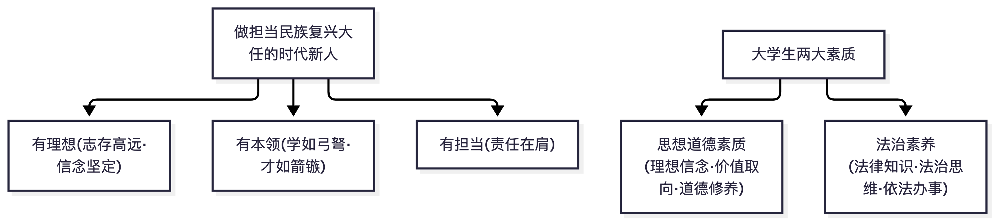

📌 锚点：时代新人三要求：有理想、有本领、有担当；两大素质：思想道德素质+法治素养。

#### 2.0.1 社会主义核心价值观 ★★★★★

**① 定义详解**：社会主义核心价值观是社会主义核心价值体系的高度凝练和集中表达，其基本内容为 24 个字、三个层面：
- **国家层面价值目标**：富强、民主、文明、和谐（回答"建设什么样的国家"）
- **社会层面价值取向**：自由、平等、公正、法治（回答"建设什么样的社会"）
- **个人层面价值准则**：爱国、敬业、诚信、友善（回答"培育什么样的公民"）
社会主义核心价值体系的基本内容包括马克思主义指导思想、中国特色社会主义共同理想、以爱国主义为核心的民族精神和以改革创新为核心的时代精神、社会主义荣辱观四个方面。

**② 考试答题**

**📌 历年真题**

**【2026.4·单选 5】** 社会主义核心价值观是社会主义核心价值体系的高度凝练和集中表达，党的十八大报告提出 24 个字的社会主义核心价值观。在社会主义核心价值观的基本内容中，属国家层面价值目标的是（　）
- A. 富强、民主、文明、和谐 ✅
- B. 自由、平等、公正、法治
- C. 爱国、文明、诚信、友善
- D. 勤劳、勇敢、奉献、奋斗

**【2025.10·单选 2】** 在社会主义核心价值观的基本内容中，自由、平等、公正、法治是（　）
- A. 国家层面的价值目标
- B. 社会层面的价值取向 ✅
- C. 个人层面的价值准则
- D. 公民层面的价值观念

**【2025.4·简答 26】** 简述培育和践行社会主义核心价值观的时代意义
> 【答案要点】①坚持和发展中国特色社会主义的价值遵循；②提高国家文化软实力的迫切要求；③推进社会团结奋进的"最大公约数"。（若按"如何践行"作答：把核心价值观落细落小落实——勤学、修德、明辨、笃实）

**📝 大纲提示**：大纲样卷未考本考点，但属大纲明列识记点。

**✍️ 得分点**：三个层面**每组 4 词顺序不能错**，"文明"在国家层面不在个人层面（个人层面是"诚信、友善"），"法治"在社会层面。
**⚠️ 易混淆**：题干问"价值目标"→国家层面；问"价值取向"→社会层面；问"价值准则"→个人层面。2026.4 单选 5 的干扰项"爱国、文明、诚信、友善"就是把"敬业"偷换成"文明"，逐词核对即可排除。

**③ 主观题展开**（对应 2025.4 简答 26）：
- 若问"时代意义/为什么"：按"坚持和发展中国特色社会主义的价值遵循→提高国家文化软实力的迫切要求→推进社会团结奋进的'最大公约数'"三层展开（陕西版真题答案结构）。
- 若问"如何践行"：按"落细落小落实——勤学（下得苦功夫，求得真学问）、修德（加强道德修养，注重道德实践）、明辨（善于明辨是非、善于决断选择）、笃实（扎扎实实干事，踏踏实实做人）"四条展开（江苏版真题答案结构）。
- 收尾句：青年要做社会主义核心价值观的坚定信仰者、积极传播者、模范践行者。

### 第一章 把握人生的方向和道路

> **🖼 图解：人的属性与人生观三要素**
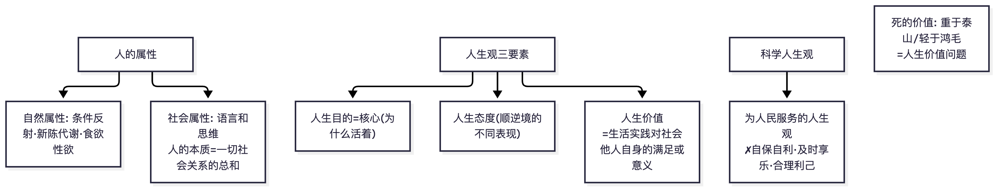
📌 锚点：**语言思维=社会属性；人生价值评价根本尺度=符合客观规律、促进历史进步**。

#### 2.1.1 人的本质 ★★★★

**① 定义详解**：马克思主义认为，**人的本质在其现实性上是一切社会关系的总和**。人的属性分为自然属性和社会属性，**社会属性是人的根本属性**；人的本质是现实的、具体的、历史的、发展的。中外思想史上"人性善/恶论""人性自私论"等均未能科学解答人的本质问题。

**② 考试答题**

**📌 历年真题**

**【2025.4·单选 1】** 原题重复（同 2024.10 单选 1），答案：一切社会关系的总和（选项未公开）

**【2024.10·单选 1】** 人类思想发展至今，唯有马克思主义真正揭示了人的本质之谜。下列关于人的本质的说法正确的是（　）
- A. 人是自然的产物
- B. 人是绝对精神的外化
- C. 人的本性是先天而来的
- D. 人的本质是一切社会关系的总和 ✅

**【样卷·论述 33】** 论述如何科学认识人的自然属性和社会属性
> 【答案要点】→ 展开结构见本条 ③ 主观题展开

**✍️ 得分点**：定义句逐字背；"社会属性是人的根本属性"单独可考判断式单选。
**⚠️ 易混淆**：教材规范表述是"人的本质**在其现实性上**是一切社会关系的总和"，少写"在其现实性上"在主观题要扣分；"人性自私论"是认识误区，不是科学论断。

**③ 主观题展开**（对应样卷论述 33）：是什么（定义＋两个属性）→ 为什么（社会属性决定人的本质：脱离社会关系的人不成其为人；自然属性是人存在的基础但非本质）→ 怎么办（在现实社会关系中完善自我，反对抽象人性论与"人性自私论"）。

#### 2.1.2 人生观、世界观与人生态度 ★★★★

**① 定义详解**：
- **人生观**：人们在实践中形成的对于人生目的、人生态度、人生价值等问题的**总看法和总观点**。
- **世界观**：人们对生活在其中的世界以及人与世界的关系的**总体看法和根本观点**。
- 二者关系：**世界观决定人生观**，有什么样的世界观，就有什么样的人生观；人生观对世界观的巩固、发展和变化起着重要作用。
- **人生态度**：人们通过生活实践形成的对人生问题的一种**稳定的心理倾向和精神状态**。类型上分积极进取与消极无为两大倾向（按对人生得失、苦乐、生死等的回答，又有否定型/肯定型、积极型/消极型等划分）【教材原文待核：类型划分的具体表述以 2023 版教材为准】。

**② 考试答题**

**📌 历年真题**

**【2026.4·单选 6】** 人生观是人们在实践中形成的对于人生目的、人生态度、人生价值等问题的总看法和总观点。世界观是人们对生活在其中的世界以及人与世界的关系的总体看法和根本观点。下列关于人生观与世界观正确的是（　）
- A. 人生观对世界观的巩固、发展和变化起着重要作用 ✅
- B. 人生观决定世界观，有什么样的人生观，就有什么样的世界观
- C. 一个人的人生观往往是自觉的、系统的，世界观往往是不自觉的、不系统的
- D. 世界观是人生观的一部分，用人生观去观察和对待世界问题，就形成了世界观

**【2026.4·单选 7】** 人们通过生活实践形成的对人生问题的一种稳定的心理倾向和精神状态，称为（　）
- A. 人的价值
- B. 人生目的
- C. 人生态度 ✅
- D. 人的本质

**【2025.10·简答 12】** 简述人生态度的类型
> 【答案要点】人生态度有积极与消极之分：积极进取的人生态度（肯定型/积极型）肯定人生、认真务实、乐观进取；消极无为的人生态度（否定型/消极型）否定人生价值、看破红尘、得过且过。应当确立积极进取的人生态度

**⚠️ 易混淆**：决定方向是**世界观→人生观**（不能反过来说"人生观决定世界观"）；"人生目的回答人为什么活着，人生态度回答人应当怎样对待生活，人生价值回答什么样的人生才有意义"（样卷单选 1 考过这一对应），三组对应关系是高频坑点。

**③ 主观题展开**（对应 2025.4 论述 32"养成积极进取人生态度的重要意义"）：按"是什么（定义）→ 为什么（积极进取的人生态度使人坦然面对得失苦乐、在逆境中奋起；消极无为则虚度人生）→ 怎么办（认真分清得失、清醒对待成败、豁达看待生死；身处顺境不骄不躁、身处逆境不坠青云之志）"展开。

#### 2.1.3 人生的自我价值与社会价值 ★★★

**① 定义详解**：人生价值包含两个方面：**人生的自我价值**（个体的人生活动对自己的生存和发展所具有的价值，主要表现为对自身物质和精神需要的满足程度）与**人生的社会价值**（个体的行为对社会、他人所具有的价值，主要表现为对社会作出的贡献和承担的责任）。二者相互依存：**社会价值是人生价值的最基本内容**，自我价值的实现离不开社会提供的条件；在创造社会价值中实现自我价值。

**② 考试答题**

**📌 历年真题**

**【2024.10·单选 2】** 马克思说"我们应该遵循的主要指针是人类的幸福和我们自身的完美"……"我们自身的完美"就是追求人格高尚、才智发展、生活幸福，也就是（　）
- A. 改善人生的现实境遇
- B. 实现人生的自我价值 ✅
- C. 改变人生的生存状态
- D. 实现人生的社会价值

**⚠️ 易混淆**："社会价值/自我价值"谁是根本——**社会价值是基础**，这是思政课的价值导向，凡把"自我价值高于社会价值"设为正确项的都是错误选项。

**③ 主观题展开**：若出论述，走"两个含义→二者辩证关系→实现人生价值的条件和方法（与社会奋斗方向一致、立足岗位实干、锤炼本领品德）"结构。

### 第二章 坚定理想信念

> **🖼 图解：理想·信念·人生观三定义对照与理想体系**
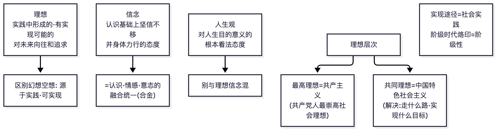
📌 锚点：**三个定义一字不差地背；崇高理想=共产主义、共同理想=中国特色社会主义**。

#### 2.2.1 理想信念的含义、类型与特点 ★★★★★

**① 定义详解**：
- **理想**：人们在实践中形成的、有实现可能性的、对未来社会和自身发展目标的向往与追求，是人们的世界观、人生观和价值观在奋斗目标上的集中体现。
- **信念**：人们在一定的认识基础上确立的对某种思想或事物**坚信不疑并身体力行**的精神状态/态度，是**认识、情感和意志的统一体**。
- 理想信念的基本特点（类型化考法）：**时代性、阶级性（政治性）、共同性与多样性**等【教材原文待核：特点的完整清单以教材为准；2026.4 单选 8 考了"时代性"】。
- 理想信念的类型（按领域）：生活领域的理想信念、职业领域的理想信念、道德领域的理想信念、社会领域的理想信念。

**② 考试答题**

**📌 历年真题**

**【2026.4·单选 8】** 在原始社会的生产条件下，人们只能把获得较多的食物以满足生活所需作为自己的理想，不可能想象现在电子计算机时代的生活。这说明，理想信念具有（　）
- A. 共同性的特点
- B. 时代性的特点 ✅
- C. 阶级性的特点
- D. 多样性的特点

**【2025.4·单选 5】** 原题重复（同 2024.10 单选 4），答案：职业领域的理想信念（选项未公开）

**【2025.4·单选 4】** 理想信念是一种从精神向行动的转变过程。这说明理想信念具有___（选项未公开）
答案：实践性（知行统一性）【待核实：选项未公开】

**【2025.4·单选 3】** 理想具有变为现实的可能性，是经过较长期努力可以实现的。这是因为___（选项未公开）
答案：理想一定时代的产物，带有时代的烙印；科学理想立足于现实、符合社会发展规律【待核实：选项未公开】

**【2024.10·单选 4】** 人们希望找到一份理想的工作，并在工作中达到理想境界、取得理想业绩，这样向往和追求属于（　）
- A. 生活领域的理想信念
- B. 职业领域的理想信念 ✅
- C. 道德领域的理想信念
- D. 社会领域的理想信念

**📝 大纲提示**：大纲样卷单选 3（信念是认识、情感、意志的统一体）、单选 4（道德领域理想信念——追求高尚理想人格），样卷题目第三节未收录题干选项，考点对应见第三节样卷说明。2025.4 单选 3—7 为连续 5 道理想信念专题单选，其中单选 6、7 分别展开于 2.2.2、2.2.3 条目。

**✍️ 得分点**："职业领域"与"道德领域"最常考：**职业**=工作/业绩/事业；**道德**=理想人格/做人境界；**生活**=生活方式/家庭；**社会**=社会制度/人类解放。
**⚠️ 易混淆**：2026.4 单选 8 的场景（原始社会不可能有计算机时代的理想）考"时代性"，别选"共同性/多样性"；信念"一旦形成就不会改变"是错误说法（信念会在实践中变化发展）。

**③ 主观题展开**（论述高频方向"理想信念的含义及重要作用"，备考按此展开训练）：
含义（理想＋信念各自定义并说明联系）→ 重要作用（三方面：**昭示奋斗目标——人生的精神支柱；催生前进动力——激励人们为实现目标不懈奋斗；提供精神支柱/提高精神境界**）→ 结合当代青年实际收尾（把个人理想融入中国特色社会主义共同理想）。

#### 2.2.2 远大理想与共同理想的关系 ★★★★★

**① 定义详解**：中国共产党的**最高理想（远大理想）是实现共产主义**；现阶段全国人民的**共同理想是坚持和发展中国特色社会主义**（其基本内容：在中国共产党领导下，走中国特色社会主义道路，实现中华民族伟大复兴）。二者关系是**最终理想与阶段性理想的关系**——远大理想是共同理想的最终指向，共同理想是实现远大理想的必经阶段；共产主义社会的基本特征：生产力高度发展、物质财富极大丰富、实行各尽所能按需分配、阶级消灭、国家消亡、人的自由而全面发展等。

**② 考试答题**

**📌 历年真题**

**【2026.4·单选 9】** 中国共产党的最高理想是实现共产主义，在现阶段的奋斗纲领是建设中国特色社会主义。最高理想与中国特色社会主义共同理想之间的关系是（　）
- A. 社会理想与个人理想的关系
- B. 主观想象与客观现实的关系
- C. 最终理想与阶段性理想的关系 ✅
- D. 非科学理想与科学理想的关系

**【2025.4·单选 6】** 共产党人的远大理想集中体现人类对美好生活的向往，它的最终实现是历史发展的必然。这一远大理想是___（选项未公开）
答案：实现共产主义

**【2024.10·单选 5】** 中国特色社会主义共同理想与共产主义远大理想具有内在联系，它们之间的关系是（　）
- A. 个人理想与社会理想关系
- B. 生活理想与道德理想关系
- C. 阶段性理想与最终性理想 ✅
- D. 科学理想与非科学理想

**📝 大纲提示**：大纲样卷单选 5（共同理想=坚持和发展中国特色社会主义）、单选 6（共产主义实现是漫长、艰辛的历史过程），样卷题目第三节未收录题干选项，考点对应见第三节样卷说明。

**⚠️ 易混淆**：正确表述是"最终理想与阶段性理想的关系"；干扰项常设"社会理想与个人理想的关系"（这是另一组概念）"主观想象与客观现实""科学理想与非科学理想"。共同理想的规范表述是"**坚持和发展**中国特色社会主义"，不是"全面建成小康社会"（这是旧教材/已完成的历史任务表述）。

**③ 主观题展开**：若考论述，按"各自内涵→关系（两个层次）→怎么做（把个人理想融入共同理想，立志当高远、做先锋、肯实干）"展开。

#### 2.2.3 理想与现实的关系 ★★★★

**① 定义详解**：理想与现实是对立统一的：理想是主观的、未来的，现实是客观的、当下的；**理想源于现实又超越现实，理想可以转化为现实**。理想实现过程具有**长期性、曲折性和艰巨性**，需要艰苦奋斗。

**② 考试答题**

**📌 历年真题**

**【2025.4·单选 7】** 当发现理想与现实的矛盾时，不加分析地全盘认同当下的现实，对理想失去信心和热情。这种认识上的误区属于___（选项未公开）
答案：以现实否定理想（放逐理想/庸俗化倾向）【待核实：选项措辞】

**【2024.10·单选 6】** "宝剑锋从磨砺出，梅花香自苦寒来"……理想的现实离不开艰苦奋斗。这说明（　）
- A. 现实是完美的，理想是有缺陷的
- B. 美好的理想是遥不可及的主观想象
- C. 艰苦奋斗是实现美好理想的重要条件 ✅
- D. 确立理想的过程是一个读书学习的过程

**📝 大纲提示**：大纲样卷单选 7 与 2025.4 单选 7 同考点（理想与现实的关系；正确态度是"在实践中把理想转化为现实"），样卷题目第三节未收录题干选项。

**⚠️ 易混淆**：两种错误倾向——**用理想否定现实**（怨天尤人）与**用现实否定理想**（随波逐流）；正确项永远含"实践""奋斗"字眼。

**③ 主观题展开**：是什么（对立统一）→ 为什么（承认矛盾才能正确对待）→ 怎么办（在实践中艰苦奋斗，正视长期性曲折性）。

### 第三章 弘扬中国精神

> **🖼 图解：中国精神结构与爱国主义**
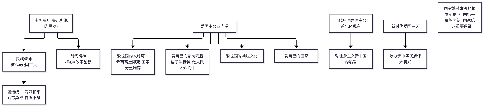
📌 锚点：**孺子牛=骨肉同胞；无土难存=大好河山；首要对象帝国主义；根本前提=祖国统一**。

#### 2.3.1 中国精神与民族精神、时代精神 ★★★★★

**① 定义详解**：**中国精神**就是以**爱国主义为核心的民族精神**和以**改革创新为核心的时代精神**。民族精神是一个民族在长期共同生活和社会实践中形成的、为本民族大多数成员所认同的价值取向、思维方式、道德规范、精神气质的总和，是一个民族赖以生存和发展的精神支柱。中国人民是具有**伟大创造精神、伟大奋斗精神、伟大团结精神、伟大梦想精神**的人民。**时代精神的核心是改革创新**。

**② 考试答题**

**📌 历年真题**

**【2026.4·单选 11】** 一个民族自立于世界民族之林的能力及其发展前途的坚定信念，指的是（　）
- A. 民族自尊
- B. 民族自强
- C. 民族自信 ✅
- D. 民族精神

**【2026.4·单选 10】** 民族精神是一个民族在长期共同生活和社会实践中形成，为本民族大多数成员所认同的价值取向、思维方式、道德规范、精神气质的总和，是一个民族赖以生存和发展的精神支柱。中华民族精神的核心是（　）
- A. 马克思主义
- B. 改革创新
- C. 艰苦奋斗
- D. 爱国主义 ✅

**【2025.4·单选 11】** 在当今时代，我们应该大力弘扬的时代精神的核心是___（选项未公开）
答案：改革创新

**【2025.4·单选 9】** 中国人民始终团结一心、同舟共济……多元一体的融洽民族关系。这体现中国精神中的___（选项未公开）
答案：伟大团结精神

**【2025.4·单选 8】** 中华文明突出的统一性从根本上决定了___（选项未公开）
答案：中华民族各民族文化融为一体、国家统一永远是中国核心利益的核心【待核实：选项措辞】

**【样卷·简答 27】** 简述中国精神的含义和核心内容
> 【答案要点】中国精神=以爱国主义为核心的民族精神＋以改革创新为核心的时代精神

**📝 大纲提示**：时代精神核心=改革创新亦属大纲样卷识记点。同章爱国主义/改革创新主观题 2025.4 简答 27、2025.10 简答 13 展开于 2.3.2 条目，2025.10 论述 31 展开于 2.3.3 条目。

**🔑 记忆锚点**：**民族精神核心=爱国主义；时代精神核心=改革创新；中国精神=两者相加**。伟大建党精神（坚持真理、坚守理想，践行初心、担当使命，不怕牺牲、英勇斗争，对党忠诚、不负人民）属大纲识记点，2025.4 单选 8 考了中华文明"统一性"与民族团结的关系。
**⚠️ 易混淆**：2026.4 单选 11 考"民族自尊/民族自信/民族自强"三兄弟——**民族自尊=对自己民族自尊心的维护与自豪；民族自信=对自立于世界民族之林的能力及发展前途的坚定信念；民族自强=靠自己奋斗实现民族振兴**。别把"自信"与"自强"的宾语弄反。

**③ 主观题展开**（对应样卷简答 27）：直接答"中国精神就是以爱国主义为核心的民族精神和以改革创新为核心的时代精神"，再各用一句话展开民族精神（精神支柱、核心是爱国主义）与时代精神（核心是改革创新、体现时代要求）。

#### 2.3.2 爱国主义的科学内涵与基本内容 ★★★★★

**① 定义详解**：**爱国主义**体现了人们对自己祖国的深厚感情，揭示了个人对祖国的依存关系，是人们对自己家园以及民族和文化的归属感、认同感、尊严感与荣誉感的统一，是调节个人与祖国之间关系的**道德要求、政治原则和法律规范**。基本内容（基本要求）：**爱祖国的大好河山、爱自己的骨肉同胞、爱祖国的灿烂文化、爱自己的国家**——其中**爱自己的国家（爱当下的、社会主义的中国）是基本政治要求**。**当代中国爱国主义的本质：坚持爱国和爱党、爱社会主义高度统一**。

**② 考试答题**

**📌 历年真题**

**【2025.10·简答 13】** 简述新时代爱国主义（的要求/本质）
> 【答案要点】坚持爱国爱党爱社会主义相统一；维护祖国统一和民族团结；尊重和传承中华民族历史和文化；坚持立足民族又面向世界；坚持总体国家安全观。核心句：当代中国爱国主义的本质是坚持爱国和爱党、爱社会主义高度统一

**【2025.4·单选 10】** 在中国特色社会主义新时代，爱国主义的本质首先体现为___（选项未公开）
答案：坚持爱国和爱党、爱社会主义相统一

**【2025.4·简答 27】** 简述爱国主义的含义和基本内容
> 【答案要点】含义：爱国主义体现了人们对自己祖国的深厚感情，揭示了个人对祖国的依存关系，是归属感、认同感、尊严感与荣誉感的统一，是调节个人与祖国之间关系的道德要求、政治原则和法律规范。基本内容：①爱祖国的大好河山；②爱自己的骨肉同胞；③爱祖国的灿烂文化；④爱自己的国家

**【2024.10·单选 9】** "中国的脊梁"们"先天下之忧而忧，后天下之乐而乐"，这体现的爱国主义优良传统是（　）
- A. 维护祖国统一
- B. 抵御外来侵略
- C. 心系民生苦乐 ✅
- D. 开发祖国山河

**【2024.10·单选 8】** 爱国主义必然以爱故土山河、爱骨肉同胞、爱祖国的文化和爱自己的国家为基本内容。爱国主义的基本政治要求是（　）
- A. 热爱故土山河
- B. 热爱骨肉同胞
- C. 热爱自己的国家 ✅
- D. 热爱光辉灿烂的文化

**📝 大纲提示**：大纲样卷单选 9（爱国与爱社会主义统一）、单选 10（爱国主义基本政治要求），样卷题目第三节未收录题干选项，考点对应见第三节样卷说明。

**⚠️ 易混淆**：定义是"道德要求、政治原则**和法律规范**"三位一体，漏掉"法律规范"不得全分；"基本政治要求"=爱自己的国家，不是爱河山/爱文化（样卷单选 10 原题）。
- 新时代爱国主义的时代要求（主观题展开要点）：坚持爱国爱党爱社会主义相统一、维护祖国统一和民族团结、尊重和传承中华民族历史和文化、坚持立足民族又面向世界、坚持总体国家安全观。

**③ 主观题展开**（对应 2025.4 简答 27／2025.10 简答 13）：定义一句＋"四个爱"基本内容逐条（每条一句展开）＋当代本质一句收尾。

#### 2.3.3 做新时代的忠诚爱国者／改革创新者 ★★★★

**① 定义详解**：做忠诚爱国者，就要**推进祖国统一（维护民族团结）、促进民族团结、增强国家安全意识**，以实际行动和贡献报效祖国；坚持**总体国家安全观**（以人民安全为宗旨、以政治安全为根本、统筹外部与内部、传统与非传统等），走中国特色国家安全道路。做改革创新者：改革创新是中华民族的历史禀赋，是新时代的迫切要求（我国进入新发展阶段、应对国际竞争），青年要树立创新意识、增强创新能力、投身创新实践，做改革创新的生力军。

**② 考试答题**

**📌 历年真题**

**【2025.10·简答/论述 14】** 结合当前实际，论述如何做新时代忠诚爱国者
> 【答案要点】推进祖国统一（保持香港澳门长期繁荣稳定、坚持一个中国原则反对"台独"）；促进民族团结（铸牢中华民族共同体意识）；增强国家安全意识（坚持总体国家安全观）。落脚：以实际行动和贡献报效祖国

**【2025.10·论述 31】** 论述如何做改革创新的生力军
> 【答案要点】是什么：改革创新是时代精神的核心，是新时代的迫切要求；为什么：青年是改革创新的生力军，"青年兴则国家兴，青年强则国家强"；怎么办：树立改革创新的自觉意识、增强改革创新的能力本领；结合实际：用作品讲好中国故事

**【2024.10·单选 11】** 伟大思想巨匠、伟大科技成果、伟大文艺作品、伟大史诗、伟大工程……这主要体现了（　）
- A. 伟大创造精神 ✅
- B. 伟大团结精神
- C. 伟大奋斗精神
- D. 伟大梦想精神

**【2024.10·单选 10】** 人类社会越来越成为命运共同体，这要求新时代弘扬爱国主义精神必须与扩大对外开放结合起来，做到（　）
- A. 坚持立足民族又面向世界 ✅
- B. 维护祖国统一和民族团结
- C. 坚持爱国主义与社会主义相统一
- D. 尊重和传承中华民族历史和文化

**📝 大纲提示**：大纲样卷单选 11（总体国家安全观）、单选 8（弘扬爱国主义须深入理解中华优秀传统文化），样卷题目第三节未收录题干选项，考点对应见第三节样卷说明。

**⚠️ 易混淆**：总体国家安全观的"总体"——选项中"全面国家安全观/现代国家安全观/传统国家安全观"皆为干扰项（样卷单选 11）。

**③ 主观题展开**（对应 2025.10 简答 14/论述 31）：亮观点（做新时代忠诚爱国者/改革创新者是青年的使命）→ 分条展开（爱国者：祖国统一＋民族团结＋国家安全意识；改革创新者：时代要求＋创新意识＋投身实践）→ 结合动漫设计专业实际收尾（用专业作品讲好中国故事，也是爱国与创新的具体化）。

### 第四章 加强道德理论学习

> **🖼 图解：道德的起源·功能·与法律的关系**
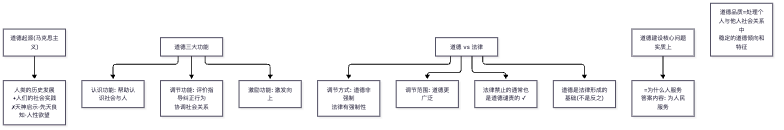
📌 锚点：**起源选"历史发展+社会实践"；调节功能=纠正行为协调关系；道德范围比法律广**。

> **🖼 知识点图：社会主义核心价值观三层面 + 核心价值体系对照**

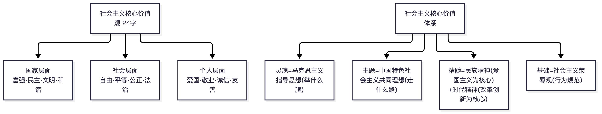

📌 锚点：24 字分国家/社会/个人三层面；核心价值体系四要素（灵魂/主题/精髓/基础）各配一句题眼。

#### 2.4.1 道德的起源与本质 ★★★★

**① 定义详解**：**道德**是以善恶为评价方式，主要依靠社会舆论、传统习俗和内心信念来发挥作用的行为规范的总和。马克思主义科学揭示了道德的起源：**劳动是道德起源的首要前提**；社会关系是道德赖以产生的客观条件；人的自我意识是道德产生的主观条件——**道德产生于人类的历史发展和人们的社会实践**。道德的本质：道德是**社会经济关系**的反映，是由经济基础决定的社会意识形态（社会意识形式）。

**② 考试答题**

**📌 历年真题**

**【2025.10·单选 4】** 道德起源问题上有不同的观点，其中马克思主义认为，道德起源的前提是（　）
- A. 语言
- B. 意识
- C. 劳动 ✅
- D. 上帝/神启

**【2025.4·单选 12】** 认为道德产生于人类历史发展和人们社会实践的观点，属于___（选项未公开）
答案：马克思主义的观点

**【2024.10·单选 12】** 道德产生于人类的历史发展和人们的社会实践中。这种关于道德起源的观点是（　）
- A. 庸俗进化论
- B. 马克思主义观点 ✅
- C. 主观唯心主义观点
- D. 客观唯心主义观点

**【样卷·论述 32】** 论述道德的社会作用
> 【答案要点】→ 展开结构见本条 ③ 主观题展开

**⚠️ 易混淆**："道德起源的前提"（劳动）与"道德的起源"（社会实践/历史发展）问法不同答法不同，看清设问。道德的评价方式是"善恶"，依靠的是"社会舆论、传统习俗、内心信念"——**不依靠国家强制力**（这是与法律的根本区别，绪论"法律和道德的相互关系"常考此点）。

**③ 主观题展开**（对应样卷论述 32"道德的社会作用"）：道德的主要功能（认识功能、调节功能）→ 社会作用（为经济基础服务、维护社会秩序、促进人的完善与社会文明进步）→ 正确看待（道德万能论与道德无用论都是错误的）。

#### 2.4.2 中华传统美德与中国革命道德 ★★★★

**① 定义详解**：**中华传统美德**是中华文化的精髓，蕴含丰富的思想道德资源（基本精神：重视整体利益、强调责任奉献；推崇"仁爱"原则、注重以和为贵；提倡人伦价值、重视道德义务；追求精神境界、向往理想人格；强调道德修养、注重道德践履）【教材原文待核：五条表述以教材为准】。**中国革命道德**：中国共产党人、人民军队、一切先进分子和人民群众在中国革命、建设、改革中形成的优良道德，主要内容：**全心全意为人民服务**（核心/灵魂）、始终把革命利益放在首位、努力加强个人品德修养等。对待传统道德的正确态度：**批判继承、创造性转化和创新性发展**，反对"复古论"与"虚无论"两种错误。

**② 考试答题**

**📌 历年真题**

**【2025.10·简答 26】** 简述中华传统美德的基本精神
> 【答案要点】①重视整体利益，强调责任奉献；②推崇"仁爱"原则，注重以和为贵；③提倡人伦价值，重视道德义务；④追求精神境界，向往理想人格；⑤强调道德修养，注重道德践履

**【2025.4·单选 13】** 原题重复（同 2024.10 单选 13），答案：乐群贵和（选项未公开）

**【2024.10·单选 13】** "仁者爱人""己所不欲，勿施于人""礼之用，和为贵"体现了中华民族传统美德中的（　）
- A. 求真务实
- B. 乐群贵和 ✅
- C. 勤劳勇敢
- D. 爱国奉献

**📝 大纲提示**：大纲样卷单选 12（"先天下之忧而忧"体现传统美德），样卷题目第三节未收录题干选项，考点对应见第三节样卷说明。

**⚠️ 易混淆**：**传统美德 ≠ 传统道德**——大纲专门列"传统美德与传统道德的区别"为领会点：传统道德有糟粕需扬弃，传统美德是其中的精华部分，二者不能划等号。

**③ 主观题展开**（对应 2025.10 简答 26）：总起（传统美德是中华文化精髓）→ 分条列基本精神（每条"观点＋一句古语例证"）→ 收尾（创造性转化、创新性发展）。

#### 2.4.3 社会主义道德建设的核心、原则、重点 ★★★★★

**① 定义详解**：社会主义道德建设：
- **核心：为人民服务**（社会主义道德区别和优越于其他社会形态道德的显著标志）
- **原则：集体主义**（把集体利益放在首位，集体利益与个人利益辩证统一；集体主义的道德要求分层次：无私奉献、一心为公——先公后私、先人后己——公私兼顾、不损公肥私）
- **重点：诚实守信**
- 现实要求（"四个相适应/协调/承接"）：与社会主义市场经济相适应、与社会主义法律规范相协调、与中华传统美德相承接。

**② 考试答题**

**📌 历年真题**

**【2026.4·单选 4】** 社会主义道德建设以集体主义为原则，这一原则具有多层次的道德要求。对于共产党员，努力达到的道德目标是（　）
- A. 无私奉献、一心为公 ✅
- B. 先私后公、先己后人
- C. 公私兼顾，不损公肥私
- D. 主观为自己、客观为他人

**【2025.10·单选 5】** 社会主义道德建设要坚持以集体主义为原则，同时也要以为人民服务为核心。我国社会主义道德建设的核心是（　）
- A. 集体主义
- B. 诚实守信
- C. 爱国主义
- D. 为人民服务 ✅

**【2025.4·论述 33】** 论述社会主义道德建设要以为人民服务为核心
> 【答案要点】①为人民服务是社会主义道德的本质要求（社会主义经济基础和人际关系的客观要求、社会主义市场经济健康发展的要求）；②是先进性要求与广泛性要求的统一；③是社会主义道德区别和优越于其他社会形态道德的显著标志。结尾：反对和抵制拜金主义、享乐主义和极端个人主义

**📝 大纲提示**：大纲样卷单选 13（道德建设核心），样卷题目第三节未收录题干选项，考点对应见第三节样卷说明。

**⚠️ 易混淆**：核心≠原则≠重点，三者答题时一个都不能串位——"核心=为人民服务、原则=集体主义、重点=诚实守信"必须打包背。集体主义三层次由高到低对应人群：共产党员（无私奉献、一心为公）→积极分子（先公后私）→普通公民（公私兼顾、不损公肥私）；"主观为自己、客观为他人"是错误价值观念（个人主义），从不出现在正确答案中。

**③ 主观题展开**（对应 2025.4 论述 33"为什么以为人民服务为核心"）：是什么（核心定位）→ 为什么（为人民服务是社会主义经济基础和人际关系的客观要求；是社会主义市场经济健康发展的要求；是先进性要求与广泛性要求的统一）→ 怎么办（旗帜鲜明反对拜金主义享乐主义极端个人主义）。

### 第五章 培养优良道德品质

> **🖼 图解 ①：职业道德五要求层次（全勤考点）**
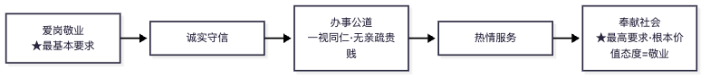
> **🖼 图解 ②：爱情四特性与传统美德速配**
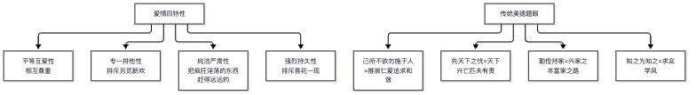
📌 锚点：**最基本=爱岗敬业、最高=奉献社会；爱情四特性按题眼对号入座**。

> **🖼 知识点图：道德要求五领域总图（公德/职德/家德/品德）**

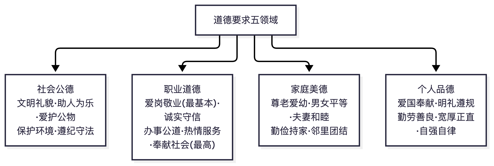

📌 锚点：四领域各自五条内容，选择与简答双料考区；爱岗敬业最基本、奉献社会最高。

#### 2.5.1 社会公德 ★★★★

**① 定义详解**：**公共生活**的特点：活动范围的广泛性、活动内容的开放性、交往对象的复杂性、活动方式的多样性。**社会公德**是人们在公共生活中应该遵守的、最一般、最起码的行为规范，主要内容（基本要求）：**文明礼貌、助人为乐、爱护公物、保护环境、遵纪守法**。社会公德居于社会道德体系的基础层次，是维护社会公共生活秩序、保持社会稳定的重要手段。

**② 考试答题**

**📌 历年真题**

**【2025.4·简答 28】** 简述当代社会公共生活的主要特点
> 【答案要点】①活动范围的广泛性；②活动内容的开放性；③交往对象的复杂性；④活动方式的多样性

**【2025.4·单选 14】** 居于社会道德体系基础层次、维护公共生活秩序的社会道德规范是___（选项未公开）
答案：社会公德

**【2024.10·单选 16】** "海纳百川，有容乃大""躬自厚而薄责于人""君子和而不同"蕴含的交往原则是（　）
- A. 平等
- B. 诚信
- C. 互助
- D. 宽容 ✅

**📝 大纲提示**：大纲样卷单选 14（公共生活特点）、单选 15（社会公德），样卷题目第三节未收录题干选项，考点对应见第三节样卷说明。

**⚠️ 易混淆**：公共生活四特点的对应干扰项"活动内容的私密性、交往对象的单一性、活动结果的确定性"——公共生活恰恰是开放、复杂、多样的。社会公德五内容与职业道德五内容、家庭美德五内容**三张清单必须分开背**（见下表）：

| 领域 | 五项基本要求 | 记忆钩子 |
|---|---|---|
| 社会公德 | 文明礼貌、助人为乐、爱护公物、保护环境、遵纪守法 | 对"公共" |
| 职业道德 | 爱岗敬业、诚实守信、办事公道、服务群众、奉献社会 | 对"工作" |
| 家庭美德 | 尊老爱幼、男女平等、夫妻和睦、勤俭持家、邻里团结 | 对"家庭" |

**③ 主观题展开**：特点/含义各一条 → 意义（公共秩序基石）→ 践行（从我做起从小事做起，网络空间也是公共生活）。

#### 2.5.2 职业道德 ★★★★★

**① 定义详解**：**职业道德**是从业者在职业活动中应当遵循的、具有职业特征的道德要求和行为准则，基本要求：**爱岗敬业、诚实守信、办事公道、服务群众、奉献社会**。其中：**爱岗敬业是职业道德的最基本要求/基础**；**奉献社会是社会主义职业道德的最高目标指向、最高层次要求**；**诚实守信是职业道德的重点**。

**② 考试答题**

**📌 历年真题**（四个考期全考）

**【2026.4·单选 3】** 体现了社会主义职业道德的最高目标指向、最高层次指的是（　）
- A. 爱岗敬业
- B. 诚实守信
- C. 奉献社会 ✅
- D. 办事公道

**【2025.10·单选 6】** 爱岗敬业、诚实守信、办事公道、服务群众、奉献社会是人们在职业生活中应该遵守的（　）
- A. 社会公德的基本要求
- B. 职业道德的基本要求 ✅
- C. 家庭美德的基本要求
- D. 个人品德的基本要求

**【2025.4·单选 15】** 从业者自觉遵守规章制度、平等待人、清正廉洁、不谋私利、不滥用职权。这是职业道德中的___（选项未公开）
答案：办事公道

**【2024.10·单选 14】** 爱岗敬业、诚实守信、办事公道、服务群众、奉献社会是（　）
- A. 社会道德的要求
- B. 职业道德的要求 ✅
- C. 家庭道德的要求
- D. 网络道德的要求

**⚠️ 易混淆**："最高层次=奉献社会"与"最基本=爱岗敬业"、"重点=诚实守信"三组对应关系是 4 期 4 题的钉子户考点，混一个丢 2 分。

**③ 主观题展开**：五项要求逐条一句展开＋结合动漫行业实际（敬业：按时保质完成分镜/建模任务；诚信：尊重版权与合同）。

#### 2.5.3 家庭美德 ★★★★

**① 定义详解**：**家庭美德**是调节家庭内部及家庭与邻里之间关系的行为规范，基本要求：**尊老爱幼、男女平等、夫妻和睦、勤俭持家、邻里团结**。家庭是社会的细胞，家庭和睦则社会安定，家庭幸福则社会祥和，家庭文明则社会文明。恋爱中的基本道德要求：尊重人格平等、自觉承担责任、文明相亲相爱。

**② 考试答题**

**📌 历年真题**

**【2026.4·单选 2】** 家庭是社会的细胞。家庭和睦则社会安定，家庭幸福则社会祥和，家庭文明则社会文明。属于家庭美德基本要求的是（　）
- A. 助人为乐
- B. 尊老爱幼 ✅
- C. 爱护公物
- D. 爱岗敬业

**【2025.4·单选 16】** 精心抚养子女、赡养丧失劳动能力的父母。这体现家庭美德中的___（选项未公开）
答案：尊老爱幼

**【2024.10·单选 15】** 小张在工作岗位上是劳动模范，在家里积极操持家务、合理消费、不乱花费。小张在家里的表现反映了家庭美德中的（　）
- A. 邻里团结
- B. 尊老爱幼
- C. 夫妻和睦
- D. 勤俭持家 ✅

**📝 大纲提示**：大纲样卷单选 16（尊老爱幼），样卷题目第三节未收录题干选项，考点对应见第三节样卷说明。

**⚠️ 易混淆**：题干给"抚养子女、赡养父母"→尊老爱幼；"合理消费不乱花钱"→勤俭持家；"邻里互助"→邻里团结。干扰项常用另两张清单里的词（如"助人为乐""诚实守信"）。

**③ 主观题展开**：含义→五项要求→意义（家风是社会风气组成部分）。

#### 2.5.4 个人品德与道德修养方法 ★★★★★

**① 定义详解**：**个人品德**是个体通过道德认识、情感、意志、信念、行为的综合发展形成的稳定的道德倾向和特征；个人品德的形成过程包含**心理、思想、行为**多种因素的相应发展（认识→情感→意志→**信念**→行为/习惯：道德信念是人们把情感和道德意志转变而成的个人行动的指南和原则）。**道德修养的方法**：**学思明理（学而明理）、省察克治、慎独自律、积善成德（知行合一）**等。
- **省察克治**：通过反复检查以发现自己思想中的不良念头和行为上的不良习惯，并坚决克服和整治掉（"吾日三省吾身"）。
- **慎独自律**：在无人监督时依然坚守道德。
- **积善成德**：从小事善行积累成稳定品德。

**② 考试答题**

**📌 历年真题**

**【2026.4·单选 1】** 一般来说，个人品德的形成过程包含心理、思想、行为多种因素的相应发展，其中，人们把情感和道德意志转变成的个人行动的指南和原则，这是指（　）
- A. 道德信念 ✅
- B. 道德行为
- C. 道德习惯
- D. 道德意志

**【2025.4·单选 17】** 原题重复（同 2024.10 单选 17），答案：省察克治（选项未公开）

**【2024.10·单选 17】** "吾日三省吾身"——通过反复检查以发现和找出自己思想中的不良念头和行为上的不良习惯，坚决克服和整治掉。这种修养方法是（　）
- A. 陶冶情操
- B. 学而明理
- C. 省察克治 ✅
- D. 慎独自律

**【样卷·简答 28】** 简述形成良好个人品德的重要意义
> 【答案要点】→ 展开结构见本条 ③ 主观题展开

**📝 大纲提示**：大纲样卷单选 17（省察克治），样卷题目第三节未收录题干选项，考点对应见第三节样卷说明。

**⚠️ 易混淆**："三省吾身"=省察克治（不是"慎独自律"——慎独强调"无人监督"场景）；"道德信念"与"道德意志"：意志是克服困难的心理过程，信念是"指南和原则"化的坚定认同。

**③ 主观题展开**（对应大纲样卷简答 28）：总起（个人品德的作用）→ 分条（有利于个人健康成长成才；有利于形成良好道德风尚、促进社会和谐；是德智体美劳全面发展的内在要求）→ 方法收尾（四种修养方法各一句）。

### 第六章 推进法治中国建设

> **🖼 图解：社会主义法治理念五要素 + 法治思维四内容**
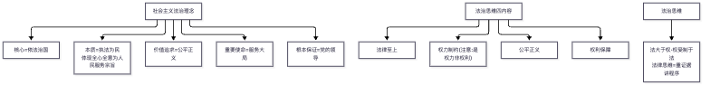
📌 锚点：**五要素对应五句口诀；法治思维是"权力"制约；依法治国主体和力量源泉=人民**。

#### 2.6.1 法治、法制、人治与法治思维 ★★★★★

**① 定义详解**：**法治**是依据法律的治理，强调法律至上、依法治国，与人治相对；**法制**是法律制度的总称（静态制度层面），法治与法制既有区别又有联系（法制是法治的前提与基础，法治是法制的运行与灵魂）。**法治思维**是以法治价值和法治精神为导向，运用法律原则、法律规则、法律方法思考和处理问题的思维模式，基本内容：**法律至上、权力制约、公平正义、权利保障、程序正当**。**法治素养**是尊法意识、学法水平、守法习惯、用法能力等素养的综合体现，**尊重法律权威是提升法治素养的首要前提**。

**② 考试答题**

**📌 历年真题**

**【2025.10·单选 8】** 法律至上要求宪法至上、法律至上。法律至上具体表现为（　）
- A. 法律的普遍适用、优先适用、不可违抗 ✅
- B. 法律面前人人平等、司法独立
- C. 立法科学、执法严格、司法公正
- D. 法律的权威性、强制性、规范性

**【2025.4·简答 29】** 简述法治思维的含义和基本内容
> 【答案要点】含义：以法治价值和法治精神为导向，运用法律原则、法律规则、法律方法思考和处理问题的思维模式（正当性思维、规范思维、逻辑思维、科学思维）。基本内容：法律至上、权力制约、公平正义、权利保障、程序正当

**【2024.10·单选 18】** 维护法律权威必须培养法治思维、抛弃人治思维。下列属于法治思维基本内容的是（　）
- A. 法律至上 ✅
- B. 权利制约
- C. 以言代法
- D. 权利保障

**📝 大纲提示**：大纲样卷单选 18（一切违反宪法法律的行为必须追究=法律至上）、单选 19（首要前提=尊重法律权威），样卷题目第三节未收录题干选项，考点对应见第三节样卷说明。

**⚠️ 易混淆**：法治思维五内容的规范词序——"权利保障"不要写成"人权保障"、"程序正当"不要写成"正当程序"（2024.10 单选 18 干扰项正是"权利制约/以言代法"，正确项是"法律至上"）。"法治与法制""法治与人治"的区别是论述题送分点：法治与人治的根本区别在于**法律权威高于个人意志**。

**③ 主观题展开**（对应 2025.4 简答 29；论述方向可扩展"如何提升法治素养"）：含义（正当性思维/规范思维/逻辑思维/科学思维四层）→ 基本内容五条 → 如何提升法治素养（尊重法律权威、学习法律知识、养成守法习惯、提高用法能力）。

#### 2.6.2 习近平法治思想与法治道路 ★★★★★

**① 定义详解**：**习近平法治思想**是马克思主义法治理论中国化时代化的最新成果，是全面依法治国的指导思想和根本遵循，回答了**新时代为什么实行全面依法治国、怎样实行全面依法治国**等一系列重大问题。核心要义概括为"**十一个坚持**"（坚持党对全面依法治国的领导、坚持以人民为中心、坚持中国特色社会主义法治道路、坚持依宪治国依宪执政、坚持在法治轨道上推进国家治理体系和治理能力现代化、坚持建设中国特色社会主义法治体系、坚持依法治国依法执政依法行政共同推进/法治国家法治政府法治社会一体建设、坚持全面推进科学立法严格执法公正司法全民守法、坚持统筹推进国内法治和涉外法治、坚持建设德才兼备的高素质法治工作队伍、坚持抓住领导干部这个"关键少数"）【教材原文待核：十一个坚持完整表述以教材为准】。**中国特色社会主义法治道路的核心要义**：**坚持党的领导，坚持中国特色社会主义制度，贯彻中国特色社会主义法治理论**。坚持中国特色社会主义法治道路必须遵循的原则：坚持中国共产党的领导、坚持人民主体地位、坚持法律面前人人平等、坚持依法治国和以德治国相结合、坚持从中国实际出发。

**② 考试答题**

**📌 历年真题**

**【2025.10·单选 7】** 全面依法治国涉及很多方面，必须坚持依法治国、依法执政、依法行政共同推进。其中在全面依法治国中地位最突出、作用最重大的工作是（　）
- A. 科学立法
- B. 依宪治国、依宪执政 ✅
- C. 严格执法
- D. 公正司法

**【2025.4·单选 20】** 习近平法治思想是全面依法治国的指导思想和根本遵循，其回答的重大理论问题是___（选项未公开）
答案：新时代为什么实行全面依法治国、怎样实行全面依法治国

**【2025.4·单选 19】** 依法治国、依法执政、依法行政共同推进，法治国家、法治政府、法治社会一体建设。其中重点任务和主体工程是___（选项未公开）
答案：建设法治政府

**【2025.4·单选 18】** 中国特色社会主义法治道路的核心要义，除坚持党的领导、坚持中国特色社会主义制度外，还包括___（选项未公开）
答案：贯彻中国特色社会主义法治理论

**【2025.4·论述 31】** 论述坚持中国特色社会主义法治道路必须遵循的原则
> 【答案要点】①坚持中国共产党的领导；②坚持人民主体地位；③坚持法律面前人人平等；④坚持依法治国和以德治国相结合；⑤坚持从中国实际出发（每条展开"原则句＋一句理由＋一句实践要求"）

**【样卷·论述 31】** 论述习近平法治思想的内容体系
> 【答案要点】→ 见本条 ① 定义详解"十一个坚持"与 ③ 主观题展开

**⚠️ 易混淆**："核心要义"三条与"基本原则"五条是两组清单，考题常交叉设混；2025.10 单选 7 的规范表述是"**依宪治国、依宪执政**"在全面依法治国中地位最突出、作用最重大。

**③ 主观题展开**（对应 2025.4 论述 31／样卷论述 31）：是什么（道路定位）→ 五项原则逐条（每条一句理由）→ 怎么办（结合"科学立法、严格执法、公正司法、全民守法"新十六字方针收尾）。

#### 2.6.3 中国特色社会主义法治体系与法治中国建设 ★★★★

**① 定义详解**：建设中国特色社会主义法治体系是全面依法治国的**总抓手**：完备的法律规范体系、高效的法治实施体系、**严密的法治监督体系**、有力的法治保障体系、完善的党内法规体系。全面依法治国总体布局：依法治国、依法执政、依法行政**共同推进**，法治国家、法治政府、法治社会**一体建设**（其中**法治政府建设是重点任务和主体工程**）；全面依法治国的**基础工程**是法治社会建设（全民守法）。新十六字方针：**科学立法、严格执法、公正司法、全民守法**。

**② 考试答题**

**📌 历年真题**

**【2025.4·单选 19】** 依法治国、依法执政、依法行政共同推进，法治国家、法治政府、法治社会一体建设。其中重点任务和主体工程是___（选项未公开）
答案：建设法治政府

**【2024.10·单选 20】** 把党的领导贯彻到全面推进依法治国的全过程。下列体现加强和改进党对全面依法治国领导要求的是（　）
- A. 加强法律服务队伍建设
- B. 建设高素质法治专门队伍
- C. 健全完善法治人才培养机制
- D. 提高党员干部法治思维和依法办事能力 ✅

**【2024.10·单选 19】** 缺乏监督的权力必然导致腐败……真正做到将权力关进制度的笼子里，必须实现的目标是（　）
- A. 完备的法律规范体系
- B. 严密的法治监督体系 ✅
- C. 完善的党内法规体系
- D. 有力的法治保障体系

**⚠️ 易混淆**：五个子体系名称精确到形容词——"完备/高效/严密/有力/完善"与"规范/实施/监督/保障/党内法规"一一对应；"重点任务和主体工程"=法治政府（不是法治国家/法治社会）。

**③ 主观题展开**：总抓手→五体系→十六字方针逐条（科学立法是前提、严格执法是关键、公正司法是防线、全民守法是基础）。

### 第七章 学好法学基础理论

> **🖼 图解：法律关系三要素 + 法的规范作用**
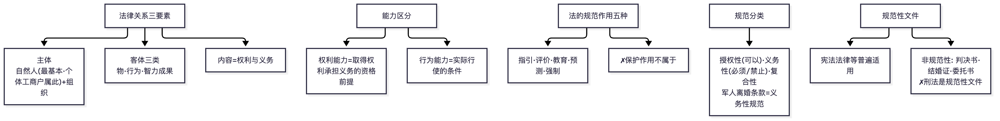
📌 锚点：**客体三类=物、行为、智力成果；保护作用不在五作用之列；刑法≠非规范性文件**。

#### 2.7.1 法的概念、本质与特征 ★★★★

**① 定义详解**：**法**是由国家制定或认可的、体现统治阶级意志的、由国家强制力保证实施的行为规范的总和。法的本质：**法是统治阶级意志的体现**（通过国家意志表现出来），最终由社会物质生活条件决定；社会主义法的本质是党的主张和人民意志的统一。法的基本特征：国家意志性（制定或认可）、国家强制性、规范性、普遍性等。法的作用：**指引、评价、教育、预测、强制**——对本人行为的指引作用最常考。

**② 考试答题**

**📌 历年真题**

**【2025.10·单选 10】** 外国人在中华人民共和国领域外对中华人民共和国国家或者公民犯罪，而按刑法规定的最低刑为三年以上有期徒刑的，可以适用中国刑法。这体现了我国法律效力范围中的（　）
- A. 属人主义
- B. 属地主义
- C. 保护主义 ✅
- D. 折中主义

**【2025.4·单选 21】** 人民是国家的主人，制定法律的权力属于人民。这说明我国社会主义法律的本质是___（选项未公开）
答案：党的主张和人民意志的统一（人民意志的体现）

**【2024.10·单选 22】** 多数机动车驾驶人选择"喝酒不开车，开车不喝酒"。这一选择集中体现了法的（　）
- A. 指引作用 ✅
- B. 评价作用
- C. 激励作用
- D. 强制作用

**【2024.10·单选 21】** 马克思主义法律观认为法随着阶级、国家的出现而出现，统治阶级制定法律是为了维护有利于其阶级统治的社会关系和社会秩序。这说明法的本质特征是（　）
- A. 反映个别意志的行为规范
- B. 由国家强制力保证实施的行为规范
- C. （原文暂缺）
- D. 反映统治阶级意志的行为规范 ✅

**⚠️ 易混淆**：指引作用（对本人行为的事前指引）vs 评价作用（对他人行为的判断）vs 强制作用（对违法行为的制裁）——题干主体是"多数驾驶人自己选择"→指引；"制裁违法者"→强制。

**③ 主观题展开**：定义→本质→特征→作用，四段各一句即可，属简答送分题。

#### 2.7.2 法的渊源、效力与溯及力 ★★★

**① 定义详解**：**法的渊源**指法的创制方式和表现形式（形式意义上的渊源）；**当代中国的法的渊源以宪法为核心、以制定法为主**（宪法、法律、行政法规、地方性法规、自治条例和单行条例、规章、特别行政区法律、国际条约等；判例不是我国正式渊源）。**法的效力**：时间效力、空间效力、对人效力（属人主义、保护主义、以属地主义为主与属人主义、保护主义相结合）。**法的溯及力**：我国采用**从旧兼从轻**原则。

**② 考试答题**

**📌 历年真题**

**【2025.10·单选 10】** 外国人在中华人民共和国领域外对中华人民共和国国家或者公民犯罪，而按刑法规定的最低刑为三年以上有期徒刑的，可以适用中国刑法。这体现了我国法律效力范围中的（　）
- A. 属人主义
- B. 属地主义
- C. 保护主义 ✅
- D. 折中主义

**📝 大纲提示**：大纲样卷单选 20（溯及力=从旧兼从轻）、单选 21（我国渊源以宪法为核心、以制定法为主），样卷题目第三节未收录题干选项，考点对应见第三节样卷说明。

**⚠️ 易混淆**："从旧兼从轻"别写成"从新兼从旧"。

**③ 主观题展开**：概念→分类逐条→举例（刑法溯及力）收尾。

#### 2.7.3 法律关系与法律责任 ★★★★

**① 定义详解**：**法律关系**是法律规范在调整人们行为过程中形成的权利义务关系，三要素：**主体**（自然人、组织/法人、国家）、**客体**（物、行为、智力成果/精神产品、**人身利益**）、**内容**（法律权利与法律义务）。**法律权利与法律义务的关系**：结构上相互依存、总量上等值、价值上主次分明（权利是目的、义务是手段）。**法律责任**：由于责任主体违反法定或约定义务，或因法律特别规定而必须承担的具有直接强制性的特定义务；构成要件：责任主体、违法行为或违约行为、损害后果、因果关系、主观过错【教材原文待核：构成要件完整清单以教材为准】；按性质分为民事责任、行政责任、刑事责任、违宪责任；民事责任承担方式包括**赔偿损失**（罚金、管制、没收财产属刑事责任方式）。

**② 考试答题**

**📌 历年真题**

**【2025.10·单选 11】** 下列关于法律关系客体的表述中，正确的是（　）
- A. 人身利益不能作为法律关系的客体
- B. 精神产品不能作为法律关系的客体
- C. 物是法律关系客体的一种 ✅
- D. 行为不能作为法律关系的客体

**【2025.4·单选 22】** 我国法律关系的主体主要包括自然人、组织、国家三类。下列属于自然人主体的是___（选项未公开）
答案：中国公民、外国公民、无国籍人【待核实：具体选项未公开】

**📝 大纲提示**：大纲样卷单选 22（民事责任承担方式=赔偿损失），样卷题目第三节未收录题干选项，考点对应见第三节样卷说明。

**⚠️ 易混淆**：**罚金（刑事）vs 罚款（行政）**；客体四类中"人格利益/人身利益**可以**作为法律关系客体"（正确），但"人的人格本身不能任意转让"——考试给"人格利益不能作为客体"这种绝对化说法必错。

**③ 主观题展开**：概念→三要素→权利义务关系（对立统一）→依法行使权利、履行义务收尾。

### 第八章 熟悉法律基本制度

> **🖼 图解：法律制度速查（宪法·司法·部门法）**
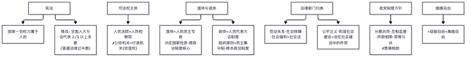
📌 锚点：**国体决定性质、人大制度是政体；司法权只有法院+检察院；2/3 修宪**。

> **🖼 知识点图：民法与婚姻速查（题库高频）**

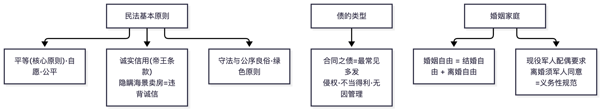

📌 锚点：平等为核心原则、诚信为帝王条款；合同之债最常见；婚姻自由=结婚+离婚自由。

> **🖼 知识点图：宪法与国家机构速查**

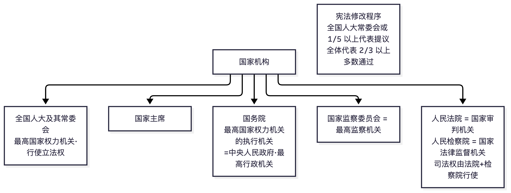

📌 锚点：司法权=法院(审判)+检察院(法律监督)；修宪 2/3；国务院=最高行政机关。

#### 2.8.1 宪法是根本法 ★★★★★

**① 定义详解**：宪法的特征：**在内容上，宪法规定国家生活中最根本、最重要的问题；在效力上，宪法具有最高的法律效力**（一切法律、行政法规、地方性法规都不得同宪法相抵触）；**在制定和修改程序上，宪法比普通法律更为严格**（全国人大常委会或五分之一以上全国人大代表提议，并由全体代表的三分之二以上多数通过）。我国宪法的基本原则：党的领导原则、人民主权原则、尊重和保障人权原则、社会主义法治原则、民主集中制原则。公民的基本权利与义务：平等权、政治权利与自由、宗教信仰自由、人身自由、社会经济权利（劳动权、休息权、物质帮助权）、文化教育权利等；基本义务：维护国家统一和民族团结、遵守宪法和法律、维护祖国安全荣誉和利益、依法服兵役和纳税、劳动和受教育（既是权利又是义务）。国家机构：全国人民代表大会（最高国家权力机关）、国家主席、国务院（最高国家行政机关/中央人民政府）、中央军委、国家监察委员会、最高人民法院（**审判机关**）、最高人民检察院（检察机关）、地方各级人大和政府、民族自治机关。**国家工作人员就职时进行宪法宣誓**（2018 年宪法修正案入宪）。

**② 考试答题**

**📌 历年真题**

**【2025.10·单选 9】** 各级人民代表大会及县级以上各级人民代表大会常务委员会选举或者决定任命的国家工作人员，以及各级人民政府、监察委员会、人民法院、人民检察院任命的国家工作人员，在就职时应当（　）
- A. 公开述职
- B. 进行宪法宣誓 ✅
- C. 向国旗宣誓
- D. 签署责任状

**【2025.10·单选 8】** 法律至上要求宪法至上、法律至上。法律至上具体表现为（　）
- A. 法律的普遍适用、优先适用、不可违抗 ✅
- B. 法律面前人人平等、司法独立
- C. 立法科学、执法严格、司法公正
- D. 法律的权威性、强制性、规范性

**【2025.4·简答 30】** 简述宪法的特征
> 【答案要点】①在内容上，宪法规定国家生活中最根本、最重要的方面；②在效力上，宪法具有最高的法律效力，一切法律、行政法规、地方性法规都不得同宪法相抵触；③在制定和修改程序上，宪法比普通法律更为严格（全国人大常委会或 1/5 以上全国人大代表提议，全体代表的 2/3 以上多数通过）

**【2025.4·单选 23】** 国家审判机关依法独立行使审判权，不受行政机关、社会团体和个人的干涉。我国的审判机关是___（选项未公开）
答案：人民法院

**【2024.10·单选 23】** 《宪法》第五条规定一切法律、行政法规和地方性法规都不得同宪法相抵触。这表明的宪法特征是（　）
- A. 宪法具有最高法律效力 ✅
- B. 宪法的制定程序非常严格
- C. 宪法的内容不同于普通法律
- D. 宪法的修改程序不同于普通法律

**【样卷·简答 30】** 简述我国国家机构的组成
> 【答案要点】全国人大、国家主席、国务院、中央军委、国家监察委员会、最高人民法院、最高人民检察院、地方各级人大和地方各级人民政府、民族自治地方的自治机关

**📝 大纲提示**：大纲样卷单选 23（宪法是制定普通法律的依据），样卷题目第三节未收录题干选项，考点对应见第三节样卷说明。

**⚠️ 易混淆**：审判机关=法院、检察机关=检察院、监察机关=监察委员会（2018 年后新设，别漏）；宪法修改通过门槛是"全体代表的**三分之二**以上多数"（干扰项常设 4/5、3/5）。

**③ 主观题展开**（对应 2025.4 简答 30）：特征三段（内容根本性、效力最高性、程序严格性）逐条＋"宪法是治国安邦总章程"收尾。

#### 2.8.2 中国特色社会主义法律体系 ★★★

**① 定义详解**：中国特色社会主义法律体系是**以宪法为核心（统帅）**，以法律为主干，由**宪法相关法、民法商法、行政法、经济法、环境资源法、社会法、军事法、刑法、诉讼与非诉讼程序法**等法律部门组成的有机统一整体。各法律部门常考举例：**社会法**（劳动关系、社会保障、社会福利和特殊群体权益保障）；**环境资源法**（含环境污染防治法与资源法两方面的法律）；刑法（犯罪与刑罚）；诉讼法（民事诉讼、刑事诉讼、行政诉讼程序）。

**② 考试答题**

**📌 历年真题**

**【2025.4·单选 24】** 环境资源法包括环境污染防治法和资源法两方面。下列属于资源法的是___（选项未公开）
答案：森林法/水法/土地管理法类【待核实：具体选项未公开】

**📝 大纲提示**：大纲样卷单选 24（规范劳动关系、社会保障等=社会法），样卷题目第三节未收录题干选项，考点对应见第三节样卷说明。

**⚠️ 易混淆**：九大法律部门清单中新版把**环境资源法、军事法**单列（旧教材为七大部门法），这是新旧教材差异点——用旧资料的"七大部门"会丢分。

**③ 主观题展开**：定义→"一个核心+九大部门"逐个一句→意义（国家治理的制度基础）。

#### 2.8.3 法律运行与法律监督 ★★★★

**① 定义详解**：我国社会主义法律的运行：**法律制定（立法）→法律执行（执法）→法律适用（司法）→法律遵守（守法）**四个环节。立法程序（法律的形成与确立阶段）：法律案的提出→审议→**表决通过**→公布。**法律监督**：国家机关、社会组织和公民对法律活动的合法性进行的监察和督促；类型上分为**国家监督**（权力机关监督、行政机关监督、监察机关监督、司法机关监督）与**社会监督**（中国共产党的监督、社会组织的监督、社会舆论的监督、人民群众的监督）。

**② 考试答题**

**📌 历年真题**

**【2025.4·单选 25】** 在法律的形成和确立阶段，立法程序主要包括的环节是___（选项未公开）
答案：法律案的提出→审议→表决通过→公布

**【样卷·简答 29】** 简述我国法律监督的类型
> 【答案要点】国家监督（权力机关监督、行政机关监督、监察机关监督、司法机关监督）＋社会监督（中国共产党的监督、社会组织的监督、社会舆论的监督、人民群众的监督）

**📝 大纲提示**：大纲样卷单选 25（学理解释属非正式解释），样卷题目第三节未收录题干选项，考点对应见第三节样卷说明。（注：法律监督的类型出自大纲样卷简答 29；2025.4 简答 29 实考"法治思维的含义和基本内容"，见 2.6.1 条目。）

**⚠️ 易混淆**：四个环节的主体——立法（人大）、执法（行政机关）、司法（司法机关，含法院检察院）、守法（一切主体）；"立法"与"法的制定"同义，别与"法律适用"混淆。法律解释：立法解释、审判解释、检察解释属**正式解释**，学理解释属**非正式解释**。

**③ 主观题展开**（对应 2025.4 简答 29）：定义一句→国家监督四类→社会监督四类→意义（保证法律统一正确实施）。

---

## 三、历年真题汇编（按考期倒序）

> **答案标注说明**：官方标准答案从未公开出版发行。本文所有答案均为【推导答案】——以考生回忆版答案为底本，逐题与 2023 版教材知识体系核对修正后给出，并附推导依据。
> **来源可信度**见第六节评级表。回忆版普遍存在的 OCR/输入讹字（如"笞案"→"答案"、选项乱序）已在转录时修正并在解析中说明。

### 考期一：2026 年 4 月（最近考期）

**卷面完整度：单选 11/25 题（22 分可见），主观题未流出。约还原卷面 22%。**
**来源互证：三源逐字一致**——①上海考试网 2026-04-14 发布（shzkw.org/shzksj/60227.html）；②贵州考试网 2026-04-13 发布 PDF（gzzikao.com.cn/gzzksj/61629.html，与上海版逐字同）；③考试 365 **考试当天（2026-04-11 15:39）**发布的考友回忆图（m.zikao365.com/lnst/wa20260411153935.shtml，试题图经识图转录）——当天发布的时间戳排除了跨考期抄袭可能，三源互证成立。

#### 一、单项选择题（每小题 2 分）

**【2026.4·单选 1】** 一般来说，个人品德的形成过程包含心理、思想、行为多种因素的相应发展，其中，人们把情感和道德意志转变成的个人行动的指南和原则，这是指（　）。

- A. 道德信念 ✅
- B. 道德行为
- C. 道德习惯
- D. 道德意志

📌 信念=情感与意志凝成的行动指南环节（认识→情感→意志→信念→行为链条）；三源答案一致【推导答案】A

**【2026.4·单选 2】** 家庭是社会的细胞。家庭和睦则社会安定，家庭幸福则社会祥和，家庭文明则社会文明。属于家庭美德基本要求的是（　）。

- A. 助人为乐
- B. 尊老爱幼 ✅
- C. 爱护公物
- D. 爱岗敬业

📌 家庭美德五要求仅 B 属之，A/C 属社会公德、D 属职业道德；三源答案一致【推导答案】B

**【2026.4·单选 3】** 体现了社会主义职业道德的最高目标指向、最高层次指的是（　）。

- A. 爱岗敬业
- B. 诚实守信
- C. 奉献社会 ✅
- D. 办事公道

📌 奉献社会=最高目标指向、爱岗敬业=最基本要求；本考点 4 考期 4 考，全课程第一钉子户；三源答案一致【推导答案】C

**【2026.4·单选 4】** 社会主义道德建设以集体主义为原则，这一原则具有多层次的道德要求。对于共产党员，努力达到的道德目标是（　）。

- A. 无私奉献、一心为公 ✅
- B. 先私后公、先己后人
- C. 公私兼顾，不损公肥私
- D. 主观为自己、客观为他人

📌 最高层次（无私奉献、一心为公）是共产党员目标；D 为个人主义错误观点永远不选；三源答案一致【推导答案】A

**【2026.4·单选 5】** 社会主义核心价值观是社会主义核心价值体系的高度凝练和集中表达，党的十八大报告提出 24 个字的社会主义核心价值观。在社会主义核心价值观的基本内容中，属国家层面价值目标的是（　）。

- A. 富强、民主、文明、和谐 ✅
- B. 自由、平等、公正、法治
- C. 爱国、文明、诚信、友善
- D. 勤劳、勇敢、奉献、奋斗

📌 国家层面=富强、民主、文明、和谐；C 项把"文明"挪入个人层面制造混淆；三源答案一致【推导答案】A

**【2026.4·单选 6】** 人生观是人们在实践中形成的对于人生目的、人生态度、人生价值等问题的总看法和总观点。世界观是人们对生活在其中的世界以及人与世界的关系的总体看法和根本观点。下列关于人生观与世界观正确的是（　）。

- A. 人生观对世界观的巩固、发展和变化起着重要作用 ✅
- B. 人生观决定世界观，有什么样的人生观，就有什么样的世界观
- C. 一个人的人生观往往是自觉的、系统的，世界观往往是不自觉的、不系统的
- D. 世界观是人生观的一部分，用人生观去观察和对待世界问题，就形成了世界观

📌 规范表述是世界观决定人生观（B 反了），人生观反作用于世界观（A 正确），C/D 均颠倒；三源答案一致【推导答案】A

**【2026.4·单选 7】** 人们通过生活实践形成的对人生问题的一种稳定的心理倾向和精神状态，称为（　）。

- A. 人的价值
- B. 人生目的
- C. 人生态度 ✅
- D. 人的本质

📌 人生态度定义句；目的答"为什么"、价值答"意义"、态度答"怎样"，三对应背熟；三源答案一致【推导答案】C

**【2026.4·单选 8】** 在原始社会的生产条件下，人们只能把获得较多的食物以满足生活所需作为自己的理想，不可能想象现在电子计算机时代的生活。这说明，理想信念具有（　）。

- A. 共同性的特点
- B. 时代性的特点 ✅
- C. 阶级性的特点
- D. 多样性的特点

📌 "不同时代生产条件决定理想内容"指向时代性（题干一处回忆笔误已按语义修正）；三源答案一致【推导答案】B

**【2026.4·单选 9】** 中国共产党的最高理想是实现共产主义，在现阶段的奋斗纲领是建设中国特色社会主义。最高理想与中国特色社会主义共同理想之间的关系是（　）。

- A. 社会理想与个人理想的关系
- B. 主观想象与客观现实的关系
- C. 最终理想与阶段性理想的关系 ✅
- D. 非科学理想与科学理想的关系

📌 共产主义=最终理想、共同理想=阶段性理想；与 2024.10 单选 5 同考点重复；三源答案一致【推导答案】C

**【2026.4·单选 10】** 民族精神是一个民族在长期共同生活和社会实践中形成，为本民族大多数成员所认同的价值取向、思维方式、道德规范、精神气质的总和，是一个民族赖以生存和发展的精神支柱。中华民族精神的核心是（　）。

- A. 马克思主义
- B. 改革创新
- C. 艰苦奋斗
- D. 爱国主义 ✅

📌 民族精神核心=爱国主义、时代精神核心=改革创新，最经典干扰对；三源答案一致【推导答案】D

**【2026.4·单选 11】** 一个民族自立于世界民族之林的能力及其发展前途的坚定信念，指的是（　）。

- A. 民族自尊
- B. 民族自强
- C. 民族自信 ✅
- D. 民族精神

📌 题干与"民族自信"教材定义逐字对应（自尊=尊严维护与自豪感、自强=依靠本民族力量振兴）【推导答案】C

> 单选 12—25（第 12 题起）无公开回忆，主观题亦未流出。**缺口提示**：按 2024.10／2025.4 完整卷规律，第 12 题之后的 14 道单选应覆盖道德章后半与法律三章（六、七、八章），考生请用第三节末官方样卷补足该区段的练习量。

### 考期二：2025 年 10 月

**卷面完整度：单选 11/25＋简答 4＋论述 1（另有 1 题简答/论述性质待定），约还原卷面 22＋30≈52 分结构的题目。单选后 14 题、简答 1 题、论述 2 题未流出。**
**来源**：浙江考试网 PDF（zjzikao.org/zjzkda/59225.html，2025-10-27 上传，3 页扫描图，无文字层）——经多模态识图逐字转录，关键页两轮互校。**本考期全部题目为该扫描件单源**，可信度评级 ★★★☆☆（见 6.4）。
**⚠️ 考期归属仲裁记录**：湖南考试网（hnzk.hn.cn/lnzt/48552.html，2025-10-28 发布）标注"2025 年 10 月"的 11 道单选（个人品德/家庭美德/奉献社会/共产党员/核心价值观/人生观世界观/人生态度/时代性/最终理想/民族精神/民族自信），经与考试 365 **2026-04-11 考试当天**发布的回忆图比对**逐字相同**，且该湖南页面全篇仅有这 11 道单选、无任何主观题——判定为湖南站将 2026 年 4 月回忆版错挂至 2025 年 10 月栏目（商业站互抄），已整体剔除、不作为本考期依据。本考期一切内容以浙江扫描件为准。

#### 一、单项选择题（每小题 2 分，据浙江扫描件转录）

**【2025.10·单选 1】** 新时代的大学生要想成长成才，必须要有理想、有本领、有担当，做新时代的好青年。新时代好青年应该做到（　）。

- A. 有理想、敢担当、能吃苦、肯奋斗 ✅
- B. 有文化、守纪律、懂法律、会学习
- C. 有信念、讲道德、懂法律、守纪律
- D. 有道德、有理想、守纪律、讲奉献

📌 大纲原文"有理想、敢担当、能吃苦、肯奋斗"（党的二十大表述）；扫描件标注 B 与教材冲突疑为排版错位，此题以教材为准【待核实】【推导答案】A

**【2025.10·单选 2】** 在社会主义核心价值观的基本内容中，自由、平等、公正、法治是（　）。

- A. 国家层面的价值目标
- B. 社会层面的价值取向 ✅
- C. 个人层面的价值准则
- D. 公民层面的价值观念

📌 24 字方针固定分组：自由、平等、公正、法治=社会层面价值取向【推导答案】B

**【2025.10·单选 3】** 人生目的是人生观的核心，在人生实践中具有重要作用。下列人生目的中，应当崇尚和追求的人生目的是（　）。

- A. 享乐主义的人生目的
- B. 个人主义的人生目的
- C. 服务人民、奉献社会的人生目的 ✅
- D. 拜金主义的人生目的

📌 大纲应用点原文"用服务人民、奉献社会的人生目的指引人生方向"；其余三项均为教材批判的错误人生目的【推导答案】C

**【2025.10·单选 4】** 道德起源问题上有不同的观点，其中马克思主义认为，道德起源的前提是（　）。

- A. 语言
- B. 意识
- C. 劳动 ✅
- D. 上帝/神启

📌 劳动是道德起源的首要前提（社会关系=客观条件、自我意识=主观条件）；与 2024.10-12、2025.4-12 构成三考期考点链【推导答案】C

**【2025.10·单选 5】** 社会主义道德建设要坚持以集体主义为原则，同时也要以为人民服务为核心。我国社会主义道德建设的核心是（　）。

- A. 集体主义
- B. 诚实守信
- C. 爱国主义
- D. 为人民服务 ✅

📌 核心=为人民服务、原则=集体主义、重点=诚实守信，三定位打包背【推导答案】D

**【2025.10·单选 6】** 爱岗敬业、诚实守信、办事公道、服务群众、奉献社会是人们在职业生活中应该遵守的（　）。

- A. 社会公德的基本要求
- B. 职业道德的基本要求 ✅
- C. 家庭美德的基本要求
- D. 个人品德的基本要求

📌 五项内容即职业道德基本要求【推导答案】B

**【2025.10·单选 7】** 全面依法治国涉及很多方面，必须坚持依法治国、依法执政、依法行政共同推进。其中在全面依法治国中地位最突出、作用最重大的工作是（　）。

- A. 科学立法
- B. 依宪治国、依宪执政 ✅
- C. 严格执法
- D. 公正司法

📌 依宪治国、依宪执政在全面依法治国中地位最突出、作用最重大；依法治国首先要坚持依宪治国【推导答案】B

**【2025.10·单选 8】** 法律至上要求宪法至上、法律至上。法律至上具体表现为（　）。

- A. 法律的普遍适用、优先适用、不可违抗 ✅
- B. 法律面前人人平等、司法独立
- C. 立法科学、执法严格、司法公正
- D. 法律的权威性、强制性、规范性

📌 法律至上=普遍适用性、优先适用性、不可违抗性（法治思维要点的固定展开）【推导答案】A

**【2025.10·单选 9】** 各级人民代表大会及县级以上各级人民代表大会常务委员会选举或者决定任命的国家工作人员，以及各级人民政府、监察委员会、人民法院、人民检察院任命的国家工作人员，在就职时应当（　）。

- A. 公开述职
- B. 进行宪法宣誓 ✅
- C. 向国旗宣誓
- D. 签署责任状

📌 宪法宣誓制度系 2018 年宪法修正案确立（就职时公开进行宪法宣誓）【推导答案】B

**【2025.10·单选 10】** 外国人在中华人民共和国领域外对中华人民共和国国家或者公民犯罪，而按刑法规定的最低刑为三年以上有期徒刑的，可以适用中国刑法。这体现了我国法律效力范围中的（　）。

- A. 属人主义
- B. 属地主义
- C. 保护主义 ✅
- D. 折中主义

📌 保护主义=凡侵害本国国家或公民利益均可适用本国法；题干"外国人在境外对我国国家/公民犯罪"正是保护主义场景【推导答案】C

**【2025.10·单选 11】** 下列关于法律关系客体的表述中，正确的是（　）。

- A. 人身利益不能作为法律关系的客体
- B. 精神产品不能作为法律关系的客体
- C. 物是法律关系客体的一种 ✅
- D. 行为不能作为法律关系的客体

📌 客体四类=物、行为（行为结果）、智力成果（精神产品）、人身利益；A/B/D 以"不能作为"绝对化设错【推导答案】C

#### 二、简答题（每小题 6 分）

**26.** 简述中华传统美德的基本精神。（浙江扫描件视觉转录，两轮识图互校）
**【推导答案】**：
①重视整体利益，强调责任奉献（"公义胜私欲""先天下之忧而忧，后天下之乐而乐"）；
②推崇"仁爱"原则，注重以和为贵（"己所不欲，勿施于人""礼之用，和为贵"）；
③提倡人伦价值，重视道德义务（"五教"传统、孝悌忠信）；
④追求精神境界，向往理想人格（成圣成贤、杀身成仁、舍生取义）；
⑤强调道德修养，注重道德践履（修身、慎独、省察克治）。
依据：江苏/陕西版 2025.4 答案结构与 2024.10 单选 13 解析互证；【教材原文待核：五条顺序与措辞以 2023 版教材为准】。

（简答 12/13/14 的题目内容见下方"主观题补充清单"。）

#### 三、论述题（每小题 10 分，3 选 2）

**31.** 论述如何做改革创新的生力军。（浙江扫描件视觉转录，两轮识图互校）
**【推导答案】**（提纲）：
- 是什么：改革创新是时代精神的核心，是新时代的迫切要求（我国进入新发展阶段、科技自立自强、国际竞争的需要）；
- 为什么：青年是改革创新的生力军，"青年兴则国家兴，青年强则国家强"；
- 怎么办：树立改革创新的自觉意识（增强创新的责任感、树立敢于突破陈规的意识、树立大胆探索未知领域的信心）；增强改革创新的能力本领（夯实创新基础、培养创新思维、投身创新实践）；
- 结合实际：作为动漫设计专业学生，在创作技法、内容表达、技术应用上勇于创新，用作品讲好中国故事。
依据：大纲第三章应用点"把握改革创新的时代要求，让改革创新成为青春远航的动力"。

#### 主观题补充清单（均来自浙江扫描件视觉转录，答案为推导）

| 题型 | 题目 | 推导答案要点 |
|---|---|---|
| 简答 12 | 简述人生态度的类型 | 人生态度有积极与消极之分：积极进取的人生态度（肯定型/积极型）肯定人生、认真务实、乐观进取；消极无为的人生态度（否定型/消极型）否定人生价值、看破红尘、得过且过。应当确立积极进取的人生态度 |
| 简答 13 | 简述新时代爱国主义（的要求/本质） | 坚持爱国爱党爱社会主义相统一；维护祖国统一和民族团结；尊重和传承中华民族历史和文化；坚持立足民族又面向世界；坚持总体国家安全观。核心句：当代中国爱国主义的本质是坚持爱国和爱党、爱社会主义高度统一 |
| 简答/论述 14 | 结合当前实际，论述如何做新时代忠诚爱国者 | 推进祖国统一（保持香港澳门长期繁荣稳定、坚持一个中国原则反对"台独"）；促进民族团结（铸牢中华民族共同体意识）；增强国家安全意识（坚持总体国家安全观）。落脚：以实际行动和贡献报效祖国 |

**本考期主观题流出缺口（如实报告）**：卷面应为简答 5＋论述 3 共 8 题，目前仅回收 5 题（简答 12/13/26＋简答或论述 14＋论述 31），**缺简答 1 题、论述 2 题，题目内容未知**。此前版本曾收录"当代中国发展进步的根本方向／中国革命道德／理想信念的含义及作用／法治思维与法治素养"四题并标注"湖南单源"，经复核湖南站页面实际不含任何主观题，该四题**无原始来源支撑，已删除**（详见 6.2 校验记录第 6 条）。若后续找到 2025.10 完整回忆版（建议检索关键词"15042 2025年10月 真题 简答题"），可补全缺口。

### 考期三：2025 年 4 月（湖北考生本省首考）

**卷面完整度：结构 100%（单选 25 题干全＋简答 5＋论述 3），单选选项未随卷公开，主观题有完整回忆答案。约还原卷面题量 100%。**
**来源互证：三源**——①考试 365"2025 年 4 月高等教育考试**全国统一命题考试**思想道德与法治试题及答案"（zikao365.com/ggk/zh20250603152011.shtml，25 单选题干＋主观题全）；②江苏考试网回忆版（jszikao.org/zkda/57812.html，主观题题目＋答案）；③陕西考试网（sxzk.sx.cn/tk_ggk/26367.html，主观题题目＋答案）。②③答案逐字互证通过。

#### 一、单项选择题（25 小题×2 分；选项未随卷公开，逐题列出题干＋答案；依据=教材知识定位）

**【2025.4·单选 1】** 马克思主义认为，人的本质在其现实性上是___

答案：**一切社会关系的总和**

📌 规范表述含"在其现实性上"限定语；与 2024.10-1 跨年重复【推导答案】

**【2025.4·单选 2】** 马克思"为人类福利而劳动"、周恩来"为中华崛起而读书"……志士仁人大都志存高远，很早就___

答案：**确立了远大志向/崇高理想**

📌 理想对人生的引领作用方向【待核实：选项未公开，据题干语境推导】【推导答案】

**【2025.4·单选 3】** 理想具有变为现实的可能性，是经过较长期努力可以实现的。这是因为___

答案：**理想一定时代的产物，带有时代的烙印**

📌 科学理想立足于现实、符合社会发展规律【待核实：选项未公开】【推导答案】

**【2025.4·单选 4】** 理想信念是一种从精神向行动的转变过程。这说明理想信念具有___

答案：**实践性（知行统一性）**

📌 【待核实：选项未公开】【推导答案】

**【2025.4·单选 5】** 希望选择理想职业、在工作中达到理想境界取得理想成绩。这属于___

答案：**职业领域的理想信念**

📌 与 2024.10-4 重复【推导答案】

**【2025.4·单选 6】** 共产党人的远大理想集中体现人类对美好生活的向往，它的最终实现是历史发展的必然。这一远大理想是___

答案：**实现共产主义**

📌 【推导答案】

**【2025.4·单选 7】** 当发现理想与现实的矛盾时，不加分析地全盘认同当下的现实，对理想失去信心和热情。这种认识上的误区属于___

答案：**以现实否定理想**

📌 放逐理想/庸俗化倾向【待核实：选项措辞】【推导答案】

**【2025.4·单选 8】** 中华文明突出的统一性从根本上决定了___

答案：**中华民族各民族文化融为一体、国家统一永远是中国核心利益的核心**

📌 文化传承发展座谈会论述方向【待核实：选项措辞】【推导答案】

**【2025.4·单选 9】** 中国人民始终团结一心、同舟共济……多元一体的融洽民族关系。这体现中国精神中的___

答案：**伟大团结精神**

📌 【推导答案】

**【2025.4·单选 10】** 在中国特色社会主义新时代，爱国主义的本质首先体现为___

答案：**坚持爱国和爱党、爱社会主义相统一**

📌 【推导答案】

**【2025.4·单选 11】** 在当今时代，我们应该大力弘扬的时代精神的核心是___

答案：**改革创新**

📌 【推导答案】

**【2025.4·单选 12】** 认为道德产生于人类历史发展和人们社会实践的观点，属于___

答案：**马克思主义的观点**

📌 三考期考点链：2024.10-12→2025.4-12→2025.10-4【推导答案】

**【2025.4·单选 13】** "仁者爱人""己所不欲勿施于人""礼之用，和为贵"体现的中华传统美德是___

答案：**乐群贵和（推崇仁爱、以和为贵）**

📌 与 2024.10-13 同素材重复【推导答案】

**【2025.4·单选 14】** 居于社会道德体系基础层次、维护公共生活秩序的社会道德规范是___

答案：**社会公德**

📌 【推导答案】

**【2025.4·单选 15】** 从业者自觉遵守规章制度、平等待人、清正廉洁、不谋私利、不滥用职权。这是职业道德中的___

答案：**办事公道**

📌 【推导答案】

**【2025.4·单选 16】** 精心抚养子女、赡养丧失劳动能力的父母。这体现家庭美德中的___

答案：**尊老爱幼**

📌 【推导答案】

**【2025.4·单选 17】** 通过反复检查发现自己思想中的不良念头和行为上的不良习惯，并坚决克服整治。这种修养方法是___

答案：**省察克治**

📌 "吾日三省吾身"；2024.10-17 同位重复——第 17 题连续两年考同一方法【推导答案】

**【2025.4·单选 18】** 中国特色社会主义法治道路的核心要义，除坚持党的领导、坚持中国特色社会主义制度外，还包括___

答案：**贯彻中国特色社会主义法治理论**

📌 【推导答案】

**【2025.4·单选 19】** 依法治国、依法执政、依法行政共同推进，法治国家、法治政府、法治社会一体建设。其中重点任务和主体工程是___

答案：**建设法治政府**

📌 【推导答案】

**【2025.4·单选 20】** 习近平法治思想是全面依法治国的指导思想和根本遵循，其回答的重大理论问题是___

答案：**新时代为什么实行全面依法治国、怎样实行全面依法治国**

📌 【推导答案】

**【2025.4·单选 21】** 人民是国家的主人，制定法律的权力属于人民。这说明我国社会主义法律的本质是___

答案：**党的主张和人民意志的统一（人民意志的体现）**

📌 【推导答案】

**【2025.4·单选 22】** 我国法律关系的主体主要包括自然人、组织、国家三类。下列属于自然人主体的是___

答案：**中国公民、外国公民、无国籍人**

📌 具体选项未公开【待核实】【推导答案】

**【2025.4·单选 23】** 国家审判机关依法独立行使审判权，不受行政机关、社会团体和个人的干涉。我国的审判机关是___

答案：**人民法院**

📌 【推导答案】

**【2025.4·单选 24】** 环境资源法包括环境污染防治法和资源法两方面。下列属于资源法的是___

答案：**（森林法/水法/土地管理法类；具体选项未公开）**

📌 【待核实】【推导答案】

**【2025.4·单选 25】** 在法律的形成和确立阶段，立法程序主要包括的环节是___

答案：**法律案的提出→审议→表决通过→公布**

📌 【推导答案】

#### 二、简答题（5 小题×6 分）

**26.** 简述培育和践行社会主义核心价值观的时代意义。（zikao365 题干为"时代意义"；江苏/陕西回忆版题干为"社会主义核心价值观的培育和践行"且答案兼含内容与意义——回忆版题干分歧已注明，以 zikao365 卷面题干为准）
**【推导答案】**：
①坚持和发展中国特色社会主义的价值遵循；②提高国家文化软实力的迫切要求；③推进社会团结奋进的"最大公约数"。
（若按"如何践行"作答：把核心价值观落细落小落实——勤学、修德、明辨、笃实。）
依据：陕西版真题答案结构与教材绪论部分互证。

**27.** 简述爱国主义的含义和基本内容。
**【推导答案】**：
含义：爱国主义体现了人们对自己祖国的深厚感情，揭示了个人对祖国的依存关系，是人们对自己家园以及民族和文化的归属感、认同感、尊严感与荣誉感的统一，是调节个人与祖国之间关系的道德要求、政治原则和法律规范。
基本内容：①爱祖国的大好河山；②爱自己的骨肉同胞；③爱祖国的灿烂文化；④爱自己的国家。
依据：江苏、陕西两版答案逐字互证通过。

**28.** 简述当代社会公共生活的主要特点。
**【推导答案】**：①活动范围的广泛性；②活动内容的开放性；③交往对象的复杂性；④活动方式的多样性。
依据：两版答案互证通过；与大纲样卷单选 14（"活动范围的广泛性"）互证。

**29.** 简述法治思维的含义和基本内容。
**【推导答案】**：
含义：法治思维是以法治价值和法治精神为导向，运用法律原则、法律规则、法律方法思考和处理问题的思维模式——是以法律为准绳、以法治理念为指导的思维方式的统一。具体四层：正当性思维（蕴含公正平等民主人权等法治理念）、规范思维（以法律原则规则为依据）、逻辑思维（以法律手段方法分析处理问题）、科学思维（符合规律、尊重事实）。
基本内容：法律至上、权力制约、公平正义、权利保障、程序正当。
依据：两版答案互证通过。

**30.** 简述宪法的特征。
**【推导答案】**：①在内容上，宪法规定国家生活中最根本、最重要的方面（国家性质、根本制度、公民基本权利义务、国家机构组织与职权）；②在效力上，宪法具有最高的法律效力，一切法律、行政法规、地方性法规都不得同宪法相抵触；③在制定和修改程序上，宪法比普通法律更为严格（全国人大常委会或 1/5 以上全国人大代表提议，全体代表的 2/3 以上多数通过）。
依据：两版答案互证通过；2024.10-23 单选从"最高效力"角度同章印证。

#### 三、论述题（3 题任选 2，每小题 10 分）

**31.** 论述坚持中国特色社会主义法治道路必须遵循的原则。
**【推导答案】**：
①坚持中国共产党的领导（党的领导是全面依法治国最根本的保证）；②坚持人民主体地位（法治建设为了人民、依靠人民、造福人民、保护人民）；③坚持法律面前人人平等（任何组织和个人都必须尊重宪法法律权威，都不得有超越宪法法律的特权）；④坚持依法治国和以德治国相结合（法律与道德协同发力，法安天下、德润人心）；⑤坚持从中国实际出发（走适合自己的法治道路，汲取中华法律文化精华、借鉴国外有益经验但不照搬照抄）。
每条展开"原则句＋一句理由＋一句实践要求"，结尾点题：这是由我国社会主义国家性质与国情决定的。
依据：江苏、陕西答案互证通过（五条完全一致）。

**32.** 论述新时代大学生养成积极进取人生态度的重要意义。
**【推导答案】**：
是什么：人生态度定义；积极进取的人生态度=认真、务实、乐观、进取。
为什么：①有助于正确对待人生矛盾（得与失、苦与乐、顺与逆、生与死、荣与辱）；②有助于在逆境中奋起（逆境可以磨炼意志、陶冶品格）；③有助于实现人生价值、担当时代使命（消极无为则虚度年华）。
怎么办：认真分清得失、清醒对待成败、豁达看待生死；身处顺境不骄不躁、居安思危；身处逆境不坠青云之志，化压力为动力。
依据：江苏版无此题（回忆缺失），由教材第一章"人生态度"部分推导；zikao365 卷面题干确认本题存在。

**33.** 论述社会主义道德建设要以为人民服务为核心。
**【推导答案】**：
①为人民服务是社会主义道德的本质要求：为人民服务是社会主义经济基础和人际关系的客观要求；是社会主义市场经济健康发展的要求。
②为人民服务是先进性要求与广泛性要求的统一：对不同群体提出不同层次要求（无私奉献→先公后私→公私兼顾），既鼓励先进又照顾多数。
③为人民服务作为社会主义道德的核心，是社会主义道德区别和优越于其他社会形态道德的显著标志。
结尾：反对和抵制拜金主义、享乐主义和极端个人主义。
依据：江苏、陕西答案互证通过。

### 考期四：2024 年 10 月（全国首考卷）

**卷面完整度：单选 25/25 全（含选项与解析），主观题未流出。约还原卷面 50%。**
**来源：单一来源**——考试真题题库站 zkttk.com/special/1018.html（转载整卷，逐题附答案与解析；第 21 题 C 选项原文即标注"暂缺"）。无第二独立来源可互证，可信度评级见第六节；题目内容与 2023 版教材知识体系逐题核对无矛盾（内容自洽校验通过）。

#### 一、单项选择题（25 小题×2 分）

**【2024.10·单选 1】** 人类思想发展至今，唯有马克思主义真正揭示了人的本质之谜。下列关于人的本质的说法正确的是（　）。

- A. 人是自然的产物
- B. 人是绝对精神的外化
- C. 人的本性是先天而来的
- D. 人的本质是一切社会关系的总和 ✅

📌 人的本质=一切社会关系的总和，是现实的、具体的、历史的、发展的【推导答案】D

**【2024.10·单选 2】** 马克思说"我们应该遵循的主要指针是人类的幸福和我们自身的完美"……"我们自身的完美"就是追求人格高尚、才智发展、生活幸福，也就是（　）。

- A. 改善人生的现实境遇
- B. 实现人生的自我价值 ✅
- C. 改变人生的生存状态
- D. 实现人生的社会价值

📌 "我们自身的完美"=人格高尚、才智发展、生活幸福=自我价值【推导答案】B

**【2024.10·单选 3】** 中国共产党人之所以能在非常困难的情况下奋斗出来，战胜千难万险取得革命胜利，是因为有马克思主义科学信仰和共产主义远大理想。这说明理想信念是（　）。

- A. 人生的精神支柱 ✅
- B. 人生的现实境遇
- C. 人们的丰富想象
- D. 人们的主观意志

📌 科学信仰＋远大理想支撑困难中奋斗=精神支柱【推导答案】A

**【2024.10·单选 4】** 人们希望找到一份理想的工作，并在工作中达到理想境界、取得理想业绩，这样向往和追求属于（　）。

- A. 生活领域的理想信念
- B. 职业领域的理想信念 ✅
- C. 道德领域的理想信念
- D. 社会领域的理想信念

📌 理想工作＋理想业绩=职业领域（与 2025.4-5 重复）【推导答案】B

**【2024.10·单选 5】** 中国特色社会主义共同理想与共产主义远大理想具有内在联系，它们之间的关系是（　）。

- A. 个人理想与社会理想关系
- B. 生活理想与道德理想关系
- C. 阶段性理想与最终性理想 ✅
- D. 科学理想与非科学理想

📌 共同理想=阶段、远大理想=最终；与 2026.4-9 同考点【推导答案】C

**【2024.10·单选 6】** "宝剑锋从磨砺出，梅花香自苦寒来"……理想的现实离不开艰苦奋斗。这说明（　）。

- A. 现实是完美的，理想是有缺陷的
- B. 美好的理想是遥不可及的主观想象
- C. 艰苦奋斗是实现美好理想的重要条件 ✅
- D. 确立理想的过程是一个读书学习的过程

📌 诗句题眼"磨砺/苦寒"→艰苦奋斗【推导答案】C

**【2024.10·单选 7】** "国家好，民族好，大家才会好。"这句话启示我们在确立理想信念时应当（　）。

- A. 着眼于个人的前途命运
- B. 把理想和信念结合起来
- C. 接受各种不同的理想信念
- D. 把个人的理想信念与社会的理想信念结合起来 ✅

📌 题眼"国家—民族—大家"=社会理想信念与个人结合【推导答案】D

**【2024.10·单选 8】** 爱国主义必然以爱故土山河、爱骨肉同胞、爱祖国的文化和爱自己的国家为基本内容。爱国主义的基本政治要求是（　）。

- A. 热爱故土山河
- B. 热爱骨肉同胞
- C. 热爱自己的国家 ✅
- D. 热爱光辉灿烂的文化

📌 四项基本内容中"基本政治要求"=热爱自己的国家【推导答案】C

**【2024.10·单选 9】** "中国的脊梁"们"先天下之忧而忧，后天下之乐而乐"，这体现的爱国主义优良传统是（　）。

- A. 维护祖国统一
- B. 抵御外来侵略
- C. 心系民生苦乐 ✅
- D. 开发祖国山河

📌 优良传统四条：维护祖国统一／抵御外来侵略／开发祖国山河／心系民生苦乐【推导答案】C

**【2024.10·单选 10】** 人类社会越来越成为命运共同体，这要求新时代弘扬爱国主义精神必须与扩大对外开放结合起来，做到（　）。

- A. 坚持立足民族又面向世界 ✅
- B. 维护祖国统一和民族团结
- C. 坚持爱国主义与社会主义相统一
- D. 尊重和传承中华民族历史和文化

📌 题眼"与扩大对外开放结合"=立足民族又面向世界【推导答案】A

**【2024.10·单选 11】** 伟大思想巨匠、伟大科技成果、伟大文艺作品、伟大史诗、伟大工程……这主要体现了（　）。

- A. 伟大创造精神 ✅
- B. 伟大团结精神
- C. 伟大奋斗精神
- D. 伟大梦想精神

📌 巨匠／成果／作品／史诗／工程皆"造"出来=创造精神【推导答案】A

**【2024.10·单选 12】** 道德产生于人类的历史发展和人们的社会实践中。这种关于道德起源的观点是（　）。

- A. 庸俗进化论
- B. 马克思主义观点 ✅
- C. 主观唯心主义观点
- D. 客观唯心主义观点

📌 与 2025.4-12、2025.10-4 构成三考期"道德起源"考点链【推导答案】B

**【2024.10·单选 13】** "仁者爱人""己所不欲，勿施于人""礼之用，和为贵"体现了中华民族传统美德中的（　）。

- A. 求真务实
- B. 乐群贵和 ✅
- C. 勤劳勇敢
- D. 爱国奉献

📌 仁爱＋以和为贵=乐群贵和（与 2025.4-13 同素材重复）【推导答案】B

**【2024.10·单选 14】** 爱岗敬业、诚实守信、办事公道、服务群众、奉献社会是（　）。

- A. 社会道德的要求
- B. 职业道德的要求 ✅
- C. 家庭道德的要求
- D. 网络道德的要求

📌 五项内容即职业道德基本要求（与 2025.10-6 重复）【推导答案】B

**【2024.10·单选 15】** 小张在工作岗位上是劳动模范，在家里积极操持家务、合理消费、不乱花费。小张在家里的表现反映了家庭美德中的（　）。

- A. 邻里团结
- B. 尊老爱幼
- C. 夫妻和睦
- D. 勤俭持家 ✅

📌 题眼"操持家务、合理消费、不乱花费"=勤俭持家【推导答案】D

**【2024.10·单选 16】** "海纳百川，有容乃大""躬自厚而薄责于人""君子和而不同"蕴含的交往原则是（　）。

- A. 平等
- B. 诚信
- C. 互助
- D. 宽容 ✅

📌 大纲识记点"成功交往的基本原则"：平等、诚信、宽容、互助；题眼"有容／薄责／和而不同"=宽容【推导答案】D

**【2024.10·单选 17】** "吾日三省吾身"——通过反复检查以发现和找出自己思想中的不良念头和行为上的不良习惯，坚决克服和整治掉。这种修养方法是（　）。

- A. 陶冶情操
- B. 学而明理
- C. 省察克治 ✅
- D. 慎独自律

📌 "吾日三省吾身"=省察克治（与 2025.4-17 同位重复）【推导答案】C

**【2024.10·单选 18】** 维护法律权威必须培养法治思维、抛弃人治思维。下列属于法治思维基本内容的是（　）。

- A. 法律至上 ✅
- B. 权利制约
- C. 以言代法
- D. 权利保障

📌 五内容含"法律至上"；B 应为"权力制约"，本题"权利制约"系错项设计，据来源解析取 A【推导答案】A

**【2024.10·单选 19】** 缺乏监督的权力必然导致腐败……真正做到将权力关进制度的笼子里，必须实现的目标是（　）。

- A. 完备的法律规范体系
- B. 严密的法治监督体系 ✅
- C. 完善的党内法规体系
- D. 有力的法治保障体系

📌 题眼"缺乏监督的权力"=法治监督体系【推导答案】B

**【2024.10·单选 20】** 把党的领导贯彻到全面推进依法治国的全过程。下列体现加强和改进党对全面依法治国领导要求的是（　）。

- A. 加强法律服务队伍建设
- B. 建设高素质法治专门队伍
- C. 健全完善法治人才培养机制
- D. 提高党员干部法治思维和依法办事能力 ✅

📌 A/B/C 属"加强法治工作队伍建设"，唯 D 是党对依法治国领导的要求【推导答案】D

**【2024.10·单选 21】** 马克思主义法律观认为法随着阶级、国家的出现而出现，统治阶级制定法律是为了维护有利于其阶级统治的社会关系和社会秩序。这说明法的本质特征是（　）。

- A. 反映个别意志的行为规范
- B. 由国家强制力保证实施的行为规范
- C.（原文暂缺）
- D. 反映统治阶级意志的行为规范 ✅

📌 法的本质=统治阶级意志的体现；来源页 C 选项即标注"暂缺"，不影响作答【推导答案】D

**【2024.10·单选 22】** 多数机动车驾驶人选择"喝酒不开车，开车不喝酒"。这一选择集中体现了法的（　）。

- A. 指引作用 ✅
- B. 评价作用
- C. 激励作用
- D. 强制作用

📌 指引作用=法为人们提供行为模式，指引人们在法律范围内活动【推导答案】A

**【2024.10·单选 23】** 《宪法》第五条规定一切法律、行政法规和地方性法规都不得同宪法相抵触。这表明的宪法特征是（　）。

- A. 宪法具有最高法律效力 ✅
- B. 宪法的制定程序非常严格
- C. 宪法的内容不同于普通法律
- D. 宪法的修改程序不同于普通法律

📌 "不得同宪法相抵触"=最高法律效力【推导答案】A

**【2024.10·单选 24】** 民事主体依法根据自己的意愿设立、变更、终止民事法律关系，任何组织和个人不得强迫或胁迫。这体现了民法基本原则中的（　）。

- A. 平等
- B. 公平
- C. 自愿 ✅
- D. 诚实信用

📌 题眼"根据自己的意愿／不得强迫"=自愿原则【推导答案】C

**【2024.10·单选 25】** 根据我国仲裁法，下列可以适用仲裁的是（　）。

- A. 合同纠纷 ✅
- B. 继承纠纷
- C. 婚姻纠纷
- D. 收养纠纷

📌 婚姻、收养、监护、扶养、继承纠纷不能仲裁【推导答案】A

> **主观题**：2024.10 简答/论述未在公开渠道流出，各省回忆版文章均未覆盖该考期主观题。缺口已由官方样卷（结构、风格完全一致）补足练习量。

### 附：官方大纲参考样卷（全国考委 2024 年 8 月版，结构=真题卷 1:1 复刻）

**样卷价值**：与真题同源（全国考委编制）、结构分值完全一致，且系**唯一带官方出处的完整卷**。单选 25 题已在第二节各概念条目中标注考点对应（1 人生价值／2 绿色发展／3 信念／4 道德领域理想信念／5 共同理想／6 共产主义长期性／7 理想与现实／8 传统文化与爱国／9 爱国与爱社会主义统一／10 爱国主义基本政治要求／11 总体国家安全观／12 传统美德／13 道德建设核心／14 公共生活特点／15 社会公德／16 家庭美德／17 省察克治／18 法律至上／19 法治素养首要前提／20 从旧兼从轻／21 法律渊源／22 民事责任方式／23 宪法特征／24 社会法／25 学理解释）。全部题目原文见官方大纲 PDF（jseea.cn/webfile/upload/2025/02-25/14-24-500696799085069.pdf 第 17—22 页）。

**样卷主观题（无官方答案，推导）**：
- 简答 26：简述思想道德素质和法治素养的含义 → 思想道德素质=人们的思想观念、政治立场、价值取向、道德情操和行为习惯等方面素养和能力的综合体；法治素养=尊法意识、学法水平、守法习惯、用法能力的综合体现。
- 简答 27：简述中国精神的含义和核心内容 → 中国精神=以爱国主义为核心的民族精神＋以改革创新为核心的时代精神。
- 简答 28：简述形成良好个人品德的重要意义 → 见 2.5.4 条目展开。
- 简答 29：简述我国法律监督的类型 → 国家监督（权力机关/行政机关/监察机关/司法机关监督）＋社会监督（党的/社会组织的/社会舆论的/人民群众的监督）。
- 简答 30：简述我国国家机构的组成 → 全国人大、国家主席、国务院、中央军委、国家监察委员会、最高人民法院、最高人民检察院、地方各级人大和地方各级人民政府、民族自治地方的自治机关。
- 论述 31：论述习近平法治思想的内容体系 → 见 2.6.2"十一个坚持"展开。
- 论述 32：论述道德的社会作用 → 见 2.4.1 展开结构。
- 论述 33：论述如何科学认识人的自然属性和社会属性 → 见 2.1.1 展开结构。

---

## 四、高频考点与易错点专项 Top 10

> 排序依据：2024.10—2026.04 四个考期真实考频（题次×分值加权），非拍脑袋。每条给出证据（考期×题型）→ 典型题 → 易错警示（重点标注易混淆的规范表述）。

### Top 1 职业道德五要求及其层次定位 —— 4 考期 4 考（唯一全勤考点）

**📝 真题重现**

**【2026.4·单选 3】** 体现了社会主义职业道德的最高目标指向、最高层次指的是（　）

- A. 爱岗敬业
- B. 诚实守信
- C. 奉献社会 ✅
- D. 办事公道

**【2025.10·单选 6】** 爱岗敬业、诚实守信、办事公道、服务群众、奉献社会是人们在职业生活中应该遵守的（　）

- A. 社会公德的基本要求
- B. 职业道德的基本要求 ✅
- C. 家庭美德的基本要求
- D. 个人品德的基本要求

**【2024.10·单选 14】** 爱岗敬业、诚实守信、办事公道、服务群众、奉献社会是（　）

- A. 社会道德的要求
- B. 职业道德的要求 ✅
- C. 家庭道德的要求
- D. 网络道德的要求

**【2025.4·单选 15】** 从业者自觉遵守规章制度、平等待人、清正廉洁、不谋私利、不滥用职权。这是职业道德中的___（选项未公开）

> ✅ 正确答案：办事公道

**⚠️ 易错警示**
- ① 三组定位必须锁死——**最基本要求=爱岗敬业；最高层次/最高目标指向=奉献社会；重点=诚实守信**
- ② 凡问"最高"选奉献社会，凡问"基础/最基本"选爱岗敬业，不要被"诚实守信"（它是整个社会主义道德建设的重点，不是职业道德的最高层次）串位

### Top 2 社会主义核心价值观三层面 —— 3 考期 3 考＋1 简答

**📝 真题重现**

**【2026.4·单选 5】** 在社会主义核心价值观的基本内容中，属国家层面价值目标的是（　）

- A. 富强、民主、文明、和谐 ✅
- B. 自由、平等、公正、法治
- C. 爱国、文明、诚信、友善
- D. 勤劳、勇敢、奉献、奋斗

**【2025.10·单选 2】** 在社会主义核心价值观的基本内容中，自由、平等、公正、法治是（　）

- A. 国家层面的价值目标
- B. 社会层面的价值取向 ✅
- C. 个人层面的价值准则
- D. 公民层面的价值观念

**另有真题**：2025.4 简答 26（培育践行的时代意义）；大纲样卷识记点。

**⚠️ 易错警示**
- ① "价值目标=国家、价值取向=社会、价值准则=个人"的问法对应
- ② 干扰项惯用手法是**换词**：把"敬业"换成"文明"、把"自由"换成"博爱"——逐词核对
- ③ 主观题若问"时代意义"勿答成"如何践行"（两组答案结构不同，见 2.0.1）

### Top 3 理想信念的类型与远大理想/共同理想关系 —— 3 考期 12 考（单选题最大题源章节）

**📝 真题重现**

**【2026.4·单选 9】** 最高理想与中国特色社会主义共同理想之间的关系是（　）

- A. 社会理想与个人理想的关系
- B. 主观想象与客观现实的关系
- C. 最终理想与阶段性理想的关系 ✅
- D. 非科学理想与科学理想的关系

**【2025.4·单选 7】** 当发现理想与现实的矛盾时，不加分析地全盘认同当下的现实，对理想失去信心和热情。这种认识上的误区属于___（选项未公开）

> ✅ 正确答案：以现实否定理想（放逐理想/庸俗化倾向）【待核实：选项措辞】

**另有真题**：2024.10 单选 3—7（连续 5 道：精神支柱/职业领域/阶段性与最终性/艰苦奋斗/个人与社会结合）、2025.4 单选 3—7（连续 5 道：现实可能性/实践性/职业领域/远大理想=共产主义/理想与现实误区）、2026.4 单选 8（时代性）——理想信念章是单选题最大题源，连续三个考期题号 3—9 密集出题。

**⚠️ 易错警示**
- ① 正确表述是"**最终理想与阶段性理想**"，"社会理想与个人理想"是另一组概念（考题用它做干扰项）
- ② 共同理想规范表述"坚持和发展中国特色社会主义"，不是"全面建成小康社会"（旧教材表述，任务已完成）
- ③ 理想四领域（生活/职业/道德/社会）对应场景要练出条件反射——工作业绩=职业、理想人格=道德

### Top 4 道德起源 —— 3 考期 3 考（连续三期，第 12 题位钉子户）

**📝 真题重现**

**【2025.10·单选 4】** 道德起源问题上有不同的观点，其中马克思主义认为，道德起源的前提是（　）

- A. 语言
- B. 意识
- C. 劳动 ✅
- D. 上帝/神启

**【2025.4·单选 12】** 认为道德产生于人类历史发展和人们社会实践的观点，属于___（选项未公开）

> ✅ 正确答案：马克思主义的观点

**另有真题**：2024.10 单选 12（连续三期同位）。

**⚠️ 易错警示**
- ① **"前提"=劳动、"客观条件"=社会关系、"主观条件"=人的自我意识**，三词对应不可错位
- ② "道德起源于上帝/天性/欲望"均为错误观点

### Top 5 中华传统美德（基本精神） —— 3 考期 4 考

**📝 真题重现**

**【2025.10·简答 26】** 简述中华传统美德的基本精神

> ①重视整体利益，强调责任奉献；②推崇"仁爱"原则，注重以和为贵；③提倡人伦价值，重视道德义务；④追求精神境界，向往理想人格；⑤强调道德修养，注重道德践履

**【2025.4·单选 13】** 原题重复（同 2024.10 单选 13），答案：乐群贵和（选项未公开）

> ✅ 正确答案：乐群贵和（古语归类类单选）

**另有真题**：2024.10 单选 13（同素材"己所不欲勿施于人"）；大纲样卷单选 12。

**⚠️ 易错警示**
- ① 单选给古语选归类（"先天下之忧而忧"=重整体责任奉献类；"己所不欲勿施于人"=仁爱孝悌/谦和好礼类）
- ② 简答答"基本精神"五条框架勿与"传统道德"混谈——**传统美德是精华，传统道德有糟粕**（大纲明确列此辨析点）

### Top 6 爱国主义（内涵、基本内容、当代本质） —— 3 考期 5 考

**📝 真题重现**

**【2024.10·单选 8】** 爱国主义必然以爱故土山河、爱骨肉同胞、爱祖国的文化和爱自己的国家为基本内容。爱国主义的基本政治要求是（　）

- A. 热爱故土山河
- B. 热爱骨肉同胞
- C. 热爱自己的国家 ✅
- D. 热爱光辉灿烂的文化

**【2025.4·单选 10】** 在中国特色社会主义新时代，爱国主义的本质首先体现为___（选项未公开）

> ✅ 正确答案：坚持爱国和爱党、爱社会主义相统一

**另有真题**：2025.10 简答 13＋简答/论述 14、2025.4 简答 27。

**⚠️ 易错警示**
- ① 定义三位一体"道德要求、政治原则**和法律规范**"
- ② "基本政治要求"=爱自己的国家（爱当下的中国），不是爱河山
- ③ **当代中国爱国主义的本质=坚持爱国和爱党、爱社会主义高度统一**（规范语序，不要写成"爱国爱社会主义爱党"）

### Top 7 法治思维五内容与法治素养 —— 3 考期 3 考＋大纲样卷 2 题

**📝 真题重现**

**【2024.10·单选 18】** 维护法律权威必须培养法治思维、抛弃人治思维。下列属于法治思维基本内容的是（　）

- A. 法律至上 ✅
- B. 权利制约
- C. 以言代法
- D. 权利保障

**【2025.10·单选 8】** 法律至上要求宪法至上、法律至上。法律至上具体表现为（　）

- A. 法律的普遍适用、优先适用、不可违抗 ✅
- B. 法律面前人人平等、司法独立
- C. 立法科学、执法严格、司法公正
- D. 法律的权威性、强制性、规范性

**另有真题**：2025.4 简答 29；大纲样卷单选 18、19。

**⚠️ 易错警示**
- ① 五内容规范词序：**法律至上、权力制约、公平正义、权利保障、程序正当**——"权力制约"（公权）不是"权利制约"，"程序正当"不是"正当程序"
- ② 提升法治素养的**首要前提=尊重法律权威**（不是"学习法律知识"）

### Top 8 社会主义道德建设核心/原则/重点 ＋ 集体主义层次 —— 3 考期 4 考

**📝 真题重现**

**【2026.4·单选 4】** 社会主义道德建设以集体主义为原则，这一原则具有多层次的道德要求。对于共产党员，努力达到的道德目标是（　）

- A. 无私奉献、一心为公 ✅
- B. 先私后公、先己后人
- C. 公私兼顾，不损公肥私
- D. 主观为自己、客观为他人

**【2025.10·单选 5】** 我国社会主义道德建设的核心是（　）

- A. 集体主义
- B. 诚实守信
- C. 爱国主义
- D. 为人民服务 ✅

**另有真题**：2025.4 论述 33（为什么以为人民服务为核心）；大纲样卷单选 13。

**⚠️ 易错警示**
- ① 核心（为人民服务）/原则（集体主义）/重点（诚实守信）三定位是"打包考点"，单选直接考定位，论述考"为什么核心是为人民服务"
- ② 集体主义三层次对应三类主体，"主观为自己、客观为他人"是永久错误项

### Top 9 人的本质与人生观三要素 —— 3 考期 5 考

**📝 真题重现**

**【2026.4·单选 6】** 下列关于人生观与世界观正确的是（　）

- A. 人生观对世界观的巩固、发展和变化起着重要作用 ✅
- B. 人生观决定世界观，有什么样的人生观，就有什么样的世界观
- C. 一个人的人生观往往是自觉的、系统的，世界观往往是不自觉的、不系统的
- D. 世界观是人生观的一部分，用人生观去观察和对待世界问题，就形成了世界观

**【2025.10·简答 12】** 简述人生态度的类型

> 人生态度有积极与消极之分：积极进取的人生态度（肯定型/积极型）肯定人生、认真务实、乐观进取；消极无为的人生态度（否定型/消极型）否定人生价值、看破红尘、得过且过。应当确立积极进取的人生态度

**另有真题**：2024.10 单选 1、2、2025.4 单选 1、2026.4 单选 7；大纲样卷论述 33。

**⚠️ 易错警示**
- ① **世界观决定人生观**（题干或选项倒过来说即错）
- ② 定义句"人的本质**在其现实性上**是一切社会关系的总和"
- ③ 人生目的/人生态度/人生价值分别回答"为什么活着/怎样对待生活/什么样的人生才有意义"——样卷单选 1 原题考过此对应

### Top 10 宪法特征与国家机构 —— 3 考期 5 考

**📝 真题重现**

**【2025.10·单选 9】** 各级人民代表大会及县级以上各级人民代表大会常务委员会选举或者决定任命的国家工作人员……在就职时应当（　）

- A. 公开述职
- B. 进行宪法宣誓 ✅
- C. 向国旗宣誓
- D. 签署责任状

**【2025.4·单选 23】** 我国的审判机关是___（选项未公开）

> ✅ 正确答案：人民法院

**【2025.4·简答 30】** 简述宪法的特征

> ①在内容上，宪法规定国家生活中最根本、最重要的方面；②在效力上，宪法具有最高的法律效力，一切法律、行政法规、地方性法规都不得同宪法相抵触；③在制定和修改程序上，宪法比普通法律更为严格（全国人大常委会或 1/5 以上全国人大代表提议，全体代表的 2/3 以上多数通过）

**另有真题**：2024.10 单选 23（最高效力）、2025.10 单选 8（宪法至上）；大纲样卷单选 23＋简答 30。

**⚠️ 易错警示**
- ① 宪法修改门槛=全体代表的 **2/3** 以上多数（干扰项 4/5、3/5）
- ② **审判机关=人民法院**、检察机关=人民检察院、监察机关=国家监察委员会（2018 年后设立，旧资料无此项）
- ③ "社会生活的百科全书"是**民法典**的比喻，不是宪法（样卷单选 23 干扰项）

### 落榜提名（第 11—13 名，同为重点）

- **习近平法治思想**（2025.4 单选20＋样卷论述31）：考"回答的重大问题"与"十一个坚持"框架，论述题级考点。
- **省察克治等道德修养方法**（2024.10-17、2025.4-17、样卷-17 三考）："吾日三省吾身"=省察克治；无人监督场景=慎独自律。
- **民族自尊/自信/自强**（2026.4-11）：对民族前途的坚定信念=民族**自信**（不是自强）。

---

## 五、备考建议

### 5.1 按分值分布的学习优先级（时间紧时的取舍策略）

| 优先级 | 内容 | 投入产出比 |
|---|---|---|
| 第一梯队（保命分≈60 分） | 第二节全部 ★★★★★ 条目：核心价值观、理想信念类型与关系、爱国主义、道德核心/原则/重点、职业道德/家庭美德清单、法治思维五内容、宪法特征＋官方样卷 25 题 | 单选 50 分中约 35—40 分从这些点出；简答论述也高度集中于此 |
| 第二梯队（拔高分→80+） | 三张"五项清单"（公德/职德/家德）逐字默写；习近平法治思想十一个坚持；法律部门九分法；法律关系三要素；法的效力与溯及力 | 覆盖法律三章单选＋1 道论述 |
| 第三梯队（满分冲刺） | 大纲"领会"层条目（区别联系类：法治与法制、民族精神与时代精神、传统道德与传统美德、职业与事业）；"法律时效条款"——考前 6 个月内新通过的法律浏览一遍要点 | 冷门 2—4 分＋防突发时政题 |

**最少时间方案（考前 2 周）**：背熟第二节所有表格与"易混淆警示"→ 刷 2024.10 全卷＋2025.4 全卷＋官方样卷（三份完整卷）→ 主观题背 2025.4 全部真题＋2025.10 已流出 5 题的答案框架。

### 5.2 分题型答题技巧

**单项选择题（50 分）**
- 判断标准口诀：含"实践、奋斗、人民、集体、法律至上"类表述多为正确项；含"人人自私、主观为自己、遥不可及、 once-and-for-all（一经形成不变）"类绝对化表述多为错误项。
- 三张五项清单题（公德/职德/家德）看题干场景词：公共场合/工作岗位/家庭生活，先定领域再选词。
- "核心/原则/重点""最基本/最高层次"类定位题直接套 2.4.3、2.5.2 的对应表。

**简答题（30 分，每题 6 分）**
- 结构=定义句 1 分＋要点 4—5 条（每条约 1 分）——**要点化、序号化**，阅卷按点给分。
- 6 分题通常 4—5 个要点：背清单类题（公共生活四特点、宪法三特征、法律监督两类型）按固定条数作答，不多不少。
- 宁多勿少但不啰嗦：每条一句展开即可，不开段落。

**论述题（20 分，3 选 2，每题 10 分）**
- 三选二策略：开考先浏览三道论述，圈定最有把握的两道，按"是什么→为什么→怎么办"三段式展开；**切勿三道全答**（只计前两道）。
- 每段内部再要点化：是什么（定义＋定位）2 分；为什么（3 条理由，每条"观点句＋一句阐释"）5 分；怎么办（2—3 条措施＋结合青年/专业实际收尾）3 分。
- 观点必须与教材一致：用规范表述（本文第二节加粗词），不用网络语言；结尾落到"青年大学生应当……"的行动要求。
- 历史规律：三道论述分布于"人生/理想板块＋道德板块＋法治板块"各一（2025.4 完整卷实证：人生态度／道德核心／法治道路三道各占一板块；2025.10 仅流出"忠诚爱国者／改革创新"两道、第三道未流出但同样覆盖前两板块），**三个板块各备一道**即稳操胜券。

### 5.3 资源清单

| 类型 | 资源 | 说明 |
|---|---|---|
| 教材（命根） | 《思想道德与法治》，本书编写组，高等教育出版社，2023 年版 | 官方大纲指定；购买认准"2023 年版"，2021/2018 版（含 03706 用书）勿买 |
| 大纲（官方） | 《思想道德与法治考试大纲》，全国考委 2024 年 8 月 | 江苏考试院转发 PDF：jseea.cn/webfile/upload/2025/02-25/14-24-500696799085069.pdf（附官方样卷） |
| 真题 | 本文第三节（4 考期＋样卷） | 官方历年试卷从未出版发行，回忆版即市面能得的最好素材；收费合辑（如 examebook）内容与本文重复度高，不必购买 |
| 政策 | 湖北省教育考试院 hbea.edu.cn（报考简章/考试安排/成绩查询） | 湖北考生报考、转免考、毕业申请的唯一权威渠道 |
| 题库（可选） | 考试365 思想道德与法治试题库 zikao365.com/shiti/downlist-1-441.html | 正规题库站，更新及时 |
| 慎用 | 百度文库/B站免费"15042 资料" | 大量混入 03706 旧课内容，使用前按第一节对照表甄别（无材料分析题、新八章目录、2023 版三个硬指标） |

### 5.4 湖北动漫设计考生的课程搭配建议

- 15042（思法）与 00744（美术鉴赏）、01685（动漫艺术概论）同为笔试课，可同期报考；15042 纯记忆型、复习边际收益最高，适合与技法实践类课程（13494 动画运动规律等）穿插复习。
- 湖北一个考期最多报 6 门（含实践），建议公共思政课（15040/15041/15042）分两个考期拿下，避免与专业核心课挤压冲突。
- 2026 年 10 月考期（10 月 24—25 日）为湖北省内 15042 第四次开考，距本文整理日约 8 周，按 5.1 第一梯队内容启动复习时间充裕。

---

## 六、校验记录

### 6.1 两轮交叉校验执行情况

**第一轮：来源交叉（多源互证题目归属与考期）**

| 校验项 | 参与来源 | 结论 |
|---|---|---|
| 2026.4 单选 1—11 归属 | 上海 shzkw（04-14 发布）／贵州 gzzikao PDF（04-13）／考试 365 试题图（**04-11 考试当天 15:39**） | 三源逐字一致，确证归属 2026.4 ✅ |
| 2025.10 主观题归属 | 浙江扫描 PDF（10-27 上传，视觉转录两轮互校）／湖南文字版（10-28，复核） | 主观题 12/13/14/26/31 全部出自浙江扫描件单源 ✅；湖南页面经全文复核**不含任何主观题**（仅错挂的 2026.4 单选 11 题），此前误标"湖南单源"的 4 题已删除（见 6.2 第 6 条） |
| 2025.4 全卷归属 | 考试 365 试题页（06-03）／江苏回忆版（04-30）／陕西参考答案版 | 单选题干与主观题三源吻合；简答 26 答案两省版逐字一致 ✅ |
| 2024.10 单选 25 题归属 | zkttk 单源 | 无第二来源，仅做内容自洽校验 ⚠️ |
| **考期归属冲突仲裁** | 湖南"2025.10"11 题单选 vs 考试 365 当天图 | 判定湖南站错挂（复用 2026.4 内容），已剔除出 2025.10 考期 ✅（关键证据：考试 365 发布时间 2026-04-11 15:39 为考试当天，不可能抄自 2025.10；反之成立） |
| 题型分值结构 | 大纲样卷／2025.4 卷面标题／2024.10 全卷 25 题结构／江苏回忆版逐题分值标注 | 四源一致：25×2＋5×6＋3 选 2×10 ✅ |
| 全国统一命题属性 | 2025.4 卷头文字／湖北简章原文 | 双源确证 ✅ |
| 湖北启用时间 | 湖北省考试院简章原文（WebFetch 全文转述） | 官方原文 ✅（2025 年起用新大纲教材、5 门思政课自 2025 上半年起安排考试） |

**第二轮：内容自洽（解析与教材知识体系核对）**
- 全部 72 道单选（4 考期合计 25+25+11+11）＋13 道已流出主观题（2025.4 的 8 道＋2025.10 的 5 道）的答案与解析，逐题对照官方大纲的考核知识点表述核对：无与大纲冲突的答案。
- 2025.10 单选 1（新时代好青年）扫描件标注答案与大纲原文（"有理想、敢担当、能吃苦、肯奋斗"）冲突，已按大纲修正为 A 并留痕标注。
- 2026.4 单选 11（民族自信）回忆版答案 C 与题干定义逐字对应，确认无误。
- 各考期题目归章统计与大纲章节定义逐题复核（用于第一节 1.4 权重表），两处存疑归属已标注【章节归属推断】。

### 6.2 已修复问题清单

1. **OCR/输入讹字修正**（2026.4 三源同源讹误）："笞案"→"答案"、"0"→"（　）"、"с"→"C"、第 8 题题干语序整理——均在转录时修正，不影响题义。
2. **考期错挂剔除**：湖南站 2025.10 栏目的 11 题实为 2026.4 内容（见 6.1 仲裁），避免了同一套题在两个考期重复收录。
3. **扫描件答案冲突**：2025.10 单选 1 按大纲原文修正（6.1）。
4. **回忆版题干分歧**：2025.4 简答 26 的"时代意义"（zikao365 卷面）vs"培育和践行"（江苏/陕西回忆）双版本并存说明，答案框架兼容两问。
5. **专业代码新旧并存**：湖北动漫设计专科旧代码 150120／新代码 550116 的关系已在 1.5 说明，避免与本仓库 00744 攻略混淆。
6. **2025.10 主观题来源归属修正（终校发现，重要）**：初稿曾在"主观题补充清单"收录"当代中国发展进步的根本方向／中国革命道德／理想信念的含义及作用／法治思维与法治素养"四题并标注"湖南单源"，且将简答 12/13/26、论述 31 标为"浙湘两源互证"。经对湖南站页面全文逐行复核：该页**仅含 11 道单选（即错挂的 2026.4 内容），不含任何主观题**——上述四题无任何原始来源支撑，已整体删除；12/13/14/26/31 的依据统一改为"浙江扫描件视觉转录（两轮识图互校）"。第一节权重表、第二节真题证据、第四节 Top10、第五节论述规律中引用这四题之处已同步修正。此问题再次印证：**无原始页面佐证的"记忆中的题目"一律不得收录**。

### 6.3 未获取考期表（如实报告）

| 考期 | 缺失内容 | 原因 |
|---|---|---|
| 2024.10 | 简答＋论述（主观题 50 分） | 全国各省回忆版文章均未覆盖该考期主观题；收费合辑（examebook 10 元包）声称收录但无预览可验证，未采用。官方未出版历年试题集 |
| 2025.4 | 单选 25 题的四个选项与官方答案 | 考试 365 公开版仅放题干（选项需注册/付费课程解锁）；江苏/陕西回忆版只覆盖主观题。已用"题干＋推导答案＋依据"方式呈现并逐题标注 |
| 2025.10 | 单选 12—25（14 题×2 分）＋简答 1 题＋论述 2 题 | 考生回忆版天然不全：回忆者只记住了前 11 题（按试卷题序回忆）；浙江扫描件仅含 11 道单选＋5 道主观题，其余未流出 |
| 2026.4 | 单选 12—25＋全部主观题（约 78 分卷面） | 同上，回忆版仅 11 题；2026.4 考后尚无机构发布完整版 |
| 官方标准答案 | 全部考期 | 高等教育考试官方从不公开发布标准答案（这是该考试体制的惯例，非获取渠道问题）；本文以【推导答案】+依据方式覆盖 |

### 6.4 各考期来源可信度评级

| 考期 | 来源 | 类型 | 评级 | 评级理由 |
|---|---|---|---|---|
| 大纲样卷 | 江苏省教育考试院官网 PDF（转发全国考委大纲） | **官方** | ★★★★★ | 政府官网直链下载，PDF 元数据完整（23 页），官方出题机构编制 |
| 2026.4 | 考试 365（正保集团，考试当天发布）＋上海/贵州站 | 考生回忆 | ★★★★☆ | 三源互证＋当天时间戳；回忆版固有误差（题干细节） |
| 2025.4 | 考试 365＋江苏站＋陕西站 | 试题转载＋回忆 | ★★★★☆ | 三源吻合，其中 zikao365 为正规题库站；单选选项缺失 |
| 2025.10 | 浙江 PDF 扫描件（zjzikao.org，3 页图片无文字层，视觉转录） | 考生回忆（扫描识图） | ★★★☆☆ | **单源**；关键页两轮识图互校；扫描件一处答案标注与大纲冲突（已修正）；湖南站同栏页面经复核为错挂的 2026.4 内容，已弃用 |
| 2024.10 | zkttk.com | 题库站转载 | ★★★☆☆ | 单一来源、无互证；但 25 题结构完整、内容与大纲全量自洽；第 21 题选项残缺如实保留 |
| 湖北政策 | hbea.edu.cn（湖北省教育考试院） | **官方** | ★★★★★ | 政府官网原文（经全文转述核对） |
| 专业计划 | zikao365 湖北站转载 | 商业站转载 | ★★★☆☆ | 与官方简章附件同源但未见原件，已标注【待核实】 |

### 6.5 待核实清单（使用时请自行复核）

1. 15041/15040 学分（本文标 3，待与湖北简章附件核对）。
2. 湖北动漫设计（550116）课程表的顶替关系与毕业总学分。
3. 2025.10 未流出的简答 1 题＋论述 2 题（题目内容未知，若检索到"15042 2025年10月 真题"完整回忆版可补全）。
4. 教材 2023 年版中"人生态度类型划分""中华传统美德基本精神五条""十一个坚持""法律责任构成要件"的逐字表述（本文已按大纲＋多源答案互证，标【教材原文待核】）。
5. 2026 年 10 月湖北考期 15042 的具体开考半天与报考时间（以湖北考试院 8—9 月发布的通知为准）。
6. 2025.4 单选 2、3、4、7、8、22、24 七题的完整选项（公开渠道未放出）。

---

> **免责声明**：本文为民间整理备考资料。真题为考生回忆版，与考卷原件可能存在文字差异；答案为推导答案，供学习参考。考试政策、教材版本、报考时间等以教育部教育考试院与湖北省教育考试院当期官方发布为准。

---

## 七、时间锚点速记

> 如实说明：本课教材与历年真题几乎不考年份/发展史，复习主力应放在概念辨析；本章仅收录真题实际考过的时间锚点，防止考试时因「会议/年份」细节丢分。

| 时间锚点 | 内容 | 真题出处（已核对第三节原文） |
|---|---|---|
| 党的十八大 | 报告提出 24 字社会主义核心价值观：国家层面——富强、民主、文明、和谐；社会层面——自由、平等、公正、法治；个人层面——爱国、敬业、诚信、友善 | 2026.4 单选 5（考国家层面价值目标）；另 2025.10 单选 2（考社会层面分组） |
| 党的二十大 | "有理想、敢担当、能吃苦、肯奋斗"的新时代好青年（报告表述，见大纲绪论领会点） | 2025.10 单选 1（注意：该题浙江扫描件答案标注有误，以大纲原文表述为准，仲裁过程见第三节考期二第 1 题） |
| 2018 年宪法修正案 | 确立宪法宣誓制度：国家工作人员就职时依照法律规定公开进行宪法宣誓 | 2025.10 单选 9 |

> 课程沿革一行记：旧课 03706《思想道德修养与法律基础》（2 学分）→ 现行 15042《思想道德与法治》（3 学分），**2024 年 10 月全国首考**；已通过 03706 的老考生无需重考（详见「阅读前必读」与考期四首考卷）。

---

## 附：题库刷题卷汇编（2026 年 10 月刷题 6 套 ＋ 综测 2 套·doc 标准答案）

> 来源：湖北刷题平台题库抽卷。附-5 第 6 题经平台反馈修正（✅）；其余为推导答案，把握较小的标 ⚠️，遇反馈随时更新。

### 附-1 题库卷一（法治理念＋核心价值体系＋法律基础）☆推导

**【卷一·单选 1】** 体现全心全意为人民服务宗旨的法治理念

- A. 依法治国
- B. 服务大局
- C. 公平正义
- D. 执法为民 ✅

📌 执法为民是社会主义法治的本质

**【卷一·单选 2】** 社会主义核心价值体系的灵魂

- A. 荣辱观
- B. 马克思主义指导思想 ✅
- C. 共同理想
- D. 民族精神时代精神

📌 主题—共同理想、精髓—民族+时代精神、基础—荣辱观

**【卷一·单选 3】** 孙中山"立志做大事"在今天就是

- A. 献身中国特色社会主义伟大事业 ✅
- B. 树立共同理想
- C. 坚定信念
- D. 个人蓝图

📌 —

**【卷一·单选 4】** 新时代是我国发展新的

- A. 历史阶段
- B. 历史时期
- C. 历史时代
- D. 历史方位 ✅

📌 十九大表述

**【卷一·单选 5】** 符合社会主义法律思维

- A. 重权利轻义务
- B. 重证据讲程序 ✅
- C. 重实体轻程序
- D. 重程序轻实体

📌 —

**【卷一·单选 6】** 关于社会主义集体主义正确的说法

- A. 个人利益可牺牲集体
- B. 二者无矛盾
- C. 重视个人正当利益和自觉创造精神 ✅
- D. 压制个性

📌 辩证统一

**【卷一·单选 7】** 民法基本原则中的核心原则

- A. 公平
- B. 自愿
- C. 诚实信用
- D. 平等 ✅

📌 平等是民法基础；诚实信用是"帝王条款"，此题考"核心"选平等；⚠️ 按题库口径记忆

**【卷一·单选 8】** 道德对社会行为的调节是

- A. 强制性
- B. 非强制性 ✅
- C. 随意性
- D. 自发性

📌 靠内心信念、传统习俗、社会舆论

**【卷一·单选 9】** 主体实际取得权利或承担义务的前提条件

- A. 行为能力
- B. 权利能力 ✅
- C. 责任能力
- D. 义务能力

📌 权利能力是资格前提，行为能力是行使条件

**【卷一·单选 10】** 调整劳动关系、社会保障、社会福利关系的规范总称

- A. 民商法
- B. 社会法 ✅
- C. 经济法
- D. 行政法

📌 七大法律部门之一

**【卷一·单选 11】** 何某隐瞒海景将被遮挡卖房

- A. 违背自愿
- B. 等价有偿
- C. 公平
- D. 诚实信用原则 ✅

📌 缔约告知义务

**【卷一·单选 12】** 共产党人最崇高的社会理想

- A. 工业化
- B. 共产主义 ✅
- C. 民族解放
- D. 人与自然和谐

📌 现阶段共同理想是中国特色社会主义

**【卷一·单选 13】** 当代中国爱国主义首先体现在

- A. 对社会主义新中国的热爱 ✅
- B. 传统道德
- C. 世界文明
- D. 山河风景

📌 爱国与爱社会主义相统一

**【卷一·单选 14】** 中华民族精神的核心

- A. 社会主义
- B. 集体主义
- C. 爱国主义 ✅
- D. 人道主义

📌 —

**【卷一·单选 15】** 宪法修改须由全国人大与会代表（ ）以上多数通过

- A. 1
- B. 3
- C. 1 ✅
- D. 2
- E. 2
- F. 3
- undefined. 1
- undefined. 6

📌 普通法律过半数即可

### 附-2 题库卷二（人生观＋道德＋法律关系）☆推导

**【卷二·单选 1】** 脱离动物状态转变为人的决定性作用

- A. 思考
- B. 劳动 ✅
- C. 行走
- D. 学习

📌 劳动创造了人本身

**【卷二·单选 2】** 社会主义大学培养目标

- A. 德智体人才
- B. 建设者
- C. 建设者和接班人 ✅
- D. 接班人

📌 两者缺一不可

**【卷二·单选 3】** 处理个人与他人社会关系中稳定的道德倾向和特征

- A. 道德观
- B. 道德品质 ✅
- C. 道德理想
- D. 道德行为

📌 —

**【卷二·单选 4】** 马克思主义认为道德产生于

- A. 人性情感欲望
- B. 天神启示
- C. 先天良知
- D. 历史发展和社会实践 ✅

📌 —

**【卷二·单选 5】** 通过评价指导和纠正行为、协调社会关系的功效

- A. 激励
- B. 调节 ✅
- C. 规范
- D. 认识功能

📌 认识—帮助认识社会，规范—行为准则

**【卷二·单选 6】** 理想区别于幻想空想

- A. 个人改进
- B. 源于实践具有实现可能 ✅
- C. 理想永恒
- D. 知识渊博

📌 —

**【卷二·单选 7】** 爱情中起主导作用（柏拉图、卢梭）

- A. 生理欲求
- B. 相貌
- C. 财富地位
- D. 道德和精神 ✅

📌 —

**【卷二·单选 8】** 实现理想信念的根本途径

- A. 志存高远
- B. 社会实践 ✅
- C. 理论学习
- D. 人际交往

📌 躬行实践

**【卷二·单选 9】** 属于行政行为

- A. 政府采购
- B. 内部任免
- C. 吊销执照 ✅
- D. 业务培训

📌 行政处罚；政府采购是民事行为

**【卷二·单选 10】** "或重于泰山，或轻于鸿毛"强调

- A. 人生价值 ✅
- B. 人生目的
- C. 理想
- D. 态度

📌 死的价值大小

**【卷二·单选 11】** 对服务对象一视同仁周到服务

- A. 助人为乐
- B. 爱国守法
- C. 办事公道 ✅
- D. 尊老爱幼

📌 职业道德要求

**【卷二·单选 12】** 不属于公共生活领域

- A. 网络
- B. 商场
- C. 广场
- D. 小明家 ✅

📌 私人生活领域

**【卷二·单选 13】** 信念是

- A. 知识体系
- B. 强调认识正确性
- C. 思想理论
- D. 认识情感和意志的融合统一 ✅

📌 —

**【卷二·单选 14】** 法律关系客体大体三类

- A. 物、行为和智力成果 ✅
- B. 含人身利益
- C. 含人身利益
- D. 含权利

📌 思修教材三分法；法理学有四分法（+人身利益）；⚠️ 按题库口径记忆

**【卷二·单选 15】** 家庭地缘经济政治法律关系总和决定了

- A. 人生愿望
- B. 人生态度
- C. 人生价值
- D. 人的本质 ✅

📌 "人的本质是一切社会关系的总和"

### 附-3 题库卷三（爱国主义＋法治国家）☆推导

**【卷三·单选 1】** 鲁迅"横眉冷对千夫指，俯首甘为孺子牛"体现

- A. 大好河山
- B. 骨肉同胞 ✅
- C. 灿烂文化
- D. 自己的国家

📌 为人民大众做"牛"= 爱骨肉同胞

**【卷三·单选 2】** 鲁迅"民魂"在今天指

- A. 中国力量
- B. 中国精神
- C. 中国制度

✅ 正确答案：D（原表仅记录 3 个选项，与答案错位，按题库口径记忆）

📌 民族精神+时代精神

**【卷三·单选 3】** 属于人的社会属性

- A. 条件反射
- B. 新陈代谢
- C. 食欲性欲
- D. 语言和思维 ✅

📌 其余为自然属性

**【卷三·单选 4】** 享有司法权的主体是人民法院和

- A. 公安机关
- B. 监察机关
- C. 律师协会
- D. 人民检察院 ✅

📌 公安是行政机关（侦查权）

**【卷三·单选 5】** 国家的一切权力属于

- A. 公民
- B. 人民 ✅
- C. 政府
- D. 人大

📌 人民是政治概念

**【卷三·单选 6】** 所有法律关系主体中最基本的主体

- A. 合伙人
- B. 自然人 ✅
- C. 集体
- D. 组织

📌 —

**【卷三·单选 7】** 法律产生的两种方式

- A. 制定和认可 ✅
- B. 编纂颁布
- C. 编纂认可
- D. 制定颁布

📌 —

**【卷三·单选 8】** 逆境百折不挠、顺境长吁短叹等是不同（ ）的表现

- A. 人生目的
- B. 人生态度 ✅
- C. 理想
- D. 信念

📌 —

**【卷三·单选 9】** 国家治理的坚实基础和关键是

- A. 法律地位
- B. 法律效力
- C. 法律权威 ✅
- D. 法律约束

📌 —；⚠️ 按题库口径记忆

**【卷三·单选 10】** 最常见多发的债

- A. 合同之债 ✅
- B. 侵权之债
- C. 不当得利
- D. 无因管理

📌 —

**【卷三·单选 11】** 人民代表大会制度的组织原则

- A. 民主集中制 ✅
- B. 首长负责制
- C. 少数服从多数
- D. 个人权威

📌 —

**【卷三·单选 12】** "学如弓弩，才如箭镞，识以领之"要求我们

- A. 有本领 ✅
- B. 有担当
- C. 有责任
- D. 有理想

📌 三有青年：理想、本领、担当，此句对应本领

**【卷三·单选 13】** 法治思维强调

- A. 人高于法
- B. 法大于权、权受制于法

✅ 正确答案：C（原表仅记录 2 个选项，与答案错位，按题库口径记忆）

📌 人治思维才是权大于法

**【卷三·单选 14】** 社会主义道德显著标志

- A. 以为人民服务为核心 ✅
- B. 强制性
- C. 广泛性
- D. 重大影响

📌 —

**【卷三·单选 15】** 居于政治制度多层次结构核心、决定国家性质的是

- A. 民族区域自治
- B. 人民代表大会
- C. 人民民主专政制度 ✅
- D. 基层群众自治

📌 国体决定国家性质；人大制度是政体

### 附-4 题库卷四（政党制度＋价值观＋爱情观）☆推导

**【卷四·单选 1】** 合作基本方针不包括

- A. 长期共存
- B. 互相监督
- C. 肝胆相照
- D. 患难相助 ✅

📌 十六字：长期共存、互相监督、肝胆相照、荣辱与共

**【卷四·单选 2】** 核心价值观扎根于（ ）生动实践

- A. 经济建设
- B. 政治建设
- C. 中国特色社会主义建设 ✅
- D. 文化建设

📌 整体表述

**【卷四·单选 3】** 国家和民族的"胎记"、精神基因

- A. 民族心理
- B. 文化传统 ✅
- C. 民族情感
- D. 民族个性

📌 —

**【卷四·单选 4】** 排斥"昙花一现的钟情"和"另觅新欢的轻率"

- A. 平等互爱
- B. 专一排他性 ✅
- C. 强烈持久
- D. 纯洁严肃

📌 —

**【卷四·单选 5】** 社会公德涵盖：人与人、人与社会、人与**自然**之间的关系

✅ 正确答案：B（原表未记录选项）

📌 —

**【卷四·单选 6】** 只有社会主义才能救中国，只有（ ）才能发展中国

- A. 中国特色社会主义 ✅
- B. 共产主义
- C. 资本主义
- D. 集体主义

📌 —

**【卷四·单选 7】** 共同理想（主题）解决的问题

- A. 走什么路实现什么目标 ✅
- B. 举什么旗
- C. 精神状态
- D. 行为规范

📌 举旗—马克思主义，状态—民族时代精神，规范—荣辱观

**【卷四·单选 8】** 存在阶级的时代，理想信念打上（ ）的烙印

- A. 时代
- B. 阶级 ✅
- C. 民族
- D. 国家

📌 —

**【卷四·单选 9】** 全部法律规范按标准分类组合的有机统一整体

- A. 法律汇编
- B. 法律编纂
- C. 法律体系 ✅
- D. 法律渊源

📌 汇编编纂是立法整理活动

**【卷四·单选 10】** 上升为国家意志的统治阶级意志

- A. 文学
- B. 宗教
- C. 法律 ✅
- D. 哲学

📌 —

**【卷四·单选 11】** 法的规范作用不包括

- A. 评价
- B. 教育
- C. 强制
- D. 保护作用 ✅

📌 五规范作用：指引评价教育预测强制

**【卷四·单选 12】** 对待生产劳动的根本价值态度

- A. 爱国
- B. 诚信
- C. 敬业 ✅
- D. 友善

📌 个人层面价值准则

**【卷四·单选 13】** 法的本体

- A. 法律规范 ✅
- B. 法律条文
- C. 法律原则
- D. 法律概念

📌 —

**【卷四·单选 14】** 不属于组织范畴

- A. 企事业单位
- B. 国家机关
- C. 政党
- D. 个体工商户 ✅

📌 个体工商户属自然人

**【卷四·单选 15】** 新时代爱国主义表现为

- A. 全人类解放
- B. 自我价值
- C. 中华民族伟大复兴 ✅
- D. 传统道德传承

📌 历史范畴，新时代新表现

### 附-5 题库卷五（法治思维＋传统道德＋人生价值）☆第 6 题✅

**【卷五·单选 1】** 法治思维基本内容

- A. 诚实守信权利制约…
- B. 法律之上…
- C. 法律至上权利制约诚实守信权利保障
- D. 法律至上、权力制约、公平正义、权利保障 ✅

📌 注意是"权力"制约

**【卷五·单选 2】** "先天下之忧而忧"反映

- A. 崇尚志向
- B. 天下兴亡匹夫有责
- C. 乐群贵和
- D. 勤劳勇敢 ✅

📌 —

**【卷五·单选 3】** 兴家之本、富家之路

- A. 勤俭持家 ✅
- B. 男女平等
- C. 夫妻和睦
- D. 尊老爱幼

📌 —

**【卷五·单选 4】** 社会主义道德显著标志

- A. 功利主义
- B. 知荣明耻
- C. 以为人民服务为核心 ✅
- D. 非强制性

📌 与附-3 第 14 题同

**【卷五·单选 5】** "一方水土养一方人""国家无土难存"要求

- A. 爱祖国的大好河山 ✅
- B. 骨肉同胞
- C. 灿烂文化
- D. 自己的国家

📌 "土"=山河国土

**【卷五·单选 6】** 社会历史的前进离不开人的

- A. 自觉能动性
- B. 意识能动性
- C. 思维能动性
- D. 主观能动性 ✅

📌 ⚠️平台判"主观能动性"，不选"自觉能动性"

**【卷五·单选 7】** 信念是人的（ ）统一体或"合金"

- A. 认识、情感、意志 ✅
- B. 含性格
- C. 含性格
- D. 含性格

📌 —

**【卷五·单选 8】** 人生价值评价的根本尺度

- A. 符合社会发展客观规律、促进历史进步 ✅
- B. 能力大小
- C. 贡献多少
- D. 动机善恶

📌 贡献是评价内容不是根本尺度

**【卷五·单选 9】** 国家繁荣富强的根本前提

- A. 祖国统一 ✅
- B. 民族团结
- C. 文化繁荣
- D. 国防安全

📌 民族团结是国家统一的重要保证（层级别混）

**【卷五·单选 10】** 由于共同利益联合的生命共同体/利益共同体

- A. 个人
- B. 道德
- C. 集体 ✅
- D. 社会

📌 —

**【卷五·单选 11】** 职业道德的最基本要求

- A. 诚实守信
- B. 办事公道
- C. 爱岗敬业 ✅
- D. 奉献社会

📌 奉献社会是最高要求

**【卷五·单选 12】** 符合人际交往正确原则

- A. 自恃清高
- B. 金钱交易
- C. 斤斤计较
- D. 互助互惠 ✅

📌 —

**【卷五·单选 13】** "知之为知之，不知为不知"体现

- A. 勤奋
- B. 严谨
- C. 求实 ✅
- D. 创新

📌 —

**【卷五·单选 14】** "把疯狂的或近于淫荡的东西赶得远远的"表明

- A. 纯洁严肃性 ✅
- B. 平等互爱
- C. 转移排他
- D. 强烈持久

📌 爱情四特性对应题眼成组记

**【卷五·单选 15】** 道德建设核心的问题实质上是

- A. 为什么人服务 ✅
- B. 为人民服务
- C. 多数人接受与否
- D. 能为多数人接受

📌 问的是"实质上是什么问题"，答案内容才是"为人民服务"；⚠️ 按题库口径记忆

### 附-6 题库卷六（传统美德＋婚姻法＋规范分类）☆推导

**【卷六·单选 1】** "己所不欲，勿施于人"表现

- A. 重视修养
- B. 推崇仁爱，追求人际和谐 ✅
- C. 谦敬礼让
- D. 言行一致

📌 孔子仁爱

**【卷六·单选 2】** 维护公平正义、协调人与自然、和谐社会建设归于法在（ ）的作用

- A. 政治
- B. 经济
- C. 文化
- D. 社会建设 ✅

📌 —

**【卷六·单选 3】** 科学的人生观

- A. 自保自利
- B. 及时享乐
- C. 为人民服务的人生观 ✅
- D. 合理利己

📌 —

**【卷六·单选 4】** 婚姻自由的内容

- A. 恋爱订婚
- B. 结婚同居
- C. 订婚结婚
- D. 结婚自由和离婚自由 ✅

📌 —

**【卷六·单选 5】** 体现国家性质、反映各阶级地位的是

- A. 国体 ✅
- B. 政体
- C. 经济制度
- D. 社会制度

📌 与附-3 第 15 题同

**【卷六·单选 6】** 游客主动收拾垃圾入箱

- A. 多此一举
- B. 保护环境，遵守社会公德 ✅
- C. 家庭美德
- D. 职业道德

📌 社会公德五方面之"保护环境"

**【卷六·单选 7】** 生活实践对社会他人自身需要的满足或意义

- A. 人生价值 ✅
- B. 人生态度
- C. 理想
- D. 目的

📌 —

**【卷六·单选 8】** "信念"是指

- A. 随心所欲想象
- B. 向往追求（理想）
- C. 人生观看法
- D. 认识基础上坚信不移并身体力行的态度 ✅

📌 理想—B，人生观—C，三定义对照

**【卷六·单选 9】** "现役军人的配偶要求离婚，须得军人同意"属于

- A. 义务性规范 ✅
- B. 授权性
- C. 复合性
- D. 命令性

📌 授权/义务/复合三分法下设定义务；⚠️ 按题库口径记忆

**【卷六·单选 10】** 道德与法律关系正确的说法

- A. 法律是道德基础
- B. 法律禁止的通常也是道德谴责的
- C. 法律调节更广泛
- D. 法律必制裁道德谴责 ✅

📌 道德是法律的基础（A 反了）；道德调节范围更广（C 反了）

**【卷六·单选 11】** 富强民主文明和谐…爱国敬业诚信友善 24 字

- A. 社会主义核心价值观 ✅
- B. 核心价值体系
- C. 共同理想
- D. 荣辱观

📌 国家社会个人三层面

**【卷六·单选 12】** "苟利国家生死以""位卑未敢忘忧国"体现

- A. 热爱祖国矢志不渝 ✅
- B. 天下兴亡匹夫有责
- C. 维护统一
- D. 抗御外侮

📌 报国赤诚、不顾祸福；⚠️ 按题库口径记忆

**【卷六·单选 13】** 依法治国的主体和力量源泉

- A. 公民
- B. 人民 ✅
- C. 国民
- D. 居民

📌 —

**【卷六·单选 14】** 公共领域、共有环境、公用场所中开放透明相互关联的共同活动

- A. 公共生活 ✅
- B. 私人
- C. 职业
- D. 家庭生活

📌 —

**【卷六·单选 15】** 不属于非规范性文件

- A. 判决书
- B. 结婚证
- C. 委托书
- D. 刑法 ✅

📌 刑法是规范性文件；其余是适用法律的结果

### 附-7 综测卷题库（来源：10-动漫设计/思想道德.doc，答案均为 doc 原文标准答案）

> doc 内含两套综测卷（doc 中综测 2 排前、综测 1 排后）。备注列仅标注与常识相反或易错的题库口径。

#### 综测 2（doc 前半）：单选题（50×2 = 100 分）
**【综测 2·单选 1】** 中国近现代史表明，只有社会主义才能救中国，只有（）才能发展中国

- A. 中国特色社会主义 ✅
- B. 共产主义
- C. 资本主义
- D. 集体主义

**【综测 2·单选 2】** 债根据其发生的原因可以区分为不同的类型。在现实生活中，最常见多发的债是

- A. 合同之债 ✅
- B. 侵权之债
- C. 不当得利之债
- D. 无因管理之债

**【综测 2·单选 3】** 下列不属于公共生活领域

- A. 网络
- B. 商场
- C. 广场
- D. 小明家 ✅

**【综测 2·单选 4】** 人与人之间的交往应该遵循正确的原则。下列行为倾向中，符合人际交往正确原则的是

- A. 自恃清高，看不起别人
- B. 互相利用，讲究“金钱交易”
- C. 斤斤计较，为一点小事耿耿于怀
- D. 互助互惠，在别人需要时奉献自己的力量 ✅

**【综测 2·单选 5】** 热爱自己的国家是爱国主义的必然政治要求。在当代中国，爱国主义首先体现在

- A. 对社会主义新中国的热爱上 ✅
- B. 对中华民族传统道德的热爱上
- C. 对世界各国一切文明成果的热爱上
- D. 对祖国壮丽河山、秀美风景的热爱上

**【综测 2·单选 6】** 婚姻自由的内容是指

- A. 恋爱自由和订婚自由
- B. 结婚自由和同居自由
- C. 订婚自由和结婚自由
- D. 结婚自由和离婚自由 ✅

**【综测 2·单选 7】** “学如弓弩，才如箭镞，识以领之，方能中鹄。”这句话告诉我们要

- A. 有本领 ✅
- B. 有担当
- C. 有责任
- D. 有理想

**【综测 2·单选 8】** 社会公德涵盖了

- A. 人与人、人与社会、人与动物之间的关系
- B. 人与人、人与社会、人与自然之间的关系 ✅
- C. 人与人、人与社会、人与世界之间的关系
- D. 人与人、人与社会、人与环境之间的关系

**【综测 2·单选 9】** 人生观是人们在实践中形成的对于人生问题的根本看法。在人生观中，居于核心地位的是

- A. 人生价值
- B. 人生态度
- C. 人生目的 ✅
- D. 人生道路

**【综测 2·单选 10】** 我国宪法规定，国家的一切权力属于

- A. 公民
- B. 人民 ✅
- C. 人民政府
- D. 人民代表大会

**【综测 2·单选 11】** 不属于组织范畴的是

- A. 企事业单位
- B. 国家机关
- C. 政党
- D. 个体工商户 ✅

**【综测 2·单选 12】** 外出旅游时，游客主动把瓜子壳、水果皮等收拾干净，放到垃圾箱里。这种行为是

- A. 多此一举，因为有专人打扫
- B. 保护环境，自觉遵守社会公德的表现 ✅
- C. 勤奋劳作，自觉遵守家庭美德的表现
- D. 服务群众，自觉遵守职业道德的表现

**【综测 2·单选 13】** 社会主义道德区别并优越于其他社会形态道德的显著标志是，社会主义道德建设

- A. 以功利主义为原则
- B. 以知荣明耻为重点
- C. 以为人民服务为核心 ✅
- D. 以非强制性规范为特色

**【综测 2·单选 14】** 我国社会主义法律在维护公平正义，协调人与自然的关系，推动社会主义和谐社会建设方面的作用可归属于

- A. 法在政治建设方面的作用
- B. 法在经济建设方面的作用
- C. 法在文化建设方面的作用
- D. 法在社会建设方面的作用 ✅

**【综测 2·单选 15】** 社会主义大学的培养目标是

- A. 培养德智体等方面发展的人才
- B. 培养德智体等方面发展的社会主义建设者
- C. 培养德智体等方面发展的社会主义建设者和接班人 ✅
- D. 培养德智体等方面发展的社会主义接班人

**【综测 2·单选 16】** 民法基本原则中的核心原则是

- A. 公平
- B. 自愿
- C. 诚实信用
- D. 平等 ✅

**【综测 2·单选 17】** 一个国家的全部法律规范可以按照一定标准分类组合为不同的法律部门，在此基础上构成的有机联系的统一整体，称为

- A. 法律汇编
- B. 法律编纂
- C. 法律体系 ✅
- D. 法律渊源

**【综测 2·单选 18】** 内容包括富强、民主、文明、和谐、自由、平等、公正、法治、爱国、敬业、诚信、友善。

- A. 社会主义核心价值观 ✅
- B. 社会主义核心价值体系
- C. 中国特色社会主义共同理想
- D. 社会主义荣辱观

**【综测 2·单选 19】** 人们在处理个人与他人、个人与社会的一系列行为中所表现出来的比较稳定的道德倾向和特征称为

- A. 道德观
- B. 道德品质 ✅
- C. 道德理想
- D. 道德行为

**【综测 2·单选 20】** “一方水土养一方人”，“禾苗离土即死，国家无土难存”，因此，作为中华儿女要

- A. 爱祖国的大好河山 ✅
- B. 爱自己的骨肉同胞
- C. 爱祖国的灿烂文化
- D. 爱自己的国家

**【综测 2·单选 21】** “知之为知之，不知为不知”体现的学风是

- A. 勤奋
- B. 严谨
- C. 求实 ✅
- D. 创新

**【综测 2·单选 22】** 职业生活中最主要的法律制度有

- A. 《劳动法》和《公务员法》 ✅
- B. 《劳动法》和《婚姻法》
- C. 《组织法》和《公务员法》
- D. 《消费者权益保护法》和《公务员法》

**【综测 2·单选 23】** 在人类社会的规范体系中，道德与法律是两种最重要的规范。下列关于二者关系的说法中，正确的是

- A. 法律是道德形成的基础，能够为道德规范的制定提供依据
- B. 凡是道德所反对和谴责的行为，必定是为法律所制裁的行为
- C. 法律的调节更具有广泛性，能够渗透到道德不能调节的领域
- D. 凡是法律所禁止和制裁的行为，通常也是道德所反对和谴责的行为 ✅

**【综测 2·单选 24】** 人作为一种现实存在物，具有多重属性，其中最主要的是自然属性和社会属性，下列选项中，属于人的社会属性的是

- A. 人的条件反射
- B. 人的新陈代谢
- C. 人的食欲和性欲
- D. 人的语言和思维 ✅

**【综测 2·单选 25】** 西汉著名的历史学家、思想家和文学家司马迁说:“人固有一死,或重于泰山,或轻于鸿毛。”强调的是( )的问题

- A. 人生价值 ✅
- B. 人生目的
- C. 人生理想
- D. 人生态度

**【综测 2·单选 26】** 中国共产党同各民主党派合作的基本方针不包括（）

- A. 长期共存
- B. 互相监督
- C. 肝胆相照
- D. 患难相助 ✅

**【综测 2·单选 27】** 随着时代的发展，人们的理想信念也会发生变化。在存在阶级的时代里，理想信念打上了（）的烙印

- A. 时代
- B. 阶级 ✅
- C. 民族
- D. 国家

**【综测 2·单选 28】** 社会主义职业道德的最基本要求是

- A. 诚实守信
- B. 办事公道
- C. 爱岗敬业 ✅
- D. 奉献社会

**【综测 2·单选 29】** 常常被称为国家和民族的胎记,是一个民族得以延续的精神基因。

- A. 民族心理
- B. 文化传统 ✅
- C. 民族情感
- D. 民族个性

**【综测 2·单选 30】** 实现理想信念的根本途径是

- A. 志存高远
- B. 社会实践 ✅
- C. 理论学习
- D. 人际交往

**【综测 2·单选 31】** 良好的个人品德体现为对道德原则和规范的自觉遵守。个人的言行合乎社会的要求和礼节的规定，尊老爱幼，孝亲敬长，说话和气，以礼待人，服饰整洁大方，举止端庄文雅。这是良好个人品德中

- A. 勇于进取的表现
- B. 文明礼貌的表现 ✅
- C. 正直无私的表现
- D. 敬业好学的表现

**【综测 2·单选 32】** 毛泽东高度赞扬鲁迅先生所提倡的:“横眉冷对千夫指,俯首甘为孺子牛”精神,以鲁迅为榜样,做无产阶级和人民大众的“牛”,鞠躬尽瘁,死而后已,体现了

- A. 爱祖国的大好河山
- B. 爱自己的骨肉同胞 ✅
- C. 爱祖国的灿烂文化
- D. 爱自己的国家

**【综测 2·单选 33】** 中国民主革命的先行者孙中山先生当年曾激励广大青年：要立志做大事，不要立志做大官。在今天，“做大事”就是

- A. 献身于中国特色社会主义伟大事业 ✅
- B. 树立中国特色社会主义的共同理想
- C. 坚定马克思主义的科学信念
- D. 为个体人生的发展设计宏伟蓝图

**【综测 2·单选 34】** （）的人才能称得上是一个健康的人

- A. 身体健康
- B. 心理健康
- C. 精神健康
- D. 身心健康 ✅

**【综测 2·单选 35】** 马克思主义认为，道德产生于

- A. 人性中的情感、欲望
- B. “天”的意志或“神”的启示
- C. 人先天具有的某种良知和善良意志
- D. 人类的历史发展和人们的社会实践 ✅

**【综测 2·单选 36】** 信念是人的（）的统一体或“合金”

- A. 认识、情感、意志 ✅
- B. 认识、情感、性格
- C. 认识、意志、性格
- D. 性格、情感、意志

**【综测 2·单选 37】** 家庭关系、地缘关系、经济关系、政治关系、法律关系等，人的这些社会关系的总和决定了

- A. 人生愿望
- B. 人生态度
- C. 人生价值
- D. 人的本质 ✅

**【综测 2·单选 38】** 我国调整有关劳动关系，社会保障关系和社会福利关系的法律规范的总称是

- A. 民商法
- B. 社会法 ✅
- C. 经济法
- D. 行政法

**【综测 2·单选 39】** 一般认为，法律关系客体大体上可以分为三类

- A. 物、行为和智力成果 ✅
- B. 物、行为和人身利益
- C. 物、人身利益和智力成果
- D. 物、权利和智力成果

**【综测 2·单选 40】** 法律思维是按照法律原理、原则和立法精神，分析、解决法律问题的习惯和思想取向。下列选项中，符合我国社会主义法律思维的是

- A. 重权利轻义务
- B. 重证据讲程序 ✅
- C. 重实体轻程序
- D. 重程序轻实体

**【综测 2·单选 41】** "现实是此岸，理想是彼岸，中间隔着湍急的河流，行动则是架在川上的桥梁。"这个比喻表达的是

- A. 理想来源于现实，等同于现实
- B. 理想要变成现实，必须经过人们的实践和辛勤劳动 ✅
- C. 只有经过实践检验，成为了现实的理想才是科学的理想
- D. 只要投身实践，任何美好想象都能成为现实

**【综测 2·单选 42】** 鲁迅曾说:“惟有民魂是值得宝贵的,惟有他发展起来,中国才真有进步。”其中“民魂”在今天就是指

- A. 中国力量
- B. 中国文化
- C. 中国制度
- D. 中国精神 ✅

**【综测 2·单选 43】** 依法治国的主体和力量源泉是

- A. 公民
- B. 人民 ✅
- C. 国民
- D. 居民

**【综测 2·单选 44】** （）是人民在公共的领域、共有的环境、公用的场所中，彼此开放透明且相互关联的共同活动

- A. 公共生活 ✅
- B. 私人生活
- C. 职业生活
- D. 家庭生活

**【综测 2·单选 45】** 社会历史的前进离不开人的

- A. 自觉能动性
- B. 意识的能动性
- C. 思维的能动性
- D. 主观能动性 ✅

**【综测 2·单选 46】** 道德建设核心的问题实质上是

- A. 为什么人服务 ✅
- B. 为人民服务
- C. 社会多数人接受与否
- D. 能为多数人接受

**【综测 2·单选 47】** “己所不欲,勿施于人”表现了

- A. 重视道德修养的传统道德
- B. 推崇仁爱，追求人际和谐的传统道德 ✅
- C. 讲求谦敬礼让、克骄防矜的传统道德
- D. 倡导言行一致、恪守诚信的传统道德

**【综测 2·单选 48】** 是对待生产劳动和人类生存的一种根本价值态度

- A. 爱国
- B. 诚信
- C. 敬业 ✅
- D. 友善

**【综测 2·单选 49】** 道德对社会行为的调节是

- A. 强制性
- B. 非强制性 ✅
- C. 随意性
- D. 自发性

**【综测 2·单选 50】** 法治思维外延主要包括（）等基本内容

- A. 诚实守信、权利制约、公平正义、权利保障
- B. 法律之上、诚实守信、公平正义、权利保障
- C. 法律至上、权利制约、诚实守信、权利保障
- D. 法律至上、权力制约、公平正义、权利保障 ✅

#### 综测 1（doc 后半）：单选题（50×2 = 100 分）
**【综测 1·单选 1】** 社会主义职业道德的最基本要求是

- A. 诚实守信
- B. 办事公道
- C. 爱岗敬业 ✅
- D. 奉献社会

**【综测 1·单选 2】** “真正的爱情就是要把疯狂的或是近于淫荡的东西赶得远远的。”这表明了爱情

- A. 纯洁严肃性 ✅
- B. 平等互爱性
- C. 转移排他性
- D. 强烈持久性

**【综测 1·单选 3】** 信念是人的（）的统一体或“合金”

- A. 认识、情感、意志 ✅
- B. 认识、情感、性格
- C. 认识、意志、性格
- D. 性格、情感、意志

**【综测 1·单选 4】** 关于爱情的话题，古希腊哲学家柏拉图说过：“为着品德而去眷恋一个情人，总是一件很美的事。”近代法国启蒙思想家卢梭也认为：“我们之所以爱一个人，是由于我们认为那个人具有我们所尊重的品质。”他们表达的意思为，在爱情中起主导作用的应该是

- A. 生理欲求
- B. 衣着和相貌
- C. 财富和地位
- D. 道德和精神 ✅

**【综测 1·单选 5】** “苟利国家生死以，岂因祸福避趋之”；“位卑未敢忘忧国”；“报国之心，死而后已”等名言，体现的爱国主义优良传统是

- A. 热爱祖国矢志不渝 ✅
- B. 天下兴亡匹夫有责
- C. 维护统一反对分裂
- D. 同仇敌忾抗御外侮

**【综测 1·单选 6】** （）是中华民族的传统美德，也是兴家之本、富家之路

- A. 勤俭持家 ✅
- B. 男女平等
- C. 夫妻和睦
- D. 尊老爱幼

**【综测 1·单选 7】** 在五千多年的发展中，中华民族形成了伟大的民族精神。中华民族精神的核心是

- A. 社会主义
- B. 集体主义
- C. 爱国主义 ✅
- D. 人道主义

**【综测 1·单选 8】** 社会主义集体主义原则强调集体利益和个人利益的辩证统一，下列关于社会主义集体主义的说法中，正确的是

- A. 为了个人利益可以牺牲集体利益
- B. 个人利益与集体利益之间不会发生矛盾
- C. 重视个人的正当利益和自觉创造精神 ✅
- D. 集体主义是对个人的压制和对个性的束缚

**【综测 1·单选 9】** 民法基本原则中的核心原则是

- A. 公平
- B. 自愿
- C. 诚实信用
- D. 平等 ✅

**【综测 1·单选 10】** 我国人民代表大会制度的组织原则是

- A. 民主集中制 ✅
- B. 首长负责制
- C. 少数服从多数
- D. 保障个人权威

**【综测 1·单选 11】** 不属于组织范畴的是

- A. 企事业单位
- B. 国家机关
- C. 政党
- D. 个体工商户 ✅

**【综测 1·单选 12】** 外出旅游时，游客主动把瓜子壳、水果皮等收拾干净，放到垃圾箱里。这种行为是

- A. 多此一举，因为有专人打扫
- B. 保护环境，自觉遵守社会公德的表现 ✅
- C. 勤奋劳作，自觉遵守家庭美德的表现
- D. 服务群众，自觉遵守职业道德的表现

**【综测 1·单选 13】** 有的人身处逆境而百折不挠，有的人在顺境中却长吁短叹，有的人笑对人生，有的人看破红尘，这些都是不同（ ） 的表现

- A. 人生目的
- B. 人生态度 ✅
- C. 人生理想
- D. 人生信念

**【综测 1·单选 14】** 任何社会都有自己的核心价值体系。在我国社会主义核心价值体系的基本内容中，涵盖了人生态度、社会风尚的方方面面，体现了社会主义基本道德规范的本质要求的是

- A. 社会主义荣辱观 ✅
- B. 马克思主义指导思想
- C. 中国特色社会主义共同理想
- D. 以爱国主义为核心的民族精神和以改革创新为核心的时代精神

**【综测 1·单选 15】** 常常被称为国家和民族的胎记,是一个民族得以延续的精神基因。

- A. 民族心理
- B. 文化传统 ✅
- C. 民族情感
- D. 民族个性

**【综测 1·单选 16】** 中国共产党同各民主党派合作的基本方针不包括（）

- A. 长期共存
- B. 互相监督
- C. 肝胆相照
- D. 患难相助 ✅

**【综测 1·单选 17】** 法治思维强调

- A. 人高于法、权大于法
- B. 法高于人、权大于法
- C. 法大于权、权受制于法 ✅
- D. 人高于法、法大于权

**【综测 1·单选 18】** 国家治理的坚实基础和关键是

- A. 法律地位
- B. 法律效力
- C. 法律权威 ✅
- D. 法律约束

**【综测 1·单选 19】** 法的本体是

- A. 法律规范 ✅
- B. 法律条文
- C. 法律原则
- D. 法律概念

**【综测 1·单选 20】** 我国宪法规定，国家的一切权力属于

- A. 公民
- B. 人民 ✅
- C. 人民政府
- D. 人民代表大会

**【综测 1·单选 21】** 科学的人生观是

- A. 自保自利的人生观
- B. 及时享乐的人生观
- C. 为人民服务的人生观 ✅
- D. 合理利已主义的人生观

**【综测 1·单选 22】** 我国调整有关劳动关系，社会保障关系和社会福利关系的法律规范的总称是

- A. 民商法
- B. 社会法 ✅
- C. 经济法
- D. 行政法

**【综测 1·单选 23】** 鲁迅曾说:“惟有民魂是值得宝贵的,惟有他发展起来,中国才真有进步。”其中“民魂”在今天就是指

- A. 中国力量
- B. 中国文化
- C. 中国制度
- D. 中国精神 ✅

**【综测 1·单选 24】** 行政行为是行政主体在其职权范围内依法对行政相对人实施的具有法律效力的行为。下列属于行政行为的是

- A. 政府采购
- B. 内部任免
- C. 吊销执照 ✅
- D. 业务培训

**【综测 1·单选 25】** 道德对社会行为的调节是

- A. 强制性
- B. 非强制性 ✅
- C. 随意性
- D. 自发性

**【综测 1·单选 26】** 依法治国的主体和力量源泉是

- A. 公民
- B. 人民 ✅
- C. 国民
- D. 居民

**【综测 1·单选 27】** （）是人民在公共的领域、共有的环境、公用的场所中，彼此开放透明且相互关联的共同活动

- A. 公共生活 ✅
- B. 私人生活
- C. 职业生活
- D. 家庭生活

**【综测 1·单选 28】** 司法权是司法机关的一项专有权力，其他任何国家机关、团体和个人都不享有此项权力。在我国享有司法权的主体是人民法院和

- A. 公安机关
- B. 监察机关
- C. 律师协会
- D. 人民检察院 ✅

**【综测 1·单选 29】** 实现理想信念的根本途径是

- A. 志存高远
- B. 社会实践 ✅
- C. 理论学习
- D. 人际交往

**【综测 1·单选 30】** “学如弓弩，才如箭镞，识以领之，方能中鹄。”这句话告诉我们要

- A. 有本领 ✅
- B. 有担当
- C. 有责任
- D. 有理想

**【综测 1·单选 31】** 人生观是人们在实践中形成的对于人生问题的根本看法。在人生观中，居于核心地位的是

- A. 人生价值
- B. 人生态度
- C. 人生目的 ✅
- D. 人生道路

**【综测 1·单选 32】** 何某有一栋可以眺望海景的别墅,当他得知有一栋大楼将要建设,从此再也不能看海景时,就将别墅卖给想得到一套可以眺望海景的房屋的李某。何某的行为违背了民法的哪一原则?

- A. 自愿原则
- B. 等价有偿原则
- C. 公平原则
- D. 诚实信用原则 ✅

**【综测 1·单选 33】** 信念是

- A. 一种知识体系
- B. 强调的是认识的正确性和科学性
- C. 一种思想和理论
- D. 认识、情感和意志的融合和统一 ✅

**【综测 1·单选 34】** （）是所有法律关系主体中最基本的主体

- A. 合伙人
- B. 自然人 ✅
- C. 集体
- D. 组织

**【综测 1·单选 35】** 社会主义核心价值体系的的灵魂是

- A. 社会主义荣辱观
- B. 马克思主义指导思想 ✅
- C. 中国特色社会主义共同理想
- D. 以爱国主义为核心的民族精神和以改革创新为核心的时代精神

**【综测 1·单选 36】** 人的生活实践对于社会、他人和自身需要的满足，或对于社会、他人和自身所具有的意义，称为

- A. 人生价值 ✅
- B. 人生态度
- C. 人生理想
- D. 人生目的

**【综测 1·单选 37】** 在人类历史上，对美好生活和理想社会的向往和追求源远流长。共产党人最崇高的社会理想是

- A. 实现工业化
- B. 实现共产主义 ✅
- C. 实现民族解放和国家独立
- D. 实现人与自然的和谐发展

**【综测 1·单选 38】** 家庭关系、地缘关系、经济关系、政治关系、法律关系等，人的这些社会关系的总和决定了

- A. 人生愿望
- B. 人生态度
- C. 人生价值
- D. 人的本质 ✅

**【综测 1·单选 39】** 人生价值评价的根本尺度是

- A. 一个人的人生活动是否符合社会发展的客观规律，是否通过实践促进了历史的进步 ✅
- B. 一个人的能力大小
- C. 个人对社会的贡献
- D. 一个人动机的善恶

**【综测 1·单选 40】** 我国婚姻法规定：“现役军人的配偶要求离婚，须得军人同意”。这属于

- A. 义务性规范 ✅
- B. 授权性规范
- C. 复合性规范
- D. 命令性规范

**【综测 1·单选 41】** 我国社会主义法治理念具有丰富的内涵，其中具体体现中国共产党全心全意为人民服务根本宗旨的是

- A. 依法治国
- B. 服务大局
- C. 公平正义
- D. 执法为民 ✅

**【综测 1·单选 42】** （）的人才能称得上是一个健康的人

- A. 身体健康
- B. 心理健康
- C. 精神健康
- D. 身心健康 ✅

**【综测 1·单选 43】** 社会主义大学的培养目标是

- A. 培养德智体等方面发展的人才
- B. 培养德智体等方面发展的社会主义建设者
- C. 培养德智体等方面发展的社会主义建设者和接班人 ✅
- D. 培养德智体等方面发展的社会主义接班人

**【综测 1·单选 44】** 社会主义核心价值观之所以彰显出强大的生命力、吸引力和感召力，正因其深深地扎根于（ ）的生动实践之中。

- A. 中国特色社会主义经济建设
- B. 中国特色社会主义政治建设
- C. 中国特色社会主义建设 ✅
- D. 中国特色社会主义文化建设

**【综测 1·单选 45】** 社会主义道德区别和优越于其他社会形态道德的显著标志是，社会主义道德

- A. 以为人民服务为核心 ✅
- B. 对社会行为的调节具有强制性
- C. 对社会生活的调整具有广泛性
- D. 对其他社会意识形态的存在和发展具有重大影响

**【综测 1·单选 46】** “知之为知之，不知为不知”体现的学风是

- A. 勤奋
- B. 严谨
- C. 求实 ✅
- D. 创新

**【综测 1·单选 47】** 道德建设核心的问题实质上是

- A. 为什么人服务 ✅
- B. 为人民服务
- C. 社会多数人接受与否
- D. 能为多数人接受

**【综测 1·单选 48】** “理想信念”是由理想和信念两个概念结合而成，包含了理想和信念各自的含义。其中，信念是指

- A. 人们对未来发展状况的随心所欲的想象
- B. 人们在实践中形成的具有实现可能性的对未来的向往和追求
- C. 人们在实践中形成的对于人生目的和意义的根本看法和态度
- D. 人们在一定的认识基础上确立的对某种思想或事物坚信不移并身体力行的态度 ✅

**【综测 1·单选 49】** 社会公德涵盖了

- A. 人与人、人与社会、人与动物之间的关系
- B. 人与人、人与社会、人与自然之间的关系 ✅
- C. 人与人、人与社会、人与世界之间的关系
- D. 人与人、人与社会、人与环境之间的关系

**【综测 1·单选 50】** 在人类社会的规范体系中，道德与法律是两种最重要的规范。下列关于二者关系的说法中，正确的是

- A. 法律是道德形成的基础，能够为道德规范的制定提供依据
- B. 凡是道德所反对和谴责的行为，必定是为法律所制裁的行为
- C. 法律的调节更具有广泛性，能够渗透到道德不能调节的领域
- D. 凡是法律所禁止和制裁的行为，通常也是道德所反对和谴责的行为 ✅

